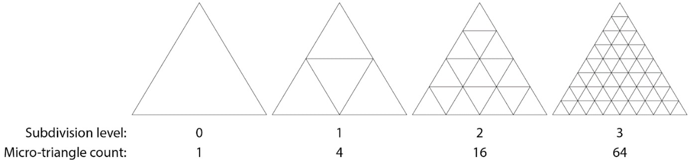
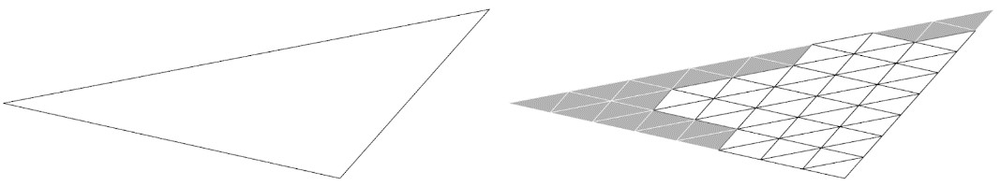
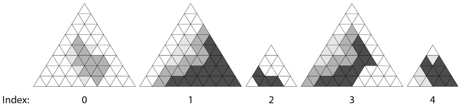
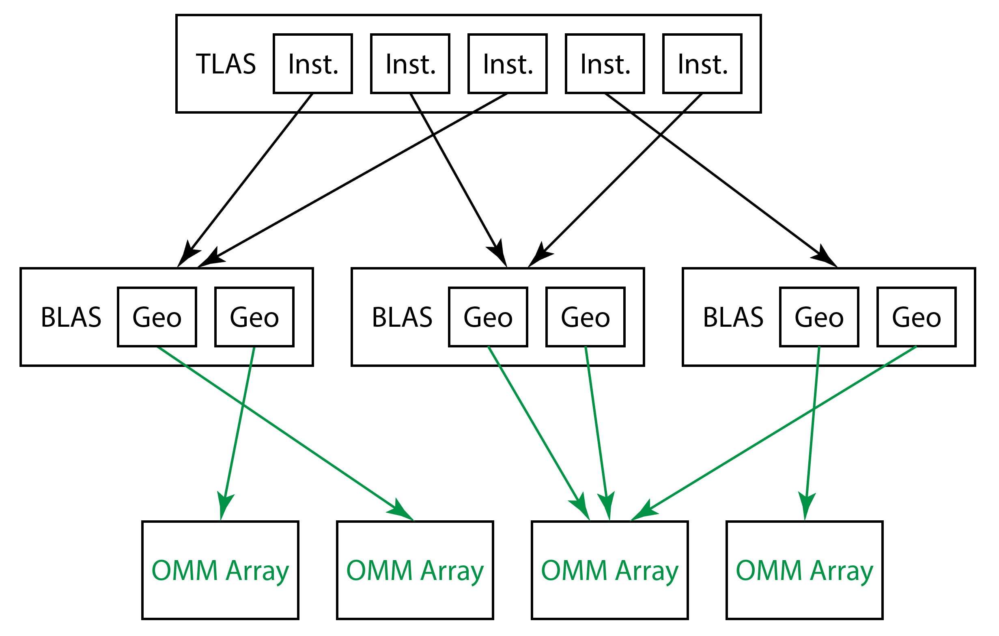
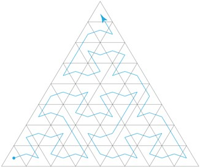

<a id="acceleration-structures"></a>

# Acceleration structures

An acceleration structure (AS) represents geometry and instances for raytracing. Applications own the backing storage. The driver constructs and processes the opaque representation. This chapter defines how they are intended to be created, modified, and used.

Allocation, residency, and GPU virtual addresses are defined in [Resources](resources.md). Acceleration-structure SRV and root-descriptor binding is defined in [Acceleration-structure SRVs](binding.md#acceleration-structure-srvs). Dependencies and enhanced/legacy barrier interoperability are defined in [Synchronization](synchronization.md). The workload consumers are specified in [TraceRay](raytracing-pipelines.md#traceray) and [RayQuery::TraceRayInline](ray-traversal.md#rayquery-tracerayinline). Shader table indexing is specified in [Addressing calculations within shader tables](raytracing-pipelines.md#addressing-calculations-within-shader-tables).

<a id="geometry-and-acceleration-structures"></a>

## Geometry and acceleration structures

Geometry for a scene is described to the system using two levels of
acceleration structures: Bottom-level acceleration structures (BLASes) each
consist of a set of geometries that are building blocks for a scene. A
top-level acceleration structure (TLAS) represents a set of instances of
bottom-level acceleration structures.

Within a given bottom-level acceleration structure there can be any
number: (1) triangle meshes, or (2) procedural primitives initially
described only by an axis aligned bounding box (AABB). A bottom-level
acceleration structure cannot mix triangles and procedural primitives. These
geometry types are described in [Geometry descriptions](#geometry-descriptions). Given a definition of a set of
these geometries (via array of [D3D12_RAYTRACING_GEOMETRY_DESC](#d3d12_raytracing_geometry_desc)), the
application calls [BuildRaytracingAccelerationStructure()](#buildraytracingaccelerationstructure)
on a CommandList to ask the system to build an opaque acceleration
structure representing it into GPU memory owned by the application. This
acceleration structure is what the system will use to intersect rays
with the geometry.

Given a set of bottom-level acceleration structures, the application
then defines a set of instances (by pointing to
[D3D12_RAYTRACING_INSTANCE_DESC](#d3d12_raytracing_instance_desc)
structures living in GPU memory). Each instance points to a bottom-level
acceleration structure and includes some other information for
specializing the instance. A couple of examples of the specializing
information included in an instance definition are: a matrix transform
(to place the instance in the world), and a user defined InstanceID
(identifying the unique instance to shaders).

Instances are sometimes referred to in this specification as geometry
instances for clarity.

This set of geometry instance definitions is given to the implementation
(via
[BuildRaytracingAccelerationStructure()](#buildraytracingaccelerationstructure))
to generate an opaque top-level acceleration structure into GPU memory
owned by the application. This acceleration structure represents what
the system traces rays against.

An application can use multiple top-level acceleration structures
simultaneously, binding them to relevant shaders as input resources (see
[RaytracingAccelerationStructure](../Raytracing.md#raytracingaccelerationstructure) in
HLSL). That way a given shader can trace rays into different sets of
geometry if desired.

> The two level hierarchy for geometry lets applications strike a balance between intersection performance (maximized by using larger bottom-level acceleration structures) and flexibility (maximized by using more, smaller bottom-level acceleration structures and more instances in a top-level acceleration structure).

See [Acceleration structure properties](#acceleration-structure-properties) for a discussion of rules and determinism.

<a id="availability"></a>

## Availability

`ID3D12Device::CheckFeatureSupport` with `D3D12_FEATURE_D3D12_OPTIONS5` reports `D3D12_FEATURE_DATA_D3D12_OPTIONS5::RaytracingTier`. With respect to acceleration structure interactions, specifically, tier 1.0 supports the baseline acceleration-structure contract, tier 1.1 adds the vertex input formats identified in `D3D12_RAYTRACING_GEOMETRY_TRIANGLES_DESC`, and opacity-micromap construction and linkage require tier 1.2.

When raytracing is not supported, attempts to create raytracing-related objects fail and using raytracing-related APIs on command lists results in undefined behavior.

<a id="d3d12_feature_data_d3d12_options5"></a>

### D3D12_FEATURE_DATA_D3D12_OPTIONS5

```cpp
typedef struct D3D12_FEATURE_DATA_D3D12_OPTIONS5
{
    BOOL SRVOnlyTiledResourceTier3;
    D3D12_RENDER_PASS_TIER RenderPassesTier;
    D3D12_RAYTRACING_TIER RaytracingTier;
} D3D12_FEATURE_DATA_D3D12_OPTIONS5;
```

The D3D12 options struct that reports RaytracingTier, the raytracing
support level (among other unrelated features). See
[D3D12_RAYTRACING_TIER](devices-and-capabilities.md#raytracing-tiers).

<a id="d3d12_raytracing_tier"></a>

### D3D12_RAYTRACING_TIER

The enumeration and overall tier requirements are defined in [Raytracing support tiers](devices-and-capabilities.md#raytracing-tiers). Query support through [`ID3D12Device::CheckFeatureSupport`](devices-and-capabilities.md#id3d12device-checkfeaturesupport).

<a id="geometry-descriptions"></a>

## Geometry descriptions

> [!NOTE]
>
> Resource state requirements in the descriptions below apply to the legacy resource-state/barrier path. Enhanced barrier callers use the [access masks](synchronization.md#barrier-access) and [synchronization scopes](synchronization.md#barrier-sync), rather than legacy states to satisfy those descriptions. Acceleration structure creation and for both paths are defined in [Storage and lifetime](#storage-and-lifetime).

<a id="d3d12_raytracing_acceleration_structure_type"></a>

### D3D12_RAYTRACING_ACCELERATION_STRUCTURE_TYPE

```cpp
typedef enum D3D12_RAYTRACING_ACCELERATION_STRUCTURE_TYPE
{
    D3D12_RAYTRACING_ACCELERATION_STRUCTURE_TYPE_TOP_LEVEL = 0x0,
    D3D12_RAYTRACING_ACCELERATION_STRUCTURE_TYPE_BOTTOM_LEVEL = 0x1,
    D3D12_RAYTRACING_ACCELERATION_STRUCTURE_TYPE_OPACITY_MICROMAP_ARRAY = 0x2,
} D3D12_RAYTRACING_ACCELERATION_STRUCTURE_TYPE;
```

Value                            | Definition
---------                        | ----------
`D3D12_RAYTRACING_ACCELERATION_STRUCTURE_TYPE_TOP_LEVEL` | Top-level acceleration structure.  Enum used by both [D3D12_BUILD_RAYTRACING_ACCELERATION_STRUCTURE_INPUTS](#d3d12_build_raytracing_acceleration_structure_inputs) and [D3D12_BUILD_RAYTRACING_ACCELERATION_STRUCTURE_TOOLS_VISUALIZATION_HEADER](#d3d12_build_raytracing_acceleration_structure_tools_visualization_header).
`D3D12_RAYTRACING_ACCELERATION_STRUCTURE_TYPE_BOTTOM_LEVEL` | Bottom-level acceleration structure. Enum used by both [D3D12_BUILD_RAYTRACING_ACCELERATION_STRUCTURE_INPUTS](#d3d12_build_raytracing_acceleration_structure_inputs) and [D3D12_BUILD_RAYTRACING_ACCELERATION_STRUCTURE_TOOLS_VISUALIZATION_HEADER](#d3d12_build_raytracing_acceleration_structure_tools_visualization_header).
`D3D12_RAYTRACING_ACCELERATION_STRUCTURE_TYPE_OPACITY_MICROMAP_ARRAY` | Opacity micromap array.  This is part of the [Opacity Micromaps](#opacity-micromaps) feature.  Enum used by both [D3D12_BUILD_RAYTRACING_ACCELERATION_STRUCTURE_INPUTS](#d3d12_build_raytracing_acceleration_structure_inputs) and [D3D12_BUILD_RAYTRACING_ACCELERATION_STRUCTURE_TOOLS_VISUALIZATION_HEADER](#d3d12_build_raytracing_acceleration_structure_tools_visualization_header).

Descriptions of these types are at [Geometry and acceleration structures](#geometry-and-acceleration-structures)
and visualized in [Ray-geometry interaction diagram](raytracing-pipelines.md#ray-geometry-interaction-diagram).

<a id="d3d12_elements_layout"></a>

### D3D12_ELEMENTS_LAYOUT

```cpp
typedef enum D3D12_ELEMENTS_LAYOUT
{
    D3D12_ELEMENTS_LAYOUT_ARRAY = 0x0,
    D3D12_ELEMENTS_LAYOUT_ARRAY_OF_POINTERS = 0x1
} D3D12_ELEMENTS_LAYOUT;
```

Given a data set of n elements, describes how the locations of the
elements are identified.

Member                              | Definition
---------                           | ----------
`D3D12_ELEMENTS_LAYOUT_ARRAY` | For a data set of n elements, the pointer parameter simply points to the start of an array of n elements in memory.
`D3D12_ELEMENTS_LAYOUT_ARRAY_OF_POINTERS` | For a data set of n elements, the pointer parameter points to an array of n pointers in memory, each pointing to an individual element of the set.

<a id="d3d12_gpu_virtual_address_and_stride"></a>

### D3D12_GPU_VIRTUAL_ADDRESS_AND_STRIDE

```cpp
typedef struct D3D12_GPU_VIRTUAL_ADDRESS_AND_STRIDE
{
    D3D12_GPU_VIRTUAL_ADDRESS   StartAddress;
    UINT64                      StrideInBytes;
} D3D12_GPU_VIRTUAL_ADDRESS_AND_STRIDE;
```

Member                              | Definition
---------                           | ----------
`UINT64 StartAddress` | Beginning of a VA range.
`UINT64 StrideInBytes` |Defines indexing stride, such as for vertices. Only the bottom 32 bits get used. The field is 64 bits purely to make alignment of containing structures clean/obvious everywhere.

<a id="d3d12_raytracing_geometry_desc"></a>

### D3D12_RAYTRACING_GEOMETRY_DESC

```cpp
typedef struct D3D12_RAYTRACING_GEOMETRY_DESC
{
    D3D12_RAYTRACING_GEOMETRY_TYPE    Type;
    D3D12_RAYTRACING_GEOMETRY_FLAGS   Flags;
    union
    {
        D3D12_RAYTRACING_GEOMETRY_TRIANGLES_DESC        Triangles;
        D3D12_RAYTRACING_GEOMETRY_AABBS_DESC            AABBs;
        D3D12_RAYTRACING_GEOMETRY_OMM_TRIANGLES_DESC    OmmTriangles;
    };
} D3D12_RAYTRACING_GEOMETRY_DESC;
```

Member                              | Definition
---------                           | ----------
`D3D12_RAYTRACING_GEOMETRY_TYPE Type` | [D3D12_RAYTRACING_GEOMETRY_TYPE](#d3d12_raytracing_geometry_type) for this geometry.
`D3D12_RAYTRACING_GEOMETRY_FLAGS Flags` | [D3D12_RAYTRACING_GEOMETRY_FLAGS](#d3d12_raytracing_geometry_flags) for this geometry.
`D3D12_RAYTRACING_GEOMETRY_TRIANGLES_DESC Triangles` | [D3D12_RAYTRACING_GEOMETRY_TRIANGLES_DESC](#d3d12_raytracing_geometry_triangles_desc) describing triangle geometry if Type is `D3D12_RAYTRACING_GEOMETRY_TYPE_TRIANGLES`. Otherwise this parameter is unused (space repurposed in a union).
`D3D12_RAYTRACING_GEOMETRY_AABBS_DESC AABBs` | [D3D12_RAYTRACING_GEOMETRY_AABBS_DESC](#d3d12_raytracing_geometry_aabbs_desc) describing AABB geometry if Type is `D3D12_RAYTRACING_GEOMETRY_TYPE_PROCEDURAL_PRIMITIVE_AABBS`. Otherwise this parameter is unused (space repurposed in a union).
`D3D12_RAYTRACING_GEOMETRY_OMM_TRIANGLES_DESC OmmTriangles` | Describes triangle geometry which may optionally use opacity micromaps, if `Type` is [D3D12_RAYTRACING_GEOMETRY_TYPE_OMM_TRIANGLES](#d3d12_raytracing_geometry_type). Otherwise, this parameter is unused (space repurposed in a union).  This is part of the [Opacity Micromaps](#opacity-micromaps) feature.

<a id="d3d12_raytracing_geometry_type"></a>

### D3D12_RAYTRACING_GEOMETRY_TYPE

```cpp
typedef enum D3D12_RAYTRACING_GEOMETRY_TYPE
{
    D3D12_RAYTRACING_GEOMETRY_TYPE_TRIANGLES,
    D3D12_RAYTRACING_GEOMETRY_TYPE_PROCEDURAL_PRIMITIVE_AABBS,
    D3D12_RAYTRACING_GEOMETRY_TYPE_OMM_TRIANGLES
} D3D12_RAYTRACING_GEOMETRY_TYPE;
```

Value                               | Definition
---------                           | ----------
`D3D12_RAYTRACING_GEOMETRY_TYPE_TRIANGLES` | The geometry consists of triangles described by [D3D12_RAYTRACING_GEOMETRY_TRIANGLES_DESC](#d3d12_raytracing_geometry_triangles_desc).
`D3D12_RAYTRACING_GEOMETRY_TYPE_PROCEDURAL_PRIMITIVE_AABBS` | The geometry procedurally is defined during raytracing by [intersection shaders](raytracing-pipelines.md#intersection-shaders---procedural-primitive-geometry). So for the purpose of acceleration structure builds, the geometry's bounds are described with axis-aligned bounding boxes via [D3D12_RAYTRACING_GEOMETRY_AABBS_DESC](#d3d12_raytracing_geometry_aabbs_desc).
`D3D12_RAYTRACING_GEOMETRY_TYPE_OMM_TRIANGLES` | Shares most fields with the basic triangle geometry type,[D3D12_RAYTRACING_GEOMETRY_TRIANGLES_DESC](#d3d12_raytracing_geometry_triangles_desc), but allows the geometry to link to an OMM Array. The basic triangle type and this OMM-enabled type geometries may be mixed in the same BLAS build.  This is part of the [Opacity Micromaps](#opacity-micromaps) feature.

<a id="d3d12_raytracing_geometry_flags"></a>

### D3D12_RAYTRACING_GEOMETRY_FLAGS

```cpp
typedef enum D3D12_RAYTRACING_GEOMETRY_FLAGS
{
    D3D12_RAYTRACING_GEOMETRY_FLAG_NONE = 0x0,
    D3D12_RAYTRACING_GEOMETRY_FLAG_OPAQUE = 0x1,
    D3D12_RAYTRACING_GEOMETRY_FLAG_NO_DUPLICATE_ANYHIT_INVOCATION = 0x2,
} D3D12_RAYTRACING_GEOMETRY_FLAGS;
```

The complete value meanings, combination requirements and traversal effects are defined in [Geometry flag traversal behavior](ray-traversal.md#geometry-flag-traversal-behavior). The declaration here supplies the flags used by the geometry description.

<a id="d3d12_raytracing_geometry_triangles_desc"></a>

### D3D12_RAYTRACING_GEOMETRY_TRIANGLES_DESC

```cpp
typedef struct D3D12_RAYTRACING_GEOMETRY_TRIANGLES_DESC
{
    D3D12_GPU_VIRTUAL_ADDRESS               Transform3x4;
    DXGI_FORMAT                             IndexFormat;
    DXGI_FORMAT                             VertexFormat;
    UINT                                    IndexCount;
    UINT                                    VertexCount;
    D3D12_GPU_VIRTUAL_ADDRESS               IndexBuffer;
    D3D12_GPU_VIRTUAL_ADDRESS_AND_STRIDE    VertexBuffer;
} D3D12_RAYTRACING_GEOMETRY_TRIANGLES_DESC;
```

The geometry pointed to by this struct is always in triangle list form
(indexed or non-indexed form). Strips are not supported for simplicity.

Member                              | Definition
---------                           | ----------
`D3D12_GPU_VIRTUAL_ADDRESS Transform3x4` | <p>Address of a 3x4 affine transform matrix in row major layout to be applied to the vertices in the VertexBuffer during an acceleration structure build. The contents of VertexBuffer are not modified. If a 2D vertex format is used, the transformation is applied with the third vertex component assumed to be zero.</p><p>If Transform3x4 is NULL the vertices will not be transformed. Using Transform3x4 may result in increased computation and/or memory requirements for the acceleration structure build.</p><p>With legacy barriers, the memory pointed to must be in state `D3D12_RESOURCE_STATE_NON_PIXEL_SHADER_RESOURCE`. The address must be aligned to 16 bytes ([D3D12_RAYTRACING_TRANSFORM3X4_BYTE_ALIGNMENT](#constants)).</p>
`DXGI_FORMAT IndexFormat` | <p>Format of the indices in the IndexBuffer. Must be one of:</p><p>`DXGI_FORMAT_UNKNOWN` (when IndexBuffer is NULL)</p><p>`DXGI_FORMAT_R32_UINT`</p><p>`DXGI_FORMAT_R16_UINT`</p>
`DXGI_FORMAT VertexFormat` | <p>Format of the vertices (positions) in VertexBuffer. Must be one of:</p><p>`DXGI_FORMAT_R32G32_FLOAT` (third component assumed 0)</p><p>`DXGI_FORMAT_R32G32B32_FLOAT`</p><p>`DXGI_FORMAT_R16G16_FLOAT` (third component assumed 0)</p><p>`DXGI_FORMAT_R16G16B16A16_FLOAT` (A16 component is ignored, other data can be packed there, such as setting vertex stride to 6 bytes)</p><p>`DXGI_FORMAT_R16G16_SNORM` (third component assumed 0)</p><p>`DXGI_FORMAT_R16G16B16A16_SNORM` (A16 component is ignored, other data can be packed there, such as setting vertex stride to 6 bytes)</p><p>[Tier 1.1](devices-and-capabilities.md#raytracing-tiers) devices support the following additional formats:</p><p>`DXGI_FORMAT_R16G16B16A16_UNORM` (A16 component is ignored, other data can be packed there, such as setting vertex stride to 6 bytes)</p><p>`DXGI_FORMAT_R16G16_UNORM` (third component assumed 0)</p><p>`DXGI_FORMAT_R10G10B10A2_UNORM` (A2 component is ignored, stride must be 4 bytes)</p><p>`DXGI_FORMAT_R8G8B8A8_UNORM` (A8 component is ignored, other data can be packed there, such as setting vertex stride to 3 bytes)</p><p>`DXGI_FORMAT_R8G8_UNORM` (third component assumed 0)</p><p>`DXGI_FORMAT_R8G8B8A8_SNORM` (A8 component is ignored, other data can be packed there, such as setting vertex stride to 3 bytes)</p><p>`DXGI_FORMAT_R8G8_SNORM` (third component assumed 0)</p>
`UINT IndexCount` | Number of indices in IndexBuffer. Must be 0 if IndexBuffer is NULL.
`UINT VertexCount` | Number of vertices (positions) in VertexBuffer.  If an index buffer is present, this must be at least the maximum index value in the index buffer + 1.
`D3D12_GPU_VIRTUAL_ADDRESS IndexBuffer` | <p>Array of vertex indices. If NULL, triangles are non-indexed. Just as with graphics, the address must be aligned to the size of IndexFormat.</p><p>With legacy barriers, the memory pointed to must be in state `D3D12_RESOURCE_STATE_NON_PIXEL_SHADER_RESOURCE`. Note that if an app wants to share index buffer inputs between graphics input assembler and raytracing acceleration structure build input, it can always put a resource into a combination of read states simultaneously, e.g. `D3D12_RESOURCE_STATE_INDEX_BUFFER | D3D12_RESOURCE_STATE_NON_PIXEL_SHADER_RESOURCE`.</p>
`D3D12_GPU_VIRTUAL_ADDRESS_AND_STRIDE VertexBuffer` | <p> Array of vertices including a stride. The alignment on the address and stride must be a multiple of the component size, so 4 bytes for formats with 32bit components and 2 bytes for formats with 16bit components. There is no constraint on the stride (whereas there is a limit for graphics), other than that the bottom 32bits of the value are all that are used -- the field is UINT64 purely to make neighboring fields align cleanly/obviously everywhere. Each vertex position is expected to be at the start address of the stride range and any excess space is ignored by acceleration structure builds. This excess space might contain other app data such as vertex attributes, which the app is responsible for manually fetching in shaders, whether it is interleaved in vertex buffers or elsewhere.</p><p>With legacy barriers, the memory pointed to must be in state `D3D12_RESOURCE_STATE_NON_PIXEL_SHADER_RESOURCE`. Note that if an app wants to share vertex buffer inputs between graphics input assembler and raytracing acceleration structure build input, it can always put a resource into a combination of read states simultaneously, e.g. `D3D12_RESOURCE_STATE_VERTEX_AND_CONSTANT_BUFFER | D3D12_RESOURCE_STATE_NON_PIXEL_SHADER_RESOURCE`.</p>

<a id="d3d12_raytracing_geometry_aabbs_desc"></a>

### D3D12_RAYTRACING_GEOMETRY_AABBS_DESC

```cpp
typedef struct D3D12_RAYTRACING_GEOMETRY_AABBS_DESC
{
    UINT64                                  AABBCount;
    D3D12_GPU_VIRTUAL_ADDRESS_AND_STRIDE    AABBs;
} D3D12_RAYTRACING_GEOMETRY_AABBS_DESC;
```

Member                              | Definition
---------                           | ----------
`UINT64 AABBCount` | Number of AABBs pointed to in the contiguous array at AABBs.
`D3D12_GPU_VIRTUAL_ADDRESS_AND_STRIDE AABBs` | <p>[D3D12_GPU_VIRTUAL_ADDRESS_AND_STRIDE](#d3d12_gpu_virtual_address_and_stride) describing the GPU memory location where an array of [AABB descriptions](#d3d12_raytracing_aabb) is to be found, including the data stride between AABBs. The address and stride must each be aligned to 8 bytes ([D3D12_RAYTRACING_AABB_BYTE_ALIGNMENT](#constants)).</p><p>The stride can be 0.</p><p>With legacy barriers, the memory pointed to must be in state `D3D12_RESOURCE_STATE_NON_PIXEL_SHADER_RESOURCE`.</p>

<a id="d3d12_raytracing_aabb"></a>

### D3D12_RAYTRACING_AABB

```cpp
typedef struct D3D12_RAYTRACING_AABB
{
    FLOAT   MinX;
    FLOAT   MinY;
    FLOAT   MinZ;
    FLOAT   MaxX;
    FLOAT   MaxY;
    FLOAT   MaxZ;
} D3D12_RAYTRACING_AABB;
```

Member                              | Definition
---------                           | ----------
`FLOAT MinX, MinY, MinZ` | The minimum X, Y and Z coordinates of the box.
`FLOAT MaxX, MaxY, MaxZ` | The maximum X, Y and Z coordinates of the box.

<a id="d3d12_raytracing_instance_desc"></a>

### D3D12_RAYTRACING_INSTANCE_DESC

```cpp
typedef struct D3D12_RAYTRACING_INSTANCE_DESC
{
    FLOAT                       Transform[3][4];
    UINT                        InstanceID : 24;
    UINT                        InstanceMask : 8;
    UINT                        InstanceContributionToHitGroupIndex : 24;
    UINT                        Flags : 8;
    D3D12_GPU_VIRTUAL_ADDRESS   AccelerationStructure;
} D3D12_RAYTRACING_INSTANCE_DESC;
```

This data structure is used in GPU memory during acceleration structure
build. This C++ struct definition is useful if generating instance data
on the CPU first then uploading to the GPU. But apps are also free to
generate instance descriptions directly into GPU memory from compute
shaders for instance, following the same layout.

Member                              | Definition
---------                           | ----------
`FLOAT Transform[3][4]` | A 3x4 transform matrix in row major layout representing the instance-to-world transformation. Implementations transform rays, as opposed to transforming all the geometry/AABBs.
`UINT InstanceID` | An arbitrary 24-bit value that can be accessed via [InstanceID()](raytracing-pipelines.md#instanceid) in shader types listed in [System value intrinsics](raytracing-pipelines.md#system-value-intrinsics).
`UINT InstanceMask` | An 8-bit mask assigned to the instance, which can be used to include/reject groups of instances on a per-ray basis. See the InstanceInclusionMask parameter in [TraceRay()](raytracing-pipelines.md#traceray) and [RayQuery::TraceRayInline()](ray-traversal.md#rayquery-tracerayinline). If the value is zero, the instance will never be included, so typically this should be set to some nonzero value.
`UINT InstanceContributionToHitGroupIndex` | Per-instance contribution to add into shader table indexing to select the hit group to use. The indexing behavior is introduced here: [Indexing into shader tables](raytracing-pipelines.md#indexing-into-shader-tables), detailed here: [Addressing calculations within shader tables](raytracing-pipelines.md#addressing-calculations-within-shader-tables), and visualized here: [Ray-geometry interaction diagram](raytracing-pipelines.md#ray-geometry-interaction-diagram).  Has no behavior with [inline raytracing](ray-traversal.md#inline-raytracing), however the value is still available to fetch from a [RayQuery](ray-traversal.md#rayquery) object for shaders use manually for any purpose.
`UINT Flags` | Flags from [D3D12_RAYTRACING_INSTANCE_FLAGS](#d3d12_raytracing_instance_flags) to apply to the instance.
`D3D12_GPU_VIRTUAL_ADDRESS AccelerationStructure` | <p>Address of the bottom-level acceleration structure that is being instanced. The address must be aligned to 256 bytes ([D3D12_RAYTRACING_ACCELERATION_STRUCTURE_BYTE_ALIGNMENT](#constants)), which is a somewhat redundant requirement as any existing acceleration structure passed in here would have already been required to be placed with such alignment anyway.</p><p>With legacy barriers, the memory pointed to must be in state [D3D12_RESOURCE_STATE_RAYTRACING_ACCELERATION_STRUCTURE](synchronization.md#legacy-states).</p>

<a id="d3d12_raytracing_instance_flags"></a>

### D3D12_RAYTRACING_INSTANCE_FLAGS

```cpp
typedef enum D3D12_RAYTRACING_INSTANCE_FLAGS
{
    D3D12_RAYTRACING_INSTANCE_FLAG_NONE = 0x0,
    D3D12_RAYTRACING_INSTANCE_FLAG_TRIANGLE_CULL_DISABLE = 0x1,
    D3D12_RAYTRACING_INSTANCE_FLAG_TRIANGLE_FRONT_COUNTERCLOCKWISE = 0x2,
    D3D12_RAYTRACING_INSTANCE_FLAG_FORCE_OPAQUE = 0x4,
    D3D12_RAYTRACING_INSTANCE_FLAG_FORCE_NON_OPAQUE = 0x8,
    D3D12_RAYTRACING_INSTANCE_FLAG_FORCE_OMM_2_STATE = 0x10,
    D3D12_RAYTRACING_INSTANCE_FLAG_DISABLE_OMMS = 0x20
} D3D12_RAYTRACING_INSTANCE_FLAGS;
```

The complete enum definition is located in [Instance flag traversal behavior](ray-traversal.md#instance-flag-traversal-behavior).

<a id="acceleration-structure-properties"></a>

## Acceleration structure properties

<a id="data-rules"></a>

### Data rules

- Once an acceleration structure has been built, it does not retain
  any references to transient inputs to the build, including vertex buffers etc.
  pointed to by the app's acceleration structure description.

- Acceleration structures are self-contained aside from top-level
  acceleration structures pointing to bottom-level acceleration
  structures and bottom-level acceleration structures referencing opacity-micromap arrays.

- Applications may not inspect the contents of an acceleration
  structure. Nothing stops a determined app from doing this, but the
  point is the data is implementation-dependent, undocumented and
  therefore useless for an app to inspect.

- Once built, an acceleration structure is immutable with the
  exception of updates (incremental builds) done in-place.

- A top-level acceleration structure must be rebuilt or updated before
  use whenever bottom-level acceleration structures it references are
  rebuilt or updated.

- The valid operations on acceleration structures are the following:

  - input to [TraceRay()](raytracing-pipelines.md#traceray) and [RayQuery::TraceRayInline()](ray-traversal.md#rayquery-tracerayinline) from a shader

  - input to [BuildRaytracingAccelerationStructure()](#buildraytracingaccelerationstructure):

    - as a bottom-level structure being referenced by a top-level
      acceleration structure build

    - as the source for an acceleration structure update
      (incremental build)

      - source can be the same as destination address to mean an
        in-place update

  - input to [CopyRaytracingAccelerationStructure()](#copyraytracingaccelerationstructure),
    which has various modes for doing things like acceleration
    structure compaction or simply cloning the data structure

    - in particular, notice that copying acceleration structures
      in any other way is invalid

  - input to [EmitRaytracingAccelerationStructurePostbuildInfo()](#emitraytracingaccelerationstructurepostbuildinfo),
    which reports information about an acceleration structure like
    how much space is needed for a compacted version.

<a id="determinism-based-on-fixed-acceleration-structure-build-input"></a>

### Determinism based on fixed acceleration structure build input

Given a fixed world composed of triangles and AABBs, as well as
identical shader code and data in the same order, multiple identical
[TraceRay()](raytracing-pipelines.md#traceray) or [RayQuery::TraceRayInline()](ray-traversal.md#rayquery-tracerayinline) calls produce identical results on the same
device and driver. This requirement means that both the tracing of rays
must be deterministic, and the acceleration structure must also be
constructed such that it behaves deterministically.

Given the same triangle stream, AABB stream and any other configuration
input to multiple acceleration structure builds (including the same
instance and geometry transforms and other properties as applicable),
the resulting acceleration structures' behavior must be the same on a
given device and driver. The actual acceleration structures' contents
may not be bit for bit identical, which could be revealed by a memory
comparison. Matching acceleration structure data itself is of no value --
they may contain internal pointers for instance that refer to differing
addresses or data layout orderings without effect on behavior. So it is
just the functional behavior of the consistently constructed
acceleration structures that must match. The same intersections will be
found in the same order with the same order of shader invocations,
assuming application shaders and data that could affect execution flow
also match.

For acceleration structure updates (incremental builds), multiple
identical update sequences with matching sets of inputs to each update
result in the same consistency of acceleration structure behavior
described above.

<a id="determinism-based-varying-acceleration-structure-build-input"></a>

### Determinism based varying acceleration structure build input

Aside from the obvious fact that changing the locations and amount of
geometry used to build an acceleration will affect its behavior, there
are subtler variations that can affect acceleration structure function.

Acceleration structure intersection finding and intersection ordering
behaviors may change as a result of varying of any of the following
factors across acceleration structure builds:

- vertex order (for triangles)

- primitive order (for triangles)

- AABB order

- instance order in a top-level acceleration structure

- geometry ordering in a bottom-level acceleration structure

- flags to acceleration structure build (or instance / geometry flags)

- acceleration structure update (incremental build) count and input
  history

- device/driver

- user defined values embedded in acceleration structures contributing
  to shader table indexing calculation or shader IDs. Implementations
  may find reason to, for instance, sort contents on these or somehow
  know which sets of content use the same values. Of course during an
  acceleration structure build the actual shader tables are not
  present, so the most an implementation could look at are the raw
  offset/ID values without trying to use them.

Acceleration structure intersection finding and intersection ordering
behaviors do not change as a result of varying any of the following
factors across acceleration structure builds:

- memory addresses of acceleration structures or build inputs (aside
  from data ordering tolerances described above)

- time

<a id="preservation-of-triangle-set"></a>

### Preservation of triangle set

Implementations may not change the input set of triangles in an
acceleration structure aside from the vertex order and primitive order.
Merging and splitting triangles are not permitted. Dropping triangles is permitted only in the [inactive](#inactive-primitives-and-instances) and [degenerate](#degenerate-primitives-and-instances) cases defined below.

Observable duplication of a primitive in an acceleration structure is
invalid. Observable means in any way that becomes visible during
raytracing operations beyond just performance difference. Exceptions
are:

- Intersection shader invocation counts, which are allowed to be
  duplicated.

- If an application has **not** set the [flag](#d3d12_raytracing_geometry_flags)
  `D3D12_RAYTRACING_GEOMETRY_FLAG_NO_DUPLICATE_ANYHIT_INVOCATION`
  in a given geometry, multiple any hit invocations may be observed
  for a given primitive for a given ray.

Barycentrics provided in the [intersection attributes structure](ray-traversal.md#triangle-intersection-attributes) for
a triangle intersection must be relative to the original vertex order,
since the app has to be able to look up vertex attributes on its own.

<a id="aabb-volume"></a>

### AABB volume

Implementations may replace the AABBs provided as input to an
acceleration structure build with more or fewer AABBs (or other
representation), with the only guarantee that the locations in space
enclosed by the input AABBs are included in the acceleration structure.

In particular, applications must not depend on the planes in the AABBs
input to acceleration structure build having any kind of clipping effect
on the shapes defined by enclosed intersection shader invocations. An
implementation may have chosen some larger volume than the input AABB
for which to invoke intersection shaders. While there is freedom for
implementations here, excessive bloat of bounding volumes would incur
extreme performance penalties from unnecessary intersection shader
invocation. So the extent of bounding volume bloating should be limited
in practice.

<a id="inactive-primitives-and-instances"></a>

### Inactive primitives and instances

Triangles are considered "inactive" (but legal input to acceleration
structure build) if the x component of any vertex is NaN. Similarly
AABBs are considered inactive if AABB.MinX is NaN. The geometries and/or
their transforms in bottom level acceleration structures can be used as
one way to inject these NaN values and deactivate entire
instances/geometries. Instances with NULL bottom level acceleration
structure pointers are also considered legal but inactive.

All inactive primitives/AABBs/bottom level acceleration structures are
discarded during the acceleration structure build phase and can thus not
be intersected during traversal.

Inactive primitives may not become active in subsequent acceleration
structure updates -- results are undefined if attempted. Conversely,
primitives that were active at the initial build operation may not be
changed to inactive (and thus can't be discarded) in acceleration
structure updates.

Inactive primitives are counted for [PrimitiveIndex()](raytracing-pipelines.md#primitiveindex),
which affects the index values for neighboring active primitives.
Similarly inactive instances are counted for
[InstanceIndex()](raytracing-pipelines.md#instanceindex), which affects the index for
neighboring instances. This ensures that any array indexing an app wants
to do based on index values for active primitives isn't affected by the
presence of inactive primitives earlier in the array.

For triangles and AABBs, none of the input coordinates may be NaN unless
the first coordinate is also NaN (that is, only when the primitive is
inactive), otherwise behavior is undefined.

Triangle vertices using an SNORM format (see VertexFormat in
[D3D12_RAYTRACING_GEOMETRY_TRIANGLES_DESC](#d3d12_raytracing_geometry_triangles_desc))
cannot be inactive, given SNORM has no NaN representation.

<a id="degenerate-primitives-and-instances"></a>

### Degenerate primitives and instances

The following are considered "degenerate" (after applying all
transforms): Triangles that form a point or a line, point sized AABBs
(Min.X == Max.X, same for Y and Z), and instances referencing (non-NULL)
bottom level acceleration structures containing no active primitives.

All degenerate primitives and instances are still considered "active"
and may participate in acceleration structure updates with new data,
switching to/from degenerate status freely.

Degenerate instances use a point at the instance origin (specified by
the instance transform) to guide the acceleration structure builder.
Apps should give a best estimate of where any future updates might place
the instance.

AABBs with inverted bounds (Min.X \> Max.X or similar for Y and Z) are
converted to a degenerate point at the center of the input bounds for
all acceleration structure operations.

During traversal, degenerate AABBs may still report possible (false
positive) intersections and invoke the intersection shader. The shader
may check the validity of the hit by, for example, inspecting the
bounds.

Degenerate triangles, on the other hand, do not generate any
intersections.

Degenerate primitives may be discarded from an acceleration structure
build, unless the `ALLOW_UPDATE` flag is specified. As a consequence, the
coordinates returned during AS visualization may be replaced with NaNs
for these primitives.

An exception to the rule that degenerates cannot be discarded with
`ALLOW_UPDATE` specified is that primitives with repeated index values
can always be discarded (even with `ALLOW_UPDATE` specified).  There
is no value in keeping them since index values cannot be changed.

For [tools-visualization output](#visualization-detail), the primitive count in the returned GeometryDescs and the number of
InstanceDescs may be affected by any discarded primitives. The index
(buffer location) and output order of active primitives will still be
correct, however.

<a id="geometry-limits"></a>

### Geometry limits

Maximum number of geometries in a bottom level acceleration structure:
2^24

Maximum number of primitives in a bottom level acceleration structure
(sum across all geometries): 2^29, including any inactive or degenerate
primitives (described above).

Maximum instance count in a top level acceleration structure: 2^24

<a id="acceleration-structure-updates"></a>

## Updates

Apps can request to make an acceleration structure updateable, or
request an update to an updateable acceleration structure, via
[D3D12_RAYTRACING_ACCELERATION_STRUCTURE_BUILD_FLAGS](#d3d12_raytracing_acceleration_structure_build_flags)
in [BuildRaytracingAccelerationStructure()](#buildraytracingaccelerationstructure).

The updateable acceleration structures (before and after they have been
updated) will not be as optimal in terms of raytracing performance as
building a static acceleration structure from scratch. An update will be
faster, however, than building an acceleration structure from scratch.

For updates to be viable to implement, constraints are in place on what
an app is allowed to change. For instance, with triangle geometry in
bottom-level acceleration structures vertex positions can be
updated. There is much more freedom of update allowed for instance
descriptions in top-level acceleration structures. For more detail see
[Acceleration structure update constraints](#acceleration-structure-update-constraints).

<a id="acceleration-structure-update-constraints"></a>

### Acceleration structure update constraints

The following describes the data that an app can change to the inputs of
an acceleration structure update relative to the inputs / flags etc.
used to build the source acceleration structure. Note that per
acceleration structure [Data rules](#data-rules), once built they never
hold explicit references to the transient data used to build them, so it is fine
for an update to provide data from different addresses in memory as long
as the only changes in the data itself conform to the following
restrictions.

For triangle geometry with opacity-micromap linkage, the additional permitted changes and required retained descriptions are defined by [`D3D12_RAYTRACING_ACCELERATION_STRUCTURE_BUILD_FLAGS`](#d3d12_raytracing_acceleration_structure_build_flags) and [`D3D12_RAYTRACING_GEOMETRY_OMM_LINKAGE_DESC`](#d3d12_raytracing_geometry_omm_linkage_desc).

> A rule of thumb is that the more that acceleration structure updates diverge from the original, the more that raytrace performance is likely to suffer. An implementation is expected to be able to retain whatever topology it might have in an acceleration structure during update.

#### Bottom-level acceleration structure updates

The VertexBuffer and/or Transform3x4 members of
[D3D12_RAYTRACING_GEOMETRY_TRIANGLES_DESC](#d3d12_raytracing_geometry_triangles_desc)
can change. The Transform3x4 member cannot change between NULL \<-\>
non-NULL, however. An app that wants to update Transform3x4 but doesn't
have one initially can specify the identity matrix rather than NULL.

Essentially this means vertex positions can change.

The AABBs member of [D3D12_RAYTRACING_GEOMETRY_DESC](#d3d12_raytracing_geometry_desc)
can change.

Except for the opacity-micromap linkage updates described below, nothing else can change, so note that in particular this means no
changes to properties like the number of geometries, VertexCount, or
AABBCount, geometry flags, data formats, index buffer contents and so on.

Note that if a bottom-level acceleration structure at a given address that is
pointed to by top-level acceleration structures ever changes, those
top-level acceleration structures are stale and must either be rebuilt
or updated before they are valid to use again.

#### Top-level acceleration structure updates

The InstanceDescs member of [D3D12_BUILD_RAYTRACING_ACCELERATION_STRUCTURE_INPUTS](#d3d12_build_raytracing_acceleration_structure_inputs)
can change.

This refers to [D3D12_RAYTRACING_INSTANCE_DESC](#d3d12_raytracing_instance_desc)
structures in GPU memory. The number of instances, defined by the
NumDescs member of [D3D12_BUILD_RAYTRACING_ACCELERATION_STRUCTURE_INPUTS](#d3d12_build_raytracing_acceleration_structure_inputs), cannot change.

So aside from the number of instances used in the top-level acceleration
structure being fixed, the definitions of each of the instances can be
completely redefined during an acceleration structure update, including
which bottom-level acceleration structure each instance points to.

<a id="storage-and-lifetime"></a>

## Storage and lifetime

Acceleration structures can only be placed in resources that are created
in the default heap (or custom heap equivalent). For the legacy creation path, resources that
will contain acceleration structures must be created in the state
[D3D12_RESOURCE_STATE_RAYTRACING_ACCELERATION_STRUCTURE](synchronization.md#legacy-states),
and must have resource flag `D3D12_RESOURCE_FLAG_ALLOW_UNORDERED_ACCESS`. The
`ALLOW_UNORDERED_ACCESS` requirement simply acknowledges both: that the
system will be doing this type of access in its implementation of
acceleration structure builds behind the scenes, and from the app point
of view, synchronization of writes/reads to acceleration structures is
defined in [Synchronization](synchronization.md).

For enhanced-barrier resource creation, `ID3D12Device10::CreateCommittedResource3` and `ID3D12Device10::CreatePlacedResource2` take `InitialLayout` instead of a legacy initial state, and buffers must use `D3D12_BARRIER_LAYOUT_UNDEFINED`. The capability and creation requirements are defined in [Versioned creation contributions](resources.md#versioned-creation). `D3D12_RESOURCE_FLAG_RAYTRACING_ACCELERATION_STRUCTURE` classifies a buffer for acceleration-structure use in place of the fixed legacy acceleration-structure state and requires `D3D12_RESOURCE_FLAG_ALLOW_UNORDERED_ACCESS`, as defined in [Resource usage flags](resources.md#resource-flags). Buffers have no enhanced layout. [Model interoperation](synchronization.md#model-interoperation) retains the fixed-state qualifications when changing models, it's still invalid to transition into or out of the fixed legacy acceleration-structure state.

For the following discussion, these resources are referred to as
acceleration structure buffers (ASBs).

With legacy barriers, ASBs cannot be transitioned into any other state, or vice versa,
otherwise the runtime will put the command list into removed state.

If a placed buffer is created that is an ASB, but there is an existing
buffer overlapping the VA range that is not an ASB, or vice versa, this
is an error enforceable by debug layer error.

Regarding reserved buffers, if a tile is ever mapped into an ASB and a
non-ASB simultaneously this is an error enforceable by debug layer
error. Mapping a tile into or out of an acceleration structure
invalidates that tile's contents.

> The reason for segregating ASBs from non-ASB memory is to enable tools/PIX to be able to robustly capture applications that use raytracing. The restriction avoids instability/crashing from tools attempting to serialize what they think are opaque acceleration structures that might have been partially overwritten by other data because the app repurposed the memory without tools being able to track it. The key issue here is the opaqueness of acceleration structure data, requiring dedicated APIs for serializing and deserializing their data to be able to preserve application state.

CPU-side build descriptions are consumed by the recording call. GPU-side build inputs and scratch storage must remain valid until the build finishes executing on the GPU. Built top-level structures retain references to bottom-level structures, and linked opacity-micromap arrays are dereferenced during raytracing.

For enhanced barriers, acceleration-structure build/read/write/copy accesses and build/copy synchronization scopes are defined in [Barrier access](synchronization.md#barrier-access) and [Barrier synchronization](synchronization.md#barrier-sync). The supported legacy resource-state and UAV-barrier path is defined in [Legacy states](synchronization.md#legacy-states).

<a id="opacity-micromaps"></a>

## Opacity micromaps

Very high quality, high-definition opacity (alpha) content is usually very coherent, or locally similar.

Typically, there are larger regions that are completely transparent or opaque within meshes that do not necessarily coincide with triangle boundaries.

Furthermore, in DXR Tier 1.1, the opaque/non-opaque properties of triangles are geometry-wide, but it might be impractical to split up meshes into several geometry pieces. As a consequence, any-hit shaders are often invoked for ray-triangle hits that could be trivially categorized as a miss or a hit.

To reduce the overhead of redundant and potentially expensive any-hit shaders, Opacity Micromaps (OMM) are added to triangle primitives with DXR Tier 1.2 ([D3D12_RAYTRACING_TIER_1_2](devices-and-capabilities.md#raytracing-tiers)).

The opacity micromap is defined on a sub-triangle detail level, encoded in a uniformly subdivided mesh of 4<sup>N</sup> *micro-triangles*, laid out on a 2<sup>N</sup>&nbsp;×&nbsp;2<sup>N</sup> barycentric grid.

Here is a diagram of the first few levels of the subdivision scheme:


<figure>
  <figcaption>Micro-mesh subdivision scheme.</figcaption>
</figure>

Briefly, OMMs can be used to cull any-hit shading invocations in regions within a triangle known to be completely opaque or transparent.
It is also possible to bypass any-hit shading completely, and use the mask as high frequency geometric detail on the triangle.
Individual OMMs store (compact) information about how to modulate a base triangle to add the extra detail, much like traditional texture mapping.

Here is an example of OMM detail applied to a base triangle:


<figure>
  <figcaption>Left: A plain base triangle. Right: A opacity micromap applied to the base triangle, splitting it into opaque and transparent regions.</figcaption>
</figure>

Construction and encoding are described below. Traversal interpretation is specified in [Opacity micromaps and TraceRay](ray-traversal.md#opacity-micromaps-and-traceray) and [Opacity micromaps and TraceRayInline](ray-traversal.md#opacity-micromaps-and-tracerayinline), including the `RayQuery` opt-in [RAYQUERY_FLAG_ALLOW_OPACITY_MICROMAPS](ray-traversal.md#rayquery-flags).

### Opacity micromap construction

Unlike triangles, the OMMs are not stored directly in the bottom-level acceleration structures (BLAS), but instead reside in separate resources. Individual OMMs may be referenced by triangles from within a BLAS. Because OMMs storage is separate from the BLASes, they can be reused within and across multiple BLASes in a scene.

Before OMMs can be used with raytracing, they must be processed by the driver. This is similar to how triangles and procedural primitives must be encoded into a BLAS before they can be used.

Collections of OMM inputs are used to construct *OMM Arrays* using the same API as for building acceleration structures: [`BuildRaytracingAccelerationStructure()`](#buildraytracingaccelerationstructure) on the command list.  Here is an example of a collection of OMMs in an OMM Array:


<figure>
  <figcaption>Example of an OMM Array containing entries with different subdivision levels. Individual OMMs are referenced via their index in the array.</figcaption>
</figure>

Like acceleration structures, the OMM Arrays are opaque data structures, but the application is responsible for memory management. The amount of memory required for an OMM Array can be queried via the same method used for acceleration structures: [GetRaytracingAccelerationStructurePrebuildInfo()](#getraytracingaccelerationstructureprebuildinfo) device member function. On the legacy creation/state path, opaque OMM Array data must reside in resources that are permanently in the state [D3D12_RESOURCE_STATE_RAYTRACING_ACCELERATION_STRUCTURE](synchronization.md#legacy-states), just like acceleration structures. Enhanced-barrier OMM array storage uses the acceleration structure classification and access requirements in [Storage and lifetime](#storage-and-lifetime). It is fine to intermix acceleration structures and OMM array data in the same allocations.

The application can reference specific entries within an array by their input-order index to link specific entries to specific triangles in a BLAS. To construct an OMM Array, the application provides an input buffer with micro-triangles in one of the supported encodings, which the driver assembles into a raytracing-compatible format.

The application can link an OMM Array per geometry, from which detailed opacity information is retrieved during ray traversal. This is illustrated in the diagram below. The OMM feature is accessible for BLAS builds through the geometry descriptor, [D3D12_RAYTRACING_GEOMETRY_OMM_TRIANGLES_DESC](#d3d12_raytracing_geometry_omm_triangles_desc), which contains additional inputs to the [BuildRaytracingAccelerationStructure()](#buildraytracingaccelerationstructure) function.


<figure>
  <figcaption>Illustration of how OMM Arrays fit into the AS hierarchy. At BLAS build time, per-triangle indices link specific triangles to OMM Array entries. OMMs can be referenced multiple times both within and across multiple BLASes.</figcaption>
</figure>

If an OMM Array is overwritten with new OMM data, any BLASes referencing it become stale and must be updated.
It is also possible to assign a different OMM Array and OMM indices when updating a BLAS.
The AS build flag [D3D12_RAYTRACING_ACCELERATION_STRUCTURE_BUILD_FLAG_ALLOW_OMM_UPDATE](#d3d12_raytracing_acceleration_structure_build_flags) lets the driver know that OMM contents may change with BLAS updates.

OMM Arrays can be copied around, serialized/deserialized etc. just like acceleration structures via the various modes of [CopyRaytracingAccelerationStructure()](#copyraytracingaccelerationstructure).

Some information about OMM Arrays is only available once it has been built. This includes the final size of the resource (which may be somewhat smaller than what is reported by the [GetRaytracingAccelerationStructurePrebuildInfo()](#getraytracingaccelerationstructureprebuildinfo) call), and the sizes of the serialized and visualization versions of the Array. The information can either be retrieved from the OMM Array build call, or by calling [EmitRaytracingAccelerationStructurePostbuildInfo()](#emitraytracingaccelerationstructurepostbuildinfo).

### Opacity micromap encoding

Opacity micromaps are bit masks of one or two bits per micro-triangle.

A 1-bit OMM marks each corresponding micro-triangle as either opaque ([D3D12_RAYTRACING_OPACITY_MICROMAP_STATE_OPAQUE](#d3d12_raytracing_opacity_micromap_state)) or transparent ([D3D12_RAYTRACING_OPACITY_MICROMAP_STATE_TRANSPARENT](#d3d12_raytracing_opacity_micromap_state)) and never requires any-hit shader intervention during the tracing of a ray.

2-bit OMMs are used if there are portions of the opacity that need to be resolved in an any-hit shader. A third translucent or “unknown” micro-triangle state is used for this purpose. The 2-bit OMM encodes four states (instead of only three) which affords some flexibility of interpretation: in some ray-traced effects, exact resolution is not required. For example, soft shadows may be resolved using a lower resolution proxy.

To facilitate use of such proxies the four states of a 2-bit OMM are transparent, opaque, unknown transparent ([D3D12_RAYTRACING_OPACITY_MICROMAP_STATE_UNKNOWN_TRANSPARENT](#d3d12_raytracing_opacity_micromap_state)), and unknown opaque ([D3D12_RAYTRACING_OPACITY_MICROMAP_STATE_UNKNOWN_OPAQUE](#d3d12_raytracing_opacity_micromap_state)).

In one mode of interpretation, unknown transparent is associated with transparent, and unknown opaque with opaque, and in doing so interpreting it as a 1-bit map without unknown states. This is referred to as operating in 2-state mode.

In a second mode of interpretation of the four states, the any-hit shader is invoked when the micro-triangle that is struck is categorized as either of the unknowns. This is referred to as operating in 4-state mode.

OMMs can be constructed with either 2 or 4 states ([D3D12_RAYTRACING_OPACITY_MICROMAP_FORMAT_OC1_2_STATE](#d3d12_raytracing_opacity_micromap_format) or [D3D12_RAYTRACING_OPACITY_MICROMAP_FORMAT_OC1_4_STATE](#d3d12_raytracing_opacity_micromap_format)).

4-state OMMs can operate in a 2-state interpretation mode through ray and instance flags, [RAY_FLAG_FORCE_OMM_2_STATE](ray-traversal.md#ray-flags) or [D3D12_RAYTRACING_INSTANCE_FLAG_FORCE_OMM_2_STATE](#d3d12_raytracing_instance_flags).

The OMM micro-triangle states are organized along a space-filling curve in barycentric space, depicted here:


<figure>
  <figcaption>The OMM input order follows a space-filling curve over the uniformly tessellated micro-triangles in barycentric space.</figcaption>
</figure>

<a id="d3d12_raytracing_geometry_omm_triangles_desc"></a>

### D3D12_RAYTRACING_GEOMETRY_OMM_TRIANGLES_DESC

```cpp
typedef struct D3D12_RAYTRACING_GEOMETRY_OMM_TRIANGLES_DESC
{
    const D3D12_RAYTRACING_GEOMETRY_TRIANGLES_DESC* pTriangles;
    const D3D12_RAYTRACING_GEOMETRY_OMM_LINKAGE_DESC* pOmmLinkage;
} D3D12_RAYTRACING_GEOMETRY_OMM_TRIANGLES_DESC;
```

Geometry triangle descriptor accompanied by a mapping to opacity micromaps.

Member                                                        | Definition
------                                                        | ----------
`const D3D12_RAYTRACING_GEOMETRY_TRIANGLES_DESC* pTriangles`          | Pointer to triangle mesh descriptor.  See [D3D12_RAYTRACING_GEOMETRY_TRIANGLES_DESC](#d3d12_raytracing_geometry_triangles_desc).
`const D3D12_RAYTRACING_GEOMETRY_OMM_LINKAGE_DESC* pOmmLinkage` | Pointer to data to map triangles to OMM data. See [D3D12_RAYTRACING_GEOMETRY_OMM_LINKAGE_DESC](#d3d12_raytracing_geometry_omm_linkage_desc).

The reason the members are pointers is to keep the size of `D3D12_RAYTRACING_GEOMETRY_OMM_TRIANGLES_DESC` from exceeding the other pre-existing structs in the union within [D3D12_RAYTRACING_GEOMETRY_DESC](#d3d12_raytracing_geometry_desc).  This tradeoff in extra complexity to use Opacity Micromaps avoided the larger complexity of having to make an API breaking change to version the container structs and corresponding APIs.  Technically the contents of pOmmLinkage could have been inlined here, but the thinking is it could be handy to combine separately tracked OMM linkage desc and triangles desc.

This is part of the [Opacity Micromaps](#opacity-micromaps) feature.

<a id="d3d12_raytracing_geometry_omm_linkage_desc"></a>

### D3D12_RAYTRACING_GEOMETRY_OMM_LINKAGE_DESC

```cpp
typedef struct D3D12_RAYTRACING_GEOMETRY_OMM_LINKAGE_DESC
{
    D3D12_GPU_VIRTUAL_ADDRESS_AND_STRIDE OpacityMicromapIndexBuffer;
    DXGI_FORMAT OpacityMicromapIndexFormat;
    UINT OpacityMicromapBaseLocation;
    D3D12_GPU_VIRTUAL_ADDRESS OpacityMicromapArray;
} D3D12_RAYTRACING_GEOMETRY_OMM_LINKAGE_DESC;
```

Descriptor of opacity micromap data to be paired with separate triangle data.

Member                                                                 | Definition
------                                                                 | ----------
`D3D12_GPU_VIRTUAL_ADDRESS_AND_STRIDE OpacityMicromapIndexBuffer`      | <p>Buffer specifying which OMM index to use for each triangle. Some values have special meaning and are used to encode OMMs with uniform state (see [D3D12_RAYTRACING_OPACITY_MICROMAP_SPECIAL_INDEX](#d3d12_raytracing_opacity_micromap_special_index)). This input is optional. If `NULL`, there is a 1:1 mapping between input triangles and OMM Array entries, as long as the OMM Array has at least as many entries as the number of triangles + `OpacityMicromapBaseLocation`. For BLAS updates, this input buffer must match that of the original build if the [D3D12_RAYTRACING_ACCELERATION_STRUCTURE_BUILD_FLAG_ALLOW_OMM_UPDATE](#d3d12_raytracing_acceleration_structure_build_flags) build flag is cleared.</p><p>With legacy barriers, the memory must be in state `D3D12_RESOURCE_STATE_NON_PIXEL_SHADER_RESOURCE`.  Address and stride must be aligned to the index format size.</p>
`DXGI_FORMAT OpacityMicromapIndexFormat`                               | Format of `OpacityMicromapIndexBuffer`. Can be `DXGI_FORMAT_R32_UINT`, `DXGI_FORMAT_R16_UINT`, `DXGI_FORMAT_R8_UINT` or `DXGI_FORMAT_UNKNOWN` (no index buffer used).
`UINT OpacityMicromapBaseLocation`                                     | Constant added to all non-uniform OMM indices in `OpacityMicromapIndexBuffer`.  For the non-indexed case it also offsets the range of entries used in an OMM Array.
`D3D12_GPU_VIRTUAL_ADDRESS OpacityMicromapArray`                       | <p>Pointer to an OMM Array used by this geometry. May be set to `NULL` if no non-uniform OMMs are used. Unlike vertex, index, and transform buffers, this resource is dereferenced during raytracing.</p><p>With legacy barriers, the memory must be in state [D3D12_RESOURCE_STATE_RAYTRACING_ACCELERATION_STRUCTURE](synchronization.md#legacy-states).</p>

This is part of the [Opacity Micromaps](#opacity-micromaps) feature.

<a id="d3d12_raytracing_opacity_micromap_special_index"></a>

### D3D12_RAYTRACING_OPACITY_MICROMAP_SPECIAL_INDEX

```cpp
typedef enum D3D12_RAYTRACING_OPACITY_MICROMAP_SPECIAL_INDEX
{
    D3D12_RAYTRACING_OPACITY_MICROMAP_SPECIAL_INDEX_FULLY_TRANSPARENT = -1,
    D3D12_RAYTRACING_OPACITY_MICROMAP_SPECIAL_INDEX_FULLY_OPAQUE = -2,
    D3D12_RAYTRACING_OPACITY_MICROMAP_SPECIAL_INDEX_FULLY_UNKNOWN_TRANSPARENT = -3,
    D3D12_RAYTRACING_OPACITY_MICROMAP_SPECIAL_INDEX_FULLY_UNKNOWN_OPAQUE = -4,
} D3D12_RAYTRACING_OPACITY_MICROMAP_SPECIAL_INDEX;
```

If a triangle has a uniform OMM state in a BLAS build, it is preferable to signal this explicitly, rather than linking to single state Opacity Micromap.

This can be accomplished by supplying these special indices as entries in `OpacityMicromapIndexBuffer`, in [D3D12_RAYTRACING_GEOMETRY_OMM_TRIANGLES_DESC](#d3d12_raytracing_geometry_omm_triangles_desc).

Value                                                                       | Definition
-----                                                                       | ----------
`D3D12_RAYTRACING_OPACITY_MICROMAP_SPECIAL_INDEX_FULLY_TRANSPARENT`         | Uniform transparent OMM state.
`D3D12_RAYTRACING_OPACITY_MICROMAP_SPECIAL_INDEX_FULLY_OPAQUE`              | Uniform opaque OMM state.
`D3D12_RAYTRACING_OPACITY_MICROMAP_SPECIAL_INDEX_FULLY_UNKNOWN_TRANSPARENT` | Uniform unknown-transparent OMM state.
`D3D12_RAYTRACING_OPACITY_MICROMAP_SPECIAL_INDEX_FULLY_UNKNOWN_OPAQUE`      | Uniform unknown-opaque OMM state.

This is part of the [Opacity Micromaps](#opacity-micromaps) feature.

<a id="d3d12_raytracing_opacity_micromap_array_desc"></a>

### D3D12_RAYTRACING_OPACITY_MICROMAP_ARRAY_DESC

```cpp
typedef struct D3D12_RAYTRACING_OPACITY_MICROMAP_ARRAY_DESC
{
    UINT NumOmmHistogramEntries;
    const D3D12_RAYTRACING_OPACITY_MICROMAP_HISTOGRAM_ENTRY* pOmmHistogram;
    D3D12_GPU_VIRTUAL_ADDRESS InputBuffer;
    D3D12_GPU_VIRTUAL_ADDRESS_AND_STRIDE PerOmmDescs;
} D3D12_RAYTRACING_OPACITY_MICROMAP_ARRAY_DESC;
```

Input structure to OMM Array construction.
Individual OMMs are accessed via indices when used in BLAS construction.

Member                                                                 | Definition
------                                                                 | ----------
`UINT NumOmmHistogramEntries`                                               | Number of OMM histogram entries in the `pOmmHistogram` array.
`const D3D12_RAYTRACING_OPACITY_MICROMAP_HISTOGRAM_ENTRY* pOmmHistogram` | Counts for each subdivision level and format combination across all the OMM entries in the build.  See [D3D12_RAYTRACING_OPACITY_MICROMAP_HISTOGRAM_ENTRY](#d3d12_raytracing_opacity_micromap_histogram_entry).
`D3D12_GPU_VIRTUAL_ADDRESS InputBuffer`                                | <p>Address for raw OMM input data. Must be 128-byte aligned. It is recommended to try to organize OMMs together in memory that are expected to be used close together spatially.</p><p>With legacy barriers, the memory must be in state `D3D12_RESOURCE_STATE_NON_PIXEL_SHADER_RESOURCE`.</p>
`D3D12_GPU_VIRTUAL_ADDRESS_AND_STRIDE PerOmmDescs`                     | <p>GPU array with one [`D3D12_RAYTRACING_OPACITY_MICROMAP_DESC`](#d3d12_raytracing_opacity_micromap_desc) entry per OMM.</p><p>With legacy barriers, the memory must be in state `D3D12_RESOURCE_STATE_NON_PIXEL_SHADER_RESOURCE`.  The address and stride must be 4 byte aligned.</p>

This is part of the [Opacity Micromaps](#opacity-micromaps) feature.

<a id="d3d12_raytracing_opacity_micromap_format"></a>

### D3D12_RAYTRACING_OPACITY_MICROMAP_FORMAT

```cpp
typedef enum D3D12_RAYTRACING_OPACITY_MICROMAP_FORMAT
{
    D3D12_RAYTRACING_OPACITY_MICROMAP_FORMAT_OC1_2_STATE = 0x1,
    D3D12_RAYTRACING_OPACITY_MICROMAP_FORMAT_OC1_4_STATE = 0x2,
} D3D12_RAYTRACING_OPACITY_MICROMAP_FORMAT;
```

Specifies the input opacity micromap formats.
The OC1 (Opacity Compression 1) format follows the space-filling curve listed in the [Opacity Micromap encoding](#opacity-micromap-encoding) section.

Value                                                  | Definition
-----                                                  | ----------
`D3D12_RAYTRACING_OPACITY_MICROMAP_FORMAT_OC1_2_STATE` | 2-state (Transparent/Opaque) format.
`D3D12_RAYTRACING_OPACITY_MICROMAP_FORMAT_OC1_4_STATE` | 4-state (Transparent/Opaque, Known/Unknown) format.

This is part of the [Opacity Micromaps](#opacity-micromaps) feature.

<a id="d3d12_raytracing_opacity_micromap_histogram_entry"></a>

### D3D12_RAYTRACING_OPACITY_MICROMAP_HISTOGRAM_ENTRY

```cpp
typedef struct D3D12_RAYTRACING_OPACITY_MICROMAP_HISTOGRAM_ENTRY
{
    UINT Count;
    UINT SubdivisionLevel;
    D3D12_RAYTRACING_OPACITY_MICROMAP_FORMAT Format;
} D3D12_RAYTRACING_OPACITY_MICROMAP_HISTOGRAM_ENTRY;
```

Number of OMMs of a specific configuration in an OMM Array.
Used to compute conservative buffer size estimates for OMM Array builds.

Member                                            | Definition
------                                            | ----------
`UINT Count`                                      | Total number of OMMs in the OMM Array with the particular `SubdivisionLevel` and `Format` specified in this descriptor.
`UINT SubdivisionLevel`                           | Number of subdivisions for the OMM. Valid inputs are `[0, 12]` (see [`D3D12_RAYTRACING_OPACITY_MICROMAP_OC1_MAX_SUBDIVISION_LEVEL`](#constants)). The total number of micro-triangles is 4<sup>`SubdivisionLevel`</sup>.
`D3D12_RAYTRACING_OPACITY_MICROMAP_FORMAT Format` | Opacity micromap format. Note that this is a 32-bit integer.

This is part of the [Opacity Micromaps](#opacity-micromaps) feature.

<a id="d3d12_raytracing_opacity_micromap_desc"></a>

### D3D12_RAYTRACING_OPACITY_MICROMAP_DESC

```cpp
typedef struct D3D12_RAYTRACING_OPACITY_MICROMAP_DESC
{
    UINT ByteOffset;
    UINT SubdivisionLevel : 16;
    D3D12_RAYTRACING_OPACITY_MICROMAP_FORMAT Format : 16;
} D3D12_RAYTRACING_OPACITY_MICROMAP_DESC;
```

Describes one opacity micromap.

Member                                                | Definition
------                                                | ----------
`UINT ByteOffset`                                     | Byte offset from the InputBuffer, specified in the input [`D3D12_RAYTRACING_OPACITY_MICROMAP_ARRAY_DESC`](#d3d12_raytracing_opacity_micromap_array_desc) struct, to where the input OMM data is located.
`UINT SubdivisionLevel : 16`                          | Number of subdivisions for the OMM. Valid inputs are `[0, 12]` (see [`D3D12_RAYTRACING_OPACITY_MICROMAP_OC1_MAX_SUBDIVISION_LEVEL`](#constants)). The total number of micro-triangles is 4<sup>`SubdivisionLevel`</sup>.
`D3D12_RAYTRACING_OPACITY_MICROMAP_FORMAT Format : 16` | Format of the OMM of type [`D3D12_RAYTRACING_OPACITY_MICROMAP_FORMAT`](#d3d12_raytracing_opacity_micromap_format). Note that this is a 16-bit integer.

This is part of the [Opacity Micromaps](#opacity-micromaps) feature.

<a id="d3d12_raytracing_opacity_micromap_state"></a>

### D3D12_RAYTRACING_OPACITY_MICROMAP_STATE

```cpp
typedef enum D3D12_RAYTRACING_OPACITY_MICROMAP_STATE
{
    D3D12_RAYTRACING_OPACITY_MICROMAP_STATE_TRANSPARENT = 0,
    D3D12_RAYTRACING_OPACITY_MICROMAP_STATE_OPAQUE = 1,
    D3D12_RAYTRACING_OPACITY_MICROMAP_STATE_UNKNOWN_TRANSPARENT = 2,
    D3D12_RAYTRACING_OPACITY_MICROMAP_STATE_UNKNOWN_OPAQUE = 3,
} D3D12_RAYTRACING_OPACITY_MICROMAP_STATE;
```

Opacity Micromap micro-triangle states. Defines the entries within an Opacity Micromap, so not part of any API input, just listed here for convenience.

Value                                       | Definition
-----                                       | ----------
`D3D12_RAYTRACING_OPACITY_MICROMAP_STATE_TRANSPARENT`         | Transparent OMM state.
`D3D12_RAYTRACING_OPACITY_MICROMAP_STATE_OPAQUE`              | Opaque OMM state.
`D3D12_RAYTRACING_OPACITY_MICROMAP_STATE_UNKNOWN_TRANSPARENT` | Unknown-transparent OMM state.
`D3D12_RAYTRACING_OPACITY_MICROMAP_STATE_UNKNOWN_OPAQUE`      | Unknown-opaque OMM state.

This is part of the [Opacity Micromaps](#opacity-micromaps) feature.  Also see [Opacity Micromap encoding](#opacity-micromap-encoding). The [traversal interpretation](ray-traversal.md#opacity-micromaps) defines hit rejection, commitment, opacity overrides and two-state behavior.

<a id="build-inputs-and-flags"></a>

## Build inputs and flags

<a id="d3d12_build_raytracing_acceleration_structure_inputs"></a>

### D3D12_BUILD_RAYTRACING_ACCELERATION_STRUCTURE_INPUTS

```cpp
typedef struct D3D12_BUILD_RAYTRACING_ACCELERATION_STRUCTURE_INPUTS
{
    D3D12_RAYTRACING_ACCELERATION_STRUCTURE_TYPE Type;
    D3D12_RAYTRACING_ACCELERATION_STRUCTURE_BUILD_FLAGS Flags;
    UINT NumDescs;
    D3D12_ELEMENTS_LAYOUT DescsLayout;
    union
    {
        D3D12_GPU_VIRTUAL_ADDRESS InstanceDescs;
        const D3D12_RAYTRACING_GEOMETRY_DESC* pGeometryDescs;
        const D3D12_RAYTRACING_GEOMETRY_DESC*const* ppGeometryDescs;
        const D3D12_RAYTRACING_OPACITY_MICROMAP_ARRAY_DESC* pOpacityMicromapArrayDesc;
    };
} D3D12_BUILD_RAYTRACING_ACCELERATION_STRUCTURE_INPUTS;
```

This structure is used by both [BuildRaytracingAccelerationStructure()](#buildraytracingaccelerationstructure)
and [GetRaytracingAccelerationStructurePrebuildInfo()](#getraytracingaccelerationstructureprebuildinfo).

For [GetRaytracingAccelerationStructurePrebuildInfo()](#getraytracingaccelerationstructureprebuildinfo),
which isn't actually doing a build, any parameter that is referenced via
`D3D12_GPU_VIRTUAL_ADDRESS` (in GPU memory), like InstanceDescs, will
not be accessed by the operation. So this memory does not need to be
initialized yet or be in a particular resource state. Whether GPU
addresses are null or not *can* be inspected by the operation, even
though the pointers are not dereferenced. If actual GPUVAs aren't known
at the time of the call, dummy non-zero values can be used just for the
purposes for the prebuild call for entries that will be replaced
with real non-null GPUVAs for build.

Member                              | Definition
---------                           | ----------
`D3D12_RAYTRACING_ACCELERATION_STRUCTURE_TYPE Type` | Type of acceleration structure to build (see [D3D12_RAYTRACING_ACCELERATION_STRUCTURE_TYPE](#d3d12_raytracing_acceleration_structure_type)).
`D3D12_RAYTRACING_ACCELERATION_STRUCTURE_BUILD_FLAGS Flags` | `D3D12_RAYTRACING_ACCELERATION_STRUCTURE_BUILD_FLAGS` to use for the build.
`UINT NumDescs` | <p> If Type is `D3D12_RAYTRACING_ACCELERATION_STRUCTURE_TYPE_TOP_LEVEL`, number of instances (laid out based on DescsLayout).</p><p>If Type is `D3D12_RAYTRACING_ACCELERATION_STRUCTURE_TYPE_BOTTOM_LEVEL`, number of elements pGeometryDescs or ppGeometryDescs refer to (which one is used depends on DescsLayout).</p>
`D3D12_ELEMENTS_LAYOUT DescsLayout` | How geometry descs are specified (see [D3D12_ELEMENTS_LAYOUT](#d3d12_elements_layout)): an array of descs or an array of pointers to descs.
`D3D12_GPU_VIRTUAL_ADDRESS InstanceDescs` | <p> If Type is `D3D12_RAYTRACING_ACCELERATION_STRUCTURE_TYPE_TOP_LEVEL`, this refers to NumDescs [D3D12_RAYTRACING_INSTANCE_DESC](#d3d12_raytracing_instance_desc) structures in GPU memory describing instances. Each instance must be aligned to 16 bytes ([D3D12_RAYTRACING_INSTANCE_DESCS_BYTE_ALIGNMENT](#constants)).</p><p>If DescsLayout is `D3D12_ELEMENTS_LAYOUT_ARRAY`, InstanceDescs points to an array of instance descs in GPU memory.</p><p>If DescsLayout is `D3D12_ELEMENTS_LAYOUT_ARRAY_OF_POINTERS`, InstanceDescs points to an array in GPU memory of `D3D12_GPU_VIRTUAL_ADDRESS` pointers to instance descs.</p><p>If Type is not `D3D12_RAYTRACING_ACCELERATION_STRUCTURE_TYPE_TOP_LEVEL`, this parameter is unused (space repurposed in a union).</p><p>With legacy barriers, the memory pointed to must be in state `D3D12_RESOURCE_STATE_NON_PIXEL_SHADER_RESOURCE`.</p>
`const D3D12_RAYTRACING_GEOMETRY_DESC* pGeometryDescs` | <p>If Type is `D3D12_RAYTRACING_ACCELERATION_STRUCTURE_TYPE_BOTTOM_LEVEL`, and DescsLayout is `D3D12_ELEMENTS_LAYOUT_ARRAY`, this field is used and points to NumDescs contiguous [D3D12_RAYTRACING_GEOMETRY_DESC](#d3d12_raytracing_geometry_desc) structures on the CPU describing individual geometries.</p><p>If Type is not `D3D12_RAYTRACING_ACCELERATION_STRUCTURE_TYPE_BOTTOM_LEVEL` or DescsLayout is not `D3D12_ELEMENTS_LAYOUT_ARRAY`, this parameter is unused (space repurposed in a union).</p><p>*The reason pGeometryDescs is a CPU based parameter as opposed to InstanceDescs which live on the GPU is, the CPU needs to look at some of the information such as triangle counts in pGeometryDescs in order to schedule acceleration structure builds.*</p>
`const D3D12_RAYTRACING_GEOMETRY_DESC*const* ppGeometryDescs` | <p>If Type is `D3D12_RAYTRACING_ACCELERATION_STRUCTURE_TYPE_BOTTOM_LEVEL`, and DescsLayout is `D3D12_ELEMENTS_LAYOUT_ARRAY_OF_POINTERS`, this field is used and points to an array of NumDescs pointers to [D3D12_RAYTRACING_GEOMETRY_DESC](#d3d12_raytracing_geometry_desc) structures on the CPU describing individual geometries.</p><p>If Type is not `D3D12_RAYTRACING_ACCELERATION_STRUCTURE_TYPE_BOTTOM_LEVEL` or DescsLayout is not `D3D12_ELEMENTS_LAYOUT_ARRAY_OF_POINTERS`, this parameter is unused (space repurposed in a union).</p><p>*ppGeometryDescs is a CPU based parameter for the same reason as pGeometryDescs described above. The only difference is this option lets the app have sparsely located geometry descs if desired.*</p>
`const D3D12_RAYTRACING_OPACITY_MICROMAP_ARRAY_DESC* pOpacityMicromapArrayDesc` | <p>If Type is `D3D12_RAYTRACING_ACCELERATION_STRUCTURE_TYPE_OPACITY_MICROMAP_ARRAY`, this field is used and points to a single [D3D12_RAYTRACING_OPACITY_MICROMAP_ARRAY_DESC](#d3d12_raytracing_opacity_micromap_array_desc) structure on the CPU.  `NumDescs` must be `1`, and `DescsLayout` must be `D3D12_ELEMENTS_LAYOUT_ARRAY` (even though it is just an array of 1 desc).  Note that the single structure being pointed to itself has fields describing an array of OMMs.  The array description there is split into multiple parts, so it doesn't work to specify just one array in this `D3D12_BUILD_RAYTRACING_ACCELERATION_STRUCTURE_INPUTS` union as with other acceleration structures.</p>

<a id="d3d12_build_raytracing_acceleration_structure_desc"></a>

### D3D12_BUILD_RAYTRACING_ACCELERATION_STRUCTURE_DESC

```cpp
typedef struct D3D12_BUILD_RAYTRACING_ACCELERATION_STRUCTURE_DESC
{
    D3D12_GPU_VIRTUAL_ADDRESS DestAccelerationStructureData;
    D3D12_BUILD_RAYTRACING_ACCELERATION_STRUCTURE_INPUTS Inputs;
    D3D12_GPU_VIRTUAL_ADDRESS SourceAccelerationStructureData;
    D3D12_GPU_VIRTUAL_ADDRESS ScratchAccelerationStructureData;
} D3D12_BUILD_RAYTRACING_ACCELERATION_STRUCTURE_DESC;
```

Member                              | Definition
---------                           | ----------
`D3D12_GPU_VIRTUAL_ADDRESS DestAccelerationStructureData` | <p> Location to store resulting acceleration structure. [GetRaytracingAccelerationStructurePrebuildInfo()](#getraytracingaccelerationstructureprebuildinfo) reports the amount of memory required for the result here given a set of acceleration structure build parameters.</p><p> The address must be aligned to 256 bytes ([D3D12_RAYTRACING_ACCELERATION_STRUCTURE_BYTE_ALIGNMENT](#constants)), or 128 bytes for [Opacity Micromap](#opacity-micromaps) arrays ([D3D12_RAYTRACING_OPACITY_MICROMAP_ARRAY_BYTE_ALIGNMENT](#constants)).</p><p> With legacy barriers, the memory pointed to must be in state [D3D12_RESOURCE_STATE_RAYTRACING_ACCELERATION_STRUCTURE](synchronization.md#legacy-states).</p>
`D3D12_BUILD_RAYTRACING_ACCELERATION_STRUCTURE_INPUTS Inputs` | Description of the input data for the acceleration structure build. This is packaged in its own struct since it is shared with [GetRaytracingAccelerationStructurePrebuildInfo()](#getraytracingaccelerationstructureprebuildinfo).
`D3D12_GPU_VIRTUAL_ADDRESS SourceAccelerationStructureData` | <p>Address of an existing acceleration structure if an acceleration structure update (incremental build) is being requested, by setting D3D12_RAYTRACING_ACCELERATION_STRUCTURE_BUILD_FLAG_PERFORM_UPDATE in the Flags parameter. Otherwise this address must be NULL.</p><p> If this address is the same as DestAccelerationStructureData, the update is to be performed in-place. Any other form of overlap of the source and destination memory is invalid and produces undefined behavior.</p><p>The address must be aligned to 256 bytes ([D3D12_RAYTRACING_ACCELERATION_STRUCTURE_BYTE_ALIGNMENT](#constants)), or 128 bytes for [Opacity Micromap](#opacity-micromaps) arrays ([D3D12_RAYTRACING_OPACITY_MICROMAP_ARRAY_BYTE_ALIGNMENT](#constants)).  This is somewhat redundant requirement as any existing acceleration structure passed in here would have already been required to be placed with such alignment anyway.</p><p>With legacy barriers, the memory pointed to must be in state [D3D12_RESOURCE_STATE_RAYTRACING_ACCELERATION_STRUCTURE](synchronization.md#legacy-states).</p>
`D3D12_GPU_VIRTUAL_ADDRESS ScratchAccelerationStructureData` | <p>Location where the build will store temporary data.[GetRaytracingAccelerationStructurePrebuildInfo()](#getraytracingaccelerationstructureprebuildinfo) reports the amount of scratch memory the implementation will need for a given set of acceleration structure build parameters.</p><p> The address must be aligned to 256 bytes ([D3D12_RAYTRACING_ACCELERATION_STRUCTURE_BYTE_ALIGNMENT](#constants)).</p><p> Contents of this memory going into a build on the GPU timeline are irrelevant and will not be preserved. After the build is complete on the GPU timeline, the memory is left with whatever undefined contents the build finished with.</p><p> With legacy barriers, the memory pointed to must be in state `D3D12_RESOURCE_STATE_UNORDERED_ACCESS`.</p>

<a id="d3d12_raytracing_acceleration_structure_build_flags"></a>

### D3D12_RAYTRACING_ACCELERATION_STRUCTURE_BUILD_FLAGS

```cpp
typedef enum D3D12_RAYTRACING_ACCELERATION_STRUCTURE_BUILD_FLAGS
{
    D3D12_RAYTRACING_ACCELERATION_STRUCTURE_BUILD_FLAG_NONE = 0x00,
    D3D12_RAYTRACING_ACCELERATION_STRUCTURE_BUILD_FLAG_ALLOW_UPDATE = 0x01,
    D3D12_RAYTRACING_ACCELERATION_STRUCTURE_BUILD_FLAG_ALLOW_COMPACTION = 0x02,
    D3D12_RAYTRACING_ACCELERATION_STRUCTURE_BUILD_FLAG_PREFER_FAST_TRACE = 0x04,
    D3D12_RAYTRACING_ACCELERATION_STRUCTURE_BUILD_FLAG_PREFER_FAST_BUILD = 0x08,
    D3D12_RAYTRACING_ACCELERATION_STRUCTURE_BUILD_FLAG_MINIMIZE_MEMORY = 0x10,
    D3D12_RAYTRACING_ACCELERATION_STRUCTURE_BUILD_FLAG_PERFORM_UPDATE = 0x20,
    D3D12_RAYTRACING_ACCELERATION_STRUCTURE_BUILD_FLAG_ALLOW_OMM_UPDATE = 0x40,
    D3D12_RAYTRACING_ACCELERATION_STRUCTURE_BUILD_FLAG_ALLOW_DISABLE_OMMS = 0x80,

} D3D12_RAYTRACING_ACCELERATION_STRUCTURE_BUILD_FLAGS;
```

Member                              | Definition
---------                           | ----------
`D3D12_RAYTRACING_ACCELERATION_STRUCTURE_BUILD_FLAG_NONE` | No options specified for the acceleration structure build.
`D3D12_RAYTRACING_ACCELERATION_STRUCTURE_BUILD_FLAG_ALLOW_UPDATE` | <p>Applicable to TLAS and BLAS builds.  Not supported for [Opacity Micromap](#opacity-micromaps) Array builds where update doesn't apply.</p><p>Build the acceleration structure such that it supports future updates (via the flag `D3D12_RAYTRACING_ACCELERATION_STRUCTURE_BUILD_FLAG_PERFORM_UPDATE`) instead of the app having to entirely rebuild. This option may result in increased memory consumption, build times and lower raytracing performance. Future updates, however, should be faster than building the equivalent acceleration structure from scratch.</p><p>This flag can only be set on an initial acceleration structure build, or on an update where the source acceleration structure specified `ALLOW_UPDATE`. In other words as soon as an acceleration structure has been built without `ALLOW_UPDATE`, no other acceleration structures can be created from it via updates.</p><p>When the [Opacity Micromaps](#opacity-micromaps) feature is being used, if `D3D12_RAYTRACING_ACCELERATION_STRUCTURE_BUILD_FLAG_ALLOW_OMM_UPDATE` is specified on a BLAS, OMM linkage can be changed along with positions when the next update is performed.  Replacing an OMM array at the same location requires a linkage update for BLASes referencing it even though the linkage pointer didn't change. `_ALLOW_OMM_UPDATE` can't be specified without `_ALLOW_UPDATE`, implying updates always require positions to be specified, whether or not OMM linkages are also being updated. If OMM linkages are present, even if they aren't being updated, the description must still be specified in an update.</p>
`D3D12_RAYTRACING_ACCELERATION_STRUCTURE_BUILD_FLAG_ALLOW_COMPACTION` | <p>Enables the option to compact the acceleration structure by calling [CopyRaytracingAccelerationStructure()](#copyraytracingaccelerationstructure) with the compact mode (see [D3D12_RAYTRACING_ACCELERATION_STRUCTURE_COPY_MODE](#d3d12_raytracing_acceleration_structure_copy_mode)).</p><p> This option may result in increased memory consumption and build times. After future compaction, however, the resulting acceleration structure should consume a smaller memory footprint (certainly no larger) than building the acceleration structure from scratch.</p><p>Specifying `ALLOW_COMPACTION` may increase pre-compaction acceleration structure size versus not specifying `ALLOW_COMPACTION`.</p><p>If multiple incremental builds are performed before finally compacting, there may be redundant compaction related work performed.</p><p>The size required for the compacted acceleration structure can be queried before compaction via [EmitRaytracingAccelerationStructurePostbuildInfo()](#emitraytracingaccelerationstructurepostbuildinfo) -- see [D3D12_RAYTRACING_ACCELERATION_STRUCTURE_POSTBUILD_INFO_COMPACTED_SIZE_DESC](#d3d12_raytracing_acceleration_structure_postbuild_info_compacted_size_desc) in particular for a discussion on some properties of compacted acceleration structure size.</p><p>This flag is compatible with all other flags. If specified as part of an acceleration structure update, the source acceleration structure must have also been built with this flag. In other words as soon as an acceleration structure has been built without `ALLOW_COMPACTION`, no other acceleration structures can be created from it via updates that specify `ALLOW_COMPACTION`.</p><p>*Note on interaction of `ALLOW_UPDATE` with `ALLOW_COMPACTION` that might apply to some implementations:*</p><p>*As long as `ALLOW_UPDATE` is specified, there is certain information that needs to be retained in the acceleration structure, and compaction will only help so much.*</p><p>*However, if the implementation knows that the acceleration structure will no longer be updated, it could do a better job of compacting it.*</p><p>*The application could benefit from compacting twice - once after the initial build, and once after the acceleration structure has "settled" to a static state (if ever).*</p><p>Applicable to TLAS, BLAS and OMM Array builds.</p>
`D3D12_RAYTRACING_ACCELERATION_STRUCTURE_BUILD_FLAG_PREFER_FAST_TRACE` | <p>Construct a high quality acceleration structure that maximizes raytracing performance at the expense of additional build time. A rough rule of thumb is the implementation should take about 2-3 times the build time than default in order to get better tracing performance.</p><p> This flag is recommended for static geometry in particular. It is also compatible with all other flags except for `D3D12_RAYTRACING_ACCELERATION_STRUCTURE_BUILD_FLAG_PREFER_FAST_BUILD`.</p><p>This flag applies to all acceleration structure types, including OMM arrays.</p>
`D3D12_RAYTRACING_ACCELERATION_STRUCTURE_BUILD_FLAG_PREFER_FAST_BUILD` | <p>Construct a lower quality acceleration structure, trading raytracing performance for build speed. A rough rule of thumb is the implementation should take about 1/2 to 1/3 the build time than default at a sacrifice in tracing performance.</p><p>This flag is compatible with all other flags except for `D3D12_RAYTRACING_ACCELERATION_STRUCTURE_BUILD_FLAG_PREFER_FAST_TRACE`.</p><p>This flag applies to all acceleration structure types, including OMM arrays.</p>
`D3D12_RAYTRACING_ACCELERATION_STRUCTURE_BUILD_FLAG_MINIMIZE_MEMORY` | <p>Minimize the amount of scratch memory used during the acceleration structure build as well as the size of the result. This option may result in increased build times and/or raytracing times.</p><p>This is orthogonal to the `D3D12_RAYTRACING_ACCELERATION_STRUCTURE_BUILD_FLAG_ALLOW_COMPACTION` flag (and explicit acceleration structure compaction that it enables). Combining the flags can mean both the initial acceleration structure as well as the result of compacting it use less memory.</p><p>The impact of using this flag for a build is reflected in the result of calling [GetRaytracingAccelerationStructurePrebuildInfo()](#getraytracingaccelerationstructureprebuildinfo) before doing the build to retrieve memory requirements for the build.</p><p>This flag is compatible with all other flags.</p><p>Applicable to TLAS and BLAS builds.</p>
`D3D12_RAYTRACING_ACCELERATION_STRUCTURE_BUILD_FLAG_PERFORM_UPDATE` | <p> Perform an acceleration structure update, as opposed to building from scratch. This is faster than a full build, but can negatively impact raytracing performance, especially if the positions of the underlying objects have changed significantly from the original build of the acceleration structure before updates.</p><p>See [Acceleration structure update constraints](#acceleration-structure-update-constraints) for a discussion of what is allowed to change in an acceleration structure update.</p><p>If the addresses of the source and destination acceleration structures are identical, the update is performed in-place. Any other overlapping of address ranges of the source and destination is invalid. For non-overlapping source and destinations, the source acceleration structure is unmodified. The memory requirement for the output acceleration structure is the same as in the input acceleration structure.</p><p>The source acceleration structure must have specified `ALLOW_UPDATE` (and if needed `ALLOW_OMM_UPDATE`).</p><p>`PERFORM_UPDATE` is compatible with all other flags. The other flags selections, aside from `ALLOW_UPDATE`, `ALLOW_OMM_UPDATE`, and `PERFORM_UPDATE`, must match the flags in the source acceleration structure.</p><p>Acceleration structure updates can be performed in unlimited succession, as long as the source acceleration structure was created with `D3D12_RAYTRACING_ACCELERATION_STRUCTURE_BUILD_FLAG_ALLOW_UPDATE` and/or `_ALLOW_OMM_UPDATE`, and if opting to continue allowing future updates, the build specifies the same combination of `ALLOW_UPDATE` and `ALLOW_OMM_UPDATE` flags (set can't change other than setting none if updates are forever finished).</p><p>If OMM linkage is present and not being updated, the original linkage description must still be passed into the update operation.</p><p>Applicable to TLAS and BLAS builds.  Not supported for [Opacity Micromap](#opacity-micromaps) Array builds where update doesn't apply.</p>
`D3D12_RAYTRACING_ACCELERATION_STRUCTURE_BUILD_FLAG_ALLOW_OMM_UPDATE`   | <p>The AS supports updates that change OMM linkage (fields of [D3D12_RAYTRACING_GEOMETRY_OMM_LINKAGE_DESC](#d3d12_raytracing_geometry_omm_linkage_desc)). Replacing an OMM array at the same location requires a linkage update for BLASes referencing it even though the linkage pointer didn't change. Specifying this flag may result in larger AS size and may reduce traversal performance.</p><p>Rules for when `ALLOW_OMM_UPDATE` can be set mirror the rules described for `ALLOW_UPDATE`, except only applicable if OMMs are present.</p><p>`ALLOW_OMM_UPDATE` can only be set if `ALLOW_UPDATE` is also set.</p><p>While any part of the linkage description can be changed, switching between having an OMM linkage at all and not having one isn't permitted.</p><p>If an acceleration structure with OMM linkage is having just its positions updated (not the OMM linkage), so `ALLOW_OMM_UPDATE` isn't specified, the update description still has to provide the original OMM linkage description.</p><p>Applicable to BLAS builds.</p><p>This is part of the [Opacity Micromaps](#opacity-micromaps) feature.</p>
`D3D12_RAYTRACING_ACCELERATION_STRUCTURE_BUILD_FLAG_ALLOW_DISABLE_OMMS` | Only applicable for BLAS builds. If enabled, any instances referencing this BLAS are allowed to disable the OMM test through the [D3D12_RAYTRACING_INSTANCE_FLAG_DISABLE_OMMS](#d3d12_raytracing_instance_flags) flag. Specifying this build flag may result in some reductions in traversal performance. This is part of the [Opacity Micromaps](#opacity-micromaps) feature.

<a id="recording-contexts"></a>

## Recording contexts, errors, and resource use

Acceleration structure builds, postbuild queries, and copies are valid on direct or compute command lists, not bundles, and outside of a render pass. They are [unpredicated](counters-queries-and-predication.md#predication-operation-matrix). Errors are emitted by the debug layer, and any retail validation or [driver-reported errors](execution.md#lifecycle-driver-errors) are deferred until command list [`Close`](execution.md#close).

The application must supply GPU input contents satisfying the geometry, instance, update, address, and size requirements in this chapter. The [prebuild query](#getraytracingaccelerationstructureprebuildinfo) may inspect CPU-visible descriptions and GPU-address nullness but must not dereference GPU input addresses. Its CPU-visible sizing calculation does not validate GPU geometry contents.

<a id="getraytracingaccelerationstructureprebuildinfo"></a>

## ID3D12Device5::GetRaytracingAccelerationStructurePrebuildInfo

<a id="getraytracingaccelerationstructureprebuildinfo-declaration"></a>

### Declaration

```cpp
void GetRaytracingAccelerationStructurePrebuildInfo(
    const D3D12_BUILD_RAYTRACING_ACCELERATION_STRUCTURE_INPUTS* pDesc,
    D3D12_RAYTRACING_ACCELERATION_STRUCTURE_PREBUILD_INFO *pInfo
);
```

<a id="getraytracingaccelerationstructureprebuildinfo-behavior"></a>

### Behavior and parameters

Query the driver for resource requirements to build an acceleration
structure. The input acceleration structure description is the same as
what goes into [BuildRaytracingAccelerationStructure()](#buildraytracingaccelerationstructure).
The result of this function lets the application provide the correct
amount of output storage and scratch storage to
[BuildRaytracingAccelerationStructure()](#buildraytracingaccelerationstructure) given the same geometry.

Builds can also be done with the same configuration passed to
GetRaytracingAccelerationStructurePrebuildInfo() overall except equal or smaller
counts for any of: number of geometries/instances and number of
vertices/indices/AABBs in any given geometry. In this case the storage
requirements reported with the original sizes passed to
GetRaytracingAccelerationStructurePrebuildInfo() will be valid -- the
build may actually consume less space but not more. This is handy for
app scenarios where having conservatively large storage allocated for
acceleration structures is fine.

This method is on the device as opposed to command list on the
assumption that drivers must be able to calculate resource requirements
for an acceleration structure build from only looking at the CPU visible
portions of the call, without having to dereference any pointers to GPU
memory containing actual vertex data, index data etc.

Parameter                           | Definition
---------                           | ----------
`const D3D12_BUILD_RAYTRACING_ACCELERATION_STRUCTURE_INPUTS* pDesc` | <p>Description of the acceleration structure build. See [D3D12_BUILD_RAYTRACING_ACCELERATION_STRUCTURE_INPUTS](#d3d12_build_raytracing_acceleration_structure_inputs). This structure is shared with [BuildRaytracingAccelerationStructure()](#buildraytracingaccelerationstructure).</p><p> The implementation is allowed to look at all the CPU parameters in this struct and nested structs. It may not inspect/dereference any GPU virtual addresses, other than to check to see if a pointer is NULL or not, such as the optional Transform in [D3D12_RAYTRACING_GEOMETRY_TRIANGLES_DESC](#d3d12_raytracing_geometry_triangles_desc), without dereferencing it.</p><p>In other words, the calculation of resource requirements for the acceleration structure does not depend on the actual geometry data (such as vertex positions), rather it can only depend on overall properties, such as the number of triangles, number of instances etc.</p><p>If actual GPUVAs aren't known at the time of the call, dummy non-zero values can be used just for the purposes for the prebuild call for entries that will be replaced with real non-null GPUVAs for build.</p>
`D3D12_RAYTRACING_ACCELERATION_STRUCTURE_PREBUILD_INFO* pInfo` | Result ( [D3D12_RAYTRACING_ACCELERATION_STRUCTURE_PREBUILD_INFO](#d3d12_raytracing_acceleration_structure_prebuild_info)) of query.

<a id="getraytracingaccelerationstructureprebuildinfo-return-values"></a>

### Return values

None.

<a id="prebuild-threading"></a>

### Threading

Device methods can be called by multiple threads simultaneously.

<a id="d3d12_raytracing_acceleration_structure_prebuild_info"></a>

### D3D12_RAYTRACING_ACCELERATION_STRUCTURE_PREBUILD_INFO

```cpp
typedef struct D3D12_RAYTRACING_ACCELERATION_STRUCTURE_PREBUILD_INFO
{
    UINT64 ResultDataMaxSizeInBytes;
    UINT64 ScratchDataSizeInBytes;
    UINT64 UpdateScratchDataSizeInBytes;
} D3D12_RAYTRACING_ACCELERATION_STRUCTURE_PREBUILD_INFO;
```

Member                              | Definition
---------                           | ----------
`UINT64 ResultDataMaxSizeInBytes` | Size required to hold the result of an acceleration structure build based on the specified inputs.
`UINT64 ScratchDataSizeInBytes` | Scratch storage on GPU required during acceleration structure build based on the specified inputs.
`UINT64 UpdateScratchDataSizeInBytes` | <p>Scratch storage on GPU required during an acceleration structure update based on the specified inputs. This only needs to be called for the original acceleration structure build, and defines the scratch storage requirement for every acceleration structure update (other than the initial build).</p><p>If the `D3D12_RAYTRACING_ACCELERATION_STRUCTURE_BUILD_FLAG_ALLOW_UPDATE` flag is not specified, this parameter returns 0.</p><p>For [Opacity Micromaps](#opacity-micromaps), this parameter returns 0 as update doesn't apply.</p>

<a id="buildraytracingaccelerationstructure"></a>

## ID3D12GraphicsCommandList4::BuildRaytracingAccelerationStructure

<a id="buildraytracingaccelerationstructure-declaration"></a>

### Declaration

```cpp
void BuildRaytracingAccelerationStructure(
    const D3D12_BUILD_RAYTRACING_ACCELERATION_STRUCTURE_DESC* pDesc,
    UINT NumPostbuildInfoDescs,
    const D3D12_RAYTRACING_ACCELERATION_STRUCTURE_POSTBUILD_INFO_DESC* pPostbuildInfoDescs
);
```

<a id="buildraytracingaccelerationstructure-behavior"></a>

### Behavior and parameters

Perform an acceleration structure build on the GPU. Also optionally
output postbuild information immediately after the build.

CPU-side input buffers are not referenced after this call.
Transient GPU-side input resources are not referenced after the build has finished executing on the GPU.

> This postbuild information can also be obtained separately from an already built acceleration structure via [EmitRaytracingAccelerationStructurePostbuildInfo()](#emitraytracingaccelerationstructurepostbuildinfo). The advantage of generating postbuild info along with a build is that a barrier isn't needed in between the build completing and requesting postbuild information, for the case where an app knows it needs the postbuild info right away.

See [Geometry and acceleration structures](#geometry-and-acceleration-structures) for an overview.

See [Acceleration structure properties](#acceleration-structure-properties) for a discussion of
rules and determinism.

Can be called on graphics or compute command lists but not from bundles. See other [context contracts](#recording-contexts).

Parameter                           | Definition
---------                           | ----------
`const D3D12_BUILD_RAYTRACING_ACCELERATION_STRUCTURE_DESC* pDesc` | Description of the acceleration structure to build.  See [D3D12_BUILD_RAYTRACING_ACCELERATION_STRUCTURE_DESC](#d3d12_build_raytracing_acceleration_structure_desc).
`UINT NumPostbuildInfoDescs` | Size of postbuild info desc array. Set to 0 if none are needed.
`const D3D12_RAYTRACING_ACCELERATION_STRUCTURE_POSTBUILD_INFO_DESC* pPostbuildInfoDescs` | Optional array of descriptions for postbuild info to generate describing properties of the acceleration structure that was built. See [D3D12_RAYTRACING_ACCELERATION_STRUCTURE_POSTBUILD_INFO_DESC](#d3d12_raytracing_acceleration_structure_postbuild_info_desc).  Any given postbuild info type,[D3D12_RAYTRACING_ACCELERATION_STRUCTURE_POSTBUILD_INFO_TYPE](#d3d12_raytracing_acceleration_structure_postbuild_info_type), can only be selected for output by at most one array entry.

<a id="buildraytracingaccelerationstructure-return-values"></a>

### Return values

None. Command list errors are reported through the [recording error and Close contract](execution.md#close).

<a id="emitraytracingaccelerationstructurepostbuildinfo"></a>

## ID3D12GraphicsCommandList4::EmitRaytracingAccelerationStructurePostbuildInfo

<a id="emitraytracingaccelerationstructurepostbuildinfo-declaration"></a>

### Declaration

```cpp
void EmitRaytracingAccelerationStructurePostbuildInfo(
    const D3D12_RAYTRACING_ACCELERATION_STRUCTURE_POSTBUILD_INFO_DESC* pDesc,
    UINT NumSourceAccelerationStructures,
    const D3D12_GPU_VIRTUAL_ADDRESS* pSourceAccelerationStructureData);
```

<a id="emitraytracingaccelerationstructurepostbuildinfo-behavior"></a>

### Behavior and parameters

Emits post-build properties for a set of acceleration structures. This
enables applications to know the output resource requirements for
performing acceleration structure operations via
[CopyRaytracingAccelerationStructure()](#copyraytracingaccelerationstructure).

Can be called on graphics or compute command lists but not from bundles. See other [context contracts](#recording-contexts).

Parameter                           | Definition
---------                           | ----------
`D3D12_RAYTRACING_ACCELERATION_STRUCTURE_POSTBUILD_INFO_DESC* pDesc` |Description of postbuild information to generate.
`UINT NumSourceAccelerationStructures` | Number of pointers to acceleration structure GPUVAs pointed to by pSourceAccelerationStructureData. This number also affects the destination (output), which will be a contiguous array of NumSourceAccelerationStructures output structures, where the type of the structures depends on InfoType.
`const D3D12_GPU_VIRTUAL_ADDRESS* pSourceAccelerationStructureData` | <p>Pointer to array of GPUVAs of size NumSourceAccelerationStructures. Each GPUVA points to the start of an existing acceleration structure, which is aligned to 256 bytes ([D3D12_RAYTRACING_ACCELERATION_STRUCTURE_BYTE_ALIGNMENT](#constants)), or 128 bytes for [Opacity Micromap](#opacity-micromaps) arrays ([D3D12_RAYTRACING_OPACITY_MICROMAP_ARRAY_BYTE_ALIGNMENT](#constants)).</p><p>With legacy barriers, the memory pointed to must be in state [D3D12_RESOURCE_STATE_RAYTRACING_ACCELERATION_STRUCTURE](synchronization.md#legacy-states).</p>

<a id="emitraytracingaccelerationstructurepostbuildinfo-return-values"></a>

### Return values

None. Command list errors are reported through the [recording error and Close contract](execution.md#close).

<a id="d3d12_raytracing_acceleration_structure_postbuild_info_desc"></a>

### D3D12_RAYTRACING_ACCELERATION_STRUCTURE_POSTBUILD_INFO_DESC

```cpp
typedef struct D3D12_RAYTRACING_ACCELERATION_STRUCTURE_POSTBUILD_INFO_DESC
{
    D3D12_GPU_VIRTUAL_ADDRESS DestBuffer;
    D3D12_RAYTRACING_ACCELERATION_STRUCTURE_POSTBUILD_INFO_TYPE InfoType;
} D3D12_RAYTRACING_ACCELERATION_STRUCTURE_POSTBUILD_INFO_DESC;
```

Description of the postbuild information to generate from an
acceleration structure. This is used by both
[EmitRaytracingAccelerationStructurePostbuildInfo()](#emitraytracingaccelerationstructurepostbuildinfo)
and optionally by [BuildRaytracingAccelerationStructure()](#buildraytracingaccelerationstructure).

Member                              | Definition
---------                           | ----------
`D3D12_GPU_VIRTUAL_ADDRESS DestBuffer` | <p>Result storage. Size required and the layout of the contents written by the system depend on InfoType.</p><p>With legacy barriers, the memory pointed to must be in state `D3D12_RESOURCE_STATE_UNORDERED_ACCESS`. The memory must be aligned to the natural alignment for the members of the particular output structure being generated (e.g. 8 bytes for a struct with the largest members being UINT64).</p>
`D3D12_RAYTRACING_ACCELERATION_STRUCTURE_POSTBUILD_INFO_TYPE InfoType`| Type of postbuild information to retrieve.

<a id="d3d12_raytracing_acceleration_structure_postbuild_info_type"></a>

### D3D12_RAYTRACING_ACCELERATION_STRUCTURE_POSTBUILD_INFO_TYPE

```cpp
typedef enum D3D12_RAYTRACING_ACCELERATION_STRUCTURE_POSTBUILD_INFO_TYPE
{
    D3D12_RAYTRACING_ACCELERATION_STRUCTURE_POSTBUILD_INFO_COMPACTED_SIZE = 0x0,
    D3D12_RAYTRACING_ACCELERATION_STRUCTURE_POSTBUILD_INFO_TOOLS_VISUALIZATION  = 0x1,
    D3D12_RAYTRACING_ACCELERATION_STRUCTURE_POSTBUILD_INFO_SERIALIZATION  = 0x2,
    D3D12_RAYTRACING_ACCELERATION_STRUCTURE_POSTBUILD_INFO_CURRENT_SIZE  = 0x3,
} D3D12_RAYTRACING_ACCELERATION_STRUCTURE_POSTBUILD_INFO_TYPE;
```

Member                              | Definition
---------                           | ----------
`D3D12_RAYTRACING_ACCELERATION_STRUCTURE_POSTBUILD_INFO_COMPACTED_SIZE` | Space requirements for an acceleration structure or Opacity Micromap Array after compaction. See [D3D12_RAYTRACING_ACCELERATION_STRUCTURE_POSTBUILD_INFO_COMPACTED_SIZE_DESC](#d3d12_raytracing_acceleration_structure_postbuild_info_compacted_size_desc).  Applies to TLAS, BLAS and Opacity Micromap Arrays.
`D3D12_RAYTRACING_ACCELERATION_STRUCTURE_POSTBUILD_INFO_TOOLS_VISUALIZATION` | Space requirements for generating tools visualization for an acceleration structure or Opacity Micromap Array (used by tools). See [D3D12_RAYTRACING_ACCELERATION_STRUCTURE_POSTBUILD_INFO_TOOLS_VISUALIZATION_DESC](#d3d12_raytracing_acceleration_structure_postbuild_info_tools_visualization_desc).  Applies to TLAS, BLAS, Opacity Micromap Arrays.
`D3D12_RAYTRACING_ACCELERATION_STRUCTURE_POSTBUILD_INFO_SERIALIZATION` | Space requirements for serializing an acceleration structure or Opacity Micromap Array. See [D3D12_RAYTRACING_ACCELERATION_STRUCTURE_POSTBUILD_INFO_SERIALIZATION_DESC](#d3d12_raytracing_acceleration_structure_postbuild_info_serialization_desc).  Applies to TLAS, BLAS, Opacity Micromap Arrays.
`D3D12_RAYTRACING_ACCELERATION_STRUCTURE_POSTBUILD_INFO_CURRENT_SIZE` | Size of the current acceleration structure or Opacity Micromap Array. See [D3D12_RAYTRACING_ACCELERATION_STRUCTURE_POSTBUILD_INFO_CURRENT_SIZE_DESC](#d3d12_raytracing_acceleration_structure_postbuild_info_current_size_desc).  Applies to TLAS, BLAS and Opacity Micromap Arrays only.

<a id="d3d12_raytracing_acceleration_structure_postbuild_info_compacted_size_desc"></a>

### D3D12_RAYTRACING_ACCELERATION_STRUCTURE_POSTBUILD_INFO_COMPACTED_SIZE_DESC

```cpp
typedef struct D3D12_RAYTRACING_ACCELERATION_STRUCTURE_POSTBUILD_INFO_COMPACTED_SIZE_DESC
{
    UINT64 CompactedSizeInBytes;
} D3D12_RAYTRACING_ACCELERATION_STRUCTURE_POSTBUILD_INFO_COMPACTED_SIZE_DESC;
```

Member                              | Definition
---------                           | ----------
`UINT64 CompactedSizeInBytes` | <p>Space requirement for acceleration structure or Opacity Micromap Array after compaction.</p><p>It is guaranteed that a compacted acceleration structure doesn't consume more space than a non-compacted acceleration structure.</p><p>Pre-compaction, it is guaranteed that the size requirements reported by [GetRaytracingAccelerationStructurePrebuildInfo()](#getraytracingaccelerationstructureprebuildinfo) for a given build configuration (triangle counts etc.) will be sufficient to store any acceleration structure whose build inputs are reduced (e.g. reducing triangle counts). This is discussed in [GetRaytracingAccelerationStructurePrebuildInfo()](#getraytracingaccelerationstructureprebuildinfo). This non-increasing property for smaller builds does not apply post-compaction, however. In other words, it is not guaranteed that having fewer items in an acceleration structure means it compresses to a smaller size than compressing an acceleration structure with more items.</p>

<a id="d3d12_raytracing_acceleration_structure_postbuild_info_tools_visualization_desc"></a>

### D3D12_RAYTRACING_ACCELERATION_STRUCTURE_POSTBUILD_INFO_TOOLS_VISUALIZATION_DESC

```cpp
typedef struct D3D12_RAYTRACING_ACCELERATION_STRUCTURE_POSTBUILD_INFO_TOOLS_VISUALIZATION_DESC
{
    UINT64 DecodedSizeInBytes;
} D3D12_RAYTRACING_ACCELERATION_STRUCTURE_POSTBUILD_INFO_TOOLS_VISUALIZATION_DESC;
```

Member                              | Definition
---------                           | ----------
`UINT64 DecodedSizeInBytes` | Space requirement for decoding an acceleration structure or Opacity Micromap array into a form that can be visualized by tools.

<a id="d3d12_raytracing_acceleration_structure_postbuild_info_serialization_desc"></a>

### D3D12_RAYTRACING_ACCELERATION_STRUCTURE_POSTBUILD_INFO_SERIALIZATION_DESC

```cpp
typedef struct D3D12_RAYTRACING_ACCELERATION_STRUCTURE_POSTBUILD_INFO_SERIALIZATION_DESC
{
    UINT64 SerializedSizeInBytes;
    union
    {
        UINT64 NumBottomLevelAccelerationStructurePointers;
        UINT64 NumBottomLevelAccelerationStructureHeaderAndPointerListPairs;
    };
} D3D12_RAYTRACING_ACCELERATION_STRUCTURE_POSTBUILD_INFO_SERIALIZATION_DESC;
```

Member                              | Definition
---------                           | ----------
`UINT64 SerializedSizeInBytes` | Size of the serialized acceleration structure, including a header, [D3D12_SERIALIZED_RAYTRACING_ACCELERATION_STRUCTURE_HEADER1](#d3d12_serialized_raytracing_acceleration_structure_header1), and header postamble data (described by the header), and the actual acceleration structure data.  For top level acceleration structures, the header postamble is a list of pointers to bottom-level acceleration structures.  For bottom-level acceleration structures, the header postamble is an array of pairs: {[D3D12_RAYTRACING_SERIALIZED_BLOCK](#d3d12_raytracing_serialized_block), list of pointers the described block type}, if needed (e.g. to describe pointers to OMM arrays if used).
`UINT64 NumBottomLevelAccelerationStructurePointers` | <p>This union entry only applies for top level acceleration structures. How many 64bit GPUVAs will be at the start of the serialized acceleration structure (after [D3D12_SERIALIZED_RAYTRACING_ACCELERATION_STRUCTURE_HEADER1](#d3d12_serialized_raytracing_acceleration_structure_header1)). For a top-level acceleration structure, the pointers indicate the acceleration structures being referred to.</p><p>When deserializing happens, these pointers to bottom level pointers must be initialized by the app in the serialized data (just after the header) to the new locations where the bottom level acceleration structures will reside. These new locations pointed to at deserialize time need not have been populated with bottom-level acceleration structures yet, as long as they have been initialized with the expected deserialized data structures before use in raytracing. During deserialization, the driver reads the new pointers, using them to produce an equivalent top-level acceleration structure to the original.</p>
`UINT64 NumBottomLevelAccelerationStructureHeaderAndPointerListPairs` | <p>This union entry applies for bottom-level acceleration structures. How many sets {[D3D12_RAYTRACING_SERIALIZED_BLOCK](#d3d12_raytracing_serialized_block), list of pointers the described block type} will be at the start of the serialized acceleration structure (after [D3D12_SERIALIZED_RAYTRACING_ACCELERATION_STRUCTURE_HEADER1](#d3d12_serialized_raytracing_acceleration_structure_header1)).  This could be `0` if no additional blocks are needed, such as no use of Opacity Micromap arrays.</p><p>When deserializing happens, this additional block information must be initialized by the app in the serialized data (just after the header) to the new locations where the specified data (e.g. Opacity Micromap arrays) will reside.  The list of entries includes at least entries that actually have objects linked to them.  But also some devices the list will be interspersed with `null` entries for entries that don't have objects linked, while other devices may prune out the null entries.  Consumers of the list must simply ignore null entries, if any.  Non null locations pointed to at deserialize time need not have been populated with data (e.g. Opacity Micromap arrays) yet, as long as they have been initialized with the expected deserialized data structures before use in raytracing. During deserialization, the driver reads the new pointers, using them to produce an equivalent acceleration structure to the original.</p>

Patching these pointer lists relocates references; it does not replace the referenced objects with different contents. Each non-NULL patched pointer must identify the corresponding original object or a copy of it, including a copy restored by deserialization, with the contents required by the serialized referring object. Those contents must be preserved apart from address relocation and representation changes permitted by the copy or deserialization operation. Independently rebuilding an object with the same build inputs or merely equivalent raytracing behavior is not sufficient to satisfy this requirement.

In particular, a BLAS must be deserialized with references to the corresponding original Opacity Micromap arrays or copies of those arrays, not a different OMM set. Deserialization is not an OMM linkage update, even if the BLAS was built with `ALLOW_OMM_UPDATE`; changing OMM linkage requires the applicable build or update operation. Likewise, TLAS deserialization must retain references to the corresponding original BLASes or copies of them, not substitute different BLASes.

This requirement does not impose an order on deserialization. Referenced destination memory may still be uninitialized when the referring object is deserialized, but must contain the required corresponding objects before raytracing uses them. Subsequent changes remain subject to the normal build, update, and reference-validity rules. Violating the pointer-patching requirements above results in undefined behavior.

The `Num*` fields are arguably not necessary for an app to look at out of postbuild info.  The same information, with more detail, is available after serialization in [D3D12_SERIALIZED_RAYTRACING_ACCELERATION_STRUCTURE_HEADER1](#d3d12_serialized_raytracing_acceleration_structure_header1).

For Opacity Micromap arrays being serialized, the `Num*` don't apply and are `0`.

<a id="d3d12_raytracing_acceleration_structure_postbuild_info_current_size_desc"></a>

### D3D12_RAYTRACING_ACCELERATION_STRUCTURE_POSTBUILD_INFO_CURRENT_SIZE_DESC

```cpp
typedef struct D3D12_RAYTRACING_ACCELERATION_STRUCTURE_POSTBUILD_INFO_CURRENT_SIZE_DESC
{
    UINT64 CurrentSizeInBytes;
} D3D12_RAYTRACING_ACCELERATION_STRUCTURE_POSTBUILD_INFO_CURRENT_SIZE_DESC;
```

Member                              | Definition
---------                           | ----------
`UINT64 CurrentSizeInBytes` | <p>Space used by current acceleration structure or OMM array. If the acceleration structure hasn't had a compaction operation performed on it, this size is the same one reported by [GetRaytracingAccelerationStructurePrebuildInfo()](#getraytracingaccelerationstructureprebuildinfo), and if it has been compacted this size is the same reported for postbuild info with `D3D12_RAYTRACING_ACCELERATION_STRUCTURE_POSTBUILD_INFO_COMPACTED_SIZE`.</p><p>*While this appears redundant to other ways of querying sizes, this one can be handy for tools to be able to determine how much memory is occupied by an arbitrary acceleration structure sitting in memory.*</p>

<a id="copyraytracingaccelerationstructure"></a>

## ID3D12GraphicsCommandList4::CopyRaytracingAccelerationStructure

<a id="copyraytracingaccelerationstructure-declaration"></a>

### Declaration

```cpp
void CopyRaytracingAccelerationStructure(
    D3D12_GPU_VIRTUAL_ADDRESS DestAccelerationStructureData,
    D3D12_GPU_VIRTUAL_ADDRESS SourceAccelerationStructureData,
    D3D12_RAYTRACING_ACCELERATION_STRUCTURE_COPY_MODE Mode);
```

<a id="copyraytracingaccelerationstructure-behavior"></a>

### Behavior and parameters

Since raytracing acceleration structures may contain internal pointers
and have a device dependent opaque layout, copying them around or
otherwise manipulating them requires a dedicated API so that drivers can
handle the requested operation. This API takes a source acceleration
structure and copies it to destination memory while applying the
transformation requested by the Mode parameter.

Can be called on graphics or compute command lists but not from bundles. See other [context contracts](#recording-contexts).

Parameter                              | Definition
---------                           | ----------
`D3D12_GPU_VIRTUAL_ADDRESS DestAccelerationStructureData` | <p>Destination memory. Required size can be discovered by calling [EmitRaytracingAccelerationStructurePostbuildInfo()](#emitraytracingaccelerationstructurepostbuildinfo) beforehand, if necessary depending on the Mode.</p><p>Destination address must be 256 byte aligned ([D3D12_RAYTRACING_ACCELERATION_STRUCTURE_BYTE_ALIGNMENT](#constants)), or 128 bytes for [Opacity Micromap](#opacity-micromaps) arrays ([D3D12_RAYTRACING_OPACITY_MICROMAP_ARRAY_BYTE_ALIGNMENT](#constants)), regardless of the Mode.</p><p> Destination memory range cannot overlap source otherwise results are undefined.</p><p>With legacy barriers, the resource state that the memory pointed to must be in depends on the Mode parameter - see [D3D12_RAYTRACING_ACCELERATION_STRUCTURE_COPY_MODE](#d3d12_raytracing_acceleration_structure_copy_mode) definitions.</p>
`D3D12_GPU_VIRTUAL_ADDRESS SourceAccelerationStructureData` | <p> Acceleration structure or other type of data to copy/transform based on the specified Mode. The data remains unchanged and usable (such as if it is an acceleration structure). The operation only involves the data pointed to (such as acceleration structure) and not any other data (such as acceleration structures) it may point to. E.g. in the case of a top-level acceleration structure, any bottom-level acceleration structures that it points to are not involved in the operation.</p><p>Memory must be 256 byte aligned ([D3D12_RAYTRACING_ACCELERATION_STRUCTURE_BYTE_ALIGNMENT](#constants)), or 128 bytes for [Opacity Micromap](#opacity-micromaps) arrays ([D3D12_RAYTRACING_OPACITY_MICROMAP_ARRAY_BYTE_ALIGNMENT](#constants)), regardless of Mode.</p><p>With legacy barriers, the resource state that the memory pointed to must be in depends on the Mode parameter - see [D3D12_RAYTRACING_ACCELERATION_STRUCTURE_COPY_MODE](#d3d12_raytracing_acceleration_structure_copy_mode) definitions.</p>
`D3D12_RAYTRACING_ACCELERATION_STRUCTURE_COPY_MODE Mode` | Type of copy operation to perform. See [D3D12_RAYTRACING_ACCELERATION_STRUCTURE_COPY_MODE](#d3d12_raytracing_acceleration_structure_copy_mode).

<a id="copyraytracingaccelerationstructure-return-values"></a>

### Return values

None. Command list errors are reported through the [recording error and Close contract](execution.md#close).

<a id="d3d12_raytracing_acceleration_structure_copy_mode"></a>

### D3D12_RAYTRACING_ACCELERATION_STRUCTURE_COPY_MODE

```cpp
typedef enum D3D12_RAYTRACING_ACCELERATION_STRUCTURE_COPY_MODE
{
    D3D12_RAYTRACING_ACCELERATION_STRUCTURE_COPY_MODE_CLONE = 0x0,
    D3D12_RAYTRACING_ACCELERATION_STRUCTURE_COPY_MODE_COMPACT = 0x1,
    D3D12_RAYTRACING_ACCELERATION_STRUCTURE_COPY_MODE_VISUALIZATION_DECODE_FOR_TOOLS = 0x2,
    D3D12_RAYTRACING_ACCELERATION_STRUCTURE_COPY_MODE_SERIALIZE = 0x3,
    D3D12_RAYTRACING_ACCELERATION_STRUCTURE_COPY_MODE_DESERIALIZE = 0x4,
} D3D12_RAYTRACING_ACCELERATION_STRUCTURE_COPY_MODE;
```

Value                               | Definition
---------                           | ----------
`D3D12_RAYTRACING_ACCELERATION_STRUCTURE_COPY_MODE_CLONE` | <p>Copy an acceleration structure or Opacity Micromap array while fixing up any self-referential pointers that may be present so that the destination is a self-contained match for the source. Any external pointers to other acceleration structures remain unchanged from source to destination in the copy. The size of the destination is identical to the size of the source.</p><p>With legacy barriers, the source and destination memory must be in state [D3D12_RESOURCE_STATE_RAYTRACING_ACCELERATION_STRUCTURE](synchronization.md#legacy-states).</p><p>The destination and source memory addresses must be 256-byte aligned ([`D3D12_RAYTRACING_ACCELERATION_STRUCTURE_BYTE_ALIGNMENT`](#constants)), or 128 bytes for [Opacity Micromap](#opacity-micromaps) arrays ([D3D12_RAYTRACING_OPACITY_MICROMAP_ARRAY_BYTE_ALIGNMENT](#constants)).</p>
`D3D12_RAYTRACING_ACCELERATION_STRUCTURE_COPY_MODE_COMPACT` | <p>Similar to the clone mode, producing a functionally equivalent acceleration structure to source in the destination. Compact mode also fits the destination into a potentially smaller memory footprint (certainly no larger). The size required for the destination can be retrieved beforehand from [EmitRaytracingAccelerationStructurePostbuildInfo()](#emitraytracingaccelerationstructurepostbuildinfo).</p><p>This mode is only valid if the source acceleration structure was originally built with the [D3D12_RAYTRACING_ACCELERATION_STRUCTURE_BUILD_FLAG_ALLOW_COMPACTION](#d3d12_raytracing_acceleration_structure_build_flags) flag, otherwise results are undefined.</p><p>With legacy barriers, the source and destination memory must be in state [D3D12_RESOURCE_STATE_RAYTRACING_ACCELERATION_STRUCTURE](synchronization.md#legacy-states).</p><p>The destination and source memory addresses must be 256-byte aligned, see [`D3D12_RAYTRACING_ACCELERATION_STRUCTURE_BYTE_ALIGNMENT`](#constants), or 128 bytes for [Opacity Micromap](#opacity-micromaps) arrays ([D3D12_RAYTRACING_OPACITY_MICROMAP_ARRAY_BYTE_ALIGNMENT](#constants)).</p>
`D3D12_RAYTRACING_ACCELERATION_STRUCTURE_COPY_MODE_VISUALIZATION_DECODE_FOR_TOOLS` | <p>Destination takes the layout described in [D3D12_BUILD_RAYTRACING_ACCELERATION_STRUCTURE_TOOLS_VISUALIZATION_HEADER](#d3d12_build_raytracing_acceleration_structure_tools_visualization_header). The size required for the destination can be retrieved beforehand from [EmitRaytracingAccelerationStructurePostbuildInfo()](#emitraytracingaccelerationstructurepostbuildinfo).</p><p>This mode is intended for tools such as PIX only, though nothing stops any app from using it. The output is essentially the inverse of an acceleration structure or Opacity Micromap array build. Its decoded input data is self-contained in the destination buffer, but references to already-built acceleration structures or Opacity Micromap arrays remain external object references. For example, returned TLAS instance descriptions reference the existing built BLASes, and returned OMM linkage references the existing built Opacity Micromap array. The operation does not recursively copy those built objects or substitute pointers to their visualization data. Tools that need their contents decode the referenced objects separately.</p><p>For top-level acceleration structures, the output includes a set of instance descriptions that are identical to the data used in the original build and in the same order.</p><p>For bottom-level acceleration structures, the output includes a set of geometry descriptions *roughly* matching the data used in the original build. The output is only a rough match for the original in part because of the tolerances allowed in the specification for [acceleration structures](#acceleration-structure-properties), and in part because reporting exactly the same structure as is conceptually encoded may not be simple.</p><p>AABBs returned for procedural primitives, for instance, could be more conservative (larger) in volume and even different in number than what is actually in the acceleration structure representation (because it may not be clean to expose the exact representation).</p><p>Geometries (each with its own geometry description) must appear in the same order as in the original build, as [shader table indexing](raytracing-pipelines.md#hit-group-table-indexing) calculations depend on this.</p><p>For BLAS with type `D3D12_RAYTRACING_GEOMETRY_TYPE_OMM_TRIANGLES`, all fields in the `D3D12_RAYTRACING_GEOMETRY_DESC.OmmTriangles.pOmmLinkage` including `OpacityMicromapIndexBuffer` can be modified vs original input but the OMM assigned through the entry in `OpacityMicromapIndexBuffer` is *compatible* with the original OMM for every triangle. Compatible means the OMM yields the same state (transparent, opaque, unknown transparent or unknown opaque) at any point of the triangle. The exception is special index cannot be replaced by regular index into OMM array, or vice versa, even if content uniformly matches the state implied by the special index.</p><p>For Opacity Micromap arrays the output is a lossless representation of original input expressed as a [D3D12_RAYTRACING_OPACITY_MICROMAP_ARRAY_DESC](#d3d12_raytracing_opacity_micromap_array_desc) after the header, with `pOmmHistogram` as a GPUVA within the result memory buffer rather than CPU pointer. The implementation is allowed to return `PerOmmDescs` descriptor fields `ByteOffset`, `SubdivisionLevel`, `Format` different as long as related OMM data in `InputBuffer` together with the descriptor is compatible with the original input. Again, the reason for that is implementation may up-convert some OMMs to higher SubdivisionLevel or promote 2-state to 4-state vs the original format.</p><p> The `pOmmHistogram` contents are necessary for the caller to be able to understand the size of data pointed to by `InputBuffer` (there isn't an explicit size parameter).  For BLAS with type `D3D12_RAYTRACING_GEOMETRY_TYPE_OMM_TRIANGLES`, the `D3D12_RAYTRACING_GEOMETRY_DESC.OmmTriangles` member ([D3D12_RAYTRACING_GEOMETRY_OMM_TRIANGLES_DESC](#d3d12_raytracing_geometry_omm_triangles_desc)) has its CPU pointer members reinterpreted as GPUVAs within the result memory buffer.</p><p> These visualization structures overall are sufficient for tools/PIX to be able to give the application some visual sense of the acceleration structure the driver made out of the app's input. Visualization can help reveal driver bugs in acceleration structures if what is shown grossly mismatches the data the application used to create the acceleration structure, beyond allowed tolerances.</p><p>With legacy barriers, the source memory must be in state [D3D12_RESOURCE_STATE_RAYTRACING_ACCELERATION_STRUCTURE](synchronization.md#legacy-states).</p><p>With legacy barriers, the destination memory must be in state `D3D12_RESOURCE_STATE_UNORDERED_ACCESS`.</p><p>The destination and source memory addresses must be 256-byte aligned ([`D3D12_RAYTRACING_ACCELERATION_STRUCTURE_BYTE_ALIGNMENT`](#constants)), or 128 bytes for [Opacity Micromap](#opacity-micromaps) arrays ([D3D12_RAYTRACING_OPACITY_MICROMAP_ARRAY_BYTE_ALIGNMENT](#constants)).</p>
`D3D12_RAYTRACING_ACCELERATION_STRUCTURE_COPY_MODE_SERIALIZE` | <p>Destination takes the layout and size described in the documentation for [D3D12_RAYTRACING_ACCELERATION_STRUCTURE_POSTBUILD_INFO_SERIALIZATION_DESC](#d3d12_raytracing_acceleration_structure_postbuild_info_serialization_desc), itself a struct generated via [EmitRaytracingAccelerationStructurePostbuildInfo()](#emitraytracingaccelerationstructurepostbuildinfo).</p><p>This mode serializes an acceleration structure or Opacity Micromap array so that an app or tools/PIX can store it to a file for later reuse, typically on a different device instance, via deserialization.</p><p>With legacy barriers, the source memory must be in state [D3D12_RESOURCE_STATE_RAYTRACING_ACCELERATION_STRUCTURE](synchronization.md#legacy-states).</p><p>With legacy barriers, the destination memory must be in state `D3D12_RESOURCE_STATE_UNORDERED_ACCESS`.</p><p>When serializing a top-level acceleration structure the bottom-level acceleration structures it refers to do not have to still be present/intact in memory. Likewise bottom-level acceleration structures can be serialized independent of whether any top-level acceleration structures are pointing to them. Opacity Micromap arrays can be independently serialized as well. Said another way, order of serialization of acceleration structures or OMM arrays doesn't matter.</p>
`D3D12_RAYTRACING_ACCELERATION_STRUCTURE_COPY_MODE_DESERIALIZE` | <p>Source must be a serialized acceleration structure, with any pointers (directly after the header) fixed to point to their new locations, as discussed in the [D3D12_RAYTRACING_ACCELERATION_STRUCTURE_POSTBUILD_INFO_SERIALIZATION_DESC](#d3d12_raytracing_acceleration_structure_postbuild_info_serialization_desc) section. These fixups must preserve the corresponding referenced objects as specified there; they do not permit substituting different BLASes, Opacity Micromap arrays, or other referenced objects.</p><p>Destination gets an acceleration structure that is functionally equivalent to the acceleration structure that was originally serialized. It does not matter what order top-level and bottom-level acceleration structures (that the top-level refers to) are deserialized, as long as by the time a top-level acceleration structure is used for raytracing or acceleration structure updates its referenced bottom-level acceleration structures are present.</p><p>Deserialization requires `CheckDriverMatchingIdentifier` to report `D3D12_DRIVER_MATCHING_IDENTIFIER_COMPATIBLE_WITH_DEVICE` for the serialized data's identifier. There is no guarantee of compatibility across any particular driver upgrade or pair of devices. This isn't intended to be used for caching acceleration structures, as running a full acceleration structure build is likely to be faster than loading one from disk.</p><p>While intended for tools/PIX, nothing stops any app from using this.</p><p>With legacy barriers, the source memory must be in state `D3D12_RESOURCE_STATE_NON_PIXEL_SHADER_RESOURCE`.</p><p>With legacy barriers, the destination memory must be in state [D3D12_RESOURCE_STATE_RAYTRACING_ACCELERATION_STRUCTURE](synchronization.md#legacy-states).</p>

<a id="visualization-detail"></a>

### Visualization detail

For triangles, the output for visualization represents the same
set of geometry as the application's original acceleration
structure, other than any level of order dependence or other
variation permitted by the acceleration structure build spec.
Transform matrices may have been folded into the geometry.
Triangle format may be different (with no loss of precision) --
so if the application used float16 data, the output of
visualization might be float32 data.

For AABBs, any spatial volume contained in the original set of
AABBs must be contained in the set of output AABBs, but may
cover a larger volume with either a larger or smaller number of
AABBs.

<a id="d3d12_serialized_raytracing_acceleration_structure_header"></a>

### D3D12_SERIALIZED_RAYTRACING_ACCELERATION_STRUCTURE_HEADER

This is the original serialization header. [D3D12_SERIALIZED_RAYTRACING_ACCELERATION_STRUCTURE_HEADER1](#d3d12_serialized_raytracing_acceleration_structure_header1) replaces it in a backward compatible way. The new struct makes the safe assumption that the `UINT64 NumBottomLevelAccelerationStructurePointersAfterHeader` field in this old struct would never have needed more than 32 bits to store a count.  Thus the new struct repurposes the top 32 bits to be an enum field, where the new enum would be set to 0 in any scenario that needs to be backwards compatible with this old struct.

```cpp
typedef struct D3D12_SERIALIZED_RAYTRACING_ACCELERATION_STRUCTURE_HEADER
{
    D3D12_SERIALIZED_DATA_DRIVER_MATCHING_IDENTIFIER DriverMatchingIdentifier;
    UINT64 SerializedSizeInBytesIncludingHeader;
    UINT64 DeserializedSizeInBytes;
    UINT64 NumBottomLevelAccelerationStructurePointersAfterHeader;
} D3D12_SERIALIZED_RAYTRACING_ACCELERATION_STRUCTURE_HEADER;
```

Header for a serialized top level raytracing acceleration structure.

Member                              | Definition
---------                           | ----------
`D3D12_SERIALIZED_DATA_DRIVER_MATCHING_IDENTIFIER DriverMatchingIdentifier` | See [D3D12_SERIALIZED_DATA_DRIVER_MATCHING_IDENTIFIER](#d3d12_serialized_data_driver_matching_identifier).
`UINT64 SerializedSizeInBytesIncludingHeader` | Size of serialized data.
`UINT64 DeserializedSizeInBytes` | Size that will be consumed when deserialized. This is less than or equal to the size of the original acceleration structure before it was serialized.
`UINT64 NumBottomLevelAccelerationStructurePointersAfterHeader` | Size of the array of `D3D12_GPU_VIRTUAL_ADDRESS` values that follow the header. See discussion in [D3D12_RAYTRACING_ACCELERATION_STRUCTURE_POSTBUILD_INFO_SERIALIZATION_DESC](#d3d12_raytracing_acceleration_structure_postbuild_info_serialization_desc), which also reports the same count and explains what to do with these pointers.

<a id="d3d12_serialized_raytracing_acceleration_structure_header1"></a>

### D3D12_SERIALIZED_RAYTRACING_ACCELERATION_STRUCTURE_HEADER1

```cpp
typedef struct D3D12_SERIALIZED_RAYTRACING_ACCELERATION_STRUCTURE_HEADER1
{
    D3D12_SERIALIZED_DATA_DRIVER_MATCHING_IDENTIFIER DriverMatchingIdentifier;
    UINT64 SerializedSizeInBytesIncludingHeader;
    UINT64 DeserializedSizeInBytes;
    union
    {
        UINT NumBottomLevelAccelerationStructurePointersAfterHeader;
        UINT NumBlocks;
    };
    D3D12_SERIALIZED_RAYTRACING_ACCELERATION_STRUCTURE_HEADER_POSTAMBLE_TYPE HeaderPostambleType;
} D3D12_SERIALIZED_RAYTRACING_ACCELERATION_STRUCTURE_HEADER1;
```

Header for a serialized top or bottom-level acceleration structure which may or may not reference additional blocks.  Also used for serialized OMM arrays, with no additional blocks in this case.

Similar to how BLAS pointers are passed in to TLAS deserialization as a list of VAs, blocks such as references to Opacity Micromap Arrays by a BLAS are listed after the header.
The number of blocks is specified by `NumBlocks`.
For each block type, one `D3D12_RAYTRACING_SERIALIZED_BLOCK` entry with array of pointers of type `D3D12_GPU_VIRTUAL_ADDRESS` follows.

Member                                              | Definition
------                                              | ----------
`D3D12_SERIALIZED_DATA_DRIVER_MATCHING_IDENTIFIER DriverMatchingIdentifier` | See [D3D12_SERIALIZED_DATA_DRIVER_MATCHING_IDENTIFIER](#d3d12_serialized_data_driver_matching_identifier)
`UINT64 SerializedSizeInBytesIncludingHeader`       | Size of serialized data.
`UINT64 DeserializedSizeInBytes`                    | Size that will be consumed when deserialized. This is less than or equal to the size of the original acceleration structure before it was serialized.
`UINT NumBottomLevelAccelerationStructurePointersAfterHeader` | Size of the array of `D3D12_GPU_VIRTUAL_ADDRESS` values that follow the header. See discussion in [D3D12_RAYTRACING_ACCELERATION_STRUCTURE_POSTBUILD_INFO_SERIALIZATION_DESC](#d3d12_raytracing_acceleration_structure_postbuild_info_serialization_desc), which also reports the same count and explains what to do with these pointers.
`UINT NumBlocks`                            | Number of [D3D12_RAYTRACING_SERIALIZED_BLOCK](#d3d12_raytracing_serialized_block) and pointer array pairs following this header.
`D3D12_SERIALIZED_RAYTRACING_ACCELERATION_STRUCTURE_HEADER_POSTAMBLE_TYPE HeaderPostambleType` | What type of extra information follows the header to complete the header before the main acceleration structure data.  See [D3D12_SERIALIZED_RAYTRACING_ACCELERATION_STRUCTURE_HEADER_POSTAMBLE_TYPE](#d3d12_serialized_raytracing_acceleration_structure_header_postamble_type). `D3D12_SERIALIZED_RAYTRACING_ACCELERATION_STRUCTURE_HEADER_POSTAMBLE_TYPE_NONE` (which doesn't apply to TLAS) means the `Num*` union fields will be `0`. `D3D12_SERIALIZED_RAYTRACING_ACCELERATION_STRUCTURE_HEADER_POSTAMBLE_TYPE_BOTTOM_LEVEL_POINTERS` (which applies to TLAS only) means that the `NumBottomLevelAccelerationStructurePointersAfterHeader` union field applies. `D3D12_SERIALIZED_RAYTRACING_ACCELERATION_STRUCTURE_HEADER_POSTAMBLE_TYPE_BLOCKS` means the `NumBlocks` union field applies.

<a id="d3d12_serialized_raytracing_acceleration_structure_header_postamble_type"></a>

### D3D12_SERIALIZED_RAYTRACING_ACCELERATION_STRUCTURE_HEADER_POSTAMBLE_TYPE

```cpp
typedef enum D3D12_SERIALIZED_RAYTRACING_ACCELERATION_STRUCTURE_HEADER_POSTAMBLE_TYPE
{
    D3D12_SERIALIZED_RAYTRACING_ACCELERATION_STRUCTURE_HEADER_POSTAMBLE_TYPE_NONE = 0,
    D3D12_SERIALIZED_RAYTRACING_ACCELERATION_STRUCTURE_HEADER_POSTAMBLE_TYPE_BOTTOM_LEVEL_POINTERS = 0,
    D3D12_SERIALIZED_RAYTRACING_ACCELERATION_STRUCTURE_HEADER_POSTAMBLE_TYPE_BLOCKS = 0xffffffff
} D3D12_SERIALIZED_RAYTRACING_ACCELERATION_STRUCTURE_HEADER_POSTAMBLE_TYPE;
```

Enum                                              | Definition
----                                              | ----------
`D3D12_SERIALIZED_RAYTRACING_ACCELERATION_STRUCTURE_HEADER_POSTAMBLE_TYPE_NONE` | No post header data after [D3D12_SERIALIZED_RAYTRACING_ACCELERATION_STRUCTURE_HEADER1](#d3d12_serialized_raytracing_acceleration_structure_header1).  The `Num*` union members will always be `0` (which thereby makes the header backwards compatible with the old `D3D12_SERIALIZED_RAYTRACING_ACCELERATION_STRUCTURE_HEADER` that it replaces).  This enum also intentionally uses the same enum value as `D3D12_SERIALIZED_RAYTRACING_ACCELERATION_STRUCTURE_HEADER_POSTAMBLE_TYPE_BOTTOM_LEVEL_POINTERS` for backwards compatibility, and given the `Num*` are `0`, the meaning is identical.  The `NONE` case applies, for instance, to BLAS with no OMMs linked by any of its geometries.  Drivers can ignore this entry and just treat it as the  `_BOTTOM_LEVEL_POINTERS` value (same enum value) in a switch statement, understanding that for non-TLAS the `Num*` will be `0` in this case.
`D3D12_SERIALIZED_RAYTRACING_ACCELERATION_STRUCTURE_HEADER_POSTAMBLE_TYPE_BOTTOM_LEVEL_POINTERS` | [D3D12_SERIALIZED_RAYTRACING_ACCELERATION_STRUCTURE_HEADER1](#d3d12_serialized_raytracing_acceleration_structure_header1) is followed by `NumBottomLevelAccelerationStructurePointersAfterHeader` (header member) pointers to bottom level acceleration structures, before the main serialized data.
`D3D12_SERIALIZED_RAYTRACING_ACCELERATION_STRUCTURE_HEADER_POSTAMBLE_TYPE_BLOCKS` | [D3D12_SERIALIZED_RAYTRACING_ACCELERATION_STRUCTURE_HEADER1](#d3d12_serialized_raytracing_acceleration_structure_header1) is followed by `NumBlocks` (header member) sets of { [D3D12_RAYTRACING_SERIALIZED_BLOCK](#d3d12_raytracing_serialized_block) header, followed by associated list of data for that block type }.

<a id="d3d12_raytracing_serialized_block"></a>

### D3D12_RAYTRACING_SERIALIZED_BLOCK

```cpp
typedef struct D3D12_RAYTRACING_SERIALIZED_BLOCK
{
    D3D12_RAYTRACING_SERIALIZED_BLOCK_TYPE Type;
    UINT64 NumBlockPointersAfterHeader;
} D3D12_RAYTRACING_SERIALIZED_BLOCK;
```

Header for one block type.

This header struct is followed by `NumBlockPointersAfterHeader` pointers of type `D3D12_GPU_VIRTUAL_ADDRESS` with valid block resources (such as, for example, [Opacity Micromap](#opacity-micromaps) Arrays if `Type` is [D3D12_RAYTRACING_SERIALIZED_BLOCK_TYPE_OPACITY_MICROMAPS](#d3d12_raytracing_serialized_block_type)).

Member                                              | Definition
------                                              | ----------
`D3D12_RAYTRACING_SERIALIZED_BLOCK_TYPE Type`       | Type of block.
`UINT64 NumBlockPointersAfterHeader`                | Number of `D3D12_GPU_VIRTUAL_ADDRESS` entries following directly after this header.

<a id="d3d12_raytracing_serialized_block_type"></a>

### D3D12_RAYTRACING_SERIALIZED_BLOCK_TYPE

```cpp
typedef enum D3D12_SERIALIZED_BLOCK_TYPE
{
    D3D12_RAYTRACING_SERIALIZED_BLOCK_TYPE_OPACITY_MICROMAPS = 0x0,
} D3D12_RAYTRACING_SERIALIZED_BLOCK_TYPE;
```

Type of block that will follow a `D3D12_RAYTRACING_SERIALIZED_BLOCK` header in a serialized BLAS.

Value                                                           | Definition
-----                                                           | ----------
`D3D12_RAYTRACING_SERIALIZED_BLOCK_TYPE_OPACITY_MICROMAPS` | Indicates that an array of OMM Array pointers follow the block header.  The list of entries includes at least geometries that actually have OMMs linked to them.  But also some devices the list will be interspersed with `null` entries for geometries that don't have OMMs linked, while other devices may prune out the null entries.  Consumers of the list must simply ignore null entries, if any.

<a id="d3d12_build_raytracing_acceleration_structure_tools_visualization_header"></a>

### D3D12_BUILD_RAYTRACING_ACCELERATION_STRUCTURE_TOOLS_VISUALIZATION_HEADER

```cpp
typedef struct D3D12_BUILD_RAYTRACING_ACCELERATION_STRUCTURE_TOOLS_VISUALIZATION_HEADER
{
    D3D12_RAYTRACING_ACCELERATION_STRUCTURE_TYPE Type;
    UINT NumDescs;
} D3D12_BUILD_RAYTRACING_ACCELERATION_STRUCTURE_TOOLS_VISUALIZATION_HEADER;

// Depending on Type field, NumDescs above is followed by either:
// D3D12_RAYTRACING_INSTANCE_DESC InstanceDescs[NumDescs]
// or D3D12_RAYTRACING_GEOMETRY_DESC GeometryDescs[NumDescs]
// or D3D12_RAYTRACING_OPACITY_MICROMAP_ARRAY_DESC (NumDescs == 1 in this case)

// For D3D12_RAYTRACING_OPACITY_MICROMAP_ARRAY_DESC, the pOmmHistogram pointer becomes a GPUVA instead of CPU pointer

```

This describes the GPU memory layout of an acceleration structure
visualization. It is a bit like the inverse of the inputs to an
acceleration structure build, focused on simply the instance or geometry
details depending on the acceleration structure type.

<a id="checkdrivermatchingidentifier"></a>

## ID3D12Device5::CheckDriverMatchingIdentifier

<a id="checkdrivermatchingidentifier-declaration"></a>

### Declaration

```cpp
D3D12_DRIVER_MATCHING_IDENTIFIER_STATUS CheckDriverMatchingIdentifier(
    D3D12_SERIALIZED_DATA_TYPE SerializedDataType,
    const D3D12_SERIALIZED_DATA_DRIVER_MATCHING_IDENTIFIER* pIdentifierToCheck);
```

<a id="checkdrivermatchingidentifier-behavior"></a>

### Behavior and parameters

Suppose an app has data that has been serialized by a driver. In
particular, the data is a serialized raytracing acceleration structure
resulting from a call to [CopyRaytracingAccelerationStructure()](#copyraytracingaccelerationstructure)
with mode `D3D12_RAYTRACING_ACCELERATION_STRUCTURE_COPY_MODE_SERIALIZE`,
likely from a previous execution of the application. CheckDriverMatchingIdentifier()
reports the compatibility of the serialized data with the current device/driver.

Drivers that support raytracing must recognize `D3D12_SERIALIZED_DATA_RAYTRACING_ACCELERATION_STRUCTURE` as a valid serialized data type. Returning `D3D12_DRIVER_MATCHING_IDENTIFIER_UNSUPPORTED_TYPE` for this type is not permitted when the device supports raytracing. The driver must instead return another applicable status, such as `UNRECOGNIZED`, `INCOMPATIBLE_VERSION`, `INCOMPATIBLE_TYPE`, or `COMPATIBLE_WITH_DEVICE`, as defined in [D3D12_DRIVER_MATCHING_IDENTIFIER_STATUS](#d3d12_driver_matching_identifier_status).

Parameter                           | Definition
---------                           | ----------
`D3D12_SERIALIZED_DATA_TYPE SerializedDataType` | See [D3D12_SERIALIZED_DATA_TYPE](#d3d12_serialized_data_type).
`const D3D12_SERIALIZED_DATA_DRIVER_MATCHING_IDENTIFIER* pIdentifierToCheck` | Identifier from the header of the serialized data to check with the driver. See [D3D12_SERIALIZED_DATA_DRIVER_MATCHING_IDENTIFIER](#d3d12_serialized_data_driver_matching_identifier).

<a id="checkdrivermatchingidentifier-return-values"></a>

### Return values

Returns [`D3D12_DRIVER_MATCHING_IDENTIFIER_STATUS`](#d3d12_driver_matching_identifier_status).

<a id="d3d12_serialized_data_type"></a>

### D3D12_SERIALIZED_DATA_TYPE

```cpp
typedef enum D3D12_SERIALIZED_DATA_TYPE
{
    D3D12_SERIALIZED_DATA_RAYTRACING_ACCELERATION_STRUCTURE = 0x0,
    D3D12_SERIALIZED_DATA_APPLICATION_SPECIFIC_DRIVER_STATE = 0x1,
} D3D12_SERIALIZED_DATA_TYPE;
```

Type of serialized data. The values are:

Value                               | Definition
---------                           | ----------
`D3D12_SERIALIZED_DATA_RAYTRACING_ACCELERATION_STRUCTURE` | Serialized data contains a raytracing acceleration structure, including BLAS, TLAS, [Opacity Micromap](#opacity-micromaps) arrays.
`D3D12_SERIALIZED_DATA_APPLICATION_SPECIFIC_DRIVER_STATE` | Unrelated to raytracing, `CheckDriverMatchingIdentifier` is also used for the [application specific driver state feature](devices-and-capabilities.md#capability-and-blob-representation).

<a id="d3d12_serialized_data_driver_matching_identifier"></a>

### D3D12_SERIALIZED_DATA_DRIVER_MATCHING_IDENTIFIER

```cpp
typedef struct D3D12_SERIALIZED_DATA_DRIVER_MATCHING_IDENTIFIER
{
    GUID DriverOpaqueGUID;
    BYTE DriverOpaqueVersioningData[16];
} D3D12_SERIALIZED_DATA_DRIVER_MATCHING_IDENTIFIER;
```

Opaque data structure describing driver versioning for a serialized
acceleration structure. This is a member of the header for serialized
acceleration structure,
[D3D12_SERIALIZED_RAYTRACING_ACCELERATION_STRUCTURE_HEADER](#d3d12_serialized_raytracing_acceleration_structure_header).
Passing this identifier into [CheckDriverMatchingIdentifier()](#checkdrivermatchingidentifier) tells
an app if a previously serialized acceleration structure is compatible
with the current driver/device, and can therefore be deserialized and
used for raytracing.

<a id="d3d12_driver_matching_identifier_status"></a>

### D3D12_DRIVER_MATCHING_IDENTIFIER_STATUS

```cpp
typedef enum D3D12_DRIVER_MATCHING_IDENTIFIER_STATUS
{
    D3D12_DRIVER_MATCHING_IDENTIFIER_COMPATIBLE_WITH_DEVICE = 0x0,
    D3D12_DRIVER_MATCHING_IDENTIFIER_UNSUPPORTED_TYPE = 0x1,
    D3D12_DRIVER_MATCHING_IDENTIFIER_UNRECOGNIZED = 0x2,
    D3D12_DRIVER_MATCHING_IDENTIFIER_INCOMPATIBLE_VERSION = 0x3,
    D3D12_DRIVER_MATCHING_IDENTIFIER_INCOMPATIBLE_TYPE = 0x4,
} D3D12_DRIVER_MATCHING_IDENTIFIER_STATUS;
```

Return value for [CheckDriverMatchingIdentifier()](#checkdrivermatchingidentifier).

Value                               | Definition
---------                           | ----------
`D3D12_DRIVER_MATCHING_IDENTIFIER_COMPATIBLE_WITH_DEVICE` | Serialized data is compatible with the current device/driver.
`D3D12_DRIVER_MATCHING_IDENTIFIER_UNSUPPORTED_TYPE` | [D3D12_SERIALIZED_DATA_TYPE](#d3d12_serialized_data_type) specified is unknown or unsupported. Drivers that support raytracing must not return this value for `D3D12_SERIALIZED_DATA_RAYTRACING_ACCELERATION_STRUCTURE`; they must recognize the type and return one of the other status values (such as `UNRECOGNIZED` or `INCOMPATIBLE_VERSION` if the identifier is not compatible). This applies to all object types serialized under this enum value, including BLAS, TLAS, [Opacity Micromap](#opacity-micromaps) arrays.
`D3D12_DRIVER_MATCHING_IDENTIFIER_UNRECOGNIZED` | Format of the data in [D3D12_SERIALIZED_DATA_DRIVER_MATCHING_IDENTIFIER](#d3d12_serialized_data_driver_matching_identifier) is unrecognized. This could indicate either corrupt data or the identifier was produced by a different hardware vendor.
`D3D12_DRIVER_MATCHING_IDENTIFIER_INCOMPATIBLE_VERSION` | Serialized data is recognized (likely from the same hardware vendor), but its version is not compatible with the current driver.
`D3D12_DRIVER_MATCHING_IDENTIFIER_INCOMPATIBLE_TYPE` | [D3D12_SERIALIZED_DATA_TYPE](#d3d12_serialized_data_type) specifies a data type that is not compatible with the type of serialized data.

<a id="constants"></a>

## Constants

```cpp
#define D3D12_RAYTRACING_ACCELERATION_STRUCTURE_BYTE_ALIGNMENT 256
#define D3D12_RAYTRACING_INSTANCE_DESCS_BYTE_ALIGNMENT 16
#define D3D12_RAYTRACING_TRANSFORM3X4_BYTE_ALIGNMENT 16
#define D3D12_RAYTRACING_AABB_BYTE_ALIGNMENT 8
#define D3D12_RAYTRACING_OPACITY_MICROMAP_ARRAY_BYTE_ALIGNMENT 128
#define D3D12_RAYTRACING_OPACITY_MICROMAP_DESCS_BYTE_ALIGNMENT 4
#define D3D12_RAYTRACING_OPACITY_MICROMAP_OC1_MAX_SUBDIVISION_LEVEL 12
#define D3D12_RAYTRACING_MAX_GEOMETRIES_PER_BOTTOM_LEVEL_ACCELERATION_STRUCTURE 16777216
#define D3D12_RAYTRACING_MAX_INSTANCES_PER_TOP_LEVEL_ACCELERATION_STRUCTURE 16777216
#define D3D12_RAYTRACING_MAX_PRIMITIVES_PER_BOTTOM_LEVEL_ACCELERATION_STRUCTURE 536870912
```

<a id="driver-interface"></a>

## Driver interface

The published driver DDIs for these operations are declared below.

`D3D12DDI_D3D12_OPTIONS_DATA_0054::RaytracingTier` reports the driver's raytracing support level using `D3D12DDI_RAYTRACING_TIER`.

<a id="capability"></a>

### Capability

```cpp
typedef enum D3D12DDI_RAYTRACING_TIER
{
    D3D12DDI_RAYTRACING_TIER_NOT_SUPPORTED = 0,
    D3D12DDI_RAYTRACING_TIER_1_0 = 10,
    D3D12DDI_RAYTRACING_TIER_1_1 = 11,
    D3D12DDI_RAYTRACING_TIER_1_2 = 12,
} D3D12DDI_RAYTRACING_TIER;
```

<a id="data-and-operation-declarations"></a>

### Data and operation declarations

```cpp
typedef enum D3D12DDI_RAYTRACING_GEOMETRY_FLAGS
{
    D3D12DDI_RAYTRACING_GEOMETRY_FLAG_NONE = 0x0,
    D3D12DDI_RAYTRACING_GEOMETRY_FLAG_OPAQUE = 0x1,
    D3D12DDI_RAYTRACING_GEOMETRY_FLAG_NO_DUPLICATE_ANYHIT_INVOCATION = 0x2,
} D3D12DDI_RAYTRACING_GEOMETRY_FLAGS;
DEFINE_ENUM_FLAG_OPERATORS( D3D12DDI_RAYTRACING_GEOMETRY_FLAGS )

typedef enum D3D12DDI_RAYTRACING_GEOMETRY_TYPE
{
    D3D12DDI_RAYTRACING_GEOMETRY_TYPE_TRIANGLES,
    D3D12DDI_RAYTRACING_GEOMETRY_TYPE_PROCEDURAL_PRIMITIVE_AABBS,
    D3D12DDI_RAYTRACING_GEOMETRY_TYPE_OMM_TRIANGLES_0110,
} D3D12DDI_RAYTRACING_GEOMETRY_TYPE;

typedef enum D3D12DDI_RAYTRACING_INSTANCE_FLAGS
{
    D3D12DDI_RAYTRACING_INSTANCE_FLAG_NONE = 0x0,
    D3D12DDI_RAYTRACING_INSTANCE_FLAG_TRIANGLE_CULL_DISABLE = 0x1,
    D3D12DDI_RAYTRACING_INSTANCE_FLAG_TRIANGLE_FRONT_COUNTERCLOCKWISE = 0x2,
    D3D12DDI_RAYTRACING_INSTANCE_FLAG_FORCE_OPAQUE = 0x4,
    D3D12DDI_RAYTRACING_INSTANCE_FLAG_FORCE_NON_OPAQUE = 0x8,
    D3D12DDI_RAYTRACING_INSTANCE_FLAG_FORCE_OMM_2_STATE_0110 = 0x10,
    D3D12DDI_RAYTRACING_INSTANCE_FLAG_DISABLE_OMMS_0110 = 0x20
} D3D12DDI_RAYTRACING_INSTANCE_FLAGS;
DEFINE_ENUM_FLAG_OPERATORS( D3D12DDI_RAYTRACING_INSTANCE_FLAGS )

typedef struct D3D12DDI_GPU_VIRTUAL_ADDRESS_AND_STRIDE
{
    D3D12DDI_GPU_VIRTUAL_ADDRESS    StartAddress;
    UINT64                          StrideInBytes;
} D3D12DDI_GPU_VIRTUAL_ADDRESS_AND_STRIDE;

typedef struct D3D12DDI_GPU_VIRTUAL_ADDRESS_RANGE
{
    D3D12DDI_GPU_VIRTUAL_ADDRESS    StartAddress;
    UINT64                          SizeInBytes;
} D3D12DDI_GPU_VIRTUAL_ADDRESS_RANGE;

typedef struct D3D12DDI_GPU_VIRTUAL_ADDRESS_RANGE_AND_STRIDE
{
    D3D12DDI_GPU_VIRTUAL_ADDRESS    StartAddress;
    UINT64                          SizeInBytes;
    UINT64                          StrideInBytes;
} D3D12DDI_GPU_VIRTUAL_ADDRESS_RANGE_AND_STRIDE;

typedef struct D3D12DDI_RAYTRACING_GEOMETRY_TRIANGLES_DESC_0054
{
    D3D12DDI_GPU_VIRTUAL_ADDRESS            ColumnMajorTransform3x4;
    DXGI_FORMAT                             IndexFormat;
    DXGI_FORMAT                             VertexFormat;
    UINT                                    IndexCount;
    UINT                                    VertexCount;
    D3D12DDI_GPU_VIRTUAL_ADDRESS            IndexBuffer;
    D3D12DDI_GPU_VIRTUAL_ADDRESS_AND_STRIDE VertexBuffer;
} D3D12DDI_RAYTRACING_GEOMETRY_TRIANGLES_DESC_0054;

typedef struct D3D12DDI_RAYTRACING_AABB
{
    FLOAT   MinX;
    FLOAT   MinY;
    FLOAT   MinZ;
    FLOAT   MaxX;
    FLOAT   MaxY;
    FLOAT   MaxZ;
} D3D12DDI_RAYTRACING_AABB;

typedef struct D3D12DDI_RAYTRACING_GEOMETRY_AABBS_DESC_0054
{
    UINT64                                  AABBCount;
    D3D12DDI_GPU_VIRTUAL_ADDRESS_AND_STRIDE AABBs;
} D3D12DDI_RAYTRACING_GEOMETRY_AABBS_DESC_0054;

typedef enum D3D12DDI_RAYTRACING_OPACITY_MICROMAP_SPECIAL_INDEX
{
    D3D12DDI_RAYTRACING_OPACITY_MICROMAP_SPECIAL_INDEX_FULLY_TRANSPARENT = -1,
    D3D12DDI_RAYTRACING_OPACITY_MICROMAP_SPECIAL_INDEX_FULLY_OPAQUE = -2,
    D3D12DDI_RAYTRACING_OPACITY_MICROMAP_SPECIAL_INDEX_FULLY_UNKNOWN_TRANSPARENT = -3,
    D3D12DDI_RAYTRACING_OPACITY_MICROMAP_SPECIAL_INDEX_FULLY_UNKNOWN_OPAQUE = -4,
} D3D12DDI_RAYTRACING_OPACITY_MICROMAP_SPECIAL_INDEX;

typedef enum D3D12DDI_RAYTRACING_OPACITY_MICROMAP_STATE
{
    D3D12DDI_RAYTRACING_OPACITY_MICROMAP_STATE_TRANSPARENT = 0,
    D3D12DDI_RAYTRACING_OPACITY_MICROMAP_STATE_OPAQUE = 1,
    D3D12DDI_RAYTRACING_OPACITY_MICROMAP_STATE_UNKNOWN_TRANSPARENT = 2,
    D3D12DDI_RAYTRACING_OPACITY_MICROMAP_STATE_UNKNOWN_OPAQUE = 3,
} D3D12DDI_RAYTRACING_OPACITY_MICROMAP_STATE;

typedef enum D3D12DDI_RAYTRACING_OPACITY_MICROMAP_FORMAT
{
    D3D12DDI_RAYTRACING_OPACITY_MICROMAP_FORMAT_OC1_2_STATE = 0x1,
    D3D12DDI_RAYTRACING_OPACITY_MICROMAP_FORMAT_OC1_4_STATE = 0x2,
} D3D12DDI_RAYTRACING_OPACITY_MICROMAP_FORMAT;

typedef struct D3D12DDI_RAYTRACING_OPACITY_MICROMAP_DESC_0110
{
    UINT ByteOffset;
    UINT SubdivisionLevel : 16;
    D3D12DDI_RAYTRACING_OPACITY_MICROMAP_FORMAT Format : 16;
} D3D12DDI_RAYTRACING_OPACITY_MICROMAP_DESC_0110;

typedef struct D3D12DDI_RAYTRACING_GEOMETRY_OMM_LINKAGE_DESC_0110
{
    D3D12DDI_GPU_VIRTUAL_ADDRESS_AND_STRIDE OpacityMicromapIndexBuffer;
    DXGI_FORMAT OpacityMicromapIndexFormat;
    UINT OpacityMicromapBaseLocation;
    D3D12DDI_GPU_VIRTUAL_ADDRESS OpacityMicromapArray;
} D3D12DDI_RAYTRACING_GEOMETRY_OMM_LINKAGE_DESC_0110;

typedef struct D3D12DDI_RAYTRACING_GEOMETRY_OMM_TRIANGLES_DESC_0110
{
    const D3D12DDI_RAYTRACING_GEOMETRY_TRIANGLES_DESC_0054* pTriangles;
    const D3D12DDI_RAYTRACING_GEOMETRY_OMM_LINKAGE_DESC_0110* pOmmLinkage;
} D3D12DDI_RAYTRACING_GEOMETRY_OMM_TRIANGLES_DESC_0110;

typedef struct D3D12DDI_RAYTRACING_GEOMETRY_DESC_0054
{
    D3D12DDI_RAYTRACING_GEOMETRY_TYPE     Type;
    D3D12DDI_RAYTRACING_GEOMETRY_FLAGS    Flags;
    union
    {
        D3D12DDI_RAYTRACING_GEOMETRY_TRIANGLES_DESC_0054  Triangles;
        D3D12DDI_RAYTRACING_GEOMETRY_AABBS_DESC_0054      AABBs;
        D3D12DDI_RAYTRACING_GEOMETRY_OMM_TRIANGLES_DESC_0110    OMMTriangles;
    };
} D3D12DDI_RAYTRACING_GEOMETRY_DESC_0054;

typedef enum D3D12DDI_RAYTRACING_ACCELERATION_STRUCTURE_BUILD_FLAGS
{
    D3D12DDI_RAYTRACING_ACCELERATION_STRUCTURE_BUILD_FLAG_NONE = 0x00,
    D3D12DDI_RAYTRACING_ACCELERATION_STRUCTURE_BUILD_FLAG_ALLOW_UPDATE = 0x01,
    D3D12DDI_RAYTRACING_ACCELERATION_STRUCTURE_BUILD_FLAG_ALLOW_COMPACTION = 0x02,
    D3D12DDI_RAYTRACING_ACCELERATION_STRUCTURE_BUILD_FLAG_PREFER_FAST_TRACE = 0x04,
    D3D12DDI_RAYTRACING_ACCELERATION_STRUCTURE_BUILD_FLAG_PREFER_FAST_BUILD = 0x08,
    D3D12DDI_RAYTRACING_ACCELERATION_STRUCTURE_BUILD_FLAG_MINIMIZE_MEMORY = 0x10,
    D3D12DDI_RAYTRACING_ACCELERATION_STRUCTURE_BUILD_FLAG_PERFORM_UPDATE = 0x20,
    D3D12DDI_RAYTRACING_ACCELERATION_STRUCTURE_BUILD_FLAG_ALLOW_OMM_UPDATE_0110 = 0x40,
    D3D12DDI_RAYTRACING_ACCELERATION_STRUCTURE_BUILD_FLAG_ALLOW_DISABLE_OMMS_0110 = 0x80,
} D3D12DDI_RAYTRACING_ACCELERATION_STRUCTURE_BUILD_FLAGS;
DEFINE_ENUM_FLAG_OPERATORS( D3D12DDI_RAYTRACING_ACCELERATION_STRUCTURE_BUILD_FLAGS )

typedef enum D3D12DDI_RAYTRACING_ACCELERATION_STRUCTURE_COPY_MODE
{
    D3D12DDI_RAYTRACING_ACCELERATION_STRUCTURE_COPY_MODE_CLONE = 0x0,
    D3D12DDI_RAYTRACING_ACCELERATION_STRUCTURE_COPY_MODE_COMPACT = 0x1,
    D3D12DDI_RAYTRACING_ACCELERATION_STRUCTURE_COPY_MODE_VISUALIZATION_DECODE_FOR_TOOLS = 0x2,
    D3D12DDI_RAYTRACING_ACCELERATION_STRUCTURE_COPY_MODE_SERIALIZE = 0x3,
    D3D12DDI_RAYTRACING_ACCELERATION_STRUCTURE_COPY_MODE_DESERIALIZE = 0x4,
} D3D12DDI_RAYTRACING_ACCELERATION_STRUCTURE_COPY_MODE;

typedef enum D3D12DDI_RAYTRACING_ACCELERATION_STRUCTURE_TYPE
{
    D3D12DDI_RAYTRACING_ACCELERATION_STRUCTURE_TYPE_TOP_LEVEL = 0x0,
    D3D12DDI_RAYTRACING_ACCELERATION_STRUCTURE_TYPE_BOTTOM_LEVEL = 0x1,
    D3D12DDI_RAYTRACING_ACCELERATION_STRUCTURE_TYPE_OPACITY_MICROMAP_ARRAY_0110 = 0x2,
} D3D12DDI_RAYTRACING_ACCELERATION_STRUCTURE_TYPE;

typedef struct D3D12DDI_RAYTRACING_INSTANCE_DESC_0054
{
    FLOAT                           Transform[3][4];
    UINT                            InstanceID : 24;
    UINT                            InstanceMask : 8;
    UINT                            InstanceContributionToHitGroupIndex : 24;
    UINT                            Flags : 8;
    D3D12DDI_GPU_VIRTUAL_ADDRESS    AccelerationStructure;
} D3D12DDI_RAYTRACING_INSTANCE_DESC_0054;

typedef enum D3D12DDI_ELEMENTS_LAYOUT
{
    D3D12DDI_ELEMENTS_LAYOUT_ARRAY = 0x0,
    D3D12DDI_ELEMENTS_LAYOUT_ARRAY_OF_POINTERS = 0x1
} D3D12DDI_ELEMENTS_LAYOUT;

typedef struct D3D12DDI_RAYTRACING_OPACITY_MICROMAP_HISTOGRAM_ENTRY_0110
{
    UINT Count;
    UINT SubdivisionLevel;
    D3D12DDI_RAYTRACING_OPACITY_MICROMAP_FORMAT Format;
} D3D12DDI_RAYTRACING_OPACITY_MICROMAP_HISTOGRAM_ENTRY_0110;

typedef struct D3D12DDI_RAYTRACING_OPACITY_MICROMAP_ARRAY_DESC_0110
{
    UINT NumOmmHistogramEntries;
    const D3D12DDI_RAYTRACING_OPACITY_MICROMAP_HISTOGRAM_ENTRY_0110* pOmmHistogram;
    D3D12DDI_GPU_VIRTUAL_ADDRESS InputBuffer;
    D3D12DDI_GPU_VIRTUAL_ADDRESS_AND_STRIDE PerOmmDescs;
} D3D12DDI_RAYTRACING_OPACITY_MICROMAP_ARRAY_DESC_0110;

typedef struct D3D12DDI_BUILD_RAYTRACING_ACCELERATION_STRUCTURE_INPUTS_0054
{
    D3D12DDI_RAYTRACING_ACCELERATION_STRUCTURE_TYPE Type;
    D3D12DDI_RAYTRACING_ACCELERATION_STRUCTURE_BUILD_FLAGS Flags;
    UINT NumDescs;
    D3D12DDI_ELEMENTS_LAYOUT DescsLayout;
    union
    {
        D3D12DDI_GPU_VIRTUAL_ADDRESS InstanceDescs;
        const D3D12DDI_RAYTRACING_GEOMETRY_DESC_0054* pGeometryDescs;
        const D3D12DDI_RAYTRACING_GEOMETRY_DESC_0054* const * ppGeometryDescs;
        const D3D12DDI_RAYTRACING_OPACITY_MICROMAP_ARRAY_DESC_0110* pOpacityMicromapArrayDesc;
    };
} D3D12DDI_BUILD_RAYTRACING_ACCELERATION_STRUCTURE_INPUTS_0054;

typedef enum D3D12DDI_RAYTRACING_ACCELERATION_STRUCTURE_POSTBUILD_INFO_TYPE
{
    D3D12DDI_RAYTRACING_ACCELERATION_STRUCTURE_POSTBUILD_INFO_COMPACTED_SIZE = 0x0,
    D3D12DDI_RAYTRACING_ACCELERATION_STRUCTURE_POSTBUILD_INFO_TOOLS_VISUALIZATION = 0x1,
    D3D12DDI_RAYTRACING_ACCELERATION_STRUCTURE_POSTBUILD_INFO_SERIALIZATION = 0x2,
    D3D12DDI_RAYTRACING_ACCELERATION_STRUCTURE_POSTBUILD_INFO_CURRENT_SIZE = 0x3,
} D3D12DDI_RAYTRACING_ACCELERATION_STRUCTURE_POSTBUILD_INFO_TYPE;

typedef struct D3D12DDI_RAYTRACING_ACCELERATION_STRUCTURE_POSTBUILD_INFO_COMPACTED_SIZE_DESC_0054
{
    UINT64 CompactedSizeInBytes;
} D3D12DDI_RAYTRACING_ACCELERATION_STRUCTURE_POSTBUILD_INFO_COMPACTED_SIZE_DESC_0054;

typedef struct D3D12DDI_RAYTRACING_ACCELERATION_STRUCTURE_POSTBUILD_INFO_TOOLS_VISUALIZATION_DESC_0054
{
    UINT64 DecodedSizeInBytes;
} D3D12DDI_RAYTRACING_ACCELERATION_STRUCTURE_POSTBUILD_INFO_TOOLS_VISUALIZATION_DESC_0054;

typedef struct D3D12DDI_BUILD_RAYTRACING_ACCELERATION_STRUCTURE_TOOLS_VISUALIZATION_HEADER_0054
{
    D3D12DDI_RAYTRACING_ACCELERATION_STRUCTURE_TYPE Type;
    UINT NumDescs;
} D3D12DDI_BUILD_RAYTRACING_ACCELERATION_STRUCTURE_TOOLS_VISUALIZATION_HEADER_0054;
// Depending on Type field, NumDescs above is followed by either:
//       D3D12_RAYTRACING_INSTANCE_DESC InstanceDescs[NumDescs]
//    or D3D12_RAYTRACING_GEOMETRY_DESC GeometryDescs[NumDescs].
//    or D3D12_RAYTRACING_OPACITY_MICROMAP_ARRAY_DESC (NumDescs == 1 in this case).
//
// For D3D12_RAYTRACING_OPACITY_MICROMAP_ARRAY_DESC, the pOmmHistogram pointer becomes a GPUVA instead of CPU pointer

typedef struct D3D12DDI_RAYTRACING_ACCELERATION_STRUCTURE_POSTBUILD_INFO_SERIALIZATION_DESC_0054
{
    UINT64 SerializedSizeInBytes;
    union
    {
        UINT64 NumBottomLevelAccelerationStructurePointers;
        UINT64 NumBottomLevelAccelerationStructureHeaderAndPointerListPairs_0110;
    };
} D3D12DDI_RAYTRACING_ACCELERATION_STRUCTURE_POSTBUILD_INFO_SERIALIZATION_DESC_0054;

typedef struct D3D12DDI_SERIALIZED_DATA_DRIVER_MATCHING_IDENTIFIER_0054
{
    GUID DriverOpaqueGUID;
    BYTE DriverOpaqueVersioningData[16];
} D3D12DDI_SERIALIZED_DATA_DRIVER_MATCHING_IDENTIFIER_0054;

typedef enum D3D12DDI_SERIALIZED_DATA_TYPE
{
    D3D12DDI_SERIALIZED_DATA_RAYTRACING_ACCELERATION_STRUCTURE = 0x0,
    D3D12DDI_SERIALIZED_DATA_APPLICATION_SPECIFIC_DRIVER_STATE = 0x1,
} D3D12DDI_SERIALIZED_DATA_TYPE;

typedef enum D3D12DDI_DRIVER_MATCHING_IDENTIFIER_STATUS
{
    D3D12DDI_DRIVER_MATCHING_IDENTIFIER_COMPATIBLE_WITH_DEVICE = 0x0,
    D3D12DDI_DRIVER_MATCHING_IDENTIFIER_UNSUPPORTED_TYPE = 0x1,
    D3D12DDI_DRIVER_MATCHING_IDENTIFIER_UNRECOGNIZED = 0x2,
    D3D12DDI_DRIVER_MATCHING_IDENTIFIER_INCOMPATIBLE_VERSION = 0x3,
    D3D12DDI_DRIVER_MATCHING_IDENTIFIER_INCOMPATIBLE_TYPE = 0x4,
} D3D12DDI_DRIVER_MATCHING_IDENTIFIER_STATUS;

typedef D3D12DDI_DRIVER_MATCHING_IDENTIFIER_STATUS ( APIENTRY* PFND3D12DDI_CHECK_DRIVER_MATCHING_IDENTIFIER_0054 )(
    D3D12DDI_HDEVICE,
    _In_ D3D12DDI_SERIALIZED_DATA_TYPE,
    _In_ CONST D3D12DDI_SERIALIZED_DATA_DRIVER_MATCHING_IDENTIFIER_0054*);

typedef struct D3D12DDI_SERIALIZED_RAYTRACING_ACCELERATION_STRUCTURE_HEADER_0054
{
    D3D12DDI_SERIALIZED_DATA_DRIVER_MATCHING_IDENTIFIER_0054 DriverMatchingIdentifier;
    UINT64 SerializedSizeInBytesIncludingHeader;
    UINT64 DeserializedSizeInBytes;
    UINT64 NumBottomLevelAccelerationStructurePointersAfterHeader;
} D3D12DDI_SERIALIZED_RAYTRACING_ACCELERATION_STRUCTURE_HEADER_0054;

typedef enum D3D12DDI_SERIALIZED_RAYTRACING_ACCELERATION_STRUCTURE_HEADER_POSTAMBLE_TYPE_0110
{
    D3D12DDI_SERIALIZED_RAYTRACING_ACCELERATION_STRUCTURE_HEADER_POSTAMBLE_TYPE_NONE = 0,
    D3D12DDI_SERIALIZED_RAYTRACING_ACCELERATION_STRUCTURE_HEADER_POSTAMBLE_TYPE_BOTTOM_LEVEL_POINTERS = 0,
    D3D12DDI_SERIALIZED_RAYTRACING_ACCELERATION_STRUCTURE_HEADER_POSTAMBLE_TYPE_BLOCKS = 0xffffffff
} D3D12DDI_SERIALIZED_RAYTRACING_ACCELERATION_STRUCTURE_HEADER_POSTAMBLE_TYPE_0110;

typedef struct D3D12DDI_SERIALIZED_RAYTRACING_ACCELERATION_STRUCTURE_HEADER_0110
{
    D3D12DDI_SERIALIZED_DATA_DRIVER_MATCHING_IDENTIFIER_0054 DriverMatchingIdentifier;
    UINT64 SerializedSizeInBytesIncludingHeader;
    UINT64 DeserializedSizeInBytes;
    union
    {
        UINT NumBottomLevelAccelerationStructurePointersAfterHeader;
        UINT NumBlocks;
    };
    D3D12DDI_SERIALIZED_RAYTRACING_ACCELERATION_STRUCTURE_HEADER_POSTAMBLE_TYPE_0110 HeaderPostambleType;
} D3D12DDI_SERIALIZED_RAYTRACING_ACCELERATION_STRUCTURE_HEADER_0110;

typedef enum D3D12DDI_SERIALIZED_BLOCK_TYPE
{
    D3D12DDI_RAYTRACING_SERIALIZED_BLOCK_TYPE_OPACITY_MICROMAPS = 0x0,
} D3D12DDI_RAYTRACING_SERIALIZED_BLOCK_TYPE;

typedef struct D3D12DDI_RAYTRACING_SERIALIZED_BLOCK_0110
{
    D3D12DDI_RAYTRACING_SERIALIZED_BLOCK_TYPE Type;
    UINT64 NumBlockPointersAfterHeader;
} D3D12DDI_RAYTRACING_SERIALIZED_BLOCK_0110;

typedef struct D3D12DDI_RAYTRACING_ACCELERATION_STRUCTURE_POSTBUILD_INFO_CURRENT_SIZE_DESC_0054
{
    UINT64 CurrentSizeInBytes;
} D3D12DDI_RAYTRACING_ACCELERATION_STRUCTURE_POSTBUILD_INFO_CURRENT_SIZE_DESC_0054;

typedef struct D3D12DDI_RAYTRACING_ACCELERATION_STRUCTURE_POSTBUILD_INFO_DESC_0054
{
    D3D12DDI_GPU_VIRTUAL_ADDRESS DestBuffer;
    D3D12DDI_RAYTRACING_ACCELERATION_STRUCTURE_POSTBUILD_INFO_TYPE InfoType;
} D3D12DDI_RAYTRACING_ACCELERATION_STRUCTURE_POSTBUILD_INFO_DESC_0054;

typedef struct D3D12DDIARG_EMIT_RAYTRACING_ACCELERATION_STRUCTURE_POSTBUILD_INFO_0054
{
    D3D12DDI_RAYTRACING_ACCELERATION_STRUCTURE_POSTBUILD_INFO_DESC_0054 Desc;
    UINT NumSourceAccelerationStructures;
    _In_reads_( NumSourceAccelerationStructures ) CONST D3D12DDI_GPU_VIRTUAL_ADDRESS* pSourceAccelerationStructureData;
} D3D12DDIARG_EMIT_RAYTRACING_ACCELERATION_STRUCTURE_POSTBUILD_INFO_0054;

typedef struct D3D12DDIARG_BUILD_RAYTRACING_ACCELERATION_STRUCTURE_0054
{
    D3D12DDI_GPU_VIRTUAL_ADDRESS DestAccelerationStructureData;
    D3D12DDI_BUILD_RAYTRACING_ACCELERATION_STRUCTURE_INPUTS_0054 Inputs;
    _In_opt_ D3D12DDI_GPU_VIRTUAL_ADDRESS SourceAccelerationStructureData;
    D3D12DDI_GPU_VIRTUAL_ADDRESS ScratchAccelerationStructureData;
    UINT NumPostbuildInfoDescs;
    _In_reads_opt_(NumPostbuildInfoDescs) const D3D12DDI_RAYTRACING_ACCELERATION_STRUCTURE_POSTBUILD_INFO_DESC_0054* pPostbuildInfoDescs;
} D3D12DDIARG_BUILD_RAYTRACING_ACCELERATION_STRUCTURE_0054;

typedef VOID ( APIENTRY* PFND3D12DDI_EMIT_RAYTRACING_ACCELERATION_STRUCTURE_POSTBUILD_INFO_0054 )(
    D3D12DDI_HCOMMANDLIST, _In_ CONST D3D12DDIARG_EMIT_RAYTRACING_ACCELERATION_STRUCTURE_POSTBUILD_INFO_0054* );

typedef VOID ( APIENTRY* PFND3D12DDI_BUILD_RAYTRACING_ACCELERATION_STRUCTURE_0054 )(
    D3D12DDI_HCOMMANDLIST, _In_ CONST D3D12DDIARG_BUILD_RAYTRACING_ACCELERATION_STRUCTURE_0054* );

typedef struct D3D12DDI_RAYTRACING_ACCELERATION_STRUCTURE_PREBUILD_INFO_0054
{
    UINT64 ResultDataMaxSizeInBytes;
    UINT64 ScratchDataSizeInBytes;
    UINT64 UpdateScratchDataSizeInBytes;
} D3D12DDI_RAYTRACING_ACCELERATION_STRUCTURE_PREBUILD_INFO_0054;

typedef void ( APIENTRY* PFND3D12DDI_GET_RAYTRACING_ACCELERATION_STRUCTURE_PREBUILD_INFO_0054 )(
    D3D12DDI_HDEVICE,
    _In_ CONST D3D12DDI_BUILD_RAYTRACING_ACCELERATION_STRUCTURE_INPUTS_0054*,
    _Out_ D3D12DDI_RAYTRACING_ACCELERATION_STRUCTURE_PREBUILD_INFO_0054*);

typedef enum D3D12DDI_RAYTRACING_OPACITY_MICROMAP_ARRAY_POSTBUILD_INFO_TYPE
{
    D3D12DDI_RAYTRACING_OPACITY_MICROMAP_ARRAY_POSTBUILD_INFO_CURRENT_SIZE = 0x0,
    D3D12DDI_RAYTRACING_OPACITY_MICROMAP_ARRAY_POSTBUILD_INFO_TOOLS_VISUALIZATION = 0x1,
} D3D12DDI_RAYTRACING_OPACITY_MICROMAP_ARRAY_POSTBUILD_INFO_TYPE;

typedef struct D3D12DDI_RAYTRACING_OPACITY_MICROMAP_ARRAY_POSTBUILD_INFO_DESC_0110
{
    D3D12DDI_GPU_VIRTUAL_ADDRESS DestBuffer;
    D3D12DDI_RAYTRACING_OPACITY_MICROMAP_ARRAY_POSTBUILD_INFO_TYPE InfoType;
} D3D12DDI_RAYTRACING_OPACITY_MICROMAP_ARRAY_POSTBUILD_INFO_DESC_0110;

typedef struct D3D12DDI_RAYTRACING_OPACITY_MICROMAP_ARRAY_POSTBUILD_INFO_CURRENT_SIZE_DESC_0110
{
    UINT64 CurrentSizeInBytes;
} D3D12DDI_RAYTRACING_OPACITY_MICROMAP_ARRAY_POSTBUILD_INFO_CURRENT_SIZE_DESC_0110;

typedef struct D3D12DDI_RAYTRACING_OPACITY_MICROMAP_ARRAY_POSTBUILD_INFO_TOOLS_VISUALIZATION_DESC_0110
{
    UINT64 DecodedSizeInBytes;
} D3D12DDI_RAYTRACING_OPACITY_MICROMAP_ARRAY_POSTBUILD_INFO_TOOLS_VISUALIZATION_DESC_0110;

typedef struct D3D12DDIARG_COPY_RAYTRACING_ACCELERATION_STRUCTURE_0054
{
    D3D12DDI_GPU_VIRTUAL_ADDRESS DestAccelerationStructureData;
    D3D12DDI_GPU_VIRTUAL_ADDRESS SourceAccelerationStructureData;
    D3D12DDI_RAYTRACING_ACCELERATION_STRUCTURE_COPY_MODE Mode;
} D3D12DDIARG_COPY_RAYTRACING_ACCELERATION_STRUCTURE_0054;

typedef VOID ( APIENTRY* PFND3D12DDI_COPY_RAYTRACING_ACCELERATION_STRUCTURE_0054 )(
    D3D12DDI_HCOMMANDLIST, _In_ CONST D3D12DDIARG_COPY_RAYTRACING_ACCELERATION_STRUCTURE_0054* );
```

Note, the `_0054` functions are still used for OMMs despite the newly introduced structures bearing `_0110` suffixes.

The triangle transform field is named `Transform3x4` in the API and `ColumnMajorTransform3x4` in the published DDI declaration. Note that the matrix layout is row-major as specified in [`D3D12_RAYTRACING_GEOMETRY_TRIANGLES_DESC`](#d3d12_raytracing_geometry_triangles_desc).

<a id="driver-current-as-operations"></a>

### Current construction and reporting contracts

The build, postbuild info, and copy DDIs do not participate in [runtime bypass](execution.md#work-command-handles).

| Current table member | Signature | API contract |
|---|---|---|
| `D3D12DDI_COMMAND_LIST_FUNCS_3D_0108::pfnBuildRaytracingAccelerationStructure` | `PFND3D12DDI_BUILD_RAYTRACING_ACCELERATION_STRUCTURE_0054` | [BuildRaytracingAccelerationStructure](#buildraytracingaccelerationstructure) |
| `D3D12DDI_COMMAND_LIST_FUNCS_3D_0108::pfnEmitRaytracingAccelerationStructurePostbuildInfo` | `PFND3D12DDI_EMIT_RAYTRACING_ACCELERATION_STRUCTURE_POSTBUILD_INFO_0054` | [EmitRaytracingAccelerationStructurePostbuildInfo](#emitraytracingaccelerationstructurepostbuildinfo) |
| `D3D12DDI_COMMAND_LIST_FUNCS_3D_0108::pfnCopyRaytracingAccelerationStructure` | `PFND3D12DDI_COPY_RAYTRACING_ACCELERATION_STRUCTURE_0054` | [CopyRaytracingAccelerationStructure](#copyraytracingaccelerationstructure) |
| `D3D12DDI_COMMAND_LIST_FUNCS_3D_0114::pfnBuildRaytracingAccelerationStructure` | `PFND3D12DDI_BUILD_RAYTRACING_ACCELERATION_STRUCTURE_0054` | [BuildRaytracingAccelerationStructure](#buildraytracingaccelerationstructure) |
| `D3D12DDI_COMMAND_LIST_FUNCS_3D_0114::pfnEmitRaytracingAccelerationStructurePostbuildInfo` | `PFND3D12DDI_EMIT_RAYTRACING_ACCELERATION_STRUCTURE_POSTBUILD_INFO_0054` | [EmitRaytracingAccelerationStructurePostbuildInfo](#emitraytracingaccelerationstructurepostbuildinfo) |
| `D3D12DDI_COMMAND_LIST_FUNCS_3D_0114::pfnCopyRaytracingAccelerationStructure` | `PFND3D12DDI_COPY_RAYTRACING_ACCELERATION_STRUCTURE_0054` | [CopyRaytracingAccelerationStructure](#copyraytracingaccelerationstructure) |
| `D3D12DDI_DEVICE_FUNCS_CORE_0119::pfnGetRaytracingAccelerationStructurePrebuildInfo` | `PFND3D12DDI_GET_RAYTRACING_ACCELERATION_STRUCTURE_PREBUILD_INFO_0054` | [GetRaytracingAccelerationStructurePrebuildInfo](#getraytracingaccelerationstructureprebuildinfo) |

The driver consumes all CPU descs during the DDI and
copies any CPU values it needs afterward. This includes the outer argument,
postbuild description/source-address arrays, BLAS geometry arrays or arrays
of pointers and referenced nested CPU descriptions, including OMM metadata.
The driver cannot retain caller array/description storage merely because
GPU execution occurs later.

`D3D12DDIARG_BUILD_RAYTRACING_ACCELERATION_STRUCTURE_0054` packages
destination, `Inputs`, source/update address, scratch address and the
postbuild count/description pointer in one argument. A zero postbuild
count requests no attached reports. The API's
[per-type report uniqueness](#buildraytracingaccelerationstructure) remains
required.

The DDIs implement the operation semantics of the API contracts listed above. Recording errors from build, postbuild-info emission and copy use [SetCommandListErrorCb](execution.md#lifecycle-driver-errors).

`D3D12DDIARG_EMIT_RAYTRACING_ACCELERATION_STRUCTURE_POSTBUILD_INFO_0054` supplies its source GPU addresses in a CPU array. The driver consumes that array during recording.

<a id="driver-current-matching-query"></a>

### Current driver matching-identifier query

`pfnCheckDriverMatchingIdentifier` implements [CheckDriverMatchingIdentifier](#checkdrivermatchingidentifier).

