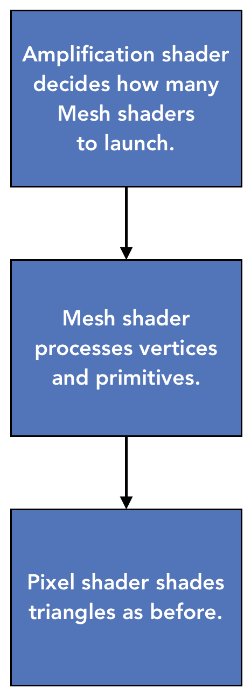

<a id="mesh-shading"></a>

# Amplification and mesh shaders

A mesh graphics pipeline executes a mesh shader (MS), optionally preceded by an amplification shader (AS), instead of the traditional VS-based geometry path. The mesh stage supplies vertices and primitives to the rasterizer. It does not use fixed-function input assembly and does not support stream output. [Mesh pipeline creation](pipeline-state.md#mesh-pipelines), [graphics root-signature compatibility](binding.md#pipeline-compatibility) and [initial/reset/bundle pipeline selection](command-list-state.md#pipeline-selection) define the shared selection and binding contracts.

The current amplification/mesh driver object creation/sizing/destruction contracts
are defined with [pipeline component creation](pipeline-state.md#driver-shader-objects)
and its [exact slot associations](pipeline-state.md#driver-object-slots).

<a id="overview"></a>

## Conceptual high level overview

A Mesh shader is a type of shader that combines vertex and primitive processing.
VS, HS, DS, and GS shader stages are replaced with Amplification Shader and Mesh Shader.
Roughly, Mesh shaders replace VS+GS or DS+GS shaders and Amplification shaders replace VS+HS.

The Amplification shader allows users to decide how many Mesh shader groups to run
and passes data to those groups.



The Mesh shader runs in threadgroups launched by [DispatchMesh](#dispatchmesh), or by the [amplification shader](#dispatchmesh-intrinsic).

Mesh shader threadgroups have access to groupshared memory like compute shaders.
Shader writers are free to declare groupshared arrays up to the maximum
allowed size. The groupshared limit for mesh shaders is reduced to 28k, slightly smaller
than the 32k limit which applies to compute shaders.

Mesh shader **outputs** comprise vertices and primitives. Different
from, say, a vertex shader, there is no implicit association of a
threadgroup thread and an output vertex or a primitive. For example, a
threadgroup may have 3 threads, each thread outputting 6 vertices and 2
primitives for a total of 18 vertices and 6 primitives per threadgroup.
This gives sufficient freedom to the shader writer to balance the ALU
loads in threads and avoid wasting lanes.

The following output rules apply:

1.  The output vertices for all output primitives must be written by the mesh
    shader in the output, otherwise behavior is undefined.

2.  The number of output vertices and primitives must be specified at runtime
    by the shader by calling [SetMeshOutputCounts](#setmeshoutputcounts),
    otherwise, the shader will not output any mesh,
    and writing to vertex or primitive attributes or indices
    results in undefined behavior.

Per-primitive output is distinct from per-vertex output.
The packed size in rows of attributes for [`vertices`](#vertex-attributes)
plus the packed size in rows of attributes for [`primitives`](#primitive-attributes)
cannot exceed 32 rows (where each row is a vector of 4 attributes).

The Mesh shader can be attached to a Pixel shader if desired, but does not
have to be if the app just wants to do UAV accesses but no rasterization.

In the case that there is a Pixel shader,
in the Mesh shader to Pixel shader pipeline,
signature elements are not aligned between stages by packing location.
Instead, Pixel shader input elements must be matched to output elements
from the mesh shader by the semantic name, system value type and semantic index.
Attributes that are uniform for a primitive,
including system value attributes such as:
`SV_RenderTargetArrayIndex`, `SV_ViewportArrayIndex`, and [`SV_CullPrimitive`](#sv_cullprimitive),
should be placed in the attribute structure for [`primitives`](#primitive-attributes),
rather than the attribute structure for [`vertices`](#vertex-attributes).
Attributes used with `GetAttributeAtVertex`
should be placed in the attribute structure for [`vertices`](#vertex-attributes),
and marked with the `nointerpolation` modifier.
In the case that there is a pixel shader input aligned with a mesh shader per-primitive output,
and that attribute is not marked as nointerpolation, the driver will still force the attribute to nointerpolate
in order to maintain functionality.

Vertex order is determined by the order of the vertex [`indices`](#vertex-indices) for the primitive.
The first vertex is the one referenced by the first index in this vector.
When the term *provoking vertex* is used in other feature descriptions,
for the mesh shader pipeline, it means the first vertex.
This order applies to the component order of `SV_Barycentrics`
and the index passed to `GetAttributeAtVertex`.
If a `nointerpolation` attribute in the [`vertices`](#vertex-attributes) is read directly in the pixel shader,
its value comes from the first vertex specified in the vertex [`indices`](#vertex-indices) for this primitive.
Primitive attributes do not require any interpolation modifiers to be specified, nor do they have any effect.

**Inputs** to the Mesh shader don't have IA enabled.

Since IA is disabled, each thread of the Mesh shader receives inputs
similar to those in a compute shader, meaning just thread IDs,
plus a group-uniform mesh [`payload`](#mesh-payload) from an Amplification shader, if any.
It's up to the shader author to read indices, read vertices, and output primitives.
Geometry culling and amplification are possible,
similar to what a Geometry Shader can do now.

The number of threads in a threadgroup must be declared with the
[`[numthreads(X, Y, Z)]`](#numthreads) attribute,
and the implementation must provide a 3-dimensional grid with exactly `X*Y*Z`
**user accessible threads** in the threadgroup.
The threadgroup dimensions are limited by `X*Y*Z <= 128`.

To support the ViewID feature of D3D12, there is a system value input [`SV_ViewID`](#sv_viewid)
which specifies the current view being computed by the Mesh shader group.
The model exposed to the user is the same as with the shader stages of the existing vertex pipeline.
You write your mesh shader as if the group is computing only one view, with some constraints.

In order to enable single-pass multi-view implementation for Tier 3 View Instancing,
certain constraints will be enforced on what is allowed to be dependent on [`SV_ViewID`](#sv_viewid).
This ensures that vertices and primitives produced for each view align across views,
while vertex and primitive attributes can vary per-view.
The primitive attribute [`SV_CullPrimitive`](#sv_cullprimitive) allows you to cull primitives
on a per-view basis, which translates to a view mask on multi-view implementations.
The attribute and groupshared limits apply after expansion for the view count on Tier 3 View Instancing.
More details in the [`SV_ViewID`](#sv_viewid) section.

Programmable amplification support is done using an Amplification shader. This
shader stage can be used to replace the hardware tessellator. The idea
is to be able to launch a variable number of children Mesh shaders to
enable amplification factors larger than a single Mesh shader can
support. An Amplification shader is bound with a Mesh shader in a Pipeline State
Object, and therefore an Amplification shader can only launch one type of a child
Mesh shader, many instances of it, if needed.

<a id="availability"></a>

## Availability and pipeline selection

To determine whether mesh and amplification shaders are supported, call `CheckFeatureSupport` using the `D3D12_FEATURE` enum,
`D3D12_FEATURE_D3D12_OPTIONS7`, which populates `pFeatureSupportData` with the structure [`D3D12_FEATURE_DATA_D3D12_OPTIONS7`](devices-and-capabilities.md#d3d12_feature_data_d3d12_options7).

<a id="d3d12_mesh_shader_tier"></a>

### D3D12_MESH_SHADER_TIER

```cpp
typedef enum D3D12_MESH_SHADER_TIER
{
    D3D12_MESH_SHADER_TIER_NOT_SUPPORTED = 0,
    D3D12_MESH_SHADER_TIER_1 = 10,
} D3D12_MESH_SHADER_TIER;
```

<a id="d3d12_tri_state"></a>

### D3D12_TRI_STATE

`D3D12_TRI_STATE` and its culled-primitive capability interpretation are defined in [Counters, queries, and predication](counters-queries-and-predication.md#d3d12_tri_state).

The complete [`D3D12_FEATURE_DATA_D3D12_OPTIONS12` declaration](devices-and-capabilities.md#d3d12_feature_data_d3d12_options12) is shared with enhanced barrier support. Its `MSPrimitivesPipelineStatisticIncludesCulledPrimitives` member uses `D3D12_TRI_STATE` and has the mesh-specific meaning defined [by the query contract](counters-queries-and-predication.md#culled-primitives).

`MeshShaderTier` other than `D3D12_MESH_SHADER_TIER_NOT_SUPPORTED` advertises AS/MS support. The shader stages begin with `as_6_5` and `ms_6_5` or newer, and they use DXIL. `OPTIONS9.MeshShaderPipelineStatsSupported` indicates whether [AS/MS statistics fields](counters-queries-and-predication.md#mesh-statistics) are supported. `MeshShaderSupportsFullRangeRenderTargetArrayIndex` indicates whether [render target array index](#render-target-array-index) has full or limited range. `MSPrimitivesPipelineStatisticIncludesCulledPrimitives` describes the [culled-primitive statistic](counters-queries-and-predication.md#culled-primitives). `DerivativesInMeshAndAmplificationShadersSupported` gates [derivative-dependent operations](#derivatives). `OPTIONS10.MeshShaderPerPrimitiveShadingRateSupported` gates mesh output of `SV_ShadingRate`.

The [mesh PSO contract](pipeline-state.md#mesh-pipelines) requires MS and permits AS and PS. It excludes the ordinary geometry shader stages and input layout/stream output declarations. Graphics-stage visibility and deny flags apply to AS/MS root arguments under the [visibility and root flags](binding.md#shader-visibility). Lack of a pixel shader does not itself disable depth/stencil rasterization. `DispatchMesh` uses the graphics root bindings and applicable graphics output state, not the compute root bindings.

<a id="amplification-and-mesh-shader"></a>

## Amplification shader and Mesh shader

The amplification shader creates an output structure for child threadgroups and
sets the number of child threadgroups to launch, which are then used to run mesh shaders.

For clarification, the way an amplification shader outputs child threadgroups
can be seen as similar to how the hull shader outputs tessellation factors.

Each child Mesh shader has access to the data structure created by the
parent Amplification shader. This is not entirely dissimilar to how currently
per-patch attributes get passed into the domain shader.

There is no "return" semantics from the Mesh shader into the Amplification shader
-- all the Amplification shader does is send the number of child Mesh shaders to
launch to the system.

|  | Required support when mesh shading is supported |
|--|--|
|Amplification shader                        | Mandatory |
|Amplification shader outputs to Mesh shader |  Up to 16k bytes per instance    |
|Mesh shader                        |  Mandatory   |
|Mesh shader maximum threads per group            |  128 |
|Mesh shader max output verts       |  256 |
|Mesh shader max output prims       |  256 |

Amplification shader output payload must not exceed 16k bytes per instance.

Mesh shader output data (including alignment constraints) must not exceed 32k bytes per instance.

The size of these two combined must not exceed 47k bytes.

<a id="dxil-stage-model"></a>

## DXIL stage model

AS and MS have DXIL entry functions with thread-group dimensions in their stage properties. AS produces a payload and dispatches child MS groups, with no I/O signatures. MS has separate per-vertex and per-primitive output signatures, maximum vertex/primitive counts, output topology and payload size properties. System-generated values are obtained through DXIL operations rather than ordinary I/O elements, as in CS.

`DispatchMesh` and `GetMeshPayload` are used to produce and consume payloads. `SetMeshOutputCounts`, `EmitIndices`, `StoreVertexOutput` and `StorePrimitiveOutput` are used to output data from MS. The stage and HLSL rules in this chapter describe how they work together.

<a id="dispatchmesh"></a>

## ID3D12GraphicsCommandList6::DispatchMesh

### Declaration

```cpp
void DispatchMesh(
    UINT ThreadGroupCountX,
    UINT ThreadGroupCountY,
    UINT ThreadGroupCountZ
    );
```

### Behavior

DispatchMesh launches the threadgroups for the amplification shader or the mesh shader in a case where no amplification shader is attached.
The API group counts follow the [shared mesh grid limits](compute.md#shared-grid-limits), including the capability-conditioned one-dimensional X limit and independent 22-bit total.

If there is an amplification shader, it will internally use an HLSL version of DispatchMesh to launch child mesh groups. The separate [grid limits](compute.md#shared-grid-limits) apply.

### Parameters

`ThreadGroupCountX`, `ThreadGroupCountY` and `ThreadGroupCountZ` give the number of groups in each dimension of the dispatch grid. With AS active this is the AS grid, otherwise it is the MS grid. Note that these describe the grid of groups, with each group independently containing threads according to `numthreads` annotation.

### Return values

None

### Recording and execution constraints

`DispatchMesh` records graphics work on DIRECT command lists and BUNDLE recordings, not COMPUTE or COPY lists. A zero count in any dimension launches no groups for that dispatch. The required mesh pipeline, graphics root arguments, descriptors, targets and dynamic output state are taken from the command list where the work is recorded. A bundle follows the canonical [pipeline selection](command-list-state.md#pipeline-selection) and [resource binding inheritance](command-list-state.md#resource-binding) contracts. Mesh shader execution follows the [vertex shading synchronization scope](synchronization.md#barrier-sync).

<a id="indirect-dispatch"></a>

## Indirect mesh dispatch

```cpp
typedef struct D3D12_DISPATCH_MESH_ARGUMENTS
{
    UINT ThreadGroupCountX;
    UINT ThreadGroupCountY;
    UINT ThreadGroupCountZ;
} D3D12_DISPATCH_MESH_ARGUMENTS;
```

`D3D12_INDIRECT_ARGUMENT_TYPE_DISPATCH_MESH` selects a `DispatchMesh` action in a command signature. Its argument data is the three `UINT` fields of `D3D12_DISPATCH_MESH_ARGUMENTS`. The [indirect execution specification](indirect-execution.md#executeindirect) defines the common pieces of indirect execution. Indirect dispatch uses the same mesh pipeline and dispatch dimension constraints as direct dispatch.

<a id="thread-groups"></a>

## Thread groups and shader interfaces

<a id="mesh-interface"></a>

### List of HLSL elements for Mesh shader

| Function Name | Mandatory/optional for shader to use |
|---|---|
| [`[numthreads(X, Y, Z)]`](#numthreads)                | Mandatory, `X*Y*Z <= 128` |
| [`[outputtopology(T)]`](#outputtopology)              | Required: `T` is `"line"` or `"triangle"` |
| [`SV_DispatchThreadID`](#sv_dispatchthreadid)   | Optional input |
| [`SV_GroupThreadID`](#sv_groupthreadid)               | Optional input |
| [`SV_GroupIndex`](#sv_groupindex)                     | Optional input |
| [`SV_GroupID`](#sv_groupid)                           | Optional input |
| [`SetMeshOutputCounts(numVertices, numPrimitives)`](#setmeshoutputcounts) | Optional |
| vertex [`indices`](#vertex-indices)                   | Required |
| attributes for [`vertices`](#vertex-attributes)       | Required with at least `SV_Position` |
| attributes for [`primitives`](#primitive-attributes)  | Optional |
| mesh [`payload`](#mesh-payload)                       | Optional payload from Amplification shader, `payload size <= 16k` |
| [`SV_ViewID`](#sv_viewid)                             | Optional input view ID for the group |
| [`SV_CullPrimitive`](#sv_cullprimitive)               | Optional per-primitive cull flag |
| `groupshared` memory                                  | Optional, total size <= 28k |

<a id="amplification-interface"></a>

### List of HLSL elements for Amplification shader

| Function Name | Mandatory/optional for Amplification shader |
|---|---|
| [`[numthreads(X, Y, Z)]`](#numthreads)                | Mandatory, `X*Y*Z <= 128` |
| [DispatchMesh(ThreadGroupCountX, ThreadGroupCountY, ThreadGroupCountZ, MeshPayload)](#dispatchmesh-intrinsic)  | Mandatory, `sizeof(MeshPayload) <= 16k` |
| `groupshared` memory                                  | Optional, total size <= 32k |

<a id="numthreads"></a>

### numthreads

```hlsl
[numthreads(X, Y, Z)]
void main(...)
```

This is a mandatory function attribute on the entry point of an amplification or mesh shader.
It specifies the launch size of the shader threadgroup, just like with compute shader.
The dimensions are positive and `X * Y * Z <= 128`.

The implementation must call the Mesh shader with the number of
user-available threads in each dimension equal to X, Y and Z,
and it should not provide any hardware IA-based functionality.

All output vertices for all output primitives must be set by the same
threadgroup. Sharing of output vertices or output indices between Mesh
shader threadgroups is not possible.

A shader exceeding the supported thread-group limits is invalid.

<a id="system-value-semantics"></a>

### System Value Semantics

AS thread/group identifiers are relative to the invoking DispatchMesh API call. Each of the following four MS system-values is computed in the following way:

If an Amplification Shader is used, system values are computed with respect to the DispatchMesh intrinsic called by the Amplification Shader.

If an Amplification Shader is not used, system values are relative to the invoking DispatchMesh API call.

For example, if an Amplification Shader is called with `DispatchMesh(2,1,1)`
and each AS invokes a Mesh Shader with `DispatchMesh(1,1,1)`,
the SV_GroupID within each Mesh Shader threadgroup would be (0,0,0) since they are
computed with respect to the `DispatchMesh(1,1,1)` call.

<a id="sv_dispatchthreadid"></a>

### SV_DispatchThreadID

```hlsl
void main(..., in uint3 dispatchThreadId : SV_DispatchThreadID, ...)
```

Provides the uint3 index of the current thread inside a DispatchMesh.
This is computed as explained above in [System Value Semantics](#system-value-semantics).

For the identifier formula and range, see [Generated identifiers](compute.md#generated-identifiers).

<a id="sv_groupthreadid"></a>

### SV_GroupThreadID

```hlsl
void main(..., in uint3 groupThreadId : SV_GroupThreadID, ...)
```

Provides the uint3 index of the current thread inside a threadgroup.
This is computed as explained above in [System Value Semantics](#system-value-semantics).

For the identifier formula and range, see [Generated identifiers](compute.md#generated-identifiers).

<a id="sv_groupindex"></a>

### SV_GroupIndex

```hlsl
void main(..., in uint threadIndex : SV_GroupIndex, ...)
```

Provides the uint flattened index of the current thread inside a threadgroup.
This is computed as explained above in [System Value Semantics](#system-value-semantics).

For the identifier formula and range, see [Generated identifiers](compute.md#generated-identifiers).

<a id="sv_groupid"></a>

### SV_GroupID

```hlsl
void main(..., in uint3 groupId : SV_GroupID, ...)
```

Provides the uint3 index of the current threadgroup inside a DispatchMesh.
This is computed as explained above in [System Value Semantics](#system-value-semantics).

For the identifier formula and range, see [Generated identifiers](compute.md#generated-identifiers).

<a id="mesh-outputs"></a>

## Mesh outputs

<a id="outputtopology"></a>

### outputtopology

```hlsl
[outputtopology(T)]
void main(...)
```

This is a mandatory function attribute on the entry point of the Mesh shader.
It specifies the topology for the output primitives of the mesh shader.
`T` must be either `"line"` or `"triangle"`.

<a id="setmeshoutputcounts"></a>

### SetMeshOutputCounts

```hlsl
void SetMeshOutputCounts(
    uint numVertices,
    uint numPrimitives);
```

At the beginning of the shader the implementation internally sets a
count of vertices and primitives to be exported from a threadgroup to 0.
It means that if a mesh shader returns without calling this function,
it will not output any mesh. This function sets the actual number of
outputs from the threadgroup.

Some restrictions on the function use and interactions with output arrays follow.

1.  This function can only be called once per shader.

2.  This call must occur before any writes to any of the
    [shared output arrays](#shared-output-arrays).
    The validator will verify this is the case.

3.  If the compiler can prove that this function is not called,
    then the threadgroup doesn't have any output.
    If the shader writes to any of the
    [shared output arrays](#shared-output-arrays),
    compilation and shader validation will fail.
    If the shader does not call any of these functions,
    the compiler will issue a warning,
    and no rasterization work will be issued.

4.  Only the input values from the first active thread are used.

5.  This call must dominate all writes to
    [shared output arrays](#shared-output-arrays).
    In other words, there must not be any execution path
    that even appears to reach any writes to any output array
    without first having executed this call.

Examples follow to illustrate restriction 5. and some other restrictions.

These are valid:
```hlsl
{   //...
    SetMeshOutputCounts(...);
    for (...) {     // uniform or divergent
        if (...) {  // uniform or divergent
            // write to output arrays  -> Valid
        }
    }
}

{   //...
    if (uniform_cond) {
        SetMeshOutputCounts(...);
        for (...) {     // uniform or divergent
            if (...) {  // uniform or divergent
                // write to output arrays  -> Valid
            }
        }
    }
}

{   //...
    if (uniform_cond)
        return;
    SetMeshOutputCounts(...);
    for (...) {     // uniform or divergent
        if (...) {  // uniform or divergent
            // write to output arrays  -> Valid
        }
    }
}
```

These are **not** valid:
```hlsl
{   // ...
    if (uniform_cond) {
        SetMeshOutputCounts(...);
    }
    if (uniform_cond) {
        // write to output arrays
        // Invalid because write is not inside the same branch
        // as SetMeshOutputCounts(...);
    }
}

{   // ...
    if (divergent_cond) {
        // Invalid when called from divergent flow control
        // however, the compiler may not catch this, resulting
        // in undefined behavior.
        SetMeshOutputCounts(...);
    }
    ...
}

{   //...
    if (uniform_cond) {
        SetMeshOutputCounts(...);
    } else {
        SetMeshOutputCounts(...);
        // Invalid: multiple calls in shader, even though they are under
        // mutually exclusive flow control conditions.
    }
}
```

The following scenarios produce undefined behavior.
The hardware implementation is not required to clamp or mask out of bounds writes.
Optional runtime validation (GBV) may catch these cases and issue errors.

1.  The function is called from divergent flow control.

2.  `numVertices` is greater than the array dimension of the
    [`vertices`](#vertex-attributes).

3.  `numPrimitives` is greater than the array dimension of the
    [`primitives`](#primitive-attributes).

4.  The index used when writing to
    [`vertices`](#vertex-attributes)
    is greater than or equal to the `numVertices` specified here.

5.  The index used when writing to
    vertex [`indices`](#vertex-indices) or
    attributes for [`primitives`](#primitive-attributes)
    is greater than or equal to the `numPrimitives` specified here.

<a id="shared-output-arrays"></a>

### Shared Output Arrays

There are three output parameters on the mesh shader
defining arrays of output shared across the group,
so that the threads in the Mesh shader group can
cooperate on filling in the values.

The dimensions of these arrays define the maximum number of
vertices and primitives that may be output from this shader.
The array dimension must be included, even if it is `1`.
The maximum declared vertex and primitive counts are each 256.

Each array cannot be read from,
and can only be written to after a call to
[`SetMeshOutputCounts`](#setmeshoutputcounts) is made
to set the actual vertex and primitive output sizes
for this thread group invocation.
See [`SetMeshOutputCounts`](#setmeshoutputcounts)
for interactions and restrictions for sizes and indexing.

When writing to the indices,
the whole uint2 or uint3 vector element of the indices array must be written to at once.
You cannot write just one component and leave other components to be filled in later.

Example:

```hlsl
void main(..., out indices uint3 Indices[MAX_OUTPUT_PRIMITIVES], ...) {
...
    Indices[i] = uint3(1, 2, 3);    // Allowed.
    Indices[i].x = 1;               // Not Allowed.
}
```

When writing to attributes,
it is fine to write to any subset of the attribute structure at once,
and fine to never write some attributes,
if the rasterizer and downstream shader will not read them.

If the same element in one of these arrays is written to,
in whole or in part, more than once,
then the last value written is the value that will be used.

See the corresponding sections for details on each parameter.

| Mesh shader shared output arrays                      | Array dimension defines maximum number of | Required  |
|-|-|-|
| vertex [`indices`](#vertex-indices)                   | primitives    | Required  |
| attributes for [`vertices`](#vertex-attributes)       | vertices      | Required  |
| attributes for [`primitives`](#primitive-attributes)  | primitives    | Optional  |

<a id="vertex-indices"></a>

### Vertex Indices

```hlsl
[outputtopology("line" or "triangle")]
void main(...,
    out indices
        [uint2 for line or uint3 for triangle]
        primitiveIndices[MAX_OUTPUT_PRIMITIVES],
    ...)
```

This required parameter defines the shared output vertex indices array for the Mesh shader threadgroup.
Each array element defines the vertex indices that make up one output primitive.
The `out` and `indices` modifiers must be used with this parameter.
The type is either `uint2` for [`outputtopology("line")`](#outputtopology),
or `uint3` for [`outputtopology("triangle")`](#outputtopology).
The static size of the array, `MAX_OUTPUT_PRIMITIVES` here,
defines the maximum number of primitives this mesh shader can produce,
and must match the size of the [Primitive Attributes](#primitive-attributes) array.
The maximum size for this array is 256 elements.

You must write all two or three vertex indices of a primitive at once,
otherwise the compiler and validator will throw an error.
If you write the same primitive index more than once,
the last value written will define the indices for the primitive.

Writing to this array must occur after the [`SetMeshOutputCounts`](#setmeshoutputcounts) call.
See that section for information on output size and indexing behavior and restrictions.

> ### Remark
>
> As there isn't a way to inspect or access the raw output indices of a mesh shader from the application level, the underlying GPU implementation may choose to store output indices in a different format from uint2 or uint3.

<a id="vertex-attributes"></a>

### Vertex Attributes

```hlsl
struct VertexAttributes {
    // User-defined per-vertex attributes
    // semantics are required and interpolation mode is used
};
void main(...,
    out vertices VertexAttributes sharedVertices[MAX_OUTPUT_VERTICES],
    ...)
```

This required parameter defines the shared output vertex attribute array for the Mesh shader threadgroup.
The `out` and `vertices` modifiers must be used with this parameter.

The static size of the array, `MAX_OUTPUT_VERTICES` here,
defines the maximum number of vertices this mesh shader can produce.
The maximum size for this array is 256 elements.
This array is write-only, so the compiler will issue an error if you attempt to read from the array.

You can write individual attributes, and leave others unwritten if they will not be used in the Pixel shader.
If you write to the same attribute at the same vertex index,
the last value written will be the value exported from the Mesh shader.

This structure must have system-value or user-defined semantics defined for all elements,
and the interpolation modes apply to the vertex attributes,
just as with the elements of an output structure used as the return value from a Vertex shader.

One 4-component vector with the `SV_Position` semantic must be present in this structure,
since this is required by the rasterizer.

Writing to this array must occur after the [`SetMeshOutputCounts`](#setmeshoutputcounts) call.
See that section for information on output size and indexing behavior and restrictions.

<a id="primitive-attributes"></a>

### Primitive Attributes

```hlsl
struct PrimitiveAttributes {
    // User-defined per-primitive attributes
    // semantics are required but interpolation mode is ignored
};
void main(...,
    out primitives PrimitiveAttributes sharedPrimitives[MAX_OUTPUT_PRIMITIVES],
    ...)
```

This optional parameter defines the shared output primitive attribute array for the Mesh shader threadgroup.
The `out` and `primitives` modifiers must be used with this parameter.
The static size of the array, `MAX_OUTPUT_PRIMITIVES` here,
defines the maximum number of primitives this mesh shader can produce,
and must match the size of the vertex [`indices`](#vertex-indices) array.
The maximum size for this array is 256 elements.

You can write individual attributes, and leave others unwritten if they will not be used in the Pixel shader.
If you write to the same attribute at the same primitive index,
the last value written will be the value exported from the Mesh shader.

This structure must have system-value or user-defined semantics defined for all elements.
`SV_RenderTargetArrayIndex` and `SV_ViewportArrayIndex` and [`SV_CullPrimitive`](#sv_cullprimitive)
can only be per-primitive attributes in a mesh shader.

`SV_ShadingRate` is subject to the mesh-specific capability below and the [per-primitive VRS rules](pixel-shaders.md#vrs-primitive), including their viewport-indexing and combiner restrictions. When set from a mesh shader, `SV_ShadingRate` functions as an actual per-primitive attribute-- not, say, a per-provoking-vertex attribute as in other geometry stages.

Writing to this array must occur after the [`SetMeshOutputCounts`](#setmeshoutputcounts) call.
See that section for information on output size and indexing behavior and restrictions.

Applications are only permitted to set SV_ShadingRate from the MS (mesh shader) stage if the MeshShaderPerPrimitiveShadingRateSupported cap is TRUE. If an application tries to set SV_ShadingRate from a mesh shader and the MeshShaderPerPrimitiveShadingRateSupported cap is FALSE, the rendering behavior is undefined.

> #### Remark
> The MeshShaderPerPrimitiveShadingRateSupported cap was added in a Windows release after the initial release of variable rate shading went out. With this in mind, the runtime does not strictly validate setting of MS per-primitive shading rates against the cap because that could mean an application-breaking change. Instead, SDK layers produce a softer-than-error message if the application tries to set a per-primitive shading rate from MS but the cap does not permit it.

<a id="signature-linkage"></a>

### Signature Linkage

In the Mesh shader pipeline, signature elements must be linked
by matching semantic name, and semantic index.
For system values, linkage is by the system value type and semantic index.
Elements must not be linked by the packed location. Note that this is different than signature linkage for other pipeline kinds.

Packing locations are still set for vertex and primitive elements in signatures,
but these may not match the pixel shader locations,
due to the way these elements are defined in separate structures for Mesh shader.
The elements will be packed with vertex elements first,
with primitive elements packed starting on the row
immediately following the last row used by the vertex elements.
Vertex and primitive attributes will not be packed into the same row,
even when the interpolation mode matches.

All of these elements must fit into a single 32-row (128 scalar element) signature.
However, the actual number of components used will be used
in the size limit calculation defined in the
[Mesh shader output size limits](#mesh-shader-output-size-limits) section.

<a id="mesh-shader-output-size-limits"></a>

### Mesh shader output size limits

Given:

| Variable | Definition |
|---|---|
| `n_verts`, `n_prims` | Declared maximum output vertex and primitive counts (array dimensions), not the dynamically selected counts |
| `n_vert_attr`, `n_prim_attr` | Total number of vertex or primitive scalar attributes |
| `n_views` | Number of views for Tier 3 View Instancing, otherwise == 1 |
| `n_vert_per_view_attr`, `n_prim_per_view_attr` | Number of scalar attributes dependent on [`SV_ViewID`](#sv_viewid) |
| `n_vert_view_shared_attr`, `n_prim_view_shared_attr` | Number of scalar attributes **not** dependent on [`SV_ViewID`](#sv_viewid) |

and the following definitions:

```cpp
#define ALIGN32(n) (((n) + 31) & ~31)
n_vert_attr     = n_vert_view_shared_attr + (n_vert_per_view_attr * n_views);
vert_attr_bytes = n_vert_attr * 4;
n_prim_attr     = n_prim_view_shared_attr + (n_prim_per_view_attr * n_views);
prim_attr_bytes = n_prim_attr * 4;
```

The following Mesh shader output limit applies:

```cpp
vert_attr_bytes * ALIGN32(n_verts) + prim_attr_bytes * ALIGN32(n_prims) <= 32768
```

Additionally, without accounting for per-view expansion,
vertex and primitive attributes must pack into **32** 4-component vector rows in total,
in accordance with vertex attribute packing rules,
without packing vertex and primitive attributes into the same row.

Since the number of enabled views isn't known when the shader is compiled,
the output size will be validated by the compiler and DXIL validator
assuming only one view.
At PSO creation time, runtime validation will verify
that output space limitations are not exceeded
with per-view attributes expanded by the number of views.

<a id="view-output-costing"></a>

#### View-expanded output costing

For PSO view-expansion costing, one 32-bit attribute is always reserved for `SV_ViewportArrayIndex`, whether or not it was declared. This reservation is per-vertex. Any declared `SV_ViewportArrayIndex` element is ignored for cost purposes from either vertex or primitive data. `SV_CullPrimitive` contributes no packed attribute storage. These rules only apply for view instancing costs, single-view limits are compared against the normal declared output signature.

<a id="payload-and-amplification"></a>

## Payload and amplification

<a id="mesh-payload"></a>

### Mesh Payload

```hlsl
void main(...,
    in payload MeshPayloadStruct MeshPayload,
    ...)
```

This optional input supplies the payload passed to the Amplification shader's DispatchMesh call.
This parameter provides the same input values for the entire Mesh shader thread group.

The structure type for this parameter should match the user-defined structure
used at the DispatchMesh call in the Amplification shader.
Runtime will validate that the structure size reported by the compiler matches
between the Amplification shader and the Mesh shader.

The data layout of this structure is the same as for structured buffers.
The maximum size for this structure is 16k bytes.

<a id="dispatchmesh-intrinsic"></a>

### DispatchMesh intrinsic

```hlsl
template <typename payload_t>
DispatchMesh(uint ThreadGroupCountX,
             uint ThreadGroupCountY,
             uint ThreadGroupCountZ,
             groupshared payload_t MeshPayload);
```

This function, called from the amplification shader,
launches the threadgroups for the mesh shader.
This function must be called exactly once per amplification shader,
must not be called from non-uniform flow control.
The DispatchMesh call implies a GroupMemoryBarrierWithGroupSync(),
and ends the amplification shader group's execution.

The arguments are treated as uniform for the group,
meaning that they are read from the first thread if not group-uniform (or groupshared).
The intended use is to have the whole group of threads cooperate on constructing the MeshPayload.
It also means that you cannot amplify the number of unique MeshPayload contents
beyond the number of Amplification shader groups launched by the API.

The child group counts follow the [shared mesh grid limits](compute.md#shared-grid-limits), including the expanded one-dimensional X capability and independent 22-bit total. Violating those constraints produces undefined behavior.

A payload of data passed to all instances of Mesh shaders invoked by this
call is passed through the MeshPayload parameter.

The payload type, specified by `payload_t` here, must be a user-defined struct
type. The size of this type must match the size of the type used in the Mesh
shader for the [mesh payload input](#mesh-payload). The maximum size
allowed for this structure is 16k bytes.

For the amplification shader, the payload structure counts against its 32-KiB groupshared allowance. A 16-KiB payload leaves 16 KiB for other AS groupshared storage. The incoming MS payload is accounted separately from the MS 28-KiB groupshared allowance, it is not subtracted from that allowance.

The structure is not flattened into a packed signature layout, but instead
passed with the data layout specified by the native structure.  Data layout
should be the same as for structured buffers.

<a id="programmable-primitive-amplification"></a>

### Programmable Primitive Amplification

A limited form of primitive amplification as in GS-amplification is
supported with Mesh shaders. It's possible to amplify input point
geometry with up to 1:V and/or 1:P ratio where V is the number of output
vertices declared by the mesh shader and P is the number of output
primitives declared by the mesh shader.

However, programmable amplification as in Amplification shaders can't be done in a
single threadgroup because expansion factors are decided by the program
and can be huge.

The Amplification shader is intended to be the shader stage that enables programmable
Amplification in Mesh shaders.

<a id="view-instancing"></a>

## View instancing and culling

Common view instancing details are specified [in the vertex processing chapter](vertex-processing.md#geometry-view-instancing). The following are the mesh-specific details.

<a id="sv_viewid"></a>

### SV_ViewID

`SV_ViewID` is special in the way it allows for a driver to create a version of
the shader that computes all views in a single shader pass. It does this by
duplicating SV_ViewID dependent values, computations, and attributes.

`SV_ViewID` expansion must fit the available storage for the selected view count and dependent attributes.

For Mesh shader, this is complicated by accessing group shared memory.
Group shared memory dependent on `SV_ViewID` must be similarly expanded
by the number of views.
Both attribute and groupshared expansion must fit their storage limits. The [validation-coverage distinction](#mesh-view-validation) applies.

Dynamically indexed arrays written to with `SV_ViewID` dependent values
must be expanded by multiplying the size by the number of views.

If a temporary or groupshared array is indexed by a value dependent on `SV_ViewID`,
the compiler (or DXIL validator) will issue an error,
as this usage is likely the result of incorrect assumptions about the model,
and probably will not result in the expected behavior,
or efficiency and consistency between multi-pass and single-pass implementations.

`SV_ViewID` dependent values are not tracked through writes to global memory,
however, values read from global memory at an address that is dependent on `SV_ViewID`
are considered dependent as well.

Note: SV_ViewID is only available as an input to a Mesh Shader, not an
Amplification Shader.

Note: SV_ViewID is available as an input to Pixel Shader that does
not consume attribute space (system generated value), and therefore cannot be
written as an output from Mesh Shader.

In addition to the storage expansions, some constraints are required to enable
a single-pass implementation.

The following values may not be dependent on `SV_ViewID`:
1.  The `numVertices` and `numPrimitives` values passed to [`SetMeshOutputCounts`](#setmeshoutputcounts).
2.  The index into the attribute array for [`vertices`](#vertex-attributes), attribute array for [`primitives`](#primitive-attributes), and [`indices`](#vertex-indices) array.
3.  The index values written to the [`indices`](#vertex-indices) array.

Amplification shaders do not support `SV_ViewID` input.

<a id="mesh-view-validation"></a>

#### Validation coverage

ViewID-dependent groupshared storage is expanded per view and must fit within the groupshared storage limit. DXC does not track the ViewID-dependent byte count, so this constraint is not automatically validated.

<a id="sv_cullprimitive"></a>

### SV_CullPrimitive

This is a per-primitive boolean culling value that indicates whether to cull
the primitive for the current view (SV_ViewID).  Hardware that expands views
inline can turn this into a per-view mask value in place of SV_ViewportArrayIndex.
SV_CullPrimitive will not consume space in the primitive signature.
The special viewport reservation is defined by [view-expanded output costing](#view-output-costing).
No attributes are counted for SV_CullPrimitive.

<a id="sv_primitiveid-in-the-pixel-shader"></a>

### SV_PrimitiveID in the Pixel Shader

When mesh shaders are used, there is no system generated PrimitiveID
(uint SV_PrimitiveID) value. If a pixel shader inputs SV_PrimitiveID
and is paired with a mesh shader, the mesh shader must include SV_PrimitiveID
as part of its primitive outputs and must manually output a value of its choosing
for each primitive. So this behaves no differently than any other mesh shader primitive output
without a special name. The basic purpose here is to allow pixel shaders
that were written to work with other shaders like geometry shaders,
where SV_PrimitiveID does exist, or vertex shaders, where the PrimitiveID is auto-generated,
to be shared with the mesh shader as well.

<a id="derivatives"></a>

## Derivatives and quad operations

Derivative-dependent texture sampling uses the common [LOD and anisotropy calculations](common-shader-internals.md#lod-and-anisotropy). The rules below specify derivative and quad-operation availability for amplification and mesh shaders, and how their threads are arranged into quads.

Derivative and derivative-dependent texture sample operations must be supported
in compute shaders
on devices that support `D3D_SHADER_MODEL_6_6`.

Derivative and derivative-dependent texture sample operations must be supported
in amplification and mesh shaders
on devices that support `D3D_SHADER_MODEL_6_6`
and have the `DerivativesInMeshAndAmplificationShadersSupported` capability.

Quad read functions require `WaveOps` support. In shader model 6.6 and later, their quad layout follows the thread-group mapping below. Earlier shader models do not guarantee that mapping.

For derivative operations, `numthreads` must have X divisible by four with Y=Z=1 (1D quads), or X and Y both divisible by two (2D quads). Other group shapes are invalid for these operations. The [quad layouts and lane mapping](compute.md#compute-quads) define the exact 1D/2D mapping.

<a id="rasterization-order"></a>

## Rasterization order

When rasterization is enabled (pixel shader or depth only rendering) and the pipeline contains an amplification shader and/or mesh shader,
the following rasterization ordering guarantees apply:

Triangles generated by any individual mesh shader thread group are always retired by the rasterizer in the order that thread group specified its primitive outputs.
This remains true for all the cases in the rest of this discussion, where ordering with respect to neighboring thread groups is discussed.

Pixel shader invocations (any shader invocations) may not execute in order. Rather only the resulting render-target/depth/stencil buffer accesses must honor any specified ordering,
over any given target location, e.g. render-target/depth sample.
If the application needs UAV accesses during pixel shader invocation to be ordered over any given target location,
the RasterizerOrderedViews (ROV) feature needs to be used in the pixel shader.

If the pipeline state includes a mesh shader but no amplification shader, the outputs of each thread group are retired by the rasterizer sequentially
with respect to neighboring thread groups. So all primitives generated by the DispatchMesh() API call are retired by the rasterizer in a fully defined order. The ordering of thread groups is defined as:

```hlsl
for(z in [0..ThreadGroupCountZ-1])
{
    for(y in [0...ThreadGroupCountY-1])
    {
        for(x in [0...ThreadGroupCountX-1])
        {
            group (x,y,z) is next
        }
    }
}
```

If the pipeline includes an amplification shader, only partial ordering of rasterization output is guaranteed.
Individual amplification shader thread groups retire their rasterized output, produced via child mesh shader thread groups, in sequential order with respect to neighboring amplification shader thread groups.
The ordering of thread groups is the (x,y,z) order described above, applied to the amplification shader stage in this case.

However, the child mesh shader thread groups produced by any individual amplification shader thread group may retire rasterized output in any order
with respect to other children of the parent amplification shader thread group.

At the same time, individual mesh shader invocations still retire rasterized output in each mesh shader's output primitive order (defined at the beginning of this discussion).
In the presence of an amplification shader, any ROV accesses from a pixel shader over a given target location are ordered,
with the exception of the arbitrary ordering of mesh shader rasterization retirement described above.

<a id="pipeline-statistics"></a>

## Pipeline statistics

The [pipeline statistics result, capability and invocation units](counters-queries-and-predication.md#mesh-statistics) are defined in the general query chapter.

<a id="render-target-array-index"></a>

## SV_RenderTargetArrayIndex limitations based on queryable capability

Some target hardware has limitations where mesh shaders that write to the SV_RenderTargetArrayIndex
attribute are limited to outputting a 3 bit value. This allows for selecting between at most 8 render-target array slices.
On such hardware, outputting an index value larger than 7 produces undefined behavior.

Other hardware, however, does not possess a limitation on valid output values of SV_RenderTargetArrayIndex
and has support for full 11-bit render target array indexing.

> ### Remark
>
> 11-bit indexing is the maximum needed, because Direct3D defines the max slices for an array texture as 2048.

Direct3D 12 has a queryable capability allowing applications to know if the target hardware supports
values of SV_RenderTargetArrayIndex which are 8 or greater. This capability is expressed through the
`MeshShaderSupportsFullRangeRenderTargetArrayIndex` field of `D3D12_FEATURE_DATA_D3D12_OPTIONS9`.

Applications can check this capability as follows:
```cpp
D3D12_FEATURE_DATA_D3D12_OPTIONS9 featureData = {};
pDevice->CheckFeatureSupport(D3D12_FEATURE_D3D12_OPTIONS9, &featureData, sizeof(featureData));
if (featureData.MeshShaderSupportsFullRangeRenderTargetArrayIndex)
    ...
```

Note that D3D12_FEATURE_DATA_D3D12_OPTIONS9 was not present in the first Windows OS release that
introduced support for mesh shaders. Applications running on an operating system version where
D3D12_FEATURE_DATA_D3D12_OPTIONS9 is not available must assume that mesh shaders only support a
maximum render target array index of 7 and going beyond this produces undefined results.

Drivers report `MeshShaderSupportsFullRangeRenderTargetArrayIndex`. Drivers that report false or use an older DDI without this capability are treated as not supporting the full range.

<a id="mesh-driver"></a>

## Driver responsibilities

<a id="dispatchmesh-ddi"></a>

### PFND3D12DDI_DISPATCH_MESH_0074

```cpp
PFND3D12DDI_DISPATCH_MESH_0074 Pfnd3d12ddiDispatchMesh0074;

VOID Pfnd3d12ddiDispatchMesh0074(
  D3D12DDI_HCOMMANDLIST unnamedParam1,
  UINT unnamedParam2,
  UINT unnamedParam3,
  UINT unnamedParam4
)
{...}
```

#### Parameters

`unnamedParam1`

A handle to the command list.

`unnamedParam2`

Thread group count in X direction.

`unnamedParam3`

Thread group count in Y direction.

`unnamedParam4`

Thread group count in Z direction.

<a id="driver-current-mesh-dispatch"></a>

### Current mesh dispatch forms

The `_0114` form of [DispatchMesh](#dispatchmesh) participates in [runtime bypass](execution.md#work-command-handles). Both forms receive `ThreadGroupCountX`, `ThreadGroupCountY` and `ThreadGroupCountZ` in that order.

| Current table member | Signature | API contract |
|---|---|---|
| `D3D12DDI_COMMAND_LIST_FUNCS_3D_0108::pfnDispatchMesh` | `PFND3D12DDI_DISPATCH_MESH_0074` | [DispatchMesh](#dispatchmesh) |
| `D3D12DDI_COMMAND_LIST_FUNCS_3D_0114::pfnDispatchMesh` | `PFND3D12DDI_DISPATCH_MESH_0114` | [DispatchMesh](#dispatchmesh) |

```cpp
typedef VOID ( APIENTRY* PFND3D12DDI_DISPATCH_MESH_0074 )(
    D3D12DDI_HCOMMANDLIST, UINT, UINT, UINT );

typedef VOID ( APIENTRY* PFND3D12DDI_DISPATCH_MESH_0114 )(D3D12DDI_API_HCOMMANDLIST, UINT, UINT, UINT );
```
