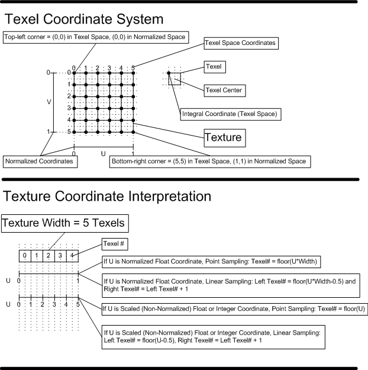

<a id="shader-internals"></a>

# Common shader internals

<!-- d3d12-review-legend:begin -->

> [!NOTE]
> **Draft provenance annotations.**
> Underlining marks pending replacement wording or authored list items. Warning boxes
> mark authored, mixed or reopened passages awaiting editorial review.
> Editorial adoption does not establish factual or hardware verification. Exact approved factual
> corrections do not trigger a marker. Unmarked text elsewhere, declarations
> and structural Markdown are not assertions of approval.
> [Annotation scope and approvals](../../spec-maintenance/d3d12/prose-annotations.md).

<!-- d3d12-review-legend:end -->

<!-- d3d12-review-alert:begin:common-shader-internals:N-core-scope:0 -->

> [!WARNING]
> **Authored synthesis - human review pending.**
>
> These shared execution concepts apply across shader stages. Stage chapters define how invocations form groups or pixel quads, how helpers are created, and which operations each stage supports. The shader representations and operation-specific contracts do not imply a universal physical scheduling order.

<!-- d3d12-review-alert:end:common-shader-internals:N-core-scope:0 -->

<a id="execution-terminology"></a>

## Execution terminology

<!-- d3d12-review-alert:begin:common-shader-internals:W-lane-terms:0 -->

> [!WARNING]
> **Mixed source and authored adaptation - human review pending.**
>
> | Term | Definition |
> |---|---|
> | Lane | A single thread of execution in a wave |
> | Wave | A set of lanes executed simultaneously in the processor |
> | Active lane | A lane executing the current operation |
> | Inactive lane | A lane not executing, for example due to control flow or insufficient work to fill the wave |
> | Quad | Four lanes grouped as a 2x2 arrangement for quad operations; formation follows the [pixel](pixel-shaders.md#pixel-quads) or [compute](compute.md#compute-quads) stage |

<!-- d3d12-review-alert:end:common-shader-internals:W-lane-terms:0 -->

<a id="waves"></a>

## Wave operations and participation

<!-- d3d12-review-alert:begin:common-shader-internals:N-wave-model:0 -->

> [!WARNING]
> **Authored synthesis - human review pending.**
>
> Shader Model 6.0 adds wave queries, votes, broadcasts, reductions, scans and quad shuffles. `D3D12_FEATURE_DATA_D3D12_OPTIONS1::WaveOps` reports wave-operation support; `WaveLaneCountMin` and `WaveLaneCountMax` report the supported lane-count range. Shader Model 6.9 makes wave operations required. `WaveGetLaneCount()` returns the current wave's lane count, including inactive lanes, while `WaveGetLaneIndex()` identifies the current lane.

<!-- d3d12-review-alert:end:common-shader-internals:N-wave-model:0 -->

<!-- d3d12-review-alert:begin:common-shader-internals:N-wave-model:1 -->

> [!WARNING]
> **Authored synthesis - human review pending.**
>
> Wave-wide votes/reductions operate on the active lanes at that operation. Divergent control flow can change this participating set. Reading a value from an inactive or nonexistent source lane is undefined. Floating-point reduction order is not defined. A program must not assume a fixed wave width or a stage-specific mapping not supplied by an explicit contract.

<!-- d3d12-review-alert:end:common-shader-internals:N-wave-model:1 -->

<!-- d3d12-review-alert:begin:common-shader-internals:N-wave-model:2 -->

> [!WARNING]
> **Authored synthesis - human review pending.**
>
> Pixel-shader [helper participation](pixel-shaders.md#wave-helper-participation) defines which helper lanes join these operations. Quad operations have their own participating-lane requirements; a wave is not synonymous with a derivative quad. Shared [memory-ordering and fence rules](memory-model.md#memory-consistency) are separate from collective value operations.

<!-- d3d12-review-alert:end:common-shader-internals:N-wave-model:2 -->

<a id="program-model"></a>

## Program organization and availability

<!-- d3d12-review-alert:begin:common-shader-internals:N-program-model:0 -->

> [!WARNING]
> **Authored synthesis - human review pending.**
>
> A shader program describes the work of one invocation. Its stage supplies inputs, outputs and invocation organization; the representation supplies values, control flow and resource operations. DXBC uses declared register files and tokenized instructions; DXIL uses typed static-single-assignment (SSA) values, LLVM instructions and `dx.op` operations. These are two representations of the shared shader model, not two different texture-filtering contracts.

<!-- d3d12-review-alert:end:common-shader-internals:N-program-model:0 -->

<!-- d3d12-review-alert:begin:common-shader-internals:N-program-model:1 -->

> [!WARNING]
> **Authored synthesis - human review pending.**
>
> Shader Models 4.0, 4.1 and 5.0 describe the inherited register/instruction model below. The D3D12 paths described here use SM5.0/5.1 DXBC shader assets and supported SM6.x DXIL shaders. SM5.1 adds resource-range flexibility; existing SM5.0 shaders can use root signatures. Historical SM4.x instruction availability is not a D3D12 profile-acceptance rule. `D3D12_FEATURE_SHADER_MODEL` reports the supported shader model. Shader model, DXIL version, validator version and optional device capabilities are distinct conditions.

<!-- d3d12-review-alert:end:common-shader-internals:N-program-model:1 -->

<!-- d3d12-review-alert:begin:common-shader-internals:N-program-model:2 -->

> [!WARNING]
> **Authored synthesis - human review pending.**
>
> The main body defines common operation-family and sampling behavior. Exact token/container encodings, declarations and exhaustive per-opcode/per-intrinsic entries are the DXBC and DXIL supporting references. The [numeric definitions](numeric-and-data-rules.md#numeric-3-1), [conversion algorithms](numeric-and-data-rules.md#numeric-3-2) and [format interpretation](formats.md#interpretation) remain separately defined; this chapter does not replace their complete references.

<!-- d3d12-review-alert:end:common-shader-internals:N-program-model:2 -->

<a id="archive-7-1"></a>

## Instruction Counts

<ins><!-- d3d12-review-inline:begin:common-shader-internals:A-7-1:0 -->There are no limits on total shader program length or execution time (accounting for loops and subroutines), aside from any limitations in what may be expressed in the shader token format.<!-- d3d12-review-inline:end:common-shader-internals:A-7-1:0 --></ins>

<ins><!-- d3d12-review-inline:begin:common-shader-internals:A-7-1:1 -->This is a program-representation statement, not a guarantee of unbounded device execution time or forward progress.<!-- d3d12-review-inline:end:common-shader-internals:A-7-1:1 --></ins>

<a id="archive-7-2"></a>

## Common instruction set

<ins><!-- d3d12-review-inline:begin:common-shader-internals:A-7-2:0 -->Aside from a few exceptions, the instruction set for all the shader stages are identical. The exceptions are confined to instructions that only make sense in a given Shader unit.<!-- d3d12-review-inline:end:common-shader-internals:A-7-2:0 --></ins>

<ins><!-- d3d12-review-inline:begin:common-shader-internals:A-7-2:1 -->Implicit-derivative sampling follows [pixel derivative rules](pixel-shaders.md#derivatives) or the supported [compute](compute.md#compute-quads) and [mesh/amplification derivative rules](amplification-and-mesh-shaders.md#derivatives). Explicit-LOD and explicit-gradient forms do not need implicit derivatives.<!-- d3d12-review-inline:end:common-shader-internals:A-7-2:1 --></ins>

<a id="dxbc-model"></a>

## DXBC values, constants and linkage

<a id="archive-7-3"></a>

### Temporary Storage

<ins><!-- d3d12-review-inline:begin:common-shader-internals:A-7-3:0 -->Temporary storage is composed of a single Element type, which is a 4-tuple of untyped 32-bit quantities.
Temporary storage consists of two classes of storage: registers, which are non-indexed single elements; and arrays,
which are indexable 1D arrays of elements. Temporary storage is read/write, and is uninitialized at the start of a
Shader execution instance. Reads of temporary storage that has not been previously written within a Shader execution
instance return undefined values, but cannot return data outside of the GPU process context.<!-- d3d12-review-inline:end:common-shader-internals:A-7-3:0 --></ins>

<ins><!-- d3d12-review-inline:begin:common-shader-internals:A-7-3:1 -->Temporary registers are [declared](https://microsoft.github.io/DirectX-Specs/d3d/archive/D3D11_3_FunctionalSpec.htm#inst_tempDCL) r#, and can be used as a temporary operand in Direct3D 12 instructions.<!-- d3d12-review-inline:end:common-shader-internals:A-7-3:1 --></ins>

<ins><!-- d3d12-review-inline:begin:common-shader-internals:A-7-3:2 -->Temporary arrays are [declared](https://microsoft.github.io/DirectX-Specs/d3d/archive/D3D11_3_FunctionalSpec.htm#inst_indexableTempDCL) as x#[n], where “n” is the array length (indexed with 0..n-1).
Temporary arrays must be indexed by an r# scalar, statically indexed x# scalar, and/or an optional immediate constant (literal),
and can have only one level of index nesting (e.g. x0[x1[r0.x+1].x+1] is not legal, but x0[x1[1].x+1] is legal). A temporary array reference, x#[?], can be used
as a temporary operand in Direct3D 12 instructions (i.e. anywhere an r# can be used). Out of bounds access to x#[?] is undefined, except that
data outside the GPU process context is never visible.<!-- d3d12-review-inline:end:common-shader-internals:A-7-3:2 --></ins>

<ins><!-- d3d12-review-inline:begin:common-shader-internals:A-7-3:3 -->The total quantity of temporary storage per Shader execution instance is 4096 elements, which can be utilized in
any combination of registers and arrays. i.e. the total number of r# and x# declared must be <= 4096.<!-- d3d12-review-inline:end:common-shader-internals:A-7-3:3 --></ins>

<ins><!-- d3d12-review-inline:begin:common-shader-internals:A-7-3:4 -->Note that the namespace for r# and x# (the #) are independent. e.g. Suppose r2 and x2[5] are declared. They are independent, but together
both count as 6 units of storage against the limit of 4096 temporary registers.<!-- d3d12-review-inline:end:common-shader-internals:A-7-3:4 --></ins>

<ins><!-- d3d12-review-inline:begin:common-shader-internals:A-7-3:5 -->To provide a run-time stack, a program allocates a temporary array of a fixed size. The program should provide its own stack bounds checking,
e.g., skip calls if the stack push would exceed the array bounds.<!-- d3d12-review-inline:end:common-shader-internals:A-7-3:5 --></ins>

<ins><!-- d3d12-review-inline:begin:common-shader-internals:A-7-3:6 -->There is no limit on the total number of times temporary registers (the same one or different ones) that can appear in a single instruction or in a shader.<!-- d3d12-review-inline:end:common-shader-internals:A-7-3:6 --></ins>

<a id="dxbc-double-packing"></a>

### Double-precision DXBC values

<!-- d3d12-review-alert:begin:common-shader-internals:N-numeric-dxbc-double-scope:0 -->

> [!WARNING]
> **Authored synthesis - human review pending.**
>
> The following packing, swizzle and write-mask rules apply to the DXBC register model, not to scalar DXIL SSA values. The [shared double-precision numeric contract](numeric-and-data-rules.md#numeric-3-1-4) defines arithmetic and availability.

<!-- d3d12-review-alert:end:common-shader-internals:N-numeric-dxbc-double-scope:0 -->

<ins><!-- d3d12-review-inline:begin:common-shader-internals:N-numeric-dxbc-double-packing:0 -->An exception to the 4-vector register convention exists for double-precision floating-point instructions, which operate on pairs of doubles.
Double-precision floating-point values are in IEEE 754R format. One double is stored in .xy with the least significant 32 bits in x, and the most significant 32 bits in y.
Similarly the second double is stored in .zw with the least significant 32 bits in z, and the most significant 32 bits in w.<!-- d3d12-review-inline:end:common-shader-internals:N-numeric-dxbc-double-packing:0 --></ins>

<ins><!-- d3d12-review-inline:begin:common-shader-internals:N-numeric-dxbc-double-packing:1 -->The permissible swizzles for double operations are .xyzw, .xyxy, .zwxy, .zwzw. The permissible write masks for double operations are .xy, .zw, and .xyzw.<!-- d3d12-review-inline:end:common-shader-internals:N-numeric-dxbc-double-packing:1 --></ins>

<a id="archive-7-4"></a>

### Immediate Constants

<!-- d3d12-review-context:begin:common-shader-internals:A-7-4:0 -->

> [!WARNING]
> **Mixed source and authored adaptation - human review pending.**

> **Draft source conflict (C01):** The inherited one-immediate/constant-buffer-source restriction below conflicts with this section's final no-limit sentence and the constant-buffer-reference statement in the next section. It is retained as historical source language, not established as a universal D3D12 operand limit. The exact accepted operand combinations require reconciliation with the supporting DXBC instruction contract.

<!-- d3d12-review-context:end:common-shader-internals:A-7-4:0 -->

<ins><!-- d3d12-review-inline:begin:common-shader-internals:A-7-4:1 -->For any instruction source argument that is capable of taking a temporary register, it is also permitted
to supply 32-bit immediate scalar or 32-bit immediate 4-vector in the Shader code.
Only at most one source operand per instruction may be specified using an immediate value (having up to 4 components). Immediate scalar values used in indexing
of registers can only be used once per indexed operand in an instruction, but these immediate values do not count against the limit of one immediate as a raw source operand.
e.g. "add r0, v[1 + r0.x], float4(1.0f,2.0f,3.0f,4.0f)" is valid, since there is only one immediate source operand present (the float4), with the value 1 in the indexing of v[] not
counting against the limit.<!-- d3d12-review-inline:end:common-shader-internals:A-7-4:1 --></ins>

<ins><!-- d3d12-review-inline:begin:common-shader-internals:A-7-4:2 -->If a source operand is a Constant Buffer reference (see [Constant Buffers](#archive-7-5)), the reference to a Constant Buffer DOES count against the same limit as immediate values. This allows
implementations to provide immediate values through the same hardware path as Constant Buffers if desired. e.g. "add r0, cb0[r1.x], float4(1.0f,2.0f,3.0f,4.0f)" is invalid, since
both an immediate value is used as well as a Constant Buffer read in the same instruction.<!-- d3d12-review-inline:end:common-shader-internals:A-7-4:2 --></ins>

<ins><!-- d3d12-review-inline:begin:common-shader-internals:A-7-4:3 -->There is no limit on the total number of times immediate constants can appear in a single instruction or in a shader.<!-- d3d12-review-inline:end:common-shader-internals:A-7-4:3 --></ins>

<a id="archive-7-5"></a>

### Constant Buffers

<ins><!-- d3d12-review-inline:begin:common-shader-internals:A-7-5:0 -->A constant buffer is accessed as a read-only operand to shader operations. D3D12 constant-buffer selection and range mapping follow [binding and root signatures](binding.md#root-signatures), not a fixed per-stage 15-slot model.<!-- d3d12-review-inline:end:common-shader-internals:A-7-5:0 --></ins>

<ins><!-- d3d12-review-inline:begin:common-shader-internals:A-7-5:1 -->In Shader code, just as a t# register is a placeholder for a Texture, a cb# register is a placeholder for a ConstantBuffer at logical register #. A ConstantBuffer is accessed in a Shader
using: cb#[index] as an operand to Shader instructions, where 'index' can be either an r# or statically indexed x# containing a 32-bit unsigned integer,
an immediate 32-bit unsigned integer constant, or a combination of the two, added together.
e.g. "mov r0, cb3[x3[0].x+6]" represents moving Element 7 from the ConstantBuffer assigned to slot 3 into r0, assuming x3[0].x contains 1.<!-- d3d12-review-inline:end:common-shader-internals:A-7-5:1 --></ins>

<ins><!-- d3d12-review-inline:begin:common-shader-internals:A-7-5:2 -->There is no limit on the total number of times constant buffer reads (from any buffer and location in the buffer) that can appear in a single instruction or in a shader.<!-- d3d12-review-inline:end:common-shader-internals:A-7-5:2 --></ins>

<ins><!-- d3d12-review-inline:begin:common-shader-internals:A-7-5:3 -->The declaration of a ConstantBuffer (cb# register) in a Shader includes the following information:<!-- d3d12-review-inline:end:common-shader-internals:A-7-5:3 --></ins>

- <ins><!-- d3d12-review-inline:begin:common-shader-internals:A-7-5:4 -->The size of the ConstantBuffer can be declared (a special flag allows for unknown-length).<!-- d3d12-review-inline:end:common-shader-internals:A-7-5:4 --></ins>
- <ins><!-- d3d12-review-inline:begin:common-shader-internals:A-7-5:4 -->The Shader must indicate whether the ConstantBuffer will be accessed via Shader-computed offset values or only by literal offsets.<!-- d3d12-review-inline:end:common-shader-internals:A-7-5:4 --></ins>
- <ins><!-- d3d12-review-inline:begin:common-shader-internals:A-7-5:4 -->The order that the declaration of a cb# appears in a Shader, relative to other cb# declarations, defines the priority<!-- d3d12-review-inline:end:common-shader-internals:A-7-5:4 --></ins>
  of that ConstantBuffer, starting at highest priority.

<ins><!-- d3d12-review-inline:begin:common-shader-internals:A-7-5:5 -->For descriptor-backed constant buffers, out of bounds access returns 0 in all
components. Out of bounds behavior is always with respect to the size of the buffer bound at that slot.<!-- d3d12-review-inline:end:common-shader-internals:A-7-5:5 --></ins>

<ins><!-- d3d12-review-inline:begin:common-shader-internals:A-7-5:6 -->If the constant buffer bound to a slot is larger than the size declared in the shader for that slot,
implementations are allowed to return incorrect data (not necessarily 0)
for indices that are larger than the declared size but smaller than the buffer size.<!-- d3d12-review-inline:end:common-shader-internals:A-7-5:6 --></ins>

<ins><!-- d3d12-review-inline:begin:common-shader-internals:A-7-5:7 -->A null constant-buffer descriptor returns zero; [root descriptors](binding.md#root-descriptors) do not carry descriptor bounds.<!-- d3d12-review-inline:end:common-shader-internals:A-7-5:7 --></ins>

<a id="archive-7-5-1"></a>

#### Immediate Constant Buffer

<ins><!-- d3d12-review-inline:begin:common-shader-internals:A-7-5-1:0 -->A DXBC shader program can [declare](https://microsoft.github.io/DirectX-Specs/d3d/archive/D3D11_3_FunctionalSpec.htm#inst_icbDCL)
a single Immediate Constant Buffer with up to 4096 4-vector
values. The data is tied to the shader program permanently, but otherwise behaves (gets accessed) by the shader exactly the same way as Constant Buffers.<!-- d3d12-review-inline:end:common-shader-internals:A-7-5-1:0 --></ins>

<ins><!-- d3d12-review-inline:begin:common-shader-internals:A-7-5-1:1 -->There is no limit on the total number of times immediate constant buffer reads (from any location in the buffer) can appear in a single instruction or in a shader.<!-- d3d12-review-inline:end:common-shader-internals:A-7-5-1:1 --></ins>

<a id="archive-7-6"></a>

### Shader Output Type Interpretation

<ins><!-- d3d12-review-inline:begin:common-shader-internals:A-7-6:0 -->The application is given control over the data type interpretation for
Shader outputs (i.e. writing raw integer values vs. writing normalized float values)
by simply choosing an appropriate format to interpret the output resource's contents as.
See the [Formats](formats.md#interpretation) section for detail.<!-- d3d12-review-inline:end:common-shader-internals:A-7-6:0 --></ins>

<a id="archive-7-7"></a>

### Shader Input/Output

<ins><!-- d3d12-review-inline:begin:common-shader-internals:A-7-7:0 -->Details on Shader input/output registers (indeed all registers) are provided in the sections
dedicated to each Shader unit elsewhere in the spec.<!-- d3d12-review-inline:end:common-shader-internals:A-7-7:0 --></ins>

<ins><!-- d3d12-review-inline:begin:common-shader-internals:A-7-7:1 -->One thing in common about input/output registers for all shaders is that if they are [declared](https://microsoft.github.io/DirectX-Specs/d3d/archive/D3D11_3_FunctionalSpec.htm#inst_indexRange)
to be dynamically indexable from the shader, and the shader indexes them out of the declared range, results are undefined,
although no data from outside the GPU process context is ever visible.<!-- d3d12-review-inline:end:common-shader-internals:A-7-7:1 --></ins>

<a id="core-operations"></a>

## Integer, floating-point and control-flow operations

<a id="archive-7-8"></a>

### Integer Instructions

<ins><!-- d3d12-review-inline:begin:common-shader-internals:A-7-8:0 -->Integer operations include bitwise operations, arithmetic, conversions and integer addressing. The following register interpretation is the DXBC baseline; the [DXIL model](#dxil-model) expresses corresponding operations with typed scalar values.<!-- d3d12-review-inline:end:common-shader-internals:A-7-8:0 --></ins>

<a id="archive-7-8-1"></a>

#### Overview

<ins><!-- d3d12-review-inline:begin:common-shader-internals:A-7-8-1:0 -->There is a collection of instructions available to Shaders
which are dedicated to performing integer arithmetic and bitwise operations.
Operands and output registers for integer instructions can be any of the register
classes available to the floating point instructions. There is no data type associated with registers;
Shader instructions determine how the data stored in registers is interpreted.
Integer instructions simply assume that the data being read from operands and
written to the destination are all 32-bit values (unsigned or signed 2's complement, depending on the instruction).<!-- d3d12-review-inline:end:common-shader-internals:A-7-8-1:0 --></ins>

<a id="archive-7-8-2"></a>

#### Implementation Notes

<ins><!-- d3d12-review-inline:begin:common-shader-internals:A-7-8-2:0 -->For the default full-precision DXBC path, shader register storage is made up of 32-bit\*4-component quantities,
and integer arithmetic on these registers is required to be performed at full 32 bit in all cases.<!-- d3d12-review-inline:end:common-shader-internals:A-7-8-2:0 --></ins>

<ins><!-- d3d12-review-inline:begin:common-shader-internals:A-7-8-2:1 -->The [minimum-precision model](#minimum-precision) defines the later precision-lowering qualification.<!-- d3d12-review-inline:end:common-shader-internals:A-7-8-2:1 --></ins>

<a id="archive-7-8-3"></a>

#### Bitwise Operations

<ins><!-- d3d12-review-inline:begin:common-shader-internals:A-7-8-3:0 -->The bitwise instructions are listed in the [Bitwise Instructions](https://microsoft.github.io/DirectX-Specs/d3d/archive/D3D11_3_FunctionalSpec.htm#BitwiseInstructions) sub-section
of the full instruction listing.<!-- d3d12-review-inline:end:common-shader-internals:A-7-8-3:0 --></ins>

<a id="archive-7-8-4"></a>

#### Integer Arithmetic Operations

<ins><!-- d3d12-review-inline:begin:common-shader-internals:A-7-8-4:0 -->See the [Integer Arithmetic Instructions](https://microsoft.github.io/DirectX-Specs/d3d/archive/D3D11_3_FunctionalSpec.htm#IntegerArithmeticInstructions) sub-section of the full instruction listing.<!-- d3d12-review-inline:end:common-shader-internals:A-7-8-4:0 --></ins>

<a id="archive-7-8-5"></a>

#### Integer/Float Conversion Operations

<ins><!-- d3d12-review-inline:begin:common-shader-internals:A-7-8-5:0 -->There is no implicit conversion between floating-point and integer values. Contents of registers are interpreted as float or ints by
the particular instruction being executed. Two instructions exist that allow explicit conversions to be performed,
listed in the [Type Conversion Instructions](https://microsoft.github.io/DirectX-Specs/d3d/archive/D3D11_3_FunctionalSpec.htm#TypeConversionInstructions) sub-section of the full instruction listing.<!-- d3d12-review-inline:end:common-shader-internals:A-7-8-5:0 --></ins>

<a id="archive-7-8-6"></a>

#### Integer Addressing of Register Banks

<ins><!-- d3d12-review-inline:begin:common-shader-internals:A-7-8-6:0 -->Integer offsets for reads from register banks are available. These offsets must be scalar values (i.e. a
select swizzle must be used to select one component of any vector-valued register used as an index) and are considered
to be unsigned 32 bit values.<!-- d3d12-review-inline:end:common-shader-internals:A-7-8-6:0 --></ins>

This indexing mechanism applied to indexable x# registers allows compilers to generate stack-like behavior for Shader subroutines.

An example syntax for indexing is:

<ins><!-- d3d12-review-inline:begin:common-shader-internals:A-7-8-6:3 -->mov r1, cb7[3+r2.x]<!-- d3d12-review-inline:end:common-shader-internals:A-7-8-6:3 --></ins>

<ins><!-- d3d12-review-inline:begin:common-shader-internals:A-7-8-6:4 -->This instruction assumes that an unsigned 32-bit integer value exists in r2.x, and uses that value to offset into ConstantBuffer
7, starting from location 3 in the ConstantBuffer. Thus, if r2.x contains integer value 2, entry 5 of ConstantBuffer 7 would be referenced.<!-- d3d12-review-inline:end:common-shader-internals:A-7-8-6:4 --></ins>

<a id="archive-7-9"></a>

### Floating Point Instructions

<ins><!-- d3d12-review-inline:begin:common-shader-internals:A-7-9:0 -->Floating point instructions must follow the Direct3D 12 [Floating Point Rules](numeric-and-data-rules.md#numeric-3-1).<!-- d3d12-review-inline:end:common-shader-internals:A-7-9:0 --></ins>

<ins><!-- d3d12-review-inline:begin:common-shader-internals:A-7-9:1 -->A listing of all floating point instructions can be found [here](https://microsoft.github.io/DirectX-Specs/d3d/archive/D3D11_3_FunctionalSpec.htm#FloatingPointInstructions).<!-- d3d12-review-inline:end:common-shader-internals:A-7-9:1 --></ins>

<a id="archive-7-9-1"></a>

#### Float Rounding

<ins><!-- d3d12-review-inline:begin:common-shader-internals:A-7-9-1:0 -->Instructions are provided for rounding floating point values to integral floating point values:<!-- d3d12-review-inline:end:common-shader-internals:A-7-9-1:0 --></ins>

<ins><!-- d3d12-review-inline:begin:common-shader-internals:A-7-9-1:1 -->[round_ne](https://microsoft.github.io/DirectX-Specs/d3d/archive/D3D11_3_FunctionalSpec.htm#inst_ROUND_NE) (nearest-even)
[round_ni](https://microsoft.github.io/DirectX-Specs/d3d/archive/D3D11_3_FunctionalSpec.htm#inst_ROUND_NI) (negative-infinity)
[round_pi](https://microsoft.github.io/DirectX-Specs/d3d/archive/D3D11_3_FunctionalSpec.htm#inst_ROUND_PI) (positive-infinity)
[round_z](https://microsoft.github.io/DirectX-Specs/d3d/archive/D3D11_3_FunctionalSpec.htm#inst_ROUND_Z) (towards zero)<!-- d3d12-review-inline:end:common-shader-internals:A-7-9-1:1 --></ins>

<a id="archive-7-10"></a>

### Vector vs Scalar Instruction Set

<ins><!-- d3d12-review-inline:begin:common-shader-internals:A-7-10:0 -->The DXBC intermediate language (IL) and register model are 4-vec oriented. This does not constrain the hardware implementation to a vector machine: implementations may operate on scalars or combinations of layouts.<!-- d3d12-review-inline:end:common-shader-internals:A-7-10:0 --></ins>

<ins><!-- d3d12-review-inline:begin:common-shader-internals:A-7-10:1 -->Register indexing addresses input/output registers as vectors; it does not provide subcomponent scalar-array indexing. The [DXIL value model](#dxil-model) is a separate representation.<!-- d3d12-review-inline:end:common-shader-internals:A-7-10:1 --></ins>

<a id="archive-7-12"></a>

### Limitations on Flow Control and Subroutine Nesting

<ins><!-- d3d12-review-inline:begin:common-shader-internals:A-7-12:0 -->A flow control block is defined as an
[if](https://microsoft.github.io/DirectX-Specs/d3d/archive/D3D11_3_FunctionalSpec.htm#inst_IF_CONDITION) block,
[loop](https://microsoft.github.io/DirectX-Specs/d3d/archive/D3D11_3_FunctionalSpec.htm#inst_LOOP) block, or
[switch](https://microsoft.github.io/DirectX-Specs/d3d/archive/D3D11_3_FunctionalSpec.htm#inst_SWITCH) block.
Flow control blocks can nest up to 64 deep per subroutine (and main). Behavior
of flow control instructions beyond this nesting limit is undefined.<!-- d3d12-review-inline:end:common-shader-internals:A-7-12:0 --></ins>

<ins><!-- d3d12-review-inline:begin:common-shader-internals:A-7-12:1 -->Subroutines can nest up to 32 deep.
If there are already 32 entries on the return
address stack and a "call" is issued, the call is skipped over.<!-- d3d12-review-inline:end:common-shader-internals:A-7-12:1 --></ins>

<a id="resource-access"></a>

## Resource selection and memory-access boundaries

<!-- d3d12-review-alert:begin:common-shader-internals:N-resource-selection:0 -->

> [!WARNING]
> **Authored synthesis - human review pending.**
>
> A shader resource reference selects a logical resource and a location within it. The descriptor/register-space mapping, root-descriptor restrictions, null descriptors and descriptor-index bounds are defined by [Binding](binding.md#table-indexing). SM5.1 permits shader-computed resource and sampler indices; SM6 also represents resources as handles, including [direct heap indexing](binding.md#direct-indexing) in SM6.6.

<!-- d3d12-review-alert:end:common-shader-internals:N-resource-selection:0 -->

<!-- d3d12-review-alert:begin:common-shader-internals:N-resource-selection:1 -->

> [!WARNING]
> **Authored synthesis - human review pending.**
>
> A potentially non-uniform resource or sampler index must carry the `NonUniformResourceIndex` indication; omitting the required indication gives undefined results. Resource-index divergence and control-flow divergence are separate from per-invocation arithmetic. For implicit derivatives, the selected resource and contributing coordinate values must satisfy the stage's derivative/quad rules. Shader Model 6.7 permits quad-uniform control flow even if different quads of a wave diverge; it does not require wave-uniform control flow for those derivative operations.

<!-- d3d12-review-alert:end:common-shader-internals:N-resource-selection:1 -->

<!-- d3d12-review-alert:begin:common-shader-internals:N-resource-selection:2 -->

> [!WARNING]
> **Authored synthesis - human review pending.**
>
> Typed accesses use the resource dimension's element coordinates. Raw accesses use byte offsets; structured accesses use a structure index and byte offset within the structure. [DXBC alignment](memory-model.md#shared-memory-alignment) and [resource/shared-memory access bounds](memory-model.md#shared-memory-bounds) define their distinct invalid and out-of-bounds cases. DXIL raw-buffer alignment and native 16-bit accesses are operation/type dependent, not a universal four-byte rule. [Typed UAV load support](formats.md#typed-uav-loads) is a device-and-format contract, distinct from ordinary SRV texture loads.

<!-- d3d12-review-alert:end:common-shader-internals:N-resource-selection:2 -->

<!-- d3d12-review-alert:begin:common-shader-internals:N-resource-selection:3 -->

> [!WARNING]
> **Authored synthesis - human review pending.**
>
> Memory ordering, races, atomicity and coherency are defined by the [memory model](memory-model.md#memory-consistency); [shader barriers](memory-model.md#shader-barriers) are not implied by texture filtering or wave collectives. [Resource layouts and synchronization](synchronization.md#layout-transitions) and [reserved-resource mapping](resources.md#reserved-resources) remain resource/command contracts. [Rasterizer-ordered access](pixel-shaders.md#rovs) remains a pixel-shader contract. The SM 6.8 [Barrier intrinsic](work-graphs.md#barrier) defines explicit memory-type/scope flags, stage legality and record-object overloads; this is distinct from command-list barriers.

<!-- d3d12-review-alert:end:common-shader-internals:N-resource-selection:3 -->

<a id="dxil-model"></a>

## DXIL values, storage, signatures and operation families

<!-- d3d12-review-alert:begin:common-shader-internals:N-dxil-program:0 -->

> [!WARNING]
> **Authored synthesis - human review pending.**
>
> A DXIL module identifies its shader model and entry functions in metadata. SSA instructions define typed scalar values, branch/switch/loop control flow and calls. Signature metadata describes pipeline inputs and outputs; resource metadata describes SRV, UAV, CBV and sampler ranges. The stage entry function's signature and properties establish the stage contract; they are not extra user-visible register storage.

<!-- d3d12-review-alert:end:common-shader-internals:N-dxil-program:0 -->

<!-- d3d12-review-alert:begin:common-shader-internals:N-dxil-program:1 -->

> [!WARNING]
> **Authored synthesis - human review pending.**
>
> The common operation families include integer and floating-point arithmetic, bitwise operations and shifts, comparisons, conversions, value selection and control flow; resource loads/stores and queries; sample/compare/gather and LOD queries; derivative/quad operations and wave collectives. Stage restrictions, numeric precision and capability conditions continue to apply. An operation's presence in DXIL's representation does not imply availability in every shader model or stage.

<!-- d3d12-review-alert:end:common-shader-internals:N-dxil-program:1 -->

* <ins><!-- d3d12-review-inline:begin:common-shader-internals:X-primitive:0 -->`void`, `metadata`<!-- d3d12-review-inline:end:common-shader-internals:X-primitive:0 --></ins>
* <ins><!-- d3d12-review-inline:begin:common-shader-internals:X-primitive:0 -->`i1`, `i8`, `i16`, `i32`, `i64`<!-- d3d12-review-inline:end:common-shader-internals:X-primitive:0 --></ins>
* <ins><!-- d3d12-review-inline:begin:common-shader-internals:X-primitive:0 -->`half`, `float`, `double`<!-- d3d12-review-inline:end:common-shader-internals:X-primitive:0 --></ins>

SM6.0 assumes native hardware support for i32 and float types.

i8 is supported only in a few intrinsics to signify masks, enumeration constant values, or in metadata. It's not supported for memory access or computation by the shader.

HLSL min12int, min16int and min16uint data types are mapped to i16.

<ins><!-- d3d12-review-inline:begin:common-shader-internals:X-primitive:4 -->half and i16 are treated as corresponding DXBC min-precision types (min16float, min16int/min16uint) in SM6.0.<!-- d3d12-review-inline:end:common-shader-internals:X-primitive:4 --></ins>

<ins><!-- d3d12-review-inline:begin:common-shader-internals:X-primitive:5 -->Native 16-bit operations require their shader-model/type mode and `Native16BitShaderOpsSupported`; double-precision operations and `Int64ShaderOps` have separate support conditions. Shader Model 6.9 requires native 16-bit, wave and 64-bit integer shader operations.<!-- d3d12-review-inline:end:common-shader-internals:X-primitive:5 --></ins>

<ins><!-- d3d12-review-inline:begin:common-shader-internals:X-scalarized:0 -->In the baseline DXIL representation, HLSL vectors are scalarized. They do not participate in computation; however, they may be present in declarations to convey original variable layout to tools, debuggers, and reflection.<!-- d3d12-review-inline:end:common-shader-internals:X-scalarized:0 --></ins>

<ins><!-- d3d12-review-inline:begin:common-shader-internals:X-scalarized:1 -->The [DXIL 1.9 vector extension](#dxil-vectors) adds native vector types and operations; the baseline scalarization rule is not a prohibition on that extension.<!-- d3d12-review-inline:end:common-shader-internals:X-scalarized:1 --></ins>

Matrices are lowered to vectors, and are not referenced by instructions. They may be present in declarations to convey original variable layout to tools, debuggers, and reflection.

Instructions may reference only 1D arrays of primitive types. However, complex arrays, e.g., multidimensional arrays or user-defined types, may be present to convey original variable layout to tools, debuggers, and reflection.

<ins><!-- d3d12-review-inline:begin:common-shader-internals:X-arrays:2 -->Original HLSL user-defined types (UDTs) are lowered and are not referenced by instructions. However, they may be present in declarations to convey original variable layout to tools, debuggers, and reflection. Some resource operations return 'grouping' UDTs that group several return values; such UDTs are immediately 'decomposed' into components that are then consumed by other instructions.<!-- d3d12-review-inline:end:common-shader-internals:X-arrays:2 --></ins>

Explicit conversions between types are supported via LLVM instructions.

There is no immediate constant buffer in DXIL. Instead, indexable constants are represented via LLVM global initialized constants in address space ASicb.

A texture buffer is mapped to RawBuffer. Texture buffer variable declarations are present for reflection purposes only.

<ins><!-- d3d12-review-inline:begin:common-shader-internals:X-threadlocal:0 -->Indexable threadlocal memory (DXBC x-registers) is linear in DXIL. Threadlocal variables are "declared" via alloca instructions. Threadlocal variables are assumed to reside in addrspace(0). The variables are not allocated into some memory pool; the driver compiler can do this, if desired. Accesses to threadlocal variables occur via pointer load/store instructions.<!-- d3d12-review-inline:end:common-shader-internals:X-threadlocal:0 --></ins>

Formal parameters of a shader entry function in HLSL specify how the shader interacts with the graphics pipeline. Input parameters, referred to as an input signature, specify values received by the shader. Output parameters, referred to as an output signature, specify values produced by the shader. The shader compiler maps HLSL input and output signatures into DXIL specifications that conform to hardware constraints outlined in the Direct3D Functional Specification. DXIL specifications are also called signatures.

Signature mapping is a complex process, as there are many constraints. All signature parameters must fit into a finite space of N 4x32-bit registers. For efficiency reasons, parameters are packed together in a way that does not violate specification constraints. The process is called signature packing. Most signatures are tightly packed; however, the VS input signature is not packed, as the values are coming from the Input Assembler (IA) stage rather than the graphics pipeline. Alternately, the PS output signature is allocated to align the SV_Target semantic index with the output register index.

DXIL uses a subset of core LLVM IR instructions that make sense for HLSL, where the meaning of the LLVM IR operation matches the meaning of the HLSL operation.

Operations missing in core LLVM IR, such as abs, fma, discard, etc., are represented by external functions, whose name is prefixed with dx.op.

The very first parameter of each such external function is the opcode of the operation, which is an i32 constant. For example, dx.op.unary computes a unary function T res = opcode(T input). Opcode defines which unary function to perform.

Operations involving shader resources and samplers are expressed via external function calls.

Wherever applicable, the return type indicates the "precision" at which the operation is executed. For example, sample intrinsic that returns half data is allowed to be executed at half precision, assuming hardware supports this; however, if the return type is float, the sample operation must be executed in float precision. If lower-precision is not supported by hardware, it is allowed to execute a higher-precision variant of the operation.

<!-- d3d12-review-alert:begin:common-shader-internals:N-dxil-resource-results:0 -->

> [!WARNING]
> **Authored synthesis - human review pending.**
>
> A resource access uses a typed resource handle; sampler operations additionally use a sampler handle. Sample/load returns group the data components with a mapping-status result, while stores have their own effects. Unused coordinates and offsets must follow the intrinsic's resource-kind rules. The mapping status is interpreted by `CheckAccessFullyMapped`, not as an application-defined bit mask.

<!-- d3d12-review-alert:end:common-shader-internals:N-dxil-resource-results:0 -->

<!-- d3d12-review-alert:begin:common-shader-internals:N-dxil-resource-results:1 -->

> [!WARNING]
> **Authored synthesis - human review pending.**
>
> The DXBC temporary-register and literal-operand limits above are not a physical allocation model for DXIL SSA values. Indexable private storage is local to the invocation; group-shared storage and its initialization/synchronization are defined by [Compute and the shared memory model](memory-model.md#shared-memory-initialization). Neither values nor handles establish inter-wave scheduling or forward-progress guarantees.

<!-- d3d12-review-alert:end:common-shader-internals:N-dxil-resource-results:1 -->

<a id="dxil-vectors"></a>

### DXIL vectors

HLSL has previously supported vectors of up to four elements (e.g. `int3`, `float4`). Shader Model 6.9 extends this to support vectors with between 5 and 1024 elements using the existing `vector<T, N>` template syntax. Long vectors enable machine learning workloads expressed as vector-matrix operations to be represented directly in HLSL. Elementwise intrinsics, loads and stores through `ByteAddressBuffer` and `StructuredBuffer`, and groupshared memory are all supported for long vectors.

Details: [Proposal 0026 — HLSL Long Vectors](https://github.com/microsoft/hlsl-specs/blob/main/proposals/0026-hlsl-long-vector-type.md)

DXIL 1.9 enables native vector types, as supported by LLVM 3.7, in the DXIL intermediate representation. A new `rawBufferVectorLoad` opcode is added to load an entire vector in a single operation, and existing elementwise intrinsics are extended to accept vector arguments. This is the underlying DXIL representation that supports the HLSL Long Vectors feature above.

Details: [Proposal 0030 — DXIL Vectors](https://github.com/microsoft/hlsl-specs/blob/main/proposals/0030-dxil-vectors.md)

See also: [Proposal 0033 — DXIL 1.9](https://github.com/microsoft/hlsl-specs/blob/main/proposals/0033-dxil19.md)

<a id="special-float-classifications"></a>

### Special floating-point classifications

<ins><!-- d3d12-review-inline:begin:common-shader-internals:F-sm69-special-float:0 -->Shader Model 6.9 adds native 16-bit float overloads for `isinf`, `isnan` and `isfinite`, and introduces `isnormal`. These 16-bit overloads generate the appropriate 16-bit DXIL operations in SM6.9 and later; earlier shader models emulate them through LLVM IR.<!-- d3d12-review-inline:end:common-shader-internals:F-sm69-special-float:0 --></ins>

<a id="texture-loads"></a>

## Texture coordinates and unfiltered resource loads

<a id="archive-3-3-2"></a>

### Texel Coordinate System

<ins><!-- d3d12-review-inline:begin:common-shader-internals:A-3-3-2:0 -->The texel coordinate system has its origin at the top-left corner of the texture. See the [texture-coordinate diagram](#archive-3-3-3). This is consistent with the Pixel Coordinate System.<!-- d3d12-review-inline:end:common-shader-internals:A-3-3-2:0 --></ins>

<a id="archive-3-3-3"></a>

### Texture Coordinate Interpretation

<ins><!-- d3d12-review-inline:begin:common-shader-internals:A-3-3-3:0 -->The memory load instructions like [sample](https://microsoft.github.io/DirectX-Specs/d3d/archive/D3D11_3_FunctionalSpec.htm#inst_SAMPLE) or [ld](https://microsoft.github.io/DirectX-Specs/d3d/archive/D3D11_3_FunctionalSpec.htm#inst_LD) have a couple of ways
texture coordinates are interpreted (normalized float, or scaled integer respectively).
The "Texture Coordinate Interpretation" diagram below describes how these interpretations get mapped to specific texel(s),
for point and linear sampling. The diagram does not illustrate address wrapping, which
occurs after the shown equations for computing texel locations. The addressing math shown in this diagram
is only a general guideline, and exact definition of texel selection arithmetic is provided in the [Texture Sampling](#archive-7-18) section,
including the role of [Fixed Point](numeric-and-data-rules.md#numeric-3-2-4-1) snapping of precision in the addressing process.<!-- d3d12-review-inline:end:common-shader-internals:A-3-3-3:0 --></ins>

<ins><!-- d3d12-review-inline:begin:common-shader-internals:A-3-3-3:1 --><!-- d3d12-review-inline:end:common-shader-internals:A-3-3-3:1 --></ins>

<a id="archive-7-16"></a>

### Textures and Resource Loading

<ins><!-- d3d12-review-inline:begin:common-shader-internals:A-7-16:0 -->A Resource binding is a representation of a Resource's base pointer (and other data such as size and pixel layout) and is independent of the samplers.<!-- d3d12-review-inline:end:common-shader-internals:A-7-16:0 --></ins>

<ins><!-- d3d12-review-inline:begin:common-shader-internals:A-7-16:1 -->The resource view defines the element interpretation and accessible subresources. D3D12's [resource selection](#resource-access) permits shader indexing of descriptor ranges; a texture-array index instead selects a slice within one resource view. Typed buffers have a format-implied element stride; structured and raw buffer accesses have their own layouts and bounds.<!-- d3d12-review-inline:end:common-shader-internals:A-7-16:1 --></ins>

<ins><!-- d3d12-review-inline:begin:common-shader-internals:A-7-16:2 -->Data from textures is accessed in shaders via the load (ld) and sample instructions. The ld instruction provides a simple read and (optional) float32 conversion of texture data using integral addresses, while the sample instructions use normalized floating point addressing and perform filtering in addition to the format conversion.<!-- d3d12-review-inline:end:common-shader-internals:A-7-16:2 --></ins>

<a id="archive-7-17"></a>

### Texture Load

<ins><!-- d3d12-review-inline:begin:common-shader-internals:A-7-17:0 -->The load operation performs a non-filtered read of resource data. See the [ld](https://microsoft.github.io/DirectX-Specs/d3d/archive/D3D11_3_FunctionalSpec.htm#inst_LD) instruction definition for details.<!-- d3d12-review-inline:end:common-shader-internals:A-7-17:0 --></ins>

<!-- d3d12-review-alert:begin:common-shader-internals:N-load-boundaries:0 -->

> [!WARNING]
> **Authored synthesis - human review pending.**
>
> `Load`/DXBC `ld` uses integer texel coordinates and an explicit mip level, without a sampler: no address-mode wrapping, filtering or LOD bias is applied. Buffer loads do not have a mip level. Texture-array indices are integer slice indices and are not spatially filtered. Integer-coordinate/mip/slice out-of-range SRV loads return zero for present components and the format's [missing-component defaults](formats.md#missing-components); a null descriptor has its separately defined all-zero behavior.

<!-- d3d12-review-alert:end:common-shader-internals:N-load-boundaries:0 -->

<!-- d3d12-review-alert:begin:common-shader-internals:N-load-boundaries:1 -->

> [!WARNING]
> **Authored synthesis - human review pending.**
>
> Texel offsets are applied in the selected mip's texel space, never along an array axis. DXBC offsets are signed four-bit immediates in `[-8,7]`; SM6.7 programmable offsets are described [below](#programmable-offsets). Loading an `R32_FLOAT` value into a 32-bit register preserves its bits, including denormals, unlike filtered sampling. MSAA loads select an integer sample index rather than blending samples. Their invalid sample-index behavior is operation-specific, not sampler border addressing.

<!-- d3d12-review-alert:end:common-shader-internals:N-load-boundaries:1 -->

<a id="archive-7-17-1"></a>

#### Multisample Resource Load

<ins><!-- d3d12-review-inline:begin:common-shader-internals:A-7-17-1:0 -->Multisample resources can be set as shader inputs, which allows individual samples to be read by the shader. `Texture2DMS` and `Texture2DMSArray` use an unfiltered load and a zero-based sample index; they do not use sampler filtering.<!-- d3d12-review-inline:end:common-shader-internals:A-7-17-1:0 --></ins>

<ins><!-- d3d12-review-inline:begin:common-shader-internals:A-7-17-1:1 -->The inherited SM4.0 profile required pixel-shader use, a declared sample count and a literal sample index. SM4.1-and-later `ld2dms` is available in all shader stages, permits a nonliteral sample index and does not require the sample count in the resource declaration. It also supports depth/stencil views. These later rules apply to the D3D12 DXBC/DXIL paths described here.<!-- d3d12-review-inline:end:common-shader-internals:A-7-17-1:1 --></ins>

<a id="msaa-index-bounds"></a>

##### MSAA sample-index bounds

<ins><!-- d3d12-review-inline:begin:common-shader-internals:B-22-4-7-msaa-index-bounds:0 -->ld2dms operates identically to ld except on 2D multsample resources
with one or more samples, by using the additional (0-based) sampleIndex
operand to identify which sample to read from the resource.<!-- d3d12-review-inline:end:common-shader-internals:B-22-4-7-msaa-index-bounds:0 --></ins>

<ins><!-- d3d12-review-inline:begin:common-shader-internals:B-22-4-7-msaa-index-bounds:1 -->The result of specifying a sampleIndex outside the resource's zero-based sample-index range
is undefined, but cannot return data outside of the GPU process context.<!-- d3d12-review-inline:end:common-shader-internals:B-22-4-7-msaa-index-bounds:1 --></ins>

<a id="sampler-model"></a>

## Sampler and filtering model

<!-- d3d12-review-alert:begin:common-shader-internals:N-sampler-model:0 -->

> [!WARNING]
> **Authored synthesis - human review pending.**
>
> Sampler state supplies minification, magnification and mip filtering; U/V/W address modes; border color; mip bias and LOD clamps; maximum anisotropy; and comparison function. [Sampler descriptions, filter encodings and creation](binding.md#samplers) define these fields and their defaults/validity, including static and dynamic samplers. Texture instructions select a resource independently from a sampler.

<!-- d3d12-review-alert:end:common-shader-internals:N-sampler-model:0 -->

<!-- d3d12-review-alert:begin:common-shader-internals:N-sampler-model:1 -->

> [!WARNING]
> **Authored synthesis - human review pending.**
>
> Standard filtering combines values with filter weights. Comparison filtering compares each selected texel with the reference value before filtering the resulting zeroes/ones. Minimum/maximum reduction uses the selected nonzero-weight footprint but reduces per-component minima/maxima instead of weighted blending. Point and linear address selection, mip selection and anisotropy determine that footprint. Filter reduction is not a separate address mode.

<!-- d3d12-review-alert:end:common-shader-internals:N-sampler-model:1 -->

<!-- d3d12-review-alert:begin:common-shader-internals:N-sampler-model:2 -->

> [!WARNING]
> **Authored synthesis - human review pending.**
>
> The normalized-coordinate algorithms below apply unless a [non-normalized-coordinate sampler](#non-normalized-coordinates) is selected. Array indices select slices, not a filtering dimension; cube coordinates select a face and project onto that face.

<!-- d3d12-review-alert:end:common-shader-internals:N-sampler-model:2 -->

<a id="array-coordinates"></a>

### Array coordinates

<ins><!-- d3d12-review-inline:begin:common-shader-internals:B-22-4-15-array-coordinates:0 -->For the DXBC sample operation, `srcAddress` is the floating-point texture-coordinate operand; the components below are after coordinate swizzling.<!-- d3d12-review-inline:end:common-shader-internals:B-22-4-15-array-coordinates:0 --></ins>

<ins><!-- d3d12-review-inline:begin:common-shader-internals:B-22-4-15-array-coordinates:1 -->For Texture1D Arrays, the srcAddress g component (after coordinate swizzling)
selects which Array Slice to fetch from. This is
always treated as a scaled float value, as opposed
to the normalized space for standard texture
coordinates, and a round-to-nearest even is applied on
the value, followed by a clamp to the available texture-view array
range.<!-- d3d12-review-inline:end:common-shader-internals:B-22-4-15-array-coordinates:1 --></ins>

<ins><!-- d3d12-review-inline:begin:common-shader-internals:B-22-4-15-array-coordinates:2 -->For Texture2D Arrays, the srcAddress b component (after coordinate swizzling)
selects which Array Slice to fetch from, otherwise using the
same semantics described for Texture1D Arrays.<!-- d3d12-review-inline:end:common-shader-internals:B-22-4-15-array-coordinates:2 --></ins>

<ins><!-- d3d12-review-inline:begin:common-shader-internals:B-22-4-15-array-coordinates:3 -->For TextureCubeArray, the additional coordinate selects a cube rather than a face; a floating-point cube index is rounded to nearest even.<!-- d3d12-review-inline:end:common-shader-internals:B-22-4-15-array-coordinates:3 --></ins>

<a id="sample-offsets"></a>

### Texel-space sample offsets

<ins><!-- d3d12-review-inline:begin:common-shader-internals:B-22-4-15-sample-offsets:0 -->DXBC's `_aoffimmi(u,v,w)` supplies immediate signed four-bit texel-space offsets. It is not permitted for cube sampling.<!-- d3d12-review-inline:end:common-shader-internals:B-22-4-15-sample-offsets:0 --></ins>

<ins><!-- d3d12-review-inline:begin:common-shader-internals:B-22-4-15-sample-offsets:1 -->The offsets are added to the texture coordinates, in texel
space, relative to each miplevel being accessed.
So even though texture coordinates are provided as
normalized float values, the offset applies a texel-space
integer offset.<!-- d3d12-review-inline:end:common-shader-internals:B-22-4-15-sample-offsets:1 --></ins>

<ins><!-- d3d12-review-inline:begin:common-shader-internals:B-22-4-15-sample-offsets:2 -->Address offsets are not applied along the array axis of
Texture1D/2D Arrays.<!-- d3d12-review-inline:end:common-shader-internals:B-22-4-15-sample-offsets:2 --></ins>

<ins><!-- d3d12-review-inline:begin:common-shader-internals:B-22-4-15-sample-offsets:3 -->_aoffimmi v,w components are ignored for Texture1Ds.<!-- d3d12-review-inline:end:common-shader-internals:B-22-4-15-sample-offsets:3 --></ins>

<ins><!-- d3d12-review-inline:begin:common-shader-internals:B-22-4-15-sample-offsets:4 -->_aoffimmi w component is ignored for Texture2Ds.<!-- d3d12-review-inline:end:common-shader-internals:B-22-4-15-sample-offsets:4 --></ins>

<ins><!-- d3d12-review-inline:begin:common-shader-internals:B-22-4-15-sample-offsets:5 -->Address wrapping modes (wrap/mirror/clamp/border etc.)
from the sampler state (s#) are applied AFTER any
address offset is applied to texture coordinates.<!-- d3d12-review-inline:end:common-shader-internals:B-22-4-15-sample-offsets:5 --></ins>

<a id="point-sample-float32"></a>

### Point-sample float32 values

<ins><!-- d3d12-review-inline:begin:common-shader-internals:B-22-4-15-point-sample-float32:0 -->When a 32-bit float value
is read by sample into a 32-bit register,
with point sampling (no filtering), denormal values may or may
not be flushed (but otherwise numbers are unmodified).  In the
unlikely event this uncertainty with point sampling denormal
values is an issue for an application, a workaround is to use
the ld instruction instead, which
guarantees 32-bit float
values are read unmodified.<!-- d3d12-review-inline:end:common-shader-internals:B-22-4-15-point-sample-float32:0 --></ins>

<a id="implicit-lod-sharing"></a>

### Implicit-LOD sharing

<ins><!-- d3d12-review-inline:begin:common-shader-internals:B-22-4-15-implicit-lod-sharing:0 -->For the sample instruction, implementations can choose to
share the same LOD calculation across all 4 pixels
in a 2x2 stamp (but no larger area), or perform
per-pixel LOD calculations.<!-- d3d12-review-inline:end:common-shader-internals:B-22-4-15-implicit-lod-sharing:0 --></ins>

<ins><!-- d3d12-review-inline:begin:common-shader-internals:B-22-4-15-implicit-lod-sharing:1 -->Given derivatives, the rest of the LOD determination
is described in the [LOD Calculations](#archive-7-18-11) section.<!-- d3d12-review-inline:end:common-shader-internals:B-22-4-15-implicit-lod-sharing:1 --></ins>

<a id="sample-gradients"></a>

### Explicit gradients and exceptional values

<ins><!-- d3d12-review-inline:begin:common-shader-internals:B-22-4-17-sample-gradients:0 -->"sample_d" behaves exactly as the "sample" instruction, except that
derivatives for the source address in the x direction and the
y direction are provided by extra parameters, srcXDerivatives and
srcYDerivatives, respectively.  These derivatives are in normalized
texture coordinate space.<!-- d3d12-review-inline:end:common-shader-internals:B-22-4-17-sample-gradients:0 --></ins>

<ins><!-- d3d12-review-inline:begin:common-shader-internals:B-22-4-17-sample-gradients:1 -->The r, g and b components of srcXDerivatives (after operand swizzling)
provide du/dx, dv/dx and dw/dx.  The 'a' component
(after operand swizzling) is ignored.<!-- d3d12-review-inline:end:common-shader-internals:B-22-4-17-sample-gradients:1 --></ins>

<ins><!-- d3d12-review-inline:begin:common-shader-internals:B-22-4-17-sample-gradients:2 -->The r, g and b components of srcYDerivatives (after operand swizzling)
provide du/dy, dv/dy and dw/dy.  The 'a' component
(after operand swizzling) is ignored.<!-- d3d12-review-inline:end:common-shader-internals:B-22-4-17-sample-gradients:2 --></ins>

<ins><!-- d3d12-review-inline:begin:common-shader-internals:B-22-4-17-sample-gradients:3 -->Note that unlike the 'sample' instruction, which is
permitted to share a single LOD calculation across
a 2x2 stamp, sample_d must calculate LOD
completely independently, per-pixel (when used
in the Pixel Shader).<!-- d3d12-review-inline:end:common-shader-internals:B-22-4-17-sample-gradients:3 --></ins>

<ins><!-- d3d12-review-inline:begin:common-shader-internals:B-22-4-17-sample-gradients:4 -->If the derivative inputs to sample_d came from derivative
calculation instructions in the Pixel Shader and
the values include INF/NaN, the behavior of sample_d
may not match the sample instruction (which implicitly
computes the derivative).  i.e. The INF/NaN values
may affect the LOD calculation differently.<!-- d3d12-review-inline:end:common-shader-internals:B-22-4-17-sample-gradients:4 --></ins>

<a id="archive-7-18"></a>

## Texture Sampling

<ins><!-- d3d12-review-inline:begin:common-shader-internals:A-7-18:0 -->Texture sampling combines coordinate processing, texel addressing, mip selection and a supported filter. The following sections define these steps independently of descriptor creation.<!-- d3d12-review-inline:end:common-shader-internals:A-7-18:0 --></ins>

<a id="archive-7-18-1"></a>

### Overview

<ins><!-- d3d12-review-inline:begin:common-shader-internals:A-7-18-1:0 -->This section describes the mechanics of sampling Texture1D/2D/3D/Cube resources using filtering. The
simplest form of filtered texture access is point sampling. Sampling and filtering availability are format-dependent, as defined by [Formats](formats.md#support); [integer sampling](#advanced-texture-operations) has additional shader-model and capability conditions.<!-- d3d12-review-inline:end:common-shader-internals:A-7-18-1:0 --></ins>

<ins><!-- d3d12-review-inline:begin:common-shader-internals:A-7-18-1:1 -->The behaviors described here are obtained via the various sample\* instructions, such as [sample](https://microsoft.github.io/DirectX-Specs/d3d/archive/D3D11_3_FunctionalSpec.htm#inst_SAMPLE).
See the specs for those instructions for further details that complement this section.<!-- d3d12-review-inline:end:common-shader-internals:A-7-18-1:1 --></ins>

<ins><!-- d3d12-review-inline:begin:common-shader-internals:A-7-18-1:2 -->Unless otherwise noted, all texture sampling address operations are performed according to the arithmetic processing rules described in the [Basics](https://microsoft.github.io/DirectX-Specs/d3d/archive/D3D11_3_FunctionalSpec.htm#Basics) section.<!-- d3d12-review-inline:end:common-shader-internals:A-7-18-1:2 --></ins>

<ins><!-- d3d12-review-inline:begin:common-shader-internals:A-7-18-1:3 -->Texture filtering theory or historical background is NOT provided in this spec.<!-- d3d12-review-inline:end:common-shader-internals:A-7-18-1:3 --></ins>

<ins><!-- d3d12-review-inline:begin:common-shader-internals:A-7-18-1:4 -->Note that details of all required texture filtering algorithms are not fully/exactly specified for this version of Direct3D 12;
the specs below only explicitly define a subset of all filtering features available in Direct3D 12.<!-- d3d12-review-inline:end:common-shader-internals:A-7-18-1:4 --></ins>

<a id="archive-7-18-4"></a>

### Normalized-Space Texture Coordinate Magnitude vs. Maximum Texture Size

<ins><!-- d3d12-review-inline:begin:common-shader-internals:A-7-18-4:0 -->The magnitude of normalized-space texture coordinates (allowing for texture tiling) has no effect on the maximum supportable
texture dimensions that can be sampled. The only catch is that as the absolute magnitude of a normalized-space
texture coordinate gets larger (e.g. large amounts of tiling), floating point dictates that less precision will be available to resolve individual texels in a given
tiling of the texture being sampled. Large amounts of tiling of large dimension textures will yield sampling artifacts where float32 precision becomes
inadequate. But separate from this tradeoff, in order to otherwise achieve decoupling of the magnitude of normalized-space texture coordinates from
having any effect on maximum texture dimension that can be sampled given float32 normalized-space addressing, a range reduction to about
[-10...10], depending on the scenario,
is applied on the texture coordinates.<!-- d3d12-review-inline:end:common-shader-internals:A-7-18-4:0 --></ins>

<ins><!-- d3d12-review-inline:begin:common-shader-internals:A-7-18-4:1 -->Details of this range reduction are described in [Reducing Texture Coordinate Range](#archive-7-18-6). The reduction happens before scaling
texture coordinates by texture size, conversion to fixed point, and final application of Texture Address modes (CLAMP/MIRROR/WRAP etc.) on
texel addresses. The range reduction allows the fixed point representation to not have to dedicate storage for the texture tiling.
It is important to note that range reduction is a separate step from applying Texture Address mode
(although the particular Texture Address mode affects what type of reduction gets used).<!-- d3d12-review-inline:end:common-shader-internals:A-7-18-4:1 --></ins>

<ins><!-- d3d12-review-inline:begin:common-shader-internals:A-7-18-4:2 -->Using range reduction to decouple texture coordinate magnitude from supportable texture size has the following implication: The
maximum texture dimension possible to be sampled in Direct3D 12 is 2^17. This limit is
derived starting with 24 bits of float32 fractional precision for the original texture coordinate, subtracting required subtexel precision
(8 bits), and subtracting 1 more bit due to the factor of 2 scaling in the reduced range.
Of course, the **minimum** upper limit for filterable texture dimension required to be exposed by all Direct3D 12 implementations is far smaller, at only
16384 (see [System Limits](https://microsoft.github.io/DirectX-Specs/d3d/archive/D3D11_3_FunctionalSpec.htm#SystemLimits)).<!-- d3d12-review-inline:end:common-shader-internals:A-7-18-4:2 --></ins>

<!-- d3d12-review-context:begin:common-shader-internals:A-7-18-4:3 -->

> [!WARNING]
> **Mixed source and authored adaptation - human review pending.**

> **Draft source conflict (C02):** The inherited `2^17` arithmetic bound above is not a D3D12 resource-dimension limit. The stated derivation (`24 - 8 - 1`) does not yield 17; its arithmetic explanation remains unresolved. `D3D12_MAX_TEXTURE_DIMENSION_2_TO_EXP` remains defined as `17`; that constant does not resolve the arithmetic explanation. Actual resource dimensions follow [Resources](resources.md#resource-dimensions) and the applicable capability limits.

<!-- d3d12-review-context:end:common-shader-internals:A-7-18-4:3 -->

<a id="archive-7-18-5"></a>

### Processing Normalized Texture Coordinates

<ins><!-- d3d12-review-inline:begin:common-shader-internals:A-7-18-5:0 -->This section describes in general how to convert a normalized texture
coordinate to a texture address. The description is based on sampling a
Texture1D, but applies equally to Texture2D and Texture3D (and not TextureCubes).<!-- d3d12-review-inline:end:common-shader-internals:A-7-18-5:0 --></ins>

A normalized texture coordinate (U) maps the range [0, 1] to the range [0,
numTexelsU], where numTexelsU is the size of a 1D texture in texels. The
process of computing a texture address is as follows:

- Reducing the normalized texture coordinate range based on the texture
  address mode
- Performing point sample or linear sample addressing (scaling the normalized
  texture coordinate by the texture size and snapping the value to a fixed point
  number with 8 bits fraction).
- <ins><!-- d3d12-review-inline:begin:common-shader-internals:A-7-18-5:2 -->Applying the texture address mode<!-- d3d12-review-inline:end:common-shader-internals:A-7-18-5:2 --></ins>

<a id="archive-7-18-6"></a>

### Reducing Texture Coordinate Range

<ins><!-- d3d12-review-inline:begin:common-shader-internals:A-7-18-6:0 -->To limit the number of bits needed to store the texture coordinate in fixed point after
conversion from floating point, the range of
the normalized texture coordinate is reduced to be within
[-10,10], depending on the Address mode. This
removes the magnitude of texture tiling from the texture coordinate, while not affecting the behavior of texture address wrap modes.
The same address mode handling can be applied to the range reduced texture coordinate as the original, producing the same result.
The benefit is that the magnitude of texture tiling is not stored in the coordinate at the same time that
texture size scaling is performed on the coordinate. This enables far larger texture coordinate range to be handled cleanly than
would otherwise be possible without reduction.<!-- d3d12-review-inline:end:common-shader-internals:A-7-18-6:0 --></ins>

<ins><!-- d3d12-review-inline:begin:common-shader-internals:A-7-18-6:1 -->Note that the range reductions applied here in some cases
leave a bit of extra padding (up to [-10,10] mentioned). This padding allows for
the fact that after scaling by texture size, the selection of texels for point or
linear sample kernels involves picking texel(s) to the left and/or right of the
sample location, so coordinates that are not near the boundaries of the
addressing mode must not appear as if they are on the boundary. e.g.
Consider Linear sampling a coordinate that straddles a border when in BORDER mode:
this needs to pick up the Border Color for 1/2 of the samples and the interior edge of the texture
for the other 1/2. However range reduction cannot just clamp to [0..1) for BORDER mode, because it would
make coordinates that fall completely into BORDER territory incorrectly behave as if they straddle
the border (picking up some contribution of Border Color and interior). Range reduction
has to also allow for immediate texel offsets permitted in shader code. Range reduction does
not change expected texture sampling behavior; it just helps keep the sequence of floating point operations
on texture coordinates within manageable range.<!-- d3d12-review-inline:end:common-shader-internals:A-7-18-6:1 --></ins>

<ins><!-- d3d12-review-inline:begin:common-shader-internals:A-7-18-6:2 -->The following logic describes how normalized texture coordinate range reduction
is performed. (This is different from final [Texture
Address Processing](#archive-7-18-9), which happens a couple of steps later, on scaled coordinates that identify texels.)<!-- d3d12-review-inline:end:common-shader-internals:A-7-18-6:2 --></ins>

```
Given:
float signedFrac(float f) returns (f - round_z(f)) // round_z : "round towards zero"
float frac(float f) returns (f - round_ni(f))      // round_ni : "round towards negative infinity"

We have:
```

```
float ReduceRange(float U, D3D12_TEXTURE_ADDRESS_MODE AddressMode)
{
    switch (AddressMode)
    {
    case D3D12_TEXTURE_ADDRESS_MODE_WRAP:
        // The reduced range is [0, 1)
        return frac(U);
    case D3D12_TEXTURE_ADDRESS_MODE_MIRROR:
        // The reduced range is (-2, 2)
        return signedFrac(U/2) * 2;
    case D3D12_TEXTURE_ADDRESS_MODE_MIRROR_ONCE:
    case D3D12_TEXTURE_ADDRESS_MODE_CLAMP:
    case D3D12_TEXTURE_ADDRESS_MODE_BORDER:
        // The reduced range is [-10, 10].
        // Each of these modes might use different tightnesses of reduced range,
        // but since there really is no benefit in that, a one-size-fits-all
        // approach is taken here.
        // Note that the range leaves room for immediate texel-space offsets
        // supported by sample instructions, [-8...7],
        // preventing these offsets from causing texcoords that clearly should
        // be out of range (i.e. in border/clamp region) from falling within
        // range after range reduction.  The point is that range reduction does
        // not have an affect on the texels that are supposed to be chosen.
        if(U <= -10)
            return -10;
        else if(U >= 10)
            return 10;
        else return U;
    }
    return 0;
}
```

<ins><!-- d3d12-review-inline:begin:common-shader-internals:A-7-18-6:5 -->Note that the amount of padding supported here for mirroronce/clamp/border are only feasible for use with point or linear filtering of a texture (a larger kernel becomes more likely to expose the
reduced range boundary), including with immediate texel offsets from the shader. Furthermore, complex filters which use point or linear filter taps as building blocks (key example being Anisotropic Texture Filtering) are perfectly
compatible with the specified range reduction. The reason is that such filters choose their "taps" by perturbing normalized texture coordinates (e.g. walking the line of
anisotropy in Anisotropic Texture Filtering), and thus each perturbed "tap" individually goes through the range reduction described here before application of the usual
Point/Linear Sample Addressing logic and Texture Address Processing described below.<!-- d3d12-review-inline:end:common-shader-internals:A-7-18-6:5 --></ins>

<a id="archive-7-18-7"></a>

### Point Sample Addressing

<ins><!-- d3d12-review-inline:begin:common-shader-internals:A-7-18-7:0 -->Setting aside how sampler state is configured and how mipmap LOD is chosen, consider simply the task of point sampling an Element from a particular
miplevel of a Texture1D, given a scalar floating point texture coordinate in normalized space. In the [Texture Coordinate Interpretation](#archive-3-3-3) section,
there is a diagram illustrating generally how a 1D texture coordinates maps to a texel (not accounting for wrapping). Note from the
"Texture Coordinate System" diagram shown that texel corners have integral coordinates in texel-space, and so texel centers are at half-units away from the corners.
Point sampling selects the "nearest" texel based on the proximity of texel centers to the texture coordinate (keeping in mind that texel centers are at half-units):<!-- d3d12-review-inline:end:common-shader-internals:A-7-18-7:0 --></ins>

- Given a 1D texture coordinate in normalized space U, assumed to be any float32 value.
- <ins><!-- d3d12-review-inline:begin:common-shader-internals:A-7-18-7:1 -->U is scaled by the Texture1D size. Call this scaledU<!-- d3d12-review-inline:end:common-shader-internals:A-7-18-7:1 --></ins>
- <ins><!-- d3d12-review-inline:begin:common-shader-internals:A-7-18-7:1 -->scaledU is converted to at least 16.8 [Fixed Point](numeric-and-data-rules.md#numeric-3-2-4-1). Call this fxpScaledU.<!-- d3d12-review-inline:end:common-shader-internals:A-7-18-7:1 --></ins>
- <ins><!-- d3d12-review-inline:begin:common-shader-internals:A-7-18-7:1 -->The integer part of fxpScaledU is the chosen texel. Call this t. Note that the conversion to [Fixed Point](numeric-and-data-rules.md#numeric-3-2-4-1) basically accomplished: t = floor(scaledU).<!-- d3d12-review-inline:end:common-shader-internals:A-7-18-7:1 --></ins>
- <ins><!-- d3d12-review-inline:begin:common-shader-internals:A-7-18-7:1 -->If t is outside [0...numTexels-1] range, D3D12_SAMPLER_DESC's AddressU mode is [applied](#archive-7-18-9).<!-- d3d12-review-inline:end:common-shader-internals:A-7-18-7:1 --></ins>

<ins><!-- d3d12-review-inline:begin:common-shader-internals:A-7-18-7:2 -->For Texture2D and Texture3D Resources, the same rules apply independently on the other dimensions.<!-- d3d12-review-inline:end:common-shader-internals:A-7-18-7:2 --></ins>

For TextureCube Resources, the following occurs:

- <ins><!-- d3d12-review-inline:begin:common-shader-internals:A-7-18-7:4 -->Choose the largest magnitude component of the input vector. Call this magnitude of this value AxisMajor. In the case of a tie, the following precedence should occur: Z, Y, X.<!-- d3d12-review-inline:end:common-shader-internals:A-7-18-7:4 --></ins>
- <ins><!-- d3d12-review-inline:begin:common-shader-internals:A-7-18-7:4 -->Select and mirror the minor axes as defined by the [TextureCube](https://microsoft.github.io/DirectX-Specs/d3d/archive/D3D11_3_FunctionalSpec.htm#TextureCube) coordinate space. Call this new 2d coordinate Position.<!-- d3d12-review-inline:end:common-shader-internals:A-7-18-7:4 --></ins>
- Project the coordinate onto the cube by dividing the components Position by AxisMajor.
- <ins><!-- d3d12-review-inline:begin:common-shader-internals:A-7-18-7:4 -->Transform to 2d Texture space as follows: Position = Position \* 0.5f + 0.5f;<!-- d3d12-review-inline:end:common-shader-internals:A-7-18-7:4 --></ins>
- <ins><!-- d3d12-review-inline:begin:common-shader-internals:A-7-18-7:4 -->Convert the coordinate to fixed point as for a Texture2D.<!-- d3d12-review-inline:end:common-shader-internals:A-7-18-7:4 --></ins>

<a id="point-address-rounding"></a>

### Point-address rounding capability

<ins><!-- d3d12-review-inline:begin:common-shader-internals:V-point-rounding:0 -->Nearest-even fixed-point conversion can snap a coordinate just below a texel boundary into the next texel.<!-- d3d12-review-inline:end:common-shader-internals:V-point-rounding:0 --></ins>

<ins><!-- d3d12-review-inline:begin:common-shader-internals:V-point-rounding:1 -->For `PointSamplingAddressesNeverRoundUp` implementations, conversion to fixed point should use round-toward-negative-infinity as the ideal rounding mode, with an allowance for truncate / round-towards-zero. Essentially, for non-negative coordinates, this snapping should never occur.<!-- d3d12-review-inline:end:common-shader-internals:V-point-rounding:1 --></ins>

<ins><!-- d3d12-review-inline:begin:common-shader-internals:V-point-rounding:2 -->`D3D12_FEATURE_DATA_D3D12_OPTIONS19::PointSamplingAddressesNeverRoundUp` reports this behavior. This feature is required for drivers with DDI version 0102 and newer.<!-- d3d12-review-inline:end:common-shader-internals:V-point-rounding:2 --></ins>

<a id="archive-7-18-8"></a>

### Linear Sample Addressing

<ins><!-- d3d12-review-inline:begin:common-shader-internals:A-7-18-8:0 -->As in [Point Sample Addressing](#archive-7-18-7), set aside how sampler state is configured and how mipmap LOD is chosen for now, and consider simply the task of linear sampling
an Element from a particular miplevel of a Texture1D, given a scalar floating point texture coordinate in normalized space. Linear sampling in 1D selects the nearest
two texels to the sample location and weights the texels based on the proximity of the sample location to them.<!-- d3d12-review-inline:end:common-shader-internals:A-7-18-8:0 --></ins>

- Given a 1D texture coordinate in normalized space U, assumed to be any float32 value.
- <ins><!-- d3d12-review-inline:begin:common-shader-internals:A-7-18-8:1 -->U is scaled by the Texture1D size, and 0.5f is subtracted. Call this scaledU.<!-- d3d12-review-inline:end:common-shader-internals:A-7-18-8:1 --></ins>
- <ins><!-- d3d12-review-inline:begin:common-shader-internals:A-7-18-8:1 -->scaledU is converted to at least 16.8 [Fixed Point](numeric-and-data-rules.md#numeric-3-2-4-1). Call this fxpScaledU.<!-- d3d12-review-inline:end:common-shader-internals:A-7-18-8:1 --></ins>
- <ins><!-- d3d12-review-inline:begin:common-shader-internals:A-7-18-8:1 -->The integer part of fxpScaledU is the chosen left texel. Call this tFloorU. Note that the conversion to [Fixed Point](numeric-and-data-rules.md#numeric-3-2-4-1) basically accomplished: tFloorU = floor(scaledU).<!-- d3d12-review-inline:end:common-shader-internals:A-7-18-8:1 --></ins>
- The right texel, tCeilU is simply tFloorU + 1.
- <ins><!-- d3d12-review-inline:begin:common-shader-internals:A-7-18-8:1 -->The weight value wCeilU is assigned the fractional part of fxpScaledU, [converted to float](numeric-and-data-rules.md#numeric-3-2-4-2) (although using less than full float32 precision for computing and processing wCeilU and wFloorU is permitted).<!-- d3d12-review-inline:end:common-shader-internals:A-7-18-8:1 --></ins>
- The weight value wFloorU is 1.0f - wCeilU.
- <ins><!-- d3d12-review-inline:begin:common-shader-internals:A-7-18-8:1 -->If tFloorU or tCeilU are out of range of the texture, D3D12_SAMPLER_DESC's AddressU mode is [applied](#archive-7-18-9) to each individually.<!-- d3d12-review-inline:end:common-shader-internals:A-7-18-8:1 --></ins>
- Since more than one texel is chosen, the single sample result is computed as:

  ```
  texelFetch(tFloorU) * wFloorU +
  texelFetch( tCeilU) *  wCeilU
  ```

<ins><!-- d3d12-review-inline:begin:common-shader-internals:A-7-18-8:2 -->The procedure described above applies to linear sampling of a given miplevel of a Texture2D as well:<!-- d3d12-review-inline:end:common-shader-internals:A-7-18-8:2 --></ins>

- <ins><!-- d3d12-review-inline:begin:common-shader-internals:A-7-18-8:3 -->Perform the texel selection to both U and V directions independently, producing 2 U texel locations and 2 V texel locations. Combined, these<!-- d3d12-review-inline:end:common-shader-internals:A-7-18-8:3 --></ins>
  select 4 texels: (tFloorU,tFloorV), (tFloorU,tCeilV), (tCeilU,tFloorV), (tCeilU,tCeilV).
- There are also 4 weight values produced: wFloorU, wCeilU, wFloorV, wCeilV.
- The linear sample result is:

  ```
  texelFetch(tFloorU,tFloorV) * wFloorU * wFloorV +
  texelFetch(tFloorU, tCeilV) * wFloorU *  wCeilV +
  texelFetch( tCeilU,tFloorV) *  wCeilU * wFloorV +
  texelFetch( tCeilU, tCeilV) *  wCeilU *  wCeilV
  ```

<ins><!-- d3d12-review-inline:begin:common-shader-internals:A-7-18-8:4 -->Performing linear sampling of a miplevel of a Texture3D Resource extends the concepts described above to fetching of 8 texels.<!-- d3d12-review-inline:end:common-shader-internals:A-7-18-8:4 --></ins>

<ins><!-- d3d12-review-inline:begin:common-shader-internals:A-7-18-8:5 -->In the case of a TextureCube, see the section regarding [TextureCube Edge and Corner Handling](#archive-7-18-12)<!-- d3d12-review-inline:end:common-shader-internals:A-7-18-8:5 --></ins>

<a id="archive-7-18-9"></a>

### Texture Address Processing

<ins><!-- d3d12-review-inline:begin:common-shader-internals:A-7-18-9:0 -->The sample\* instructions provide texture coordinates in normalized floating point form, such that values in
[0..1] range span a given dimension of a texture, and values outside this range fall off the borders of the
texture. Later in the filtering process, when individual texels are fetched,
if the address is outside the extents of the texture, either the address gets mapped back into range by the texture address mode for each component,
or the border-color is used. The texture address mode is defined by the AddressU, AddressV, and AddressW members of D3D12_SAMPLER_DESC.<!-- d3d12-review-inline:end:common-shader-internals:A-7-18-9:0 --></ins>

<ins><!-- d3d12-review-inline:begin:common-shader-internals:A-7-18-9:1 -->Consider the moment in the process of sampling of a Texture1D just after picking a particular integer address scaledU to fetch a texel from
(details on choosing sample locations described elsewhere for various filter modes). Suppose the texel address scaledU falls off the Texture1D,
meaning either (scaledU < 0), or (scaledU > numTexelsU - 1), where numTexelsU is the count of texels in the U dimension of the Texture1D.
The following pseudocode describes how the setting on D3D12_SAMPLER_DESC member AddressU gets applied on scaledU:<!-- d3d12-review-inline:end:common-shader-internals:A-7-18-9:1 --></ins>

```
if ((scaledU < 0) || (scaledU > numTexelsU-1))
{
    switch (AddressU)
    {
    case D3D12_TEXTURE_ADDRESS_MODE_WRAP:
        scaledU = scaledU % numTexelsU;
        if(scaledU < 0)
            scaledU += numTexelsU;
        break;
    case D3D12_TEXTURE_ADDRESS_MODE_MIRROR:

        {
            if(scaledU < 0)
                scaledU = -scaledU - 1;
            bool Flip = (scaledU/numTexelsU) & 1;
            scaledU %= numTexelsU;
            if( Flip ) // Odd tile
                scaledU = numTexelsU - scaledU - 1;
            break;
        }
    case D3D12_TEXTURE_ADDRESS_MODE_CLAMP:
        scaledU = max( 0, min( scaledU, numTexelsU - 1 ) );
        break;
    case D3D12_TEXTURE_ADDRESS_MODE_MIRROR_ONCE:
        if(scaledU < 0)
            scaledU = -scaledU - 1;
        scaledU = max( 0, min( scaledU, numTexelsU - 1 ) );
        break;
    case D3D12_TEXTURE_ADDRESS_MODE_BORDER:
        // Special case: Instead of fetching from the texture,
        // use the Border Color.
        bUseBorderColor = true;
        break;
    default:
        scaledU = 0;
    }
}
```

<ins><!-- d3d12-review-inline:begin:common-shader-internals:A-7-18-9:3 -->For Texture2D and Texture3D, all of the above modes apply to the V and W dimensions independently, based on AddressV and AddressW. If any single dimension selects Border Color, then the
[Border Color](#archive-7-18-9-1) is applied.<!-- d3d12-review-inline:end:common-shader-internals:A-7-18-9:3 --></ins>

<a id="archive-7-18-9-1"></a>

#### Border Color

<ins><!-- d3d12-review-inline:begin:common-shader-internals:A-7-18-9-1:0 -->For floating-point border-color samplers, border-color values are defined in the DDI via 4 floating point values (RGBA), in linear space. The Border Color used
in filtering is snapped to the precision the hardware performs filtering at for the format.<!-- d3d12-review-inline:end:common-shader-internals:A-7-18-9-1:0 --></ins>

<ins><!-- d3d12-review-inline:begin:common-shader-internals:A-7-18-9-1:1 -->Note that the only components of the BorderColor used by filtering hardware are the ones present in the resource format
description.<!-- d3d12-review-inline:end:common-shader-internals:A-7-18-9-1:1 --></ins>

<ins><!-- d3d12-review-inline:begin:common-shader-internals:A-7-18-9-1:2 -->For example, suppose the resource format is DXGI_FORMAT_R8_SNORM, and BorderColor is needed during a sample operation.
In this case only the RED component of BorderColor is used, along with the appropriate format-specific
defaults for the other components. The BorderColor (the red part in this case) is taken as floating-point data and
clamped into the range of the format before filtering. In this case, the red part of the BorderColor is clamped to
[-1.0f,1.0f] range before being used by the filtering hardware.
From this point (entering the filtering hardware) onward, the fact that BorderColor is being used has no more
behavioral effect.<!-- d3d12-review-inline:end:common-shader-internals:A-7-18-9-1:2 --></ins>

<ins><!-- d3d12-review-inline:begin:common-shader-internals:A-7-18-9-1:3 -->Integer border colors have the [SM6.7 rules](#advanced-texture-operations), including narrow-component and SRV-swizzle ordering limitations.<!-- d3d12-review-inline:end:common-shader-internals:A-7-18-9-1:3 --></ins>

<a id="lod-and-anisotropy"></a>

## Mip selection, gradients, bias and anisotropy

<a id="archive-7-18-10"></a>

### Mipmap Selection

<ins><!-- d3d12-review-inline:begin:common-shader-internals:A-7-18-10:0 -->Suppose the task at hand is to choose a mipmap level from a Resource, given a floating point LOD value. The
choice of mipmap level is based on the particular choice of filter mode in the [Sampler State](#sampler-model);
in which the possible choices are POINT and LINEAR. Ordinary anisotropic texture filtering uses LINEAR mipmap selection; [point-mip anisotropic filtering](#anisotropic-point-mip) is a capability-dependent alternative.<!-- d3d12-review-inline:end:common-shader-internals:A-7-18-10:0 --></ins>

- <ins><!-- d3d12-review-inline:begin:common-shader-internals:A-7-18-10:1 -->If the Sampler defines a Filter for which MIP is set to POINT (otherwise known as 'nearest'), the LOD is first converted to at least 8.8<!-- d3d12-review-inline:end:common-shader-internals:A-7-18-10:1 --></ins>
  fixed point (if not already in fixed point form), 0.5 is added, and then the integer part of the LOD is taken as the mipmap level (clamped
  to available miplevels or any settings for clamping miplevels). This selects the "nearest" miplevel.
- If the Sampler defines a Filter for which MIP is set to LINEAR:
  - <ins><!-- d3d12-review-inline:begin:common-shader-internals:A-7-18-10:1 -->The two nearest mipmaps are selected as follows.<!-- d3d12-review-inline:end:common-shader-internals:A-7-18-10:1 --></ins>
  - <ins><!-- d3d12-review-inline:begin:common-shader-internals:A-7-18-10:1 -->First, the LOD is converted to at least 8.8<!-- d3d12-review-inline:end:common-shader-internals:A-7-18-10:1 --></ins>
    fixed point (if not already in fixed point form). Call this fxpLOD.
  - <ins><!-- d3d12-review-inline:begin:common-shader-internals:A-7-18-10:1 -->The integer part of the fxpLOD is the first miplevel. Call this mipFloor.<!-- d3d12-review-inline:end:common-shader-internals:A-7-18-10:1 --></ins>
  - <ins><!-- d3d12-review-inline:begin:common-shader-internals:A-7-18-10:1 -->The second miplevel, call it mipCeil, is mipFloor+1.<!-- d3d12-review-inline:end:common-shader-internals:A-7-18-10:1 --></ins>
  - <ins><!-- d3d12-review-inline:begin:common-shader-internals:A-7-18-10:1 -->The selected miplevels are clamped to the range of mipmaps available, plus any other settings for clamping miplevels.<!-- d3d12-review-inline:end:common-shader-internals:A-7-18-10:1 --></ins>
  - <ins><!-- d3d12-review-inline:begin:common-shader-internals:A-7-18-10:1 -->The weight for mipCeil, call it wMipCeil, is the fractional component of fxpLOD, converted to float.<!-- d3d12-review-inline:end:common-shader-internals:A-7-18-10:1 --></ins>
  - <ins><!-- d3d12-review-inline:begin:common-shader-internals:A-7-18-10:1 -->The weight for mipFloor, call it wMipFloor, is 1.0f - wMipCeil.<!-- d3d12-review-inline:end:common-shader-internals:A-7-18-10:1 --></ins>

    In the past multiple IHVs have cheated here (weight selection) with tactics such as snapping LOD values loosely "around" a given mipmap
    level to that level in order to avoid performing fetches from multiple mipmap levels. Such practices were always in
    violation of spec, and will continue to be violations in Direct3D 12.
  - <ins><!-- d3d12-review-inline:begin:common-shader-internals:A-7-18-10:1 -->Finally, the texture filtering operation receives the pair of chosen miplevels and weights. The filter can perform some sampling operation<!-- d3d12-review-inline:end:common-shader-internals:A-7-18-10:1 --></ins>
    at each miplevel and combines them using the weights: sampleAt(mipCeil) \* wMipCeil + sampleAt(mipFloor) \* wMipFloor,
    where the particular sample operation performed depends on the filtering mode (and multiple such operations involving LINEAR mipmap selection
    could be involved in a complicated filtering process, e.g. in anisotropic filtering).

<a id="archive-7-18-11"></a>

### LOD Calculations

<ins><!-- d3d12-review-inline:begin:common-shader-internals:A-7-18-11:0 -->This section describes how LOD is computed as part of sample\* instructions involving filtering. `IsAnisotropicFilter` identifies the standard, comparison, minimum or maximum anisotropic filter variants.<!-- d3d12-review-inline:end:common-shader-internals:A-7-18-11:0 --></ins>

- <ins><!-- d3d12-review-inline:begin:common-shader-internals:A-7-18-11:1 -->The following determines whether LOD will be computed by a sample instruction, either in an isotropic formulation or<!-- d3d12-review-inline:end:common-shader-internals:A-7-18-11:1 --></ins>
  in anisotropic formulation:

  ```
      bool ComputeAnisotropicLOD =
          (IsAnisotropicFilter(SamplerState.Filter)) &&
          IsTexture2D // Includes. 2D array.
                      // Note: Implementations may choose to perform anisotropic texture
                      // filtering for TextureCubes as well, however Direct3D 12 does not require
                      // filtering of TextureCubes to behave any better than tri-linear filtering.

      bool ComputeIsotropicLOD = !ComputeAnisotropicLOD
      bool Magnifying = (clampedLOD <= 0)
  ```
- <ins><!-- d3d12-review-inline:begin:common-shader-internals:A-7-18-11:1 -->Given a texture coordinate vector (1D, 2D or 3D), let it be referred to here as:<!-- d3d12-review-inline:end:common-shader-internals:A-7-18-11:1 --></ins>

  ```
      float3 TC.uvw
  ```
- <ins><!-- d3d12-review-inline:begin:common-shader-internals:A-7-18-11:1 -->For an implicit-derivative sample in a supported stage, compute the partial derivative vectors in the stage's derivative x and y directions for TC.uvw. Let the<!-- d3d12-review-inline:end:common-shader-internals:A-7-18-11:1 --></ins>
  derivatives be referred to here as:

  ```
      float3 dX.uvw
      float3 dY.uvw
  ```
- <ins><!-- d3d12-review-inline:begin:common-shader-internals:A-7-18-11:1 -->See the [deriv_rtx_coarse](https://microsoft.github.io/DirectX-Specs/d3d/archive/D3D11_3_FunctionalSpec.htm#inst_DERIV_RTX_COARSE) and [deriv_rty_coarse](https://microsoft.github.io/DirectX-Specs/d3d/archive/D3D11_3_FunctionalSpec.htm#inst_DERIV_RTY_COARSE)<!-- d3d12-review-inline:end:common-shader-internals:A-7-18-11:1 --></ins>
  instructions for details on how to compute these quantities.
- <ins><!-- d3d12-review-inline:begin:common-shader-internals:A-7-18-11:1 -->A couple of variants of the sampling instructions allow the Shader to provide derivatives directly or specify LOD directly (and are available in<!-- d3d12-review-inline:end:common-shader-internals:A-7-18-11:1 --></ins>
  all Shader stages, not just the Pixel Shader). The [sample_d](https://microsoft.github.io/DirectX-Specs/d3d/archive/D3D11_3_FunctionalSpec.htm#inst_SAMPLE_D) instruction provides derivatives directly,
  and the [sample_l](https://microsoft.github.io/DirectX-Specs/d3d/archive/D3D11_3_FunctionalSpec.htm#inst_SAMPLE_L) instruction allows the LOD to be provided directly. When anisotropic filtering, the ratio of anisotropy with [sample_l](https://microsoft.github.io/DirectX-Specs/d3d/archive/D3D11_3_FunctionalSpec.htm#inst_SAMPLE_L) is 1 (isotropic).
- <ins><!-- d3d12-review-inline:begin:common-shader-internals:A-7-18-11:1 -->If the current texture is a TextureCube, transform the partial derivative vectors into the space of the primary TextureCube face as follows:<!-- d3d12-review-inline:end:common-shader-internals:A-7-18-11:1 --></ins>
  - <ins><!-- d3d12-review-inline:begin:common-shader-internals:A-7-18-11:1 -->Using TC, determine which component is of the largest magnitude, as when [calculating the texel location](#archive-7-18-7).<!-- d3d12-review-inline:end:common-shader-internals:A-7-18-11:1 --></ins>
    If any of the components are equivalent, precedence is as follows: Z, Y, X. The absolute value of this will be referred to as AxisMajor.
  - <ins><!-- d3d12-review-inline:begin:common-shader-internals:A-7-18-11:1 -->select and mirror the minor axes of TC as defined by the TextureCube coordinate space to generate TC'.uv<!-- d3d12-review-inline:end:common-shader-internals:A-7-18-11:1 --></ins>
  - <ins><!-- d3d12-review-inline:begin:common-shader-internals:A-7-18-11:1 -->select and mirror the minor axes of the partial derivative vectors as defined by the TextureCube coordinate space,<!-- d3d12-review-inline:end:common-shader-internals:A-7-18-11:1 --></ins>
    generating 2 new partial derivative vectors dX'.uv & dY'.uv.
  - <ins><!-- d3d12-review-inline:begin:common-shader-internals:A-7-18-11:1 -->Suppose DerivativeMajorX and DerivativeMajorY are the major axis component of the original partial derivative vectors.<!-- d3d12-review-inline:end:common-shader-internals:A-7-18-11:1 --></ins>
  - <ins><!-- d3d12-review-inline:begin:common-shader-internals:A-7-18-11:1 -->Calculate 2 new dX and dY vectors for future calculations as follows:<!-- d3d12-review-inline:end:common-shader-internals:A-7-18-11:1 --></ins>

    ```
        dX.uv = (AxisMajor*dX'.uv - TC'.uv*DerivativeMajorX)/(AxisMajor*AxisMajor)
        dY.uv = (AxisMajor*dY'.uv - TC'.uv*DerivativeMajorY)/(AxisMajor*AxisMajor)
    ```
- <ins><!-- d3d12-review-inline:begin:common-shader-internals:A-7-18-11:1 -->Scale the derivatives by the texture size at largest mipmap:<!-- d3d12-review-inline:end:common-shader-internals:A-7-18-11:1 --></ins>

  ```
      if (IsTextureCube)
      {
          // multiplying by 0.5f to adjust for TextureCube coordinate system
          dX.uvw = 0.5f * dX.uvw * [NumTexelsAlongCubeSide,NumTexelsAlongCubeSide,0];
          dY.uvw = 0.5f * dY.uvw * [NumTexelsAlongCubeSide,NumTexelsAlongCubeSide,0];
      }
      else
      {
          dX.uvw = dX.uvw * [NumTexelsInUDimension,NumTexelsInVDimension,NumTexelsInWDimension];
          dY.uvw = dY.uvw * [NumTexelsInUDimension,NumTexelsInVDimension,NumTexelsInWDimension];
      }
  ```
- <ins><!-- d3d12-review-inline:begin:common-shader-internals:A-7-18-11:1 -->Given a pair of partial derivative vectors representing an elliptical transform, it is important to calculate LOD using a proper orthogonal Jacobian matrix,<!-- d3d12-review-inline:end:common-shader-internals:A-7-18-11:1 --></ins>
  as described by [Heckbert 89]. When performing anisotropic filtering, it is also important to use these modified vectors to calculate the proper filtering
  footprint. Direct3D 12 will allow approximations to this effect. The following describes the ideal transformation, given 2 dimensional vectors:

  ```
      Implicit ellipse coefficients:

      A = dX.v ^ 2 + dY.v ^ 2
      B = -2 * (dX.u * dX.v + dY.u * dY.v)
      C = dX.u ^ 2 + dY.u ^ 2
      F = (dX.u * dY.v - dY.u * dX.v) ^ 2
  ```

  Defining the following variables:

  ```
      p = A - C
      q = A + C
      t = sqrt(p ^ 2 + B ^ 2)
  ```

  The new vectors may be then calculated as:

  ```
      new_dX.u = sqrt(F * (t+p) / ( t * (q+t)))
      new_dX.v = sqrt(F * (t-p) / ( t * (q+t)))*sgn(B) // The paper says sgn(B*p), which appears to be incorrect.
      new_dY.u = sqrt(F * (t-p) / ( t * (q-t)))*-sgn(B)
      new_dY.v = sqrt(F * (t+p) / ( t * (q-t)))
  ```

  If w is nonzero, as when calculating LOD for a volume map, an orthogonal transformation must be used to calculate a pair of 2 dimensional vectors with the same
  lengths and inner angle prior to computing the correct Jacobian matrix. The following is the transformation implemented by the reference rasterizer:

  ```
      orthovec = dX x (dX x dY)
      dX' = (|dX|, 0, 0)
      dY' = (dot(dY,dX) / |dX|, dot(dY,orthovec) / |orthovec|, 0)
  ```

  The following caveats also apply:

  - <ins><!-- d3d12-review-inline:begin:common-shader-internals:A-7-18-11:1 -->if either of dX or dY are of zero length, an implementation should skip these transformations.<!-- d3d12-review-inline:end:common-shader-internals:A-7-18-11:1 --></ins>
  - <ins><!-- d3d12-review-inline:begin:common-shader-internals:A-7-18-11:1 -->if dX and dY are parallel, an implementation should skip these transformations.<!-- d3d12-review-inline:end:common-shader-internals:A-7-18-11:1 --></ins>
  - <ins><!-- d3d12-review-inline:begin:common-shader-internals:A-7-18-11:1 -->if dX and dY are perpendicular, an implementation should skip these transformations.<!-- d3d12-review-inline:end:common-shader-internals:A-7-18-11:1 --></ins>
  - <ins><!-- d3d12-review-inline:begin:common-shader-internals:A-7-18-11:1 -->if any component of dX or dY is inf or NaN, an implementation should skip these transformations.<!-- d3d12-review-inline:end:common-shader-internals:A-7-18-11:1 --></ins>
  - <ins><!-- d3d12-review-inline:begin:common-shader-internals:A-7-18-11:1 -->if components of dX and dY are large or small enough to cause NaNs in these calculations, an implementation should skip these transformations.<!-- d3d12-review-inline:end:common-shader-internals:A-7-18-11:1 --></ins>

- <ins><!-- d3d12-review-inline:begin:common-shader-internals:A-7-18-11:1 -->if(ComputeIsotropicLOD), the LOD calculation is:<!-- d3d12-review-inline:end:common-shader-internals:A-7-18-11:1 --></ins>

  ```
      float lengthX = sqrt(dX.u*dX.u + dX.v*dX.v + dX.w*dX.w)
      float lengthY = sqrt(dY.u*dY.u + dY.v*dY.v + dY.w*dY.w)
      output.LOD = log2(max(lengthX,lengthY))
  ```
- <ins><!-- d3d12-review-inline:begin:common-shader-internals:A-7-18-11:1 -->if(ComputeAnisotropicLOD), the LOD calculation is:<!-- d3d12-review-inline:end:common-shader-internals:A-7-18-11:1 --></ins>

  ```
      // Compute outputs:
      // (1) float ratioOfAnisotropy
      // (2) float anisoLineDirection
      // (3) float LOD

      // (For 1D Textures, dX.v and dY.v are 0, so all the
      // math below can be simplified)

      float squaredLengthX = dX.u*dX.u + dX.v*dX.v
      float squaredLengthY = dY.u*dY.u + dY.v*dY.v
      float determinant = abs(dX.u*dY.v - dX.v*dY.u)
      bool isMajorX = squaredLengthX > squaredLengthY
      float squaredLengthMajor = isMajorX ? squaredLengthX : squaredLengthY
      float lengthMajor = sqrt(squaredLengthMajor)
      float normMajor = 1.f/lengthMajor

      output.anisoLineDirection.u = (isMajorX ? dX.u : dY.u) * normMajor
      output.anisoLineDirection.v = (isMajorX ? dX.v : dY.v) * normMajor

      output.ratioOfAnisotropy = squaredLengthMajor/determinant

      // clamp ratio and compute LOD
      float lengthMinor
      if ( output.ratioOfAnisotropy > input.maxAniso ) // maxAniso comes from a Sampler state.
      {
          // ratio is clamped - LOD is based on ratio (preserves area)
          output.ratioOfAnisotropy = input.maxAniso
          lengthMinor = lengthMajor/output.ratioOfAnisotropy
      }
      else
      {
          // ratio not clamped - LOD is based on area
          lengthMinor = determinant/lengthMajor
      }

      // clamp to top LOD
      if (lengthMinor < 1.0)
      {
          output.ratioOfAnisotropy = MAX( 1.0, output.ratioOfAnisotropy*lengthMinor )

          // lengthMinor = 1.0 // This line is no longer recommended for future hardware
          //
          // The commented out line above was part of the D3D10 spec until 8/17/2009,
          // when it was finally noticed that it was undesirable.
          //
          // Consider the case when the LOD is negative (lengthMinor less than 1),
          // but a positive LOD bias will be applied later on due to
          // sampler / instruction settings.
          //
          // With the clamp of lengthMinor above, the log2() below would make a
          // negative LOD become 0, after which any LOD biasing would apply later.
          // That means with biasing, LOD values less than the bias amount are
          // unavailable.  This would look blurrier than isotropic filtering,
          // which is obviously incorrect.  The output of this routine must allow
          // negative LOD values, so that LOD bias (if used) can still result in
          // hitting the most detailed mip levels.
          //
          // Because this issue was only noticed years after the D3D10 spec was originally
          // authored, many implementations will include a clamp such as commented out
          // above.  WHQL must therefore allow implementations that support either
          // behavior - clamping or not.  It is recommended that future hardware
          // does not do the clamp to 1.0 (thus allowing negative LOD).
          // The same allowance was retained by the inherited D3D11 hardware contract; its specs
          // had already been locked down for a long time before this issue was uncovered.
      }

      output.LOD = log2(lengthMinor);
  ```
- <ins><!-- d3d12-review-inline:begin:common-shader-internals:A-7-18-11:1 -->Given an LOD specified either from the shader or calculated from derivatives, MipLODBias,<!-- d3d12-review-inline:end:common-shader-internals:A-7-18-11:1 --></ins>
  srcLODBias ([sample_b](https://microsoft.github.io/DirectX-Specs/d3d/archive/D3D11_3_FunctionalSpec.htm#inst_SAMPLE_B) only), and MinLOD and MaxLOD clamps are applied to it:

  ```
      biasedLOD = output.LOD + MipLODBias;
      biasedLOD = biasedLOD + srcLODBias;  // for sample_b only; must be done per pixel
      clampedLOD = max(MinLOD,(min(MaxLOD, biasedLOD)));
  ```

  The ordering of min/max guarantees that if MinLOD > MaxLOD, then MinLOD takes precedence. These min and max operations follow the
  [Floating Point Rules](numeric-and-data-rules.md#numeric-3-1), so NaN never gets propagated. A sampler state that specifies NaN for MinLOD or MaxLOD is invalid.

  The selection of minification vs magnification occurs after LOD clamping.

  Prior to feature level 11.0, it was undefined whether magnification selection occurred before or after LOD clamping.

  Also note the independent [Per-Resource Mipmap Clamping](#resource-lod-clamp) feature, which is an optional additional clamp
  on the LOD like MinLOD above but specified as resource-relative SRV state, independently of sampler state.

  Regarding MipLODBias: The valid ranges for MipLODBias in the sampler and srcLODBias in the
  [sample_b](https://microsoft.github.io/DirectX-Specs/d3d/archive/D3D11_3_FunctionalSpec.htm#inst_SAMPLE_B) instruction are `[-16.0f, 15.99f]`, with both endpoints included.
  An implementation must support sufficient range for the LOD value before the application-defined
  MinLOD/MaxLOD/MipLODBias/srcLODBias equation above, such that
  if the calculated LOD before this equation is outside of the internally supported range and gets clamped (prior to applying application-defined
  MinLOD/MaxLOD), then the MipLODBias part of the equation (given any valid MipLODBias and srcLODBias value) must not cause the LOD to come back into the range
  that affects mip selection.

<a id="bias-input-bounds"></a>

### Bias input bounds and resulting-LOD clamping

<ins><!-- d3d12-review-inline:begin:common-shader-internals:L-shader-bias-range:0 -->The range of `srcLODBias` is `[-16.0f, 15.99f]`, with both endpoints included; values outside of this range will produce undefined results.<!-- d3d12-review-inline:end:common-shader-internals:L-shader-bias-range:0 --></ins>

<!-- d3d12-review-alert:begin:common-shader-internals:N-bias-input-bounds:0 -->

> [!WARNING]
> **Authored synthesis - human review pending.**
>
> The sampler's `MipLODBias` interval has the same inclusive endpoints: `D3D12_MIP_LOD_BIAS_MIN` is `-16.0f`, and `D3D12_MIP_LOD_BIAS_MAX` is `15.99f`. [Binding](binding.md#sampler-fields) defines the sampler field.

<!-- d3d12-review-alert:end:common-shader-internals:N-bias-input-bounds:0 -->

<!-- d3d12-review-alert:begin:common-shader-internals:N-bias-input-bounds:1 -->

> [!WARNING]
> **Authored synthesis - human review pending.**
>
> The shader bias is added to the computed LOD along with sampler bias before the `MinLOD`/`MaxLOD` clamp. That clamp limits the resulting LOD; it does not establish a clamp that makes an out-of-range shader-bias input valid. The out-of-range-result rule above is not a requirement to raise a runtime error for a shader-computed bias. DXIL validation diagnoses an out-of-range constant bias operand; that constant-operand check is separate from shader execution.

<!-- d3d12-review-alert:end:common-shader-internals:N-bias-input-bounds:1 -->

<!-- d3d12-review-alert:begin:common-shader-internals:N-lod-operation-controls:0 -->

> [!WARNING]
> **Authored synthesis - human review pending.**
>
> LOD controls are operation-dependent. `Sample` and `SampleBias` use implicit gradients; `SampleBias` adds its shader bias. `SampleGrad` uses supplied spatial gradients. `SampleLevel` uses an explicit LOD and no derivative-derived anisotropy; its ratio of anisotropy is one. The inherited DXBC `sample_l` and `sample_c_lz` operation contracts honor sampler bias and LOD clamps, with `sample_c_lz` biasing from zero. Those controls do not turn an explicit LOD into a derivative-derived footprint. The arithmetic above is the common bias/clamp calculation where the selected operation honors those controls, not an instruction to apply every bias to every operation.

<!-- d3d12-review-alert:end:common-shader-internals:N-lod-operation-controls:0 -->

<!-- d3d12-review-alert:begin:common-shader-internals:N-lod-operation-controls:1 -->

> [!WARNING]
> **Authored synthesis - human review pending.**
>
> `CalculateLevelOfDetail` returns the corresponding clamped LOD; `CalculateLevelOfDetailUnclamped` returns the unclamped result. `Gather` operates at the most detailed mip of the view rather than choosing a derivative-derived mip. A sample's optional minimum-LOD operand supplies an additional lower clamp; it does not change descriptor mapping or residency.

<!-- d3d12-review-alert:end:common-shader-internals:N-lod-operation-controls:1 -->

<a id="lod-query-boundaries"></a>

### LOD-query bounds and filter restrictions

<ins><!-- d3d12-review-inline:begin:common-shader-internals:B-22-5-6-lod-query-boundaries:0 -->For a null resource descriptor, zero is returned.<!-- d3d12-review-inline:end:common-shader-internals:B-22-5-6-lod-query-boundaries:0 --></ins>

<ins><!-- d3d12-review-inline:begin:common-shader-internals:B-22-5-6-lod-query-boundaries:1 -->If the sampler is using anisotropic filtering the LOD should
correspond to the fractional mip level based on the smaller
axis of the elliptical footprint.<!-- d3d12-review-inline:end:common-shader-internals:B-22-5-6-lod-query-boundaries:1 --></ins>

<ins><!-- d3d12-review-inline:begin:common-shader-internals:B-22-5-6-lod-query-boundaries:2 -->The inherited DXBC lod operation is valid for the following texture types:  Texture1D,
Texture2D, Texture3D and TextureCube.<!-- d3d12-review-inline:end:common-shader-internals:B-22-5-6-lod-query-boundaries:2 --></ins>

<ins><!-- d3d12-review-inline:begin:common-shader-internals:B-22-5-6-lod-query-boundaries:3 -->The lod instruction is not defined when used with a sampler that
specifies point mip filtering, specifically, any D3D12_FILTER enum
that ends in MIP_POINT.
(An example of this would be D3D12_FILTER_MIN_MAG_MIP_POINT.)<!-- d3d12-review-inline:end:common-shader-internals:B-22-5-6-lod-query-boundaries:3 --></ins>

<a id="anisotropic-point-mip"></a>

### Anisotropic filtering with point mip selection

<!-- d3d12-review-alert:begin:common-shader-internals:N-anisotropic-point:0 -->

> [!WARNING]
> **Authored synthesis - human review pending.**
>
> `D3D12_FEATURE_DATA_D3D12_OPTIONS19::AnisoFilterWithPointMipSupported` enables `D3D12_FILTER_MIN_MAG_ANISOTROPIC_MIP_POINT`, `D3D12_FILTER_COMPARISON_MIN_MAG_ANISOTROPIC_MIP_POINT`, `D3D12_FILTER_MINIMUM_MIN_MAG_ANISOTROPIC_MIP_POINT` and `D3D12_FILTER_MAXIMUM_MIN_MAG_ANISOTROPIC_MIP_POINT`. These retain anisotropic minification/magnification but use point mip selection instead of linear mip interpolation.

<!-- d3d12-review-alert:end:common-shader-internals:N-anisotropic-point:0 -->

<a id="archive-7-18-12"></a>

### TextureCube Edge and Corner Handling

<ins><!-- d3d12-review-inline:begin:common-shader-internals:A-7-18-12:0 -->TextureCube filtering near Cube edges, where 2x2 (bilinear) filter taps would fall off a face are required to spill over by
one texel row/column to the appropriate adjacent map.<!-- d3d12-review-inline:end:common-shader-internals:A-7-18-12:0 --></ins>

<ins><!-- d3d12-review-inline:begin:common-shader-internals:A-7-18-12:1 -->At TextureCube corners, a linear combination of the three
relevant samples is required. The ideal (reference) linear combination of the three samples in the corner case is as follows:
Imagine flattening out the Cube faces at the corner, yielding 3 texels and a missing one.
Apply bilinear weights on this virtual grid of 4 texels, and then divide the weight for the missing texel evenly amongst
the 3 other texels. It is alternatively permissible for an implementation to, instead of dividing the weight evenly amongst the
3 other texels, just split the weight of the missing texel across the 2 adjacent texels.<!-- d3d12-review-inline:end:common-shader-internals:A-7-18-12:1 --></ins>

<a id="archive-7-18-13"></a>

### Anisotropic Filtering of TextureCubes

<ins><!-- d3d12-review-inline:begin:common-shader-internals:A-7-18-13:0 -->Anisotropic texture filtering on a TextureCube does not have specified/required behavior except that it must at least behave
no "worse" than tri-linear filtering would.<!-- d3d12-review-inline:end:common-shader-internals:A-7-18-13:0 --></ins>

<a id="archive-7-18-14"></a>

### Sample Return Value Type Interpretation

<ins><!-- d3d12-review-inline:begin:common-shader-internals:A-7-18-14:0 -->The application is given control over the return type of texture load
instructions (i.e. reading raw integer values vs. reading normalized float values)
by simply choosing an appropriate format to interpret the resource's contents as.
See the [Formats](formats.md#interpretation) section for detail.<!-- d3d12-review-inline:end:common-shader-internals:A-7-18-14:0 --></ins>

<a id="resource-lod-clamp"></a>

## View/resource LOD clamping and fractional boundaries

<!-- d3d12-review-alert:begin:common-shader-internals:N-resource-clamp:0 -->

> [!WARNING]
> **Authored synthesis - human review pending.**
>
> `ResourceMinLODClamp` is SRV state in D3D12. It supplies the resource-relative minimum-LOD clamp described below; `MostDetailedMip` establishes the view-relative mip zero. It is not a D3D11 per-resource setter or a sampler field. [Formats and views](formats.md#texture-srv) defines the view fields and coordinate space. The inherited term “per-resource MinLOD clamp” in the following algorithms refers to this resource-relative clamp carried by the view.

<!-- d3d12-review-alert:end:common-shader-internals:N-resource-clamp:0 -->

<a id="archive-5-8-3"></a>

### Mipmap Number Space

<!-- d3d12-review-alert:begin:common-shader-internals:N-canonical-mip-number-space:0 -->

> [!WARNING]
> **Authored synthesis - human review pending.**
>
> The [texture-SRV field definition](formats.md#texture-srv) defines the resource-relative `ResourceMinLODClamp` and view-relative sampler mip-number spaces. The fractional and empty-set algorithms below use those canonical spaces.

<!-- d3d12-review-alert:end:common-shader-internals:N-canonical-mip-number-space:0 -->

<a id="archive-5-8-4"></a>

### Fractional Clamping

<ins><!-- d3d12-review-inline:begin:common-shader-internals:A-5-8-4:0 -->The per-resource MinLOD clamp can be fractional (like the [Sampler](#sampler-model) MinLOD clamp) – this is useful with linear mipmap filtering. For example suppose the per-resource
MinLOD clamp is 1.1, and the current Shader Resource View is the entire mipchain. Texture filters would behave as if the most detailed mipmap available is a blend
of 90% of mipmap [1] and 10% of mipmap [2]. Both mipmap [1] and [2] would have to be resident on the GPU. For a streaming use of the fractions, an application can start with a
high MinLOD clamp (limiting the memory footprint enough to prevent stalling on texture upload to the GPU), and gradually lower the MinLOD resource-relative SRV clamp over time, allowing the application more time to make all of the resource resident. Visually there would be no popping, as the
influence of more detailed mipmaps is blended in.<!-- d3d12-review-inline:end:common-shader-internals:A-5-8-4:0 --></ins>

<ins><!-- d3d12-review-inline:begin:common-shader-internals:A-5-8-4:1 -->A fractional per-resource MinLOD clamp basically requires the floor of the MinLOD miplevel and the less detailed miplevels to be resident.
In the example above with a per-resource MinLOD clamp of 1.1, if a ld instruction requests data from miplevel [1], it will be resident.<!-- d3d12-review-inline:end:common-shader-internals:A-5-8-4:1 --></ins>

<ins><!-- d3d12-review-inline:begin:common-shader-internals:A-5-8-4:2 -->As another example, consider the same Shader Resource View with a full mipchain, but a MinLOD clamp of 0.1. The [gather4](https://microsoft.github.io/DirectX-Specs/d3d/archive/D3D11_3_FunctionalSpec.htm#inst_GATHER4) instruction
is defined to operate on mip 0 in the view only (otherwise an out of bounds result is returned). But since the clamp of 0.1 requires mip 0 to be present, gather4 will
fetch from mip 0.<!-- d3d12-review-inline:end:common-shader-internals:A-5-8-4:2 --></ins>

<ins><!-- d3d12-review-inline:begin:common-shader-internals:A-5-8-4:3 -->Changing the SRV clamp does not map tiles or make resource data resident; the application supplies the accessible mip data through the [resource mapping and residency contracts](resources.md#residency).<!-- d3d12-review-inline:end:common-shader-internals:A-5-8-4:3 --></ins>

<a id="archive-5-8-5"></a>

### Empty-Set Cases

<ins><!-- d3d12-review-inline:begin:common-shader-internals:A-5-8-5:0 -->Suppose a ShaderResourceView on a resource is defined which limits the miplevels visible in the resource. Now suppose a per-resource MinLOD clamp is set such that the
intersection of the remaining active miplevels after the clamp, with the miplevels used in a ShaderResourceView, is empty. e.g using a ShaderResourceView of mipmaps
0..3 on a resource along with a resource MinLOD clamp of 5. The result of fetching from the ShaderResourceView with such an empty intersection with the per-resource
clamp is the defined out-of-bounds access result. That is, 0 is returned for all non-missing components of the format of the resource, and the default is provided
for missing components. The [lod](https://microsoft.github.io/DirectX-Specs/d3d/archive/D3D11_3_FunctionalSpec.htm#inst_LOD) instruction returns 0 for the clamped LOD in this empty-set case.<!-- d3d12-review-inline:end:common-shader-internals:A-5-8-5:0 --></ins>

<ins><!-- d3d12-review-inline:begin:common-shader-internals:A-5-8-5:1 -->If a texture has 6 mip levels (0..5) and the MinLOD clamp is set to any value past the least detailed mip in the view (e.g. 5.1), the out of bounds
behavior applies. This is an exception to the rule that the floor of the MinLOD clamp is required to be present.<!-- d3d12-review-inline:end:common-shader-internals:A-5-8-5:1 --></ins>

<ins><!-- d3d12-review-inline:begin:common-shader-internals:A-5-8-5:2 -->Shader [ld\*](https://microsoft.github.io/DirectX-Specs/d3d/archive/D3D11_3_FunctionalSpec.htm#inst_LD) instructions, which do not perform filtering, and which access miplevels directly, also honor the per-resource MinLOD clamp. This is unlike the MinLOD clamp in
Sampler state, since ld\* instructions do not use samplers. The previous section has an example illustrating how ld behaves with a fractional clamp.<!-- d3d12-review-inline:end:common-shader-internals:A-5-8-5:2 --></ins>

<ins><!-- d3d12-review-inline:begin:common-shader-internals:A-5-8-5:3 -->If [sample\*](https://microsoft.github.io/DirectX-Specs/d3d/archive/D3D11_3_FunctionalSpec.htm#inst_SAMPLE) instructions that explicitly provide a miplevel to fetch from, such as [sample_l](https://microsoft.github.io/DirectX-Specs/d3d/archive/D3D11_3_FunctionalSpec.htm#inst_SAMPLE_L), request a miplevel that is clamped off by a per-resource MinLOD clamp
(where the per-resource clamp still falls within the View), the result of the fetch is the same as what happens with sampler clamping; that is the most
detailed available clamped mip (after both sampler and MinLOD clamp) is used.<!-- d3d12-review-inline:end:common-shader-internals:A-5-8-5:3 --></ins>

<ins><!-- d3d12-review-inline:begin:common-shader-internals:A-5-8-5:4 -->When sampling using a [Sampler](#sampler-model) configured to use BorderColor, accessing the border region of a mipmap that has been clamped off due to MinLOD clamp,
the result is the out of bounds behavior (as opposed to returning the border color).<!-- d3d12-review-inline:end:common-shader-internals:A-5-8-5:4 --></ins>

<a id="archive-5-8-6"></a>

### Per-Resource Clamp Examples

<ins><!-- d3d12-review-inline:begin:common-shader-internals:A-5-8-6:0 -->The three cases below distinguish a clamp within both ranges, beyond the sampler clamp but within the view, and beyond the view.<!-- d3d12-review-inline:end:common-shader-internals:A-5-8-6:0 --></ins>

<a id="archive-5-8-6-1"></a>

#### Case 1: Per-resource Clamp falls within SRV and Sampler Clamp

<ins><!-- d3d12-review-inline:begin:common-shader-internals:A-5-8-6-1:0 -->**Initial Conditions:**<!-- d3d12-review-inline:end:common-shader-internals:A-5-8-6-1:0 --></ins>

```
Resource: 8 miplevels [0..7]
Shader Resource View: [1..6] (so mip 0 in the view is mip 1 on the resource.  In View space this is [0..5])
Sampler MinLOD = 1.2, MaxLOD = 4 (this is in the View mip number space)
Sampler filter mode: MIN_MAG_MIP_LINEAR
Per-Resource MinLOD clamp = 3.5 (this is in the Resource mip number space)
```

<ins><!-- d3d12-review-inline:begin:common-shader-internals:A-5-8-6-1:2 -->**Some results:**<!-- d3d12-review-inline:end:common-shader-internals:A-5-8-6-1:2 --></ins>

- From the Pixel Shader a sample instruction using the above SRV and Sampler results in a pre-clamp LOD calculation of -2.
  - <ins><!-- d3d12-review-inline:begin:common-shader-internals:A-5-8-6-1:3 -->The Sampler MinLOD/MaxLOD clamp of [1.2…4] brings the LOD to 1.2 in the SRV mip number space.<!-- d3d12-review-inline:end:common-shader-internals:A-5-8-6-1:3 --></ins>
  - <ins><!-- d3d12-review-inline:begin:common-shader-internals:A-5-8-6-1:3 -->The Per-Resource MinLOD clamp brings the LOD to 2.5 in the SRV mip number space (since the clamp is 3.5 in the Resource space).<!-- d3d12-review-inline:end:common-shader-internals:A-5-8-6-1:3 --></ins>
  - <ins><!-- d3d12-review-inline:begin:common-shader-internals:A-5-8-6-1:3 -->Since the post-clamped LOD is > 0, the minfilter is used (linear).<!-- d3d12-review-inline:end:common-shader-internals:A-5-8-6-1:3 --></ins>
  - <ins><!-- d3d12-review-inline:begin:common-shader-internals:A-5-8-6-1:3 -->So the sample instruction fetches from View mips 2 and 3, applies LINEAR filtering to both mips (since that is the MIN filter),<!-- d3d12-review-inline:end:common-shader-internals:A-5-8-6-1:3 --></ins>
    and blends them 50% each, due to the .5 in the LOD with LINEAR as the MIP filter.
  - <ins><!-- d3d12-review-inline:begin:common-shader-internals:A-5-8-6-1:3 -->The getLOD instruction would return -2 as the unclamped LOD and 2.5 as the clamped LOD.<!-- d3d12-review-inline:end:common-shader-internals:A-5-8-6-1:3 --></ins>
- <ins><!-- d3d12-review-inline:begin:common-shader-internals:A-5-8-6-1:3 -->sample_l with -2 as the LOD would fetch from LOD 2.5 with MIN filtering the same as the sample did above.<!-- d3d12-review-inline:end:common-shader-internals:A-5-8-6-1:3 --></ins>
- <ins><!-- d3d12-review-inline:begin:common-shader-internals:A-5-8-6-1:3 -->A ld instruction (note this doesn’t use a sampler) that specifies an unsigned integer mipLevel of 2 results in data being fetched from miplevel 2<!-- d3d12-review-inline:end:common-shader-internals:A-5-8-6-1:3 --></ins>
  in View space (3 in Resource space), since the per-Resource clamp is 3.5 (in Resource space), which forces mip 2 (3 in Resource space) to be available.
- A ld instruction that specifies an unsigned integer miplevel of 1 results in out-of-bounds ld behavior
  since mip 1 in View space (2 in Resource space) has been clamped off.
- <ins><!-- d3d12-review-inline:begin:common-shader-internals:A-5-8-6-1:3 -->gather4_\* instructions, which can only operate on view mip 0, would return out of bounds result. For gather4_\*_c instructions (which do a comparison),<!-- d3d12-review-inline:end:common-shader-internals:A-5-8-6-1:3 --></ins>
  the out of bounds result is used as the comparison value against the reference provided from the shader, and the comparison results are returned.
- Suppose in the sample example above, the pre-clamp LOD calculation was 2.

- <ins><!-- d3d12-review-inline:begin:common-shader-internals:A-5-8-6-1:3 -->The Sampler MinLOD/MaxLOD clamp of [1.2…4] leaves the LOD at 2 in the SRV mip number space.<!-- d3d12-review-inline:end:common-shader-internals:A-5-8-6-1:3 --></ins>
- <ins><!-- d3d12-review-inline:begin:common-shader-internals:A-5-8-6-1:3 -->The Per-Resource MinLOD clamp brings the LOD to 2.5 in the SRV mip number space (since the clamp is 3.5 in the Resource space).<!-- d3d12-review-inline:end:common-shader-internals:A-5-8-6-1:3 --></ins>
- <ins><!-- d3d12-review-inline:begin:common-shader-internals:A-5-8-6-1:3 -->Since the post-clamped LOD is > 0, the minfilter is used (linear).<!-- d3d12-review-inline:end:common-shader-internals:A-5-8-6-1:3 --></ins>
- <ins><!-- d3d12-review-inline:begin:common-shader-internals:A-5-8-6-1:3 -->So the sample instruction fetches from View mips 2 and 3, applies LINEAR filtering to both mips (since that is the MIN filter),<!-- d3d12-review-inline:end:common-shader-internals:A-5-8-6-1:3 --></ins>
  and blends them 50% each, due to the .5 in the LOD with LINEAR as the MIP filter.
- <ins><!-- d3d12-review-inline:begin:common-shader-internals:A-5-8-6-1:3 -->The LOD instruction would return 2 as the unclamped LOD and 2.5 as the clamped LOD.<!-- d3d12-review-inline:end:common-shader-internals:A-5-8-6-1:3 --></ins>

- <ins><!-- d3d12-review-inline:begin:common-shader-internals:A-5-8-6-1:3 -->sample_l with 2 as the LOD would fetch from LOD 2.5 with MIN filtering the same as the sample did above.<!-- d3d12-review-inline:end:common-shader-internals:A-5-8-6-1:3 --></ins>

<a id="archive-5-8-6-2"></a>

#### Case 2: Per-Resource Clamp falls within SRV, but outside Sampler clamp

<ins><!-- d3d12-review-inline:begin:common-shader-internals:A-5-8-6-2:0 -->**Initial Conditions:**<!-- d3d12-review-inline:end:common-shader-internals:A-5-8-6-2:0 --></ins>

```
Resource: 8 miplevels [0..7]
Shader Resource View: [1..6] (so mip 0 in the view is mip 1 on the resource.  In view space this is [0..5])
Sampler MinLOD = 1.2, MaxLOD = 4 (this is in the View mip number space)
Sampler filter mode: MIN_MAG_MIP_LINEAR
Per-Resource MinLOD clamp = 5.5 (this is in the Resource mip number space)
```

<ins><!-- d3d12-review-inline:begin:common-shader-internals:A-5-8-6-2:2 -->**Some results:**<!-- d3d12-review-inline:end:common-shader-internals:A-5-8-6-2:2 --></ins>

- From the Pixel Shader a sample instruction using the above SRV and Sampler results in a pre-clamp LOD calculation of -2.

- <ins><!-- d3d12-review-inline:begin:common-shader-internals:A-5-8-6-2:3 -->The Sampler MinLOD/MaxLOD clamp of [1.2…4] brings the LOD to 1.2 in the SRV mip number space.<!-- d3d12-review-inline:end:common-shader-internals:A-5-8-6-2:3 --></ins>
- <ins><!-- d3d12-review-inline:begin:common-shader-internals:A-5-8-6-2:3 -->The Per-Resource MinLOD clamp brings the LOD to 4.5 in the SRV mip number space (since the clamp is 5.5 in the Resource space).<!-- d3d12-review-inline:end:common-shader-internals:A-5-8-6-2:3 --></ins>
- <ins><!-- d3d12-review-inline:begin:common-shader-internals:A-5-8-6-2:3 -->Since the post-clamped LOD is > 0, the minfilter is used (linear).<!-- d3d12-review-inline:end:common-shader-internals:A-5-8-6-2:3 --></ins>
- <ins><!-- d3d12-review-inline:begin:common-shader-internals:A-5-8-6-2:3 -->So the sample instruction fetches from View mips 4 and 5, applies LINEAR filtering to both mips (since that is the MIN filter),<!-- d3d12-review-inline:end:common-shader-internals:A-5-8-6-2:3 --></ins>
  and blends them 50% each, due to the .5 in the LOD with LINEAR as the MIP filter.
- <ins><!-- d3d12-review-inline:begin:common-shader-internals:A-5-8-6-2:3 -->The LOD instruction would return -2 as the unclamped LOD and 4.5 as the clamped LOD.<!-- d3d12-review-inline:end:common-shader-internals:A-5-8-6-2:3 --></ins>

- <ins><!-- d3d12-review-inline:begin:common-shader-internals:A-5-8-6-2:3 -->sample_l with -2 as the LOD would fetch from LOD 4.5 with MIN filtering the same as the sample did above.<!-- d3d12-review-inline:end:common-shader-internals:A-5-8-6-2:3 --></ins>
- <ins><!-- d3d12-review-inline:begin:common-shader-internals:A-5-8-6-2:3 -->A ld instruction (note this doesn’t use a sampler) that specifies an unsigned integer mipLevel of 4 results in data being fetched from miplevel 4 in View space (5 in Resource space), since the per-Resource clamp is 5.5 (in Resource space), which forces mip 4 (5 in Resource space) to be available.<!-- d3d12-review-inline:end:common-shader-internals:A-5-8-6-2:3 --></ins>
- A ld instruction that specifies an unsigned integer miplevel of 3 results in out-of-bounds ld behavior since mip 3 in View space (4 in Resource space) has been clamped off.
- <ins><!-- d3d12-review-inline:begin:common-shader-internals:A-5-8-6-2:3 -->gather4\* instructions, which can only operate on view mip 0, would return out of bounds result. For gather4_c\* instructions (which do a comparison), the out of bounds result is used as the comparison value against the reference provided from the shader, and the comparison results are returned.<!-- d3d12-review-inline:end:common-shader-internals:A-5-8-6-2:3 --></ins>
- Suppose in the sample example above, the pre-clamp LOD calculation was 2.

- <ins><!-- d3d12-review-inline:begin:common-shader-internals:A-5-8-6-2:3 -->The Sampler MinLOD/MaxLOD clamp of [1.2…4] causes no change to the LOD of 2.<!-- d3d12-review-inline:end:common-shader-internals:A-5-8-6-2:3 --></ins>
- <ins><!-- d3d12-review-inline:begin:common-shader-internals:A-5-8-6-2:3 -->The Per-Resource MinLOD clamp brings the LOD to 4.5 in the SRV mip number space (since the clamp is 5.5 in the Resource space).<!-- d3d12-review-inline:end:common-shader-internals:A-5-8-6-2:3 --></ins>
- <ins><!-- d3d12-review-inline:begin:common-shader-internals:A-5-8-6-2:3 -->Since the post-clamped LOD is > 0, the minfilter is used (linear).<!-- d3d12-review-inline:end:common-shader-internals:A-5-8-6-2:3 --></ins>
- <ins><!-- d3d12-review-inline:begin:common-shader-internals:A-5-8-6-2:3 -->So the sample instruction fetches from View mips 4 and 5, applies LINEAR filtering to both mips (since that is the MIN filter), and blends them 50% each, due to the .5 in the LOD with LINEAR as the MIP filter.<!-- d3d12-review-inline:end:common-shader-internals:A-5-8-6-2:3 --></ins>
- <ins><!-- d3d12-review-inline:begin:common-shader-internals:A-5-8-6-2:3 -->The LOD instruction would return 2 as the unclamped LOD and 4.5 as the clamped LOD.<!-- d3d12-review-inline:end:common-shader-internals:A-5-8-6-2:3 --></ins>

- <ins><!-- d3d12-review-inline:begin:common-shader-internals:A-5-8-6-2:3 -->sample_l with 2 as the LOD would fetch from LOD 4.5 with MIN filtering the same as the sample did above.<!-- d3d12-review-inline:end:common-shader-internals:A-5-8-6-2:3 --></ins>

<a id="archive-5-8-6-3"></a>

#### Case 3: Per-Resource Clamp falls outside SRV

<ins><!-- d3d12-review-inline:begin:common-shader-internals:A-5-8-6-3:0 -->**Initial Conditions:**<!-- d3d12-review-inline:end:common-shader-internals:A-5-8-6-3:0 --></ins>

```
Resource: 8 miplevels [0..7]
Shader Resource View: [1..6] (so mip 0 in the view is mip 1 on the resource.  In view space this is [0..5])
Sampler MinLOD = 1.2, MaxLOD = 4 (this is in the View mip number space)
Sampler filter mode: MIN_MAG_MIP_LINEAR
Per-Resource MinLOD clamp = 6.5 (this is in the Resource mip number space)
```

<ins><!-- d3d12-review-inline:begin:common-shader-internals:A-5-8-6-3:2 -->**Some results:**<!-- d3d12-review-inline:end:common-shader-internals:A-5-8-6-3:2 --></ins>

- From the Pixel Shader a sample instruction using the above SRV and Sampler results in a pre-clamp LOD calculation of -2.

- <ins><!-- d3d12-review-inline:begin:common-shader-internals:A-5-8-6-3:3 -->Since the Per-Resource MinLOD clamp is outside the View, the sample returns out of bounds behavior -> 0 for all defined components, and defaults for missing components.<!-- d3d12-review-inline:end:common-shader-internals:A-5-8-6-3:3 --></ins>
  The result is identical no matter what the pre-clamp calculated LOD is.

- <ins><!-- d3d12-review-inline:begin:common-shader-internals:A-5-8-6-3:3 -->The LOD instruction would return -2 as the unclamped LOD and 0 as the clamped LOD.<!-- d3d12-review-inline:end:common-shader-internals:A-5-8-6-3:3 --></ins>
- sample_l would return the same out of bounds behavior as above, regardless of what mip is requested.
- <ins><!-- d3d12-review-inline:begin:common-shader-internals:A-5-8-6-3:3 -->A ld instruction (note this doesn’t use a sampler) would return out of bounds behavior regardless of what mip is requested.<!-- d3d12-review-inline:end:common-shader-internals:A-5-8-6-3:3 --></ins>
- <ins><!-- d3d12-review-inline:begin:common-shader-internals:A-5-8-6-3:3 -->gather4\* instructions, which can only operate on view mip 0, would return out of bounds result. For gather4_c\* instructions (which do a comparison),<!-- d3d12-review-inline:end:common-shader-internals:A-5-8-6-3:3 --></ins>
  the out of bounds result is used as the comparison value against the reference provided from the shader, and the comparison results are returned.
- Suppose in the sample example above, the pre-clamp LOD calculation was 2.

- <ins><!-- d3d12-review-inline:begin:common-shader-internals:A-5-8-6-3:3 -->Since the Per-Resource MinLOD clamp is outside the View, the sample returns out of bounds behavior -> 0 for all defined components, and defaults for missing components.<!-- d3d12-review-inline:end:common-shader-internals:A-5-8-6-3:3 --></ins>
  The result is identical no matter what the pre-clamp calculated LOD is.
- <ins><!-- d3d12-review-inline:begin:common-shader-internals:A-5-8-6-3:3 -->The LOD instruction would return 2 as the unclamped LOD and 0 as the clamped LOD.<!-- d3d12-review-inline:end:common-shader-internals:A-5-8-6-3:3 --></ins>

<a id="mapping-feedback"></a>

## Per-sample clamps and mapping feedback

<!-- d3d12-review-alert:begin:common-shader-internals:N-mapping-scope:0 -->

> [!WARNING]
> **Authored synthesis - human review pending.**
>
> The status returned by a resource access describes whether the accessed footprint was fully mapped. It is distinct from sampler-feedback maps, which record texture usage. `CheckAccessFullyMapped` interprets the status. Mapping changes and tiled-resource tier behavior remain [resource contracts](resources.md#reserved-resources); these shader-visible rules do not synchronize mapping or make an unmapped tile resident.

<!-- d3d12-review-alert:end:common-shader-internals:N-mapping-scope:0 -->

<!-- d3d12-review-alert:begin:common-shader-internals:N-mapping-scope:1 -->

> [!WARNING]
> **Authored synthesis - human review pending.**
>
> Packed-mip texture-array availability follows the [tier-specific resource-creation contract](resources.md#arrayed-packed-mips). The mapping-status and sampling operations remain the shader-visible interface to those resources.

<!-- d3d12-review-alert:end:common-shader-internals:N-mapping-scope:1 -->

<a id="archive-5-9-4-5-2"></a>

### Shader Feedback About Mapped Areas

<ins><!-- d3d12-review-inline:begin:common-shader-internals:A-5-9-4-5-2:0 -->In DXBC, a resource-read instruction with a mapping-status return causes status
information to be recorded. This is exposed as an optional extra return value on the
listed resource-read instruction forms, in a 32-bit temp register.
The contents of the return value are opaque - direct reading
by the shader program is disallowed. However dedicated instruction(s) (initially only one) allow
status information to be extracted.<!-- d3d12-review-inline:end:common-shader-internals:A-5-9-4-5-2:0 --></ins>

<a id="archive-5-9-4-5-3"></a>

### Fully Mapped Check

<ins><!-- d3d12-review-inline:begin:common-shader-internals:A-5-9-4-5-3:0 -->The [check_access_mapped](https://microsoft.github.io/DirectX-Specs/d3d/archive/D3D11_3_FunctionalSpec.htm#inst_CHECKACCESSMAPPED) instruction interprets the status return from a memory access and
indicates whether all data being accessed was mapped in the resource - true (0xFFFFFFFF) or false (0x00000000).<!-- d3d12-review-inline:end:common-shader-internals:A-5-9-4-5-3:0 --></ins>

<ins><!-- d3d12-review-inline:begin:common-shader-internals:A-5-9-4-5-3:1 -->During filter operations, sometimes the weight of a given texel ends up being 0.0. An example is a linear sample with texture coordinates that fall directly on a texel center:
3 other texels (which ones they are can vary by hardware) contribute to the filter - but with 0 weight. These 0 weight texels do not contribute to the filter result at all,
so if they happen to fall on NULL tiles they don't count as an unmapped access. Note the same guarantee applies for texture filters that include multiple mip levels - if the texels on one of the mipmaps is not mapped but the
weight on those texels is 0, those texels don't count as an unmapped access.<!-- d3d12-review-inline:end:common-shader-internals:A-5-9-4-5-3:1 --></ins>

<ins><!-- d3d12-review-inline:begin:common-shader-internals:A-5-9-4-5-3:2 -->When sampling from a format that has fewer than 4 components (such as DXGI_FORMAT_R8_UNORM), any texels that fall on NULL tiles result in a NULL mapped access being reported regardless of
which component(s) the shader actually looks at in the result. For example reading from R8_UNORM and masking the read result in the shader with .gba/.yzw wouldn't appear to need to read the texture at all,
but if the texel address is a NULL mapped tile it still counts as a NULL map access.<!-- d3d12-review-inline:end:common-shader-internals:A-5-9-4-5-3:2 --></ins>

<ins><!-- d3d12-review-inline:begin:common-shader-internals:A-5-9-4-5-3:3 -->The shader can check the status and pursue any desired course of action on failure.
For example logging 'misses' (say via UAV write) and/or issuing another read
clamped to a coarser LOD known to be mapped.  It may be useful for an
application to track successful accesses as well in order to get a sense of what
portion of the mapped set of tiles got accessed.<!-- d3d12-review-inline:end:common-shader-internals:A-5-9-4-5-3:3 --></ins>

<ins><!-- d3d12-review-inline:begin:common-shader-internals:A-5-9-4-5-3:4 -->One complication for logging is there is no mechanism for reporting the exact
set of tiles that would have been accessed. The application can make conservative guesses
based on knowing the coordinates it used for access, as well as using the lod
instruction which returns what the hardware lod calculation is.<!-- d3d12-review-inline:end:common-shader-internals:A-5-9-4-5-3:4 --></ins>

<a id="archive-5-9-4-5-4"></a>

### Per-sample MinLOD Clamp

<ins><!-- d3d12-review-inline:begin:common-shader-internals:A-5-9-4-5-4:0 -->To help shaders avoid areas in mipmapped Tiled Resources that are known to be non-mapped, most shader instructions that involve using a Sampler (filtering) have
a mode that allows the shader to pass an additional float32 MinLOD clamp parameter to the texture sample. This value is in the View's mipmap number space, as opposed
to the underlying resource.<!-- d3d12-review-inline:end:common-shader-internals:A-5-9-4-5-4:0 --></ins>

The hardware performs max(fShaderMinLODClamp,fComputedLOD) in the same place in the LOD calculation where the per-Resource MinLOD clamp occurs (which is also a max()).

If the result of applying the Per-sample LOD clamp and any other LOD clamps defined in the sampler is an empty set, the result is the same out of bounds access result as the
per-Resource minLOD clamp: 0 for components in the surface format and defaults for missing components.

<ins><!-- d3d12-review-inline:begin:common-shader-internals:A-5-9-4-5-4:3 -->The lod instruction (which predates the per-sample minLOD clamp described here) returns both a clamped and unclamped LOD. The clamped LOD return from this lod instruction
reflects all clamping including the per-resource clamp, but not a per-sample clamp. Per-sample clamp is controlled/known by the shader anyway, so the
shader author can manually apply that clamp to the lod instruction's return value if desired.<!-- d3d12-review-inline:end:common-shader-internals:A-5-9-4-5-4:3 --></ins>

<a id="mapping-feedback-instructions"></a>

### DXBC mapping-status and clamp instruction forms

<ins><!-- d3d12-review-inline:begin:common-shader-internals:TILED-shader-instructions:0 -->The following shader instructions include combinations of feedback and/or clamp in addition to their basic operation, followed by instructions that examine the feedback return.
If the clamp is used, it is an additional scalar float32 register or immediate operand. If feedback is requested, it comes out in an additional 32 bit scalar register operand that
needs to be fed into instruction(s) that interpret feedback.<!-- d3d12-review-inline:end:common-shader-internals:TILED-shader-instructions:0 --></ins>

<ins><!-- d3d12-review-inline:begin:common-shader-internals:TILED-shader-instructions:1 -->These instructions can be used on Tiled or non-Tiled Resources for all applicable resource dimensions (Buffer, Texture1D/2D/3D). Non-Tiled Resources always appear to be fully mapped.<!-- d3d12-review-inline:end:common-shader-internals:TILED-shader-instructions:1 --></ins>

<ins><!-- d3d12-review-inline:begin:common-shader-internals:TILED-shader-instructions:2 -->The suffix `_s` indicates mapping status, and `_cl` indicates LOD clamp.<!-- d3d12-review-inline:end:common-shader-internals:TILED-shader-instructions:2 --></ins>

The following instructions have a mapping status return option [_s] (but no clamp option):

* <ins><!-- d3d12-review-inline:begin:common-shader-internals:TILED-shader-instructions:4 -->[`gather4[_s]`](../archive/D3D11_3_FunctionalSpec.htm#inst_GATHER4)<!-- d3d12-review-inline:end:common-shader-internals:TILED-shader-instructions:4 --></ins>
* <ins><!-- d3d12-review-inline:begin:common-shader-internals:TILED-shader-instructions:4 -->[`gather4_c[_s]`](../archive/D3D11_3_FunctionalSpec.htm#inst_GATHER4_C)<!-- d3d12-review-inline:end:common-shader-internals:TILED-shader-instructions:4 --></ins>
* <ins><!-- d3d12-review-inline:begin:common-shader-internals:TILED-shader-instructions:4 -->[`gather4_po[_s]`](../archive/D3D11_3_FunctionalSpec.htm#inst_GATHER4_PO)<!-- d3d12-review-inline:end:common-shader-internals:TILED-shader-instructions:4 --></ins>
* <ins><!-- d3d12-review-inline:begin:common-shader-internals:TILED-shader-instructions:4 -->[`gather4_po_c[_s]`](../archive/D3D11_3_FunctionalSpec.htm#inst_GATHER4_PO_C)<!-- d3d12-review-inline:end:common-shader-internals:TILED-shader-instructions:4 --></ins>
* <ins><!-- d3d12-review-inline:begin:common-shader-internals:TILED-shader-instructions:4 -->[`ld[_s]`](../archive/D3D11_3_FunctionalSpec.htm#inst_LD)<!-- d3d12-review-inline:end:common-shader-internals:TILED-shader-instructions:4 --></ins>
* <ins><!-- d3d12-review-inline:begin:common-shader-internals:TILED-shader-instructions:4 -->[`ld2dms[_s]`](../archive/D3D11_3_FunctionalSpec.htm#inst_LD2DMS)<!-- d3d12-review-inline:end:common-shader-internals:TILED-shader-instructions:4 --></ins>
* <ins><!-- d3d12-review-inline:begin:common-shader-internals:TILED-shader-instructions:4 -->[`ld_uav_typed[_s]`](../archive/D3D11_3_FunctionalSpec.htm#inst_LD_UAV_TYPED)<!-- d3d12-review-inline:end:common-shader-internals:TILED-shader-instructions:4 --></ins>
* <ins><!-- d3d12-review-inline:begin:common-shader-internals:TILED-shader-instructions:4 -->[`ld_raw[_s]`](../archive/D3D11_3_FunctionalSpec.htm#inst_LD_RAW)<!-- d3d12-review-inline:end:common-shader-internals:TILED-shader-instructions:4 --></ins>
* <ins><!-- d3d12-review-inline:begin:common-shader-internals:TILED-shader-instructions:4 -->[`ld_structured[_s]`](../archive/D3D11_3_FunctionalSpec.htm#inst_LD_STRUCTURED)<!-- d3d12-review-inline:end:common-shader-internals:TILED-shader-instructions:4 --></ins>
* <ins><!-- d3d12-review-inline:begin:common-shader-internals:TILED-shader-instructions:4 -->[`sample_l[_s]`](../archive/D3D11_3_FunctionalSpec.htm#inst_SAMPLE_L)<!-- d3d12-review-inline:end:common-shader-internals:TILED-shader-instructions:4 --></ins>
* <ins><!-- d3d12-review-inline:begin:common-shader-internals:TILED-shader-instructions:4 -->[`sample_c_lz[_s]`](../archive/D3D11_3_FunctionalSpec.htm#inst_SAMPLE_C_LZ)<!-- d3d12-review-inline:end:common-shader-internals:TILED-shader-instructions:4 --></ins>

<ins><!-- d3d12-review-inline:begin:common-shader-internals:TILED-shader-instructions:5 -->The following instructions have both mapping status [_s] and clamp [_cl] options:<!-- d3d12-review-inline:end:common-shader-internals:TILED-shader-instructions:5 --></ins>

* <ins><!-- d3d12-review-inline:begin:common-shader-internals:TILED-shader-instructions:6 -->[`sample[_cl][_s]`](../archive/D3D11_3_FunctionalSpec.htm#inst_SAMPLE)<!-- d3d12-review-inline:end:common-shader-internals:TILED-shader-instructions:6 --></ins>
* <ins><!-- d3d12-review-inline:begin:common-shader-internals:TILED-shader-instructions:6 -->[`sample_b[_cl][_s]`](../archive/D3D11_3_FunctionalSpec.htm#inst_SAMPLE_B)<!-- d3d12-review-inline:end:common-shader-internals:TILED-shader-instructions:6 --></ins>
* <ins><!-- d3d12-review-inline:begin:common-shader-internals:TILED-shader-instructions:6 -->[`sample_d[_cl][_s]`](../archive/D3D11_3_FunctionalSpec.htm#inst_SAMPLE_D)<!-- d3d12-review-inline:end:common-shader-internals:TILED-shader-instructions:6 --></ins>
* <ins><!-- d3d12-review-inline:begin:common-shader-internals:TILED-shader-instructions:6 -->[`sample_c[_cl][_s]`](../archive/D3D11_3_FunctionalSpec.htm#inst_SAMPLE_C)<!-- d3d12-review-inline:end:common-shader-internals:TILED-shader-instructions:6 --></ins>

<ins><!-- d3d12-review-inline:begin:common-shader-internals:TILED-shader-instructions:7 -->The following instruction examines the status return from any of the above instructions:<!-- d3d12-review-inline:end:common-shader-internals:TILED-shader-instructions:7 --></ins>

* <ins><!-- d3d12-review-inline:begin:common-shader-internals:TILED-shader-instructions:8 -->`check_access_mapped`<!-- d3d12-review-inline:end:common-shader-internals:TILED-shader-instructions:8 --></ins>

<ins><!-- d3d12-review-inline:begin:common-shader-internals:TILED-shader-instructions:9 -->There is no mapping-status feedback for memory write instructions such as `store_uav_*`.<!-- d3d12-review-inline:end:common-shader-internals:TILED-shader-instructions:9 --></ins>

<a id="mapping-feedback-hlsl"></a>

### HLSL mapping-status and clamp arguments

<ins><!-- d3d12-review-inline:begin:common-shader-internals:TILED-hlsl-mapping-feedback:0 -->The following HLSL overloads expose mapping status and/or a per-sample LOD clamp. Their device capability conditions follow the [tiled-resource tier contract](resources.md#tiled-tiers).
Each relevant HLSL intrinsic method for tiled resources (see the table below)
accepts either one (feedback) or two (clamp
and feedback in this order) additional
optional parameters. For example, an offset-bearing `Texture2D.Sample` overload has this argument order:<!-- d3d12-review-inline:end:common-shader-internals:TILED-hlsl-mapping-feedback:0 --></ins>

```hlsl
Sample(sampler, location [, offset [, clamp [, feedback]]]);
```

<ins><!-- d3d12-review-inline:begin:common-shader-internals:TILED-hlsl-mapping-feedback:2 -->The offset,
clamp and
feedback parameters are optional.
For offset-bearing texture overloads, programmers have to specify all optional parameters up to the one they need,
which is consistent with the C++ rules for default function arguments. For
example, if the feedback status is
needed, both offset and
clamp parameters need to be explicitly
supplied to Sample, even though they may not be logically needed.<!-- d3d12-review-inline:end:common-shader-internals:TILED-hlsl-mapping-feedback:2 --></ins>

<ins><!-- d3d12-review-inline:begin:common-shader-internals:TILED-hlsl-mapping-feedback:3 -->For `TextureCube` and `TextureCubeArray`, the corresponding status form is `Sample(sampler, location, clamp, feedback)`; there is no texture-offset parameter.<!-- d3d12-review-inline:end:common-shader-internals:TILED-hlsl-mapping-feedback:3 --></ins>

<ins><!-- d3d12-review-inline:begin:common-shader-internals:TILED-hlsl-mapping-feedback:4 -->The clamp
parameter is a scalar float value. The literal value of
clamp=0.0f indicates that clamp
operation is not performed.<!-- d3d12-review-inline:end:common-shader-internals:TILED-hlsl-mapping-feedback:4 --></ins>

<ins><!-- d3d12-review-inline:begin:common-shader-internals:TILED-hlsl-mapping-feedback:5 -->The feedback
parameter is a uint variable that can
be supplied to memory-access querying intrinsic: CheckAccessFullyMapped. Programmers must not modify or interpret the value of the
feedback parameter; however, the
compiler does not provide any advanced analysis and diagnostics to detect this.<!-- d3d12-review-inline:end:common-shader-internals:TILED-hlsl-mapping-feedback:5 --></ins>

<ins><!-- d3d12-review-inline:begin:common-shader-internals:TILED-hlsl-mapping-feedback:6 -->There is one HLSL intrinsic to query the feedback status:<!-- d3d12-review-inline:end:common-shader-internals:TILED-hlsl-mapping-feedback:6 --></ins>

```hlsl
bool CheckAccessFullyMapped(in uint FeedbackVar);
```

<ins><!-- d3d12-review-inline:begin:common-shader-internals:TILED-hlsl-mapping-feedback:8 -->CheckAccessFullyMapped
interprets the value of FeedbackVar
and returns true if all data being
accessed was mapped in the resource; otherwise,
CheckAccessFullyMapped returns
false.<!-- d3d12-review-inline:end:common-shader-internals:TILED-hlsl-mapping-feedback:8 --></ins>

<ins><!-- d3d12-review-inline:begin:common-shader-internals:TILED-hlsl-mapping-feedback:9 -->In DXBC compilation, if either clamp
or feedback parameter is present, the
compiler emits a variant of the basic instruction. For example, the DXBC lowering of Sample with these options generates the `sample_cl_s` instruction. If neither
clamp nor
feedback is specified, the compiler
emits the basic instruction, so that there is no change from the current
behavior. The clamp value of 0.0f
indicates that no clamp is performed; thus, the driver compiler can further
tailor the instruction to the target hardware. If
feedback is a NULL register in an
instruction, the feedback is unused;
thus, the driver compiler can further tailor the instruction to the target
architecture.<!-- d3d12-review-inline:end:common-shader-internals:TILED-hlsl-mapping-feedback:9 --></ins>

<ins><!-- d3d12-review-inline:begin:common-shader-internals:TILED-hlsl-mapping-feedback:10 -->If the HLSL compiler infers that
clamp is 0.0f and feedback
is unused, the compiler emits the corresponding basic instruction (e.g., sample
rather than sample_cl_s).<!-- d3d12-review-inline:end:common-shader-internals:TILED-hlsl-mapping-feedback:10 --></ins>

<ins><!-- d3d12-review-inline:begin:common-shader-internals:TILED-hlsl-mapping-feedback:11 -->If a tiled resource access consists of several constituent
byte code instructions, e.g., for structured resources, the compiler aggregates
individual feedback values via the OR operation to produce the final feedback
value. Therefore, programmers see a single feedback value for such a complex
access.<!-- d3d12-review-inline:end:common-shader-internals:TILED-hlsl-mapping-feedback:11 --></ins>

<ins><!-- d3d12-review-inline:begin:common-shader-internals:TILED-hlsl-mapping-feedback:12 -->The following table summarizes the listed HLSL mapping-status and clamp overloads.
They work on tiled and non-tiled resources of the applicable object types.
Non-tiled resources always appear to be fully mapped.<!-- d3d12-review-inline:end:common-shader-internals:TILED-hlsl-mapping-feedback:12 --></ins>

<!-- d3d12-review-alert:begin:common-shader-internals:TILED-hlsl-mapping-feedback:13 -->

> [!WARNING]
> **Mixed source and authored adaptation - human review pending.**
>
> | HLSL objects | Mapping-status methods; * also has a LOD-clamp option |
> |---|---|
> | `Texture1D`, `Texture1DArray` | `Load`, `Sample`*, `SampleBias`*, `SampleCmp`*, `SampleCmpLevelZero`, `SampleGrad`*, `SampleLevel` |
> | `Texture2D`, `Texture2DArray` | `Load`, `Sample`*, `SampleBias`*, `SampleCmp`*, `SampleCmpLevelZero`, `SampleGrad`*, `SampleLevel`; `Gather`, `GatherRed`, `GatherGreen`, `GatherBlue`, `GatherAlpha`, `GatherCmp`, `GatherCmpRed`, `GatherCmpGreen`, `GatherCmpBlue`, `GatherCmpAlpha` |
> | `TextureCube`, `TextureCubeArray` | `Sample`*, `SampleBias`*, `SampleCmp`*, `SampleCmpLevelZero`, `SampleGrad`*, `SampleLevel`; `Gather`, `GatherRed`, `GatherGreen`, `GatherBlue`, `GatherAlpha`, `GatherCmp`, `GatherCmpRed`, `GatherCmpGreen`, `GatherCmpBlue`, `GatherCmpAlpha` |
> | `Texture3D` | `Load`, `Sample`*, `SampleBias`*, `SampleGrad`*, `SampleLevel` |
> | `Texture2DMS`, `Texture2DMSArray`; `Buffer`, `RWBuffer`; `RWTexture1D`, `RWTexture1DArray`, `RWTexture2D`, `RWTexture2DArray`, `RWTexture3D`; `ByteAddressBuffer`, `RWByteAddressBuffer`, `StructuredBuffer`, `RWStructuredBuffer` | `Load` |

<!-- d3d12-review-alert:end:common-shader-internals:TILED-hlsl-mapping-feedback:13 -->

<ins><!-- d3d12-review-inline:begin:common-shader-internals:TILED-hlsl-mapping-feedback:14 -->This table describes the listed mapping-status families, not every later shader-model overload. Sampler-based methods are not methods of RW texture objects. Texture3D does not acquire the comparison-sampling methods from the other texture rows. Method-specific coordinate, offset and result signatures remain part of the shader reference; raw-buffer `Load2`/`Load3`/`Load4` follow their load-family status rules.<!-- d3d12-review-inline:end:common-shader-internals:TILED-hlsl-mapping-feedback:14 --></ins>

<a id="minmax-filtering"></a>

## Minimum and maximum reduction filters

<a id="archive-5-9-4-5-6"></a>

### Min/Max Reduction Filtering

<ins><!-- d3d12-review-inline:begin:common-shader-internals:A-5-9-4-5-6:0 -->Min/Max Reduction filtering is a mode on Samplers that fetches the same set of texels that a normal texture filter would fetch,
but instead of blending the values to produce an answer, it returns the min() or max() of the texels fetched, on a per-component basis (e.g. the min of all the R values,
separately from the min of all the G values etc.)<!-- d3d12-review-inline:end:common-shader-internals:A-5-9-4-5-6:0 --></ins>

<ins><!-- d3d12-review-inline:begin:common-shader-internals:A-5-9-4-5-6:1 -->The min/max operations follow D3D arithmetic precision rules. The order of comparisons does not matter.<!-- d3d12-review-inline:end:common-shader-internals:A-5-9-4-5-6:1 --></ins>

<ins><!-- d3d12-review-inline:begin:common-shader-internals:A-5-9-4-5-6:2 -->During filter operations that are not min/max, sometimes the weight of a given texel ends up being 0.0. An example is a linear sample with texture coordinates that fall directly on a texel center -
3 other texels (which ones they are may vary by hardware) contribute to the filter but with 0 weight. For any of these texels that would be 0 weight on a non-min/max filter, if the filter is
min/max these texels still do not contribute to the result (and the weights do not otherwise affect the min/max filter operation).<!-- d3d12-review-inline:end:common-shader-internals:A-5-9-4-5-6:2 --></ins>

<ins><!-- d3d12-review-inline:begin:common-shader-internals:A-5-9-4-5-6:3 -->The full list of filter modes is defined by [D3D12_FILTER in Binding](binding.md#sampler-fields) - note the modes with MINIMUM and MAXIMUM in the name.<!-- d3d12-review-inline:end:common-shader-internals:A-5-9-4-5-6:3 --></ins>

<ins><!-- d3d12-review-inline:begin:common-shader-internals:A-5-9-4-5-6:4 -->Support for this feature depends on [Tier](resources.md#tiled-tiers) 2 support for Tiled Resources.<!-- d3d12-review-inline:end:common-shader-internals:A-5-9-4-5-6:4 --></ins>

<a id="comparison-sampling"></a>

## Comparison sampling

<a id="archive-7-18-15"></a>

### Comparison Filtering

<ins><!-- d3d12-review-inline:begin:common-shader-internals:A-7-18-15:0 -->Comparison filtering is a building-block operation for percentage-closer filtering. Each selected texel is compared to the reference, and the resulting comparison values are filtered, rather than comparing an already filtered texture value.<!-- d3d12-review-inline:end:common-shader-internals:A-7-18-15:0 --></ins>

<!-- d3d12-review-alert:begin:common-shader-internals:N-comparison-semantics:0 -->

> [!WARNING]
> **Authored synthesis - human review pending.**
>
> The comparison is `reference ComparisonFunc texel.R`, after applying SRV component mapping. A passing comparison contributes `1.0f`; a failing comparison contributes `0.0f`. The configured filter combines those values to produce a scalar result. Address modes, border handling, mip selection and supported comparison filters still apply. Comparison sampling uses a comparison sampler and a comparison-supported resource format; [format capabilities](formats.md#support) establish the typed support.

<!-- d3d12-review-alert:end:common-shader-internals:N-comparison-semantics:0 -->

<!-- d3d12-review-alert:begin:common-shader-internals:N-comparison-semantics:1 -->

> [!WARNING]
> **Authored synthesis - human review pending.**
>
> The inherited fixed-point/depth-format comparison path quantizes/clamps the reference to the format's representable range before comparison. Floating-point texture comparisons follow floating-point comparison rules; the reference is not automatically clamped to `[0,1]` merely because comparison sampling is used. `SampleCmpLevelZero` selects LOD zero; SM6.7 `SampleCmpLevel` supplies an explicit LOD; SM6.8 adds bias and explicit-gradient counterparts, described below.

<!-- d3d12-review-alert:end:common-shader-internals:N-comparison-semantics:1 -->

<a id="advanced-texture-operations"></a>

## Shader Model 6.7 advanced texture operations

<ins><!-- d3d12-review-inline:begin:common-shader-internals:F-integer-sampling:0 -->Values from unsigned integer formats can be used by texture retrieval intrinsics with certain restrictions on filtering.
Integer samples may not use any `LINEAR` or `ANISOTROPIC` filtering modes.
These D3D12_FILTER options are allowed:<!-- d3d12-review-inline:end:common-shader-internals:F-integer-sampling:0 --></ins>

- `D3D12_FILTER_MIN_MAG_MIP_POINT`
- `D3D12_FILTER_MINIMUM_MIN_MAG_MIP_POINT`
- `D3D12_FILTER_MAXIMUM_MIN_MAG_MIP_POINT`

For signed texture formats, the border color values are treated
as 32-bit signed integers instead. For texture formats where the
components are smaller than 32 bits, it is undefined whether the
hardware will truncate or clamp.

**Note**: D3D does not currently define an ordering between retrieving
border color values and applying SRV swizzles, and different hardware
may apply these in opposite orders. Additionally, for stencil data,
D3D defines that the shader should retrieve the value in the G channel,
which some hardware may achieve by using SRV swizzles. Therefore, it
is possible that when sampling stencil and passing out-of-bounds coordinates
to return a border color, the border value returned to the shader in the G
channel (unless otherwise redirected via an SRV swizzle) may be the value
specified in the sampler's border color in *either* the R or G channel.

<!-- d3d12-review-alert:begin:common-shader-internals:N-integer-sampler-owner:0 -->

> [!WARNING]
> **Authored synthesis - human review pending.**
>
> Integer-border selection and static integer-border colors are defined by [sampler fields](binding.md#sampler-fields). `D3D12_SAMPLER_FLAG_UINT_BORDER_COLOR` selects integer border values for dynamic samplers. The signed interpretation and stencil/SRV-swizzle ordering limitations above are not a promise of signed-format sampling support beyond the operation's supported formats.

<!-- d3d12-review-alert:end:common-shader-internals:N-integer-sampler-owner:0 -->

In HLSL code below, these notation conventions are used for non-native HLSL code:

- `<TexObject>`: one of the following texture objects
  - Texture1D
  - Texture1DArray
  - Texture2D
  - Texture2DArray
  - Texture3D
- `<TexObject2D>`: one of the following texture objects
  - Texture2D
  - Texture2DArray
- `Format`: the format of the values in the texture object.
- `N`: used in `int<N>` or `float<N>` to represent
   the dimensionality of the texture object.
   Where array textures are concerned,
   N will be one greater than the base texture dimension.
- `[]` braces: optional parameters

<a id="raw-gather"></a>

### Raw gathers

<ins><!-- d3d12-review-inline:begin:common-shader-internals:F-raw-gather:0 -->To access single-channel integer values from
 formats representing multichannel texture elements,
 the `GatherRaw` method is provided:<!-- d3d12-review-inline:end:common-shader-internals:F-raw-gather:0 --></ins>

```c++
uint<bits>_t4 <TexObject2D>.GatherRaw(SamplerState S, float<N> Location, [int2 Offset], [out uint Status]);
```

<ins><!-- d3d12-review-inline:begin:common-shader-internals:F-raw-gather:2 -->These are distinct from existing `Gather` methods
 because rather than retrieving a single channel
 of however many the format element contains,
 they retrieve a single value that represents
 a raw, bitwise copy of all of the element's channels
 without any conversion of texture contents.
The `<bits>` variable represents the number of bits corresponding to the
type of `<TexObject2D>`.
Note that `<TexObject>` does not include cube textures.
 Given that cube texture sampling does not always involve four elements,
 they are not usable with raw gather.<!-- d3d12-review-inline:end:common-shader-internals:F-raw-gather:2 --></ins>

The unsigned integer formats (`DXGI_FORMAT_`* values)
 usable by GatherRaw:

- `DXGI_FORMAT_R16_UINT`
- `DXGI_FORMAT_R32_UINT`
- `DXGI_FORMAT_R32G32_UINT`

<ins><!-- d3d12-review-inline:begin:common-shader-internals:F-raw-gather:5 -->No other formats may be used with `GatherRaw`.
To perform a raw gather on another format,
 resource aliasing to an integer format must be used
 as defined by [Formats](formats.md#cast-lists).<!-- d3d12-review-inline:end:common-shader-internals:F-raw-gather:5 --></ins>

The `uint16_t GatherRaw` overload is only available on platforms with native 16-bit shader op support.

The `uint64_t GatherRaw` overload is only available on platforms with 64-bit shader op support.

<!-- d3d12-review-alert:begin:common-shader-internals:N-gather-casting:0 -->

> [!WARNING]
> **Authored synthesis - human review pending.**
>
> The required integer-view aliasing and castable-format lists are defined by [Formats](formats.md#cast-lists). A raw gather returns bitwise element contents through the permitted integer view; it does not apply normalized/floating conversion to the original multi-channel storage format.

<!-- d3d12-review-alert:end:common-shader-internals:N-gather-casting:0 -->

<a id="programmable-offsets"></a>

### Programmable offsets

These HLSL texture access methods have an optional Offset parameter
representing integer offsets to the loaded or sampled location.
Earlier shader models required that this offset be an immediate value.

<ins><!-- d3d12-review-inline:begin:common-shader-internals:F-programmable-offsets:1 -->`Load`, `Sample`, `SampleBias`, `SampleCmp`, `SampleCmpLevelZero`, `SampleGrad` and `SampleLevel` have these offset operands.<!-- d3d12-review-inline:end:common-shader-internals:F-programmable-offsets:1 --></ins>

<ins><!-- d3d12-review-inline:begin:common-shader-internals:F-programmable-offsets:2 -->In Shader Model 6.7, the `Offset` parameters can be variables
 where the 4 least significant bits are honored as a signed value,
 yielding a [-8..7] range.<!-- d3d12-review-inline:end:common-shader-internals:F-programmable-offsets:2 --></ins>

Note: no DXIL changes are needed as the operations already take i32 values for offsets.

<a id="sample-cmp-level"></a>

### Explicit-LOD comparison sampling

Shader Model 6.7 introduces a new SampleCmp texture method
 to perform the existing Sample/Compare operation
 with an explicitly specified MIP level of detail(LOD)
 where a default or implicit level was previously used.
This intrinsic is available in all shader stages.

<ins><!-- d3d12-review-inline:begin:common-shader-internals:F-cmp-level:1 -->The method takes a comparison sampler, texture coordinates, comparison value and explicit LOD, with optional mapping-status output. Texture1D[Array] and Texture2D[Array] forms permit a spatial texel offset; TextureCube and TextureCubeArray forms do not. Texture3D and Texture2DMS[Array] are not comparison-sampling texture kinds.<!-- d3d12-review-inline:end:common-shader-internals:F-cmp-level:1 --></ins>

<ins><!-- d3d12-review-inline:begin:common-shader-internals:F-cmp-level:2 -->The spatial-offset forms support [programmable offsets](#programmable-offsets).<!-- d3d12-review-inline:end:common-shader-internals:F-cmp-level:2 --></ins>

<a id="writable-msaa"></a>

### Writable multisampled textures

Shader Model 6.7 introduces writable multi-sampled texture resources:

- `RWTexture2DMS<Type, Samples>`.
- `RWTexture2DMSArray<Type, Samples>`.

The `Type` and `Samples` template variables represent
 the HLSL type of the resource and the number of samples.
Unlike existing texture resource types, they are required.

These texture resources share the existing methods of the
 `Texture2DMS` and `Texture2DMSArray` resource types with two exceptions:
 the `Operator[]` and `sample.Operator[][]` methods return writable resource variables.
The first references the location in sample index 0.
The second references the location in the provided sample index.

These texture resources are UAV-type objects similar to RWTexture2D and RWTexture2DArray.
Just like those objects, their backing resources have to be created with unordered access enabled.
Resources that enable unordered access cannot also allow creation of depth stencil views.
As such, depth stencil resources cannot be written to using Writable MSAA Textures.

```c++
R RWTexture2DMS::Operator[](uint2 pos);
R RWTexture2DMS::sample.Operator[][](uint sampleIndex, uint2 pos);
R RWTexture2DMSArray::Operator[](uint3 pos);
R RWTexture2DMSArray::sample.Operator[][](uint sampleIndex, uint3 pos);
```

<ins><!-- d3d12-review-inline:begin:common-shader-internals:F-writable-msaa:6 -->Support for writable MSAA textures is determined by
the `WriteableMSAATexturesSupported` field of `D3D12_FEATURE_DATA_D3D12_OPTIONS14`.<!-- d3d12-review-inline:end:common-shader-internals:F-writable-msaa:6 --></ins>

<!-- d3d12-review-alert:begin:common-shader-internals:N-advanced-capabilities:0 -->

> [!WARNING]
> **Authored synthesis - human review pending.**
>
> Shader Model 6.7 advanced texture operations require `D3D12_FEATURE_DATA_D3D12_OPTIONS14::AdvancedTextureOpsSupported`. Writable MSAA textures have the separate `WriteableMSAATexturesSupported` capability. Sixteen-bit `GatherRaw` additionally requires native 16-bit shader operations (`OPTIONS4::Native16BitShaderOpsSupported`); 64-bit `GatherRaw` additionally requires `OPTIONS1::Int64ShaderOps`. Integer aliasing also requires the [relaxed format-casting contract](formats.md#cast-lists). Shader model alone does not replace these capabilities.

<!-- d3d12-review-alert:end:common-shader-internals:N-advanced-capabilities:0 -->

<a id="expanded-comparison-sampling"></a>

## Shader Model 6.8 comparison extensions

<ins><!-- d3d12-review-inline:begin:common-shader-internals:F-expanded-behavior:0 -->The semantics of the comparisons are identical to the existing `SampleCmp` and `SampleCmpLevel[Zero]` methods. The comparison is performed on the R channel of the texture after applying SRV swizzling.
The number of components in the `Location` and `Offset` value depends on the type of the texture being sampled from.<!-- d3d12-review-inline:end:common-shader-internals:F-expanded-behavior:0 --></ins>

<ins><!-- d3d12-review-inline:begin:common-shader-internals:F-expanded-behavior:1 -->The only difference between these new functions and the existing comparison sample ops is how the LOD is computed. The computation of the LOD is identical to the equivalent non-comparison sampling operation.
`SampleCmpGrad` uses explicit gradients to compute the LOD rather than implicit ones from other pixels in the current quad, and `SampleCmpBias` computes an implicit LOD and then adds a shader-computed bias value to the result.<!-- d3d12-review-inline:end:common-shader-internals:F-expanded-behavior:1 --></ins>

<!-- d3d12-review-alert:begin:common-shader-internals:N-expanded-availability:0 -->

> [!WARNING]
> **Authored synthesis - human review pending.**
>
> Shader Model 6.8 `SampleCmpBias` and `SampleCmpGrad` require `D3D12_FEATURE_DATA_D3D12_OPTIONS21::SampleCmpGradientAndBiasSupported`. The `SampleCmpGradientOrBias` shader feature flag records this requirement. `SampleCmpGrad` uses explicit gradients and is available in all shader stages, for Texture1D[Array], Texture2D[Array] and TextureCube, but not TextureCubeArray. Cube forms have no texel-offset operand. `SampleCmpBias` supports the comparison-sampling texture kinds including TextureCubeArray, but requires implicit derivatives in the selected stage. Stage-specific derivative support, including the mesh/amplification capability, remains applicable.

<!-- d3d12-review-alert:end:common-shader-internals:N-expanded-availability:0 -->

<!-- d3d12-review-alert:begin:common-shader-internals:N-expanded-availability:1 -->

> [!WARNING]
> **Authored synthesis - human review pending.**
>
> SM6.8 also adds `CalculateLevelOfDetail` and `CalculateLevelOfDetailUnclamped` overloads accepting comparison samplers. These LOD-query overloads are required by SM6.8, independently of the optional gradient/bias sampling capability, and use the same LOD computations as non-comparison sampler overloads.

<!-- d3d12-review-alert:end:common-shader-internals:N-expanded-availability:1 -->

<a id="gather"></a>

## Gather footprint and ordering

<!-- d3d12-review-alert:begin:common-shader-internals:N-gather-model:0 -->

> [!WARNING]
> **Authored synthesis - human review pending.**
>
> `Gather` retrieves one selected component from each of the four texels of the bilinear footprint at the view's most detailed mip, without blending them or computing a derivative-derived LOD. The component results are returned in counter-clockwise footprint order starting at the lower-left: `(u0,v1)`, `(u1,v1)`, `(u1,v0)`, `(u0,v0)`; V increases down the texture. A comparison gather compares the reference against each tap and returns the four comparison results, not their filtered average. Gather offsets shift the footprint in texel space and do not index the array dimension.

<!-- d3d12-review-alert:end:common-shader-internals:N-gather-model:0 -->

<!-- d3d12-review-alert:begin:common-shader-internals:N-gather-model:1 -->

> [!WARNING]
> **Authored synthesis - human review pending.**
>
> Cube gathers follow cube face/edge/corner rules. At a cube corner the virtual missing sample follows the gather operation's cube-corner behavior rather than imposing a four-independent-face assumption. `GatherRaw` has its stricter two-dimensional integer-view restrictions [above](#raw-gather). Operation-specific per-tap offsets and supported gather components/types remain part of the supporting operation reference.

<!-- d3d12-review-alert:end:common-shader-internals:N-gather-model:1 -->

<a id="gather-details"></a>

### Gather edges, float values and full footprints

<ins><!-- d3d12-review-inline:begin:common-shader-internals:B-22-4-2-gather-details:0 -->For CubeMap textures when a bi-linear footprint spans an edge texels from the
neighboring face are used.  Corners use the same rules as the Sample instruction,
that is the unknown corner is considered the average of the three impinging face corners.<!-- d3d12-review-inline:end:common-shader-internals:B-22-4-2-gather-details:0 --></ins>

<ins><!-- d3d12-review-inline:begin:common-shader-internals:B-22-4-2-gather-details:1 -->There are texture format restrictions that apply to gather4 which are
expressed in [Formats' support definitions](formats.md#support).<!-- d3d12-review-inline:end:common-shader-internals:B-22-4-2-gather-details:1 --></ins>

<ins><!-- d3d12-review-inline:begin:common-shader-internals:B-22-4-2-gather-details:2 -->The swizzle on srcResource allows the returned values to be swizzled arbitrarily
before they are written to the destination.<!-- d3d12-review-inline:end:common-shader-internals:B-22-4-2-gather-details:2 --></ins>

<ins><!-- d3d12-review-inline:begin:common-shader-internals:B-22-4-2-gather-details:3 -->The .select_component on srcSampler chooses which component of the source texture
(r/g/b/a) to read 4 texels from.<!-- d3d12-review-inline:end:common-shader-internals:B-22-4-2-gather-details:3 --></ins>

<ins><!-- d3d12-review-inline:begin:common-shader-internals:B-22-4-2-gather-details:4 -->Historically, SM4.1 gather supported the red component; later forms select supported r/g/b/a components.<!-- d3d12-review-inline:end:common-shader-internals:B-22-4-2-gather-details:4 --></ins>

<ins><!-- d3d12-review-inline:begin:common-shader-internals:B-22-4-2-gather-details:5 -->For formats with float32 components, if the value being
fetched is normalized, denormalized, +-0 or +-INF, it is returned
to the shader unaltered.  NaN is returned as NaN, but the
exact bit representation of the NaN may be changed.  For
TextureCubes, since at corners some synthesis of the missing 4th
texel must occur, the notion of returning bits "unchanged"
for the synthesized texel does not apply, and denorms could
be flushed.<!-- d3d12-review-inline:end:common-shader-internals:B-22-4-2-gather-details:5 --></ins>

<ins><!-- d3d12-review-inline:begin:common-shader-internals:B-22-4-2-gather-details:6 -->Note for hardware implementations: Optimizations in traditional bilinear
filtering that detect samples directly on texels and skip reading of
texels that would have weight 0 cannot be leveraged with gather4.  gather4
always returns all requested texels.<!-- d3d12-review-inline:end:common-shader-internals:B-22-4-2-gather-details:6 --></ins>

<a id="comparison-gather-details"></a>

### Comparison-gather cube synthesis and float32 values

<ins><!-- d3d12-review-inline:begin:common-shader-internals:B-22-4-3-comparison-gather-details:0 -->For TextureCube corners, where there are 3 real texels
and a 4th must be synthesized, the synthesis must
occur after the comparison step.  Note this means
the returned comparison result for the synthesized texel
can be 0, 0.33…, 0.66…, or 1.  Some implementations may
only return either 0 or 1 for the synthesized texel.  Aside
from this listing of possible results, the method for
synthesizing the texel is unspecified.<!-- d3d12-review-inline:end:common-shader-internals:B-22-4-3-comparison-gather-details:0 --></ins>

<ins><!-- d3d12-review-inline:begin:common-shader-internals:B-22-4-3-comparison-gather-details:1 -->For formats with float32 components, if the value being
fetched is normalized, or +-INF, it is used in the
comparison operation untouched.  NaN is used in the
comparison operation as NaN, but the exact bit representation
of the NaN may be changed.  Denorms are flushed to zero going
into the comparison.  For TextureCubes, since at corners
some synthesis of the missing 4th texel must occur, the notion of
returning bits "unchanged" for the synthesized texel does not apply.<!-- d3d12-review-inline:end:common-shader-internals:B-22-4-3-comparison-gather-details:1 --></ins>

<a id="gather-programmable-offsets"></a>

### Programmable gather offsets

<ins><!-- d3d12-review-inline:begin:common-shader-internals:B-22-4-4-gather-programmable-offsets:0 -->The first 2 components of the 4-vector offset parameter supply
32-bit integer offsets.  The other components of this
parameter are ignored.<!-- d3d12-review-inline:end:common-shader-internals:B-22-4-4-gather-programmable-offsets:0 --></ins>

<ins><!-- d3d12-review-inline:begin:common-shader-internals:B-22-4-4-gather-programmable-offsets:1 -->The 6 least significant bits of each offset value is
honored as a signed value, yielding [-32..31] range.<!-- d3d12-review-inline:end:common-shader-internals:B-22-4-4-gather-programmable-offsets:1 --></ins>

<ins><!-- d3d12-review-inline:begin:common-shader-internals:B-22-4-4-gather-programmable-offsets:2 -->gather4po only works with 2D textures (unlike gather4,
which also works with TextureCubes).<!-- d3d12-review-inline:end:common-shader-internals:B-22-4-4-gather-programmable-offsets:2 --></ins>

<ins><!-- d3d12-review-inline:begin:common-shader-internals:B-22-4-4-gather-programmable-offsets:3 -->The only modes honored in the sampler are the addressing modes.
Only the most detailed mip in the resource view is used.<!-- d3d12-review-inline:end:common-shader-internals:B-22-4-4-gather-programmable-offsets:3 --></ins>

<ins><!-- d3d12-review-inline:begin:common-shader-internals:B-22-4-4-gather-programmable-offsets:4 -->Note that if the address falls on a texel center, this does not
mean the other texels can be zeroed out.<!-- d3d12-review-inline:end:common-shader-internals:B-22-4-4-gather-programmable-offsets:4 --></ins>

<ins><!-- d3d12-review-inline:begin:common-shader-internals:B-22-4-4-gather-programmable-offsets:5 -->The srcSampler parameter includes [.select_component],
allowing any single component of a texture to be retrieved
(including returning defaults for missing components).<!-- d3d12-review-inline:end:common-shader-internals:B-22-4-4-gather-programmable-offsets:5 --></ins>

<ins><!-- d3d12-review-inline:begin:common-shader-internals:B-22-4-4-gather-programmable-offsets:6 -->The comparison form `gather4_po_c` has the same two-dimensional restriction and six-bit signed offset range; it returns individual comparisons rather than a filtered average. Its float32 comparison inputs flush denormals to zero, as in the comparison-gather rules.<!-- d3d12-review-inline:end:common-shader-internals:B-22-4-4-gather-programmable-offsets:6 --></ins>

<a id="non-normalized-coordinates"></a>

## Non-normalized-coordinate sampling

Samplers with `D3D12_SAMPLER_FLAG_NON_NORMALIZED_COORDINATES` set must sample from the target texture at the coordinates specified, unscaled by the texture's dimensions.

When non-normalized coordinates are used, the following restrictions apply:
* The SRV being sampled must be `D3D12_SRV_DIMENSION_TEXTURE1D` or `D3D12_SRV_DIMENSION_TEXTURE2D`
* The SRV's mip-count must be 1.
* The sampling coordinate valid range is `x:[0, width)` and `y:[0, height)`
* The `Offset` parameter in `Sample*` functions must not be used
* The `D3D12_FILTER` must be one of
  * `D3D12_FILTER_MIN_MAG_MIP_POINT`
  * `D3D12_FILTER_MIN_MAG_LINEAR_MIP_POINT`
  * `D3D12_FILTER_MINIMUM_MIN_MAG_MIP_POINT`
  * `D3D12_FILTER_MINIMUM_MIN_MAG_LINEAR_MIP_POINT`
  * `D3D12_FILTER_MAXIMUM_MIN_MAG_MIP_POINT`
  * `D3D12_FILTER_MAXIMUM_MIN_MAG_LINEAR_MIP_POINT`

  Where the `min` and `mag` filters are equal, `mip` is `POINT`, and comparison and anisotropy are disabled.
* `MinLOD` and `MaxLOD` must be 0
* `AddressU` and `AddressV` must be `D3D12_TEXTURE_ADDRESS_MODE_CLAMP` or `D3D12_TEXTURE_ADDRESS_MODE_BORDER`

The result of sampling outside of the valid range is generally undefined in terms of what value may be returned, but additionally undefined in terms of what state the device is left in if `AddressU` or `AddressV` are not appropriately set.

Support for non-normalized texture sampling is implied by, and must be supported on, drivers that report their DDI version to be 0100 or greater.

<!-- d3d12-review-alert:begin:common-shader-internals:N-nonnormalized-cap:0 -->

> [!WARNING]
> **Authored synthesis - human review pending.**
>
> `D3D12_FEATURE_DATA_D3D12_OPTIONS17::NonNormalizedCoordinateSamplersSupported` reports this support. [Binding](binding.md#non-normalized-samplers) defines dynamic/static sampler representation and root-signature version conditions; those representation conditions are distinct from the sampling capability.

<!-- d3d12-review-alert:end:common-shader-internals:N-nonnormalized-cap:0 -->

<a id="sampler-feedback"></a>

## Sampler-feedback usage recording

<!-- d3d12-review-alert:begin:common-shader-internals:N-feedback-intro:0 -->

> [!WARNING]
> **Authored synthesis - human review pending.**
>
> Sampler-feedback writes record the texture footprint that a sampling operation would use, rather than returning filtered color. Feedback resources pair with the sampled texture; their format/view pairing is defined by [Formats](formats.md#create-sampler-feedback-uav), and feedback-region properties by [Resources](resources.md#extended-description). Feedback does not alter texture mapping or replace resource-state synchronization.

<!-- d3d12-review-alert:end:common-shader-internals:N-feedback-intro:0 -->

<a id="feedback-capability-tiers"></a>

### Sampler-feedback capability tiers

Sampler feedback support is not required as part of a Direct3D feature level.

Support for sampler feedback is queryable from a CheckFeatureSupport capability tier.

The tiers are organized as version-numbers-with-fractions as follows:
* TIER_NOT_SUPPORTED indicates sampler feedback is not supported. Attempts at calling sampler feedback APIs represent an error.
* TIER_0_9 (i.e., version 0.9) indicates the following.
    * Sampler feedback is supported for samplers with these texture addressing modes:
      * D3D12_TEXTURE_ADDRESS_MODE_WRAP
      * D3D12_TEXTURE_ADDRESS_MODE_CLAMP
    * The Texture2D shader resource view passed in to feedback-writing HLSL methods has these restrictions:
      * The MostDetailedMip field must be 0.
      * The MipLevels count must span the full mip count of the resource.
      * The PlaneSlice field must be 0.
      * The ResourceMinLODClamp field must be 0.
    * The Texture2DArray shader resource view passed in to feedback-writing HLSL methods has these restrictions:
      * All the limitations as in Texture2D above, and
      * The FirstArraySlice field must be 0.
      * The ArraySize field must span the full array element count of the resource.

* TIER_1_0 (i.e., version 1.0) indicates sampler feedback is supported for all texture addressing modes, and feedback-writing methods are supported irrespective of the passed-in shader resource view.

<a id="feedback-method-contract"></a>

### Feedback method kinds and stage availability

<!-- d3d12-review-alert:begin:common-shader-internals:N-feedback-method-contract:0 -->

> [!WARNING]
> **Authored synthesis - human review pending.**
>
> `FeedbackTexture2D<type>` methods take a paired `Texture2D`; `FeedbackTexture2DArray<type>` methods take a paired `Texture2DArray`. The feedback-map `type` is `SAMPLER_FEEDBACK_MIN_MIP` or `SAMPLER_FEEDBACK_MIP_REGION_USED`. The sampled coordinates have two spatial components, with an additional array-slice component for `Texture2DArray`.

<!-- d3d12-review-alert:end:common-shader-internals:N-feedback-method-contract:0 -->

<!-- d3d12-review-alert:begin:common-shader-internals:N-feedback-method-contract:1 -->

> [!WARNING]
> **Authored synthesis - human review pending.**
>
> Tier1.0 removes the listed Tier0.9 sampler-addressing and SRV-field restrictions; the method-kind, paired-texture identity and zero-offset requirements still apply.

<!-- d3d12-review-alert:end:common-shader-internals:N-feedback-method-contract:1 -->

<!-- d3d12-review-alert:begin:common-shader-internals:N-feedback-method-contract:2 -->

> [!WARNING]
> **Authored synthesis - human review pending.**
>
> Sampler-feedback operations require Shader Model 6.5 or later and sampler-feedback device support. Their entry-stage availability is operation-specific:

<!-- d3d12-review-alert:end:common-shader-internals:N-feedback-method-contract:2 -->

<!-- d3d12-review-alert:begin:common-shader-internals:N-feedback-method-contract:3 -->

> [!WARNING]
> **Authored synthesis - human review pending.**
>
> | Method | LOD input | Entry-stage availability |
> |---|---|---|
> | `WriteSamplerFeedback` | Implicit derivatives | Pixel shader |
> | `WriteSamplerFeedbackBias` | Implicit derivatives plus bias | Pixel shader |
> | `WriteSamplerFeedbackLevel` | Explicit LOD | All shader stages supporting sampler feedback |
> | `WriteSamplerFeedbackGrad` | Explicit gradients | All shader stages supporting sampler feedback |

<!-- d3d12-review-alert:end:common-shader-internals:N-feedback-method-contract:3 -->

<!-- d3d12-review-alert:begin:common-shader-internals:N-feedback-method-contract:4 -->

> [!WARNING]
> **Authored synthesis - human review pending.**
>
> The implicit and bias feedback forms retain the pixel-entry restriction in the selected DXIL operation contract. Their presence in library code does not authorize use from an otherwise ineligible entry stage. The [SM6.6 compute/mesh/amplification derivative extension](../HLSL_SM_6_6_Derivatives.md#texture-sample-methods) adds the listed sampling and LOD-query operations to those stages; it does not extend these two feedback operations. Thus later derivative support alone does not authorize implicit or bias sampler-feedback writes outside pixel shaders.

<!-- d3d12-review-alert:end:common-shader-internals:N-feedback-method-contract:4 -->

<a id="feedback-zero-offset"></a>

### Paired texture identity and zero-offset footprint

The texture parameter indicates which texture to generate feedback for. If the texture parameter does not match the resource used when creating the binding, the behavior is undefined.

The writing of feedback does not support offsets. That is, all feedback should be written assuming samples at zero offsets.

<a id="feedback-footprint"></a>

### Feedback footprint and helper behavior

<ins><!-- d3d12-review-inline:begin:common-shader-internals:F-feedback-values:0 -->Meaningful values for sampler feedback are obtained through [transcoding](resource-operations.md#feedback-transcoding). The interpretations depend on whether the map records [minimum mip](../SamplerFeedback.md#minmip-feedback-map) or [mip-region use](../SamplerFeedback.md#mipregionused-feedback-map).<!-- d3d12-review-inline:end:common-shader-internals:F-feedback-values:0 --></ins>

<ins><!-- d3d12-review-inline:begin:common-shader-internals:F-feedback-packed:0 -->If the paired texture is a tiled resource with packed mips, feedback writes involving the packed mips don't behave differently from non-packed mips.<!-- d3d12-review-inline:end:common-shader-internals:F-feedback-packed:0 --></ins>

<ins><!-- d3d12-review-inline:begin:common-shader-internals:F-feedback-zero:0 -->In some cases, a filtering mode may involve a computation with multiple texture reads where some of the reads are zero-weight (i.e., are multiplied by zero).<!-- d3d12-review-inline:end:common-shader-internals:F-feedback-zero:0 --></ins>

These zero-weight reads may cause feedback to be written to the feedback map, or they may not, depending on the graphics hardware's implementation of the sampler.

<ins><!-- d3d12-review-inline:begin:common-shader-internals:F-feedback-single:0 -->Sampler feedback can not be used with a paired resource with sample count greater-than-one. This restriction is related to the fact that there isn't a way to call Sample on those resources.<!-- d3d12-review-inline:end:common-shader-internals:F-feedback-single:0 --></ins>

<ins><!-- d3d12-review-inline:begin:common-shader-internals:F-feedback-conservative:0 -->If anisotropic filtering is used and the sampled texture has mip count 1, feedback writes may include "false positives"- that is, conservative behavior.<!-- d3d12-review-inline:end:common-shader-internals:F-feedback-conservative:0 --></ins>

>#### Remark
> Applications seeking to avoid conservative behavior may choose to circumvent it by allocating the affected anisotropic-filtered textures with mip count greater than one.

<!-- d3d12-review-alert:begin:common-shader-internals:F-feedback-null:0 -->

> [!WARNING]
> **Mixed source and authored adaptation - human review pending.**
>
> Feedback map UAVs may be created against a NULL paired texture. If shader code involves writes to a feedback map, but the feedback's shader bind name either
> * is not bound to any descriptor, or
> * is bound to a feedback UAV descriptor, but the descriptor was created using a NULL paired texture

<!-- d3d12-review-alert:end:common-shader-internals:F-feedback-null:0 -->

then the writes have no effect.

<ins><!-- d3d12-review-inline:begin:common-shader-internals:F-feedback-helpers:0 -->On [pixel-shader helper lanes](pixel-shaders.md#helper-lanes), sampler-feedback writes are discarded, consistently with other UAV writes. This does not classify all inactive lanes as helper lanes.<!-- d3d12-review-inline:end:common-shader-internals:F-feedback-helpers:0 --></ins>

<!-- d3d12-review-context:begin:common-shader-internals:F-feedback-helpers:1 -->

> [!WARNING]
> **Mixed source and authored adaptation - human review pending.**

>#### Remark
> While discard of sampler feedback from helper lanes is a clean and consistent design, it's worth calling out an implication that has.
>
> Suppose you have a normal-map. It is giant, so you store it as a tiled resource and stream in parts of it as needed. And at a high level, you have a shader which loads a value from this normal-map and uses that normal as UVW to sample something else.
>
> Suppose, given this situation, you're an active lane and you have a neighboring helper lane. You sample from the normal-map, and your helper lane does the same. You write feedback for the sample, also.
>
> You ideally would have sampled from {mip 0, left tile} so you write that. The neighboring helper lane would have ideally have sampled {mip 0, middle tile}.
>
> What if sampler feedback is not kept for helper lanes? The next time we run through this shader, given, say, no change in camera or anything, we will have loaded the left tile but not the middle tile. Once again we're the only one active lane. We sample a normal from mip 0, and our helper lane samples from some low quality mip level, say mip 5. Normally it wouldn't matter if a helper lane samples from a low-quality mip level, since all its work gets discarded anyway. But, we can think of some troublesome situations.
>
> Suppose the thing we need to do with our sampled value is take a derivative of it. While this sounds a bit contrived, it can happen. Our derivative would compare a sampled value from a mip 0 versus a sampled value from mip 5. This wouldn't be a very reliable derivative. Why might we need a derivative? Well, maybe we want to do another sample.
>
> More specifically, we might need a derivative because we want to sample from a sky-box volume texture, and use the previously-sampled normal value as an input UVW. The sample of the sky-box could have unappealing artifacts if its LOD selection is based on a bad derivative.
>
> Given the [stochastic feedback-update behavior](../SamplerFeedback.md#performance-and-stochastic-update-of-feedback-maps), streaming applications are unlikely to experience imprecise LOD selection due to feedback not being written from helper lanes. However, in the cases where this poses a problem, applications could work around it by, for example, avoiding primitives which very closely straddle tile boundaries.

<!-- d3d12-review-context:end:common-shader-internals:F-feedback-helpers:1 -->

<!-- d3d12-review-alert:begin:common-shader-internals:N-feedback-operations:0 -->

> [!WARNING]
> **Authored synthesis - human review pending.**
>
> `WriteSamplerFeedback`, `WriteSamplerFeedbackBias`, `WriteSamplerFeedbackLevel` and `WriteSamplerFeedbackGrad` mirror the corresponding implicit, bias, explicit-LOD and explicit-gradient sampling footprint calculations. Their [method kinds and stage restrictions](#feedback-method-contract), [zero-offset and paired-texture requirements](#feedback-zero-offset), and [sampler/SRV capability-tier restrictions](#feedback-capability-tiers) apply to those calculations. Support is reported by `D3D12_FEATURE_DATA_D3D12_OPTIONS7::SamplerFeedbackTier`. MinMip and MipRegionUsed interpretation and [opaque-map transcoding](resource-operations.md#feedback-transcoding) remain distinct from shader color-sampling operations.

<!-- d3d12-review-alert:end:common-shader-internals:N-feedback-operations:0 -->

<a id="sampling-precision"></a>

## Sampling precision and invariants

<a id="archive-7-18-16"></a>

### Texture Sampling Precision

<ins><!-- d3d12-review-inline:begin:common-shader-internals:A-7-18-16:0 -->Texture addressing/LOD precision, arithmetic precision and general invariants are separate requirements.<!-- d3d12-review-inline:end:common-shader-internals:A-7-18-16:0 --></ins>

<a id="archive-7-18-16-1"></a>

#### Texture Addressing and LOD Precision

<ins><!-- d3d12-review-inline:begin:common-shader-internals:A-7-18-16-1:0 -->During [Texture Sampling](#archive-7-18), the amount of range required for selecting texels (after scaling normalized
texture coordinates by texture size) is at least 2^16. This range is centered around 0.<!-- d3d12-review-inline:end:common-shader-internals:A-7-18-16-1:0 --></ins>

<ins><!-- d3d12-review-inline:begin:common-shader-internals:A-7-18-16-1:1 -->The amount of subtexel precision required (after scaling texture coordinates by texture size) is at least 8-bits
of fractional precision (2^8 subdivisions).<!-- d3d12-review-inline:end:common-shader-internals:A-7-18-16-1:1 --></ins>

<ins><!-- d3d12-review-inline:begin:common-shader-internals:A-7-18-16-1:2 -->In mipmap selection, after conversion from float, at least 8-bits must represent the integer component of the LOD, and at least
8-bits must represent the fractional component of an LOD (2^8
subdivisions).<!-- d3d12-review-inline:end:common-shader-internals:A-7-18-16-1:2 --></ins>

<ins><!-- d3d12-review-inline:begin:common-shader-internals:A-7-18-16-1:3 -->See the discussion in the [Fixed Point Integers](numeric-and-data-rules.md#numeric-3-2-4) section on how fixed point numbers should be defined
and how it relates to texture coordinate precision.<!-- d3d12-review-inline:end:common-shader-internals:A-7-18-16-1:3 --></ins>

<a id="archive-7-18-16-2"></a>

#### Texture Filtering Arithmetic Precision

<ins><!-- d3d12-review-inline:begin:common-shader-internals:A-7-18-16-2:0 -->All of the texture filtering operations in Direct3D 12, when being performed
on floating point formats (regardless of format width), are required to
follow the Direct3D 12 [Floating Point Rules](numeric-and-data-rules.md#numeric-3-1), with one exception: When a filter
weight of 0.0 is encountered, NaN's or signed zeros may or may not be propagated from the source texture.<!-- d3d12-review-inline:end:common-shader-internals:A-7-18-16-2:0 --></ins>

<ins><!-- d3d12-review-inline:begin:common-shader-internals:A-7-18-16-2:1 -->Texture filtering operations performed on fixed point formats must be done with at least as much precision
as the format.<!-- d3d12-review-inline:end:common-shader-internals:A-7-18-16-2:1 --></ins>

<a id="archive-7-18-16-3"></a>

#### General Texture Sampling Invariants

<ins><!-- d3d12-review-inline:begin:common-shader-internals:A-7-18-16-3:0 -->For standard color filtering (not the comparison transform), here are some general observations about things that can be expected of texture filtering operations.<!-- d3d12-review-inline:end:common-shader-internals:A-7-18-16-3:0 --></ins>

- Point sampling always yields a single texel, exactly.
- <ins><!-- d3d12-review-inline:begin:common-shader-internals:A-7-18-16-3:1 -->On a filter that samples from multiple texels, the output must fall between the min and the max values of the texels accessed. Consequently,<!-- d3d12-review-inline:end:common-shader-internals:A-7-18-16-3:1 --></ins>
  filtering a constant-color texture always yields that color. The one exception to this is that as stated [here](https://microsoft.github.io/DirectX-Specs/d3d/archive/D3D11_3_FunctionalSpec.htm#inst_SAMPLE),
  point sampling of a denormalized 32-bit float value, the result may or
  may not be flushed.
- <ins><!-- d3d12-review-inline:begin:common-shader-internals:A-7-18-16-3:1 -->In a bilinear filter operation, colors must increase or decrease monotonically as a function of the U or V filter weights.<!-- d3d12-review-inline:end:common-shader-internals:A-7-18-16-3:1 --></ins>

<a id="archive-7-18-17"></a>

### Sampling Unbound Data

<ins><!-- d3d12-review-inline:begin:common-shader-internals:A-7-18-17:0 -->Sampling through a null SRV descriptor returns zero in all components. An uninitialized or out-of-range descriptor is not thereby made a null descriptor; [Binding's null and bounds rules](binding.md#null-descriptors) apply.<!-- d3d12-review-inline:end:common-shader-internals:A-7-18-17:0 --></ins>

<a id="minimum-precision"></a>

## Minimum precision and native arithmetic

<!-- d3d12-review-alert:begin:common-shader-internals:N-minimum-precision:0 -->

> [!WARNING]
> **Authored synthesis - human review pending.**
>
> Minimum-precision declarations permit an implementation to use higher precision; they do not request a particular physical register allocation. D3D12 reports minimum-precision support through `D3D12_FEATURE_DATA_D3D12_OPTIONS::MinPrecisionSupport`. Native 16-bit operations use their separate SM6.2-and-later type mode and `OPTIONS4::Native16BitShaderOpsSupported` capability. Native 16-bit and minimum-precision operations are not interchangeable contracts.

<!-- d3d12-review-alert:end:common-shader-internals:N-minimum-precision:0 -->

<!-- d3d12-review-alert:begin:common-shader-internals:N-minimum-precision:1 -->

> [!WARNING]
> **Authored synthesis - human review pending.**
>
> The following inherited precision levels describe the applicable SM4+ minimum-precision model, not D3D9/level-9 profiles. Complete instruction rounding, format conversion and numeric special cases remain in the [numeric primary definitions](numeric-and-data-rules.md#numeric-3-1) and [conversion definitions](numeric-and-data-rules.md#numeric-3-2), together with the operation's supporting reference.

<!-- d3d12-review-alert:end:common-shader-internals:N-minimum-precision:1 -->

<a id="archive-7-20-2"></a>

### Precision Levels

<ins><!-- d3d12-review-inline:begin:common-shader-internals:A-7-20-2:0 -->Historical SM4/SM5 minimum-precision availability and representation are summarized below. “Optional” describes the historical shader profile, not a new D3D12 format-support query. Native float16 representation follows the [float16 numeric definition](numeric-and-data-rules.md#numeric-3-1-5).<!-- d3d12-review-inline:end:common-shader-internals:A-7-20-2:0 --></ins>

<!-- d3d12-review-context:begin:common-shader-internals:A-7-20-2:1 -->

> [!WARNING]
> **Mixed source and authored adaptation - human review pending.**

<table border="1" frame="border" id="LowPrecisionTable">
<tr>
<th></th><th>Default Precision</th><th>Min 10-bit fixed point (2.8)</th><th>Min 16-bit int / float</th><th>32-bit int/float</th><th>64-bit float</th></tr>
<tr>
<td><b>Executing at higher precision allowed?</b></td><td>-</td><td>Y</td><td>Y</td><td>N</td><td>N</td>
</tr><tr>
<td><b>Shader Constants</b></td><td>-</td><td>N</td><td>N</td><td>Y</td><td>Y</td>
</tr><tr>
<td><b>SM 4.x</b></td><td>fp32 / int32</td><td>opt</td><td>opt</td><td>Y</td><td>opt</td>
</tr><tr>
<td><b>SM 5.0</b></td><td>fp32 / int32</td><td>opt</td><td>opt</td><td>Y</td><td>opt</td>
</tr><tr>
<td><b>Float range</b></td><td>-</td><td>[-2,2)</td><td>See the float16 definition</td><td>Full IEEE 754</td><td>Full IEEE 754</td>
</tr><tr>
<td><b>Float magnitude range</b></td><td>-</td><td>2^-8...2</td><td>On SM 4+,<br/> includes INF/NAN</td><td>Full IEEE 754</td><td>Full IEEE
		754</td>
</tr><tr>
<td><b>Int range</b></td><td>-</td><td>-</td><td>Full range signed<br/> and unsigned on SM4+
</td><td>full</td><td>-</td>
</tr>
</table>

<!-- d3d12-review-context:end:common-shader-internals:A-7-20-2:1 -->

<a id="archive-7-20-2-1"></a>

#### 10-bit min precision level

<ins><!-- d3d12-review-inline:begin:common-shader-internals:A-7-20-2-1:0 -->This is a 2.8 fixed point value, though the fixed point semantics may not be identical to the general fixed point semantics defined in the D3D10+ specs. Following the D3D10+ fixed point semantics is recommended for future hardware that may choose to implement the 10-bit precision level.<!-- d3d12-review-inline:end:common-shader-internals:A-7-20-2-1:0 --></ins>

<ins><!-- d3d12-review-inline:begin:common-shader-internals:A-7-20-2-1:1 -->8-bit UNORM data is invertable when passed through 10-bit min-precision storage. For example: Suppose UNORM 8-bit data that is point sampled from the texture format DXGI_FORMAT_R8G8B8A8_UNORM gets read into a shader and is stored and passed around in the 10-bit representation. If that data is subsequently written unchanged out to a UNORM 8-bit output (such as a DXGI_FORMAT_R8G8B8A8_UNORM rendertarget) the output UNORM value matches the input UNORM value. This guarantee does not (cannot) apply for other formats passing through 10-bit, such as 8-bit UNORM_SRGB or higher precision UNORM values like 16-bit UNORM.<!-- d3d12-review-inline:end:common-shader-internals:A-7-20-2-1:1 --></ins>

From the shader point of view the 10-bit min-precision level this appears as a float value with at minimum [-2,2) range.

<ins><!-- d3d12-review-inline:begin:common-shader-internals:A-7-20-2-1:3 -->Support for 10-bit minimum precision does not imply support for 16-bit minimum precision.<!-- d3d12-review-inline:end:common-shader-internals:A-7-20-2-1:3 --></ins>

<a id="archive-7-20-2-2"></a>

#### 16-bit min-precision level

<ins><!-- d3d12-review-inline:begin:common-shader-internals:A-7-20-2-2:0 -->The float16 and integer levels have distinct representation rules.<!-- d3d12-review-inline:end:common-shader-internals:A-7-20-2-2:0 --></ins>

<a id="archive-7-20-2-2-1"></a>

##### float16

<ins><!-- d3d12-review-inline:begin:common-shader-internals:A-7-20-2-2-1:0 -->For float values, this is float 16 as defined in the D3D10+ specs.<!-- d3d12-review-inline:end:common-shader-internals:A-7-20-2-2-1:0 --></ins>

<ins><!-- d3d12-review-inline:begin:common-shader-internals:A-7-20-2-2-1:1 -->Conversion from float32 (e.g. from shader constants) to float16 may or may not flush float16 denorm to 0, and round to zero is used, per D3D spec for high to low precision float. Float16 arithmetic operations within the shader may or may not flush float16 denorm to 0, and may either round to nearest even or truncate to a representable number. Out of range values in conversion from float32 or arithmetic may produce +/-MAX_FLOAT16 or +/- INF.<!-- d3d12-review-inline:end:common-shader-internals:A-7-20-2-2-1:1 --></ins>

<a id="archive-7-20-2-3"></a>

#### int16/uint16

<ins><!-- d3d12-review-inline:begin:common-shader-internals:A-7-20-2-3:0 -->For shader model 4+, native integer ops can be used on 16-bit min-precision values, however applications must beware that the device could choose to simply use larger-than-16-bit (e.g. 32 bit) integer ops without any clamping to maintain the illusion that there are not more than 16 bits present.<!-- d3d12-review-inline:end:common-shader-internals:A-7-20-2-3:0 --></ins>

<ins><!-- d3d12-review-inline:begin:common-shader-internals:A-7-20-2-3:1 -->For Shader Models 4+, Shader Constants feeding 16-bit in the shader are specified as float32 or UINT32/INT32 as appropriate (i.e. unchanged from the way constants feed into float32 arithmetic).<!-- d3d12-review-inline:end:common-shader-internals:A-7-20-2-3:1 --></ins>

<a id="archive-7-20-3-3"></a>

#### Usage Cases

<ins><!-- d3d12-review-inline:begin:common-shader-internals:A-7-20-3-3:0 -->The dest and source operand tokens in SM 4.0+ can use the MIN_PRECISION enum in the following circumstances:<!-- d3d12-review-inline:end:common-shader-internals:A-7-20-3-3:0 --></ins>

- Any instruction that returns values to the shader

  - e.g. mul

- Any memory fetch (incl texture sampling) or data move
- Type conversion instructions

  - Those involving doubles, e.g. ftod or dtof only allow precision lowering on the float32 side of the operation.
  - Other conversions, such as f32tof16, allow precision lowering on either side of the operation.

- Exceptions (precision lowering not allowed)

  - double precision arithmetic
  - atomic operations
  - load/store to non-Typed Unordered Access Views (Typed UAVs ok, since that involves format conv.)
  - Geometry Shader stream output

- Input and output attribute declarations

  - <ins><!-- d3d12-review-inline:begin:common-shader-internals:A-7-20-3-3:1 -->At VS input, the input data types continue to be defined externally (Input Layout), but MIN_PRECISION can still be part of the shader input declaration, indicating how the shader will expect to see the data after it has been read in (post format conversion).<!-- d3d12-review-inline:end:common-shader-internals:A-7-20-3-3:1 --></ins>

<a id="archive-7-20-3-4"></a>

#### Interpreting minimum precision

- <ins><!-- d3d12-review-inline:begin:common-shader-internals:A-7-20-3-4:0 -->Source operands are incoming stored at the (minimum) precision indicated on the operand. If no minimum precision is specified (default) the operand precision is 32-bit.<!-- d3d12-review-inline:end:common-shader-internals:A-7-20-3-4:0 --></ins>
- <ins><!-- d3d12-review-inline:begin:common-shader-internals:A-7-20-3-4:0 -->The precision specified on the output operand determines the minimum storage needed for the output as well as the minimum precision for the operation.<!-- d3d12-review-inline:end:common-shader-internals:A-7-20-3-4:0 --></ins>
- <ins><!-- d3d12-review-inline:begin:common-shader-internals:A-7-20-3-4:0 -->Mixing precisions across operands and the instruction is valid, but should be rare. Drivers may need to expand format changes into separate individual type conversions to the instruction’s precision unless the conversion is supported natively.<!-- d3d12-review-inline:end:common-shader-internals:A-7-20-3-4:0 --></ins>
- <ins><!-- d3d12-review-inline:begin:common-shader-internals:A-7-20-3-4:0 -->Precisions on the index value in dynamic indexing scenarios or other addressing (such as texture coordinates for a texture fetch) just follow the precision indicated on the value, unaffected by the instruction precision. The same applies for condition parameters in conditional instructions (like movc).<!-- d3d12-review-inline:end:common-shader-internals:A-7-20-3-4:0 --></ins>
- <ins><!-- d3d12-review-inline:begin:common-shader-internals:A-7-20-3-4:0 -->See [Shader Constants](#archive-7-20-3-5) for a discussion about shader constants.<!-- d3d12-review-inline:end:common-shader-internals:A-7-20-3-4:0 --></ins>

<a id="archive-7-20-3-5"></a>

#### Shader Constants

<ins><!-- d3d12-review-inline:begin:common-shader-internals:A-7-20-3-5:0 -->Shader constants are defined at full 32-bit per component. New hardware implementing low precision is encouraged to design efficient downconversion support upon constant access, otherwise some driver work or extra conversion instructions will need to be added by the driver into shaders that read 32-bit per component constants into lower precision shader operations.<!-- d3d12-review-inline:end:common-shader-internals:A-7-20-3-5:0 --></ins>

<a id="archive-7-20-3-6"></a>

#### Referencing Shader Constants within Shaders

<ins><!-- d3d12-review-inline:begin:common-shader-internals:A-7-20-3-6:0 -->When referencing a shader constant from a low precision instruction, if the constant value is out of the range of the instruction’s precision level, the value read is undefined. For constant values within range of a low precision instruction reference, the precision of the value may still get quantized down from full 32 bits.<!-- d3d12-review-inline:end:common-shader-internals:A-7-20-3-6:0 --></ins>

<ins><!-- d3d12-review-inline:begin:common-shader-internals:A-7-20-3-6:1 -->Shader constants referenced in shader source operands will be marked at the precision they are to be referenced at, even though they come down the API/DDI at 32-bit per component.<!-- d3d12-review-inline:end:common-shader-internals:A-7-20-3-6:1 --></ins>

- The constant buffer precision indicated on reference may be different than the precision of a given instruction, since multiple instructions in the shader at different precisions may read the same constant.
- <ins><!-- d3d12-review-inline:begin:common-shader-internals:A-7-20-3-6:2 -->The HLSL compiler guarantees that all accesses of a given constant are marked with the same precision, indicating how much storage is needed for them regardless of what precision operations that reference them are using.<!-- d3d12-review-inline:end:common-shader-internals:A-7-20-3-6:2 --></ins>
- <ins><!-- d3d12-review-inline:begin:common-shader-internals:A-7-20-3-6:2 -->Implementations that may need to downconvert constants ahead of shader invocation (likely not ideal) can easily determine the required precision/storage for constants within a shader just by observing how they are tagged on first reference in the shader.<!-- d3d12-review-inline:end:common-shader-internals:A-7-20-3-6:2 --></ins>
- <ins><!-- d3d12-review-inline:begin:common-shader-internals:A-7-20-3-6:2 -->In cases of dynamic indexing of constants, there is no way to know which parts of a constant buffer will be referenced at what precision ahead of time. The minimum-precision declaration model does not provide per-index constant-precision declarations.<!-- d3d12-review-inline:end:common-shader-internals:A-7-20-3-6:2 --></ins>

<a id="archive-7-20-3-7"></a>

#### Component Swizzling

<ins><!-- d3d12-review-inline:begin:common-shader-internals:A-7-20-3-7:0 -->Low precision data is referenced by component in masks and swizzles – xyzw - just like default precision data. It is as though the registers do have a smaller number of bits (for hardware that supports lower precision). This is unlike the way double precision is mapped, where xy contains one double and zw contains another. Low precision doesn’t yield sub-fields within .x for example.<!-- d3d12-review-inline:end:common-shader-internals:A-7-20-3-7:0 --></ins>

<ins><!-- d3d12-review-inline:begin:common-shader-internals:A-7-20-3-7:1 -->The HLSL compiler will not generate code that mixes precisions in different components of any xyzw register (mostly for simplicity, even though this may not matter for hardware).<!-- d3d12-review-inline:end:common-shader-internals:A-7-20-3-7:1 --></ins>

<a id="archive-7-20-3-8"></a>

#### Low Precision Shader Limits

<ins><!-- d3d12-review-inline:begin:common-shader-internals:A-7-20-3-8:0 -->The use of min / low precision specifiers never increases the maximum amount of resources available to a shader (such as limits on inputs, outputs or temp storage), since the shader must always be able to function on hardware that does not operate at low precision.<!-- d3d12-review-inline:end:common-shader-internals:A-7-20-3-8:0 --></ins>
