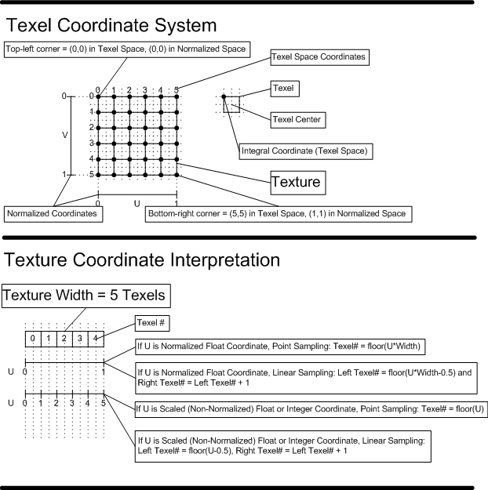
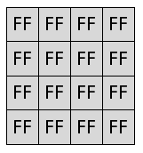
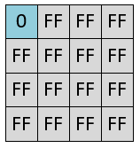
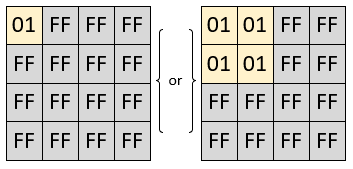
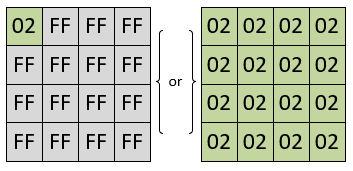

<a id="shader-internals"></a>

# Common shader internals

<a id="execution-terminology"></a>

## Execution terminology

| Term | Definition |
|---|---|
| Lane | A single thread of execution. The shader models before version 6.0 expose only one of these at the language level, leaving expansion to parallel SIMD processing entirely up to the implementation. |
| Wave | A set of lanes (threads) executed simultaneously in the processor. No explicit barriers are required to guarantee that they execute in parallel. Similar concepts include "warp" and "wavefront." |
| Inactive Lane | A lane which is not being executed, for example due to the flow of control, or insufficient work to fill the minimum size of the wave. |
| Active Lane | A lane for which execution is being performed. In pixel shaders, it may include any helper pixel lanes. |
| Quad | A set of 4 adjacent lanes corresponding, in pixel shaders, to pixels arranged in a 2x2 square at the applicable shading frequency. They are used to estimate gradients by differencing in either x or y. A wave may be comprised of multiple quads. All pixels in an active quad are executed (and may be "Active Lanes"), but those that do not produce visible results are termed "Helper Lanes". See [pixel quads](pixel-shaders.md#pixel-quads), [compute quads](compute.md#compute-quads), and [amplification/mesh derivatives](amplification-and-mesh-shaders.md#derivatives) for stage-specific formation. |
| Helper Lane | A lane which is executed to support gradients or other quad operations in pixel shader quads, or a lane that has been demoted with `discard`. The output of such a lane will be discarded, and so not render to the destination surface. See [pixel shader helper invocations](pixel-shaders.md#helper-lanes) for helper generation and wave operation participation. |

<a id="waves"></a>

## Wave operations and participation

Wave operations include queries, votes, broadcasts, reductions, scans and quad shuffles. They are available in Shader Model 6.0 and later. [`D3D12_FEATURE_DATA_D3D12_OPTIONS1::WaveOps`](devices-and-capabilities.md#d3d12_feature_data_d3d12_options1) reports wave operation support. `WaveLaneCountMin` and `WaveLaneCountMax` report the supported lane count range. Shader Model 6.9 requires wave operation support. `WaveGetLaneCount()` returns the current wave's lane count, including inactive lanes, while `WaveGetLaneIndex()` identifies the current lane.

Wave-wide votes/reductions operate on the active lanes at that operation. Divergent control flow can change this participating set. Reading a value from an inactive or nonexistent source lane is undefined. Floating-point reduction order is not defined. A program must not assume a fixed wave width or a stage-specific mapping not supplied by an explicit contract.

See [pixel shader helper participation](pixel-shaders.md#wave-helper-participation) for when helper lanes join wave operations.

<a id="program-model"></a>

## Program organization and availability

DXBC uses declared register files and tokenized instructions. DXIL uses typed static single assignment (SSA) values, LLVM instructions and `dx.op` operations.

The D3D12 shader paths described here use SM4.0-5.1 DXBC shader assets and supported SM6.x DXIL shaders. `D3D12_FEATURE_SHADER_MODEL` reports the supported shader model. Shader model, DXIL version, and optional device capabilities are distinct conditions. SM5.1 is the first shader model designed for D3D12, and the first one which allows dynamic indexing of resources. All D3D12 devices support at least SM5.1.

<a id="archive-7-1"></a>

## Instruction Counts

There are no limits on total shader program length or execution time (accounting for loops and subroutines), aside from any limitations in what may be expressed in the shader representation's encoding.

The absence of these program limits does not guarantee unbounded device execution time or forward progress.

<a id="archive-7-2"></a>

## Common instruction set

Aside from a few exceptions, the operations available to all shader stages are identical. The exceptions are operations that only make sense in a particular shader stage.

See [pixel shader derivatives](pixel-shaders.md#derivatives), [compute quads](compute.md#compute-quads) and [amplification and mesh shader derivatives](amplification-and-mesh-shaders.md#derivatives) for the stages that support implicit-derivative sampling. Explicit LOD and explicit gradient forms do not need implicit derivatives.

<a id="dxbc-model"></a>

## DXBC values, constants and linkage

<a id="archive-7-3"></a>

### Temporary Storage

Temporary storage is composed of a single Element type, which is a 4-tuple of untyped 32-bit quantities.
Temporary storage consists of two classes of storage: registers, which are non-indexed single elements; and arrays,
which are indexable 1D arrays of elements. Temporary storage is read/write, and is uninitialized at the start of a
Shader execution instance. Reads of temporary storage that has not been previously written within a Shader execution
instance return undefined values, but cannot return data outside of the GPU process context.

Temporary registers are [declared](https://microsoft.github.io/DirectX-Specs/d3d/archive/D3D11_3_FunctionalSpec.htm#inst_tempDCL) r#, and can be used as a temporary operand in Direct3D 12 instructions.

Temporary arrays are [declared](https://microsoft.github.io/DirectX-Specs/d3d/archive/D3D11_3_FunctionalSpec.htm#inst_indexableTempDCL) as x#[n], where “n” is the array length (indexed with 0..n-1).
Temporary arrays must be indexed by an r# scalar, statically indexed x# scalar, and/or an optional immediate constant (literal),
and can have only one level of index nesting (e.g. x0[x1[r0.x+1].x+1] is not legal, but x0[x1[1].x+1] is legal). A temporary array reference, x#[?], can be used
as a temporary operand in Direct3D 12 instructions (i.e. anywhere an r# can be used). Out of bounds access to x#[?] is undefined, except that
data outside the GPU process context is never visible.

The total quantity of temporary storage per Shader execution instance is 4096 elements, which can be utilized in
any combination of registers and arrays. i.e. the total number of r# and x# declared must be <= 4096.

Note that the namespace for r# and x# (the #) are independent. e.g. Suppose r2 and x2[5] are declared. They are independent, but together
both count as 6 units of storage against the limit of 4096 temporary registers.

To provide a run-time stack, a program allocates a temporary array of a fixed size. The program should provide its own stack bounds checking,
e.g., skip calls if the stack push would exceed the array bounds.

There is no limit on the total number of times temporary registers (the same one or different ones) that can appear in a single instruction or in a shader.

<a id="dxbc-double-packing"></a>

### Double-precision DXBC values

An exception to the 4-vector register convention exists for double-precision floating-point instructions, which operate on pairs of doubles.
Double-precision floating-point values are in IEEE 754R format. One double is stored in .xy with the least significant 32 bits in x, and the most significant 32 bits in y.
Similarly the second double is stored in .zw with the least significant 32 bits in z, and the most significant 32 bits in w.

The permissible swizzles for double operations are .xyzw, .xyxy, .zwxy, .zwzw. The permissible write masks for double operations are .xy, .zw, and .xyzw.

<a id="archive-7-4"></a>

### Immediate Constants

For any instruction source argument that is capable of taking a temporary register, it is also permitted
to supply 32-bit immediate scalar or 32-bit immediate 4-vector in the Shader code.

There is no limit on the total number of times immediate constants can appear in a single instruction or in a shader.

<a id="archive-7-5"></a>

### Constant Buffers

A constant buffer is accessed as a read-only operand to shader operations. See [root signatures](binding.md#root-signatures) for how shader constant buffer registers are mapped to constant buffers.

In Shader code, just as a t# register is a placeholder for a Texture, a cb# register is a placeholder for a ConstantBuffer at logical register #. A ConstantBuffer is accessed in a Shader
using: cb#[index] as an operand to Shader instructions, where 'index' can be either an r# or statically indexed x# containing a 32-bit unsigned integer,
an immediate 32-bit unsigned integer constant, or a combination of the two, added together.
e.g. "mov r0, cb3[x3[0].x+6]" represents moving Element 7 from the ConstantBuffer assigned to slot 3 into r0, assuming x3[0].x contains 1.

There is no limit on the total number of times constant buffer reads (from any buffer and location in the buffer) that can appear in a single instruction or in a shader.

The declaration of a ConstantBuffer (cb# register) in a Shader includes the following information:

- The size of the ConstantBuffer can be declared (a special flag allows for unknown-length).
- The Shader must indicate whether the ConstantBuffer will be accessed via Shader-computed offset values or only by literal offsets.
- The order that the declaration of a cb# appears in a Shader, relative to other cb# declarations, defines the priority
  of that ConstantBuffer, starting at highest priority.

For constant buffer descriptors that retain buffer bounds checking under the [descriptor promises](binding.md#static-promises), out of bounds access returns 0 in all
components. Out of bounds behavior is always with respect to the size of the buffer bound at that slot.
[Root constant buffer views](binding.md#root-descriptors) contain an address but no buffer size for bounds checking.

If the constant buffer bound to a slot is larger than the size declared in the shader for that slot,
implementations are allowed to return incorrect data (not necessarily 0)
for indices that are larger than the declared size but smaller than the buffer size.

Reads through a [null constant buffer descriptor](binding.md#null-descriptors) return zero.

<a id="archive-7-5-1"></a>

#### Immediate Constant Buffer

A DXBC shader program can [declare](https://microsoft.github.io/DirectX-Specs/d3d/archive/D3D11_3_FunctionalSpec.htm#inst_icbDCL)
a single Immediate Constant Buffer with up to 4096 4-vector
values. The data is tied to the shader program permanently, but otherwise behaves (gets accessed) by the shader exactly the same way as Constant Buffers.

There is no limit on the total number of times immediate constant buffer reads (from any location in the buffer) can appear in a single instruction or in a shader.

<a id="archive-7-6"></a>

### Shader Output Type Interpretation

The application is given control over the data type interpretation for
Shader outputs (i.e. writing raw integer values vs. writing normalized float values)
by simply choosing an appropriate format to interpret the output resource's contents as.
See the [Formats](formats.md#interpretation) section for detail.

<a id="archive-7-7"></a>

### Shader Input/Output

See the [vertex](vertex-processing.md#vertex-logical-interfaces), [hull](tessellation.md#dxbc-hull-processing), [domain](tessellation.md#domain-logical-interfaces), [geometry](geometry-shaders-and-stream-output.md#gs-dxbc-interface), [pixel](pixel-shaders.md#dxbc-storage) and [compute](compute.md#dxbc-compute) interfaces for stage-specific DXBC registers.

One thing in common about input/output registers for all shaders is that if they are [declared](https://microsoft.github.io/DirectX-Specs/d3d/archive/D3D11_3_FunctionalSpec.htm#inst_indexRange)
to be dynamically indexable from the shader, and the shader indexes them out of the declared range, results are undefined,
although no data from outside the GPU process context is ever visible.

<a id="core-operations"></a>

## Integer, floating-point and control flow operations

In DXIL, integer operations use [typed SSA values](#dxil-model) instead of the untyped DXBC registers described below.

<a id="archive-7-8"></a>
<a id="integer-instructions"></a>

### DXBC Integer Instructions

<a id="archive-7-8-1"></a>

#### Overview

There is a collection of instructions available to Shaders
which are dedicated to performing integer arithmetic and bitwise operations.
Operands and output registers for integer instructions can be any of the register
classes available to the floating point instructions. There is no data type associated with registers;
Shader instructions determine how the data stored in registers is interpreted.
Integer instructions simply assume that the data being read from operands and
written to the destination are all 32-bit values (unsigned or signed 2's complement, depending on the instruction).

<a id="archive-7-8-2"></a>

#### Implementation Notes

For the default full-precision DXBC path, shader register storage is made up of 32-bit\*4-component quantities,
and integer arithmetic on these registers is required to be performed at full 32 bit in all cases.

See the [minimum-precision model](#minimum-precision) for operands declared with a lower minimum precision.

<a id="archive-7-8-3"></a>

#### Bitwise Operations

The bitwise instructions are listed in the [Bitwise Instructions](https://microsoft.github.io/DirectX-Specs/d3d/archive/D3D11_3_FunctionalSpec.htm#BitwiseInstructions) sub-section
of the full instruction listing.

<a id="archive-7-8-4"></a>

#### Integer Arithmetic Operations

See the [Integer Arithmetic Instructions](https://microsoft.github.io/DirectX-Specs/d3d/archive/D3D11_3_FunctionalSpec.htm#IntegerArithmeticInstructions) sub-section of the full instruction listing.

<a id="archive-7-8-5"></a>

#### Integer/Float Conversion Operations

There is no implicit conversion between floating-point and integer values. Contents of registers are interpreted as float or ints by
the particular instruction being executed. Two instructions exist that allow explicit conversions to be performed,
listed in the [Type Conversion Instructions](https://microsoft.github.io/DirectX-Specs/d3d/archive/D3D11_3_FunctionalSpec.htm#TypeConversionInstructions) sub-section of the full instruction listing.

<a id="archive-7-8-6"></a>

#### Integer Addressing of Register Banks

Integer offsets for reads from register banks are available. These offsets must be scalar values (i.e. a
select swizzle must be used to select one component of any vector-valued register used as an index) and are considered
to be unsigned 32 bit values.

This indexing mechanism applied to indexable x# registers allows compilers to generate stack-like behavior for Shader subroutines.

An example syntax for indexing is:

```
mov r1, cb7[3+r2.x]
```

This instruction assumes that an unsigned 32-bit integer value exists in r2.x, and uses that value to offset into ConstantBuffer
7, starting from location 3 in the ConstantBuffer. Thus, if r2.x contains integer value 2, entry 5 of ConstantBuffer 7 would be referenced.

<a id="archive-7-9"></a>

### Floating-point operations

Floating-point operations must follow the Direct3D 12 [Floating Point Rules](numeric-and-data-rules.md#numeric-3-1).

<a id="archive-7-9-1"></a>
<a id="float-rounding"></a>

#### Integral rounding

Integral rounding returns a floating-point value rounded to an integer, using nearest-even, toward-negative-infinity, toward-positive-infinity or toward-zero rounding.

<a id="archive-7-10"></a>

### Vector vs Scalar Instruction Set

The DXBC intermediate language (IL) and register model are 4-vec oriented. This does not constrain the hardware implementation to a vector machine: implementations may operate on scalars or combinations of layouts.

Register indexing addresses input/output registers as vectors. It does not provide subcomponent scalar array indexing. See the [DXIL value model](#dxil-model) for the DXIL representation.

<a id="archive-7-12"></a>
<a id="limitations-on-flow-control-and-subroutine-nesting"></a>

### DXBC flow control and subroutine nesting

A flow control block is defined as an
[if](https://microsoft.github.io/DirectX-Specs/d3d/archive/D3D11_3_FunctionalSpec.htm#inst_IF_CONDITION) block,
[loop](https://microsoft.github.io/DirectX-Specs/d3d/archive/D3D11_3_FunctionalSpec.htm#inst_LOOP) block, or
[switch](https://microsoft.github.io/DirectX-Specs/d3d/archive/D3D11_3_FunctionalSpec.htm#inst_SWITCH) block.
Flow control blocks can nest up to 64 deep per subroutine (and main). Behavior
of flow control instructions beyond this nesting limit is undefined.

Subroutines can nest up to 32 deep.
If there are already 32 entries on the return
address stack and a "call" is issued, the call is skipped over.

For DXIL, see [Control flow and functions](#dxil-control-flow).

<a id="resource-access"></a>

## Resource selection and memory access boundaries

Shader Model 5.1 and later shaders can select resources and samplers with shader-computed indices. DXIL represents resources as handles. Shader Model 6.6 and later shaders can also select descriptors through [direct heap indexing](binding.md#direct-indexing).

A potentially non-uniform resource or sampler index must carry the `NonUniformResourceIndex` indication. Omitting the required indication gives undefined results. For implicit derivatives, the selected resource and contributing coordinate values must satisfy the stage's derivative/quad rules. For these derivative operations, Shader Model 6.7 introduces [`QuadAny`](pixel-shaders.md#quadany) and [`QuadAll`](pixel-shaders.md#quadall), making it simpler to maintain quad-uniform control flow even if different quads of a wave diverge.

Typed accesses use the resource dimension's element coordinates. Raw accesses use byte offsets. Structured accesses use a structure index and byte offset within the structure. See [DXBC alignment](memory-model.md#shared-memory-alignment) and [resource/shared memory access bounds](memory-model.md#shared-memory-bounds) for their distinct invalid and out-of-bounds cases. DXIL raw buffer and native 16-bit access alignment depends on the operation and type rather than a universal four-byte rule. [Typed UAV load support](formats.md#typed-uav-loads) depends on the device and format, separately from ordinary SRV texture loads.

See [multisampled texture UAVs](binding.md#multisampled-texture-uavs) for their shader declarations and sample-index access.

<a id="dxil-model"></a>

## DXIL values, storage, signatures and operation families

A DXIL module identifies its shader model and entry functions in metadata. Signature metadata describes pipeline inputs and outputs. Resource metadata describes SRV, UAV, CBV and sampler ranges.

### Primitive types

* `void`, `metadata`
* `i1`, `i8`, `i16`, `i32`, `i64`
* `half`, `float`, `double`

SM6.0 assumes native hardware support for i32 and float types.

In the baseline scalarized representation, i8 is supported only in a few intrinsics to signify masks, enumeration constant values, or in metadata. It's not supported for memory access or computation by the shader.

HLSL min12int, min16int and min16uint data types are mapped to i16.

<ins><!-- d3d12-review-inline:begin:common-shader-internals:minimum-precision:0:authored:primitive-types -->The precision semantics of `half` and `i16` depend on the [DXIL minimum-precision mode](#dxil-minimum-precision).<!-- d3d12-review-inline:end:common-shader-internals:minimum-precision:0:authored:primitive-types --></ins>

Native 16-bit operations have [shader model, compiler mode and device support requirements](numeric-and-data-rules.md#native16). Double-precision operations require [double support](numeric-and-data-rules.md#numeric-3-1-4). Integer 64-bit operations require [`Int64ShaderOps`](devices-and-capabilities.md#d3d12_feature_data_d3d12_options1). Shader Model 6.9 requires 64-bit integer shader operations.

### Values and storage

There is no limit on the number of virtual values in DXIL. The IR is guaranteed to be in an SSA form.

In the baseline DXIL representation, HLSL vectors are scalarized. They do not participate in computation; however, they may be present in declarations to convey original variable layout to tools, debuggers, and reflection.

DXIL 1.9 and later also support [native vector types and operations](#dxil-vectors).

Matrices are lowered to vectors, and are not referenced by instructions. They may be present in declarations to convey original variable layout to tools, debuggers, and reflection.

In the baseline scalarized representation, instructions may reference only 1D arrays of primitive types. However, complex arrays, e.g., multidimensional arrays or user-defined types, may be present to convey original variable layout to tools, debuggers, and reflection.

Original HLSL user-defined types (UDTs) are lowered and are not referenced by instructions. However, they may be present in declarations to convey original variable layout to tools, debuggers, and reflection. Some resource operations return 'grouping' UDTs that group several return values; such UDTs are immediately 'decomposed' into components that are then consumed by other instructions.

Explicit conversions between types are supported via LLVM instructions.

There is no immediate constant buffer in DXIL. Instead, indexable constants are represented via LLVM global initialized constants in address space ASicb.

A texture buffer is mapped to RawBuffer. Texture buffer variable declarations are present for reflection purposes only.

Indexable threadlocal memory (DXBC x-registers) is linear in DXIL. Threadlocal variables are "declared" via alloca instructions. Threadlocal variables are assumed to reside in addrspace(0). The variables are not allocated into some memory pool; the driver compiler can do this, if desired. Accesses to threadlocal variables occur via pointer load/store instructions.

<a id="dxil-control-flow"></a>

### Control flow and functions

The DXIL control-flow graph must be reducible, as checked by T1-T2 test. There is no fixed DXIL control-flow nesting limit. Switch label blocks may fall through.

DXIL uses LLVM functions and call instructions. Recursion is not allowed. Function parameters can be passed by value or by reference. Driver compilers may inline functions.

### Signatures

Formal parameters of a shader entry function in HLSL specify how the shader interacts with the graphics pipeline. Input parameters, referred to as an input signature, specify values received by the shader. Output parameters, referred to as an output signature, specify values produced by the shader. The shader compiler maps HLSL input and output signatures into DXIL specifications that conform to hardware constraints outlined in the Direct3D Functional Specification. DXIL specifications are also called signatures.

Signature mapping is a complex process, as there are many constraints. All signature parameters must fit into a finite space of N 4x32-bit registers. For efficiency reasons, parameters are packed together in a way that does not violate specification constraints. The process is called signature packing. Most signatures are tightly packed; however, the VS input signature is not packed, as the values are coming from the Input Assembler (IA) stage rather than the graphics pipeline. Alternately, the PS output signature is allocated to align the SV_Target semantic index with the output register index.

### Operations

DXIL uses a subset of core LLVM IR instructions that make sense for HLSL, where the meaning of the LLVM IR operation matches the meaning of the HLSL operation.

Operations missing in core LLVM IR, such as abs, fma, discard, etc., are represented by external functions, whose name is prefixed with dx.op.

The very first parameter of each such external function is the opcode of the operation, which is an i32 constant. For example, dx.op.unary computes a unary function T res = opcode(T input). Opcode defines which unary function to perform.

Arithmetic and bitwise operations use typed LLVM IR instructions, including `add`/`fadd`, `sdiv`/`udiv`, and `and`/`or`/`xor`. `fptosi`, `fptoui`, `sitofp` and `uitofp` perform explicit numeric conversions between floating-point and integer values. For arithmetic precision and exceptional values, see [Numeric and data rules](numeric-and-data-rules.md#numeric-3-1).

For [integral rounding](#float-rounding), the corresponding DXIL operations are `Round_ne`, `Round_ni`, `Round_pi` and `Round_z`.

Operations involving shader resources and samplers are expressed via external function calls.

Wherever applicable, the return type indicates the "precision" at which the operation is executed. For example, sample intrinsic that returns half data is allowed to be executed at half precision, assuming hardware supports this; however, if the return type is float, the sample operation must be executed in float precision. If lower-precision is not supported by hardware, it is allowed to execute a higher-precision variant of the operation.

A resource access uses a typed resource handle. Sampler operations additionally use a sampler handle. Sample/load returns group the data components with a mapping status result.

<a id="dxil-texture-operands"></a>

### Texture operands and results

DXIL texture operations pass coordinates and offsets as separate scalar operands. DXIL offset operands are `i32`. For sampling an array, `c1` is the slice coordinate for a 1D array, `c2` for a 2D array, and `c3` selects the cube for a cube array. `dx.op.sampleGrad` takes x and y derivatives for each spatial coordinate, excluding the array coordinate.

`dx.op.sampleBias` supplies the shader bias. `dx.op.sampleLevel` supplies an explicit LOD. `dx.op.textureLoad` uses integer texel coordinates and a mip level or multisample index. `dx.op.textureGather` takes an explicit channel selector.

<a id="dxil-vectors"></a>

### DXIL vectors

Native vectors are allowed in DXIL version 1.9 or greater.
These can be stored in allocas, static globals, groupshared variables, and SSA values.
They can be loaded from or stored to raw buffers and used as arguments to a selection
of element-wise intrinsic functions as well as the standard math operators.
They cannot be used in shader signatures, constant buffers, typed buffer, or texture types.

Devices that support Shader Model 6.9 are required to fully support this feature.

<a id="dxil-vector-storage"></a>

#### Vector storage and indexing

In alloca and variable representations, individual vectors are represented as a single native vector and arrays of vectors remain as arrays of native vectors, though multi-dimensional arrays are flattened to one dimension.

Single-element vectors are represented as scalars, except in exported library functions, which retain vector representations to correctly match overloads when linking. Native vector use in earlier shader models is restricted to exported library functions.

Native vectors can be dynamically accessed using `extractelement`, `insertelement`, `shufflevector` or `getelementptr` operations.

<a id="dxil-vector-elementwise"></a>

#### Vector operations

Elementwise intrinsics compute each result element from the corresponding elements of their vector arguments.

The scalar variants of these DXIL intrinsics can be used in conjunction with the vector variants within the same shader.

The [DXIL appendix](dxil.md#native-vectors) defines the native vector buffer intrinsics, their operands and return types, supported intrinsic overloads, and vector reductions and dot products.

<a id="texture-loads"></a>

## Texture coordinates and unfiltered resource loads

<a id="archive-3-3-2"></a>

### Texel Coordinate System

The texel coordinate system has its origin at the top-left corner of the texture, consistent with the [Pixel Coordinate System](rasterization.md#pixel-coordinates). See the [texture coordinate diagram](#archive-3-3-3).

<a id="archive-3-3-3"></a>

### Texture Coordinate Interpretation

Texture sampling uses normalized floating-point spatial coordinates unless a [non-normalized coordinate sampler](#non-normalized-coordinates) is selected. Texture loads use scaled integer coordinates.
The "Texture Coordinate Interpretation" diagram below describes how these interpretations get mapped to specific texel(s),
for point and linear sampling. The diagram does not illustrate address wrapping, which
occurs after the shown equations for computing texel locations. The addressing math shown in this diagram
is only a general guideline, and exact definition of texel selection arithmetic is provided in the [Texture Sampling](#archive-7-18) section,
including the role of [Fixed Point](numeric-and-data-rules.md#numeric-3-2-4-1) snapping of precision in the addressing process.



<a id="archive-7-16"></a>

### Textures and Resource Loading

A Resource binding is a representation of a Resource's base pointer (and other data such as size and pixel layout) and is independent of the samplers.

The resource view defines the element interpretation and accessible subresources. [Resource selection](#resource-access) can index descriptor ranges. A texture array index instead selects a slice within one resource view. Typed buffers have a format-implied element stride; structured and raw buffer accesses have their own layouts and bounds.

Texture data is accessed in shaders through load and sample operations. Loads provide a simple read and optional format conversion using integer addresses. Sampling uses sampler-controlled addressing and filtering in addition to format conversion.

<a id="texel-offsets"></a>

### Texel space offsets for loads and samples

Texel offsets are applied in the selected mip's texel space, never along an array axis. The offset range is `[-8,7]`. Before Shader Model 6.7, these offsets must be immediate values. Cube sampling has no spatial texel offset operand.

<a id="programmable-offsets"></a>

Shader Model 6.7 and later permit variable offsets when [`D3D12_FEATURE_DATA_D3D12_OPTIONS14::AdvancedTextureOpsSupported`](devices-and-capabilities.md#d3d12_feature_data_d3d12_options14) is supported. For programmable offsets, only the four least significant bits are honored as a signed value.

<a id="archive-7-17"></a>

### Texture Load

The load operation performs a non-filtered read of resource data.

Texture loads use integer texel coordinates and an explicit mip level, without a sampler: no address mode wrapping, filtering or LOD bias is applied. Buffer loads do not have a mip level. Texture array indices are integer slice indices and are not spatially filtered. Integer coordinate/mip/slice out-of-range SRV loads return zero for present components and the format's [missing-component defaults](formats.md#missing-components). A compatible load through a [null descriptor](binding.md#null-descriptors) returns zero in all components.

Loading an `R32_FLOAT` value into a 32-bit shader value preserves its bits, including denormals, unlike filtered sampling.

<a id="archive-7-17-1"></a>

#### Multisample Resource Load

Multisample resources can be set as shader inputs, which allows individual samples to be read by the shader. `Texture2DMS` and `Texture2DMSArray` use an unfiltered load and a zero-based sample index. They do not support sampler filtering.

In SM4.1 and later, including the D3D12 DXBC and DXIL paths described here, the multisample load operation is available in all shader stages, permits a nonliteral sample index, does not require the sample count in the resource declaration and supports depth/stencil views. The SM4.0 profile required pixel shader use, a declared sample count and a literal sample index.

<a id="msaa-index-bounds"></a>

##### MSAA sample index bounds

Multisample loads follow the texture load rules, with an additional zero-based sample index selecting a sample from a 2D multisampled resource.

The result of specifying a sample index outside the resource's zero-based sample index range
is undefined, but cannot return data outside of the GPU process context.

<a id="sampler-model"></a>

## Sampler and filtering model

See [Static and dynamic samplers](binding.md#samplers) for sampler descriptions and creation. The normalized coordinate algorithms below apply unless a [non-normalized coordinate sampler](#non-normalized-coordinates) is selected.

<a id="archive-7-18-14"></a>

### Sample Return Value Type Interpretation

The application is given control over the return type of texture load
operations (i.e. reading raw integer values vs. reading normalized float values)
by simply choosing an appropriate format to interpret the resource's contents as.
See the [Formats](formats.md#interpretation) section for detail.

<a id="integer-sampling"></a>

### Integer sampling

Sampling integer formats requires Shader Model 6.7 or later and [`D3D12_FEATURE_DATA_D3D12_OPTIONS14::AdvancedTextureOpsSupported`](devices-and-capabilities.md#d3d12_feature_data_d3d12_options14).
Integer samples may not use any `LINEAR` or `ANISOTROPIC` filtering modes.
These D3D12_FILTER options are allowed:

- `D3D12_FILTER_MIN_MAG_MIP_POINT`
- `D3D12_FILTER_MINIMUM_MIN_MAG_MIP_POINT`
- `D3D12_FILTER_MAXIMUM_MIN_MAG_MIP_POINT`

<a id="array-coordinates"></a>

### Array coordinates

For Texture1D arrays, the array slice coordinate follows the single spatial coordinate and selects the array slice to fetch from. This is
always treated as a scaled float value, as opposed
to the normalized space for standard texture
coordinates, and a round-to-nearest even is applied on
the value, followed by a clamp to the available texture view array
range.

For Texture2D arrays, the array slice coordinate follows the two spatial coordinates and otherwise uses the Texture1D array slice rules.

For TextureCubeArray, the additional coordinate selects a cube rather than a face; a floating-point cube index is rounded to nearest even.

<a id="sample-offsets"></a>

### Texel space sample offsets

The spatial-offset forms of `Sample`, `SampleBias`, `SampleCmp`, `SampleCmpLevelZero`, `SampleGrad` and `SampleLevel` use the same [texel offset representation and availability](#texel-offsets) as `Load`.

The offsets are added to the texture coordinates, in texel
space, relative to each miplevel being accessed.
So even though texture coordinates are provided as
normalized float values, the offset applies a texel-space
integer offset.

Address offsets are not applied along the array axis of
Texture1D/2D Arrays.

Address wrapping modes (wrap/mirror/clamp/border etc.)
from the sampler state are applied AFTER any
address offset is applied to texture coordinates.

<a id="point-sample-float32"></a>

### Point sample float32 values

When a 32-bit float value
is returned by sampling as a 32-bit shader value,
with point sampling (no filtering), denormal values may or may
not be flushed (but otherwise numbers are unmodified).  In the
unlikely event this uncertainty with point sampling denormal
values is an issue for an application, a workaround is to use
a texture load instead, which
guarantees 32-bit float
values are read unmodified.

<a id="implicit-lod-sharing"></a>

### Implicit LOD sharing

For implicit-gradient sampling, implementations can choose to
share the same LOD calculation across all 4 pixels
in a 2x2 stamp (but no larger area), or perform
per-pixel LOD calculations.

Given derivatives, the rest of the LOD determination
is described in the [LOD Calculations](#archive-7-18-11) section.

<a id="sample-gradients"></a>

### Explicit gradients and exceptional values

Explicit-gradient sampling uses shader-supplied derivatives of the spatial texture coordinates in the x and y directions. These derivatives are in normalized texture coordinate space.

The x-direction derivatives specify du/dx, dv/dx and dw/dx for the spatial dimensions present in the texture. The y-direction derivatives specify du/dy, dv/dy and dw/dy. Explicit-gradient sampling calculates LOD independently for each pixel shader invocation, rather than sharing one calculation across a 2x2 pixel group.

If the derivative inputs to explicit-gradient sampling came from derivative
calculation instructions in the Pixel Shader and
the values include INF/NaN, the behavior of explicit-gradient sampling
may not match implicit-gradient sampling (which implicitly
computes the derivative).  i.e. The INF/NaN values
may affect the LOD calculation differently.

<a id="archive-7-18"></a>

## Texture Sampling

<a id="archive-7-18-1"></a>

### Overview

This section describes the mechanics of sampling Texture1D/2D/3D/Cube resources using filtering. The
simplest form of filtered texture access is point sampling. See [Formats](formats.md#support) for which formats support sampling and filtering. [Integer sampling](#integer-sampling) has additional shader model and capability conditions.

These algorithms describe texture sampling operations, including sampling with implicit gradients, shader-supplied gradients or an explicit LOD.

Unless otherwise noted, all texture sampling address operations are performed according to the arithmetic processing rules described in the [Numeric and data rules](numeric-and-data-rules.md#numeric-3-1) section.

The following sections do not fully or exactly specify every required texture filtering algorithm. They explicitly define only a subset of the filtering features available in Direct3D 12.

<a id="archive-7-18-4"></a>

### Normalized Space Texture Coordinate Magnitude vs. Maximum Texture Size

The magnitude of normalized-space texture coordinates (allowing for texture tiling) has no effect on the maximum supportable
texture dimensions that can be sampled. The only catch is that as the absolute magnitude of a normalized-space
texture coordinate gets larger (e.g. large amounts of tiling), floating point dictates that less precision will be available to resolve individual texels in a given
tiling of the texture being sampled. Large amounts of tiling of large dimension textures will yield sampling artifacts where float32 precision becomes
inadequate. But separate from this tradeoff, in order to otherwise achieve decoupling of the magnitude of normalized-space texture coordinates from
having any effect on maximum texture dimension that can be sampled given float32 normalized-space addressing, a range reduction to about
[-10...10], depending on the scenario,
is applied on the texture coordinates.

Details of this range reduction are described in [Reducing Texture Coordinate Range](#archive-7-18-6). The reduction happens before scaling
texture coordinates by texture size, conversion to fixed point, and final application of Texture Address modes (CLAMP/MIRROR/WRAP etc.) on
texel addresses. The range reduction allows the fixed point representation to not have to dedicate storage for the texture tiling.
It is important to note that range reduction is a separate step from applying Texture Address mode
(although the particular Texture Address mode affects what type of reduction gets used).

Using range reduction to decouple texture coordinate magnitude from supportable texture size has the following implication: The
theoretical maximum texture dimension permitted by the addressing precision is 2^15. This limit is
derived starting with 24 bits of float32 fractional precision for the original texture coordinate, subtracting required subtexel precision
(8 bits), and subtracting 1 more bit due to the factor of 2 scaling in the reduced range: `24 - 8 - 1 = 15`.
Direct3D 12 fixes the maximum dimension of 1D and 2D textures at 16384 texels. Implementations must support this limit and may not expose larger dimensions. See [Texture dimension limits](resources.md#texture-dimension-limits).

<a id="archive-7-18-5"></a>

### Processing Normalized Texture Coordinates

This section describes in general how to convert a normalized texture
coordinate to a texture address. The description is based on sampling a
Texture1D, but applies equally to Texture2D and Texture3D (and not TextureCubes).

A normalized texture coordinate (U) maps the range [0, 1] to the range [0,
numTexelsU], where numTexelsU is the size of a 1D texture in texels. The
process of computing a texture address is as follows:

- Reducing the normalized texture coordinate range based on the texture
  address mode
- Performing point sample or linear sample addressing (scaling the normalized
  texture coordinate by the texture size and snapping the value to a fixed point
  number with 8 bits fraction).
- Applying the texture address mode

<a id="archive-7-18-6"></a>

### Reducing Texture Coordinate Range

To limit the number of bits needed to store the texture coordinate in fixed point after
conversion from floating point, the range of
the normalized texture coordinate is reduced to be within
[-10,10], depending on the Address mode. This
removes the magnitude of texture tiling from the texture coordinate, while not affecting the behavior of texture address wrap modes.
The same address mode handling can be applied to the range reduced texture coordinate as the original, producing the same result.
The benefit is that the magnitude of texture tiling is not stored in the coordinate at the same time that
texture size scaling is performed on the coordinate. This enables far larger texture coordinate range to be handled cleanly than
would otherwise be possible without reduction.

Note that the range reductions applied here in some cases
leave a bit of extra padding (up to [-10,10] mentioned). This padding allows for
the fact that after scaling by texture size, the selection of texels for point or
linear sample kernels involves picking texel(s) to the left and/or right of the
sample location, so coordinates that are not near the boundaries of the
addressing mode must not appear as if they are on the boundary. e.g.
Consider Linear sampling a coordinate that straddles a border when in BORDER mode:
this needs to pick up the Border Color for 1/2 of the samples and the interior edge of the texture
for the other 1/2. However range reduction cannot just clamp to [0..1) for BORDER mode, because it would
make coordinates that fall completely into BORDER territory incorrectly behave as if they straddle
the border (picking up some contribution of Border Color and interior). Range reduction
has to also allow for texel offsets permitted in shader code. Range reduction does
not change expected texture sampling behavior; it just helps keep the sequence of floating point operations
on texture coordinates within manageable range.

The following logic describes how normalized texture coordinate range reduction
is performed. (This is different from final [Texture
Address Processing](#archive-7-18-9), which happens a couple of steps later, on scaled coordinates that identify texels.)

```
Given:
float signedFrac(float f) returns (f - trunc(f)) // trunc : "round towards zero"
float frac(float f) returns (f - floor(f))      // floor : "round towards negative infinity"

We have:
```

```
float ReduceRange(float U, D3D12_TEXTURE_ADDRESS_MODE AddressMode)
{
    switch (AddressMode)
    {
    case D3D12_TEXTURE_ADDRESS_MODE_WRAP:
        // The reduced range is [0, 1)
        return frac(U);
    case D3D12_TEXTURE_ADDRESS_MODE_MIRROR:
        // The reduced range is (-2, 2)
        return signedFrac(U/2) * 2;
    case D3D12_TEXTURE_ADDRESS_MODE_MIRROR_ONCE:
    case D3D12_TEXTURE_ADDRESS_MODE_CLAMP:
    case D3D12_TEXTURE_ADDRESS_MODE_BORDER:
        // The reduced range is [-10, 10].
        // Each of these modes might use different tightnesses of reduced range,
        // but since there really is no benefit in that, a one-size-fits-all
        // approach is taken here.
        // Note that the range leaves room for immediate texel-space offsets
        // supported by sample instructions, [-8...7],
        // preventing these offsets from causing texcoords that clearly should
        // be out of range (i.e. in border/clamp region) from falling within
        // range after range reduction.  The point is that range reduction does
        // not have an affect on the texels that are supposed to be chosen.
        if(U <= -10)
            return -10;
        else if(U >= 10)
            return 10;
        else return U;
    }
    return 0;
}
```

Note that the amount of padding supported here for mirroronce/clamp/border are only feasible for use with point or linear filtering of a texture (a larger kernel becomes more likely to expose the
reduced range boundary), including with texel offsets from the shader. Furthermore, complex filters which use point or linear filter taps as building blocks (key example being Anisotropic Texture Filtering) are perfectly
compatible with the specified range reduction. The reason is that such filters choose their "taps" by perturbing normalized texture coordinates (e.g. walking the line of
anisotropy in Anisotropic Texture Filtering), and thus each perturbed "tap" individually goes through the range reduction described here before application of the usual
Point/Linear Sample Addressing logic and Texture Address Processing described below.

<a id="archive-7-18-7"></a>

### Point Sample Addressing

Setting aside how sampler state is configured and how mipmap LOD is chosen, consider simply the task of point sampling an Element from a particular
miplevel of a Texture1D, given a scalar floating point texture coordinate in normalized space. In the [Texture Coordinate Interpretation](#archive-3-3-3) section,
there is a diagram illustrating generally how a 1D texture coordinates maps to a texel (not accounting for wrapping). Note from the
"Texture Coordinate System" diagram shown that texel corners have integral coordinates in texel-space, and so texel centers are at half-units away from the corners.
Point sampling selects the "nearest" texel based on the proximity of texel centers to the texture coordinate (keeping in mind that texel centers are at half-units):

- Given a 1D texture coordinate in normalized space U, assumed to be any float32 value.
- U is scaled by the Texture1D size. Call this scaledU
- scaledU is converted to at least 16.8 [Fixed Point](numeric-and-data-rules.md#numeric-3-2-4-1). Call this fxpScaledU.
- The integer part of fxpScaledU is the chosen texel. Call this t. Note that the conversion to [Fixed Point](numeric-and-data-rules.md#numeric-3-2-4-1) basically accomplished: t = floor(scaledU).
- If t is outside [0...numTexels-1] range, D3D12_SAMPLER_DESC's AddressU mode is [applied](#archive-7-18-9).

For Texture2D and Texture3D Resources, the same rules apply independently on the other dimensions.

For TextureCube Resources, the following occurs:

- Choose the largest magnitude component of the input vector. Call this magnitude of this value AxisMajor. In the case of a tie, the following precedence should occur: Z, Y, X.
- Select and mirror the minor axes as defined by the [TextureCube](https://microsoft.github.io/DirectX-Specs/d3d/archive/D3D11_3_FunctionalSpec.htm#TextureCube) coordinate space. Call this new 2d coordinate Position.
- Project the coordinate onto the cube by dividing the components Position by AxisMajor.
- Transform to 2d Texture space as follows: Position = Position \* 0.5f + 0.5f;
- Convert the coordinate to fixed point as for a Texture2D.

<a id="point-address-rounding"></a>

### Point address rounding capability

Nearest-even fixed-point conversion can snap a coordinate just below a texel boundary into the next texel.

For `PointSamplingAddressesNeverRoundUp` implementations, conversion to fixed point should use round-toward-negative-infinity as the ideal rounding mode, with an allowance for truncate / round-towards-zero. Essentially, for non-negative coordinates, this snapping should never occur.

`D3D12_FEATURE_DATA_D3D12_OPTIONS19::PointSamplingAddressesNeverRoundUp` reports this behavior. This feature is required for drivers with DDI version 0102 and newer.

<a id="archive-7-18-8"></a>

### Linear Sample Addressing

As in [Point Sample Addressing](#archive-7-18-7), set aside how sampler state is configured and how mipmap LOD is chosen for now, and consider simply the task of linear sampling
an Element from a particular miplevel of a Texture1D, given a scalar floating point texture coordinate in normalized space. Linear sampling in 1D selects the nearest
two texels to the sample location and weights the texels based on the proximity of the sample location to them.

- Given a 1D texture coordinate in normalized space U, assumed to be any float32 value.
- U is scaled by the Texture1D size, and 0.5f is subtracted. Call this scaledU.
- scaledU is converted to at least 16.8 [Fixed Point](numeric-and-data-rules.md#numeric-3-2-4-1). Call this fxpScaledU.
- The integer part of fxpScaledU is the chosen left texel. Call this tFloorU. Note that the conversion to [Fixed Point](numeric-and-data-rules.md#numeric-3-2-4-1) basically accomplished: tFloorU = floor(scaledU).
- The right texel, tCeilU is simply tFloorU + 1.
- The weight value wCeilU is assigned the fractional part of fxpScaledU, [converted to float](numeric-and-data-rules.md#numeric-3-2-4-2) (although using less than full float32 precision for computing and processing wCeilU and wFloorU is permitted).
- The weight value wFloorU is 1.0f - wCeilU.
- If tFloorU or tCeilU are out of range of the texture, D3D12_SAMPLER_DESC's AddressU mode is [applied](#archive-7-18-9) to each individually.
- Since more than one texel is chosen, the single sample result is computed as:

  ```
  texelFetch(tFloorU) * wFloorU +
  texelFetch( tCeilU) *  wCeilU
  ```

The procedure described above applies to linear sampling of a given miplevel of a Texture2D as well:

- Perform the texel selection to both U and V directions independently, producing 2 U texel locations and 2 V texel locations. Combined, these
  select 4 texels: (tFloorU,tFloorV), (tFloorU,tCeilV), (tCeilU,tFloorV), (tCeilU,tCeilV).
- There are also 4 weight values produced: wFloorU, wCeilU, wFloorV, wCeilV.
- The linear sample result is:

  ```
  texelFetch(tFloorU,tFloorV) * wFloorU * wFloorV +
  texelFetch(tFloorU, tCeilV) * wFloorU *  wCeilV +
  texelFetch( tCeilU,tFloorV) *  wCeilU * wFloorV +
  texelFetch( tCeilU, tCeilV) *  wCeilU *  wCeilV
  ```

Performing linear sampling of a miplevel of a Texture3D Resource extends the concepts described above to fetching of 8 texels.

In the case of a TextureCube, see the section regarding [TextureCube Edge and Corner Handling](#archive-7-18-12)

<a id="archive-7-18-9"></a>

### Texture Address Processing

Texture sampling operations use texture coordinates in normalized floating point form, such that values in
[0..1] range span a given dimension of a texture, and values outside this range fall off the borders of the
texture. Later in the filtering process, when individual texels are fetched,
if the address is outside the extents of the texture, either the address gets mapped back into range by the texture address mode for each component,
or the border-color is used. The texture address mode is defined by the AddressU, AddressV, and AddressW members of D3D12_SAMPLER_DESC.

Consider the moment in the process of sampling of a Texture1D just after picking a particular integer address scaledU to fetch a texel from
(details on choosing sample locations described elsewhere for various filter modes). Suppose the texel address scaledU falls off the Texture1D,
meaning either (scaledU < 0), or (scaledU > numTexelsU - 1), where numTexelsU is the count of texels in the U dimension of the Texture1D.
The following pseudocode describes how the setting on D3D12_SAMPLER_DESC member AddressU gets applied on scaledU:

```
if ((scaledU < 0) || (scaledU > numTexelsU-1))
{
    switch (AddressU)
    {
    case D3D12_TEXTURE_ADDRESS_MODE_WRAP:
        scaledU = scaledU % numTexelsU;
        if(scaledU < 0)
            scaledU += numTexelsU;
        break;
    case D3D12_TEXTURE_ADDRESS_MODE_MIRROR:

        {
            if(scaledU < 0)
                scaledU = -scaledU - 1;
            bool Flip = (scaledU/numTexelsU) & 1;
            scaledU %= numTexelsU;
            if( Flip ) // Odd tile
                scaledU = numTexelsU - scaledU - 1;
            break;
        }
    case D3D12_TEXTURE_ADDRESS_MODE_CLAMP:
        scaledU = max( 0, min( scaledU, numTexelsU - 1 ) );
        break;
    case D3D12_TEXTURE_ADDRESS_MODE_MIRROR_ONCE:
        if(scaledU < 0)
            scaledU = -scaledU - 1;
        scaledU = max( 0, min( scaledU, numTexelsU - 1 ) );
        break;
    case D3D12_TEXTURE_ADDRESS_MODE_BORDER:
        // Special case: Instead of fetching from the texture,
        // use the Border Color.
        bUseBorderColor = true;
        break;
    default:
        scaledU = 0;
    }
}
```

For Texture2D and Texture3D, all of the above modes apply to the V and W dimensions independently, based on AddressV and AddressW. If any single dimension selects Border Color, then the
[Border Color](#archive-7-18-9-1) is applied.

<a id="archive-7-18-9-1"></a>

#### Border Color

For floating-point border color samplers, border color values are defined in the DDI via 4 floating point values (RGBA), in linear space. The Border Color used
in filtering is snapped to the precision the hardware performs filtering at for the format.

Note that the only components of the BorderColor used by filtering hardware are the ones present in the resource format
description.

For example, suppose the resource format is DXGI_FORMAT_R8_SNORM, and BorderColor is needed during a sample operation.
In this case only the RED component of BorderColor is used, along with the appropriate format-specific
defaults for the other components. The BorderColor (the red part in this case) is taken as floating-point data and
clamped into the range of the format before filtering. In this case, the red part of the BorderColor is clamped to
[-1.0f,1.0f] range before being used by the filtering hardware.
From this point (entering the filtering hardware) onward, the fact that BorderColor is being used has no more
behavioral effect.

<a id="integer-border-colors"></a>

[`D3D12_SAMPLER_FLAG_UINT_BORDER_COLOR`](binding.md#sampler-fields) selects integer border values for dynamic samplers.

For signed texture formats, the border color values are treated
as 32-bit signed integers instead. For texture formats where the
components are smaller than 32 bits, it is undefined whether the
hardware will truncate or clamp.

<a id="border-color-component-mapping-order"></a>

**Note**: D3D does not currently define an ordering between retrieving
border color values and applying SRV swizzles, and different hardware
may apply these in opposite orders. Additionally, for stencil data,
D3D defines that the shader should retrieve the value in the G channel,
which some hardware may achieve by using SRV swizzles. Therefore, it
is possible that when sampling stencil and passing out-of-bounds coordinates
to return a border color, the border value returned to the shader in the G
channel (unless otherwise redirected via an SRV swizzle) may be the value
specified in the sampler's border color in *either* the R or G channel.

<a id="lod-and-anisotropy"></a>

## Mip selection, gradients, bias and anisotropy

<a id="archive-7-18-10"></a>

### Mipmap Selection

Suppose the task at hand is to choose a mipmap level from a Resource, given a floating point LOD value. The
choice of mipmap level is based on the particular choice of filter mode in the [Sampler State](#sampler-model);
in which the possible choices are POINT and LINEAR. Ordinary anisotropic texture filtering uses LINEAR mipmap selection; [point mip anisotropic filtering](#anisotropic-point-mip) is a capability-dependent alternative.

- If the Sampler defines a Filter for which MIP is set to POINT (otherwise known as 'nearest'), the LOD is first converted to at least 8.8
  fixed point (if not already in fixed point form), 0.5 is added, and then the integer part of the LOD is taken as the mipmap level (clamped
  to available miplevels or any settings for clamping miplevels). This selects the "nearest" miplevel.
- If the Sampler defines a Filter for which MIP is set to LINEAR:
  - The two nearest mipmaps are selected as follows.
  - First, the LOD is converted to at least 8.8
    fixed point (if not already in fixed point form). Call this fxpLOD.
  - The integer part of the fxpLOD is the first miplevel. Call this mipFloor.
  - The second miplevel, call it mipCeil, is mipFloor+1.
  - The selected miplevels are clamped to the range of mipmaps available, plus any other settings for clamping miplevels.
  - The weight for mipCeil, call it wMipCeil, is the fractional component of fxpLOD, converted to float.
  - The weight for mipFloor, call it wMipFloor, is 1.0f - wMipCeil.

    In the past multiple IHVs have cheated here (weight selection) with tactics such as snapping LOD values loosely "around" a given mipmap
    level to that level in order to avoid performing fetches from multiple mipmap levels. Such practices were always in
    violation of spec, and will continue to be violations in Direct3D 12.
  - Finally, the texture filtering operation receives the pair of chosen miplevels and weights. The filter can perform some sampling operation
    at each miplevel and combines them using the weights: sampleAt(mipCeil) \* wMipCeil + sampleAt(mipFloor) \* wMipFloor,
    where the particular sample operation performed depends on the filtering mode (and multiple such operations involving LINEAR mipmap selection
    could be involved in a complicated filtering process, e.g. in anisotropic filtering).

<a id="archive-7-18-11"></a>

### LOD Calculations

This section describes how LOD is computed as part of texture sampling operations involving filtering. `IsAnisotropicFilter` identifies the standard, comparison, minimum or maximum anisotropic filter variants.

- The following determines whether LOD will be computed by a sampling operation, either in an isotropic formulation or
  in anisotropic formulation:

  ```
      bool ComputeAnisotropicLOD =
          (IsAnisotropicFilter(SamplerState.Filter)) &&
          IsTexture2D // Includes. 2D array.
                      // Note: Implementations may choose to perform anisotropic texture
                      // filtering for TextureCubes as well, however Direct3D 12 does not require
                      // filtering of TextureCubes to behave any better than tri-linear filtering.

      bool ComputeIsotropicLOD = !ComputeAnisotropicLOD
      bool Magnifying = (clampedLOD <= 0)
  ```
- Given a texture coordinate vector (1D, 2D or 3D), let it be referred to here as:

  ```
      float3 TC.uvw
  ```
- For an implicit-derivative sample in a supported stage, compute the partial derivative vectors in the stage's derivative x and y directions for TC.uvw. Let the
  derivatives be referred to here as:

  ```
      float3 dX.uvw
      float3 dY.uvw
  ```
- See [coarse and fine derivatives](pixel-shaders.md#coarse-and-fine-derivatives) for the pixel shader derivative calculations and [stage derivative availability](#archive-7-2) for other stages.
- Explicit-gradient sampling supplies derivatives directly. Explicit-LOD sampling supplies the LOD directly and uses an anisotropy ratio of 1 (isotropic). Both forms are available in all shader stages, subject to their operation-specific availability.
- If the current texture is a TextureCube, transform the partial derivative vectors into the space of the primary TextureCube face as follows:
  - Using TC, determine which component is of the largest magnitude, as when [calculating the texel location](#archive-7-18-7).
    If any of the components are equivalent, precedence is as follows: Z, Y, X. The absolute value of this will be referred to as AxisMajor.
  - select and mirror the minor axes of TC as defined by the TextureCube coordinate space to generate TC'.uv
  - select and mirror the minor axes of the partial derivative vectors as defined by the TextureCube coordinate space,
    generating 2 new partial derivative vectors dX'.uv & dY'.uv.
  - Suppose DerivativeMajorX and DerivativeMajorY are the major axis component of the original partial derivative vectors.
  - Calculate 2 new dX and dY vectors for future calculations as follows:

    ```
        dX.uv = (AxisMajor*dX'.uv - TC'.uv*DerivativeMajorX)/(AxisMajor*AxisMajor)
        dY.uv = (AxisMajor*dY'.uv - TC'.uv*DerivativeMajorY)/(AxisMajor*AxisMajor)
    ```
- Scale the derivatives by the texture size at largest mipmap:

  ```
      if (IsTextureCube)
      {
          // multiplying by 0.5f to adjust for TextureCube coordinate system
          dX.uvw = 0.5f * dX.uvw * [NumTexelsAlongCubeSide,NumTexelsAlongCubeSide,0];
          dY.uvw = 0.5f * dY.uvw * [NumTexelsAlongCubeSide,NumTexelsAlongCubeSide,0];
      }
      else
      {
          dX.uvw = dX.uvw * [NumTexelsInUDimension,NumTexelsInVDimension,NumTexelsInWDimension];
          dY.uvw = dY.uvw * [NumTexelsInUDimension,NumTexelsInVDimension,NumTexelsInWDimension];
      }
  ```
- Given a pair of partial derivative vectors representing an elliptical transform, it is important to calculate LOD using a proper orthogonal Jacobian matrix,
  as described by [Heckbert 89]. When performing anisotropic filtering, it is also important to use these modified vectors to calculate the proper filtering
  footprint. Direct3D 12 will allow approximations to this effect. The following describes the ideal transformation, given 2 dimensional vectors:

  ```
      Implicit ellipse coefficients:

      A = dX.v ^ 2 + dY.v ^ 2
      B = -2 * (dX.u * dX.v + dY.u * dY.v)
      C = dX.u ^ 2 + dY.u ^ 2
      F = (dX.u * dY.v - dY.u * dX.v) ^ 2
  ```

  Defining the following variables:

  ```
      p = A - C
      q = A + C
      t = sqrt(p ^ 2 + B ^ 2)
  ```

  The new vectors may be then calculated as:

  ```
      new_dX.u = sqrt(F * (t+p) / ( t * (q+t)))
      new_dX.v = sqrt(F * (t-p) / ( t * (q+t)))*sgn(B) // The paper says sgn(B*p), which appears to be incorrect.
      new_dY.u = sqrt(F * (t-p) / ( t * (q-t)))*-sgn(B)
      new_dY.v = sqrt(F * (t+p) / ( t * (q-t)))
  ```

  If w is nonzero, as when calculating LOD for a volume map, an orthogonal transformation must be used to calculate a pair of 2 dimensional vectors with the same
  lengths and inner angle prior to computing the correct Jacobian matrix. The following is the transformation implemented by the reference rasterizer:

  ```
      orthovec = dX x (dX x dY)
      dX' = (|dX|, 0, 0)
      dY' = (dot(dY,dX) / |dX|, dot(dY,orthovec) / |orthovec|, 0)
  ```

  The following caveats also apply:

  - if either of dX or dY are of zero length, an implementation should skip these transformations.
  - if dX and dY are parallel, an implementation should skip these transformations.
  - if dX and dY are perpendicular, an implementation should skip these transformations.
  - if any component of dX or dY is inf or NaN, an implementation should skip these transformations.
  - if components of dX and dY are large or small enough to cause NaNs in these calculations, an implementation should skip these transformations.

- if(ComputeIsotropicLOD), the LOD calculation is:

  ```
      float lengthX = sqrt(dX.u*dX.u + dX.v*dX.v + dX.w*dX.w)
      float lengthY = sqrt(dY.u*dY.u + dY.v*dY.v + dY.w*dY.w)
      output.LOD = log2(max(lengthX,lengthY))
  ```
- <a id="anisotropic-lod-calculation"></a>if(ComputeAnisotropicLOD), the LOD calculation is:

  ```
      // Compute outputs:
      // (1) float ratioOfAnisotropy
      // (2) float anisoLineDirection
      // (3) float LOD

      // (For 1D Textures, dX.v and dY.v are 0, so all the
      // math below can be simplified)

      float squaredLengthX = dX.u*dX.u + dX.v*dX.v
      float squaredLengthY = dY.u*dY.u + dY.v*dY.v
      float determinant = abs(dX.u*dY.v - dX.v*dY.u)
      bool isMajorX = squaredLengthX > squaredLengthY
      float squaredLengthMajor = isMajorX ? squaredLengthX : squaredLengthY
      float lengthMajor = sqrt(squaredLengthMajor)
      float normMajor = 1.f/lengthMajor

      output.anisoLineDirection.u = (isMajorX ? dX.u : dY.u) * normMajor
      output.anisoLineDirection.v = (isMajorX ? dX.v : dY.v) * normMajor

      output.ratioOfAnisotropy = squaredLengthMajor/determinant

      // clamp ratio and compute LOD
      float lengthMinor
      if ( output.ratioOfAnisotropy > input.maxAniso ) // maxAniso comes from a Sampler state.
      {
          // ratio is clamped - LOD is based on ratio (preserves area)
          output.ratioOfAnisotropy = input.maxAniso
          lengthMinor = lengthMajor/output.ratioOfAnisotropy
      }
      else
      {
          // ratio not clamped - LOD is based on area
          lengthMinor = determinant/lengthMajor
      }

      // clamp to top LOD
      if (lengthMinor < 1.0)
      {
          output.ratioOfAnisotropy = MAX( 1.0, output.ratioOfAnisotropy*lengthMinor )

          // lengthMinor = 1.0 // This line is no longer recommended for future hardware
          //
          // The commented out line above was part of the D3D10 spec until 8/17/2009,
          // when it was finally noticed that it was undesirable.
          //
          // Consider the case when the LOD is negative (lengthMinor less than 1),
          // but a positive LOD bias will be applied later on due to
          // sampler / instruction settings.
          //
          // With the clamp of lengthMinor above, the log2() below would make a
          // negative LOD become 0, after which any LOD biasing would apply later.
          // That means with biasing, LOD values less than the bias amount are
          // unavailable.  This would look blurrier than isotropic filtering,
          // which is obviously incorrect.  The output of this routine must allow
          // negative LOD values, so that LOD bias (if used) can still result in
          // hitting the most detailed mip levels.
          //
          // Because this issue was only noticed years after the D3D10 spec was originally
          // authored, many implementations will include a clamp such as commented out
          // above.  WHQL must therefore allow implementations that support either
          // behavior - clamping or not.  It is recommended that future hardware
          // does not do the clamp to 1.0 (thus allowing negative LOD).
          // The same allowance was retained by the inherited D3D11 hardware contract; its specs
          // had already been locked down for a long time before this issue was uncovered.
      }

      output.LOD = log2(lengthMinor);
  ```
- <a id="sampler-lod-bias-and-clamping"></a>Given an LOD specified by the shader or calculated from derivatives, apply the sampler MipLODBias, any shader-supplied LOD bias, and the MinLOD and MaxLOD clamps. In the following pseudocode, shaderLODBias is the bias supplied by a bias-sampling operation, or zero when no shader bias is supplied:

  ```
      biasedLOD = output.LOD + MipLODBias;
      biasedLOD = biasedLOD + shaderLODBias;  // shader bias is optional, applied per pixel
      clampedLOD = max(MinLOD,(min(MaxLOD, biasedLOD)));
  ```

  The ordering of min/max guarantees that if MinLOD > MaxLOD, then MinLOD takes precedence. These min and max operations follow the
  [Floating Point Rules](numeric-and-data-rules.md#numeric-3-1), so NaN never gets propagated. A sampler state that specifies NaN for MinLOD or MaxLOD is invalid.

  The selection of minification vs magnification occurs after LOD clamping.

  Prior to feature level 11.0, it was undefined whether magnification selection occurred before or after LOD clamping.

  Also note the independent [Per-Resource Mipmap Clamping](#resource-lod-clamp) feature, which is an optional additional clamp
  on the LOD like MinLOD above but specified as resource-relative SRV state, independently of sampler state.

  Regarding MipLODBias: The valid ranges for the sampler's MipLODBias and the shader-supplied shaderLODBias are `[-16.0f, 15.99f]`, with both endpoints included.
  An implementation must support sufficient range for the LOD value before the application-defined
  MinLOD/MaxLOD/MipLODBias/shaderLODBias equation above, such that
  if the calculated LOD before this equation is outside of the internally supported range and gets clamped (prior to applying application-defined
  MinLOD/MaxLOD), then the MipLODBias part of the equation (given any valid MipLODBias and shaderLODBias value) must not cause the LOD to come back into the range
  that affects mip selection.

<a id="bias-input-bounds"></a>

### Bias input bounds and resulting-LOD clamping

The range of the shader-supplied LOD bias is `[-16.0f, 15.99f]`, with both endpoints included; values outside of this range will produce undefined results.

Clamping to `MinLOD`/`MaxLOD` does not make an out-of-range shader bias input valid. DXIL validation diagnoses an out-of-range constant bias operand. An out-of-range shader-computed bias is not required to raise a runtime error.

<a id="lod-operation-controls"></a>

### LOD selection by operation

`Sample`, `SampleBias`, `SampleCmp` and [`SampleCmpBias`](#expanded-comparison-sampling) use implicit gradients. `SampleBias` and `SampleCmpBias` add their shader bias. `SampleGrad` and [`SampleCmpGrad`](#expanded-comparison-sampling) use supplied spatial gradients. `SampleLevel` and [`SampleCmpLevel`](#sample-cmp-level) use an explicit LOD and no derivative-derived anisotropy. See [DXBC LOD control forms](dxbc.md#lod-control-forms) for their sampler-bias and LOD-clamp rules.

`CalculateLevelOfDetail` returns the corresponding clamped LOD. `CalculateLevelOfDetailUnclamped` returns the unclamped result. `Gather` operates at the most detailed mip of the view rather than choosing a derivative-derived mip. A sample's optional minimum LOD operand supplies an additional lower clamp.

Shader Model 6.8 and later support `CalculateLevelOfDetail` and `CalculateLevelOfDetailUnclamped` overloads accepting comparison samplers. These LOD query overloads are required by SM6.8, independently of the optional gradient/bias sampling capability, and use the same LOD computations as non-comparison sampler overloads.

<a id="lod-query-boundaries"></a>

### LOD query bounds and anisotropic filtering

For a [null resource descriptor](binding.md#null-descriptors), zero is returned.

If the sampler is using anisotropic filtering the LOD should
correspond to the fractional mip level based on the smaller
axis of the elliptical footprint.

<a id="anisotropic-point-mip"></a>

### Anisotropic filtering with point mip selection

`D3D12_FEATURE_DATA_D3D12_OPTIONS19::AnisoFilterWithPointMipSupported` enables `D3D12_FILTER_MIN_MAG_ANISOTROPIC_MIP_POINT`, `D3D12_FILTER_COMPARISON_MIN_MAG_ANISOTROPIC_MIP_POINT`, `D3D12_FILTER_MINIMUM_MIN_MAG_ANISOTROPIC_MIP_POINT` and `D3D12_FILTER_MAXIMUM_MIN_MAG_ANISOTROPIC_MIP_POINT`. These retain anisotropic minification/magnification but use point mip selection instead of linear mip interpolation.

<a id="archive-7-18-12"></a>

### TextureCube Edge and Corner Handling

TextureCube filtering near Cube edges, where 2x2 (bilinear) filter taps would fall off a face are required to spill over by
one texel row/column to the appropriate adjacent map.

At TextureCube corners, a linear combination of the three
relevant samples is required. The ideal (reference) linear combination of the three samples in the corner case is as follows:
Imagine flattening out the Cube faces at the corner, yielding 3 texels and a missing one.
Apply bilinear weights on this virtual grid of 4 texels, and then divide the weight for the missing texel evenly amongst
the 3 other texels. It is alternatively permissible for an implementation to, instead of dividing the weight evenly amongst the
3 other texels, just split the weight of the missing texel across the 2 adjacent texels.

<a id="archive-7-18-13"></a>

### Anisotropic Filtering of TextureCubes

Anisotropic texture filtering on a TextureCube does not have specified/required behavior except that it must at least behave
no "worse" than tri-linear filtering would.

<a id="resource-lod-clamp"></a>

## SRV LOD clamping and fractional boundaries

<a id="archive-5-8-3"></a>

### Mipmap Number Space

The SRV's [`ResourceMinLODClamp`](binding.md#texture-srv) field supplies a minimum LOD clamp in the resource's mip number space. The SRV's `MostDetailedMip` field establishes mip zero of the view's mip number space. The following sections call this resource-relative clamp the per-resource MinLOD clamp.

<a id="archive-5-8-4"></a>

### Fractional Clamping

The SRV MinLOD clamp can be fractional (like the [Sampler](#sampler-model) MinLOD clamp) – this is useful with linear mipmap filtering. For example suppose the SRV
MinLOD clamp is 1.1, and the current Shader Resource View is the entire mipchain. Texture filters would behave as if the most detailed mipmap available is a blend
of 90% of mipmap [1] and 10% of mipmap [2].

For a nonempty clamped view, unfiltered texture loads can access mips within the view whose resource-relative indices are at least the floor of the SRV MinLOD clamp.
In the example above, a load from mip [1] is permitted.

Gather operates only on view mip 0, returning an out-of-bounds result if that mip is excluded by the clamp. For the same full-mipchain view with an SRV MinLOD clamp of 0.1, mip 0 remains accessible and is fetched.

<a id="archive-5-8-5"></a>

### Empty-Set Cases

Suppose a ShaderResourceView on a resource is defined which limits the miplevels visible in the resource. Now suppose a per-resource MinLOD clamp is set such that the
intersection of the remaining active miplevels after the clamp, with the miplevels used in a ShaderResourceView, is empty. e.g using a ShaderResourceView of mipmaps
0..3 on a resource along with a resource MinLOD clamp of 5. The result of fetching from the ShaderResourceView with such an empty intersection with the per-resource
clamp is the defined out-of-bounds access result. That is, 0 is returned for all non-missing components of the format of the resource, and the default is provided
for missing components. A clamped LOD query returns 0 for the clamped LOD in this empty-set case.

If a texture has 6 mip levels (0..5) and the MinLOD clamp is set to any value past the least detailed mip in the view (e.g. 5.1), the out of bounds
behavior applies.

Texture load operations, which do not perform filtering, and which access miplevels directly, also honor the per-resource MinLOD clamp. This is unlike the MinLOD clamp in
Sampler state, since texture loads do not use samplers. The previous section has an example illustrating how a texture load behaves with a fractional clamp.

If texture sampling operations with an explicit LOD request a miplevel that is clamped off by a per-resource MinLOD clamp
(where the per-resource clamp still falls within the View), the result of the fetch is the same as what happens with sampler clamping; that is the most
detailed available clamped mip (after both sampler and MinLOD clamp) is used.

When sampling using a [Sampler](#sampler-model) configured to use BorderColor, accessing the border region of a mipmap that has been clamped off due to MinLOD clamp,
the result is the out of bounds behavior (as opposed to returning the border color).

<a id="archive-5-8-6"></a>
<a id="per-resource-clamp-examples"></a>

### SRV LOD clamp examples

Sampler `MipLODBias` is 0 in all three cases.

<a id="archive-5-8-6-1"></a>

#### Case 1: Per-resource Clamp falls within SRV and Sampler Clamp

**Initial Conditions:**

```
Resource: 8 miplevels [0..7]
Shader Resource View: [1..6] (so mip 0 in the view is mip 1 on the resource.  In View space this is [0..5])
Sampler MinLOD = 1.2, MaxLOD = 4 (this is in the View mip number space)
Sampler filter mode: MIN_MAG_MIP_LINEAR
Per-Resource MinLOD clamp = 3.5 (this is in the Resource mip number space)
```

**Some results:**

- From the Pixel Shader an implicit-gradient sample using the above SRV and Sampler results in a pre-clamp LOD calculation of -2.
  - The Sampler MinLOD/MaxLOD clamp of [1.2…4] brings the LOD to 1.2 in the SRV mip number space.
  - The Per-Resource MinLOD clamp brings the LOD to 2.5 in the SRV mip number space (since the clamp is 3.5 in the Resource space).
  - Since the post-clamped LOD is > 0, the minfilter is used (linear).
  - So the sampling operation fetches from View mips 2 and 3, applies LINEAR filtering to both mips (since that is the MIN filter),
    and blends them 50% each, due to the .5 in the LOD with LINEAR as the MIP filter.
  - The LOD query would return -2 as the unclamped LOD and 2.5 as the clamped LOD.
- An explicit-LOD sample with -2 as the LOD would fetch from LOD 2.5 with MIN filtering the same as the sample did above.
- An unfiltered texture load that specifies an unsigned integer mipLevel of 2 results in data being fetched from miplevel 2
  in View space (3 in Resource space), since the resource-relative SRV clamp of 3.5 leaves mip 2 (3 in Resource space) accessible.
- An unfiltered texture load that specifies an unsigned integer miplevel of 1 results in out-of-bounds access behavior
  since mip 1 in View space (2 in Resource space) has been clamped off.
- Gather operations, which can only operate on view mip 0, would return out of bounds result. For comparison-gather operations,
  the out of bounds result is used as the comparison value against the reference provided from the shader, and the comparison results are returned.
- Suppose in the sample example above, the pre-clamp LOD calculation was 2.
  - The Sampler MinLOD/MaxLOD clamp of [1.2…4] leaves the LOD at 2 in the SRV mip number space.
  - The Per-Resource MinLOD clamp brings the LOD to 2.5 in the SRV mip number space (since the clamp is 3.5 in the Resource space).
  - Since the post-clamped LOD is > 0, the minfilter is used (linear).
  - So the sampling operation fetches from View mips 2 and 3, applies LINEAR filtering to both mips (since that is the MIN filter),
    and blends them 50% each, due to the .5 in the LOD with LINEAR as the MIP filter.
  - The LOD query would return 2 as the unclamped LOD and 2.5 as the clamped LOD.

- An explicit-LOD sample with 2 as the LOD would fetch from LOD 2.5 with MIN filtering the same as the sample did above.

<a id="archive-5-8-6-2"></a>

#### Case 2: Per-Resource Clamp falls within SRV, but outside Sampler clamp

**Initial Conditions:**

```
Resource: 8 miplevels [0..7]
Shader Resource View: [1..6] (so mip 0 in the view is mip 1 on the resource.  In view space this is [0..5])
Sampler MinLOD = 1.2, MaxLOD = 4 (this is in the View mip number space)
Sampler filter mode: MIN_MAG_MIP_LINEAR
Per-Resource MinLOD clamp = 5.5 (this is in the Resource mip number space)
```

**Some results:**

- From the Pixel Shader an implicit-gradient sample using the above SRV and Sampler results in a pre-clamp LOD calculation of -2.
  - The Sampler MinLOD/MaxLOD clamp of [1.2…4] brings the LOD to 1.2 in the SRV mip number space.
  - The Per-Resource MinLOD clamp brings the LOD to 4.5 in the SRV mip number space (since the clamp is 5.5 in the Resource space).
  - Since the post-clamped LOD is > 0, the minfilter is used (linear).
  - So the sampling operation fetches from View mips 4 and 5, applies LINEAR filtering to both mips (since that is the MIN filter),
    and blends them 50% each, due to the .5 in the LOD with LINEAR as the MIP filter.
  - The LOD query would return -2 as the unclamped LOD and 4.5 as the clamped LOD.

- An explicit-LOD sample with -2 as the LOD would fetch from LOD 4.5 with MIN filtering the same as the sample did above.
- An unfiltered texture load that specifies an unsigned integer mipLevel of 4 results in data being fetched from miplevel 4 in View space (5 in Resource space), since the resource-relative SRV clamp of 5.5 leaves mip 4 (5 in Resource space) accessible.
- An unfiltered texture load that specifies an unsigned integer miplevel of 3 results in out-of-bounds access behavior since mip 3 in View space (4 in Resource space) has been clamped off.
- Gather operations, which can only operate on view mip 0, would return out of bounds result. For comparison-gather operations, the out of bounds result is used as the comparison value against the reference provided from the shader, and the comparison results are returned.
- Suppose in the sample example above, the pre-clamp LOD calculation was 2.
  - The Sampler MinLOD/MaxLOD clamp of [1.2…4] causes no change to the LOD of 2.
  - The Per-Resource MinLOD clamp brings the LOD to 4.5 in the SRV mip number space (since the clamp is 5.5 in the Resource space).
  - Since the post-clamped LOD is > 0, the minfilter is used (linear).
  - So the sampling operation fetches from View mips 4 and 5, applies LINEAR filtering to both mips (since that is the MIN filter), and blends them 50% each, due to the .5 in the LOD with LINEAR as the MIP filter.
  - The LOD query would return 2 as the unclamped LOD and 4.5 as the clamped LOD.

- An explicit-LOD sample with 2 as the LOD would fetch from LOD 4.5 with MIN filtering the same as the sample did above.

<a id="archive-5-8-6-3"></a>

#### Case 3: Per-Resource Clamp falls outside SRV

**Initial Conditions:**

```
Resource: 8 miplevels [0..7]
Shader Resource View: [1..6] (so mip 0 in the view is mip 1 on the resource.  In view space this is [0..5])
Sampler MinLOD = 1.2, MaxLOD = 4 (this is in the View mip number space)
Sampler filter mode: MIN_MAG_MIP_LINEAR
Per-Resource MinLOD clamp = 6.5 (this is in the Resource mip number space)
```

**Some results:**

- From the Pixel Shader an implicit-gradient sample using the above SRV and Sampler results in a pre-clamp LOD calculation of -2.
  - Since the Per-Resource MinLOD clamp is outside the View, the sample returns out of bounds behavior -> 0 for all defined components, and defaults for missing components.
    The result is identical no matter what the pre-clamp calculated LOD is.
  - The LOD query would return -2 as the unclamped LOD and 0 as the clamped LOD.
- An explicit-LOD sample would return the same out of bounds behavior as above, regardless of what mip is requested.
- An unfiltered texture load would return out of bounds behavior regardless of what mip is requested.
- Gather operations, which can only operate on view mip 0, would return out of bounds result. For comparison-gather operations,
  the out of bounds result is used as the comparison value against the reference provided from the shader, and the comparison results are returned.
- Suppose in the sample example above, the pre-clamp LOD calculation was 2.
  - Since the Per-Resource MinLOD clamp is outside the View, the sample returns out of bounds behavior -> 0 for all defined components, and defaults for missing components.
    The result is identical no matter what the pre-clamp calculated LOD is.
  - The LOD query would return 2 as the unclamped LOD and 0 as the clamped LOD.

<a id="mapping-feedback"></a>

## Per-sample clamps and mapping feedback

Here, *mapped* means a logical tile of a reserved resource has a non-NULL [tile mapping](resources.md#tiled-sparse-storage) to backing heap memory. A tile with a NULL mapping is unmapped. Non-tiled resources always report fully mapped.

The status returned by a resource access describes whether the accessed footprint was fully mapped. It is distinct from sampler feedback maps, which record texture usage.

Mapping-status returns and per-sample minimum LOD clamps require [Tiled Resources Tier 2 or higher](resources.md#tiled-tiers).

Mapping status is not returned by constant-buffer reads, resource-information queries (including LOD queries), resource writes or atomic operations.

Per-sample minimum LOD clamps are not supported for explicit-LOD sampling, fixed-LOD-zero comparison sampling, unfiltered loads or gathers. Clamp and mapping status can be requested independently.

<a id="archive-5-9-4-5-2"></a>

### Shader Feedback About Mapped Areas

A resource read operation can return an opaque mapping-status value describing whether its accessed footprint was fully mapped. The shader must not directly read or modify its bits. A fully mapped check interprets this status.

<a id="archive-5-9-4-5-3"></a>

### Fully Mapped Check

A fully mapped check returns true if all data accessed by the resource read was mapped, and false otherwise.

During filter operations, sometimes the weight of a given texel ends up being 0.0. An example is a linear sample with texture coordinates that fall directly on a texel center:
3 other texels (which ones they are can vary by hardware) contribute to the filter - but with 0 weight. These 0 weight texels do not contribute to the filter result at all,
so if they happen to fall on NULL tiles they don't count as an unmapped access. Note the same guarantee applies for texture filters that include multiple mip levels - if the texels on one of the mipmaps is not mapped but the
weight on those texels is 0, those texels don't count as an unmapped access.

When sampling from a format that has fewer than 4 components (such as DXGI_FORMAT_R8_UNORM), any texels that fall on NULL tiles result in a NULL mapped access being reported regardless of
which component(s) the shader actually looks at in the result. For example reading from R8_UNORM and selecting only its green, blue and alpha components wouldn't appear to need to read the texture at all,
but if the texel address is a NULL mapped tile it still counts as a NULL map access.

The shader can check the status and pursue any desired course of action on failure.
For example logging 'misses' (say via UAV write) and/or issuing another read
clamped to a coarser LOD known to be mapped.  It may be useful for an
application to track successful accesses as well in order to get a sense of what
portion of the mapped set of tiles got accessed.

One complication for logging is there is no mechanism for reporting the exact
set of tiles that would have been accessed. The application can make conservative guesses
based on knowing the coordinates it used for access, as well as using an LOD
query which returns what the hardware lod calculation is.

<a id="archive-5-9-4-5-4"></a>

### Per-sample MinLOD Clamp

To help shaders avoid areas in mipmapped Tiled Resources that are known to be non-mapped, most shader operations that involve using a Sampler (filtering) have
a mode that allows the shader to pass an additional float32 MinLOD clamp parameter to the texture sample. This value is in the View's mipmap number space, as opposed
to the underlying resource.

The hardware performs max(fShaderMinLODClamp,fComputedLOD) in the same place in the LOD calculation where the per-Resource MinLOD clamp occurs (which is also a max()).

If the result of applying the Per-sample LOD clamp and any other LOD clamps defined in the sampler is an empty set, the result is the same out of bounds access result as the
per-Resource minLOD clamp: 0 for components in the surface format and defaults for missing components.

LOD queries provide clamped and unclamped LOD results. The clamped result reflects the sampler and per-resource clamps, but not a per-sample clamp. The per-sample clamp is controlled by the shader, which can apply it to the queried LOD if desired.

<a id="mapping-feedback-instructions"></a>

### Mapping status interfaces

See [DXBC mapping status and clamp forms](dxbc.md#mapping-feedback-instructions) for status registers, instruction suffixes and the DXBC fully mapped check.

<a id="dxil-mapping-status"></a>

### DXIL mapping status and clamp operands

DXIL texture sample, gather and load operations return mapping status in the final `i32` field of their `dx.types.ResRet.*` result. `dx.op.checkAccessFullyMapped` consumes that status and returns an `i1` indicating whether all accessed values were mapped.

The DXIL sample operations that support a per-sample minimum LOD clamp take a separate floating-point clamp operand. An unused clamp has the value `0.0f`.

<a id="minmax-filtering"></a>

## Minimum and maximum reduction filters

<a id="archive-5-9-4-5-6"></a>

### Min/Max Reduction Filtering

Min/Max Reduction filtering is a mode on Samplers that fetches the same set of texels that a normal texture filter would fetch,
but instead of blending the values to produce an answer, it returns the min() or max() of the texels fetched, on a per-component basis (e.g. the min of all the R values,
separately from the min of all the G values etc.)

The min/max operations follow D3D arithmetic precision rules. The order of comparisons does not matter.

During filter operations that are not min/max, sometimes the weight of a given texel ends up being 0.0. An example is a linear sample with texture coordinates that fall directly on a texel center -
3 other texels (which ones they are may vary by hardware) contribute to the filter but with 0 weight. For any of these texels that would be 0 weight on a non-min/max filter, if the filter is
min/max these texels still do not contribute to the result (and the weights do not otherwise affect the min/max filter operation).

The full list of filter modes is defined by [D3D12_FILTER in Binding](binding.md#sampler-fields) - note the modes with MINIMUM and MAXIMUM in the name.

Support for this feature depends on [Tier](resources.md#tiled-tiers) 2 support for Tiled Resources.

<a id="comparison-sampling"></a>

## Comparison sampling

<a id="archive-7-18-15"></a>

### Comparison Filtering

Comparison filtering is a building-block operation for percentage-closer filtering. Each selected texel is compared to the reference, and the resulting comparison values are filtered, rather than comparing an already filtered texture value.

The comparison is `reference ComparisonFunc texel.R`. A passing comparison contributes `1.0f`. A failing comparison contributes `0.0f`. The configured filter combines the per-texel values to produce a scalar result. Comparison sampling uses a comparison sampler and a comparison-supported resource format. See [format capabilities](formats.md#support) for typed support.

<a id="comparison-component-mapping"></a>

For comparison-filtered sampling, `texel.R` is selected before SRV component mapping. Each comparison result is completed to `(result, 0.0f, 0.0f, 1.0f)`. SRV component mapping applies to that intermediate before filtering. The scalar return is the R component of the filtered value.

The fixed-point/depth format comparison path quantizes/clamps the reference to the format's representable range before comparison. Floating-point texture comparisons follow floating-point comparison rules. Comparison sampling does not itself clamp the reference to `[0,1]`. `SampleCmpLevelZero` selects LOD zero. [`SampleCmpLevel`](#sample-cmp-level) (Shader Model 6.7) takes an explicit LOD. [`SampleCmpBias` and `SampleCmpGrad`](#expanded-comparison-sampling) (Shader Model 6.8) take a bias or explicit gradients.

<a id="sample-cmp-level"></a>

### Explicit LOD comparison sampling

In Shader Model 6.7 and later, the `SampleCmpLevel` texture method requires [`D3D12_FEATURE_DATA_D3D12_OPTIONS14::AdvancedTextureOpsSupported`](devices-and-capabilities.md#d3d12_feature_data_d3d12_options14). It performs comparison sampling
 with an explicitly specified MIP level of detail (LOD).
This intrinsic is available in all shader stages.

<a id="expanded-comparison-sampling"></a>

### Comparison sampling with bias or explicit gradients

`SampleCmpBias` and `SampleCmpGrad` perform comparison sampling with a shader-computed LOD bias or explicit gradients. Their comparisons are identical to those of the `SampleCmp` and `SampleCmpLevel[Zero]` methods. They use the same [component-mapping contract](#comparison-component-mapping).
The number of components in the `Location` and `Offset` value depends on the type of the texture being sampled from.

Shader Model 6.8 `SampleCmpBias` and `SampleCmpGrad` require [`D3D12_FEATURE_DATA_D3D12_OPTIONS21::SampleCmpGradientAndBiasSupported`](devices-and-capabilities.md#d3d12_feature_data_d3d12_options21). The `SampleCmpGradientOrBias` shader feature flag records this requirement. `SampleCmpGrad` is available in all shader stages, for Texture1D[Array], Texture2D[Array] and TextureCube, but not TextureCubeArray. Cube forms have no texel offset operand. `SampleCmpBias` supports the comparison sampling texture kinds including TextureCubeArray, but requires implicit derivatives in the selected stage. See the [pixel](pixel-shaders.md#derivatives), [compute](compute.md#compute-quads) and [optional amplification/mesh](amplification-and-mesh-shaders.md#derivatives) derivative rules for stage availability.

<a id="gather"></a>

## Gather footprint and ordering

`Gather` retrieves one selected component from each of the four texels of the bilinear footprint at the view's most detailed mip, without blending them or computing a derivative-derived LOD. The component results are returned in counter-clockwise footprint order starting at the lower-left: `(u0,v1)`, `(u1,v1)`, `(u1,v0)`, `(u0,v0)`. V increases down the texture. A comparison gather compares the reference against each tap and returns the four comparison results, not their filtered average.

<a id="gather-component-mapping"></a>

SRV component mapping acts independently on each texel tap, not on the packed vector of gathered values. For non-comparison gathers, mapping applies before selecting the component contributed by each tap. The [DXBC instruction result swizzle](dxbc.md#gather-result-swizzle) acts separately on the packed gather result.

<a id="raw-gather"></a>

### Raw gathers

In Shader Model 6.7 and later, raw gathers require [`D3D12_FEATURE_DATA_D3D12_OPTIONS14::AdvancedTextureOpsSupported`](devices-and-capabilities.md#d3d12_feature_data_d3d12_options14). Resource aliasing to an integer format also requires [relaxed format casting](formats.md#cast-lists).

To access single-channel integer values from
 formats representing multichannel texture elements,
 the `GatherRaw` method is provided:

```c++
uint<bits>_t4 <TexObject2D>.GatherRaw(SamplerState S, float<N> Location, [int2 Offset], [out uint Status]);
```

`<TexObject2D>` denotes `Texture2D` or `Texture2DArray`. `N` is the coordinate dimensionality, including the array index when present. Brackets mark optional parameters.

These are distinct from `Gather` methods
 because rather than retrieving a single channel
 of however many the format element contains,
 they retrieve a single value that represents
 a raw, bitwise copy of all of the element's channels
 without any conversion of texture contents.
The `<bits>` variable represents the number of bits corresponding to the
type of `<TexObject2D>`.
Note that `<TexObject2D>` does not include cube textures.
 Given that cube texture sampling does not always involve four elements,
 they are not usable with raw gather.

The unsigned integer formats (`DXGI_FORMAT_`* values)
 usable by GatherRaw:

- `DXGI_FORMAT_R16_UINT`
- `DXGI_FORMAT_R32_UINT`
- `DXGI_FORMAT_R32G32_UINT`

No other formats may be used with `GatherRaw`.
To perform a raw gather on another format,
 resource aliasing to an integer format must be used
 as defined by [Formats](formats.md#cast-lists).

The `uint16_t GatherRaw` overload is only available on platforms with [native 16-bit shader op support](numeric-and-data-rules.md#native16).

The `uint64_t GatherRaw` overload is only available on platforms with [64-bit shader op support](devices-and-capabilities.md#d3d12_feature_data_d3d12_options1) (`OPTIONS1::Int64ShaderOps`).

<a id="gather-details"></a>

### Gather edges, float values and full footprints

For CubeMap textures when a bi-linear footprint spans an edge texels from the
neighboring face are used.  Corners use the same rules as texture sampling,
that is the unknown corner is considered the average of the three impinging face corners.

There are texture format restrictions that apply to gather operations which are
expressed in [Formats support definitions](formats.md#support).

SM4.1 gather supports the red component.

For formats with float32 components, if the value being
fetched is normalized, denormalized, +-0 or +-INF, it is returned
to the shader unaltered.  NaN is returned as NaN, but the
exact bit representation of the NaN may be changed.  For
TextureCubes, since at corners some synthesis of the missing 4th
texel must occur, the notion of returning bits "unchanged"
for the synthesized texel does not apply, and denorms could
be flushed.

Note for hardware implementations: Optimizations in traditional bilinear
filtering that detect samples directly on texels and skip reading of
texels that would have weight 0 cannot be leveraged with gather operations. Gather operations
always return all requested texels.

<a id="comparison-gather-details"></a>

### Comparison-gather cube synthesis and float32 values

For TextureCube corners, where there are 3 real texels
and a 4th must be synthesized, the synthesis must
occur after the comparison step.  Note this means
the returned comparison result for the synthesized texel
can be 0, 0.33…, 0.66…, or 1.  Some implementations may
only return either 0 or 1 for the synthesized texel.  Aside
from this listing of possible results, the method for
synthesizing the texel is unspecified.

<a id="gather-programmable-offsets"></a>

### Programmable gather offsets

Gather offsets shift the footprint in texel space and do not index the array dimension.

The 6 least significant bits of each offset value are honored as a signed value, yielding the range [-32,31].

Operand layouts are defined under [DXBC programmable gather offsets](dxbc.md#programmable-gather-offsets) and [DXIL texture operands](#dxil-texture-operands).

<a id="non-normalized-coordinates"></a>

## Non-normalized coordinate sampling

Samplers with `D3D12_SAMPLER_FLAG_NON_NORMALIZED_COORDINATES` set must sample from the target texture at the coordinates specified, unscaled by the texture's dimensions.

When non-normalized coordinates are used, the following restrictions apply:
* The SRV being sampled must be `D3D12_SRV_DIMENSION_TEXTURE1D` or `D3D12_SRV_DIMENSION_TEXTURE2D`
* The SRV's mip-count must be 1.
* The sampling coordinate valid range is `x:[0, width)` and `y:[0, height)`
* The `Offset` parameter in `Sample*` functions must not be used
* The `D3D12_FILTER` must be one of
  * `D3D12_FILTER_MIN_MAG_MIP_POINT`
  * `D3D12_FILTER_MIN_MAG_LINEAR_MIP_POINT`
  * `D3D12_FILTER_MINIMUM_MIN_MAG_MIP_POINT`
  * `D3D12_FILTER_MINIMUM_MIN_MAG_LINEAR_MIP_POINT`
  * `D3D12_FILTER_MAXIMUM_MIN_MAG_MIP_POINT`
  * `D3D12_FILTER_MAXIMUM_MIN_MAG_LINEAR_MIP_POINT`

  Where the `min` and `mag` filters are equal, `mip` is `POINT`, and comparison and anisotropy are disabled.
* `MinLOD`, `MaxLOD`, and `MipLODBias` must be 0
* `AddressU` and `AddressV` must be `D3D12_TEXTURE_ADDRESS_MODE_CLAMP` or `D3D12_TEXTURE_ADDRESS_MODE_BORDER`

The result of sampling outside of the valid range is generally undefined in terms of what value may be returned.

Sampler creation and root signature creation (for static samplers) validate the capability, filter, LOD/bias and address-mode requirements. See [non-normalized coordinate samplers](binding.md#non-normalized-samplers) for the validation failure behavior.

`D3D12_FEATURE_DATA_D3D12_OPTIONS17::NonNormalizedCoordinateSamplersSupported` reports support for non-normalized coordinate sampling.

Support for non-normalized texture sampling is implied by, and must be supported on, drivers that report their DDI version to be 0100 or greater.

<a id="sampler-feedback"></a>

## Sampler feedback usage recording

Sampler feedback writes record the texture footprint that a sampling operation would use, rather than returning filtered color. Feedback resources [pair with the sampled texture](binding.md#create-sampler-feedback-uav).

<a id="feedback-capability-tiers"></a>

### Sampler feedback capability tiers

Feature level [12_2](devices-and-capabilities.md#feature-level-12-2) requires sampler feedback Tier 0.9 or higher.

Support for sampler feedback is queryable through `CheckFeatureSupport` using `D3D12_FEATURE_DATA_D3D12_OPTIONS7::SamplerFeedbackTier`.

The tiers are organized as version-numbers-with-fractions as follows:
* TIER_NOT_SUPPORTED indicates sampler feedback is not supported. Attempts at calling sampler feedback APIs represent an error.
* TIER_0_9 (i.e., version 0.9) indicates the following.
    * Sampler feedback is supported for samplers with these texture addressing modes:
      * D3D12_TEXTURE_ADDRESS_MODE_WRAP
      * D3D12_TEXTURE_ADDRESS_MODE_CLAMP
    * The Texture2D shader resource view passed in to feedback-writing HLSL methods has these restrictions:
      * The MostDetailedMip field must be 0.
      * The MipLevels count must span the full mip count of the resource.
      * The PlaneSlice field must be 0.
      * The ResourceMinLODClamp field must be 0.
    * The Texture2DArray shader resource view passed in to feedback-writing HLSL methods has these restrictions:
      * All the limitations as in Texture2D above, and
      * The FirstArraySlice field must be 0.
      * The ArraySize field must span the full array element count of the resource.

* TIER_1_0 (i.e., version 1.0) indicates sampler feedback is supported for all texture addressing modes, and feedback-writing methods are supported irrespective of the passed-in shader resource view.

<a id="feedback-map-interpretation"></a>

### Feedback map interpretation and updating

The two feedback map kinds are MinMip and MipRegionUsed, selected by the [opaque resource format](formats.md#sampler-feedback-formats). The definitions below describe logical mip-region entries and decoded values; the [opaque resource description](resources.md#sampler-feedback-resources) retains the dimensions of the paired texture. [Transcoding](resource-operations.md#feedback-transcoding) converts between opaque storage and the application-readable representation.

An application-maintained MinMip map used to select per-sample LOD clamps is separate application data, not a MinMip feedback map.

Values in a sampler feedback map represent the choice of which mips have been requested.

<a id="minmip-feedback-map"></a>

#### MinMip feedback map

MinMip feedback maps, when decoded, do not have mip levels.

Each texel in a decoded MinMip feedback map corresponds to a mip region of the paired texture.

The value of each texel is the most-detailed mip level that has been requested within the mip region, with no mip level clamping applied. Put another way, each texel’s value is the “ideal” most-detailed mip level that would have been used for that region.

The feedback-writing operations do not expose ways of subtracting feedback, e.g., performing writes that convey no mip has been requested. Instead, [clearing or encoding](resource-operations.md#feedback-transcoding) is used to reset feedback values.

The application is free to initialize the feedback map as it sees fit, either through shader code or [transcoding](resource-operations.md#feedback-transcoding).

##### Sampling and updating

Hardware samples with and updates a MinMip feedback map by:

1. Using the texture coordinates, paired texture and the app's sampler state for sampling the paired texture, a sampling pattern (list of one or more sample locations) is established by the hardware.

2. For each sample in the sampling pattern, the fractional mip level is computed, using the normalized texture coordinates of the sample, the gradients, and the dimensions of the paired texture.

3. For each sample, the normalized texture coordinates of the sample location is converted into absolute integer texel coordinates against the feedback map. The mip level of the sample is encoded and written into the feedback map using an atomic minimum operation.

The feedback map sampling operation is unique in that it starts as a texture sampling operation against the paired texture, and then after texture addressing is complete, the sample locations are converted into UAV atomic operations against the feedback map instead of proceeding to texture fetch and filter against the paired texture.

<a id="feedback-small-tail-mips"></a>

##### Small tail mips

This section describes a possibility of conservative behavior for feedback involving the least-detailed mips of the paired texture, depending on the hardware implementation.

For a given paired texture and mip region, all mips numbered N where
* PairedMipNWidth < PairedMip0Width / MipRegionWidth, or
* PairedMipNHeight < PairedMip0Height / MipRegionHeight

are called the set of *small tail mips* for purposes of this section.

When writing feedback for *small tail mip* M, hardware may write either
* M, or
* The lowest-indexed *small tail mip*.

For example, consider a 1024x1024 paired texture with a full mip chain.
Its mips are sized {1024x1024, 512x512, 256x256, 128x128, 64x64, 32x32, 16x16, 8x8, 4x4, 2x2, 1x1}, indexed 0 through 10 inclusive.
Suppose the mip region is 16x16.

In that case,

PairedMip0Width / MipRegionWidth = 1024 / 16 = 64; similarly for the height.

The mips can be described as follows

| Mip level | Size | Small tail mip? | Feedback mip level result |
|:-|-|:--|--|
|0 |1024x1024 | N | 0 |
|1 |512x512| N | 1 |
|2 |256x256| N | 2 |
|3 |128x128| N | 3 |
|4 |64x64| N | 4 |
|5 |32x32| Y | 5 |
|6 |16x16| Y | 5, or 6 |
|7 |8x8| Y | 5, or 7 |
|8 |4x4| Y | 5, or 8 |
|9 |2x2| Y | 5, or 9 |
|10 |1x1| Y | 5, or 10 |

The *small tail mips* are the set of mips less-detailed than 64x64, namely those mips of size {32x32, 16x16, 8x8, 4x4, 2x2, 1x1}, indexed 5 through 10 inclusive.

Therefore in this example, feedback writes for mips indexed 6 through 10 may cause 5 to be written to the feedback map. To put it another way, a more-detailed-mip-than-requested may be written to the feedback map in circumstances where one paired texel might correspond to multiple feedback texels.

<a id="feedback-decoded-minmip"></a>

##### Decoded representation

As discussed earlier, each texel in a decoded MinMip feedback map contains the most-detailed mip level requested for the corresponding mip region. If no mip was requested in a particular location, the decoded feedback map contains 0xFF.

A type of variability can exist between feedback map implementations. This variability is unlikely to affect application code.

Suppose you have a paired texture sized 16x16, and a MinMip feedback map with a mip region of 4x4x1.

The paired texture's mips, then, are as follows

| Mip level | Size |
|:-|-|
|0 |16x16|
|1 |8x8|
|2 |4x4|
|3 |2x2|
|4 |1x1|

Given these sizes with a mip region of 4x4x1, the decoded feedback map is sized 4x4. If no writes were requested, the decoded feedback map looks like:



Now, suppose there is a request written in the top left corner for mip 0. In that case, the decoded feedback map would look like



Now suppose we clear the map and write feedback once again. We write a request for mip 1, in the top left. In that case, the decoded representation would look like one of these:



Note how the "01" may appear in the top left group of decoded texels, or in the top left texel only.

>##### Remark
> In practice, regardless of the representation, applications generally react to feedback the exact same way, tracking the given mip level at the given place in the decoded result.
>
> The second representation might appear to be less precise, but consider: a texture streaming system where the mip region is the tile size, namely, 4x4. And we're dealing with a request written for the top left of mip 1, which is an 8x8 mip in the paired texture. *Any* write in the top-left quadrant would have the same effect; it would cause the same tile to be loaded. This is why this variance in decoded result is called out in the spec but is unlikely to have an effect on application code.

Suppose we clear the map and write feedback one last time. We write a request for mip 2, again in the top left. In that case, the decoded representation would look like one of these:



One representation will yield a singular 0x2, while the other will yield the entire feedback map with 0x2. Mip level 2 is sized 4x4 in the paired texture, the size of one mip region.

>##### Remark
> In a typical application of streaming system where the mip region is set to the tile size, mip level 2 is one entire tile.

<a id="mipregionused-feedback-map"></a>

#### MipRegionUsed feedback map

A MipRegionUsed feedback map has a structure with mip levels. A texel in mip N refers to a mip region in mip N of the paired texture.

Each texel's value holds a boolean true or false value that indicates the desired status of that region in the paired texture.

The boolean value, in the transcoded R8_UINT format with one byte per texel, is represented as **255**, or **0xFF** for true and **0x0** for false.

The application is free to initialize the feedback map as it sees fit, either through shader code or [transcoding](resource-operations.md#feedback-transcoding).

##### Sampling and updating

Hardware samples and updates a MipRegionUsed feedback map as follows (in steps that may not occur in the exact factoring described, but are functionally equivalent):

1. Using the texture coordinates, paired texture and the app's sampler state (e.g., filtering mode) for sampling the paired texture, a sampling pattern (list of one or more sample locations) is established by the hardware.

2. For each sample in the sampling pattern, one or two integer mip levels are computed, using the normalized texture coordinates of the sample, the gradients, and the dimensions of the paired texture.

3. For each sample, the feedback map absolute integer texel coordinates are computed corresponding to the normalized texture coordinates & integer mip level of the sample at each of the sample’s mip levels. The hardware’s native swizzling pattern could be used for the feedback map. A “true” value is atomically OR-ed into the feedback map texel.

<a id="feedback-map-relationship"></a>

#### Relationship between the map kinds

A MipRegionUsed feedback map contains strictly more information than a MinMip feedback map:
* A MipRegionUsed feedback map conveys what can be thought of as a "bitfield of mip levels".
* A MinMip feedback map conveys an "index of the rightmost-set bit in that bitfield of mip levels".

<a id="feedback-method-contract"></a>

### Feedback method kinds and stage availability

`FeedbackTexture2D<type>` methods take a paired `Texture2D`. `FeedbackTexture2DArray<type>` methods take a paired `Texture2DArray`. The feedback map `type` is `SAMPLER_FEEDBACK_MIN_MIP` or `SAMPLER_FEEDBACK_MIP_REGION_USED`. The sampled coordinates have two spatial components, with an additional array slice component for `Texture2DArray`.

Sampler feedback operations require Shader Model 6.5 or later and sampler feedback device support.

`WriteSamplerFeedback` uses implicit derivatives; `WriteSamplerFeedbackBias` additionally applies a shader LOD bias. These forms are supported in pixel shaders and, from Shader Model 6.6, in compute shaders under the [compute derivative and quad-layout requirements](compute.md#compute-quads). `WriteSamplerFeedbackLevel` uses an explicit LOD and `WriteSamplerFeedbackGrad` uses explicit gradients; both are supported in all shader stages supporting sampler feedback.

The [DXIL reference](dxil.md#sampler-feedback-instructions) defines the compiled instruction forms.

<a id="feedback-zero-offset"></a>

### Paired texture identity and zero-offset footprint

The texture parameter indicates which texture to generate feedback for. If the texture parameter does not match the resource used when creating the binding, the behavior is undefined.

The writing of feedback does not support offsets. That is, all feedback should be written assuming samples at zero offsets.

<a id="feedback-footprint"></a>

### Feedback footprint and helper behavior

`WriteSamplerFeedback`, `WriteSamplerFeedbackBias`, `WriteSamplerFeedbackLevel` and `WriteSamplerFeedbackGrad` mirror the corresponding implicit, bias, explicit LOD and explicit gradient sampling footprint calculations.

Meaningful values for sampler feedback are obtained through [transcoding](resource-operations.md#feedback-transcoding). The interpretations depend on whether the map records [minimum mip](#minmip-feedback-map) or [mip region use](#mipregionused-feedback-map).

If the paired texture is a tiled resource with packed mips, feedback writes involving the packed mips don't behave differently from non-packed mips.

In some cases, a filtering mode may involve a computation with multiple texture reads where some of the reads are zero-weight (i.e., are multiplied by zero).

These zero-weight reads may cause feedback to be written to the feedback map, or they may not, depending on the graphics hardware's implementation of the sampler.

Sampler feedback can not be used with a paired resource with sample count greater-than-one. This restriction is related to the fact that there isn't a way to call Sample on those resources.

If anisotropic filtering is used and the sampled texture has mip count 1, feedback writes may include "false positives"- that is, conservative behavior.

>#### Remark
> Applications seeking to avoid conservative behavior may choose to circumvent it by allocating the affected anisotropic-filtered textures with mip count greater than one.

Feedback map UAVs may be created against a NULL paired texture. If shader code involves writes to a feedback map, but the feedback's shader bind name either
* is not bound to any descriptor, or
* is bound to a feedback UAV descriptor, but the descriptor was created using a NULL paired texture

then the writes have no effect.

On [pixel shader helper lanes](pixel-shaders.md#helper-lanes), sampler feedback writes are discarded, consistently with other UAV writes.

>#### Remark
> While discard of sampler feedback from helper lanes is a clean and consistent design, it's worth calling out an implication that has.
>
> Suppose you have a normal-map. It is giant, so you store it as a tiled resource and stream in parts of it as needed. And at a high level, you have a shader which loads a value from this normal-map and uses that normal as UVW to sample something else.
>
> Suppose, given this situation, you're an active lane and you have a neighboring helper lane. You sample from the normal-map, and your helper lane does the same. You write feedback for the sample, also.
>
> You ideally would have sampled from {mip 0, left tile} so you write that. The neighboring helper lane would have ideally have sampled {mip 0, middle tile}.
>
> What if sampler feedback is not kept for helper lanes? The next time we run through this shader, given, say, no change in camera or anything, we will have loaded the left tile but not the middle tile. Once again we're the only one active lane. We sample a normal from mip 0, and our helper lane samples from some low quality mip level, say mip 5. Normally it wouldn't matter if a helper lane samples from a low-quality mip level, since all its work gets discarded anyway. But, we can think of some troublesome situations.
>
> Suppose the thing we need to do with our sampled value is take a derivative of it. While this sounds a bit contrived, it can happen. Our derivative would compare a sampled value from a mip 0 versus a sampled value from mip 5. This wouldn't be a very reliable derivative. Why might we need a derivative? Well, maybe we want to do another sample.
>
> More specifically, we might need a derivative because we want to sample from a sky-box volume texture, and use the previously-sampled normal value as an input UVW. The sample of the sky-box could have unappealing artifacts if its LOD selection is based on a bad derivative.
>
> In the cases where this poses a problem, applications could work around it by, for example, avoiding primitives which very closely straddle tile boundaries.

<a id="sampling-precision"></a>

## Sampling precision and invariants

<a id="archive-7-18-16"></a>

### Texture Sampling Precision

<a id="archive-7-18-16-1"></a>

#### Texture Addressing and LOD Precision

During [Texture Sampling](#archive-7-18), the amount of range required for selecting texels (after scaling normalized
texture coordinates by texture size) is at least 2^16. This range is centered around 0.

The amount of subtexel precision required (after scaling texture coordinates by texture size) is at least 8-bits
of fractional precision (2^8 subdivisions).

In mipmap selection, after conversion from float, at least 8-bits must represent the integer component of the LOD, and at least
8-bits must represent the fractional component of an LOD (2^8
subdivisions).

See the discussion in the [Fixed Point Integers](numeric-and-data-rules.md#numeric-3-2-4) section on how fixed point numbers should be defined
and how it relates to texture coordinate precision.

<a id="archive-7-18-16-2"></a>

#### Texture Filtering Arithmetic Precision

All of the texture filtering operations in Direct3D 12, when being performed
on floating point formats (regardless of format width), are required to
follow the Direct3D 12 [Floating Point Rules](numeric-and-data-rules.md#numeric-3-1), with one exception: When a filter
weight of 0.0 is encountered, NaN's or signed zeros may or may not be propagated from the source texture.

Texture filtering operations performed on fixed point formats must be done with at least as much precision
as the format.

<a id="archive-7-18-16-3"></a>

#### General Texture Sampling Invariants

For standard color filtering (not the comparison transform), here are some general observations about things that can be expected of texture filtering operations.

- Point sampling always yields a single texel, exactly.
- On a filter that samples from multiple texels, the output must fall between the min and the max values of the texels accessed. Consequently,
  filtering a constant-color texture always yields that color. The one exception to this is that as stated [for point sampling](#point-sample-float32),
  point sampling of a denormalized 32-bit float value, the result may or
  may not be flushed.
- In a bilinear filter operation, colors must increase or decrease monotonically as a function of the U or V filter weights.

<a id="archive-7-18-17"></a>

### Sampling Unbound Data

Sampling through a null SRV descriptor returns zero in all components. An uninitialized or out-of-range descriptor is not thereby made a null descriptor. See [null descriptors](binding.md#null-descriptors) for their access rules.

<a id="minimum-precision"></a>

## Minimum precision and native arithmetic

Minimum-precision declarations permit an implementation to use higher precision. They do not request a particular physical register allocation. D3D12 reports minimum-precision support through [`D3D12_FEATURE_DATA_D3D12_OPTIONS::MinPrecisionSupport`](devices-and-capabilities.md#d3d12_feature_data_d3d12_options). See [Native 16-bit shader execution](numeric-and-data-rules.md#native16) for exact-width types and their support conditions.

<a id="dxil-minimum-precision"></a>

### DXIL minimum precision

DXIL represents 16-bit minimum-precision floating-point and integer values as `half` (`f16` in overload names) and `i16` when the [`UseNativeLowPrecision` flag](dxil.md#native-low-precision) is unset. There is no separate 10-bit minimum-precision level in DXIL.

Setting that flag selects native 16-bit semantics for the same IR types, subject to the [native 16-bit support requirements](numeric-and-data-rules.md#native16). With the flag unset, the [16-bit minimum-precision numeric rules](#archive-7-20-2-2) apply, and execution at higher precision remains permitted.

<a id="archive-7-20-2"></a>

### Precision Levels

#### DXBC precision profiles

Historical SM4/SM5 minimum-precision availability and representation are summarized below. “Optional” describes the historical shader profile, not a new D3D12 format support query. Native float16 representation follows the [float16 numeric definition](numeric-and-data-rules.md#numeric-3-1-5).

<a id="LowPrecisionTable"></a>

| | Default Precision | Min 10-bit fixed point (2.8) | Min 16-bit int / float | 32-bit int/float | 64-bit float |
|---|---|---|---|---|---|
| Executing at higher precision allowed? | - | Y | Y | N | N |
| Shader Constants | - | N | N | Y | Y |
| Required support | fp32 / int32 | opt | opt | Y | opt |
| Float range | - | [-2,2) | See the float16 definition | Full IEEE 754 | Full IEEE 754 |
| Float magnitude range | - | 2^-8...2 | On SM 4+, includes INF/NAN | Full IEEE 754 | Full IEEE 754 |
| Int range | - | - | Full range signed and unsigned on SM4+ | full | - |

<a id="archive-7-20-2-1"></a>

#### DXBC 10-bit min precision level

This is a 2.8 fixed point value, though the fixed point semantics may not be identical to the general [fixed point semantics](numeric-and-data-rules.md#numeric-3-2-4). Following those fixed point semantics is recommended for future hardware that may choose to implement the 10-bit precision level.

8-bit UNORM data is invertable when passed through 10-bit min-precision storage. For example: Suppose UNORM 8-bit data that is point sampled from the texture format DXGI_FORMAT_R8G8B8A8_UNORM gets read into a shader and is stored and passed around in the 10-bit representation. If that data is subsequently written unchanged out to a UNORM 8-bit output (such as a DXGI_FORMAT_R8G8B8A8_UNORM rendertarget) the output UNORM value matches the input UNORM value. This guarantee does not (cannot) apply for other formats passing through 10-bit, such as 8-bit UNORM_SRGB or higher precision UNORM values like 16-bit UNORM.

From the shader point of view the 10-bit min-precision level appears as a float value with at minimum [-2,2) range.

Support for 10-bit minimum precision does not imply support for 16-bit minimum precision.

<a id="archive-7-20-2-2"></a>

#### 16-bit min-precision level

<a id="archive-7-20-2-2-1"></a>

##### float16

For float values, this is [16-bit floating point](numeric-and-data-rules.md#numeric-3-1-5).

Conversion from float32 (e.g. from shader constants) to float16 may or may not flush float16 denorm to 0, and round to zero is used, per the [floating point conversion rules](numeric-and-data-rules.md#numeric-3-2-2) for high to low precision float. Float16 arithmetic operations within the shader may or may not flush float16 denorm to 0, and may either round to nearest even or truncate to a representable number. Out of range values in conversion from float32 or arithmetic may produce +/-MAX_FLOAT16 or +/- INF.

<a id="archive-7-20-2-3"></a>

##### int16/uint16

Integer arithmetic is available on 16-bit minimum-precision values; implementations may use wider integer operations without truncating results to 16 bits.

### DXBC minimum-precision operand rules

<a id="archive-7-20-3-3"></a>

#### Usage Cases

The dest and source operand tokens in SM 4.0+ can use the MIN_PRECISION enum in the following circumstances:

- Any instruction that returns values to the shader

  - e.g. mul

- Any memory fetch (incl texture sampling) or data move
- Type conversion instructions

  - Those involving doubles, e.g. ftod or dtof only allow precision lowering on the float32 side of the operation.
  - Other conversions, such as f32tof16, allow precision lowering on either side of the operation.

- Exceptions (precision lowering not allowed)

  - double precision arithmetic
  - atomic operations
  - load/store to non-Typed Unordered Access Views (Typed UAVs ok, since that involves format conv.)
  - Geometry Shader stream output

- Input and output attribute declarations

  - At VS input, the input data types continue to be defined externally (Input Layout), but MIN_PRECISION can still be part of the shader input declaration, indicating how the shader will expect to see the data after it has been read in (post format conversion).

<a id="archive-7-20-3-4"></a>

#### Interpreting minimum precision

- Source operands are incoming stored at the (minimum) precision indicated on the operand. If no minimum precision is specified (default) the operand precision is 32-bit.
- The precision specified on the output operand determines the minimum storage needed for the output as well as the minimum precision for the operation.
- Mixing precisions across operands and the instruction is valid, but should be rare. Drivers may need to expand format changes into separate individual type conversions to the instruction’s precision unless the conversion is supported natively.
- Precisions on the index value in dynamic indexing scenarios or other addressing (such as texture coordinates for a texture fetch) just follow the precision indicated on the value, unaffected by the instruction precision. The same applies for condition parameters in conditional instructions (like movc).

<a id="archive-7-20-3-5"></a>

#### Shader Constants

For Shader Models 4+, Shader Constants feeding 16-bit in the shader are specified as float32 or UINT32/INT32 as appropriate (i.e. unchanged from the way constants feed into float32 arithmetic).

Shader constants are defined at full 32-bit per component. New hardware implementing low precision is encouraged to design efficient downconversion support upon constant access, otherwise some driver work or extra conversion instructions will need to be added by the driver into shaders that read 32-bit per component constants into lower precision shader operations.

<a id="archive-7-20-3-6"></a>

#### Referencing Shader Constants within Shaders

When referencing a shader constant from a low precision instruction, if the constant value is out of the range of the instruction’s precision level, the value read is undefined. For constant values within range of a low precision instruction reference, the precision of the value may still get quantized down from full 32 bits.

Shader constants referenced in shader source operands will be marked at the precision they are to be referenced at, even though they come down the API/DDI at 32-bit per component.

- The constant buffer precision indicated on reference may be different than the precision of a given instruction, since multiple instructions in the shader at different precisions may read the same constant.
- The HLSL compiler guarantees that all accesses of a given constant are marked with the same precision, indicating how much storage is needed for them regardless of what precision operations that reference them are using.
- Implementations that may need to downconvert constants ahead of shader invocation (likely not ideal) can easily determine the required precision/storage for constants within a shader just by observing how they are tagged on first reference in the shader.
- In cases of dynamic indexing of constants, there is no way to know which parts of a constant buffer will be referenced at what precision ahead of time. The minimum-precision declaration model does not provide per-index constant precision declarations.

<a id="archive-7-20-3-7"></a>

#### Component Swizzling

Low precision data is referenced by component in masks and swizzles – xyzw - just like default precision data. It is as though the registers do have a smaller number of bits (for hardware that supports lower precision). This is unlike the way double precision is mapped, where xy contains one double and zw contains another. Low precision doesn’t yield sub-fields within .x for example.

The HLSL compiler will not generate code that mixes precisions in different components of any xyzw register (mostly for simplicity, even though this may not matter for hardware).

<a id="archive-7-20-3-8"></a>

#### Low Precision Shader Limits

The use of min / low precision specifiers never increases the maximum amount of resources available to a shader (such as limits on inputs, outputs or temp storage), since the shader must always be able to function on hardware that does not operate at low precision.
