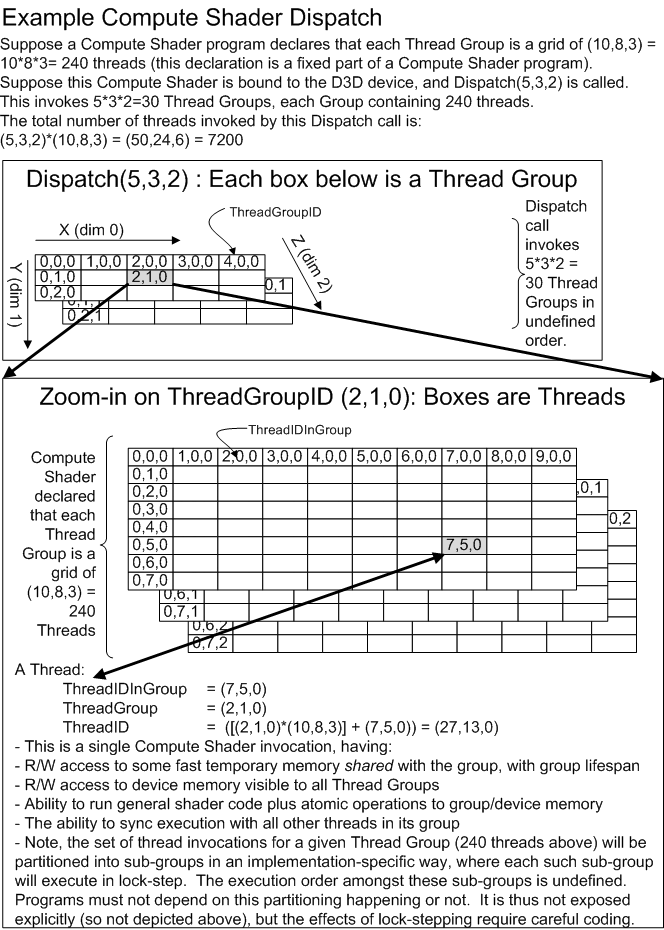

<a id="compute"></a>

# Compute execution

<!-- d3d12-review-legend:begin -->

> [!NOTE]
> **Draft provenance annotations.**
> Underlining marks pending replacement wording or authored list items. Warning boxes
> mark authored, mixed or reopened passages awaiting editorial review.
> Editorial adoption does not establish factual or hardware verification. Exact approved factual
> corrections do not trigger a marker. Unmarked text elsewhere, declarations
> and structural Markdown are not assertions of approval.
> [Annotation scope and approvals](../../spec-maintenance/d3d12/prose-annotations.md).

<!-- d3d12-review-legend:end -->

<!-- d3d12-review-alert:begin:compute:PC-stage-creation-owner:0 -->

> [!WARNING]
> **Authored synthesis - human review pending.**
>
> The current compute driver object creation/sizing/destruction contracts
> are defined with [pipeline component creation](pipeline-state.md#driver-shader-objects)
> and its [exact slot associations](pipeline-state.md#driver-object-slots).
> They do not add application shader/state object APIs or replace this stage's
> execution, linkage, capability or resource-lifetime rules.

<!-- d3d12-review-alert:end:compute:PC-stage-creation-owner:0 -->

<a id="stage-model"></a>

## Stage model

<ins><!-- d3d12-review-inline:begin:compute:C-overview:0 -->A compute shader is a separate logical shader type analogous to the graphics shaders: the vertex, geometry, and pixel shaders. However, while it uses the same classes of input and output data, it is not directly connected to other shaders in the same pipeline during use. Its purpose is to enable more general processing operations than those enabled by the graphics shaders.<!-- d3d12-review-inline:end:compute:C-overview:0 --></ins>

<ins><!-- d3d12-review-inline:begin:compute:C-no-mapping:0 -->A compute shader does not necessarily have a forced 1-1 mapping to either input records (like a vertex shader does) or output records (like the pixel shader does).<!-- d3d12-review-inline:end:compute:C-no-mapping:0 --></ins>

<!-- d3d12-review-alert:begin:compute:N-stage-state:0 -->

> [!WARNING]
> **Authored synthesis - human review pending.**
>
> Compute execution selects a [compute pipeline state](pipeline-state.md#compute-description), not the fixed-function graphics pipeline. The shader reads constants, shader resources and samplers and reads or writes resources through unordered-access views (UAVs), using [compute root arguments and descriptors](binding.md#recording-state). Resources can be shared with graphics work under their [access, layout and synchronization contracts](synchronization.md#barrier-access); sharing a resource does not itself order the accesses. Rasterization, depth/stencil testing, blending and render-target output are not compute-stage operations.

<!-- d3d12-review-alert:end:compute:N-stage-state:0 -->

<!-- d3d12-review-alert:begin:compute:N-stage-state:1 -->

> [!WARNING]
> **Authored synthesis - human review pending.**
>
> The ordinary compute stage uses applicable DXBC Shader Model 5.0/5.1 or DXIL Shader Model 6.x programs. Existing Shader Model 5.0 assets can use D3D12 root signatures; Shader Model 5.1 adds register spaces, resource ranges and descriptor indexing. This does not imply support for downlevel `cs_4_x` profiles. The logical thread/group model is common to the supported representations; the [representation-specific contracts](#shader-representations) below distinguish register-based DXBC from typed DXIL. Compute pipeline creation owns shader/root-signature compatibility and driver compilation; dispatch launches the selected program.

<!-- d3d12-review-alert:end:compute:N-stage-state:1 -->

<a id="thread-groups"></a>

## Thread groups and invocations

<!-- d3d12-review-alert:begin:compute:N-group-model:0 -->

> [!WARNING]
> **Authored synthesis - human review pending.**
>
> A dispatch launches a three-dimensional grid of thread groups. Each group executes the same compute entry point and has its own thread-group shared memory (TGSM). A shader's `[numthreads(X,Y,Z)]` declaration fixes the three-dimensional arrangement of threads within every group; the Dispatch arguments specify groups, not threads.

<!-- d3d12-review-alert:end:compute:N-group-model:0 -->

<!-- d3d12-review-alert:begin:compute:N-group-model:1 -->

> [!WARNING]
> **Authored synthesis - human review pending.**
>
> Groups can execute in any order. Threads within a group cooperate through TGSM, UAVs, atomics and explicit synchronization. A thread group is not a wave: it can contain multiple waves, whose relative execution order is not specified. The [wave model](#waves) defines the narrower operations exposed by DXIL shaders; it does not introduce a group-wide or grid-wide execution rendezvous.

<!-- d3d12-review-alert:end:compute:N-group-model:1 -->

<!-- d3d12-review-alert:begin:compute:N-numthreads:0 -->

> [!WARNING]
> **Authored synthesis - human review pending.**
>
> `X`, `Y` and `Z` are positive compile-time integers. X and Y are each at most 1,024, Z is at most 64, and `X*Y*Z` is at most 1,024. The product limit applies together with the per-axis limits; `[numthreads(1024,1024,1)]` is not valid.

<!-- d3d12-review-alert:end:compute:N-numthreads:0 -->

<!-- d3d12-review-alert:begin:compute:N-numthreads:1 -->

> [!WARNING]
> **Authored synthesis - human review pending.**
>
> For example, `[numthreads(10,8,3)]` declares 240 threads per group. `Dispatch(5,3,2)` launches 30 groups and therefore 7,200 shader invocations. For group `(2,1,0)`, local thread `(7,5,0)` has dispatch-thread coordinates `(27,13,0)` and flattened group index 57.

<!-- d3d12-review-alert:end:compute:N-numthreads:1 -->

<!-- d3d12-review-alert:begin:compute:N-dispatch-figure:0 -->

> [!WARNING]
> **Authored synthesis - human review pending.**
>
> 

<!-- d3d12-review-alert:end:compute:N-dispatch-figure:0 -->

<!-- d3d12-review-alert:begin:compute:N-dispatch-figure:1 -->

> [!WARNING]
> **Authored synthesis - human review pending.**
>
> The figure's ThreadGroupID, ThreadIDInGroup and ThreadID correspond to `SV_GroupID`, `SV_GroupThreadID` and `SV_DispatchThreadID`. Its implementation-specific subgroups must not be assumed to have a particular size or mapping; the [wave and quad rules](#waves) define what a program may observe.

<!-- d3d12-review-alert:end:compute:N-dispatch-figure:1 -->

<a id="generated-identifiers"></a>

### Generated identifiers

<!-- d3d12-review-alert:begin:compute:N-identifiers:0 -->

> [!WARNING]
> **Authored synthesis - human review pending.**
>
> These values are generated by compute execution, not fetched from an input-assembler signature. Components are 32-bit unsigned integers. Let `groupSize = (X,Y,Z)` from `numthreads` and `localID = SV_GroupThreadID`.

<!-- d3d12-review-alert:end:compute:N-identifiers:0 -->

<!-- d3d12-review-alert:begin:compute:N-identifiers:1 -->

> [!WARNING]
> **Authored synthesis - human review pending.**
>
> | HLSL semantic | DXBC input | DXIL operation | Meaning |
> |---|---|---|---|
> | `SV_GroupID` (`uint3`) | `vThreadGroupID.xyz` | `GroupId` | Group coordinates, each from zero through the corresponding dispatch count minus one |
> | `SV_GroupThreadID` (`uint3`) | `vThreadIDInGroup.xyz` | `ThreadIdInGroup` | Local coordinates, each from zero through the corresponding group size minus one |
> | `SV_DispatchThreadID` (`uint3`) | `vThreadID.xyz` | `ThreadId` | `SV_GroupID * groupSize + localID`, component-wise |
> | `SV_GroupIndex` (`uint`) | `vThreadIDInGroupFlattened` | `FlattenedThreadIdInGroup` | `localID.z*Y*X + localID.y*X + localID.x` |

<!-- d3d12-review-alert:end:compute:N-identifiers:1 -->

<!-- d3d12-review-alert:begin:compute:N-identifiers:2 -->

> [!WARNING]
> **Authored synthesis - human review pending.**
>
> The flattened local index is in `[0, X*Y*Z-1]`; X changes fastest, then Y, then Z. It is not a flattened index of the whole dispatch and is not in general a wave-lane index.

<!-- d3d12-review-alert:end:compute:N-identifiers:2 -->

<!-- d3d12-review-context:begin:compute:N-id-overflow:0 -->

> [!WARNING]
> **Authored synthesis - human review pending.**

> **Unresolved expanded-grid case:** The dispatch-thread formula above defines representable coordinates. Expanded one-dimensional grids can make a mathematical component exceed `UINT32_MAX`; the selected public sources do not specify the resulting `SV_DispatchThreadID` value. No modulo-wrapping guarantee or additional group-count limit is established here.

<!-- d3d12-review-context:end:compute:N-id-overflow:0 -->

<a id="shader-representations"></a>

## Shader representations

<a id="dxbc-compute"></a>

### DXBC logical interface

<ins><!-- d3d12-review-inline:begin:compute:N-dxbc-table:0 -->DXBC declares its thread-group dimensions with `dcl_thread_group`. A compute program has generated ID inputs and resource accesses, not vertex-style incoming records or a graphics-stage output signature. `r#` and indexable `x#` storage is private to each thread; `g#` denotes shared storage for its group.<!-- d3d12-review-inline:end:compute:N-dxbc-table:0 --></ins>

<!-- d3d12-review-alert:begin:compute:N-dxbc-table:1 -->

> [!WARNING]
> **Mixed source and authored adaptation - human review pending.**
>
> | Logical storage/input | Count or bound | Access | Components | Indexable by temporary value | Default | Declaration |
> |---|---|---|---|---|---|---|
> | 32-bit temporaries `r#` | 4,096 total with `x#` | Read/write | 4 | No | None | Required |
> | 32-bit indexable temporary arrays `x#[n]` | 4,096 total with `r#` | Read/write | 4 | Yes | None | Required |
> | 32-bit TGSM `g#[n]` | 8,192 scalar DWORDs across declarations | Read/write | 1; raw/structured declaration layouts | Yes | None | Required |
> | Input resources `t#` | Shader profile and binding tiers | Read | Resource-defined | SM5.1 resource-range indexing | None | Required |
> | Samplers `s#` | Shader profile and binding tiers | Read | 1 | SM5.1 resource-range indexing | None | Required |
> | Constant buffers `cb#` | Shader profile and binding tiers | Read | 4 | Contents; SM5.1 resource ranges | None | Required |
> | Immediate constant buffer `icb[index]` | 1 | Read | 4 | Contents | None | Required |
> | `vThreadID.xyz` | 1 | Read | 3 | No | Generated | Required when used |
> | `vThreadGroupID.xyz` | 1 | Read | 3 | No | Generated | Required when used |
> | `vThreadIDInGroup.xyz` | 1 | Read | 3 | No | Generated | Required when used |
> | `vThreadIDInGroupFlattened` | 1 | Read | 1 | No | Generated | Required when used |
> | Null destination | Not applicable | Discard result | Not applicable | Not applicable | Not applicable | No |
> | UAVs `u#` | Shader profile and binding tiers | Read/write | Resource-defined | SM5.1 resource-range indexing | None | Required |

<!-- d3d12-review-alert:end:compute:N-dxbc-table:1 -->

<ins><!-- d3d12-review-inline:begin:compute:N-dxbc-table:2 -->The resource rows are logical shader declarations, subject to the shader profile and current [binding-tier limits](binding.md#binding-capabilities). SM5.0 register bindings are mapped through the root signature; SM5.1 additionally supports [register spaces](binding.md#register-spaces), ranges and descriptor indexing. Its range-indexing model is not imposed on SM5.0 assets.<!-- d3d12-review-inline:end:compute:N-dxbc-table:2 --></ins>

<ins><!-- d3d12-review-inline:begin:compute:C-register-spill:0 -->In practice, hardware implementations may spill temp register storage to slower memory behind the scenes if the combination of number of temps per thread and number of threads in the group goes too high. Functionally, however, it will always appear to the DXBC shader as if storage for 4096 temp registers is available per Compute Shader thread independent of how many threads are in a group.<!-- d3d12-review-inline:end:compute:C-register-spill:0 --></ins>

<a id="dxil-compute"></a>

### DXIL entry point, properties and operations

<!-- d3d12-review-alert:begin:compute:N-dxil-model:0 -->

> [!WARNING]
> **Authored synthesis - human review pending.**
>
> A final DXIL compute shader has a compute entry point identified by `dx.entryPoints` and the `cs` shader-model declaration. The entry-point properties include the three `numthreads` dimensions (`kDxilNumThreadsTag`, tag 4), applicable shader requirement flags and any requested [wave-size property](#wave-size). Driver compilation uses these properties as well as the instructions and resource metadata; the group size is not supplied by a Dispatch call.

<!-- d3d12-review-alert:end:compute:N-dxil-model:0 -->

<!-- d3d12-review-alert:begin:compute:N-dxil-model:1 -->

> [!WARNING]
> **Authored synthesis - human review pending.**
>
> Compute system values are obtained through `ThreadId`, `GroupId`, `ThreadIdInGroup` and `FlattenedThreadIdInGroup`. They are not packed into a graphics input signature. Ordinary compute has no graphics output signature: results are stored to resources. DXIL expresses private values through typed single-static-assignment (SSA) values and private allocations rather than a fixed bank of DXBC `r#` registers; the DXBC register-count table is not a DXIL private-allocation limit.

<!-- d3d12-review-alert:end:compute:N-dxil-model:1 -->

<!-- d3d12-review-alert:begin:compute:N-dxil-model:2 -->

> [!WARNING]
> **Authored synthesis - human review pending.**
>
> TGSM is represented by typed global variables in address space 3 and accessed through the corresponding loads, stores and atomic operations. Resource operations use handles and their typed/raw/structured access instructions. The operation families relevant to compute include resource loads/stores and counters, integer/bitwise atomics, shader barriers, generated IDs, and, when available, wave, quad and derivative operations. The [memory model](memory-model.md#memory-consistency) and [shader-barrier rules](memory-model.md#shader-barriers) define shared cooperation semantics; the complete per-intrinsic operation/encoding reference belongs to the DXIL appendix.

<!-- d3d12-review-alert:end:compute:N-dxil-model:2 -->

<a id="thread-group-shared-memory"></a>

## Thread-group shared memory

<!-- d3d12-review-alert:begin:compute:N-tgsm-storage:0 -->

> [!WARNING]
> **Authored synthesis - human review pending.**
>
> Each compute group has at most 32 KiB (32,768 bytes) of TGSM. Any thread in the group can read or write any declared shared location; another group has separate shared storage even when it executes the same program. HLSL declares this storage with `groupshared`. The aggregate allocation, including type layout/alignment, must fit the per-group limit; this is not a per-variable allowance.

<!-- d3d12-review-alert:end:compute:N-tgsm-storage:0 -->

<!-- d3d12-review-alert:begin:compute:N-tgsm-storage:1 -->

> [!WARNING]
> **Authored synthesis - human review pending.**
>
> DXBC exposes up to 8,192 32-bit scalar locations across all `g#` declarations. `dcl_tgsm_raw` declares a byte-count multiple of four; `dcl_tgsm_structured` declares `structByteStride * structCount` bytes, with a four-byte-multiple stride. DXIL's typed shared globals are allocated according to their types, not by counting each typed element as one DWORD.

<!-- d3d12-review-alert:end:compute:N-tgsm-storage:1 -->

<!-- d3d12-review-alert:begin:compute:N-tgsm-storage:2 -->

> [!WARNING]
> **Authored synthesis - human review pending.**
>
> Native 16-bit types, enabled for Shader Model 6.2 and later on a device reporting `D3D12_FEATURE_DATA_D3D12_OPTIONS4::Native16BitShaderOpsSupported`, permit actual 16-bit storage. Minimum-precision spelling alone is not a promise of two-byte allocation. Native 16-bit storage does not increase the 32-KiB budget. Shader Model 6.9 makes native 16-bit shader operations required; layout and allocation remain part of the shared-storage accounting.

<!-- d3d12-review-alert:end:compute:N-tgsm-storage:2 -->

<ins><!-- d3d12-review-inline:begin:compute:F-long-vectors:0 -->Shader Model 6.9 supports vectors with between 5 and 1024 elements using the existing `vector<T, N>` template syntax. Elementwise intrinsics, loads and stores through `ByteAddressBuffer` and `StructuredBuffer`, and groupshared memory are all supported for long vectors.<!-- d3d12-review-inline:end:compute:F-long-vectors:0 --></ins>

<ins><!-- d3d12-review-inline:begin:compute:C-tgsm-lifetime:0 -->Values stored in this shared memory are not preserved between dispatches, nor between thread groups. They must be initialized by the shader before use, and any results to be persisted must be written out to resource memory.<!-- d3d12-review-inline:end:compute:C-tgsm-lifetime:0 --></ins>

<!-- d3d12-review-alert:begin:compute:N-compute-memory-owner:0 -->

> [!WARNING]
> **Authored synthesis - human review pending.**
>
> Shared storage follows the dedicated memory model's [initialization](memory-model.md#shared-memory-initialization), [access bounds](memory-model.md#shared-memory-bounds) and [DXBC access-alignment](memory-model.md#shared-memory-alignment) rules. [Memory consistency and atomics](memory-model.md#memory-consistency), [UAV coherency](memory-model.md#uav-coherency), [atomic capabilities](memory-model.md#atomic-capabilities), [shader barriers](memory-model.md#shader-barriers) and [inter-group communication](memory-model.md#inter-group-ordering) are defined there rather than by this stage chapter.

<!-- d3d12-review-alert:end:compute:N-compute-memory-owner:0 -->

<a id="waves"></a>

## Waves and quad operations

<!-- d3d12-review-alert:begin:compute:N-compute-wave-owner:0 -->

> [!WARNING]
> **Authored synthesis - human review pending.**
>
> The [shared wave/lane definitions and wave-operation capabilities](common-shader-internals.md#waves) apply. A compute group can contain multiple waves; their relative execution order is not specified. Do not assume a particular group-to-wave partition or equality of `SV_GroupIndex` and wave-lane index except where the [compute quad contract](#compute-quads) supplies a mapping. Group cooperation across waves still requires the [memory/execution synchronization](memory-model.md#shader-barriers). Compute does not generate rasterization helper pixels.

<!-- d3d12-review-alert:end:compute:N-compute-wave-owner:0 -->

<a id="wave-size"></a>

### Requested wave size

The allowed wave sizes that an HLSL shader may specify are
the powers of 2 between 4 and 128, inclusive.
In other words, the set: `[4, 8, 16, 32, 64, 128]`.

<ins><!-- d3d12-review-inline:begin:compute:W-device-obligation:0 -->A device that reports Shader Model 6.6 and `WaveOps` support must support shader-selected wave size. All powers of two in its reported wave-size interval must be selectable, with wave operations supported at every such size. Sizes incompatible with compute wave intrinsics and shader selection must not be included in that interval.<!-- d3d12-review-inline:end:compute:W-device-obligation:0 --></ins>

<ins><!-- d3d12-review-inline:begin:compute:W-device-obligation:1 -->SM6.6 imposes no additional wave-size-selection requirement on a device that does not report `WaveOps`. Conversely, a shader's WaveSize property is communicated through its minimum/maximum lane requirements even if it uses no wave intrinsics; the property alone does not set a WaveOps requirement.<!-- d3d12-review-inline:end:compute:W-device-obligation:1 --></ins>

<!-- d3d12-review-alert:begin:compute:N-fixed-wave:0 -->

> [!WARNING]
> **Authored synthesis - human review pending.**
>
> Shader Model 6.6 introduces `[WaveSize(numLanes)]` on compute entry points. The argument is a compile-time integer from the allowed set. When shader-selected wave size is supported, the shader must execute at the requested size, and pipeline creation fails if that size is unsupported. This attribute does not require `numthreads` to equal one wave; the group may contain multiple waves or a partially filled wave. A wave-size request is separate from use of wave-operation instructions.

<!-- d3d12-review-alert:end:compute:N-fixed-wave:0 -->

<!-- d3d12-review-alert:begin:compute:N-fixed-wave:1 -->

> [!WARNING]
> **Authored synthesis - human review pending.**
>
> Starting with Shader Model 6.8, `[WaveSize(minWaveSize,maxWaveSize)]` accepts a range and `[WaveSize(minWaveSize,maxWaveSize,prefWaveSize)]` additionally requests a preferred size. Every supplied value is a compile-time power of two from 4 through 128, `minWaveSize < maxWaveSize`, and a supplied preferred size lies in the inclusive range. The one-argument form remains the way to request exactly one size.

<!-- d3d12-review-alert:end:compute:N-fixed-wave:1 -->

<!-- d3d12-review-alert:begin:compute:N-fixed-wave:2 -->

> [!WARNING]
> **Authored synthesis - human review pending.**
>
> SM6.8 requires support for the ranged metadata's restrictions. The device and shader ranges must overlap. The driver selects a supported size within the requested range; if the preferred size is supported by the device, it must be used. An unsupported preference does not reject the shader when some other size in the allowed range is available.

<!-- d3d12-review-alert:end:compute:N-fixed-wave:2 -->

<!-- d3d12-review-alert:begin:compute:N-fixed-wave:3 -->

> [!WARNING]
> **Authored synthesis - human review pending.**
>
> DXIL before SM6.8 uses `kDxilWaveSizeTag` (11) for a fixed-size request. SM6.8 and later use `kDxilRangedWaveSizeTag` (23), with three integers `(minimum,maximum,preferred)`: absent optional values are zero, and `(size,0,0)` encodes the single-size form. The old tag is invalid for SM6.8 and later; the ranged tag is invalid for earlier shader models.

<!-- d3d12-review-alert:end:compute:N-fixed-wave:3 -->

<a id="compute-quads"></a>

### Derivatives and compute quad layout

<!-- d3d12-review-alert:begin:compute:N-common-lod-algorithms:0 -->

> [!WARNING]
> **Authored synthesis - human review pending.**
>
> These stage-specific derivatives feed the shared [LOD/anisotropy calculation](common-shader-internals.md#lod-and-anisotropy) and [sampling/addressing precision rules](common-shader-internals.md#sampling-precision). The common texture algorithm does not change this stage's quad formation or participating-lane requirements.

<!-- d3d12-review-alert:end:compute:N-common-lod-algorithms:0 -->

<!-- d3d12-review-alert:begin:compute:N-derivative-availability:0 -->

> [!WARNING]
> **Authored synthesis - human review pending.**
>
> Shader Model 6.6 supports derivatives and derivative-dependent sampling in compute. This includes `ddx`, `ddy`, their fine/coarse variants, implicit-derivative `Sample`, `SampleBias`, `SampleCmp` and `CalculateLevelOfDetail`, under their operation-specific type/format rules. Explicit-LOD/gradient sampling and nonfiltered loads retain their own availability and do not acquire an implicit-quad requirement merely because they access a texture. Buffers are not filterable textures.

<!-- d3d12-review-alert:end:compute:N-derivative-availability:0 -->

<!-- d3d12-review-alert:begin:compute:N-derivative-availability:1 -->

> [!WARNING]
> **Authored synthesis - human review pending.**
>
> The derivative quad layout requires either X divisible by four with Y=Z=1, or X and Y both divisible by two. Other `numthreads` shapes cannot use derivatives. AS/MS use the same layout but have their own [optional derivative capability](amplification-and-mesh-shaders.md#derivatives); that optional AS/MS bit is not a compute derivative capability bit.

<!-- d3d12-review-alert:end:compute:N-derivative-availability:1 -->

<ins><!-- d3d12-review-inline:begin:compute:Q-associations:0 -->For both layouts:<!-- d3d12-review-inline:end:compute:Q-associations:0 --></ins>

- <ins><!-- d3d12-review-inline:begin:compute:Q-associations:1 -->`quadID = WaveGetLaneIndex() / 4`<!-- d3d12-review-inline:end:compute:Q-associations:1 --></ins>
- <ins><!-- d3d12-review-inline:begin:compute:Q-associations:1 -->`quadIndex = WaveGetLaneIndex() % 4`<!-- d3d12-review-inline:end:compute:Q-associations:1 --></ins>

<ins><!-- d3d12-review-inline:begin:compute:Q-associations:2 -->`quadID` identifies which lanes share a quad, not a prescribed location for that quad in the group. The quad index follows Z-order:<!-- d3d12-review-inline:end:compute:Q-associations:2 --></ins>

<!-- d3d12-review-alert:begin:compute:Q-associations:3 -->

> [!WARNING]
> **Mixed source and authored adaptation - human review pending.**
>
> | Quad indices |
> |:---:|
> | (0) (1)<br>(2) (3) |

<!-- d3d12-review-alert:end:compute:Q-associations:3 -->

<a id="compute-quads-1d"></a>

#### One-dimensional layout

Where only the X dimension is greater than 1,
the 2x2 quad is based on the group index
as provided by the `SV_GroupIndex` parameter.

- X position in quad from left = `SV_GroupIndex & 1`
- Y position in quad from top = `(SV_GroupIndex & 2) >> 1`

The result is that lanes in the group
form a sequence of serialized quads.
Every four sequential lanes form an individual quad.
The first and second lanes in the foursome
form the upper left and upper right respectively.
The third and fourth lanes
form the lower left and lower right respectively.
The lane after the fourth, if present represents
the upper left of the next quad.
This is sometimes called Z-order.

<ins><!-- d3d12-review-inline:begin:compute:Q-1d:3 -->To provide a deterministic mapping between SV_GroupIndex
and the lanes within a quad,
1D quad ordering requires that threads are assigned lane indices
in the same order within the quad as specified by the SV_GroupIndex parameter:<!-- d3d12-review-inline:end:compute:Q-1d:3 --></ins>

<ins><!-- d3d12-review-inline:begin:compute:Q-1d:4 -->For 1D quads: `SV_GroupThreadID.x % 4 == SV_GroupIndex % 4 == WaveGetLaneIndex() % 4`<!-- d3d12-review-inline:end:compute:Q-1d:4 --></ins>

<ins><!-- d3d12-review-inline:begin:compute:Q-1d:5 -->For example,
a thread group defined by `[numthreads (32, 1, 1)]`
might contain a single wave containing 32 lanes that make up 8 quads.
The layout for the first quad would be as follows where the parenthesized value
represents the group index in decimal:<!-- d3d12-review-inline:end:compute:Q-1d:5 --></ins>

|Quad 0|
|:-----------:|
|(00) (01)<br>(02) (03)|

And a later quad would be:

|**Quad _n_**|
|:-----------:|
|(16) (17)<br>(18) (19)|

<a id="compute-quads-2d"></a>

#### Two-dimensional layout

Where the X and Y dimensions are divisible by 2,
the 2x2 quad is based on the x and y components
of group thread ID
as provided by the `SV_GroupThreadID` parameter.

- X position in quad from left = `SV_GroupThreadID.x & 1`
- Y position in quad from top = `SV_GroupThreadID.y & 1`

As a result, for every even x and y value within the thread group,
a quad is made up of the values (x,y) , (x+1,y), (x, y+1), (x+1, y+1).
There is no defined assignment of any quad within any wave
and no relation between the values of SV_GroupIndex and
the return value of WaveGetLaneIndex() should be assumed.

<ins><!-- d3d12-review-inline:begin:compute:Q-2d:3 -->While existing compute Quad* operations required
the same association with lane indices,
no mapping of quad lanes to SV_GroupThreadID was required.
**History:** This mapping is not required for pre-6.6 shader models.<!-- d3d12-review-inline:end:compute:Q-2d:3 --></ins>


<ins><!-- d3d12-review-inline:begin:compute:Q-2d:4 -->For example,
a thread group defined by `[numthreads (8,4,1)]`
might contain a single wave containing 32 lanes that make up 8 quads.
The layout for the first quad would be as follows where the parenthesized pair
represents the corresponding (GroupThreadID.x, GroupThreadID.y) values:<!-- d3d12-review-inline:end:compute:Q-2d:4 --></ins>

|Quad 0|
|:-----------:|
|(0,0) (1,0)<br>(0,1) (1,1)|

|**Quad _n_**|
|:-----------:|
|(6,2) (7,2)<br>(6,3) (7,3)|

<!-- d3d12-review-alert:begin:compute:N-quad-uniformity:0 -->

> [!WARNING]
> **Authored synthesis - human review pending.**
>
> `QuadReadLaneAt` and the across-X/Y/diagonal operations are available in compute from SM6.0 with wave-operation support; for SM6.0-6.5 their thread-to-quad mapping is implementation-dependent. SM6.6 supplies the layouts above. SM6.7 adds `QuadAny` and `QuadAll`, which test all four lanes of a quad and require quad-uniform flow control. Quad-uniform control may differ between quads of the same wave.

<!-- d3d12-review-alert:end:compute:N-quad-uniformity:0 -->

<!-- d3d12-review-alert:begin:compute:N-quad-uniformity:1 -->

> [!WARNING]
> **Authored synthesis - human review pending.**
>
> Derivative calculations on shader-computed temporary values likewise need the participating quad's values to be available; divergent flow does not make a value from an inactive lane defined. The direct-input-versus-temporary distinction and valid restructuring examples are defined by the [quad-uniformity rules](../HLSL_SM_6_7_QuadAny_QuadAll.md#how-to-use-quadanyquadall-to-ensure-uniform-flow-control-across-the-quad). Quad operations do not synchronize the rest of the group.

<!-- d3d12-review-alert:end:compute:N-quad-uniformity:1 -->

<a id="device-memory"></a>

## Device-memory operations and stage integration

<!-- d3d12-review-alert:begin:compute:N-device-operations:0 -->

> [!WARNING]
> **Authored synthesis - human review pending.**
>
> Compute can load shader resources and read/write supported UAV buffers/textures, including raw and structured buffers, indexed/scattered stores and applicable atomic operations. Resource descriptors, null descriptors and register-range indexing follow [resource binding](binding.md#descriptor-tables); view interpretation and typed-UAV format support follow [Formats and views](formats.md#typed-uav-loads). Binding a descriptor does not automatically unbind conflicting SRV/UAV descriptors; valid resource usage and synchronization remain explicit application responsibilities.

<!-- d3d12-review-alert:end:compute:N-device-operations:0 -->

<!-- d3d12-review-alert:begin:compute:N-device-operations:1 -->

> [!WARNING]
> **Authored synthesis - human review pending.**
>
> Indirect dispatch, root/descriptor state and resource dependencies are recorded through the D3D12 command-list contracts below. Compute invocation statistics belong to [pipeline statistics](counters-queries-and-predication.md#pipeline-statistics), and predication eligibility belongs to the [operation matrix](counters-queries-and-predication.md#predication-operation-matrix), not a separate compute-only predicate list.

<!-- d3d12-review-alert:end:compute:N-device-operations:1 -->

<a id="dispatch-grids"></a>

## Dispatch grids

<!-- d3d12-review-alert:begin:compute:N-grid-parameters:0 -->

> [!WARNING]
> **Authored synthesis - human review pending.**
>
> `Dispatch` takes three group counts, `ThreadGroupCountX`, `ThreadGroupCountY` and `ThreadGroupCountZ`, which describe a compute grid. The [full API contract](#dispatch) follows the common dimension rules below.

<!-- d3d12-review-alert:end:compute:N-grid-parameters:0 -->

<ins><!-- d3d12-review-inline:begin:compute:A-dispatch-groups:0 -->These arguments identify the x-, y-, and z- dimensions of the array of thread groups to be dispatched.<!-- d3d12-review-inline:end:compute:A-dispatch-groups:0 --></ins>

<ins><!-- d3d12-review-inline:begin:compute:A-dispatch-groups:1 -->If any of the Dispatch arguments are 0, no thread groups are launched.<!-- d3d12-review-inline:end:compute:A-dispatch-groups:1 --></ins>

<!-- d3d12-review-alert:begin:compute:N-grid-selection:0 -->

> [!WARNING]
> **Authored synthesis - human review pending.**
>
> Dispatch group counts are distinct from the number of shader threads declared within each group. A compute dispatch uses the selected [compute pipeline](pipeline-state.md#compute-description) and [compute root arguments](binding.md#recording-state). A mesh dispatch uses the corresponding graphics program and root state. This distinction does not change when a one-dimensional grid is enlarged.

<!-- d3d12-review-alert:end:compute:N-grid-selection:0 -->

<a id="dispatch-dimensions"></a>

## Dispatch dimensions and capabilities

<a id="options22"></a>

### D3D12_FEATURE_DATA_D3D12_OPTIONS22

```cpp
typedef struct D3D12_FEATURE_DATA_D3D12_OPTIONS22
{
    BOOL ShaderExecutionReorderingActuallyReorders;
    BOOL CreateByteOffsetViewsSupported;
    UINT Max1DDispatchSize;
    UINT Max1DDispatchMeshSize;
} D3D12_FEATURE_DATA_D3D12_OPTIONS22;
```

<!-- d3d12-review-alert:begin:compute:N-capability-selector:0 -->

> [!WARNING]
> **Authored synthesis - human review pending.**
>
> `CheckFeatureSupport` with `D3D12_FEATURE_D3D12_OPTIONS22` (enum value 65) returns this structure. `Max1DDispatchSize` and `Max1DDispatchMeshSize` are independent compute and mesh group-count limits. The other members retain their [SER support](../Raytracing.md#ser-device-support) and [byte-offset view support](../D3D12RevisedCreateViews.md#feature-check-d3d12_feature_data_d3d12_options22createbyteoffsetviewssupported) contracts.

<!-- d3d12-review-alert:end:compute:N-capability-selector:0 -->

- **Max1DDispatchSize** - The maximum number of thread groups that can be dispatched in the X dimension for Compute Shaders when Y = 1 and Z = 1. Must be at least 65,535 (the value of `D3D12_CS_DISPATCH_MAX_THREAD_GROUPS_PER_DIMENSION`). This limit also applies to grids launched in Work Graphs, however Work Graphs are additionally constrained by the maximum total number of thread groups as defined by `D3D12_WORK_GRAPHS_DISPATCH_MAX_THREAD_GROUPS_PER_GRID` (16,777,215). This means that while `Max1DDispatchSize` may be larger than 16,777,215, Work Graph dispatches cannot exceed this total thread group limit.

- **Max1DDispatchMeshSize** - The maximum number of thread groups that can be dispatched in the X dimension for Mesh Shaders (via `DispatchMesh`) when Y = 1 and Z = 1. Must be at least 65,535 (the value of `D3D12_CS_DISPATCH_MAX_THREAD_GROUPS_PER_DIMENSION`). This value must not exceed 4,194,303 (the value of `D3D12_MS_DISPATCH_MAX_THREAD_GROUPS_PER_GRID`), which is the maximum total number of thread groups allowed for Mesh Shader dispatches.

<ins><!-- d3d12-review-inline:begin:compute:D-older-driver-fallback:0 -->When queried on an existing driver which does not provide the expanded dispatch capabilities the D3D runtime will automatically return 65535 for both `Max1DDispatchSize` and `Max1DDispatchMeshSize` as defined by `D3D12_CS_DISPATCH_MAX_THREAD_GROUPS_PER_DIMENSION`.<!-- d3d12-review-inline:end:compute:D-older-driver-fallback:0 --></ins>

<!-- d3d12-review-alert:begin:compute:N-mesh-support:0 -->

> [!WARNING]
> **Authored synthesis - human review pending.**
>
> These fields report grid dimensions, not optional shader-stage support. A mesh dispatch still requires the [mesh-shader capability and pipeline](amplification-and-mesh-shaders.md#availability). The reported mesh field is constrained to the interval 65,535 through 4,194,303; that reporting requirement is separate from the total-group check on every mesh grid.

<!-- d3d12-review-alert:end:compute:N-mesh-support:0 -->

<a id="shared-grid-limits"></a>

### Shared grid limits

<!-- d3d12-review-alert:begin:compute:N-dimension-table:0 -->

> [!WARNING]
> **Authored synthesis - human review pending.**
>
> | Operation/grid | Ordinary per-axis bound | Expanded one-dimensional bound | Independent total-group bound |
> |---|---|---|---|
> | Direct or indirect compute dispatch | Each axis at most 65,535 | X at most `Max1DDispatchSize`, with Y=Z=1 | No mesh/work-graph total is imposed by this compute-grid rule |
> | API, indirect, or AS-intrinsic mesh dispatch | Each axis at most 65,535 | X at most `Max1DDispatchMeshSize`, with Y=Z=1 | `X*Y*Z < 2^22` (at most 4,194,303) |
> | Work-graph execution grid | Each axis at most 65,535 | X at most `Max1DDispatchSize`, with Y=Z=1 | `X*Y*Z < 2^24` (at most 16,777,215) |

<!-- d3d12-review-alert:end:compute:N-dimension-table:0 -->

<!-- d3d12-review-alert:begin:compute:N-dimension-table:1 -->

> [!WARNING]
> **Authored synthesis - human review pending.**
>
> The expanded case enlarges X only; it does not enlarge Y or Z. When X exceeds 65,535, both Y and Z must be exactly one. Zero-work API dispatches do not waive dimension, program, resource or recording constraints. All applicable row constraints must hold together; a reported 1D limit does not remove a separate total-grid limit.

<!-- d3d12-review-alert:end:compute:N-dimension-table:1 -->

<!-- d3d12-review-alert:begin:compute:N-mesh-grid-scope:0 -->

> [!WARNING]
> **Authored synthesis - human review pending.**
>
> With AS active, API DispatchMesh dimensions launch the parent AS groups; without AS, they launch MS groups directly. The AS DispatchMesh intrinsic launches a separate child MS grid. Both are subject to the mesh row above; child legality is not established by CPU validation of its parent's arguments. The AS payload, per-group thread, output-storage and invocation contracts remain those of [amplification and mesh processing](amplification-and-mesh-shaders.md#payload-and-amplification).

<!-- d3d12-review-alert:end:compute:N-mesh-grid-scope:0 -->

<a id="work-graph-grids"></a>

### Work-graph grid configuration

<!-- d3d12-review-alert:begin:compute:N-graph-scope:0 -->

> [!WARNING]
> **Authored synthesis - human review pending.**
>
> The work-graph row applies to grids sourced from CPU-input records, GPU-input records and shader-produced records. Dynamic grids must also fit the node's configured maximum grid. The [fixed/dynamic shader grid declarations](work-graphs.md#shader-function-attributes) and [state-object grid overrides](state-objects.md#d3d12_broadcasting_launch_overrides) remain separate program-configuration contracts; the independent 24-bit total remains even when the device's compute 1D capability is larger.

<!-- d3d12-review-alert:end:compute:N-graph-scope:0 -->

<!-- d3d12-review-alert:begin:compute:N-graph-compiler:0 -->

> [!WARNING]
> **Authored synthesis - human review pending.**
>
> Directly authored `NodeDispatchGrid` and `NodeMaxDispatchGrid` attributes in the fixed shader-compiler contract require positive per-axis values at most 65,535 and a total at most 16,777,215. That compile-time attribute constraint is not interchangeable with the expanded execution-grid capability. State-object dispatch-grid or maximum-grid overrides can supply expanded one-dimensional X values, subject to the configured-grid and total constraints above. CPU-input record validation does not imply that GPU-input or shader-produced record dimensions are CPU-validated.

<!-- d3d12-review-alert:end:compute:N-graph-compiler:0 -->

<a id="dispatch-validation"></a>

### Validation and driver responsibilities

<ins><!-- d3d12-review-inline:begin:compute:D-validation:0 -->The following dimension requirements apply; automatic diagnostic coverage is qualified below:<!-- d3d12-review-inline:end:compute:D-validation:0 --></ins>

<!-- d3d12-review-alert:begin:compute:D-validation:1 -->

> [!WARNING]
> **Mixed source and authored adaptation - human review pending.**
>
> **For Direct Compute Dispatches (`Dispatch`) and Dispatch Graph (CPU_INPUT):**
> - If `ThreadGroupCountX > D3D12_CS_DISPATCH_MAX_THREAD_GROUPS_PER_DIMENSION` (65,535):
>   - Require that `ThreadGroupCountY == 1`
>   - Require that `ThreadGroupCountZ == 1`
>   - Require that `ThreadGroupCountX <= Max1DDispatchSize`
>   - For DispatchGraph, require that `ThreadGroupCountX <= D3D12_WORK_GRAPHS_DISPATCH_MAX_THREAD_GROUPS_PER_GRID (16,777,215)`
>   - If any of these conditions is not met, the grid is invalid; diagnostics do not themselves clamp the arguments; the ordinary recording path forwards them unchanged
> - If `ThreadGroupCountX <= 65535`:
>   - Apply standard validation (all dimensions must be <= 65,535)
>
> **For Mesh Shader Dispatches (`DispatchMesh`):**
> - If `ThreadGroupCountX > D3D12_CS_DISPATCH_MAX_THREAD_GROUPS_PER_DIMENSION` (65,535):
>   - Require that `ThreadGroupCountY == 1`
>   - Require that `ThreadGroupCountZ == 1`
>   - Require that `ThreadGroupCountX <= Max1DDispatchMeshSize`
>   - Require that `ThreadGroupCountX <= D3D12_MS_DISPATCH_MAX_THREAD_GROUPS_PER_GRID (4,194,303)`
>   - If any of these conditions is not met, the grid is invalid; diagnostics do not themselves clamp the arguments; the ordinary recording path forwards them unchanged
> - If `ThreadGroupCountX <= 65535`:
>   - Apply standard validation (all dimensions must be <= 65,535)

<!-- d3d12-review-alert:end:compute:D-validation:1 -->

<ins><!-- d3d12-review-inline:begin:compute:D-runtime-enforcement:0 -->The ordinary runtime recording path does not drop, clamp, or otherwise modify an oversized dispatch. When recorded-argument validation diagnoses oversized dimensions, it reports an **error**, but the dispatch is still passed to the driver unchanged — issuing a debug-layer error does not, by itself, alter runtime behaviour. This is intentional: dropping the dispatch would be a compatibility risk for existing applications.<!-- d3d12-review-inline:end:compute:D-runtime-enforcement:0 --></ins>

<!-- d3d12-review-alert:begin:compute:N-validation-boundary:0 -->

> [!WARNING]
> **Authored synthesis - human review pending.**
>
> Argument forwarding is not a guarantee that invalid work executes, produces a specified result or continues under every diagnostic-control configuration. Configured diagnostics may interrupt execution. A driver cannot infer that dimensions were checked or sanitized merely because it received a dispatch. In particular, Y=Z=1 is a precondition of a valid expanded 1D grid, not a promise that retail runtime validation filtered all malformed calls. CPU validation of direct or CPU-record arguments must not be described as inspection of GPU-resident indirect, GPU-input or shader-produced dimensions. Work-graph actual records must fit their configured maxima and total-grid constraints even when a CPU record check does not independently diagnose every violation; successful validation is not a waiver of those requirements.

<!-- d3d12-review-alert:end:compute:N-validation-boundary:0 -->

<!-- d3d12-review-alert:begin:compute:D-driver-reporting:0 -->

> [!WARNING]
> **Mixed source and authored adaptation - human review pending.**
>
> **Capability Reporting:**
> - Reported values must be at least 65,535 (D3D12_CS_DISPATCH_MAX_THREAD_GROUPS_PER_DIMENSION)
> - `Max1DDispatchMeshSize` must not exceed 4,194,303 (D3D12_MS_DISPATCH_MAX_THREAD_GROUPS_PER_GRID)
> - Drivers may report different values for Compute and Mesh dispatches based on hardware capabilities
>
> **Dispatch Handling:**
> - Drivers must correctly handle Compute dispatches with X dimension up to the reported `Max1DDispatchSize`
> - Drivers must correctly handle Mesh dispatches with X dimension up to the reported `Max1DDispatchMeshSize`
> - For valid expanded 1D grids, Y = 1 and Z = 1; drivers must not treat runtime invocation as a guarantee that invalid dimensions were filtered

<!-- d3d12-review-alert:end:compute:D-driver-reporting:0 -->

<a id="dispatch"></a>

## ID3D12GraphicsCommandList::Dispatch

### Declaration

```cpp
void Dispatch(
    UINT ThreadGroupCountX,
    UINT ThreadGroupCountY,
    UINT ThreadGroupCountZ
    );
```

### Behavior

<ins><!-- d3d12-review-inline:begin:compute:A-dispatch-behavior:0 -->The invocation process dispatches the specified number of groups in the array. (The number of threads in each group is not specified in the Dispatch() call, but is specified in the shader to allow the compiler to optimize register pressure).<!-- d3d12-review-inline:end:compute:A-dispatch-behavior:0 --></ins>

### Parameters

`[in] ThreadGroupCountX`

Type: **[UINT](https://learn.microsoft.com/en-us/windows/desktop/WinProg/windows-data-types)**

<ins><!-- d3d12-review-inline:begin:compute:P-Dispatch:2 -->The number of groups dispatched in the x direction. *ThreadGroupCountX* follows the [shared grid limits](#shared-grid-limits), including the expanded one-dimensional case.<!-- d3d12-review-inline:end:compute:P-Dispatch:2 --></ins>

`[in] ThreadGroupCountY`

Type: **[UINT](https://learn.microsoft.com/en-us/windows/desktop/WinProg/windows-data-types)**

<ins><!-- d3d12-review-inline:begin:compute:P-Dispatch:5 -->The number of groups dispatched in the y direction. *ThreadGroupCountY* must be less than or equal to D3D12_CS_DISPATCH_MAX_THREAD_GROUPS_PER_DIMENSION (65535).<!-- d3d12-review-inline:end:compute:P-Dispatch:5 --></ins>

`[in] ThreadGroupCountZ`

Type: **[UINT](https://learn.microsoft.com/en-us/windows/desktop/WinProg/windows-data-types)**

<ins><!-- d3d12-review-inline:begin:compute:P-Dispatch:8 -->The number of groups dispatched in the z direction. *ThreadGroupCountZ* must be less than or equal to D3D12_CS_DISPATCH_MAX_THREAD_GROUPS_PER_DIMENSION (65535).<!-- d3d12-review-inline:end:compute:P-Dispatch:8 --></ins>

### Return values

None

### Recording and execution constraints

<!-- d3d12-review-alert:begin:compute:N-dispatch-contract:0 -->

> [!WARNING]
> **Authored synthesis - human review pending.**
>
> Dispatch records work on DIRECT and COMPUTE command lists and BUNDLE recordings, not COPY lists. Dispatch must execute outside an active render pass, including when a Dispatch-containing bundle executes under its parent's [render-pass context](command-list-state.md#render-pass). The compute pipeline and [root-signature/argument compatibility](binding.md#pipeline-compatibility), descriptor/resource [lifetime](execution.md#lifetime), [residency](resources.md#residency) and [compute synchronization](synchronization.md#barrier-sync) must be satisfied. Bundles follow the canonical [pipeline selection](command-list-state.md#pipeline-selection) and [resource-binding inheritance](command-list-state.md#resource-binding) rules; they do not inherit an arbitrary parent PSO. A zero count on any axis launches no groups but does not bypass those constraints. [Predication](counters-queries-and-predication.md#predication-operation-matrix) applies to eligible execution, not to whether CPU-side recording and validation occur.

<!-- d3d12-review-alert:end:compute:N-dispatch-contract:0 -->

<a id="indirect-dispatch"></a>

## Indirect execution

<!-- d3d12-review-alert:begin:compute:N-indirect:0 -->

> [!WARNING]
> **Authored synthesis - human review pending.**
>
> `D3D12_INDIRECT_ARGUMENT_TYPE_DISPATCH` consumes `D3D12_DISPATCH_ARGUMENTS`; `DISPATCH_MESH` consumes the mesh dispatch record. Their grids use the corresponding [shared dimensions](#shared-grid-limits), not a separate legacy maximum. The [indirect execution contract](indirect-execution.md#executeindirect) owns signature, count/argument-buffer, root-state and post-call state behavior. Validation of a CPU API call does not imply that every GPU-resident argument record is checked before execution.

<!-- d3d12-review-alert:end:compute:N-indirect:0 -->

<a id="driver-dispatch"></a>

## Ordinary dispatch DDI

```cpp
typedef VOID ( APIENTRY* PFND3D12DDI_DISPATCH )(
    D3D12DDI_HCOMMANDLIST, UINT, UINT, UINT );
```

<!-- d3d12-review-alert:begin:compute:WE-dispatch-roles:0 -->

> [!WARNING]
> **Authored synthesis - human review pending.**
>
> `PFND3D12DDI_DISPATCH` implements [Dispatch](#dispatch). Its three `UINT` arguments are `ThreadGroupCountX`, `ThreadGroupCountY` and `ThreadGroupCountZ` in that order.

<!-- d3d12-review-alert:end:compute:WE-dispatch-roles:0 -->

<!-- d3d12-review-alert:begin:compute:WE-dispatch-roles:1 -->

> [!WARNING]
> **Authored synthesis - human review pending.**
>
> The runtime forwards the dimensions unchanged. The driver must not assume they have been validated or clamped. See [dispatch validation](#dispatch-validation).

<!-- d3d12-review-alert:end:compute:WE-dispatch-roles:1 -->

```cpp
typedef VOID ( APIENTRY* PFND3D12DDI_DISPATCH_0114 )(D3D12DDI_API_HCOMMANDLIST, UINT, UINT, UINT );
```

<!-- d3d12-review-alert:begin:compute:EF-api-dispatch-contract:0 -->

> [!WARNING]
> **Authored synthesis - human review pending.**
>
> The `_0114` entry participates in [runtime bypass](execution.md#work-command-handles). Its arguments otherwise match the [ordinary dispatch DDI](#driver-dispatch).

<!-- d3d12-review-alert:end:compute:EF-api-dispatch-contract:0 -->

