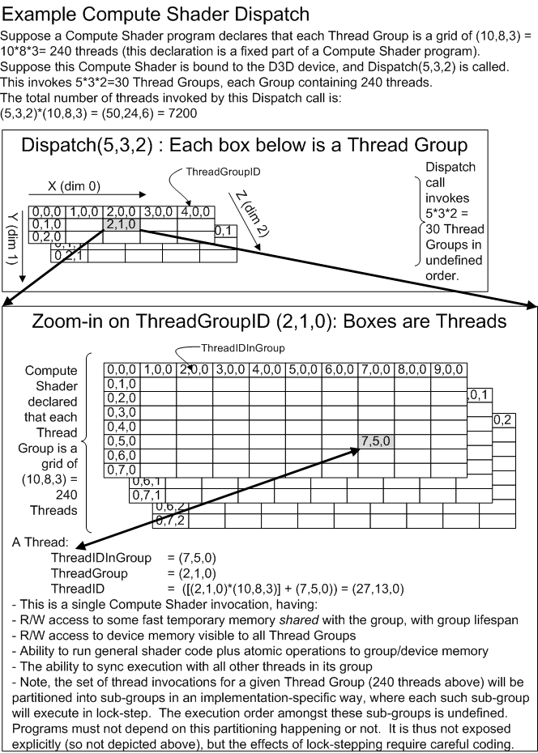

<a id="compute"></a>

# Compute execution

<a id="stage-model"></a>

## Stage model

A compute shader is a separate logical shader type analogous to the graphics shaders: the vertex, geometry, and pixel shaders. However, while it uses the same classes of input and output data, it is not directly connected to other shaders in the same pipeline during use. Its purpose is to enable more general processing operations than those enabled by the graphics shaders.

A compute shader does not necessarily have a forced 1-1 mapping to either input records (like a vertex shader does) or output records (like the pixel shader does).

<a id="device-memory"></a>
<a id="device-memory-operations-and-stage-integration"></a>

Compute execution selects a [compute pipeline state](pipeline-state.md#compute-description). The shader reads constants, shader resources and samplers and reads or writes resources through unordered access views (UAVs), using [compute root arguments and descriptors](binding.md#recording-state).

Compute shaders are DXBC Shader Model 5.0 or 5.1 programs or DXIL Shader Model 6.x programs. The downlevel `cs_4_x` profiles are not part of this set.

<a id="thread-groups"></a>

## Thread groups and invocations

A dispatch launches a three-dimensional grid of thread groups. Each group executes the same compute entry point and has its own thread group shared memory (TGSM). A shader's `[numthreads(X,Y,Z)]` declaration fixes the three-dimensional arrangement of threads within every group. The Dispatch arguments specify groups, not threads.

Groups can execute in any order. Threads within a group cooperate through TGSM, UAVs, atomics and explicit synchronization.

`X`, `Y` and `Z` are positive compile-time integers. X and Y are each at most 1024, Z is at most 64, and `X*Y*Z` is at most 1024.

For example, `[numthreads(10,8,3)]` declares 240 threads per group. `Dispatch(5,3,2)` launches 30 groups and therefore 7,200 shader invocations. For group `(2,1,0)`, local thread `(7,5,0)` has dispatch thread coordinates `(27,13,0)` and flattened group index 57.



The figure's ThreadGroupID, ThreadIDInGroup and ThreadID correspond to `SV_GroupID`, `SV_GroupThreadID` and `SV_DispatchThreadID`. The figure's "sub-groups" are [waves](common-shader-internals.md#execution-terminology).

<a id="generated-identifiers"></a>

### Generated identifiers

Components are 32-bit unsigned integers. Let `groupSize = (X,Y,Z)` from `numthreads` and `localID = SV_GroupThreadID`.

| HLSL semantic | DXBC input | DXIL operation | Meaning |
|---|---|---|---|
| `SV_GroupID` (`uint3`) | `vThreadGroupID.xyz` | `GroupId` | Group coordinates, each from zero through the corresponding dispatch count minus one |
| `SV_GroupThreadID` (`uint3`) | `vThreadIDInGroup.xyz` | `ThreadIdInGroup` | Local coordinates, each from zero through the corresponding group size minus one |
| `SV_DispatchThreadID` (`uint3`) | `vThreadID.xyz` | `ThreadId` | `SV_GroupID * groupSize + localID`, component-wise |
| `SV_GroupIndex` (`uint`) | `vThreadIDInGroupFlattened` | `FlattenedThreadIdInGroup` | `localID.z*Y*X + localID.y*X + localID.x` |

The flattened local index is in `[0, X*Y*Z-1]`. X changes fastest, then Y, then Z. It is not a flattened index of the whole dispatch and is not in general a wave lane index.

Behavior is undefined if the mathematical result of `SV_GroupID * groupSize + localID` exceeds `UINT32_MAX` in any component.

<a id="shader-representations"></a>

## Shader representations

<a id="dxbc-compute"></a>

### DXBC logical interface

DXBC declares its thread group dimensions with `dcl_thread_group`. A compute program has generated ID inputs and resource accesses, not vertex-style incoming records or a graphics stage output signature. `r#` and indexable `x#` storage is private to each thread. `g#` denotes shared storage for its group.

| Logical storage/input | Count or bound | Access | Components | Indexable by temporary value | Default | Declaration |
|---|---|---|---|---|---|---|
| 32-bit temporaries `r#` | 4,096 total with `x#` | Read/write | 4 | No | None | Required |
| 32-bit indexable temporary arrays `x#[n]` | 4,096 total with `r#` | Read/write | 4 | Yes | None | Required |
| 32-bit TGSM `g#[n]` | 8,192 scalar DWORDs across declarations | Read/write | 1; raw/structured declaration layouts | Yes | None | Required |
| Input resources `t#` | Shader profile and binding tiers | Read | Resource-defined | SM5.1 resource range indexing | None | Required |
| Samplers `s#` | Shader profile and binding tiers | Read | 1 | SM5.1 resource range indexing | None | Required |
| Constant buffers `cb#` | Shader profile and binding tiers | Read | 4 | Contents; SM5.1 resource ranges | None | Required |
| Immediate constant buffer `icb[index]` | 1 | Read | 4 | Contents | None | Required |
| `vThreadID.xyz` | 1 | Read | 3 | No | Generated | Required when used |
| `vThreadGroupID.xyz` | 1 | Read | 3 | No | Generated | Required when used |
| `vThreadIDInGroup.xyz` | 1 | Read | 3 | No | Generated | Required when used |
| `vThreadIDInGroupFlattened` | 1 | Read | 1 | No | Generated | Required when used |
| Null destination | Not applicable | Discard result | Not applicable | Not applicable | Not applicable | No |
| UAVs `u#` | Shader profile and binding tiers | Read/write | Resource-defined | SM5.1 resource range indexing | None | Required |

The resource rows are logical shader declarations, subject to the shader profile and [binding tier limits](binding.md#binding-capabilities). The root signature maps SM5.0 register bindings. SM5.1 additionally supports [register spaces](binding.md#register-spaces), ranges and descriptor indexing.

In practice, hardware implementations may spill temp register storage to slower memory behind the scenes if the combination of number of temps per thread and number of threads in the group goes too high. Functionally, however, it will always appear to the DXBC shader as if storage for 4096 temp registers is available per Compute Shader thread independent of how many threads are in a group.

<a id="dxil-compute"></a>

### DXIL entry point, properties and operations

A DXIL compute shader has a compute entry point identified by `dx.entryPoints` and the `cs` shader model declaration. The entry point properties include the three `numthreads` dimensions (`kDxilNumThreadsTag`, tag 4), applicable shader requirement flags and any requested [wave size property](#wave-size).

Compute system values are not packed into a graphics input signature. Ordinary compute has no graphics output signature: results are stored to resources. DXIL expresses private/thread-local values through typed static single assignment (SSA) values and private allocations rather than a fixed bank of DXBC `r#`/`x#` registers. The DXBC register count table is not a DXIL private allocation limit.

TGSM is represented by typed global variables in address space 3 and accessed through the corresponding loads, stores and atomic operations. Resource operations use handles and their typed/raw/structured access instructions.

<a id="thread-group-shared-memory"></a>

## Thread group shared memory

Each compute group has at most 32 KiB (32,768 bytes) of TGSM. Any thread in the group can read or write any declared shared location. Another group has separate shared storage even when it executes the same program. HLSL declares this storage with `groupshared`. The aggregate allocation, including type layout/alignment, must fit the per-group limit.

DXBC exposes up to 8,192 32-bit scalar locations across all `g#` declarations. `dcl_tgsm_raw` declares a byte count multiple of four. `dcl_tgsm_structured` declares `structByteStride * structCount` bytes, with a four-byte-multiple stride. DXIL's typed shared globals are allocated according to their types, not by counting each typed element as one DWORD.

[Native 16-bit types](numeric-and-data-rules.md#native16) permit two-byte shared storage. Minimum-precision types do not guarantee two-byte allocation.

`groupshared` variables can use [long vectors](common-shader-internals.md#dxil-vectors) in Shader Model 6.9 and later.

Values stored in this shared memory are not preserved between dispatches, nor between thread groups. They must be initialized by the shader before use, and any results to be persisted must be written out to resource memory.

<a id="waves"></a>

## Waves and quad operations

A compute group can contain multiple [waves](common-shader-internals.md#waves). Their relative execution order is not specified. Do not assume a particular group-to-wave partition or equality of `SV_GroupIndex` and wave lane index except where the [compute quad contract](#compute-quads) supplies a mapping. Group cooperation across waves requires [memory/execution synchronization](memory-model.md#shader-barriers). Compute does not generate rasterization helper pixels - threads that are required to fill out a wave but whose indices would not fit in the thread group size are inactive, not helpers.

<a id="wave-size"></a>

### Requested wave size

The `[WaveSize(numLanes)]` attribute (Shader Model 6.6) requests the wave size for a compute entry point.

The allowed wave sizes that an HLSL shader may specify are
the powers of 2 between 4 and 128, inclusive.
In other words, the set: `[4, 8, 16, 32, 64, 128]`.

The argument is a compile-time integer from the allowed set. When shader-selected wave size is supported, the shader must execute at the requested size, and pipeline creation fails if that size is unsupported. The group may contain multiple waves or a partially filled wave.

A device that reports Shader Model 6.6 and `WaveOps` support must support shader-selected wave size. All powers of two in its reported wave size interval must be selectable, with wave operations supported at every such size. Sizes incompatible with compute wave intrinsics and shader selection must not be included in that interval.

Wave-size selection is optional for Shader Model 6.6 devices without `WaveOps` support. A shader's `WaveSize` property specifies its minimum and maximum lane requirements, even when the shader uses no wave intrinsics. The property alone does not set the shader's `WaveOps` feature requirement.

Starting with Shader Model 6.8, `[WaveSize(minWaveSize,maxWaveSize)]` accepts a range and `[WaveSize(minWaveSize,maxWaveSize,prefWaveSize)]` additionally requests a preferred size. Every supplied value is a compile-time power of two from 4 through 128, `minWaveSize < maxWaveSize`, and a supplied preferred size lies in the inclusive range. The one-argument form requests exactly one size.

SM6.8 requires support for the ranged metadata's restrictions. The device and shader ranges must overlap, or else pipeline creation will fail. The driver selects a supported size within the requested range. If the preferred size is supported by the device, it must be used. An unsupported preference does not reject the shader when some other size in the allowed range is available.

See [DXIL wave size properties](dxil.md#wave-size-properties) for the property tags and operands.

<a id="compute-quads"></a>

### Derivatives and compute quad layout

Shader Model 6.6 supports derivatives and derivative-dependent sampling in compute. This includes `ddx`, `ddy`, their fine/coarse variants, implicit-derivative `Sample`, `SampleBias`, `SampleCmp` and `CalculateLevelOfDetail`, under their operation-specific type/format rules.

The derivative quad layout requires either X divisible by four with Y=Z=1, or X and Y both divisible by two. Other `numthreads` shapes cannot use derivatives. Amplification and mesh shaders use the same layout but have their own [optional derivative capability](amplification-and-mesh-shaders.md#derivatives).

These stage-specific derivatives feed the common [LOD/anisotropy calculation](common-shader-internals.md#lod-and-anisotropy) and [sampling/addressing precision rules](common-shader-internals.md#sampling-precision).

For both layouts:

- `quadID = WaveGetLaneIndex() / 4`
- `quadIndex = WaveGetLaneIndex() % 4`

`quadID` identifies which lanes share a quad, not a prescribed location for that quad in the group. The quad index follows Z-order:

| Quad indices |
|:---:|
| (0) (1)<br>(2) (3) |

<a id="compute-quads-1d"></a>

#### One-dimensional layout

Where only the X dimension is greater than 1,
the 2x2 quad is based on the group index
as provided by the `SV_GroupIndex` parameter.

- X position in quad from left = `SV_GroupIndex & 1`
- Y position in quad from top = `(SV_GroupIndex & 2) >> 1`

The result is that lanes in the group
form a sequence of serialized quads.
Every four sequential lanes form an individual quad.
The first and second lanes in the foursome
form the upper left and upper right respectively.
The third and fourth lanes
form the lower left and lower right respectively.
The lane after the fourth, if present represents
the upper left of the next quad.
This is sometimes called Z-order.

To provide a deterministic mapping between SV_GroupIndex
and the lanes within a quad,
1D quad ordering requires that threads are assigned lane indices
in the same order within the quad as specified by the SV_GroupIndex parameter:

For 1D quads: `SV_GroupThreadID.x % 4 == SV_GroupIndex % 4 == WaveGetLaneIndex() % 4`

For example,
a thread group defined by `[numthreads (32, 1, 1)]`
might contain a single wave containing 32 lanes that make up 8 quads.
The layout for the first quad would be as follows where the parenthesized value
represents the group index in decimal:

|Quad 0|
|:-----------:|
|(00) (01)<br>(02) (03)|

And a later quad would be:

|**Quad _n_**|
|:-----------:|
|(16) (17)<br>(18) (19)|

<a id="compute-quads-2d"></a>

#### Two-dimensional layout

Where the X and Y dimensions are divisible by 2,
the 2x2 quad is based on the x and y components
of group thread ID
as provided by the `SV_GroupThreadID` parameter.

- X position in quad from left = `SV_GroupThreadID.x & 1`
- Y position in quad from top = `SV_GroupThreadID.y & 1`

As a result, for every even x and y value within the thread group,
a quad is made up of the values (x,y) , (x+1,y), (x, y+1), (x+1, y+1).
There is no defined assignment of any quad within any wave
and no relation between the values of SV_GroupIndex and
the return value of WaveGetLaneIndex() should be assumed.

For shader models before 6.6,
compute `Quad*` operations use the same association between quads and lane indices,
but this mapping of quad lanes to `SV_GroupThreadID` is not required.


For example,
a thread group defined by `[numthreads (8,4,1)]`
might contain a single wave containing 32 lanes that make up 8 quads.
The layout for the first quad would be as follows where the parenthesized pair
represents the corresponding (GroupThreadID.x, GroupThreadID.y) values:

|Quad 0|
|:-----------:|
|(0,0) (1,0)<br>(0,1) (1,1)|

|**Quad _n_**|
|:-----------:|
|(6,2) (7,2)<br>(6,3) (7,3)|

`QuadReadLaneAt` and the across-X/Y/diagonal operations are available in compute from SM6.0 with wave operation support. For SM6.0-6.5 their thread-to-quad mapping is implementation-dependent. SM6.6 supplies the layouts above. SM6.7 adds native [`QuadAny` and `QuadAll`](common-shader-internals.md#quad-votes), which test all four lanes of a quad and require quad-uniform flow control. Quad-uniform control may differ between quads of the same wave.

Gradients of shader-computed values require [quad-uniform control flow](common-shader-internals.md#quad-uniformity). The [pixel shader examples](pixel-shaders.md#quad-gradient-examples) show the distinction between direct shader inputs and temporaries.

<a id="dispatch-grids"></a>
<a id="dispatch-dimensions"></a>

## Dispatch dimensions and capabilities

<a id="shared-grid-limits"></a>

### Common grid limits

| Operation/grid | Ordinary per-axis bound | Expanded one-dimensional bound | Independent total group bound |
|---|---|---|---|
| Direct or indirect compute dispatch | Each axis at most 65,535 | X at most [`Max1DDispatchSize`](devices-and-capabilities.md#d3d12_feature_data_d3d12_options22), with Y=Z=1 | No mesh/work graph total is imposed by this compute grid rule |
| API, indirect or amplification shader mesh dispatch | Each axis at most 65,535 | X at most [`Max1DDispatchMeshSize`](devices-and-capabilities.md#d3d12_feature_data_d3d12_options22), with Y=Z=1 | `X*Y*Z < 2^22` (at most 4,194,303) |
| Work graph execution grid | Each axis at most 65,535 | X at most [`Max1DDispatchSize`](devices-and-capabilities.md#d3d12_feature_data_d3d12_options22), with Y=Z=1 | `X*Y*Z < 2^24` (at most 16,777,215) |

When the pipeline has an amplification shader, API DispatchMesh dimensions launch amplification shader groups. Without one, they launch mesh shader groups directly. The amplification shader's DispatchMesh intrinsic launches a separate child mesh shader grid. Both grids are subject to the mesh row above. CPU validation of the API DispatchMesh arguments does not establish that the child grid is valid.

<a id="work-graph-grids"></a>

### Work graph grid configuration

The work graph grid limits apply to CPU input records, GPU input records and shader-produced records. Dynamic grids must also fit the node's configured maximum grid. See [shader grid declarations](work-graphs.md#shader-function-attributes) and [state object grid overrides](state-objects.md#d3d12_broadcasting_launch_overrides) for program configuration. The independent 24-bit total applies even when the device's compute 1D capability is larger.

The selected shader compiler requires directly authored `NodeDispatchGrid` and `NodeMaxDispatchGrid` attribute values to be positive, at most 65,535 per axis and at most 16,777,215 in total. State object dispatch grid or maximum grid overrides can supply expanded one-dimensional X values, subject to the configured-grid and total constraints above.

<a id="dispatch-validation"></a>

### Dispatch validation

<a id="validation-and-driver-responsibilities"></a>


Valid dispatch grids meet the following requirements:

**For Direct Compute Dispatches (`Dispatch`) and Dispatch Graph (CPU_INPUT):**
- If `ThreadGroupCountX > D3D12_CS_DISPATCH_MAX_THREAD_GROUPS_PER_DIMENSION` (65,535):
  - Require that `ThreadGroupCountY == 1`
  - Require that `ThreadGroupCountZ == 1`
  - Require that `ThreadGroupCountX <= Max1DDispatchSize`
  - For DispatchGraph, require that `ThreadGroupCountX <= D3D12_WORK_GRAPHS_DISPATCH_MAX_THREAD_GROUPS_PER_GRID (16,777,215)`
  - If any of these conditions is not met, the grid is invalid.
- If `ThreadGroupCountX <= 65535`:
  - Apply standard validation (all dimensions must be <= 65,535)

**For Mesh Shader Dispatches (`DispatchMesh`):**
- If `ThreadGroupCountX > D3D12_CS_DISPATCH_MAX_THREAD_GROUPS_PER_DIMENSION` (65,535):
  - Require that `ThreadGroupCountY == 1`
  - Require that `ThreadGroupCountZ == 1`
  - Require that `ThreadGroupCountX <= Max1DDispatchMeshSize`
  - Require that `ThreadGroupCountX <= D3D12_MS_DISPATCH_MAX_THREAD_GROUPS_PER_GRID (4,194,303)`
  - If any of these conditions is not met, the grid is invalid.
- If `ThreadGroupCountX <= 65535`:
  - Apply standard validation (all dimensions must be <= 65,535)

The ordinary runtime recording path does not drop, clamp, or otherwise modify an oversized dispatch. When the debug layer diagnoses oversized dimensions, it reports an **error**, but the dispatch is still passed to the driver unchanged — issuing a debug-layer error does not, by itself, alter runtime behaviour. This is intentional: dropping the dispatch would be a compatibility risk for existing applications.

<a id="dispatch"></a>

## ID3D12GraphicsCommandList::Dispatch

### Declaration

```cpp
void Dispatch(
    UINT ThreadGroupCountX,
    UINT ThreadGroupCountY,
    UINT ThreadGroupCountZ
    );
```

### Behavior

These arguments identify the x-, y-, and z- dimensions of the array of thread groups to be dispatched.

If any of the Dispatch arguments are 0, no thread groups are launched.

The invocation process dispatches the specified number of groups in the array. (The number of threads in each group is not specified in the Dispatch() call, but is specified in the shader to allow the compiler to optimize register pressure).

### Parameters

`ThreadGroupCountX`

[in] The number of groups dispatched in the x direction. *ThreadGroupCountX* follows the [common grid limits](#shared-grid-limits), including the expanded one-dimensional case.

`ThreadGroupCountY`

[in] The number of groups dispatched in the y direction. *ThreadGroupCountY* must be less than or equal to D3D12_CS_DISPATCH_MAX_THREAD_GROUPS_PER_DIMENSION (65535).

`ThreadGroupCountZ`

[in] The number of groups dispatched in the z direction. *ThreadGroupCountZ* must be less than or equal to D3D12_CS_DISPATCH_MAX_THREAD_GROUPS_PER_DIMENSION (65535).

### Return values

None

### Recording and execution constraints

Dispatch records work on DIRECT and COMPUTE command lists and BUNDLE recordings, not COPY lists. Dispatch must execute outside an active render pass, including when a Dispatch-containing bundle executes under its parent's [render pass context](command-list-state.md#render-pass). A zero count on any axis does not bypass these constraints. See [pipeline selection](command-list-state.md#pipeline-selection) and [resource binding inheritance](command-list-state.md#resource-binding) for the pipeline state and bindings a bundle uses. Dispatches can be [predicated](counters-queries-and-predication.md#predication-operation-matrix).

<a id="indirect-dispatch"></a>

## Indirect execution

[`ExecuteIndirect`](indirect-execution.md#executeindirect) uses `D3D12_INDIRECT_ARGUMENT_TYPE_DISPATCH` to consume [`D3D12_DISPATCH_ARGUMENTS`](indirect-execution.md#dispatch-arguments). `DISPATCH_MESH` consumes the [mesh dispatch record](indirect-execution.md#argument-records). Their grids use the corresponding [common dimensions](#shared-grid-limits).

## Dispatch driver interfaces and requirements

### Expanded dispatch grid requirements

**Dispatch Handling:**
- Drivers must correctly handle Compute dispatches with X dimension up to the reported `Max1DDispatchSize`
- Drivers must correctly handle Mesh dispatches with X dimension up to the reported `Max1DDispatchMeshSize`
- For valid expanded 1D grids, Y = 1 and Z = 1.
- Drivers must not rely on the runtime to reject dispatches with invalid dimensions. See [Dispatch validation](#dispatch-validation).

<a id="driver-dispatch"></a>

### Ordinary dispatch DDI

```cpp
typedef VOID ( APIENTRY* PFND3D12DDI_DISPATCH )(
    D3D12DDI_HCOMMANDLIST, UINT, UINT, UINT );
```

`PFND3D12DDI_DISPATCH` implements [Dispatch](#dispatch). Its three `UINT` arguments are `ThreadGroupCountX`, `ThreadGroupCountY` and `ThreadGroupCountZ` in that order.

```cpp
typedef VOID ( APIENTRY* PFND3D12DDI_DISPATCH_0114 )(D3D12DDI_API_HCOMMANDLIST, UINT, UINT, UINT );
```

The `_0114` entry participates in [runtime bypass](execution.md#work-command-handles). Its arguments otherwise match the [ordinary dispatch DDI](#driver-dispatch).
