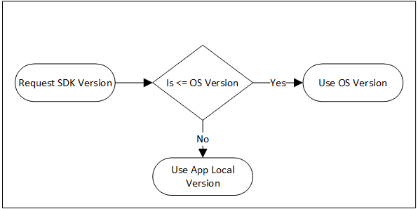

# Devices, feature levels and capabilities

A device represents an adapter and exposes its supported Direct3D 12 functionality. Adapter identity, device-object identity and the device's linked-node topology are distinct. An adapter LUID identifies the adapter, not a particular independent device. A node index selects a physical adapter within a device; it is not a device identifier.

Device creation selects a minimum feature level. Feature levels group required functionality; independently queried capabilities describe additional support and tiers. Interface availability, runtime recognition of a query or version, driver reporting, shader-model support and feature-level support are separate conditions.

[Execution](execution.md#threading) defines common CPU threading and object-lifetime rules. [Resources](resources.md) defines heap placement and resource node masks. [Binding](binding.md#binding-capabilities) defines root-signature representation and version support. The capability catalog in this chapter identifies exact query payload owners without moving their feature semantics.

Video interface discovery and the separate `ID3D12VideoDevice::CheckFeatureSupport` protocol are defined in [Video](video.md#video-device-model).

<a id="identity"></a>

## Adapter identity and linked nodes

<a id="id3d12device-getadapterluid"></a>

### ID3D12Device::GetAdapterLuid

#### Declaration

```cpp
LUID GetAdapterLuid();
```

#### Behavior

Gets a locally unique identifier for the device's adapter.

#### Return values

Type: **[LUID](https://learn.microsoft.com/en-us/windows/desktop/api/ntdef/ns-ntdef-luid)**

The locally unique identifier for the adapter.

#### Context

This method returns a unique identifier for the adapter that is specific to the adapter hardware. Applications can use this identifier to define robust mappings across various APIs (Direct3D 12, DXGI).

A locally unique identifier (LUID) is a 64-bit value that is guaranteed to be unique only on the system on which it was generated. The uniqueness of a locally unique identifier (LUID) is guaranteed only until the system is restarted.

<a id="id3d12device-getnodecount"></a>

### ID3D12Device::GetNodeCount

#### Declaration

```cpp
UINT GetNodeCount();
```

#### Behavior

Reports the number of physical adapters (nodes) that are associated with this device.

#### Return values

Type: **[UINT](https://learn.microsoft.com/en-us/windows/desktop/WinProg/windows-data-types)**

The number of physical adapters (nodes) that this device has.

A node index is zero-based and is less than `GetNodeCount()`. On a single-node device the index is zero. An index is not a bit mask: a node mask uses bit positions to select nodes. The `QUERY_META_COMMAND` payload uses its own `NodeMask` convention, including zero for single-GPU operation, rather than the `NodeIndex` convention used by architecture and protected-session queries.

<a id="common-object-interfaces"></a>

## Common object interfaces

<a id="id3d12devicechild-getdevice"></a>

### ID3D12DeviceChild::GetDevice

#### Declaration

```cpp
HRESULT GetDevice( REFIID riid, void** ppvDevice );
```

#### Behavior

Gets a pointer to the device that created this interface.

The query is against the device that created the child, not the child
itself or an adapter selected from its LUID/node mask. It retrieves an
interface on that existing device; it is not another device-creation
operation or an independent device identity. Inherited copies of this
method remain this single declaring API identity.

#### Parameters

##### `riid`

The globally unique identifier (`GUID`) for the device interface.
The `REFIID`, or `GUID`, of the interface to the device can be obtained by using the `__uuidof()` macro.
For example, `__uuidof(ID3D12Device)` will get the `GUID` of the interface to a device.

##### `ppvDevice`

A pointer to a memory block that receives a pointer to the `ID3D12Device` interface for the device.

#### Return values

The runtime returns the creating device's interface-query result under
the [COM QueryInterface contract](https://learn.microsoft.com/en-us/windows/win32/api/unknwn/nf-unknwn-iunknown-queryinterface(refiid_void)).
A supported IID returns `S_OK` and the requested interface;
an unsupported IID returns `E_NOINTERFACE` and a null output interface.
A null output address returns `E_POINTER`; it is not the null-output
`S_FALSE` device-creation probe defined by [D3D12CreateDevice](#d3d12createdevice).
These results are CPU interface-query results, not GPU completion.

#### Reference ownership

Any returned interfaces have their reference count incremented by one, so be sure to call `Release` on the returned pointers when no longer needed, to avoid a reference leak.

<a id="object-private-data"></a>

### Object-associated private data

ID3D12Object associates CPU-side private data with GUID keys on that
object. Inherited methods do not create separate API identities.
Application-defined keys select either copied bytes or an owned COM
interface association; the same key is replaced, not appended.
This is not resource-content upload, shader data, GPU residency,
cross-process sharing or synchronization.

The generic key/size rules below describe application-defined keys.
The [diagnostic naming GUIDs](diagnostics.md#object-names) have their
separate string/name behavior; do not treat a named feature key as an
arbitrary application blob or assume all such keys have identical
short-buffer behavior.

<a id="id3d12object-getprivatedata"></a>

### ID3D12Object::GetPrivateData

#### Declaration

```cpp
HRESULT GetPrivateData( REFGUID guid, UINT* pDataSize, void* pData );
```

#### Behavior

Gets application-defined data from a device object.

#### Parameters

##### `guid`

The `GUID` that is associated with the data.

##### `pDataSize`

A pointer to a variable that on input contains the size, in bytes, of the buffer that `pData` points to, and on output contains the size, in bytes, of the amount of data that `GetPrivateData` retrieved.

##### `pData`

A pointer to a memory block that receives the data from the device object if `pDataSize` points to a value that specifies a buffer large enough to hold the data.

#### Return values

For an application-defined key, a null `pData` queries the required
byte size without retrieving bytes or acquiring an interface reference.
With an output buffer, `*pDataSize` is its input capacity. A sufficient
buffer receives the complete value and `S_OK`; an insufficient buffer
receives no partial value, returns `DXGI_ERROR_MORE_DATA`, and reports
the required size. A later update can change that required size between
a query and fetch.

An absent application key returns `DXGI_ERROR_NOT_FOUND` and a zero
reported size. `pDataSize` is required; a null address returns
`E_INVALIDARG`. Counts are bytes, not characters or object counts.
For an interface association the required size is `sizeof(IUnknown*)`.
Successful retrieval of a non-null interface owns an additional
reference; the caller must Release it. Raw pointer bytes stored by
SetPrivateData are not promoted to an owning interface association.

If the data returned is a pointer to an `IUnknown`, or one of its derivative classes, which was previously set by **SetPrivateDataInterface**, that interface will have its reference count incremented before the private data is returned.

<a id="id3d12object-setprivatedata"></a>

### ID3D12Object::SetPrivateData

#### Declaration

```cpp
HRESULT SetPrivateData( REFGUID guid, UINT DataSize, const void* pData );
```

#### Behavior

Sets application-defined data to a device object and associates that data with an application-defined `GUID`.

#### Parameters

##### `guid`

The `GUID` to associate with the data.

##### `DataSize`

The size in bytes of the data.

##### `pData`

A pointer to a memory block that contains the data to be stored with this device object. If `pData` is `NULL`, `DataSize` must also be 0, and any data that was previously associated with the `GUID` specified in `guid` will be destroyed.

#### Return values

Successful storage returns `S_OK`. The bytes are copied during the
call; caller storage can be reused afterward. `pData == nullptr`
requires `DataSize == 0` and removes the application key, releasing
any previously owned interface. Removing an absent application key
returns `S_FALSE`. A non-null pointer with zero size instead stores
an existing zero-length value; it is not the null-pointer removal case.

Allocation and other failures are reported through HRESULT. A raw
byte value does not AddRef embedded interface pointers or establish
their lifetime. The diagnostic string/name convention remains the
[SetName contract](diagnostics.md#id3d12object-setname), not a new
generic byte encoding.

<a id="id3d12object-setprivatedatainterface"></a>

### ID3D12Object::SetPrivateDataInterface

#### Declaration

```cpp
HRESULT SetPrivateDataInterface( REFGUID guid, const IUnknown* pData );
```

#### Behavior

Associates an [IUnknown](https://learn.microsoft.com/en-us/windows/win32/api/unknwn/nn-unknwn-iunknown)-derived interface with the device object, and associates that interface with an application-defined **GUID**.

#### Parameters

##### `guid`

The **GUID** to associate with the interface.

##### `pData`

A pointer to the [IUnknown](https://learn.microsoft.com/en-us/windows/win32/api/unknwn/nn-unknwn-iunknown)-derived interface to be associated with the device object. Its reference count is incremented when set, and decremented when either the [ID3D12Object](#object-private-data) is destroyed, or when the data is overwritten by calling [SetPrivateData](#id3d12object-setprivatedata) or **SetPrivateDataInterface** with the same **GUID**.

#### Return values

Successful association returns `S_OK`; allocation/other failures use
HRESULT. The associated non-null interface is AddRef'd when stored
and Released when replaced, removed or the owning object is destroyed.
Retrieving it through GetPrivateData acquires a separate caller
reference; a size-only query does not.

A null `pData` stores a null interface value under the key, with the
pointer-sized extent. It releases a prior non-null interface but is
distinct from removing the key with SetPrivateData(guid, 0, nullptr).
A later successful fetch therefore returns a null pointer rather
than reporting a missing key. The interface association is strong,
not a weak reference; callers must avoid unintended reference cycles.

<a id="destruction-notifications"></a>

### Destruction notifications

**ID3DDestructionNotifier** is an interface that you can use to register for callbacks when a Direct3D nano-COM object is destroyed.

To acquire an instance of this interface, call [QueryInterface](https://learn.microsoft.com/en-us/windows/win32/api/unknwn/nf-unknwn-iunknown-queryinterface(refiid_void)) on a Direct3D object with the **IID** of **ID3DDestructionNotifier**.

Using **ID3DDestructionNotifier** instead of **[ID3D12Object::SetPrivateDataInterface](#id3d12object-setprivatedatainterface)** provides
stronger guarantees about the order of destruction. With **ID3DDestructionNotifier**, implicit relationships are guaranteed to be valid, and the referenced object is guaranteed to still be alive when the destruction callback is invoked. With **[ID3D12Object::SetPrivateDataInterface](#id3d12object-setprivatedatainterface)**, the implicit references can be released before the destruction callback is invoked.

It isn't safe to access the object being destructed during the callback.

ID3DDestructionNotifier is an IUnknown-derived interface queried on the
object being monitored, not a separately created D3D12 device child.
QueryInterface can fail if an object does not expose it. Release the
acquired interface reference when no longer needed; retaining an
interface on the monitored object can itself postpone destruction.

The callback observes object destruction, not every Release call,
the loss of one application's reference, device removal, a resource
barrier, or proof of GPU completion. Applications still satisfy the
[recorded-use and GPU lifetime requirements](execution.md#lifetime)
before releasing objects used by pending work. The implicit-reference
guarantee concerns those relationships, not every object once used
with the monitored object or every child of a device.

<a id="pfn-destruction-callback"></a>

#### PFN_DESTRUCTION_CALLBACK

```cpp
typedef void(__stdcall *PFN_DESTRUCTION_CALLBACK)(void* pData);
```

Registration stores the callback function and the `pData` pointer value;
it does not copy an application context object or AddRef a COM pointer
passed as that value. A null context pointer is permitted. Keep the
function and any context it will access valid until the registration
is removed or its destruction callback has returned.

The runtime invokes remaining callbacks inline during destruction,
passing each registration's stored context. This is not a request for
dispatch to an application-selected thread. The prohibition on accessing
the object being destroyed also excludes registering/unregistering on
that object, querying it, or trying to resurrect it from its callback.

<a id="id3ddestructionnotifier-registerdestructioncallback"></a>

### ID3DDestructionNotifier::RegisterDestructionCallback

#### Declaration

```cpp
HRESULT RegisterDestructionCallback( PFN_DESTRUCTION_CALLBACK callbackFn, void* pData, UINT* pCallbackID );
```

#### Behavior

Registers a user-defined callback to be invoked on destruction of the object from which this [ID3DDestructionNotifier](#destruction-notifications) was created.

#### Parameters

##### `callbackFn`

Type: **PFN_DESTRUCTION_CALLBACK**

A user-defined callback to be invoked when the object is destroyed.

##### `pData`

Type: **void\***

The data to pass to *callbackFn* when invoked

##### `pCallbackID`

Type: **[UINT](https://learn.microsoft.com/en-us/windows/win32/winprog/windows-data-types)\***

Pointer to a **UINT** used to identify the callback, and to pass to [UnregisterDestructionCallback](#id3ddestructionnotifier-unregisterdestructioncallback) to unregister the callback.

Use a writable `pCallbackID` for the cancellable registration form.
The returned ID identifies that registration on this object, not
a globally unique object, GPU address or fence value. Use it only
after successful registration. Holding the copied ID does not
retain the object or take ownership of its context.

#### Return values

Type: **[HRESULT](https://learn.microsoft.com/en-us/windows/win32/com/structure-of-com-error-codes)**

If this function succeeds, it returns **S_OK**.

A null `callbackFn` returns `DXGI_ERROR_INVALID_CALL` in the current
runtime; allocation failure returns `E_OUTOFMEMORY`. Failure does
not establish a usable registration ID, even if an output value
was written before the failure. No GPU wait or work is performed.

<a id="id3ddestructionnotifier-unregisterdestructioncallback"></a>

### ID3DDestructionNotifier::UnregisterDestructionCallback

#### Declaration

```cpp
HRESULT UnregisterDestructionCallback( UINT callbackID );
```

#### Behavior

Unregisters a callback that was registered with [RegisterDestructionCallback](#id3ddestructionnotifier-registerdestructioncallback).

#### Parameters

##### `callbackID`

Type: **[UINT](https://learn.microsoft.com/en-us/windows/win32/winprog/windows-data-types)**

The **UINT** that was created by the *pCallbackID* argument to **[ID3DDestructionNotifier::RegisterDestructionCallback](#id3ddestructionnotifier-registerdestructioncallback)**.

#### Return values

Type: **[HRESULT](https://learn.microsoft.com/en-us/windows/win32/com/structure-of-com-error-codes)**

If this function succeeds, it returns **S_OK**.

Successful removal prevents that registration's later destruction
notification; it neither destroys the object nor frees the
application's context. Zero, an unknown ID or an already removed
ID returns `DXGI_ERROR_NOT_FOUND`. IDs belong to the same object's
notifier. Unregistration is not a GPU fence or a way to call back
into the object while its destruction callback is running.

<a id="binary-data-blobs"></a>

### Binary-data blob objects

The `ID3D10Blob` interface inherits from `IUnknown` and is used to return arbitrary-length data.

The `ID3DBlob` interface is type-defined in the D3DCommon.h header file as an `ID3D10Blob` interface, which is fully defined in the D3DCommon.h header file.
`ID3DBlob` is version-neutral and can be used in code for any Direct3D version.

`ID3DBlob` is an alias of `ID3D10Blob`, not a new interface or device
child. Its data is CPU binary storage. Retain the blob's COM reference
while using the borrowed byte pointer; do not free that pointer as a
separate allocation or call Release on it. Releasing the blob reference
and accessing its bytes are separate operations.

The pointer/size pair describes only the returned byte span. It does not
assert a text encoding or terminating byte, validate a shader/container
format, identify GPU VA, or establish GPU-resource residency/lifetime.
A producing API's payload/ownership rules remain required.

Current consumers include [root-signature serialization](binding.md#d3d12serializeversionedrootsignature),
[pipeline cached blobs](pipeline-state.md#id3d12pipelinestate-getcachedblob) and the
[compiler-runtime root serializer](offline-compilation.md#d3d12compilerserializeversionedrootsignature).
Their payload/version/adapter eligibility is separate from accessing
the bytes; the common blob interface requires no D3D12 device.

<a id="id3d10blob-getbufferpointer"></a>

### ID3D10Blob::GetBufferPointer

#### Declaration

```cpp
LPVOID GetBufferPointer();
```

#### Behavior

Gets a pointer to the data.

#### Return values

Returns a pointer.

`LPVOID` is a CPU `void*`. The pointer is borrowed under the
[common blob ownership and extent contract](#binary-data-blobs); this accessor
returns no HRESULT or additional COM reference.

<a id="id3d10blob-getbuffersize"></a>

### ID3D10Blob::GetBufferSize

#### Declaration

```cpp
SIZE_T GetBufferSize();
```

#### Behavior

Gets the size.

#### Return values

The size of the data, in bytes.

The result is a CPU `SIZE_T` byte count, not a character/element count,
GPU allocation size or HRESULT. Do not truncate it to a 32-bit count.
[GetBufferPointer](#id3d10blob-getbufferpointer) accesses the corresponding
byte span; size alone neither allocates storage nor transfers ownership.

<a id="ordinary-creation"></a>

## Ordinary device creation

<a id="d3d12createdevice"></a>

### D3D12CreateDevice

#### Declaration

```cpp
HRESULT D3D12CreateDevice(IUnknown *pAdapter, D3D_FEATURE_LEVEL MinimumFeatureLevel,
                         REFIID riid, void **ppDevice);
```

#### Behavior

Creates a device that represents the display adapter.

#### Parameters

`pAdapter` (input, optional)

Type: **IUnknown\***

A pointer to the video adapter to use when creating a device. Pass **NULL** to use the default adapter, which is the first adapter that is enumerated by [IDXGIFactory1::EnumAdapters](https://learn.microsoft.com/en-us/windows/desktop/api/dxgi/nf-dxgi-idxgifactory-enumadapters).

`MinimumFeatureLevel`

Type: **[D3D_FEATURE_LEVEL](https://learn.microsoft.com/en-us/windows/desktop/api/d3dcommon/ne-d3dcommon-d3d_feature_level)**

The minimum [D3D_FEATURE_LEVEL](https://learn.microsoft.com/en-us/windows/desktop/api/d3dcommon/ne-d3dcommon-d3d_feature_level) required for successful device creation.

`riid` (input)

Type: **REFIID**

The globally unique identifier (**GUID**) for the device interface. This parameter, and *ppDevice*, can be addressed with the single macro [IID_PPV_ARGS](https://learn.microsoft.com/en-us/windows/desktop/api/combaseapi/nf-combaseapi-iid_ppv_args).

`ppDevice` (output, optional)

Type: **void\*\***

A pointer to a memory block that receives a pointer to the device. Pass **NULL** to test if device creation would succeed, but to not actually create the device. If **NULL** is passed and device creation would succeed, **S\_FALSE** is returned.

#### Return values

Type: **[HRESULT](https://learn.microsoft.com/en-us/windows/win32/com/structure-of-com-error-codes)**

This method can return one of the [Direct3D 12 Return Codes](https://learn.microsoft.com/en-us/windows/desktop/direct3d12/d3d12-graphics-reference-returnvalues).

Possible return values include those documented for [CreateDXGIFactory1](https://learn.microsoft.com/en-us/windows/desktop/api/dxgi/nf-dxgi-createdxgifactory1) and [IDXGIFactory::EnumAdapters](https://learn.microsoft.com/en-us/windows/desktop/api/dxgi/nf-dxgi-idxgifactory-enumadapters).

If **ppDevice** is **NULL** and the function succeeds, **S\_FALSE** is returned, rather than **S\_OK**.

#### Context

`D3D12CreateDevice` provides a singleton per adapter. If a Direct3D 12 singleton device already exists in the current process for a given adapter, then a subsequent call to **D3D12CreateDevice** returns the existing device. If the current Direct3D 12 device is in a removed state (that is, [ID3D12Device::GetDeviceRemovedReason](diagnostics.md#id3d12device-getdeviceremovedreason) returns a failing HRESULT), then **D3D12CreateDevice** fails instead of returning the existing device. The sameness of two adapters (that is, they have the same identity) is determined by comparing their LUIDs, not their pointers.

In order to be sure to pick up the first adapter that supports D3D12, use the following code.

```cpp
HRESULT GetHardwareAdapter(IDXGIFactory4* pFactory, IDXGIAdapter1** ppAdapter)
{
    if (!ppAdapter)
        return E_INVALIDARG;
    *ppAdapter = nullptr;
    if (!pFactory)
        return E_INVALIDARG;

    for (UINT adapterIndex = 0; ; ++adapterIndex)
    {
        ComPtr<IDXGIAdapter1> adapter;
        HRESULT hr = pFactory->EnumAdapters1(adapterIndex, adapter.GetAddressOf());
        if (hr == DXGI_ERROR_NOT_FOUND)
            return DXGI_ERROR_NOT_FOUND;
        if (FAILED(hr))
            return hr;

        DXGI_ADAPTER_DESC1 desc = {};
        hr = adapter->GetDesc1(&desc);
        if (FAILED(hr))
            return hr;
        if (desc.Flags & DXGI_ADAPTER_FLAG_SOFTWARE)
            continue;

        hr = D3D12CreateDevice(adapter.Get(), D3D_FEATURE_LEVEL_11_0,
                              __uuidof(ID3D12Device), nullptr);
        if (SUCCEEDED(hr))
        {
            *ppAdapter = adapter.Detach();
            return S_OK;
        }
    }
}
```

The function signature PFN\_D3D12\_CREATE\_DEVICE is provided as a typedef, so that you can use dynamic linking techniques ([GetProcAddress](https://learn.microsoft.com/en-us/windows/desktop/api/libloaderapi/nf-libloaderapi-getprocaddress)) instead of statically linking.

The **REFIID**, or **GUID**, of the interface to a device can be obtained by using the `__uuidof()` macro. For example, `__uuidof`([ID3D12Device](https://learn.microsoft.com/en-us/windows/desktop/api/d3d12/nn-d3d12-id3d12device)) will get the **GUID** of the interface to a device.

#### Examples

Create a hardware based device, unless instructed to create a WARP software device.

```cpp
ComPtr<IDXGIFactory4> factory;
ThrowIfFailed(CreateDXGIFactory1(IID_PPV_ARGS(&factory)));

if (m_useWarpDevice)
{
    ComPtr<IDXGIAdapter> warpAdapter;
    ThrowIfFailed(factory->EnumWarpAdapter(IID_PPV_ARGS(&warpAdapter)));

    ThrowIfFailed(D3D12CreateDevice(
        warpAdapter.Get(),
        D3D_FEATURE_LEVEL_11_0,
        IID_PPV_ARGS(&m_device)
        ));
}
else
{
    ComPtr<IDXGIAdapter1> hardwareAdapter;
    ThrowIfFailed(GetHardwareAdapter(factory.Get(), hardwareAdapter.GetAddressOf()));

    ThrowIfFailed(D3D12CreateDevice(
        hardwareAdapter.Get(),
        D3D_FEATURE_LEVEL_11_0,
        IID_PPV_ARGS(&m_device)
        ));
}

```

Refer to the [Example Code in the D3D12 Reference](https://learn.microsoft.com/en-us/windows/desktop/direct3d12/notes-on-example-code).

The ordinary entry point's singleton is per adapter LUID within the process. Independent devices created by a factory do not make all device objects for the same LUID identical. A removed singleton cannot be replaced through `D3D12CreateDevice` while references keep it alive. Releasing the singleton and its device children permits a subsequent creation; independent creation provides a separate configuration and recovery boundary.

Historical context: driver-upgrade recovery also requires allowing the old user-mode driver and its dependent modules to unload. Sharing a singleton couples components' recovery to the lifetime of that singleton.

[Runtime cache discovery](runtime-cache-discovery.md#effective-identity) defines effective identity and registered default-PSDB initialization for a newly initialized device. Its [absence/error and retained-state rules](runtime-cache-discovery.md#failure-and-lifetime) do not imply that returning an existing singleton repeats initialization or refreshes its cache.

<a id="runtime-selection"></a>

## Runtime selection and configuration

### SDK selection

Applications targeting a redist ship the app local copy of D3D12core.dll and register the SDK version.

If the requested redist version is the same or older than the OS inbox D3D12, the application uses the inbox version.



This version policy:

- Maintains compatibility with OS entry points like Kernel Thunks.
- Ages out old versions of redists to help close the support window on older redists.

### No requested redistributable

Applications that don't target a redist continue to get the inbox OS version as before.

<a id="sdk-selection-exports"></a>

### Application SDK-selection exports

Applications and games set redist parameters by exporting constant data via well known symbols.

- D3D12SDKVersion - Declares the SDK version of the D3D12 redistributable that the Application is targeting.
- D3D12SDKPath - The path to D3D12 binaries relative to the application exe using D3D12.

For example, the application exe can export these constants via a .def file:

```
EXPORTS
    D3D12SDKVersion DATA PRIVATE
    D3D12SDKPath DATA PRIVATE
```

And declare the constants in code:

```c++
extern "C" {
    extern const UINT D3D12SDKVersion = 4;
    extern const char* D3D12SDKPath = ".\\D3D12\\";
}
```

Alternatively, a developer who does not want to use a .def file, can export these constants as follows:
```c++
extern "C" {
    __declspec(dllexport) extern const UINT D3D12SDKVersion = 4;
    __declspec(dllexport) extern const char* D3D12SDKPath = ".\\D3D12\\";
}
```

In either case, this declares that the version of the D3D12SDKVersion included with the application is 4.

D3D12SDKPath is a UTF-8 string that declares that D3D12Core.dll, D3D12SDKLayers.dll, and other D3D12 redist binaries are located in the subfolder D3D12 relative to the exe, so:

Path to exe:
c:\Game\game.exe

Path to D3D12 redist:
c:\Game\D3D12\D3D12Core.dll

Configure the application installer to install the D3D12Core.dll in the folder specified in D3D12SDKPath.

Applications call D3D12CreateDevice on the OS inbox D3D12.dll as they always have.  This runtime checks if the requested version is the same or older than the inbox version.  If it is, the inbox version of D3D12.dll, D3D12SDKLayers.dll, etc. are used.

If the requested version is newer, the runtime will load D3D12Core.dll from D3D12SDKPath, ensure that it matches the declared version, and use it instead.

The interfaces and feature checks of the requested SDK version are now available.

<a id="d3d12getinterface"></a>

### D3D12GetInterface

#### Declaration

```cpp
HRESULT D3D12GetInterface(REFCLSID rclsid, REFIID riid, void **ppvDebug);
```

#### Behavior

Retrieves an interface selected by class and interface identifiers. Supports debug, tools, [DRED](diagnostics.md#dred), and SDK configuration interfaces.

#### Parameters

`rclsid`

Type: **[REFCLSID](https://learn.microsoft.com/en-us/openspecs/windows_protocols/ms-oaut/bbde795f-5398-42d8-9f59-3613da03c318)**

The CLSID associated with the data and code that will be used to create the object.

The following CLSIDs are defined.

- DEFINE\_GUID(CLSID\_D3D12Debug, 0xf2352aeb, 0xdd84, 0x49fe, 0xb9, 0x7b, 0xa9, 0xdc, 0xfd, 0xcc, 0x1b, 0x4f);
- DEFINE\_GUID(CLSID\_D3D12Tools, 0xe38216b1, 0x3c8c, 0x4833, 0xaa, 0x09, 0x0a, 0x06, 0xb6, 0x5d, 0x96, 0xc8);
- DEFINE\_GUID(CLSID\_D3D12DeviceRemovedExtendedData, 0x4a75bbc4, 0x9ff4, 0x4ad8, 0x9f, 0x18, 0xab, 0xae, 0x84, 0xdc, 0x5f, 0xf2);
- DEFINE\_GUID(CLSID\_D3D12SDKConfiguration, 0x7cda6aca, 0xa03e, 0x49c8, 0x94, 0x58, 0x03, 0x34, 0xd2, 0x0e, 0x07, 0xce);

They correspond, respectively, to the following interfaces.

- [ID3D12Debug interface](diagnostics.md#debug-configuration)
- [ID3D12Tools interface](https://learn.microsoft.com/en-us/windows/win32/api/d3d12/nn-d3d12-id3d12tools)
- [ID3D12DeviceRemovedExtendedDataSettings interface](diagnostics.md#dred-settings)
- [ID3D12SDKConfiguration interface](https://learn.microsoft.com/en-us/windows/win32/api/d3d12/nn-d3d12-id3d12sdkconfiguration)

`riid`

Type: **[REFIID](https://learn.microsoft.com/en-us/openspecs/windows_protocols/ms-oaut/bbde795f-5398-42d8-9f59-3613da03c318)**

The globally unique identifier (**GUID**) for the SDK configuration interface. The **REFIID**, or **GUID**, of the interface can be obtained by using the `__uuidof` macro. For example, `__uuidof(ID3D12SDKConfiguration)` will retrieve the **GUID** of the SDK configuration interface.

`ppvDebug`

Type: **[void](https://learn.microsoft.com/en-us/windows/win32/winprog/windows-data-types)\*\***

The `out` parameter that contains the requested interface on return (for example, the SDK configuration interface), as a pointer to pointer to void. See [ID3D12SDKConfiguration](https://learn.microsoft.com/en-us/windows/win32/api/d3d12/nn-d3d12-id3d12sdkconfiguration).

The [state-object database factory](state-object-databases-and-identity.md#database-factory) is retrieved with `CLSID_D3D12StateObjectFactory` and its database-factory interface. The [application identity configuration interface](state-object-databases-and-identity.md#id3d12applicationidentity-setapplicationidentity) uses `CLSID_D3D12ApplicationIdentity`. Global identity retrieval through this function and factory-scoped identity retrieval through [GetConfigurationInterface](#id3d12devicefactory-getconfigurationinterface) retain their distinct configuration and snapshot rules.

The [shader-cache registration factory](shader-cache-registration.md#factory-bootstrap) is retrieved using `CLSID_D3DShaderCacheInstallerFactory` and `IID_ID3DShaderCacheInstallerFactory`. It creates installers and read-only explorers; it is not an `ID3D12DeviceFactory` or a compiler factory. Its client, catalog and object-lifetime contracts are defined there.

#### Return values

Type: **[HRESULT](https://learn.microsoft.com/en-us/windows/win32/com/structure-of-com-error-codes)**

If the function succeeds, then it returns **S\_OK**. Otherwise, it returns one of the [Direct3D 12 return codes](https://learn.microsoft.com/en-us/windows/win32/direct3d12/d3d12-graphics-reference-returnvalues).

`CLSID_D3D12DeviceFactory` retrieves a factory from the globally selected runtime. `ID3D12SDKConfiguration1::CreateDeviceFactory` additionally selects a side-by-side runtime for that factory. The SDK configuration object is obtained using `CLSID_D3D12SDKConfiguration`. Factory configuration interfaces refer to the factory's state, not automatically to the process-global state.

<a id="id3d12sdkconfiguration-setsdkversion"></a>

### ID3D12SDKConfiguration::SetSDKVersion

#### Declaration

```cpp
HRESULT SetSDKVersion(UINT SDKVersion, LPCSTR SDKPath);
```

#### Behavior

Configures the SDK version to use.

#### Parameters

`SDKVersion`

Type: **[UINT](https://learn.microsoft.com/en-us/windows/win32/winprog/windows-data-types)**

The SDK version to set.

`SDKPath`

Type: **[LPCSTR](https://learn.microsoft.com/en-us/windows/win32/winprog/windows-data-types)**

A NULL-terminated string that provides the relative path to `d3d12core.dll` at the specified *SDKVersion*. The path is relative to the process exe of the caller. If `d3d12core.dll` isn't found, or isn't of the specified *SDKVersion*, then Direct3D 12 device creation fails.

#### Return values

Type: **[HRESULT](https://learn.microsoft.com/en-us/windows/win32/com/structure-of-com-error-codes)**

If the function succeeds, then it returns **S\_OK**. Otherwise, it returns one of the [Direct3D 12 return codes](https://learn.microsoft.com/en-us/windows/win32/direct3d12/d3d12-graphics-reference-returnvalues).

#### Context

This method can be used only in Windows Developer Mode.

To set the SDK version using this API, you must call it before you create the Direct3D 12 device. Calling this API *after* creating the Direct3D 12 device will cause the Direct3D 12 runtime to remove the device.

If the `d3d12core.dll` installed with the OS is newer than the SDK version specified, then the OS version is used instead.

You can retrieve the version of a particular `D3D12Core.dll` from the exported symbol [**D3D12SDKVersion**](https://learn.microsoft.com/en-us/windows/win32/direct3d12/nf-d3d12-d3d12sdkversion), which is a variable of type **UINT**, just like the variables exported from applications to enable use of the Agility SDK.

`SetSDKVersion` changes the global selection and requires Developer Mode. Factory creation does not require Developer Mode and can select its own SDK without replacing the global selection. Selecting a newer runtime does not itself establish hardware or driver support for an optional feature.

<a id="runtime-driver-initialization"></a>

## Runtime and driver initialization

The user-mode display driver (UMD) interface is distinct from the application's COM interfaces. The runtime opens a driver adapter object, selects a mutually supported DDI version, provides private-device storage and creates the driver device. Driver function tables and runtime callback tables carry calls in opposite directions.

One DDI device is associated with each opened UMD adapter object. This does not restrict the number of application devices associated with a physical adapter.

The Direct3D runtime can open multiple graphics adapter objects from a single graphics adapter.

Driver handles identify driver objects or their supplied private storage. Runtime handles identify objects used when calling back into the runtime. These handle domains are not interchangeable. [Application device creation](devices-and-capabilities.md#ordinary-device-creation), [CPU threading and lifetime](execution.md#threading) and [device-removal reporting](diagnostics.md#device-removal-status) retain their separate contracts.

<a id="driver-entry"></a>

### Driver entry and adapter objects

<a id="pfnd3d12ddi_openadapter"></a>

#### PFND3D12DDI_OPENADAPTER

The UMD exports `OpenAdapter12` with this function type:

```cpp
typedef HRESULT (APIENTRY *PFND3D12DDI_OPENADAPTER)(
    _Inout_ D3D12DDIARG_OPENADAPTER* pArgs);

typedef struct D3D12DDIARG_OPENADAPTER
{
    D3D12DDI_HRTADAPTER hRTAdapter;
    D3D12DDI_HADAPTER hAdapter;
    CONST D3DDDI_ADAPTERCALLBACKS* pAdapterCallbacks;
    D3D12DDI_ADAPTERFUNCS* pAdapterFuncs;
} D3D12DDIARG_OPENADAPTER;
```

The runtime supplies `hRTAdapter`, its adapter callback table and writable adapter-function-table storage. On success, the driver returns `hAdapter` and fills the adapter function table. `hRTAdapter` is used with the runtime's adapter callbacks; `hAdapter` identifies the opened driver object in subsequent adapter DDIs.

The adapter callback table includes `pfnQueryAdapterInfoCb`, which the driver can use with `hRTAdapter` to query adapter information from the display miniport driver.

Adapter opening does not receive a selected device DDI version. Version
selection is a separate operation. The adapter function table below
supplies the current callbacks; its function types do not by themselves
establish the extent of the subsequently supplied device-creation data.

```cpp

typedef struct D3D12DDI_ADAPTERFUNCS_0109
{
    PFND3D12DDI_CALCPRIVATEDEVICESIZE pfnCalcPrivateDeviceSize;
    PFND3D12DDI_CREATEDEVICE_0109 pfnCreateDevice;
    PFND3D12DDI_CLOSEADAPTER pfnCloseAdapter;
    PFND3D12DDI_GETSUPPORTEDVERSIONS pfnGetSupportedVersions;
    PFND3D12DDI_GETCAPS pfnGetCaps;
    PFND3D12DDI_GETOPTIONALDDITTABLES pfnGetOptionalDDITables;
    PFND3D12DDI_FILLDDITTABLE pfnFillDDITable;
    PFND3D12DDI_DESTROYDEVICE pfnDestroyDevice;
} D3D12DDI_ADAPTERFUNCS_0109;
```

The table's create-device function type does not establish the extent of every creation argument the runtime will supply. The driver must use the creation arguments' negotiated `Interface`/`Version` pair before accessing the [extended creation fields](#creation-tail).

`OpenAdapter12` returns an `HRESULT` indicating whether adapter opening succeeded. Required allocation failure can be reported as `E_OUTOFMEMORY`. The driver owns the adapter object and its allocations; the runtime uses `CloseAdapter` to end its successful opened lifetime.

<a id="pfnd3d12ddi_closeadapter"></a>

#### PFND3D12DDI_CLOSEADAPTER

```cpp
typedef HRESULT (APIENTRY *PFND3D12DDI_CLOSEADAPTER)(
    D3D12DDI_HADAPTER hAdapter);
```

Closes the opened driver adapter object and releases its driver-owned resources. The device associated with that adapter is no longer in use when the adapter is closed. The return value reports completion or failure of closing the adapter; it is not a request to create or renegotiate a device.

<a id="interface-versions"></a>

### Supported interface versions

<a id="pfnd3d12ddi_getsupportedversions"></a>

#### PFND3D12DDI_GETSUPPORTEDVERSIONS

```cpp
typedef HRESULT (APIENTRY *PFND3D12DDI_GETSUPPORTEDVERSIONS)(
    D3D12DDI_HADAPTER hAdapter,
    _Inout_ UINT32* puEntries,
    _Out_writes_opt_(*puEntries) UINT64* pSupportedDDIInterfaceVersions);
```

Each returned `UINT64` is one exact supported DDI version, not a ceiling that implicitly advertises every lower build. A selected version must appear in the driver's returned list and be supported by the runtime. Runtime and driver are independently versioned.

Runtime selection normally prefers the highest mutually supported version. Compatibility exclusions, including runtime or driver bugs, can require a shared version to be skipped. The driver must not rely on unconditional selection of the numerically highest advertised value.

A null version-array pointer queries the number of entries through `puEntries`. For retrieval, `*puEntries` supplies array capacity in `UINT64` elements; on successful retrieval it reports the actual returned count, which does not exceed that capacity. The runtime can accept fewer entries than the preceding size query reported. Returned order does not establish version preference.

The function returns an `HRESULT`. This is a full-list query/retrieval protocol, not a specified capacity-clamped prefix or `DXGI_ERROR_MORE_DATA` convention. No generic failure-count or untouched-array guarantee is implied.

The selected value is communicated for device sizing and creation through the `Interface` and `Version` fields. Together they represent the selected 64-bit DDI version; they are not the API SDK version, feature level or shader-model version. If no version is supported by both sides, a device cannot be created for that runtime/driver pair.

<a id="device-storage"></a>

### Private device storage

<a id="pfnd3d12ddi_calcprivatedevicesize"></a>

#### PFND3D12DDI_CALCPRIVATEDEVICESIZE

```cpp
typedef SIZE_T (APIENTRY *PFND3D12DDI_CALCPRIVATEDEVICESIZE)(
    D3D12DDI_HADAPTER hAdapter,
    _In_ CONST D3D12DDIARG_CALCPRIVATEDEVICESIZE* pArgs);

typedef struct D3D12DDIARG_CALCPRIVATEDEVICESIZE
{
    UINT Interface;
    UINT Version;
    D3D12DDI_CREATE_DEVICE_FLAGS Flags;
} D3D12DDIARG_CALCPRIVATEDEVICESIZE;

typedef enum D3D12DDI_CREATE_DEVICE_FLAGS
{
    D3D12DDI_CREATE_DEVICE_FLAG_NONE = 0x0,
    D3D12DDI_CREATE_DEVICE_FLAG_DISABLE_IMPLICIT_MGPU = 0x1,
    D3D12DDI_CREATE_DEVICE_FLAG_DEBUGGABLE = 0x2,
} D3D12DDI_CREATE_DEVICE_FLAGS;
```

The CalcPrivateDeviceSize function determines the size of a memory region that the user-mode display driver requires from the Microsoft Direct3D runtime to store frequently-accessed data.

The return value is a byte size, not an `HRESULT`. The query describes the selected DDI interface/version and creation-mode flags. The flags identify requests to disable implicit multi-GPU operation or create a debuggable driver device; they are DDI creation flags, not the application device-factory flag enumeration.

The runtime allocates and frees the reported private-device region. The driver initializes that storage through `hDrvDevice` and owns any auxiliary allocations it makes. The storage supplied for creation must satisfy the size requirement for the actual creation parameters.

The private-device pointer is aligned to `MEMORY_ALLOCATION_ALIGNMENT`: 16 bytes on 64-bit Windows and 8 bytes on 32-bit Windows. This is not a 64-byte alignment guarantee.

<a id="device-creation"></a>

### Driver-device creation and destruction

<a id="pfnd3d12ddi_createdevice_0003-and-pfnd3d12ddi_createdevice_0109"></a>

### PFND3D12DDI_CREATEDEVICE_0109

```cpp

typedef HRESULT (APIENTRY *PFND3D12DDI_CREATEDEVICE_0109)(
    D3D12DDI_HADAPTER hAdapter,
    _In_ CONST D3D12DDIARG_CREATEDEVICE_0109* pArgs);

typedef struct D3D12DDIARG_CREATEDEVICE_0109
{
    D3D12DDI_HRTDEVICE hRTDevice;
    UINT Interface;
    UINT Version;
    CONST D3DDDI_DEVICECALLBACKS* pKTCallbacks;
    D3D12DDI_HDEVICE hDrvDevice;
    union
    {
        CONST D3D12DDI_CORELAYER_DEVICECALLBACKS_0003* p12UMCallbacks;
        CONST struct D3D12DDI_CORELAYER_DEVICECALLBACKS_0022* p12UMCallbacks_0022;
        CONST struct D3D12DDI_CORELAYER_DEVICECALLBACKS_0050* p12UMCallbacks_0050;
        CONST struct D3D12DDI_CORELAYER_DEVICECALLBACKS_0062* p12UMCallbacks_0062;
        CONST struct D3D12DDI_CORELAYER_DEVICECALLBACKS_0112* p12UMCallbacks_0112;
        CONST struct D3D12DDI_CORELAYER_DEVICECALLBACKS_0116* p12UMCallbacks_0116;
    };
    D3D12DDI_CREATE_DEVICE_FLAGS Flags;
    D3D12DDI_GPU_VIRTUAL_ADDRESS_RANGE* pReserveRanges;
    UINT NumReserveRanges;
} D3D12DDIARG_CREATEDEVICE_0109;
```

`hRTDevice` is the runtime handle used for callbacks. `hDrvDevice` identifies the supplied driver-private device storage, not a new allocation whose ownership transfers from the driver. `Interface`, `Version` and `Flags` specify the device being created.

`pKTCallbacks` supplies runtime callbacks that access kernel services. The `p12UMCallbacks` union supplies the applicable versioned core user-mode callback table. The union members are alternative views of one callback-table pointer, not independently supplied tables; the driver uses the layout applicable to the negotiated interface.

Creation supplies the adapter's selected core-version context for subsequent table population. It does not change the opened adapter table into a new negotiated table shape.

<a id="creation-tail"></a>

#### Creation-tail availability and reserved GPUVAs

The two fields after `Flags` are `pReserveRanges` and `NumReserveRanges`. Their presence is guaranteed only when the creation `Interface`/`Version` pair indicates `D3D12DDI_SUPPORTED_0111` or later. A driver must establish that field-availability guarantee before reading them, including before reading the count. Accessing absent fields is undefined behavior.

**History:** The `_0109` type name predates the 0111 field-presence guarantee. Earlier versions do not guarantee that the tail exists; the type name is not an availability test.

```cpp
typedef struct D3D12DDI_GPU_VIRTUAL_ADDRESS_RANGE
{
    D3D12DDI_GPU_VIRTUAL_ADDRESS StartAddress;
    UINT64 SizeInBytes;
} D3D12DDI_GPU_VIRTUAL_ADDRESS_RANGE;
```

For a creation payload that includes the tail, `pReserveRanges` supplies `NumReserveRanges` GPU virtual address ranges. `StartAddress` is a GPU virtual address and `SizeInBytes` is the extent in bytes. The driver must immediately reserve the supplied ranges during creation, before its initialization allocations can consume addresses needed for replay.

Ranges provided to `CreateDevice` are not processed in any way and may or may not be aligned in offset or size and may or may not overlap, depending on driver behavior during record.

The driver reports creation completion through the `HRESULT`. A failing creation must clean up the driver's partial work and auxiliary allocations; it cannot depend on `DestroyDevice` being called to finish a failed creation.

<a id="pfnd3d12ddi_destroydevice"></a>

#### PFND3D12DDI_DESTROYDEVICE

```cpp
typedef VOID (APIENTRY *PFND3D12DDI_DESTROYDEVICE)(
    D3D12DDI_HDEVICE hDevice);
```

Destroys the successfully created driver device and releases its driver-owned auxiliary allocations. The runtime retains ownership of the supplied private-device region and frees that region after its use ends.

Successful DDI device creation establishes a destruction obligation even if the application device is not yet complete. If a subsequent initialization DDI fails and initial creation is abandoned, the runtime calls `DestroyDevice` before closing the adapter. This does not make a later failure of a delay-loaded feature a device-creation failure.

`DestroyDevice` is an adapter-table entry, so cleanup does not depend on successfully obtaining the device function tables. It has no return value.

<a id="capability-queries"></a>

### Adapter capability queries

<a id="pfnd3d12ddi_getcaps"></a>

#### PFND3D12DDI_GETCAPS

```cpp
typedef HRESULT (APIENTRY *PFND3D12DDI_GETCAPS)(
    D3D12DDI_HADAPTER hAdapter,
    _In_ CONST D3D12DDIARG_GETCAPS* pArgs);

typedef struct D3D12DDIARG_GETCAPS
{
    D3D12DDICAPS_TYPE Type;
    VOID* pInfo;
    VOID* pData;
    UINT DataSize;
} D3D12DDIARG_GETCAPS;
```

`Type` selects the driver capability query. `pInfo` and `pData` carry its query-specific information and payload; their inputs, outputs and permitted null values are defined by that query. `DataSize` describes the `pData` payload size in bytes. The function returns an `HRESULT` reporting the query result.

This is an adapter-level interface, not a one-to-one dispatch of an application `CheckFeatureSupport` call. Runtime capability results can be cached, combined or translated. [Feature-level reporting](devices-and-capabilities.md#driver-responsibilities) defines concrete query/result mappings, including the input and output fields of the 3D-pipeline-support query.

<a id="table-discovery"></a>

### Required and additional function tables

Core-DDI table families are `D3D12DDI_TABLE_TYPE_DEVICE_CORE`, `D3D12DDI_TABLE_TYPE_COMMAND_LIST_3D`, `D3D12DDI_TABLE_TYPE_COMMAND_QUEUE_3D` and, from core version 0020, the [applicable extended-feature table](#extended-features). The selected core version determines which layout of each family applies. The `_0096` extended-feature table replaces the older selector at that version; both are not required simultaneously.

Most required families have one copy. A graphics-capable device has two baseline 3D command-list copies, for DIRECT and BUNDLE recordings. A device without graphics-pipeline support has one baseline 3D command-list copy. These counts do not establish a contractual numeric DIRECT/BUNDLE assignment for `tableNum`.

<a id="pfnd3d12ddi_getoptionalddittables"></a>

#### PFND3D12DDI_GETOPTIONALDDITTABLES

```cpp
typedef HRESULT (APIENTRY *PFND3D12DDI_GETOPTIONALDDITTABLES)(
    D3D12DDI_HADAPTER hAdapter,
    _Inout_ UINT32* puEntries,
    _Out_writes_opt_(*puEntries) D3D12DDI_TABLE_REQUEST* pRequests);

typedef struct D3D12DDI_TABLE_REQUEST
{
    D3D12DDI_TABLE_TYPE tableType;
    UINT numTables;
} D3D12DDI_TABLE_REQUEST;
```

This query describes additional table instances requested by the driver. Only `D3D12DDI_TABLE_TYPE_COMMAND_LIST_3D` participates in this optional-table mechanism. Command-list tables belonging to separately negotiated extended features do not use it.

`puEntries` counts request records, not table copies. A null request-array pointer queries that count; a corresponding retrieval supplies storage for the reported records, with `puEntries` identifying the returned record count. The function returns an `HRESULT`. An empty request list requests no additional tables.

Within each record, `numTables` is the number of additional copies of `tableType`, not the total including required copies. Thus a graphics-capable device's two required 3D copies plus an optional request for three copies produces five. A zero-copy request adds no copies.

These are alternative dispatch-table instances, not additional advertised DDI versions. The driver can select an appropriate instance for a command list through the [table-selection callback](#table-selection).

<a id="pfnd3d12ddi_fillddittable"></a>

#### PFND3D12DDI_FILLDDITTABLE

```cpp
typedef HRESULT (APIENTRY *PFND3D12DDI_FILLDDITTABLE)(
    D3D12DDI_HADAPTER hAdapter,
    D3D12DDI_TABLE_TYPE tableType,
    _Inout_ VOID* pTable,
    SIZE_T tableSize,
    UINT tableNum,
    _In_opt_ D3D12DDI_HRTTABLE hRTTable);
```

The driver fills the requested table instance and returns an `HRESULT`. `tableType` identifies the table family, `tableSize` is the output buffer size in bytes, and `tableNum` identifies the requested instance of that family. The index is not a DDI version number.

For core tables, the device creation `Interface`/`Version` context determines the applicable versioned layout. For an extended feature, the enabled feature version determines that feature's layout. The driver writes within the supplied table extent.

`pTable` is caller-owned writable storage for the call, not storage owned by the driver and not the stable runtime table handle. The driver provides function pointers according to each entry's contract. Presence of an entry in the layout does not itself require a non-null value: per-entry optionality rules apply.

For 3D command-list tables, `hRTTable` is the opaque runtime identity used for table selection. Its validity lasts until device destruction; it must not be interpreted as ownership of, or a right to retain or modify, the output buffer.

<a id="table-selection"></a>

#### PFND3D12DDI_SETCOMMANDLISTDDITABLE_CB

```cpp
typedef VOID (APIENTRY CALLBACK *PFND3D12DDI_SETCOMMANDLISTDDITABLE_CB)(
    D3D12DDI_HRTCOMMANDLIST hRTCommandList,
    D3D12DDI_HRTTABLE hRTTable);
```

The driver calls this runtime callback to select which populated 3D command-list table is used for the specified runtime command-list object. That selection may change during the command list's lifetime. The callback has no return value.

Table selection does not renegotiate the core DDI version. The stable identity is the supplied runtime handle, not the transient table-population buffer. [Command recording](execution.md#recording-lifecycle) retains its own object, storage and threading rules.

<a id="extended-features"></a>

### Extended-feature negotiation

Extended features have their own `UINT32` version values in addition to the selected core DDI version. A version returned by the driver is an exact supported version; activation selects a value supported by both runtime and driver. Highest compatible is the normal intention, subject to compatibility exclusions as for the core interface.

The extended-feature interface uses the following selector and table:

| Table selector | Current layout |
|---|---|
| `D3D12DDI_TABLE_TYPE_0096_EXTENDED_FEATURES` | `D3D12DDI_EXTENDED_FEATURES_FUNCS_0096` |

```cpp

typedef struct D3D12DDI_EXTENDED_FEATURES_FUNCS_0096
{
    PFND3D12DDI_GET_SUPPORTED_EXTENDED_FEATURES_0096 pfnGetSupportedExtendedFeatures;
    PFND3D12DDI_GET_SUPPORTED_EXTENDED_FEATURE_VERSIONS_0020 pfnGetSupportedExtendedFeatureVersions;
    PFND3D12DDI_ENABLE_EXTENDED_FEATURE_0020 pfnEnableExtendedFeature;
    PFND3D12DDI_SET_EXTENDED_FEATURE_CALLBACKS_0021 pfnSetExtendedFeatureCallbacks;
} D3D12DDI_EXTENDED_FEATURES_FUNCS_0096;
```

`D3D12DDI_FEATURE_0020` identifies a feature family, not a feature version. Its identifier values are:

```cpp
typedef enum D3D12DDI_FEATURE_0020
{
    D3D12DDI_FEATURE_0020_VIDEO = 2,
    D3D12DDI_FEATURE_0021_SHADERCACHING = 4,
    D3D12DDI_FEATURE_0030_CONTENT_PROTECTION_RESOURCES = 5,
    D3D12DDI_FEATURE_0030_CONTENT_PROTECTION_STREAMING = 6,
    D3D12DDI_FEATURE_0033_METACOMMAND = 9,
    D3D12DDI_FEATURE_0043_RENDER_PASS = 10,
    D3D12DDI_FEATURE_0054_DOWNLEVEL_SUPPORT = 11,
    D3D12DDI_FEATURE_0076_PIN_RESOURCES = 12,
} D3D12DDI_FEATURE_0020;
```

An identifier's presence in this enumeration is not an advertisement of device support or an enabled feature. Support and versions are obtained through the queries below.

<a id="pfnd3d12ddi_get_supported_extended_features_0020-and-_0096"></a>

### PFND3D12DDI_GET_SUPPORTED_EXTENDED_FEATURES_0096

```cpp

typedef HRESULT (APIENTRY *PFND3D12DDI_GET_SUPPORTED_EXTENDED_FEATURES_0096)(
    D3D12DDI_HDEVICE hDevice,
    D3D12DDI_FEATURE_0020 HighestAllowedFeatureNumber,
    _Inout_ UINT32* puFeatures,
    _Out_writes_opt_(*puFeatures) D3D12DDI_FEATURE_0020* pFeatures);
```

Returns the supported extended-feature identifiers for the device. A null array queries the number of feature identifiers. A corresponding fetch supplies that reported element count for the same query inputs; the count must remain consistent between that query and fetch. A zero feature count means that no extended features are advertised.

Returned feature identifiers must not exceed the caller's inclusive
`HighestAllowedFeatureNumber`. This is a bound on feature identifiers, not
on their version numbers.

The function returns an `HRESULT`. These calls do not establish a capacity-clamped prefix, oversized-capacity normalization or `DXGI_ERROR_MORE_DATA` protocol. A failure does not imply that the output array was left untouched.

<a id="pfnd3d12ddi_get_supported_extended_feature_versions_0020"></a>

#### PFND3D12DDI_GET_SUPPORTED_EXTENDED_FEATURE_VERSIONS_0020

```cpp
typedef HRESULT (APIENTRY *PFND3D12DDI_GET_SUPPORTED_EXTENDED_FEATURE_VERSIONS_0020)(
    D3D12DDI_HDEVICE hDevice,
    D3D12DDI_FEATURE_0020 Feature,
    _Inout_ UINT32* puFeatureVersions,
    _Out_writes_opt_(*puFeatureVersions) UINT32* pFeatureVersions);
```

For an advertised `Feature`, queries its supported exact version values. A null version array obtains the element count. A corresponding fetch supplies that count for the same device and feature; the reported count must remain consistent. An advertised feature has at least one supported version.

The returned `UINT32` values are the feature's versions, not core DDI version values or feature IDs. A selected version must be explicitly advertised and recognized by the runtime. If no version is supported by both sides, that feature cannot be activated through this protocol.

The function returns an `HRESULT`; no generic short-buffer status, partial-prefix contract or failure-output guarantee is specified here.

<a id="pfnd3d12ddi_enable_extended_feature_0020"></a>

#### PFND3D12DDI_ENABLE_EXTENDED_FEATURE_0020

```cpp
typedef HRESULT (APIENTRY *PFND3D12DDI_ENABLE_EXTENDED_FEATURE_0020)(
    D3D12DDI_HDEVICE hDevice,
    D3D12DDI_FEATURE_0020 Feature,
    UINT32 FeatureVersion);
```

Enables `Feature` at the selected exact `FeatureVersion` and establishes its version context for subsequent table population. The return value reports whether enabling succeeded.

Successful enablement precedes requesting that feature's driver tables or supplying its callback tables. Those tables and callbacks must be ready before the feature is used. This defines prerequisites, not a fixed sequence between driver-table retrieval and callback installation.

Some feature table initialization is delayed until the feature is used through the API. It need not occur before application device creation completes. Failure of eager feature initialization fails device creation and follows the [creation cleanup obligation](#device-creation); failure of deferred initialization is handled by the triggering operation's API/feature error contract.

<a id="pfnd3d12ddi_set_extended_feature_callbacks_0021"></a>

#### PFND3D12DDI_SET_EXTENDED_FEATURE_CALLBACKS_0021

```cpp
typedef HRESULT (APIENTRY *PFND3D12DDI_SET_EXTENDED_FEATURE_CALLBACKS_0021)(
    D3D12DDI_HDEVICE hDevice,
    D3D12DDI_TABLE_TYPE Table,
    _In_reads_(TableSize) const void* pTable,
    SIZE_T TableSize);
```

Installs the runtime callback table identified by `Table` for an enabled feature. `pTable` supplies that feature/version's callback layout; `TableSize` is its size in bytes. The function returns an `HRESULT`. It is not limited to video callbacks.

Unlike the caller-owned output buffer of `FillDDITable`, this is runtime-provided callback storage whose [lifetime](#callback-storage) permits the driver to retain the supplied read-only pointer.

<a id="callback-storage"></a>

### Runtime callback storage

| Supplied table | Storage lifetime guaranteed to the driver |
| --- | --- |
| Adapter `pAdapterCallbacks` | Through adapter close |
| Device `pKTCallbacks` | Through device destruction |
| Applicable versioned device `p12UMCallbacks` | Through device destruction |
| Extended-feature table supplied by `SetExtendedFeatureCallbacks` | Through device destruction |

The runtime owns this storage. The driver may retain the supplied read-only table pointer for the stated lifetime; it does not free or modify the table. The guarantee concerns table storage and does not extend the validity of destroyed object handles or waive a callback's individual preconditions.

The callback direction is driver to runtime. Device/core errors and command-list recording errors retain their distinct reporting paths; [deferred recording errors](execution.md#lifecycle-driver-errors) defines the command-list error callback's accepted errors and propagation. The [runtime cache callback reference](runtime-cache-discovery.md#compiled-value-lookup) defines its separate data ownership and result protocol.

<a id="independent-devices"></a>

## Independent devices and configuration snapshots

`ID3D12DeviceFactory` can be retrieved from `ID3D12SDKConfiguration1::CreateDeviceFactory` (where `ID3D12SDKConfiguration1` is created from `D3D12GetInterface` with `CLSID_D3D12SDKConfiguration`). The returned object can retrieve further configuration settings using `ID3D12DeviceFactory::GetConfigurationInterface` with `CLSID_D3D12Debug`, `CLSID_D3D12Tools`, and `CLSID_D3D12DeviceRemovedExtendedData`.

Any settings applied using any of these interfaces, when that interface was queried from a D3D12 device factory object, will apply only to that factory object and not globally, unless/until `ApplyToGlobalState` is called. If the `InitializeFromGlobalState` API is not called, the device factory object will begin in a well-defined state, which matches the state if no API is invoked on any of the listed configuration interfaces, nor the `D3D12EnableExperimentalFeatures` export. The `InitializeFromGlobalState` API may not always be available. It requires that the globally-configured `D3D12Core.dll` be updated to support device factories, or else some of the global state is not queryable.

When `CreateDevice` creates a new device, the state of this object is copied into the new device. If the device is installed as the singleton, then the state is also copied into the global configuration state.

A device factory can be modified after a device is created, and then used to create additional devices. If a blank slate is desired, the factory can be discarded and a new one created.

<a id="factory-flags"></a>

### D3D12_DEVICE_FACTORY_FLAGS

```cpp
enum D3D12_DEVICE_FACTORY_FLAGS
{
    D3D12_DEVICE_FACTORY_FLAG_NONE = 0,
    D3D12_DEVICE_FACTORY_FLAG_ALLOW_RETURNING_EXISTING_DEVICE = 0x1,
    D3D12_DEVICE_FACTORY_FLAG_ALLOW_RETURNING_INCOMPATIBLE_EXISTING_DEVICE = 0x2,
    D3D12_DEVICE_FACTORY_FLAG_DISALLOW_STORING_NEW_DEVICE_AS_SINGLETON = 0x4,
};
```

|Flag|Meaning|
|----|-------|
|`D3D12_DEVICE_FACTORY_FLAG_NONE`|The default behavior is for the new device to be completely independent of existing devices. `CreateDevice` will fail with `DXGI_ERROR_ALREADY_EXISTS` if a device exists and the driver for that device is not capable of supporting independent devices. If no device already exists, and `CreateDevice` succeeds, if the driver does not support independent devices, then the new device will be installed as the new singleton for that adapter.|
|`D3D12_DEVICE_FACTORY_FLAG_ALLOW_RETURNING_EXISTING_DEVICE`|Modifies the behavior of `CreateDevice`: If a device exists for the given adapter, and its configuration is compatible with the requested configuration, that device may be returned instead. If the configuration is incompatible, `DXGI_ERROR_ALREADY_EXISTS` will be returned.|
|`D3D12_DEVICE_FACTORY_FLAG_ALLOW_RETURNING_INCOMPATIBLE_EXISTING_DEVICE`|Can only be specified with `D3D12_DEVICE_FACTORY_FLAG_ALLOW_RETURNING_EXISTING_DEVICE`. Further modifies the behavior of `CreateDevice`, indicating that the requested configuration is merely a preference, and any existing device may be returned. In the case that an incompatible device is returned, and the debug layer is on, the debug layer records a message indicating as such, and what incompatibilities are present.|
|`D3D12_DEVICE_FACTORY_FLAG_DISALLOW_STORING_NEW_DEVICE_AS_SINGLETON`|Modifies the behavior of `CreateDevice`: If a new device is created, and the driver does not support independent devices, the device will be destroyed and the call failed with `DXGI_ERROR_UNSUPPORTED` rather than storing a new global device.|

<a id="device-compatibility"></a>

### Device compatibility

The `D3D12_DEVICE_FACTORY_FLAGS` flags mention "compatibility" between an existing singleton device and a new device configuration. A device is said to be compatible if:
* The existing device's Agility SDK version is >= the new device's requested version.
* The existing device's debug layer state exactly matches the new device's requested debug layer state, including GPU-based validation settings.
* The existing device's shader tracing enablement exactly matches the new device's requested shader tracing state.
* The existing device's DRED enablement is at least at a level requested by the new device.
* The existing device enables all experimental features requested by the new device.

To ensure maximum likelihood of compatibility with an existing device, use `InitializeFromGlobalState` before applying incremental changes.

Compatibility does not require identical configurations. SDK version and DRED enablement are ordered comparisons; debug-layer and GPU-based-validation state and shader tracing require exact matches; the existing device's experimental-feature set may be a superset. The two allow-return flags permit reuse; they do not require a new independent device. `ALLOW_RETURNING_INCOMPATIBLE_EXISTING_DEVICE` requires `ALLOW_RETURNING_EXISTING_DEVICE`. Without permission to reuse, a driver that cannot support independent devices follows the singleton failure rules in the flag table.

<a id="id3d12devicefactory-initializefromglobalstate"></a>

### ID3D12DeviceFactory::InitializeFromGlobalState

#### Declaration

```cpp
HRESULT InitializeFromGlobalState();
```

#### Behavior

Retrieves the current global configuration state and stores it in this object. This allows future modifications to be incremental on top of the global state. If the global state is owned by an older version of `D3D12Core.dll`, this API will return `D3D12_ERROR_INVALID_REDIST`.

#### Parameters

This method has no parameters. The copy is a snapshot at this call; later changes to global configuration do not implicitly refresh the factory.

#### Return values

`S_OK` indicates success. `D3D12_ERROR_INVALID_REDIST` indicates that the global runtime cannot expose the required state.

<a id="id3d12devicefactory-applytoglobalstate"></a>

### ID3D12DeviceFactory::ApplyToGlobalState

#### Declaration

```cpp
HRESULT ApplyToGlobalState();
```

#### Behavior

Equivalent to replaying the various configuration API calls to the equivalent global configuration objects/exports. This includes `ID3D12SDKConfiguration::SetSDKVersion`, meaning the global state cannot be modified if a singleton exists from a different `D3D12Core.dll`, however this method bypasses the developer mode and relative path requirements. The global SDK version also cannot be downgraded via this method. Failures here will return `D3D12_ERROR_INVALID_REDIST`. If any change occurs in global state, any existing singleton D3D12 device will become removed.

#### Parameters

This method has no parameters. Its effect is process-global rather than a mutation of devices previously created independently from this factory.

#### Return values

`S_OK` indicates success. `D3D12_ERROR_INVALID_REDIST` reports a prohibited global SDK change. The global SDK version cannot be downgraded; an existing singleton from a different runtime prevents replacement.

<a id="id3d12devicefactory-setflags"></a>

### ID3D12DeviceFactory::SetFlags

#### Declaration

```cpp
HRESULT SetFlags(D3D12_DEVICE_FACTORY_FLAGS flags);
```

#### Behavior

Sets the flags that will affect the behavior of a future call to `CreateDevice`.

#### Parameters

`flags` supplies the complete factory-flag value used for future `CreateDevice` calls. The initial value is `D3D12_DEVICE_FACTORY_FLAG_NONE`; this setting is distinct from the device configuration's diagnostic flags.

#### Return values

`S_OK` indicates success. A flag value unrecognized by the runtime, or `ALLOW_RETURNING_INCOMPATIBLE_EXISTING_DEVICE` without `ALLOW_RETURNING_EXISTING_DEVICE`, is invalid (`E_INVALIDARG`).

<a id="id3d12devicefactory-getflags"></a>

### ID3D12DeviceFactory::GetFlags

#### Declaration

```cpp
D3D12_DEVICE_FACTORY_FLAGS GetFlags();
```

#### Behavior

Gets the currently set flags.

#### Parameters

This method has no parameters.

#### Return values

Returns the currently selected `D3D12_DEVICE_FACTORY_FLAGS`, not `D3D12_DEVICE_FLAGS`.

<a id="id3d12devicefactory-getconfigurationinterface"></a>

### ID3D12DeviceFactory::GetConfigurationInterface

#### Declaration

```cpp
HRESULT GetConfigurationInterface(REFCLSID clsid, REFIID iid, void **ppv);
```

#### Behavior

Retrieves an interface with further configuration properties - equivalent to the `D3D12GetInterface` export for one of `CLSID_D3D12Debug`, `CLSID_D3D12Tools`, or `CLSID_D3D12DeviceRemovedExtendedData`.

#### Parameters

`clsid` identifies the configuration class; `iid` identifies the requested interface; `ppv` receives that interface. The supported configuration classes are `CLSID_D3D12Debug`, `CLSID_D3D12Tools` and `CLSID_D3D12DeviceRemovedExtendedData`. The retrieved interface controls this factory's configuration.

#### Return values

`S_OK` indicates success. An unsupported class or interface cannot yield the requested configuration interface.

<a id="id3d12devicefactory-enableexperimentalfeatures"></a>

### ID3D12DeviceFactory::EnableExperimentalFeatures

#### Declaration

```cpp
HRESULT EnableExperimentalFeatures(UINT NumFeatures, const IID *pIIDs,
                                   void *pConfigurationStructs,
                                   UINT *pConfigurationStructSizes);
```

#### Behavior

Stores the requested experimental feature data to be applied to the next `CreateDevice` call - equivalent to the `D3D12EnableExperimentalFeatures` export, but applying to this object rather than global.

#### Parameters

`NumFeatures` is the number of IIDs in `pIIDs`. `pConfigurationStructs` and `pConfigurationStructSizes` provide feature-specific configuration with the same ordering. The [experimental-feature mechanism](#experimental-features) defines the pointer/count and result conventions; this method stores the selection on the factory rather than in global state.

#### Return values

`S_OK` indicates success. The feature recognition, configuration and compatibility errors follow the experimental-feature mechanism.

<a id="id3d12devicefactory-createdevice"></a>

### ID3D12DeviceFactory::CreateDevice

#### Declaration

```cpp
HRESULT CreateDevice(IUnknown *adapter, D3D_FEATURE_LEVEL FeatureLevel,
                     REFIID riid, void **ppvDevice);
```

#### Behavior

Creates a device under the independent-device and singleton-reuse policy selected by the `D3D12_DEVICE_FACTORY_FLAGS` flags set on this object.

For a newly initialized device, [effective identity and runtime cache discovery](runtime-cache-discovery.md#effective-identity) use this factory's copied configuration. Returning an existing device follows the compatibility rules here, not a new identity/cache refresh operation.

#### Parameters

`adapter` selects the adapter; null selects the default adapter. `FeatureLevel` is the minimum required feature level. `riid` identifies the device interface; `ppvDevice` receives that interface. A null output is the support-only creation test. The factory flags, compatibility predicates and older-driver rules apply to this call, rather than the ordinary export's singleton-per-adapter policy.

#### Return values

`S_OK` indicates successful creation or permitted reuse; successful support-only creation testing returns `S_FALSE`. `DXGI_ERROR_ALREADY_EXISTS` and `DXGI_ERROR_UNSUPPORTED` distinguish the existing-singleton and disallow-storage branches in the flag table. Device and interface support requirements still apply.

<a id="sdk-lifetime"></a>

## SDK factories and lifetime

<a id="id3d12sdkconfiguration1-createdevicefactory"></a>

### ID3D12SDKConfiguration1::CreateDeviceFactory

#### Declaration

```cpp
HRESULT CreateDeviceFactory(UINT SDKVersion, LPCSTR SDKPath,
                            REFIID riid, void **ppvFactory);
```

#### Behavior

Equivalent to calling `D3D12GetInterface` with the `CLSID_D3D12DeviceFactory` CLSID, with one major difference - it allows loading a side-by-side D3D12Core to provide this device factory. This API does not require developer mode.

#### Parameters

`SDKVersion` selects the requested SDK. `SDKPath` is the null-terminated narrow string path to its runtime; unlike `SetSDKVersion`, this path is not constrained to be relative to the executable. `riid` requests the factory interface, normally `ID3D12DeviceFactory`; `ppvFactory` receives it. This selection applies to the new factory rather than to global configuration.

#### Return values

`S_OK` indicates success. Failure to select and load the requested runtime or obtain the requested factory is an `HRESULT` failure.

<a id="id3d12sdkconfiguration1-freeunusedsdks"></a>

### ID3D12SDKConfiguration1::FreeUnusedSDKs

#### Declaration

```cpp
void FreeUnusedSDKs();
```

#### Behavior

Similar to `CoFreeUnusedLibraries` for traditional COM. Since the code which marks a D3D12Core module as "unused" is running inside that module, it is not possible for that code to unload itself without a race. For example, `ID3D12SDKConfiguration1::CreateDeviceFactory` may load a D3D12Core module and retrieve an interface from it. If `CreateDevice` is never called on that factory, then when the factory object is `Release`d, the D3D12Core module becomes unused. But since the code for `Release` is on the stack when the module becomes unused, it cannot be unloaded here, and instead sticks around until `FreeUnusedSDKs` is invoked to unload the module. Similarly for independent devices created from this module, `Release` cannot unload the module.

#### Parameters

This method has no parameters. It requests unloading of unused SDK modules, not forced unloading of a module that still owns live factories, devices or device children.

#### Return values

This method returns no value.

<a id="configuration-reflection"></a>

## Device configuration reflection

`ID3D12DeviceConfiguration` can be queried from a created `ID3D12Device` or from an `ID3D12DeviceFactory` object. The interface enables apps to call functions that are exports from D3D12, and would normally redirect to a globally-configured D3D12Core.dll. Instead, these functions redirect to the created device's D3D12Core.dll, which may be different from the global one. This also allows apps to reflect the properties from a factory for an about-to-be-created device, or from an already-created device.

<a id="d3d12_device_flags"></a>

### D3D12_DEVICE_FLAGS

```cpp
enum D3D12_DEVICE_FLAGS
{
    D3D12_DEVICE_FLAG_NONE = 0,
    D3D12_DEVICE_FLAG_DEBUG_LAYER_ENABLED = 0x1,
    D3D12_DEVICE_FLAG_GPU_BASED_VALIDATION_ENABLED = 0x2,
    D3D12_DEVICE_FLAG_SYNCHRONIZED_COMMAND_QUEUE_VALIDATION_DISABLED = 0x4,
    D3D12_DEVICE_FLAG_DRED_AUTO_BREADCRUMBS_ENABLED = 0x8,
    D3D12_DEVICE_FLAG_DRED_PAGE_FAULT_REPORTING_ENABLED = 0x10,
    D3D12_DEVICE_FLAG_DRED_WATSON_REPORTING_ENABLED = 0x20,
    D3D12_DEVICE_FLAG_DRED_BREADCRUMB_CONTEXT_ENABLED = 0x40,
    D3D12_DEVICE_FLAG_DRED_USE_MARKERS_ONLY_BREADCRUMBS = 0x80,
    D3D12_DEVICE_FLAG_SHADER_INSTRUMENTATION_ENABLED = 0x100,
    D3D12_DEVICE_FLAG_AUTO_DEBUG_NAME_ENABLED = 0x200,
    D3D12_DEVICE_FLAG_FORCE_LEGACY_STATE_VALIDATION = 0x400,
};
```

<a id="d3d12_device_configuration_desc"></a>

### D3D12_DEVICE_CONFIGURATION_DESC

```cpp
struct D3D12_DEVICE_CONFIGURATION_DESC
{
    D3D12_DEVICE_FLAGS Flags;
    UINT GpuBasedValidationFlags; // D3D12_GPU_BASED_VALIDATION_FLAGS from d3d12sdklayers.h
    UINT SDKVersion;
    UINT NumEnabledExperimentalFeatures;
};
```

`Flags` reflects enabled diagnostic/configuration properties through `D3D12_DEVICE_FLAGS`; it is not the factory reuse-policy mask. `GpuBasedValidationFlags` uses `D3D12_GPU_BASED_VALIDATION_FLAGS` from `d3d12sdklayers.h`. `SDKVersion` identifies the selected runtime SDK. `NumEnabledExperimentalFeatures` is the number of enabled feature GUIDs available through `GetEnabledExperimentalFeatures`. A device exposes its creation snapshot; a factory exposes its current configuration for a subsequent creation.

<a id="id3d12deviceconfiguration-getdesc"></a>

### ID3D12DeviceConfiguration::GetDesc

#### Declaration

```cpp
D3D12_DEVICE_CONFIGURATION_DESC GetDesc();
```

#### Behavior

Returns the device or factory configuration as a `D3D12_DEVICE_CONFIGURATION_DESC`, including its SDK version, configuration flags and enabled-experiment count.

#### Return values

This method has no parameters and returns the description by value, not an `HRESULT`.

<a id="id3d12deviceconfiguration-getenabledexperimentalfeatures"></a>

### ID3D12DeviceConfiguration::GetEnabledExperimentalFeatures

#### Declaration

```cpp
HRESULT GetEnabledExperimentalFeatures(GUID *pGuids, UINT NumGuids);
```

#### Behavior

Copies the enabled experimental-feature GUIDs for the device's creation snapshot or the factory's current configuration.

#### Parameters

`pGuids` is caller-provided output storage and `NumGuids` is its capacity in GUIDs, not bytes. `GetDesc().NumEnabledExperimentalFeatures` supplies the required count. This is not a null-pointer size-discovery overload.

#### Return values

A capacity smaller than that count returns `E_INVALIDARG`; sufficient capacity returns `S_OK`. A zero count is sufficient when no experimental features are enabled.

<a id="id3d12deviceconfiguration-serializeversionedrootsignature"></a>

### ID3D12DeviceConfiguration::SerializeVersionedRootSignature

#### Declaration

```cpp
HRESULT SerializeVersionedRootSignature(const D3D12_VERSIONED_ROOT_SIGNATURE_DESC *pDesc,
                                       ID3DBlob **ppResult, ID3DBlob **ppError);
```

#### Behavior

Serializes the versioned root-signature description using the SDK runtime owned by this configuration object. A device configuration uses that device's runtime; a factory configuration uses the factory's selected runtime. This routing does not depend on the process-global SDK selection. [Binding](binding.md#d3d12serializeversionedrootsignature) defines the root-signature data, validation, serialization and subsequent CreateRootSignature contract.

#### Parameters

`pDesc` (input)

Type: **const [D3D12_VERSIONED_ROOT_SIGNATURE_DESC](https://learn.microsoft.com/en-us/windows/desktop/api/d3d12/ns-d3d12-d3d12_versioned_root_signature_desc)\***

Specifies a [D3D12_VERSIONED_ROOT_SIGNATURE_DESC](https://learn.microsoft.com/en-us/windows/desktop/api/d3d12/ns-d3d12-d3d12_versioned_root_signature_desc) that contains a description of any version of a root signature.

`ppResult` (output)

Type: **ID3DBlob\*\***

A pointer to a memory block that receives a pointer to the [ID3DBlob](https://learn.microsoft.com/en-us/previous-versions/windows/desktop/legacy/ff728743%28v=vs.85%29) interface that you can use to access the serialized root signature.

`ppError` (output, optional)

Type: **ID3DBlob\*\***

A pointer to a memory block that receives a pointer to the [ID3DBlob](https://learn.microsoft.com/en-us/previous-versions/windows/desktop/legacy/ff728743%28v=vs.85%29) interface that you can use to access serializer error messages, or **NULL** if there are no errors.

#### Return values

Type: **[HRESULT](https://learn.microsoft.com/en-us/windows/win32/com/structure-of-com-error-codes)**

Returns **S\_OK** if successful; otherwise, returns one of the [Direct3D 12 Return Codes](https://learn.microsoft.com/en-us/windows/desktop/direct3d12/d3d12-graphics-reference-returnvalues).

<a id="id3d12deviceconfiguration-createversionedrootsignaturedeserializer"></a>

### ID3D12DeviceConfiguration::CreateVersionedRootSignatureDeserializer

#### Declaration

```cpp
HRESULT CreateVersionedRootSignatureDeserializer(const void *pBlob, SIZE_T Size,
                                                 REFIID riid, void **ppvDeserializer);
```

#### Behavior

Creates a versioned root-signature deserializer using the SDK runtime owned by this configuration object, not the process-global SDK selection. A device configuration routes through the device's runtime, and a factory configuration routes through the factory's selected runtime. The input may be a serialized root signature or a compiled shader containing one. [Binding](binding.md#d3d12createversionedrootsignaturedeserializer) defines deserialization and the returned interface's representation/conversion contract. The deserializer owns the lifetime of its deserialized description storage.

#### Parameters

`pBlob` (input)

Type: **LPCVOID**

A pointer to the source data for the serialized root signature.

`Size` (input)

Type: **SIZE\_T**

The size, in bytes, of the block of memory that *pBlob* points to.

`riid` (input)

Type: **REFIID**

The globally unique identifier (**GUID**) for the root signature deserializer interface.

`ppvDeserializer` (output)

Type: **void\*\***

A pointer to a memory block that receives a pointer to the root signature deserializer.

#### Return values

Type: **[HRESULT](https://learn.microsoft.com/en-us/windows/win32/com/structure-of-com-error-codes)**

Returns **S\_OK** if successful; otherwise, returns one of the [Direct3D 12 Return Codes](https://learn.microsoft.com/en-us/windows/desktop/direct3d12/d3d12-graphics-reference-returnvalues).

<a id="experimental-features"></a>

## Experimental-feature configuration mechanism

<a id="d3d12enableexperimentalfeatures"></a>

### D3D12EnableExperimentalFeatures

#### Declaration

```cpp
HRESULT D3D12EnableExperimentalFeatures(UINT NumFeatures, const IID *pIIDs,
                                       void *pConfigurationStructs,
                                       UINT *pConfigurationStructSizes);
```

#### Behavior

Enables a list of experimental features.

#### Parameters

`NumFeatures`

Type: **UINT**

The number of experimental features to enable.

`pIIDs` (input)

Type: **const IID\***

A pointer to an array of IDs that specify which of the available experimental features to enable.

`pConfigurationStructs` (input)

Type: **void\***

Structures that contain additional configuration details that some experimental features might need to be enabled.

`pConfigurationStructSizes` (input)

Type: **UINT\***

The sizes of any configuration structs passed in pConfigurationStructs parameter.

#### Return values

Type: **[HRESULT](https://learn.microsoft.com/en-us/windows/win32/com/structure-of-com-error-codes)**

This method returns an HRESULT success or error code that can include E\_NOINTERFACE if an unrecognized feature is specified or Developer Mode is not enabled, or E\_INVALIDARG if the configuration of a feature is incorrect, the experimental features specified are not compatible, or other errors.

Call this function before device creation.

Because the set of experimental features will change over time, and because these features may not be stable, they are intended for development and experimentation only. This is enforced by requiring Developer Mode to be active before any experimental features can be enabled.

If this function is called again with a different list of features to enable, current singleton D3D12 devices are set to the DEVICE\_REMOVED state.

The feature IIDs identify the requested set; the configuration-size array associates each feature with its configuration data in the same order. The representation of `pConfigurationStructs` is feature-defined: it is not a universal byte-packed or pointer-array ABI. The feature identified by each IID defines its configuration schema and the interpretation of its associated size. Features requiring no configuration use no configuration data. The factory form stores the requested set for future creations rather than changing global state or existing independent-device snapshots.

`NumFeatures == 0` requests an empty enabled-feature set; no IID elements are read. A changed global set removes existing singleton devices, whereas a factory's changed set applies to future creations. For nonzero counts the caller supplies the corresponding IID elements. The configuration schema belongs to the feature identified by each IID.

<a id="feature-discovery"></a>

## Feature discovery

<a id="id3d12device-checkfeaturesupport"></a>

### ID3D12Device::CheckFeatureSupport

#### Declaration

```cpp
HRESULT CheckFeatureSupport(D3D12_FEATURE Feature, void *pFeatureSupportData,
                            UINT FeatureSupportDataSize);
```

#### Behavior

Gets information about the features that are supported by the current graphics driver.

#### Parameters

`Feature`

Type: **[D3D12_FEATURE](https://learn.microsoft.com/en-us/windows/desktop/api/d3d12/ne-d3d12-d3d12_feature)**

A constant from the [D3D12_FEATURE](https://learn.microsoft.com/en-us/windows/desktop/api/d3d12/ne-d3d12-d3d12_feature) enumeration describing the feature(s) that you want to query for support.

`pFeatureSupportData` (input, output)

Type: **void\***

A pointer to a data structure that corresponds to the value of the *Feature* parameter. To determine the corresponding data structure for each constant, see [D3D12_FEATURE](https://learn.microsoft.com/en-us/windows/desktop/api/d3d12/ne-d3d12-d3d12_feature).

`FeatureSupportDataSize`

Type: **[UINT](https://learn.microsoft.com/en-us/windows/desktop/WinProg/windows-data-types)**

The size of the structure pointed to by the *pFeatureSupportData* parameter.

#### Return values

Type: **[HRESULT](https://learn.microsoft.com/en-us/windows/win32/com/structure-of-com-error-codes)**

Returns **S\_OK** if successful. Returns **E\_INVALIDARG** if an unsupported data type is passed to the *pFeatureSupportData* parameter or if a size mismatch is detected for the *FeatureSupportDataSize* parameter.

`Feature` selects a payload type, not a variable-length prefix of an arbitrary options structure. `pFeatureSupportData` supplies writable storage for that selected type; `FeatureSupportDataSize` is `sizeof` that type. Indirect arrays and buffers named by the payload are separate storage and are not added to this size.

The caller initializes every input member before the call. Output-only fields are results; input/output fields such as `HighestShaderModel` and `HighestVersion` are request ceilings replaced by the negotiated result on success. For structures containing a node index, the caller selects an existing node before querying.

An unrecognized selector, a mismatched payload size or invalid query input is an error, distinct from a successful query reporting `FALSE`, no support bits or a not-supported tier. A successful capability query does not create a device object or enable a feature. Failure does not establish a general zero-output guarantee: result validity follows the selected query's contract.

The [selector catalog](#selector-catalog) gives the payload, size and input convention for each selected query. [Formats and MSAA](formats.md#format-query-cases) retains the complete format-specific parameter, result and diagnostic rules.

The payload pointer is not an optional size-discovery parameter. The caller supplies valid storage for the payload and for every input/output extent it names; passing null does not select an alternate query overload. A node index outside the device's node count does not identify a valid query target.

<a id="feature-level-requests"></a>

### Feature-level requests

#### Declaration

```cpp
typedef struct D3D12_FEATURE_DATA_FEATURE_LEVELS {
  UINT                    NumFeatureLevels;
  const D3D_FEATURE_LEVEL *pFeatureLevelsRequested;
  D3D_FEATURE_LEVEL       MaxSupportedFeatureLevel;
} D3D12_FEATURE_DATA_FEATURE_LEVELS;
```

#### Members

`NumFeatureLevels`

The number of [feature levels](https://learn.microsoft.com/en-us/windows/desktop/direct3d11/overviews-direct3d-11-devices-downlevel-intro) in the array at **pFeatureLevelsRequested**.

`pFeatureLevelsRequested`

A pointer to an array of [D3D_FEATURE_LEVEL](https://learn.microsoft.com/en-us/windows/desktop/api/d3dcommon/ne-d3dcommon-d3d_feature_level)s that the application is requesting for the driver and hardware to evaluate.

`MaxSupportedFeatureLevel`

The maximum [feature level](https://learn.microsoft.com/en-us/windows/desktop/direct3d11/overviews-direct3d-11-devices-downlevel-intro) that the driver and hardware support.

#### Context

See [D3D12_FEATURE](https://learn.microsoft.com/en-us/windows/desktop/api/d3d12/ne-d3d12-d3d12_feature).

`NumFeatureLevels` and `pFeatureLevelsRequested` are inputs; `MaxSupportedFeatureLevel` is an output. The request contains at least one feature level and a non-null array; a zero count or null array is invalid (`E_INVALIDARG`). On success the result is the highest supported member of the requested set, not necessarily the highest feature level known to the runtime. If none of the requested levels is supported, the result is `DXGI_ERROR_UNSUPPORTED`. The request order does not select a lower supported result over a higher supported result.

<a id="shader-model-negotiation"></a>

### Shader-model negotiation

#### Declaration

```cpp
typedef struct D3D12_FEATURE_DATA_SHADER_MODEL {
  D3D_SHADER_MODEL HighestShaderModel;
} D3D12_FEATURE_DATA_SHADER_MODEL;
```

#### Members

`HighestShaderModel`

Specifies one member of [D3D_SHADER_MODEL](https://learn.microsoft.com/en-us/windows/win32/api/d3d12/ne-d3d12-d3d_shader_model) that indicates the maximum supported shader model.

#### Context

Refer to the enumeration constant *D3D12\_FEATURE\_SHADER\_MODEL* in the [D3D12_FEATURE](https://learn.microsoft.com/en-us/windows/win32/api/d3d12/ne-d3d12-d3d12_feature).

When used with the [ID3D12Device::CheckFeatureSupport](https://learn.microsoft.com/en-us/windows/win32/api/d3d12/nf-d3d12-id3d12device-checkfeaturesupport) function, before calling the function initialize the *HighestShaderModel* field to the highest shader model that your application understands. After the function completes successfully, the *HighestShaderModel* field contains the highest shader model that is both supported by the device and no higher than the shader model passed in.

Note

**ID3D12Device::CheckFeatureSupport** returns **E\_INVALIDARG** if *HighestShaderModel* isn't known by the current runtime.

Shader-model negotiation has two separate ceilings: the model understood by the querying application and the models understood by the runtime. On a recognized request the successful output is the lower of the requested model and the device's supported model. An older runtime can reject a newer model value with `E_INVALIDARG`; this is not a successful result saying the device has no shader support. Retrying with a lower recognized model is a separate query. Other errors are not evidence that the requested model is unsupported.

Shader-model support does not by itself establish every optional feature used by a shader. The feature-level and feature-specific capability requirements remain separate from compiler target selection and serialized shader representation.

For `D3D12_FEATURE_ROOT_SIGNATURE`, `HighestVersion` is initialized to the highest root-signature version being requested. On success it contains the highest available version no greater than that input. [Binding's root-signature capability contract](binding.md#binding-capabilities) owns the payload declaration, versions and serialization semantics.

<a id="architecture-queries"></a>

### Architecture queries

<a id="d3d12_feature_data_architecture"></a>

#### D3D12_FEATURE_DATA_ARCHITECTURE

##### Declaration

```cpp
typedef struct D3D12_FEATURE_DATA_ARCHITECTURE {
  UINT NodeIndex;
  BOOL TileBasedRenderer;
  BOOL UMA;
  BOOL CacheCoherentUMA;
} D3D12_FEATURE_DATA_ARCHITECTURE;
```

##### Members

`NodeIndex`

In multi-adapter operation, this indicates which physical adapter of the device is relevant. See [Multi-adapter systems](https://learn.microsoft.com/en-us/windows/win32/direct3d12/multi-engine). **NodeIndex** is filled out by the application before calling [CheckFeatureSupport](https://learn.microsoft.com/en-us/windows/win32/api/d3d12/nf-d3d12-id3d12device-checkfeaturesupport), as the application can retrieve details about the architecture of each adapter.

`TileBasedRenderer`

Specifies whether the hardware and driver support a tile-based renderer. The runtime sets this member to **TRUE** if the hardware and driver support a tile-based renderer.

`UMA`

Specifies whether the hardware and driver support UMA. The runtime sets this member to **TRUE** if the hardware and driver support UMA.

`CacheCoherentUMA`

Specifies whether the hardware and driver support cache-coherent UMA. The runtime sets this member to **TRUE** if the hardware and driver support cache-coherent UMA.

`D3D12_FEATURE_DATA_ARCHITECTURE1` adds `IsolatedMMU` to the original architecture query and supersedes it starting with Windows 10, version 1703. The original selector and payload remain a distinct supported query; the shared UMA and cache-coherent UMA explanation follows the extended payload.

<a id="d3d12_feature_data_architecture1"></a>

#### D3D12_FEATURE_DATA_ARCHITECTURE1

##### Declaration

```cpp
typedef struct D3D12_FEATURE_DATA_ARCHITECTURE1 {
  UINT NodeIndex;
  BOOL TileBasedRenderer;
  BOOL UMA;
  BOOL CacheCoherentUMA;
  BOOL IsolatedMMU;
} D3D12_FEATURE_DATA_ARCHITECTURE1;
```

##### Members

`NodeIndex`

In multi-adapter operation, this indicates which physical adapter of the device is relevant. See [Multi-adapter systems](https://learn.microsoft.com/en-us/windows/win32/direct3d12/multi-engine). **NodeIndex** is filled out by the application before calling [CheckFeatureSupport](https://learn.microsoft.com/en-us/windows/win32/api/d3d12/nf-d3d12-id3d12device-checkfeaturesupport), as the application can retrieve details about the architecture of each adapter.

`TileBasedRenderer`

Specifies whether the hardware and driver support a tile-based renderer. The runtime sets this member to **TRUE** if the hardware and driver support a tile-based renderer.

`UMA`

Specifies whether the hardware and driver support UMA. The runtime sets this member to **TRUE** if the hardware and driver support UMA.

`CacheCoherentUMA`

Specifies whether the hardware and driver support cache-coherent UMA. The runtime sets this member to **TRUE** if the hardware and driver support cache-coherent UMA.

`IsolatedMMU`

Specifies whether the hardware and driver support isolated Memory Management Unit (MMU). The runtime sets this member to **TRUE** if the GPU honors CPU page table properties like **MEM\_WRITE\_WATCH** (for more information, see [VirtualAlloc](https://learn.microsoft.com/en-us/windows/win32/api/memoryapi/nf-memoryapi-virtualalloc)) and **PAGE\_READONLY** (for more information, see [Memory Protection Constants](https://learn.microsoft.com/en-us/windows/win32/Memory/memory-protection-constants)).

If **TRUE**, the application must take care to not use memory with these page table properties with the GPU, as the GPU might trigger these page table properties in unexpected ways. For example, GPU write operations might be coarser than the application expects, particularly writes from within shaders. Certain write-watch pages might appear dirty, even when it isn't obvious how GPU writes may have affected them. GPU operations associated with upload and readback heap usage scenarios work well with write-watch pages, but might occasionally generate false positives that can be safely ignored.

##### Context

###### UMA and cache-coherent UMA
 D3D12 apps should be concerned about managing memory residency and providing the optimal heap properties. D3D12 apps can stay simplified and run reasonably well across many GPU architectures by only managing the residency for resources in [D3D12_HEAP_TYPE](https://learn.microsoft.com/en-us/windows/win32/api/d3d12/ne-d3d12-d3d12_heap_type)\_DEFAULT heaps. Those apps only need to call [IDXGIAdapter3::QueryVideoMemoryInfo](https://learn.microsoft.com/en-us/windows/win32/api/dxgi1_4/nf-dxgi1_4-idxgiadapter3-queryvideomemoryinfo) for DXGI\_MEMORY\_SEGMENT\_GROUP\_LOCAL, and they must be tolerant that D3D12\_HEAP\_TYPE\_UPLOAD and D3D12\_HEAP\_TYPE\_READBACK come from that same memory segment group.
However, such a simple design is too constraining for applications that push the limits. So, D3D12\_FEATURE\_DATA\_ARCHITECTURE helps applications better optimize for the underlying adapter properties.

Some applications may want to better optimize for discrete adapters, and take on the additional complexity of managing both system memory and video memory budgets. If the size of upload heaps rivals the size of default textures, a near doubling of memory utilization is available. When supporting such optimizations, an application can either detect two residency budgets or recognize **UMA** is **false**.

Some applications may want to better optimize for integrated/ UMA adapters, especially those that are interested in extending battery life on mobile device. Simple D3D12 applications are forced into copying data between heaps with different attributions, when it isn't always necessary on UMA. However, the UMA property, by itself, encompasses a reasonably vague grey area of GPU designs. Do not assume UMA means all GPU-accessible memory can be freely made CPU-accessible, because it doesn't. There's a property that more closely aligns to that type of thinking: **CacheCoherentUMA**.

When **CacheCoherentUMA** is **false**, a single residency budget is available but the UMA design commonly benefits from the three heap attributions. Opportunities do exist to remove resource copying through wise usage of upload and readback resources and heaps, that provide CPU-access to the memory. Such opportunities are not clear-cut, though. So, applications should be cautious; and experimentation across a variety of "UMA" systems is advisable, as resorting to enabling or precluding certain device IDs may be warranted. An understanding of the GPU memory architecture and how heap types translate to cache properties is recommended. The feasibility of success is likely dependent on how often each processor either reads or writes the data, the size and locality of data accesses, etc. For advanced developers: when **UMA** is true and **CacheCoherentUMA** is **false**, the most unique characteristic for these adapters is that upload heaps are still write-combined. However, some UMA adapters benefit from both the no-CPU-access and write-combine properties of default and upload heaps. See [GetCustomHeapProperties](https://learn.microsoft.com/en-us/windows/win32/api/d3d12/nf-d3d12-id3d12device-getcustomheapproperties%28uint_d3d12_heap_type%29) for more details.

When **CacheCoherentUMA** is true, applications can more strongly entertain abandoning the attribution of heaps and using the custom heap equivalent of upload heaps everywhere. Zero-copy UMA optimizations such as those offered by [WriteToSubresource](https://learn.microsoft.com/en-us/windows/win32/api/d3d12/nf-d3d12-id3d12resource-writetosubresource) are more generally encouraged as more scenarios will just benefit from shared usage. The memory model is very conducive to more scenarios and wider adoption. Some corner cases may still exist where benefits are not easily obtained, but they should be much rarer and less detrimental than other options. For advanced developers: **CacheCoherentUMA** means that a significant amount of the caches in the memory hierarchy are also unified or integrated between the CPU and GPU. The most unique observable characteristic is that upload heaps are actually write-back on **CacheCoherentUMA**. For these architectures, the usage of write-combine on upload heaps is commonly a detriment.

The low-level details should be ignored by a vast majority of single-adapter applications. As usual, single-adapter applications can simplify the landscape and ensure that the CPU writes to upload heaps use patterns that are write-combine-friendly. The lower-level details help reinforce the concepts for multi-adapter applications. Multi-adapter applications likely need to understand adapter architecture properties well enough to choose the optimal custom heap properties to efficiently move data between adapters.

<a id="feature-levels"></a>

## Feature levels and required capabilities

The basic properties of feature levels are:

- Direct3D 12 graphics devices support Feature Level 11\_0 or better.
- A GPU that allows a device to be created meets or exceeds the functionality of that feature level.
- A feature level always includes the functionality of previous or lower feature levels.
- A feature level does not imply performance, only functionality. Performance is dependent on hardware implementation.
- A feature level is chosen when you call [**D3D12CreateDevice**](https://learn.microsoft.com/en-us/windows/desktop/api/d3d12/nf-d3d12-d3d12createdevice).
- For more detailed information on supported features (especially those marked *Optional* in the feature-level table, which means that the hardware might support the feature but is not required to) call [**CheckFeatureSupport**](https://learn.microsoft.com/en-us/windows/desktop/api/d3d12/nf-d3d12-id3d12device-checkfeaturesupport).

<a id="compute-only-feature-level"></a>

### Compute-only feature level

`D3D_FEATURE_LEVEL_1_0_CORE` (`0x1000`) allows Microsoft Compute Driver Model (MCDM) devices to be used, or more feature-rich devices (such as traditional GPUs) that support a superset of the functionality. MCDM is the overall driver model for compute-only; it's a scaled-down peer of the larger scoped Windows Device Driver Model (WDDM).

<a id="graphics-feature-level-guarantees"></a>

### Graphics feature-level numbering and guarantees

Hardware feature levels are *not* the same as API versions. For example, there is a D3D11.3 API, but there is no 11\_3 hardware feature level. Feature levels are defined in the [**D3D\_FEATURE\_LEVEL**](https://learn.microsoft.com/en-us/windows/desktop/api/d3dcommon/ne-d3dcommon-d3d_feature_level) enum.

There are three distinct numbering systems:

- Direct3D versions use a period; for example, Direct3D 12.0.
- Shader models use a period; for example, shader model 5.1.
- Feature levels use an underscore; for example, feature level 12\_0.

The following features are available for each Direct3D feature level.

The headings across the top row are Direct3D feature levels. The headings in the left-hand column are features.

| Feature \ Feature Level | 12\_1 | 12\_0 | 11\_1 | 11\_0 |
| --- | --- | --- | --- | --- |
| [Resource Binding Tier](https://learn.microsoft.com/en-us/windows/win32/direct3d12/hardware-support) | Tier2³ | Tier2³ | Tier1³ | Tier1³ |
| [Tiled Resources](https://learn.microsoft.com/en-us/windows/desktop/api/d3d12/ne-d3d12-d3d12_tiled_resources_tier) | Tier2³ | Tier2³ | Optional | Optional |
| [Conservative Rasterization](https://learn.microsoft.com/en-us/windows/win32/direct3d12/conservative-rasterization) | Tier1³ | Optional | Optional | No |
| [Rasterizer Ordered Views](https://learn.microsoft.com/en-us/windows/win32/direct3d12/rasterizer-order-views) | Yes | Optional | Optional | No |
| [Min/Max Filters](https://learn.microsoft.com/en-us/windows/desktop/api/d3d12/ne-d3d12-d3d12_filter) | Yes | Yes | Optional | No |
| Map Default Buffer | Optional | Optional | Optional | Optional |
| [Shader Specified Stencil Reference Value](https://learn.microsoft.com/en-us/windows/win32/direct3d12/shader-specified-stencil-reference-value) | Optional | Optional | Optional | No |
| [Typed Unordered Access View Loads](https://learn.microsoft.com/en-us/windows/win32/direct3d12/typed-unordered-access-view-loads) | 18 formats, more optional | 18 formats, more optional | 3 formats, more optional | 3 formats, more optional |
| [Geometry Shader](https://learn.microsoft.com/en-us/previous-versions//bb205146%28v=vs.85%29) | Yes | Yes | Yes | Yes |
| [Stream Out](https://learn.microsoft.com/en-us/windows/desktop/direct3d11/d3d10-graphics-programming-guide-output-stream-stage) | Yes | Yes | Yes | Yes |
| [DirectCompute / Compute Shader](https://learn.microsoft.com/en-us/windows/desktop/direct3d11/direct3d-11-advanced-stages-compute-shader) | Yes | Yes | Yes | Yes |
| [Hull and Domain Shaders](https://learn.microsoft.com/en-us/windows/desktop/direct3d11/direct3d-11-advanced-stages-tessellation) | Yes | Yes | Yes | Yes |
| [Texture Resource Arrays](https://learn.microsoft.com/en-us/windows/desktop/direct3d11/overviews-direct3d-11-resources-textures-intro) | Yes | Yes | Yes | Yes |
| [Cubemap Resource Arrays](https://learn.microsoft.com/en-us/windows/desktop/direct3d11/overviews-direct3d-11-resources-textures-intro) | Yes | Yes | Yes | Yes |
| [BC1 to BC7 Compression](https://learn.microsoft.com/en-us/windows/desktop/direct3d10/d3d10-graphics-programming-guide-resources-block-compression) | Yes | Yes | Yes | Yes |
| [Alpha-to-coverage](https://learn.microsoft.com/en-us/windows/desktop/direct3d11/d3d10-graphics-programming-guide-blend-state) | Yes | Yes | Yes | Yes |
| [Logic Operations (Output Merger)](https://learn.microsoft.com/en-us/windows/desktop/api/d3d11/ns-d3d11-d3d11_feature_data_d3d11_options) | Yes | Yes | Yes | Optional |
| Target-independent rasterization | Yes | Yes | Yes | No |
| [Multiple render target(MRT) with ForcedSampleCount 1](https://learn.microsoft.com/en-us/windows/desktop/api/d3d11/ns-d3d11-d3d11_feature_data_d3d11_options) | Yes | Yes | Yes | Optional |
| [Max forced sample count for UAV-only rendering](https://learn.microsoft.com/en-us/windows/desktop/api/d3d11/ns-d3d11-d3d11_feature_data_d3d11_options) | 16 | 16 | 16 | 8 |
| Max Texture Dimension | 16384 | 16384 | 16384 | 16384 |
| Max Cubemap Dimension | 16384 | 16384 | 16384 | 16384 |
| Max Volume Extent | 2048 | 2048 | 2048 | 2048 |
| Max Texture Repeat | 16384 | 16384 | 16384 | 16384 |
| Max Anisotropy | 16 | 16 | 16 | 16 |
| Max Primitive Count | 2^32 – 1 | 2^32 – 1 | 2^32 – 1 | 2^32 – 1 |
| Max Vertex Index | 2^32 – 1 | 2^32 – 1 | 2^32 – 1 | 2^32 – 1 |
| Max Input Slots | 32 | 32 | 32 | 32 |
| Simultaneous Render Targets | 8 | 8 | 8 | 8 |
| Occlusion Queries | Yes | Yes | Yes | Yes |
| Separate Alpha Blend | Yes | Yes | Yes | Yes |
| Mirror Once | Yes | Yes | Yes | Yes |
| Overlapping Vertex Elements | Yes | Yes | Yes | Yes |
| Independent Write Masks | Yes | Yes | Yes | Yes |
| Instancing | Yes | Yes | Yes | Yes |

- ³ Higher tiers are optional.


Feature levels `12_0` and `12_1` do not require Shader Model 6 support. Shader-model support is reported independently by `D3D12_FEATURE_SHADER_MODEL` using the [shader-model negotiation contract](#shader-model-negotiation). This does not change feature level `12_2`'s separate Shader Model 6.5 requirement.

<a id="feature-level-12-2"></a>

### Feature level 12_2

The runtime queries the graphics driver for the 12_2 feature level in the same manner it queries for other feature levels.

> Remark
>
>While feature level 12_2 could be inferred based on the right set of caps being at the right values, the runtime does not do this because inferring feature levels goes against pre-existing designs. Feature level 12_2 is something explicitly reported by the driver.

The enumeration value for 12_2 is expressed as follows:
```cpp
typedef
enum D3D_FEATURE_LEVEL
{
    // ...
	D3D_FEATURE_LEVEL_12_2 = 0xc200

} 	D3D_FEATURE_LEVEL;
```

Feature level 12_2 is requested in the same manner as other feature levels, e.g., when creating a device:
```cpp
    ComPtr<ID3D12Device> device;
    D3D_FEATURE_LEVEL featureLevel = D3D_FEATURE_LEVEL_12_2;
    HRESULT hr = D3D12CreateDevice(nullptr, featureLevel, IID_PPV_ARGS(&device));
    if (SUCCEEDED(hr))
    {
        // feature level is supported by default adapter
    }
```

Feature level 12_2 is expressed in terms of capabilities and feature tiers directly queryable through CheckFeatureSupport.

If a device is feature level 12_2, it has

| Feature                                                                 | 12_2 minimum         | Public spec
| :--- | --- | --- |
|Required driver model                                                    | WDDM 2.0	                  | |
|Shader Model	                                                          | 6.5                           |[Link](https://microsoft.github.io/DirectX-Specs/d3d/HLSL_ShaderModel6_5.html)
|Raytracing tier	                                                      | Tier 1.1                      |[Link](acceleration-structures.md#d3d12_raytracing_tier)
|Variable shading rate                                                    | Tier 2                        |[Link](pixel-shaders.md#vrs)
|Mesh shader tier	                                                      | Tier 1                        |[Link](amplification-and-mesh-shaders.md#availability)
|Sampler feedback	                                                      | Tier 0.9                      |[Link](https://microsoft.github.io/DirectX-Specs/d3d/SamplerFeedback.html)
|Resource Binding Tier	                                                  | Tier 3                        |[Link](binding.md#binding-capabilities)
|Tiled Resources	                                                      | Tier 3 | |
|Conservative Rasterization                                               | Tier 3                        |[Link](rasterization.md#conservative-overview)
|Root-signature version	                                                      | 1.1                           |[Link](binding.md#binding-capabilities)
|DepthBoundsTestSupported	                                              | TRUE                          |[Link](output-merger.md#depth-bounds)
|WriteBufferImmediateSupportFlags	                                      | Direct, Compute, Bundle | |
|MaxGPUVirtualAddressBitsPerResource                                      | 40, on 64-bit processes | |
|MaxGPUVirtualAddressBitsPerProcess                                       | 40, on 64-bit processes | |

On feature level 12_2 devices, the two capabilities MaxGPUVirtualAddressBitsPerResource and MaxGPUVirtualAddressBitsPerProcess are guaranteed to be at least 40 for programs running in 64-bit processes (for example, x64-based processes are considered 64-bit processes). This idea pertains to process architecture which is not necessarily the same as CPU or operating system architecture.

There are no guarantees in particular regarding MaxGPUVirtualAddressBitsPerResource and MaxGPUVirtualAddressBitsPerProcess for 32-bit processes.

Additionally, it has the following flags set

| Feature                                                                 | 12_2 value
| :--- | --- |
|WaveOps	                                                              | TRUE
|OutputMergerLogicOp	                                                  | TRUE
|VPAndRTArrayIndexFromAnyShaderFeedingRasterizerSupportedWithoutGSEmulation | TRUE
|CopyQueueTimestampQueriesSupported	                                      | TRUE
|CastingFullyTypedFormatSupported	                                      | TRUE
|UnalignedBlockTexturesSupported	                                          | TRUE
|Int64ShaderOps	                                                          | TRUE


<a id="driver-responsibilities"></a>

## Driver and runtime responsibilities

The Direct3D 12 UMD DDI has an enumeration, D3D12DDI_3DPIPELINELEVEL, for describing feature levels. This enumeration has a value for feature level 12.2:

```cpp
typedef enum D3D12DDI_3DPIPELINELEVEL
{
    // ...
    D3D12DDI_3DPIPELINELEVEL_12_2 = 14,
} D3D12DDI_3DPIPELINELEVEL;
```

To find out which feature levels a driver supports, the runtime calls PFND3D12DDI_GETCAPS with
* D3D12DDICAPS_TYPE_3DPIPELINESUPPORT, or
* D3D12DDICAPS_TYPE_3DPIPELINESUPPORT1

The difference between these two usages of GetCaps is as follows

| Selector            | Data interpretation                                                              | Valid returnable feature levels
| :--- | --- | --- |
|3DPIPELINESUPPORT    | D3D12DDI_3DPIPELINELEVEL, simple output value                                    | 12.1 and earlier
|3DPIPELINESUPPORT1   | D3D12DDI_3DPIPELINESUPPORT1_DATA_0081, structure with an input and output field  | any, including 12.2 and later

The definition of D3D12DDI_3DPIPELINESUPPORT1_DATA_0081 is as follows

```cpp
typedef struct D3D12DDI_3DPIPELINESUPPORT1_DATA_0081
{
    D3D12DDI_3DPIPELINELEVEL HighestRuntimeSupportedFeatureLevel; // input
    D3D12DDI_3DPIPELINELEVEL MaximumDriverSupportedFeatureLevel;  // output
} D3D12DDI_3DPIPELINESUPPORT1_DATA_0081;
```

For 3DPIPELINESUPPORT1, the runtime sets the value of HighestRuntimeSupportedFeatureLevel.
The driver returns a value for MaximumDriverSupportedFeatureLevel which does not exceed HighestRuntimeSupportedFeatureLevel.

>#### Remark
> In practice:
> * Versions of Direct3D built into the operating system at or before Manganese (20H2) use 3DPIPELINESUPPORT.
> * Versions of Direct3D built into Iron operating system, or organized as a re-distributable use 3DPIPELINESUPPORT1, and fall back to 3DPIPELINESUPPORT if it fails.

### API-level and DDI-level reported capabilities
The WriteBufferImmediateSupportFlags capability D3D12_COMMAND_LIST_SUPPORT_FLAG_BUNDLE is switched on at the API level for drivers which report D3D12DDI_COMMAND_QUEUE_FLAG_3D at the DDI level.

[Runtime UMD initialization](devices-and-capabilities.md#runtime-driver-initialization) defines `OpenAdapter12`, exact shared DDI-version selection, compatible adapter tables, private-device storage, creation and cleanup, table population and callback ownership. The `_0109` creation type name is not its tail-field availability gate: [the reserved-range fields require the 0111 guarantee](devices-and-capabilities.md#creation-tail).

The [generic driver capability query](devices-and-capabilities.md#capability-queries) defines `PFND3D12DDI_GETCAPS` and its query/buffer parameters. A CPU `CheckFeatureSupport` call is not a one-to-one DDI dispatch. The runtime can cache, combine or translate driver reporting; the feature-level query and bundle write-immediate mapping are explicit examples.

<a id="selector-catalog"></a>

## Capability selector catalog

Each row identifies its `D3D12_FEATURE` selector suffix, exact payload type and input/output convention. `FeatureSupportDataSize` is `sizeof` the linked payload type, including inline arrays but excluding separately pointed-to storage. The caller initializes the listed inputs; other fields are outputs unless the owner explicitly describes an in/out field.

The payload type is not inferred by concatenating the selector name: `D3D12_TIGHT_ALIGNMENT` uses `D3D12_FEATURE_DATA_TIGHT_ALIGNMENT`, and `SHADER_CACHE_ABI_SUPPORT` uses `D3D12_FEATURE_DATA_SHADERCACHE_ABI_SUPPORT`. Feature-specific payload owners retain their field and feature semantics.

| Selector | Value | Input / output convention | Payload / capability owner |
| --- | --- | --- | --- |
| `D3D12_OPTIONS` | 0 | No inputs; payload fields output | [D3D12_FEATURE_DATA_D3D12_OPTIONS](#d3d12_feature_data_d3d12_options) |
| `ARCHITECTURE` | 1 | `NodeIndex` input; other fields output | [D3D12_FEATURE_DATA_ARCHITECTURE](#d3d12_feature_data_architecture) |
| `FEATURE_LEVELS` | 2 | `NumFeatureLevels`, `pFeatureLevelsRequested` input; array read; `MaxSupportedFeatureLevel` output | [D3D12_FEATURE_DATA_FEATURE_LEVELS](#feature-level-requests) |
| `FORMAT_SUPPORT` | 3 | `Format` input; `Support1`, `Support2` output | [D3D12_FEATURE_DATA_FORMAT_SUPPORT](formats.md#format-query-cases) |
| `MULTISAMPLE_QUALITY_LEVELS` | 4 | `Format`, `SampleCount`, `Flags` input; `NumQualityLevels` output | [D3D12_FEATURE_DATA_MULTISAMPLE_QUALITY_LEVELS](formats.md#format-query-cases) |
| `FORMAT_INFO` | 5 | `Format` input; `PlaneCount` output | [D3D12_FEATURE_DATA_FORMAT_INFO](formats.md#format-query-cases) |
| `GPU_VIRTUAL_ADDRESS_SUPPORT` | 6 | No inputs; payload fields output | [D3D12_FEATURE_DATA_GPU_VIRTUAL_ADDRESS_SUPPORT](resources.md#tiled-virtual-address) |
| `SHADER_MODEL` | 7 | `HighestShaderModel` in/out request ceiling/result | [D3D12_FEATURE_DATA_SHADER_MODEL](#shader-model-negotiation) |
| `D3D12_OPTIONS1` | 8 | No inputs; payload fields output | [D3D12_FEATURE_DATA_D3D12_OPTIONS1](#d3d12_feature_data_d3d12_options1) |
| `PROTECTED_RESOURCE_SESSION_SUPPORT` | 10 | `NodeIndex` input; `Support` output | [D3D12_FEATURE_DATA_PROTECTED_RESOURCE_SESSION_SUPPORT](#d3d12_feature_data_protected_resource_session_support) |
| `ROOT_SIGNATURE` | 12 | `HighestVersion` in/out request ceiling/result | [D3D12_FEATURE_DATA_ROOT_SIGNATURE](binding.md#binding-capabilities) |
| `ARCHITECTURE1` | 16 | `NodeIndex` input; other fields output | [D3D12_FEATURE_DATA_ARCHITECTURE1](#d3d12_feature_data_architecture1) |
| `D3D12_OPTIONS2` | 18 | No inputs; payload fields output | [D3D12_FEATURE_DATA_D3D12_OPTIONS2](#d3d12_feature_data_d3d12_options2) |
| `SHADER_CACHE` | 19 | No inputs; payload fields output | [D3D12_FEATURE_DATA_SHADER_CACHE](#d3d12_feature_data_shader_cache) |
| `COMMAND_QUEUE_PRIORITY` | 20 | `CommandListType`, `Priority` input; `PriorityForTypeIsSupported` output | [D3D12_FEATURE_DATA_COMMAND_QUEUE_PRIORITY](#d3d12_feature_data_command_queue_priority) |
| `D3D12_OPTIONS3` | 21 | No inputs; payload fields output | [D3D12_FEATURE_DATA_D3D12_OPTIONS3](#d3d12_feature_data_d3d12_options3) |
| `EXISTING_HEAPS` | 22 | No inputs; payload fields output | [D3D12_FEATURE_DATA_EXISTING_HEAPS](#d3d12_feature_data_existing_heaps) |
| `D3D12_OPTIONS4` | 23 | No inputs; payload fields output | [D3D12_FEATURE_DATA_D3D12_OPTIONS4](#d3d12_feature_data_d3d12_options4) |
| `SERIALIZATION` | 24 | `NodeIndex` input; `HeapSerializationTier` output | [D3D12_FEATURE_DATA_SERIALIZATION](resource-operations.md#heap-serialization-capability) |
| `CROSS_NODE` | 25 | No inputs; payload fields output | [D3D12_FEATURE_DATA_CROSS_NODE](#d3d12_feature_data_cross_node) |
| `D3D12_OPTIONS5` | 27 | No inputs; payload fields output | [D3D12_FEATURE_DATA_D3D12_OPTIONS5](acceleration-structures.md#d3d12_feature_data_d3d12_options5) |
| `DISPLAYABLE` | 28 | No inputs; payload fields output | [D3D12_FEATURE_DATA_DISPLAYABLE](#d3d12_feature_data_displayable) |
| `D3D12_OPTIONS6` | 30 | No inputs; payload fields output | [D3D12_FEATURE_DATA_D3D12_OPTIONS6](pixel-shaders.md#vrs-types) |
| `QUERY_META_COMMAND` | 31 | `CommandId`, `NodeMask`, query input pointer/size and output pointer/size input; pointed-to output buffer written | [D3D12_FEATURE_DATA_QUERY_META_COMMAND](#d3d12_feature_data_query_meta_command) |
| `D3D12_OPTIONS7` | 32 | No inputs; payload fields output | [D3D12_FEATURE_DATA_D3D12_OPTIONS7](amplification-and-mesh-shaders.md#d3d12_feature_data_d3d12_options7) |
| `PROTECTED_RESOURCE_SESSION_TYPE_COUNT` | 33 | `NodeIndex` input; `Count` output | [D3D12_FEATURE_DATA_PROTECTED_RESOURCE_SESSION_TYPE_COUNT](#d3d12_feature_data_protected_resource_session_type_count) |
| `PROTECTED_RESOURCE_SESSION_TYPES` | 34 | `NodeIndex`, `Count`, `pTypes` input; pointed-to GUID array output; count matches TYPE_COUNT result | [D3D12_FEATURE_DATA_PROTECTED_RESOURCE_SESSION_TYPES](#d3d12_feature_data_protected_resource_session_types) |
| `D3D12_OPTIONS8` | 36 | No inputs; payload fields output | [D3D12_FEATURE_DATA_D3D12_OPTIONS8](resource-operations.md#bc-copy-edges) |
| `D3D12_OPTIONS9` | 37 | No inputs; payload fields output | [D3D12_FEATURE_DATA_D3D12_OPTIONS9](amplification-and-mesh-shaders.md#d3d12_feature_data_d3d12_options9) |
| `D3D12_OPTIONS10` | 39 | No inputs; payload fields output | [D3D12_FEATURE_DATA_D3D12_OPTIONS10](pixel-shaders.md#vrs-types) |
| `D3D12_OPTIONS11` | 40 | No inputs; payload fields output | [D3D12_FEATURE_DATA_D3D12_OPTIONS11](#d3d12_feature_data_d3d12_options11) |
| `D3D12_OPTIONS12` | 41 | No inputs; payload fields output | [D3D12_FEATURE_DATA_D3D12_OPTIONS12](synchronization.md#enhanced-barriers) |
| `D3D12_OPTIONS13` | 42 | No inputs; payload fields output | [D3D12_FEATURE_DATA_D3D12_OPTIONS13](#d3d12_feature_data_d3d12_options13) |
| `D3D12_OPTIONS14` | 43 | No inputs; payload fields output | [D3D12_FEATURE_DATA_D3D12_OPTIONS14](#d3d12_feature_data_d3d12_options14) |
| `D3D12_OPTIONS15` | 44 | No inputs; payload fields output | [D3D12_FEATURE_DATA_D3D12_OPTIONS15](#d3d12_feature_data_d3d12_options15) |
| `D3D12_OPTIONS16` | 45 | No inputs; payload fields output | [D3D12_FEATURE_DATA_D3D12_OPTIONS16](#d3d12_feature_data_d3d12_options16) |
| `D3D12_OPTIONS17` | 46 | No inputs; payload fields output | [D3D12_FEATURE_DATA_D3D12_OPTIONS17](#d3d12_feature_data_d3d12_options17) |
| `D3D12_OPTIONS18` | 47 | No inputs; payload fields output | [D3D12_FEATURE_DATA_D3D12_OPTIONS18](output-merger.md#render-pass-support) |
| `D3D12_OPTIONS19` | 48 | No inputs; payload fields output | [D3D12_FEATURE_DATA_D3D12_OPTIONS19](#d3d12_feature_data_d3d12_options19) |
| `D3D12_OPTIONS20` | 49 | No inputs; payload fields output | [D3D12_FEATURE_DATA_D3D12_OPTIONS20](#d3d12_feature_data_d3d12_options20) |
| `PREDICATION` | 50 | No inputs; payload fields output | [D3D12_FEATURE_DATA_PREDICATION](#d3d12_feature_data_predication) |
| `PLACED_RESOURCE_SUPPORT_INFO` | 51 | `Format`, `Dimension`, `DestHeapProperties` input; `Supported` output | [D3D12_FEATURE_DATA_PLACED_RESOURCE_SUPPORT_INFO](#d3d12_feature_data_placed_resource_support_info) |
| `HARDWARE_COPY` | 52 | No inputs; payload fields output | [D3D12_FEATURE_DATA_HARDWARE_COPY](#d3d12_feature_data_hardware_copy) |
| `D3D12_OPTIONS21` | 53 | No inputs; payload fields output | [D3D12_FEATURE_DATA_D3D12_OPTIONS21](indirect-execution.md#incrementing-constant) |
| `D3D12_TIGHT_ALIGNMENT` | 54 | No inputs; payload fields output | [D3D12_FEATURE_DATA_TIGHT_ALIGNMENT](resources.md#tight-alignment) |
| `APPLICATION_SPECIFIC_DRIVER_STATE` | 56 | No inputs; `Supported` output | [D3D12_FEATURE_DATA_APPLICATION_SPECIFIC_DRIVER_STATE](#d3d12_feature_data_application_specific_driver_state) |
| `BYTECODE_BYPASS_HASH_SUPPORTED` | 57 | No inputs; `Supported` output | [D3D12_FEATURE_DATA_BYTECODE_BYPASS_HASH_SUPPORTED](#d3d12_feature_data_bytecode_bypass_hash_supported) |
| `HARDWARE_SCHEDULING_QUEUE_GROUPINGS` | 60 | No inputs; `ComputeQueuesPer3DQueue` output | [D3D12_FEATURE_DATA_HARDWARE_SCHEDULING_QUEUE_GROUPINGS](execution.md#hardware-scheduling-queue-groupings) |
| `SHADER_CACHE_ABI_SUPPORT` | 61 | No inputs; adapter-family array, ABI range and compiler/profile versions output | [D3D12_FEATURE_DATA_SHADERCACHE_ABI_SUPPORT](#d3d12_feature_data_shadercache_abi_support) |
| `BARRIER_LAYOUT` | 64 | `CommandListType`, `Layout` input; `Supported` output | [D3D12_FEATURE_DATA_BARRIER_LAYOUT](#d3d12_feature_data_barrier_layout) |
| `D3D12_OPTIONS22` | 65 | No inputs; payload fields output | [D3D12_FEATURE_DATA_D3D12_OPTIONS22](compute.md#options22) |

For `D3D12_FEATURE_FENCE_BARRIERS`, use [`D3D12_FEATURE_DATA_FENCE_BARRIERS`](fence-barriers.md#availability) and `sizeof(D3D12_FEATURE_DATA_FENCE_BARRIERS)`. That contract defines the field directions and availability.

<a id="standalone-query-payloads"></a>

### Standalone query payloads

<a id="d3d12_feature_data_d3d12_options"></a>

#### D3D12_FEATURE_DATA_D3D12_OPTIONS

##### Declaration

```cpp
typedef struct D3D12_FEATURE_DATA_D3D12_OPTIONS {
  BOOL                                  DoublePrecisionFloatShaderOps;
  BOOL                                  OutputMergerLogicOp;
  D3D12_SHADER_MIN_PRECISION_SUPPORT    MinPrecisionSupport;
  D3D12_TILED_RESOURCES_TIER            TiledResourcesTier;
  D3D12_RESOURCE_BINDING_TIER           ResourceBindingTier;
  BOOL                                  PSSpecifiedStencilRefSupported;
  BOOL                                  TypedUAVLoadAdditionalFormats;
  BOOL                                  ROVsSupported;
  D3D12_CONSERVATIVE_RASTERIZATION_TIER ConservativeRasterizationTier;
  UINT                                  MaxGPUVirtualAddressBitsPerResource;
  BOOL                                  StandardSwizzle64KBSupported;
  D3D12_CROSS_NODE_SHARING_TIER         CrossNodeSharingTier;
  BOOL                                  CrossAdapterRowMajorTextureSupported;
  BOOL                                  VPAndRTArrayIndexFromAnyShaderFeedingRasterizerSupportedWithoutGSEmulation;
  D3D12_RESOURCE_HEAP_TIER              ResourceHeapTier;
} D3D12_FEATURE_DATA_D3D12_OPTIONS;
```

##### Members

`DoublePrecisionFloatShaderOps`

Specifies whether **double** types are allowed for shader operations. If **TRUE**, double types are allowed; otherwise **FALSE**. The supported operations are equivalent to Direct3D 11's **ExtendedDoublesShaderInstructions** member of the [D3D11_FEATURE_DATA_D3D11_OPTIONS](https://learn.microsoft.com/en-us/windows/desktop/api/d3d11/ns-d3d11-d3d11_feature_data_d3d11_options) structure.

To use any HLSL shader that is compiled with a **double** type, the runtime must set **DoublePrecisionFloatShaderOps** to **TRUE**.

`OutputMergerLogicOp`

Specifies whether logic operations are available in blend state. The runtime sets this member to **TRUE** if logic operations are available in blend state and **FALSE** otherwise. For Direct3D 12 graphics devices, this member is optional at feature level 11_0 and **TRUE** at feature level 11_1 or higher.

`MinPrecisionSupport`

A combination of [D3D12_SHADER_MIN_PRECISION_SUPPORT](https://learn.microsoft.com/en-us/windows/desktop/api/d3d12/ne-d3d12-d3d12_shader_min_precision_support)-typed values that are combined by using a bitwise OR operation. The resulting value specifies minimum precision levels that the driver supports for shader stages. A value of zero indicates that the driver supports only full 32-bit precision for all shader stages.

`TiledResourcesTier`

Specifies whether the hardware and driver support tiled resources. The runtime sets this member to a [D3D12_TILED_RESOURCES_TIER](https://learn.microsoft.com/en-us/windows/desktop/api/d3d12/ne-d3d12-d3d12_tiled_resources_tier)-typed value that indicates if the hardware and driver support tiled resources and at what tier level.

`ResourceBindingTier`

Specifies the level at which the hardware and driver support resource binding. The runtime sets this member to a [D3D12_RESOURCE_BINDING_TIER](https://learn.microsoft.com/en-us/windows/desktop/api/d3d12/ne-d3d12-d3d12_resource_binding_tier)-typed value that indicates the tier level.

`PSSpecifiedStencilRefSupported`

Specifies whether pixel shader stencil ref is supported. If **TRUE**, it's supported; otherwise **FALSE**.

`TypedUAVLoadAdditionalFormats`

Specifies whether the loading of additional formats for typed unordered-access views (UAVs) is supported. If **TRUE**, it's supported; otherwise **FALSE**.

`ROVsSupported`

Specifies whether [Rasterizer Order Views](https://learn.microsoft.com/en-us/windows/desktop/direct3d12/directx-12-glossary) (ROVs) are supported. If **TRUE**, they're supported; otherwise **FALSE**.

`ConservativeRasterizationTier`

Specifies the level at which the hardware and driver support conservative rasterization. The runtime sets this member to a [D3D12_CONSERVATIVE_RASTERIZATION_TIER](https://learn.microsoft.com/en-us/windows/desktop/api/d3d12/ne-d3d12-d3d12_conservative_rasterization_tier)-typed value that indicates the tier level.

`MaxGPUVirtualAddressBitsPerResource`

Don't use this field; instead, use the [D3D12_FEATURE_DATA_GPU_VIRTUAL_ADDRESS_SUPPORT](https://learn.microsoft.com/en-us/windows/desktop/api/d3d12/ns-d3d12-d3d12_feature_data_gpu_virtual_address_support) query (a structure with a **MaxGPUVirtualAddressBitsPerResource** member), which is more accurate.

`StandardSwizzle64KBSupported`

TRUE if the hardware supports textures with the 64KB standard swizzle pattern. Support for this pattern enables zero-copy texture optimizations while providing near-equilateral locality for each dimension within the texture. For texture swizzle options and restrictions, see [D3D12_TEXTURE_LAYOUT](https://learn.microsoft.com/en-us/windows/desktop/api/d3d12/ne-d3d12-d3d12_texture_layout).

`CrossNodeSharingTier`

A [D3D12_CROSS_NODE_SHARING_TIER](sharing-and-interoperability.md#cross-node-sharing-tier) enumeration constant that specifies the level of sharing across nodes of an adapter that has multiple nodes, such as Tier 1 Emulated, Tier 1, or Tier 2.

`CrossAdapterRowMajorTextureSupported`

FALSE means the device only supports copy operations to and from cross-adapter row-major textures. TRUE means the device supports shader resource views, unordered access views, and render target views of cross-adapter row-major textures. "Cross-adapter" means between multiple adapters (even from different IHVs).

`VPAndRTArrayIndexFromAnyShaderFeedingRasterizerSupportedWithoutGSEmulation`

Whether the viewport (VP) and Render Target (RT) array index from any shader feeding the rasterizer are supported without geometry shader emulation. Compare the **VPAndRTArrayIndexFromAnyShaderFeedingRasterizer** member of the [D3D11_FEATURE_DATA_D3D11_OPTIONS3](https://learn.microsoft.com/en-us/windows/desktop/api/d3d11/ns-d3d11-d3d11_feature_data_d3d11_options3) structure. In [ID3D12ShaderReflection::GetRequiresFlags](https://learn.microsoft.com/en-us/windows/desktop/api/d3d12shader/nf-d3d12shader-id3d12shaderreflection-getrequiresflags), see the #define D3D\_SHADER\_REQUIRES\_VIEWPORT\_AND\_RT\_ARRAY\_INDEX\_FROM\_ANY\_SHADER\_FEEDING\_RASTERIZER.

`ResourceHeapTier`

Specifies the level at which the hardware and driver require heap attribution related to resource type. The runtime sets this member to a [D3D12_RESOURCE_HEAP_TIER](https://learn.microsoft.com/en-us/windows/desktop/api/d3d12/ne-d3d12-d3d12_resource_heap_tier) enumeration constant.

##### Context

See [D3D12_FEATURE](https://learn.microsoft.com/en-us/windows/desktop/api/d3d12/ne-d3d12-d3d12_feature).

<a id="d3d12_feature_data_d3d12_options1"></a>

#### D3D12_FEATURE_DATA_D3D12_OPTIONS1

##### Declaration

```cpp
typedef struct D3D12_FEATURE_DATA_D3D12_OPTIONS1 {
  BOOL WaveOps;
  UINT WaveLaneCountMin;
  UINT WaveLaneCountMax;
  UINT TotalLaneCount;
  BOOL ExpandedComputeResourceStates;
  BOOL Int64ShaderOps;
} D3D12_FEATURE_DATA_D3D12_OPTIONS1;
```

##### Members

`WaveOps`

True if the driver supports HLSL 6.0 wave operations.

`WaveLaneCountMin`

Specifies the baseline number of lanes in the SIMD wave that this implementation can support. This term is sometimes known as "wavefront size" or "warp width". Currently apps should rely only on this minimum value for sizing workloads.

`WaveLaneCountMax`

Specifies the maximum number of lanes in the SIMD wave that this implementation can support.

`TotalLaneCount`

Specifies the total number of SIMD lanes on the hardware.

`ExpandedComputeResourceStates`

Indicates transitions are possible in and out of the CBV, and indirect argument states, on compute command lists. If [CheckFeatureSupport](https://learn.microsoft.com/en-us/windows/desktop/api/d3d12/nf-d3d12-id3d12device-checkfeaturesupport) succeeds this value will always be true.

`Int64ShaderOps`

Indicates that 64-bit integer operations are supported.

<a id="d3d12_feature_data_d3d12_options2"></a>

#### D3D12_FEATURE_DATA_D3D12_OPTIONS2

##### Declaration

```cpp
typedef struct D3D12_FEATURE_DATA_D3D12_OPTIONS2 {
  BOOL                                     DepthBoundsTestSupported;
  D3D12_PROGRAMMABLE_SAMPLE_POSITIONS_TIER ProgrammableSamplePositionsTier;
} D3D12_FEATURE_DATA_D3D12_OPTIONS2;
```

##### Members

`DepthBoundsTestSupported`

On return, contains true if depth-bounds tests are supported; otherwise, false.

`ProgrammableSamplePositionsTier`

On return, contains a value that indicates the level of support offered for programmable sample positions.

##### Context

Use this structure with [CheckFeatureSupport](https://learn.microsoft.com/en-us/windows/desktop/api/d3d12/nf-d3d12-id3d12device-checkfeaturesupport) to determine the level of support offered for the optional Depth-bounds test and programmable sample positions features.

See the enumeration constant D3D12\_FEATURE\_D3D12\_OPTIONS2 in the [D3D12_FEATURE](https://learn.microsoft.com/en-us/windows/desktop/api/d3d12/ne-d3d12-d3d12_feature) enumeration.

<a id="d3d12_feature_data_d3d12_options3"></a>

#### D3D12_FEATURE_DATA_D3D12_OPTIONS3

##### Declaration

```cpp
typedef struct D3D12_FEATURE_DATA_D3D12_OPTIONS3 {
  BOOL                             CopyQueueTimestampQueriesSupported;
  BOOL                             CastingFullyTypedFormatSupported;
  D3D12_COMMAND_LIST_SUPPORT_FLAGS WriteBufferImmediateSupportFlags;
  D3D12_VIEW_INSTANCING_TIER       ViewInstancingTier;
  BOOL                             BarycentricsSupported;
} D3D12_FEATURE_DATA_D3D12_OPTIONS3;
```

##### Members

`CopyQueueTimestampQueriesSupported`

Indicates whether timestamp queries are supported on copy queues.

`CastingFullyTypedFormatSupported`

Indicates whether casting from one fully typed format to another, compatible, format is supported.

`WriteBufferImmediateSupportFlags`

Indicates the kinds of command lists that support the ability to write an immediate value directly from the command stream into a specified buffer.

`ViewInstancingTier`

Indicates the level of support the adapter has for view instancing.

`BarycentricsSupported`

Indicates whether barycentrics are supported.

<a id="d3d12_feature_data_d3d12_options4"></a>

#### D3D12_FEATURE_DATA_D3D12_OPTIONS4

##### Declaration

```cpp
typedef struct D3D12_FEATURE_DATA_D3D12_OPTIONS4 {
  BOOL                                     MSAA64KBAlignedTextureSupported;
  D3D12_SHARED_RESOURCE_COMPATIBILITY_TIER SharedResourceCompatibilityTier;
  BOOL                                     Native16BitShaderOpsSupported;
} D3D12_FEATURE_DATA_D3D12_OPTIONS4;
```

##### Members

`MSAA64KBAlignedTextureSupported`

Type: **[BOOL](https://learn.microsoft.com/en-us/windows/desktop/winprog/windows-data-types)**

Indicates whether 64KB-aligned MSAA textures are supported.

`SharedResourceCompatibilityTier`

Type: **[D3D12_SHARED_RESOURCE_COMPATIBILITY_TIER](sharing-and-interoperability.md#cross-api-compatibility)**

Indicates the tier of cross-API sharing support.

`Native16BitShaderOpsSupported`

Type: **[BOOL](https://learn.microsoft.com/en-us/windows/desktop/winprog/windows-data-types)**

Indicates native 16-bit shader operations are supported. These operations require shader model 6\_2. For more information, see the [16-Bit Scalar Types](https://github.com/microsoft/DirectXShaderCompiler/wiki/16-Bit-Scalar-Types) HLSL reference.

The complete [sharing capability-domain definitions](sharing-and-interoperability.md#adapter-domains) distinguish linked-node sharing, unlinked cross-adapter sharing and cross-API resource compatibility. The [cross-API format-tier table](sharing-and-interoperability.md#cross-api-compatibility) remains qualified pending feature-owner clarification; it does not settle the separate DISPLAYABLE query's scope.

<a id="d3d12_feature_data_d3d12_options11"></a>

#### D3D12_FEATURE_DATA_D3D12_OPTIONS11

##### Declaration

```cpp
typedef struct D3D12_FEATURE_DATA_D3D12_OPTIONS11 {
  BOOL AtomicInt64OnDescriptorHeapResourceSupported;
} D3D12_FEATURE_DATA_D3D12_OPTIONS11;
```

##### Members

`AtomicInt64OnDescriptorHeapResourceSupported`

Type: **[BOOL](https://learn.microsoft.com/en-us/windows/desktop/winprog/windows-data-types)**

Indicates whether or not 64-bit integer atomics on resources in descriptor heaps are supported. `true` if supported, otherwise `false`.

<a id="d3d12_feature_data_d3d12_options13"></a>

#### D3D12_FEATURE_DATA_D3D12_OPTIONS13

##### Declaration

```cpp
typedef struct D3D12_FEATURE_DATA_D3D12_OPTIONS13 {
  BOOL UnrestrictedBufferTextureCopyPitchSupported;
  BOOL UnrestrictedVertexElementAlignmentSupported;
  BOOL InvertedViewportHeightFlipsYSupported;
  BOOL InvertedViewportDepthFlipsZSupported;
  BOOL TextureCopyBetweenDimensionsSupported;
  BOOL AlphaBlendFactorSupported;
} D3D12_FEATURE_DATA_D3D12_OPTIONS13;
```

* `UnrestrictedBufferTextureCopyPitchSupported` reports support for [unrestricted buffer texture copy row pitch and offset](resource-operations.md#copy-pitch).
* `UnrestrictedVertexElementAlignmentSupported` reports support for [unrestricted vertex element alignment](vertex-processing.md#alignment).
* `InvertedViewportHeightFlipsYSupported` reports support for [inverted viewports](rasterization.md#inverted-viewports).
* `InvertedViewportDepthFlipsZSupported` reports support for [inverted viewports](rasterization.md#inverted-viewports).
* `TextureCopyBetweenDimensionsSupported` reports support for [texture copy between inequal dimension textures](resource-operations.md#copy-pitch).
* `AlphaBlendFactorSupported` reports support for [alpha blend factor](output-merger.md#alpha-factors).

<a id="d3d12_feature_data_protected_resource_session_support"></a>

#### D3D12_FEATURE_DATA_PROTECTED_RESOURCE_SESSION_SUPPORT

##### Declaration

```cpp
typedef struct D3D12_FEATURE_DATA_PROTECTED_RESOURCE_SESSION_SUPPORT {
  UINT                                           NodeIndex;
  D3D12_PROTECTED_RESOURCE_SESSION_SUPPORT_FLAGS Support;
} D3D12_FEATURE_DATA_PROTECTED_RESOURCE_SESSION_SUPPORT;
```

##### Members

`NodeIndex`

Type: **[UINT](https://learn.microsoft.com/en-us/windows/desktop/WinProg/windows-data-types)**

An input field, indicating the adapter index to query.

`Support`

`Support` is an output mask of [D3D12_PROTECTED_RESOURCE_SESSION_SUPPORT_FLAGS](https://learn.microsoft.com/en-us/windows/win32/api/d3d12/ne-d3d12-d3d12_protected_resource_session_support_flags): `NONE` reports no support, and `SUPPORTED` reports support on the selected node. The [protected-resource contract](../ProtectedResources.md) owns session creation and protected operations.

<a id="d3d12_feature_data_shader_cache"></a>

#### D3D12_FEATURE_DATA_SHADER_CACHE

##### Declaration

```cpp
typedef struct D3D12_FEATURE_DATA_SHADER_CACHE {
  D3D12_SHADER_CACHE_SUPPORT_FLAGS SupportFlags;
} D3D12_FEATURE_DATA_SHADER_CACHE;
```

##### Members

`SupportFlags`

Type: [**D3D12\_SHADER\_CACHE\_SUPPORT\_FLAGS**](shader-delivery-and-caching.md#d3d12-shader-cache-support-flags)

Indicates the level of caching supported.

##### Context

Use this structure with [CheckFeatureSupport](https://learn.microsoft.com/en-us/windows/desktop/api/d3d12/nf-d3d12-id3d12device-checkfeaturesupport) to determine the level of support offered for the optional shader-caching features.

See the enumeration constant D3D12\_FEATURE\_SHADER\_CACHE in the [D3D12_FEATURE](https://learn.microsoft.com/en-us/windows/desktop/api/d3d12/ne-d3d12-d3d12_feature) enumeration.

<a id="d3d12_feature_data_command_queue_priority"></a>

#### D3D12_FEATURE_DATA_COMMAND_QUEUE_PRIORITY

##### Declaration

```cpp
typedef struct D3D12_FEATURE_DATA_COMMAND_QUEUE_PRIORITY {
  D3D12_COMMAND_LIST_TYPE CommandListType;
  UINT                    Priority;
  BOOL                    PriorityForTypeIsSupported;
} D3D12_FEATURE_DATA_COMMAND_QUEUE_PRIORITY;
```

##### Members

`CommandListType`

The type of the command list you're interested in.

`Priority`

The priority level you're interested in.

`PriorityForTypeIsSupported`

On return, contains true if the specified command list type supports the specified priority level; otherwise, false.

##### Context

Use this structure with [CheckFeatureSupport](https://learn.microsoft.com/en-us/windows/desktop/api/d3d12/nf-d3d12-id3d12device-checkfeaturesupport) to determine the priority levels supported by various command queue types.

See the enumeration constant **D3D12\_FEATURE\_COMMAND\_QUEUE\_PRIORITY** in the [D3D12_FEATURE](https://learn.microsoft.com/en-us/windows/desktop/api/d3d12/ne-d3d12-d3d12_feature) enumeration.

<a id="d3d12_feature_data_existing_heaps"></a>

#### D3D12_FEATURE_DATA_EXISTING_HEAPS

##### Declaration

```cpp
typedef struct D3D12_FEATURE_DATA_EXISTING_HEAPS {
  BOOL Supported;
} D3D12_FEATURE_DATA_EXISTING_HEAPS;
```

##### Members

`Supported`

**TRUE** if the adapter can create a heap from existing system memory. Otherwise, **FALSE**.

##### Context

For a variety of performance and compatibility reasons, applications should not make use of this feature except for diagnostic purposes. In particular, heaps created using this feature only support system-memory heaps with cross-adapter properties, which precludes many optimization opportunities that typical application scenarios could otherwise take advantage of.

<a id="d3d12_feature_data_cross_node"></a>

#### D3D12_FEATURE_DATA_CROSS_NODE

##### Declaration

```cpp
typedef struct D3D12_FEATURE_DATA_CROSS_NODE {
  D3D12_CROSS_NODE_SHARING_TIER SharingTier;
  BOOL                          AtomicShaderInstructions;
} D3D12_FEATURE_DATA_CROSS_NODE;
```

##### Members

`SharingTier`

Type: **[D3D12_CROSS_NODE_SHARING_TIER](sharing-and-interoperability.md#cross-node-sharing-tier)**

Indicates the tier of sharing across linked nodes of the adapter. Linked-node sharing is distinct from unlinked cross-adapter sharing.

`AtomicShaderInstructions`

Type: **[BOOL](https://learn.microsoft.com/en-us/windows/desktop/winprog/windows-data-types)**

Indicates support for atomic shader instructions across linked nodes of the adapter.

<a id="d3d12_feature_data_displayable"></a>

#### D3D12_FEATURE_DATA_DISPLAYABLE

##### Declaration

```cpp
typedef struct D3D12_FEATURE_DATA_DISPLAYABLE {
  BOOL                                     DisplayableTexture;
  D3D12_SHARED_RESOURCE_COMPATIBILITY_TIER SharedResourceCompatibilityTier;
} D3D12_FEATURE_DATA_DISPLAYABLE;
```

`DisplayableTexture` is the output flag for displayable-texture support. `SharedResourceCompatibilityTier` uses [D3D12_SHARED_RESOURCE_COMPATIBILITY_TIER](sharing-and-interoperability.md#cross-api-compatibility). The owning table's format-tier coverage remains visibly qualified pending feature-owner clarification. Both fields are outputs; neither is a request to create, share or present a resource.

> **Draft qualification:** The precise resource/heap flags and shapes governed by `DisplayableTexture`, and the scope of `SharedResourceCompatibilityTier` within this query, remain unresolved pending feature-owner follow-up. This query is not a presentability guarantee.

<a id="d3d12_feature_data_query_meta_command"></a>

#### D3D12_FEATURE_DATA_QUERY_META_COMMAND

##### Declaration

```cpp
typedef struct D3D12_FEATURE_DATA_QUERY_META_COMMAND {
  GUID       CommandId;
  UINT       NodeMask;
  const void *pQueryInputData;
  SIZE_T     QueryInputDataSizeInBytes;
  void       *pQueryOutputData;
  SIZE_T     QueryOutputDataSizeInBytes;
} D3D12_FEATURE_DATA_QUERY_META_COMMAND;
```

##### Members

`CommandId`

Type: **[GUID](https://learn.microsoft.com/en-us/windows/win32/api/guiddef/ns-guiddef-guid)**

The fixed GUID that identifies the metacommand to query about.

`NodeMask`

Type: **[UINT](https://learn.microsoft.com/en-us/windows/win32/winprog/windows-data-types)**

For single GPU operation, this is zero. If there are multiple GPU nodes, a bit is set to identify a node (the device's physical adapter). Each bit in the mask corresponds to a single node. Only 1 bit must be set. Refer to [Multi-adapter systems](https://learn.microsoft.com/en-us/windows/win32/direct3d12/multi-engine).

`pQueryInputData`

Type: ** const [void](https://learn.microsoft.com/en-us/windows/win32/winprog/windows-data-types)\***

A pointer to a buffer containing the query input data. Allocate *QueryInputDataSizeInBytes* bytes.

`QueryInputDataSizeInBytes`

Type: **[SIZE_T](https://learn.microsoft.com/en-us/windows/win32/winprog/windows-data-types)**

The size of the buffer pointed to by *pQueryInputData*, in bytes.

`pQueryOutputData`

Type: **[void](https://learn.microsoft.com/en-us/windows/win32/winprog/windows-data-types)\***

A pointer to a buffer containing the query output data.

`QueryOutputDataSizeInBytes`

Type: **[SIZE_T](https://learn.microsoft.com/en-us/windows/win32/winprog/windows-data-types)**

The size of the buffer pointed to by *pQueryOutputData*, in bytes.

Generic meta-command discovery, stage parameter reflection and instance use are defined in [Meta commands](meta-commands.md#meta-commands).

<a id="d3d12_feature_data_protected_resource_session_type_count"></a>

#### D3D12_FEATURE_DATA_PROTECTED_RESOURCE_SESSION_TYPE_COUNT

##### Declaration

```cpp
typedef struct D3D12_FEATURE_DATA_PROTECTED_RESOURCE_SESSION_TYPE_COUNT {
  UINT NodeIndex;
  UINT Count;
} D3D12_FEATURE_DATA_PROTECTED_RESOURCE_SESSION_TYPE_COUNT;
```

##### Members

`NodeIndex`

Type: **[UINT](https://learn.microsoft.com/en-us/windows/desktop/winprog/windows-data-types)**

An input parameter which, in multi-adapter operation, indicates which physical adapter of the device this operation applies to.

`Count`

Type: **[UINT](https://learn.microsoft.com/en-us/windows/desktop/winprog/windows-data-types)**

An output parameter containing the number of protected resource session types supported by the driver.

<a id="d3d12_feature_data_protected_resource_session_types"></a>

#### D3D12_FEATURE_DATA_PROTECTED_RESOURCE_SESSION_TYPES

##### Declaration

```cpp
typedef struct D3D12_FEATURE_DATA_PROTECTED_RESOURCE_SESSION_TYPES {
  UINT NodeIndex;
  UINT Count;
  GUID *pTypes;
} D3D12_FEATURE_DATA_PROTECTED_RESOURCE_SESSION_TYPES;
```

##### Members

`NodeIndex`

Type: **[UINT](https://learn.microsoft.com/en-us/windows/desktop/winprog/windows-data-types)**

An input parameter which, in multi-adapter operation, indicates which physical adapter of the device this operation applies to.

`Count`

Type: **[UINT](https://learn.microsoft.com/en-us/windows/desktop/winprog/windows-data-types)**

An input parameter indicating the size of the *pTypes* array. This must match the count returned through the [D3D12_FEATURE_PROTECTED_RESOURCE_SESSION_TYPE_COUNT](https://learn.microsoft.com/en-us/windows/win32/api/d3d12/ne-d3d12-d3d12_feature) query.

`pTypes`

Type: **[GUID](https://learn.microsoft.com/en-us/windows/desktop/winprog/windows-data-types)\***

An output parameter containing an array populated with the supported protected resource session types.

<a id="d3d12_feature_data_d3d12_options14"></a>

#### D3D12_FEATURE_DATA_D3D12_OPTIONS14

```cpp
typedef struct D3D12_FEATURE_DATA_D3D12_OPTIONS14
{
    BOOL AdvancedTextureOpsSupported;
    BOOL WriteableMSAATexturesSupported;
    BOOL IndependentFrontAndBackStencilRefMaskSupported;
} D3D12_FEATURE_DATA_D3D12_OPTIONS14;
```

All fields are outputs; no input node is selected.

* `AdvancedTextureOpsSupported`: [capability contract](common-shader-internals.md#advanced-texture-operations).

* `WriteableMSAATexturesSupported`: [capability contract](common-shader-internals.md#writable-msaa).

* `IndependentFrontAndBackStencilRefMaskSupported`: [capability contract](output-merger.md#independent-stencil).

<a id="d3d12_feature_data_d3d12_options15"></a>

#### D3D12_FEATURE_DATA_D3D12_OPTIONS15

```cpp
typedef struct D3D12_FEATURE_DATA_D3D12_OPTIONS15
{
    BOOL TriangleFanSupported;
    BOOL DynamicIndexBufferStripCutSupported;
} D3D12_FEATURE_DATA_D3D12_OPTIONS15;
```

All fields are outputs; no input node is selected.

* `TriangleFanSupported`: [capability contract](../VulkanOn12.md#triangle-fan).

* `DynamicIndexBufferStripCutSupported`: [capability contract](vertex-processing.md#strip-cuts).

<a id="d3d12_feature_data_d3d12_options16"></a>

#### D3D12_FEATURE_DATA_D3D12_OPTIONS16

```cpp
typedef struct D3D12_FEATURE_DATA_D3D12_OPTIONS16
{
    BOOL DynamicDepthBiasSupported;
    BOOL GPUUploadHeapSupported;
} D3D12_FEATURE_DATA_D3D12_OPTIONS16;
```

All fields are outputs; no input node is selected.

* `DynamicDepthBiasSupported`: [capability contract](rasterization.md#depth-bias).

* `GPUUploadHeapSupported`: [capability contract](resources.md#gpu-upload).

<a id="d3d12_feature_data_d3d12_options17"></a>

#### D3D12_FEATURE_DATA_D3D12_OPTIONS17

```cpp
typedef struct D3D12_FEATURE_DATA_D3D12_OPTIONS17
{
    BOOL NonNormalizedCoordinateSamplersSupported;
    BOOL ManualWriteTrackingResourceSupported;
} D3D12_FEATURE_DATA_D3D12_OPTIONS17;
```

All fields are outputs; no input node is selected.

* `NonNormalizedCoordinateSamplersSupported`: [capability contract](common-shader-internals.md#non-normalized-coordinates).

* `ManualWriteTrackingResourceSupported`: [capability contract](resources.md#manual-write-tracking).

<a id="d3d12_feature_data_d3d12_options18"></a>

#### D3D12_FEATURE_DATA_D3D12_OPTIONS18

```cpp
typedef struct D3D12_FEATURE_DATA_D3D12_OPTIONS18
{
    BOOL RenderPassesValid;
} D3D12_FEATURE_DATA_D3D12_OPTIONS18;
```

All fields are outputs; no input node is selected.

`RenderPassesValid` reports whether the render-pass API is valid for use. [Output merger's render-pass support contract](output-merger.md#render-pass-support) defines the older unrecognized-query failure, the newer `TRUE` result and the separate driver-optimization tiers.

<a id="d3d12_feature_data_d3d12_options19"></a>

#### D3D12_FEATURE_DATA_D3D12_OPTIONS19

```cpp
typedef struct D3D12_FEATURE_DATA_D3D12_OPTIONS19
{
    BOOL MismatchingOutputDimensionsSupported;
    UINT SupportedSampleCountsWithNoOutputs;
    BOOL PointSamplingAddressesNeverRoundUp;
    BOOL RasterizerDesc2Supported;
    BOOL NarrowQuadrilateralLinesSupported;
    BOOL AnisoFilterWithPointMipSupported;
    UINT MaxSamplerDescriptorHeapSize;
    UINT MaxSamplerDescriptorHeapSizeWithStaticSamplers;
    UINT MaxViewDescriptorHeapSize;
    BOOL ComputeOnlyCustomHeapSupported;
} D3D12_FEATURE_DATA_D3D12_OPTIONS19;
```

All fields are outputs; no input node is selected.

* `MismatchingOutputDimensionsSupported`: [capability contract](output-merger.md#mismatching-output-dimensions).

* `SupportedSampleCountsWithNoOutputs`: [capability contract](pipeline-state.md#no-output-samples).

* `PointSamplingAddressesNeverRoundUp`: [capability contract](common-shader-internals.md#point-address-rounding).

* `RasterizerDesc2Supported`: [capability contract](rasterization.md#line-mode-selection).

* `NarrowQuadrilateralLinesSupported`: [capability contract](rasterization.md#line-mode-selection).

* `AnisoFilterWithPointMipSupported`: [capability contract](binding.md#anisotropic-point-mip).

* `MaxSamplerDescriptorHeapSize`: [capability contract](binding.md#binding-capabilities).

* `MaxSamplerDescriptorHeapSizeWithStaticSamplers`: [capability contract](binding.md#binding-capabilities).

* `MaxViewDescriptorHeapSize`: [capability contract](binding.md#binding-capabilities).

* `ComputeOnlyCustomHeapSupported` reports custom-heap support only for devices whose actual maximum supported feature level is `D3D_FEATURE_LEVEL_1_0_CORE`. The option is irrelevant on devices with a higher maximum supported feature level, even when device creation requested a `1_0_CORE` minimum. [Resources](resources.md#compute-only-heap-support) defines the resulting prohibition on all `D3D12_HEAP_TYPE_CUSTOM` heap creation when this field is `FALSE` in the applicable device class.

<a id="d3d12_feature_data_d3d12_options20"></a>

#### D3D12_FEATURE_DATA_D3D12_OPTIONS20

```cpp
typedef struct D3D12_FEATURE_DATA_D3D12_OPTIONS20
{
    BOOL ComputeOnlyWriteWatchSupported;
    D3D12_RECREATE_AT_TIER RecreateAtTier;
} D3D12_FEATURE_DATA_D3D12_OPTIONS20;
```

All fields are outputs; no input node is selected.

* `RecreateAtTier`: [capability contract](../RecreateAtGpuva-public.md#check-for-support).

* `ComputeOnlyWriteWatchSupported` reports write-watch support only for devices whose actual maximum supported feature level is `D3D_FEATURE_LEVEL_1_0_CORE`. The option is irrelevant on devices with a higher maximum supported feature level, even when device creation requested a `1_0_CORE` minimum. [Resources](resources.md#compute-only-heap-support) defines the resulting prohibition on all `D3D12_HEAP_FLAG_ALLOW_WRITE_WATCH` uses when this field is `FALSE` in the applicable device class.

<a id="d3d12_feature_data_predication"></a>

#### D3D12_FEATURE_DATA_PREDICATION

```cpp
typedef struct D3D12_FEATURE_DATA_PREDICATION
{
    BOOL Supported;
} D3D12_FEATURE_DATA_PREDICATION;
```

`Supported` reports whether predication is supported.

<a id="d3d12_feature_data_placed_resource_support_info"></a>

#### D3D12_FEATURE_DATA_PLACED_RESOURCE_SUPPORT_INFO

```cpp
typedef struct D3D12_FEATURE_DATA_PLACED_RESOURCE_SUPPORT_INFO
{
    DXGI_FORMAT Format;
    D3D12_RESOURCE_DIMENSION Dimension;
    D3D12_HEAP_PROPERTIES DestHeapProperties;
    BOOL Supported;
} D3D12_FEATURE_DATA_PLACED_RESOURCE_SUPPORT_INFO;
```

`Format`, `Dimension` and `DestHeapProperties` are caller-initialized inputs describing the proposed placed resource and destination heap; `Supported` is the output support result.

<a id="d3d12_feature_data_hardware_copy"></a>

#### D3D12_FEATURE_DATA_HARDWARE_COPY

```cpp
typedef struct D3D12_FEATURE_DATA_HARDWARE_COPY
{
    BOOL Supported;
} D3D12_FEATURE_DATA_HARDWARE_COPY;
```

`Supported` reports hardware-copy support.

<a id="d3d12_feature_data_application_specific_driver_state"></a>

#### D3D12_FEATURE_DATA_APPLICATION_SPECIFIC_DRIVER_STATE

##### Declaration

```cpp
typedef struct D3D12_FEATURE_DATA_APPLICATION_SPECIFIC_DRIVER_STATE
{
    BOOL Supported;
} D3D12_FEATURE_DATA_APPLICATION_SPECIFIC_DRIVER_STATE;
```

`D3D12_FEATURE_APPLICATION_SPECIFIC_DRIVER_STATE` takes no input fields and writes `Supported`. Use `sizeof(D3D12_FEATURE_DATA_APPLICATION_SPECIFIC_DRIVER_STATE)`, not the size of a driver-state blob. `TRUE` reports application-specific driver-state support on this device; `FALSE` is a valid unsupported result, distinct from query failure. The query does not retrieve a blob or install application state. The [application-specific driver-state contract](../Application_Specific_Driver_State_v0_07.md#d3d12_feature_application_specific_driver_state) defines the associated operations and their own restrictions.

<a id="d3d12_feature_data_bytecode_bypass_hash_supported"></a>

#### D3D12_FEATURE_DATA_BYTECODE_BYPASS_HASH_SUPPORTED

##### Declaration

```cpp
typedef struct D3D12_FEATURE_DATA_BYTECODE_BYPASS_HASH_SUPPORTED
{
    BOOL Supported;
} D3D12_FEATURE_DATA_BYTECODE_BYPASS_HASH_SUPPORTED;
```

`D3D12_FEATURE_BYTECODE_BYPASS_HASH_SUPPORTED` takes no input fields and writes `Supported`. Use `sizeof(D3D12_FEATURE_DATA_BYTECODE_BYPASS_HASH_SUPPORTED)`. `TRUE` reports support for bytecode bypass hashes; `FALSE` is a valid unsupported result. A successful capability query is not shader creation, shader-model negotiation or experimental-feature enablement. The payload does not contain a hash, bytecode pointer or bytecode size.

<a id="d3d12_feature_data_shadercache_abi_support"></a>

#### D3D12_FEATURE_DATA_SHADERCACHE_ABI_SUPPORT

##### Declaration

```cpp
typedef struct D3D12_FEATURE_DATA_SHADERCACHE_ABI_SUPPORT
{
    WCHAR szAdapterFamily[128];
    UINT64 MinimumABISupportVersion;
    UINT64 MaximumABISupportVersion;
    D3D12_VERSION_NUMBER CompilerVersion;
    D3D12_VERSION_NUMBER ApplicationProfileVersion;
} D3D12_FEATURE_DATA_SHADERCACHE_ABI_SUPPORT;
```

The shared [D3D12_VERSION_NUMBER declaration and encoding](state-object-databases-and-identity.md#d3d12_version_number) define the version fields below. Compiler/profile versions and the inclusive ABI range retain the distinct query meanings defined here.

| Member | Reporting meaning |
| --- | --- |
| `szAdapterFamily` | The IHV defined adapter family that this adapter belongs to. |
| `MinimumABISupportVersion` | The lowest compiler ABI version supported by the driver. |
| `MaximumABISupportVersion` | The highest compiler ABI version supported by the driver. |
| `CompilerVersion` | The Compiler Version of the compiler used by the driver. |
| `ApplicationProfileVersion` | The version of the compiler profile that targets this application. |

`D3D12_FEATURE_SHADER_CACHE_ABI_SUPPORT` takes no input fields. Use `sizeof(D3D12_FEATURE_DATA_SHADERCACHE_ABI_SUPPORT)`, including the inline 128-element `WCHAR` adapter-family array. The caller does not pass an ABI request ceiling or an output-array pointer/count. All fields are outputs.

`MinimumABISupportVersion` through `MaximumABISupportVersion` is an inclusive supported ABI range. `CompilerVersion` and `ApplicationProfileVersion` use [D3D12_VERSION_NUMBER](state-object-databases-and-identity.md#d3d12_version_number), whose `Version` member and four `VersionParts` elements are alternative representations of the same 64-bit value. These values describe compiler/cache compatibility, not shader-model support or feature levels. The [compiler/driver ABI contract](../ShaderCompilerPlugin.md#struct-d3d12ddi_shadercache_abi_support_data) defines adapter-family, ABI-range and compiler/profile matching; [cache registration](../ShaderCacheRegistrationAPI.md) retains precompiled-database selection. Query failure does not establish a default ABI range or a universally valid zeroed output.

The offline compiler's [family enumeration](offline-compilation.md#id3d12compilerfactory-enumerateadapterfamilies), [ABI enumeration](offline-compilation.md#id3d12compilerfactory-enumerateadapterfamilyabiversions) and [compiler/profile version domains](offline-compilation.md#version-domains) define compiler-side target discovery. The installed-driver inclusive range above and the plugin's enumerated ABI set have distinct query contracts.

[Registration target discovery](shader-cache-registration.md#target-discovery) defines the installer/application catalog's adapter compatibility records, application-dependent preference/profile behavior and distinct count/array protocols. That discovery is separate from this device payload and from the offline compiler's enumerated ABI set.

The [current driver ABI-capability query](runtime-cache-discovery.md#runtime-cache-driver-caps) defines `pfnShaderCacheGetCaps`, its fixed output payload and mandatory-query failure contract.

<a id="d3d12_feature_data_barrier_layout"></a>

#### D3D12_FEATURE_DATA_BARRIER_LAYOUT

##### Declaration

```cpp
typedef struct D3D12_FEATURE_DATA_BARRIER_LAYOUT
{
    D3D12_COMMAND_LIST_TYPE CommandListType;
    D3D12_BARRIER_LAYOUT Layout;
    BOOL Supported;
} D3D12_FEATURE_DATA_BARRIER_LAYOUT;
```

`D3D12_FEATURE_BARRIER_LAYOUT` takes `CommandListType` and `Layout` as inputs and writes `Supported` for that command-list-type/layout combination. Use `sizeof(D3D12_FEATURE_DATA_BARRIER_LAYOUT)`. There is no node-index input. The caller supplies the requested command-list type and barrier-layout value before the call; a successful `Supported == FALSE` is a capability result, not a size or dispatch error. [Synchronization](synchronization.md#enhanced-barriers) retains the layout meanings, queue restrictions and barrier-operation requirements; this query does not perform a transition or make an otherwise invalid barrier valid.
