# Formats

<!-- d3d12-review-legend:begin -->

> [!NOTE]
> **Draft provenance annotations.**
> Underlining marks pending replacement wording or authored list items. Warning boxes
> mark authored, mixed or reopened passages awaiting editorial review.
> Editorial adoption does not establish factual or hardware verification. Exact approved factual
> corrections do not trigger a marker. Unmarked text elsewhere, declarations
> and structural Markdown are not assertions of approval.
> [Annotation scope and approvals](../../spec-maintenance/d3d12/prose-annotations.md).

<!-- d3d12-review-legend:end -->

<!-- d3d12-review-alert:begin:formats:N-intro:0 -->

> [!WARNING]
> **Authored synthesis - human review pending.**
>
> A resource's format describes its storage representation. A resource view selects the format interpretation and the buffer elements, mip levels, array slices, or planes exposed to a particular use. Format support, resource creation flags, view validity, binding, and synchronization impose distinct requirements.

<!-- d3d12-review-alert:end:formats:N-intro:0 -->

<a id="interpretation"></a>

## Resource formats and view interpretation

<!-- d3d12-review-alert:begin:formats:N-numeric-conversion-owner:0 -->

> [!WARNING]
> **Authored synthesis - human review pending.**
>
> The [shared numeric representations and conversion algorithms](numeric-and-data-rules.md#numeric-3-2) define SNORM/UNORM/sRGB, floating-point and integer width conversions, with the [round-trip guarantee and its exceptions](numeric-and-data-rules.md#numeric-19-1-2). The [RGB9E5](numeric-and-data-rules.md#numeric-19-3-2) and [R11G11B10](numeric-and-data-rules.md#numeric-19-3-3) numeric layouts/conversions remain distinct from this chapter's format use capabilities, casting and component default rules.

<!-- d3d12-review-alert:end:formats:N-numeric-conversion-owner:0 -->

<ins><!-- d3d12-review-inline:begin:formats:L-format-baseline:0 -->Formats describe element data format layout and interpretations.  A large number of data
layouts and interpretations are available.  In addition, there is facility to view the same data with different interpretations (e.g. raw bits vs. normalized integer),
 or to represent data in a general way (just the bit layouts) without committing to a particular interpretation of the data (e.g. normalized) until as late as possible (e.g. a Shader using the data).<!-- d3d12-review-inline:end:formats:L-format-baseline:0 --></ins>

<ins><!-- d3d12-review-inline:begin:formats:L-format-baseline:1 -->A resource can use a partially typeless format where the number of bits per component is specified, but not the data interpretation for those bits.
An example of a partially typeless format is `DXGI_FORMAT_R8G8B8A8_TYPELESS`.  This format has several subformats (making up a second tier) which fully resolve the
interpretation of the data, including `DXGI_FORMAT_R8G8B8A8_UNORM`, `DXGI_FORMAT_R8G8B8A8_UNORM_SRGB`, among others.<!-- d3d12-review-inline:end:formats:L-format-baseline:1 --></ins>

<ins><!-- d3d12-review-inline:begin:formats:L-format-baseline:2 -->When a resource with a partially typeless format is bound to a Shader for output or input, it must be fully qualified as one of the subformats which
in ordinary within-family casting has the same bit counts for each component but now defines a specific type for each component.<!-- d3d12-review-inline:end:formats:L-format-baseline:2 --></ins>

<ins><!-- d3d12-review-inline:begin:formats:L-typeless:0 -->A texture resource may be created with a typeless format. Its format supplies component bit widths without component types, and its description supplies dimensions in format elements. This is unlike a structured buffer view, which specifies a
structure size/stride without defining the structure's members. Before the Resource is bound to the
pipeline, Resource Views must be created which will fully qualify the
component's types. These Resource Views also allow the Resource to be
decomposed into smaller compatible subgroupings of the Subresources.
For example, a fully mipped `DXGI_FORMAT_R32G32B32A32_TYPELESS` Texture3D with
a width of four, a height of three, and a depth of five, would have
three mip levels. To use this texture, a Resource View would have
to fully qualify the format of the Resource, for example
`DXGI_FORMAT_R32G32B32A32_UINT`. In addition, the Resource View could also
regroup only the two least detailed mip levels or select only a
particular mip level. This allows the original Resource to be
manipulated as if it were a Resource made up of only a few Subresources
within the original Resource. View descriptions are defined in [Resource binding and root signatures](binding.md#view-descriptions).<!-- d3d12-review-inline:end:formats:L-typeless:0 --></ins>

<ins><!-- d3d12-review-inline:begin:formats:L-typeless:1 -->The benefit of typeless resources is that memory may be used
as weakly typed storage, enabling limited reuse or reinterpretation of the memory,
for ordinary within-family casting, where the component bit counts remain the same.
The same typeless resource may be bound to multiple slots
in the graphics pipeline with Views of different fully qualified formats at
each location. This forces bit representations of formats to be well-defined
with respect to each other.<!-- d3d12-review-inline:end:formats:L-typeless:1 --></ins>

<ins><!-- d3d12-review-inline:begin:formats:L-typeless:2 -->For example, a Resource created with the format R32G32B32A32_TYPELESS may be
used as R32G32B32A32_FLOAT and R32G32B32A32_UINT at different locations in the
pipeline simultaneously.<!-- d3d12-review-inline:end:formats:L-typeless:2 --></ins>

<!-- d3d12-review-alert:begin:formats:N-family:0 -->

> [!WARNING]
> **Authored synthesis - human review pending.**
>
> A format family fixes a compatible storage layout; typed members qualify the interpretation of accessible components. A name containing TYPELESS only for padding does not make the view's accessed components untyped: for example, `DXGI_FORMAT_R24_UNORM_X8_TYPELESS` is a depth plane SRV format. Buffer resources use `DXGI_FORMAT_UNKNOWN`; typed, raw, and structured buffer views supply their respective interpretations.

<!-- d3d12-review-alert:end:formats:N-family:0 -->

<!-- d3d12-review-alert:begin:formats:N-cast-forward:0 -->

> [!WARNING]
> **Authored synthesis - human review pending.**
>
> The ordinary component layout restrictions above do not replace the separately defined [R32_UINT UAV casting exception](#r32-uav-casting) or [explicit castable format lists](#cast-lists).

<!-- d3d12-review-alert:end:formats:N-cast-forward:0 -->

<a id="format-values"></a>

### DXGI format values

<!-- d3d12-review-alert:begin:formats:N-dxgi:0 -->

> [!WARNING]
> **Authored synthesis - human review pending.**
>
> `DXGI_FORMAT` identifies the format namespace. An enumerated value is not by itself evidence that a resource kind, view kind, or operation supports it. The [format support queries](#support) establish the applicable capabilities; operation-specific restrictions still apply.

<!-- d3d12-review-alert:end:formats:N-dxgi:0 -->

#### DXGI_FORMAT

<a id="dxgi-format"></a>

```cpp
typedef enum DXGI_FORMAT
{
    DXGI_FORMAT_UNKNOWN	                                = 0,
    DXGI_FORMAT_R32G32B32A32_TYPELESS                   = 1,
    DXGI_FORMAT_R32G32B32A32_FLOAT                      = 2,
    DXGI_FORMAT_R32G32B32A32_UINT                       = 3,
    DXGI_FORMAT_R32G32B32A32_SINT                       = 4,
    DXGI_FORMAT_R32G32B32_TYPELESS                      = 5,
    DXGI_FORMAT_R32G32B32_FLOAT                         = 6,
    DXGI_FORMAT_R32G32B32_UINT                          = 7,
    DXGI_FORMAT_R32G32B32_SINT                          = 8,
    DXGI_FORMAT_R16G16B16A16_TYPELESS                   = 9,
    DXGI_FORMAT_R16G16B16A16_FLOAT                      = 10,
    DXGI_FORMAT_R16G16B16A16_UNORM                      = 11,
    DXGI_FORMAT_R16G16B16A16_UINT                       = 12,
    DXGI_FORMAT_R16G16B16A16_SNORM                      = 13,
    DXGI_FORMAT_R16G16B16A16_SINT                       = 14,
    DXGI_FORMAT_R32G32_TYPELESS                         = 15,
    DXGI_FORMAT_R32G32_FLOAT                            = 16,
    DXGI_FORMAT_R32G32_UINT                             = 17,
    DXGI_FORMAT_R32G32_SINT                             = 18,
    DXGI_FORMAT_R32G8X24_TYPELESS                       = 19,
    DXGI_FORMAT_D32_FLOAT_S8X24_UINT                    = 20,
    DXGI_FORMAT_R32_FLOAT_X8X24_TYPELESS                = 21,
    DXGI_FORMAT_X32_TYPELESS_G8X24_UINT                 = 22,
    DXGI_FORMAT_R10G10B10A2_TYPELESS                    = 23,
    DXGI_FORMAT_R10G10B10A2_UNORM                       = 24,
    DXGI_FORMAT_R10G10B10A2_UINT                        = 25,
    DXGI_FORMAT_R11G11B10_FLOAT                         = 26,
    DXGI_FORMAT_R8G8B8A8_TYPELESS                       = 27,
    DXGI_FORMAT_R8G8B8A8_UNORM                          = 28,
    DXGI_FORMAT_R8G8B8A8_UNORM_SRGB                     = 29,
    DXGI_FORMAT_R8G8B8A8_UINT                           = 30,
    DXGI_FORMAT_R8G8B8A8_SNORM                          = 31,
    DXGI_FORMAT_R8G8B8A8_SINT                           = 32,
    DXGI_FORMAT_R16G16_TYPELESS                         = 33,
    DXGI_FORMAT_R16G16_FLOAT                            = 34,
    DXGI_FORMAT_R16G16_UNORM                            = 35,
    DXGI_FORMAT_R16G16_UINT                             = 36,
    DXGI_FORMAT_R16G16_SNORM                            = 37,
    DXGI_FORMAT_R16G16_SINT                             = 38,
    DXGI_FORMAT_R32_TYPELESS                            = 39,
    DXGI_FORMAT_D32_FLOAT                               = 40,
    DXGI_FORMAT_R32_FLOAT                               = 41,
    DXGI_FORMAT_R32_UINT                                = 42,
    DXGI_FORMAT_R32_SINT                                = 43,
    DXGI_FORMAT_R24G8_TYPELESS                          = 44,
    DXGI_FORMAT_D24_UNORM_S8_UINT                       = 45,
    DXGI_FORMAT_R24_UNORM_X8_TYPELESS                   = 46,
    DXGI_FORMAT_X24_TYPELESS_G8_UINT                    = 47,
    DXGI_FORMAT_R8G8_TYPELESS                           = 48,
    DXGI_FORMAT_R8G8_UNORM                              = 49,
    DXGI_FORMAT_R8G8_UINT                               = 50,
    DXGI_FORMAT_R8G8_SNORM                              = 51,
    DXGI_FORMAT_R8G8_SINT                               = 52,
    DXGI_FORMAT_R16_TYPELESS                            = 53,
    DXGI_FORMAT_R16_FLOAT                               = 54,
    DXGI_FORMAT_D16_UNORM                               = 55,
    DXGI_FORMAT_R16_UNORM                               = 56,
    DXGI_FORMAT_R16_UINT                                = 57,
    DXGI_FORMAT_R16_SNORM                               = 58,
    DXGI_FORMAT_R16_SINT                                = 59,
    DXGI_FORMAT_R8_TYPELESS                             = 60,
    DXGI_FORMAT_R8_UNORM                                = 61,
    DXGI_FORMAT_R8_UINT                                 = 62,
    DXGI_FORMAT_R8_SNORM                                = 63,
    DXGI_FORMAT_R8_SINT                                 = 64,
    DXGI_FORMAT_A8_UNORM                                = 65,
    DXGI_FORMAT_R1_UNORM                                = 66,
    DXGI_FORMAT_R9G9B9E5_SHAREDEXP                      = 67,
    DXGI_FORMAT_R8G8_B8G8_UNORM                         = 68,
    DXGI_FORMAT_G8R8_G8B8_UNORM                         = 69,
    DXGI_FORMAT_BC1_TYPELESS                            = 70,
    DXGI_FORMAT_BC1_UNORM                               = 71,
    DXGI_FORMAT_BC1_UNORM_SRGB                          = 72,
    DXGI_FORMAT_BC2_TYPELESS                            = 73,
    DXGI_FORMAT_BC2_UNORM                               = 74,
    DXGI_FORMAT_BC2_UNORM_SRGB                          = 75,
    DXGI_FORMAT_BC3_TYPELESS                            = 76,
    DXGI_FORMAT_BC3_UNORM                               = 77,
    DXGI_FORMAT_BC3_UNORM_SRGB                          = 78,
    DXGI_FORMAT_BC4_TYPELESS                            = 79,
    DXGI_FORMAT_BC4_UNORM                               = 80,
    DXGI_FORMAT_BC4_SNORM                               = 81,
    DXGI_FORMAT_BC5_TYPELESS                            = 82,
    DXGI_FORMAT_BC5_UNORM                               = 83,
    DXGI_FORMAT_BC5_SNORM                               = 84,
    DXGI_FORMAT_B5G6R5_UNORM                            = 85,
    DXGI_FORMAT_B5G5R5A1_UNORM                          = 86,
    DXGI_FORMAT_B8G8R8A8_UNORM                          = 87,
    DXGI_FORMAT_B8G8R8X8_UNORM                          = 88,
    DXGI_FORMAT_R10G10B10_XR_BIAS_A2_UNORM              = 89,
    DXGI_FORMAT_B8G8R8A8_TYPELESS                       = 90,
    DXGI_FORMAT_B8G8R8A8_UNORM_SRGB                     = 91,
    DXGI_FORMAT_B8G8R8X8_TYPELESS                       = 92,
    DXGI_FORMAT_B8G8R8X8_UNORM_SRGB                     = 93,
    DXGI_FORMAT_BC6H_TYPELESS                           = 94,
    DXGI_FORMAT_BC6H_UF16                               = 95,
    DXGI_FORMAT_BC6H_SF16                               = 96,
    DXGI_FORMAT_BC7_TYPELESS                            = 97,
    DXGI_FORMAT_BC7_UNORM                               = 98,
    DXGI_FORMAT_BC7_UNORM_SRGB                          = 99,
    DXGI_FORMAT_AYUV                                    = 100,
    DXGI_FORMAT_Y410                                    = 101,
    DXGI_FORMAT_Y416                                    = 102,
    DXGI_FORMAT_NV12                                    = 103,
    DXGI_FORMAT_P010                                    = 104,
    DXGI_FORMAT_P016                                    = 105,
    DXGI_FORMAT_420_OPAQUE                              = 106,
    DXGI_FORMAT_YUY2                                    = 107,
    DXGI_FORMAT_Y210                                    = 108,
    DXGI_FORMAT_Y216                                    = 109,
    DXGI_FORMAT_NV11                                    = 110,
    DXGI_FORMAT_AI44                                    = 111,
    DXGI_FORMAT_IA44                                    = 112,
    DXGI_FORMAT_P8                                      = 113,
    DXGI_FORMAT_A8P8                                    = 114,
    DXGI_FORMAT_B4G4R4A4_UNORM                          = 115,
    DXGI_FORMAT_P208                                    = 130,
    DXGI_FORMAT_V208                                    = 131,
    DXGI_FORMAT_V408                                    = 132,
    DXGI_FORMAT_SAMPLER_FEEDBACK_MIN_MIP_OPAQUE         = 189,
    DXGI_FORMAT_SAMPLER_FEEDBACK_MIP_REGION_USED_OPAQUE = 190,
    DXGI_FORMAT_A4B4G4R4_UNORM                          = 191,
    DXGI_FORMAT_FORCE_UINT                  = 0xffffffff
} DXGI_FORMAT;
```

<a id="components"></a>

### Component naming and storage

```text
R/G/B/A   - Refers to Shader register components (source component on write
            out from a Shader, or pre-swizzle destination component on read
            into a Shader).
D/S       - Refers to Depth/Stencil for formats that are to be used
            as such.
X         - Unused bits in format.
#         - Refers to number of bits in component.
```

Channel ordering of R/G/B/A/D/S/X in format name, read from left to right
indicates order of placement of the channel storage from "first" (left)
to "last" (right).

<ins><!-- d3d12-review-inline:begin:formats:L-components:2 -->Formats are defined to be compatible across host CPU architectures, especially
host CPU architectures that are little or big endian. In general, components
which come "first" are located at lower addresses, while "later" components are
located at higher addresses. This means that, for example, `DXGI_FORMAT_R8G8B8A8_*`
is interpreted as:<!-- d3d12-review-inline:end:formats:L-components:2 --></ins>

```text
( ElementAddress + 0 ) : R8
( ElementAddress + 1 ) : G8
( ElementAddress + 2 ) : B8
( ElementAddress + 3 ) : A8
```

<ins><!-- d3d12-review-inline:begin:formats:L-components:4 -->This means that the CPU can treat the R8G8B8A8 Element as an array of byte-sized
components, which is a memory layout that is compatible with popular programming
languages implemented on multiple host CPU architectures. When components grow
larger than a byte, like `DXGI_FORMAT_R32G32B32A32`, later components are still
located at larger addresses than earlier components. However, the component
is still specified in LSb/ MSb format, so respects the host CPU byte-endianness:<!-- d3d12-review-inline:end:formats:L-components:4 --></ins>

```text
( ElementAddress +  0 ) : R32
( ElementAddress +  4 ) : G32
( ElementAddress +  8 ) : B32
( ElementAddress + 12 ) : A32
```

```text
R32 : 32 bits, matching the CPU byte-endianness.
LE R32 =>                  MSb                 LSb
( ComponentAddress + 0 ) = 07:06:05:04:03:02:01:00
( ComponentAddress + 1 ) = 15:14:13:12:11:10:09:08
( ComponentAddress + 2 ) = 23:22:21:20:19:18:17:16
( ComponentAddress + 3 ) = 31:30:29:28:27:26:25:24
BE R32 =>                  MSb                 LSb
( ComponentAddress + 0 ) = 31:30:29:28:27:26:25:24
( ComponentAddress + 1 ) = 23:22:21:20:19:18:17:16
( ComponentAddress + 2 ) = 15:14:13:12:11:10:09:08
( ComponentAddress + 3 ) = 07:06:05:04:03:02:01:00
```

Naturally, such a specification only works well for certain formats. As long as
the format components are uniform (all have the same size), the component size
is a power of two, and the component size is a multiple of 8 bits. When such
conditions are not met, the memory layout specification must resort to a least
significant bit/ most significant bit definition of the entire element,
when the element size is a multiple of 8 bits.

```text
R10G10B10A2: 32-bit Element
R: bits  0- 9
G: bits 10-19
B: bits 20-29
A: bits 30-31
```

<ins><!-- d3d12-review-inline:begin:formats:L-components:9 -->Certain formats do not comply with these rules, because they are considered
custom formats. An example of such formats is the [block compression formats](#block-compressed-formats).
Such custom formats have memory layout definitions of their own, separate
from the general rules. R1 formats also have their own separate definition.<!-- d3d12-review-inline:end:formats:L-components:9 --></ins>

<ins><!-- d3d12-review-inline:begin:formats:L-components:10 -->Note, this means that to first-class support multiple CPU architectures,
the implementation of the specification must adapt component endianness to
match the host CPU. For those formats which are specified in a least
significant bit/ most significant bit definition, the implementation must
adapt the overall element endianness to match the host CPU.<!-- d3d12-review-inline:end:formats:L-components:10 --></ins>

<a id="modifiers"></a>

### Format name modifiers

#### `_SNORM`

<ins><!-- d3d12-review-inline:begin:formats:L-modifiers:1 -->Data in channels appearing on the left of _SNORM in the format name are interpreted in the resource as signed integers, and in the Shader as signed normalized float values in the range [-1,1].  Conversions are defined here: [FLOAT -> SNORM](numeric-and-data-rules.md#numeric-3-2-3-4) [SNORM-> FLOAT](numeric-and-data-rules.md#numeric-3-2-3-3)<!-- d3d12-review-inline:end:formats:L-modifiers:1 --></ins>

#### `_UNORM`

<ins><!-- d3d12-review-inline:begin:formats:L-modifiers:3 -->Data in channels appearing on the left of _UNORM in the format name are interpreted in the resource as unsigned integers, and in the Shader as unsigned normalized float values, in the range [0,1]. Conversions are defined here: [FLOAT -> UNORM](numeric-and-data-rules.md#numeric-3-2-3-6) [UNORM -> FLOAT](numeric-and-data-rules.md#numeric-3-2-3-5)<!-- d3d12-review-inline:end:formats:L-modifiers:3 --></ins>

#### `_SINT`

<ins><!-- d3d12-review-inline:begin:formats:L-modifiers:5 -->Data in channels appearing to the left of _SINT in the format name are interpreted both in the resource and in the Shader as signed integers.  Conversions are defined here: [SINT -> SINT (With More Bits)](numeric-and-data-rules.md#numeric-3-2-3-9) [SINT or UINT -> SINT or UINT (With Fewer or Equal Bits)](numeric-and-data-rules.md#numeric-3-2-3-13)<!-- d3d12-review-inline:end:formats:L-modifiers:5 --></ins>

#### `_UINT`

<ins><!-- d3d12-review-inline:begin:formats:L-modifiers:7 -->Data in channels appearing to the left of _UINT in the format name are interpreted in the resource as unsigned integers, and also in the Shader as unsigned integers.  Conversions are defined here: [UINT -> UINT (With More Bits)](numeric-and-data-rules.md#numeric-3-2-3-12) [SINT or UINT -> SINT or UINT (With Fewer or Equal Bits)](numeric-and-data-rules.md#numeric-3-2-3-13)<!-- d3d12-review-inline:end:formats:L-modifiers:7 --></ins>

#### `_FLOAT`

<ins><!-- d3d12-review-inline:begin:formats:L-modifiers:9 -->Data in channels appearing to the left of _FLOAT in the format name are interpreted in the resource as floating point values (bit depth specified by format), and in the Shader as floating point values, with appropriate conversions either way.  Conversions are defined here: [Floating Point Conversion](numeric-and-data-rules.md#numeric-3-2-2)<!-- d3d12-review-inline:end:formats:L-modifiers:9 --></ins>

#### `_SRGB`

<ins><!-- d3d12-review-inline:begin:formats:L-modifiers:11 -->R, G and B channels in format store sRGB-encoded nonlinear data.  Conversion to/from linear values is required (pre-filtering) when reading/writing data to those channels.  Conversions are defined here: [SRGB -> FLOAT](numeric-and-data-rules.md#numeric-3-2-3-7) [FLOAT -> SRGB](numeric-and-data-rules.md#numeric-3-2-3-8) If a format with _SRGB has an A channel, the A channel is linear. This modifier is ignored for display scan-out (see [SRGB Display Scan-Out](../archive/D3D11_3_FunctionalSpec.htm#SRGBDisplayScanOut)).<!-- d3d12-review-inline:end:formats:L-modifiers:11 --></ins>

#### `_TYPELESS`

<ins><!-- d3d12-review-inline:begin:formats:L-modifiers:13 -->Typeless format with the component bit counts specified.  When the resource is bound to a Shader, the application's view description must resolve what format to interpret the data as (ordinary family casting preserves the component bit distribution; [named casting exceptions](#casting) are defined separately).<!-- d3d12-review-inline:end:formats:L-modifiers:13 --></ins>

<a id="missing-components"></a>

### Missing components

<ins><!-- d3d12-review-inline:begin:formats:L-missing:0 -->The default value for missing components in an Element format is "0" for any component except A, which gets "1".
The way "1" appears in the Shader depends on the Element format, in that it takes the specified data
interpretation of the first typed component that is actually present in the format (starting from the left in RGBA order).
If this interpretation is UNORM, SNORM, SRGB or FLOAT, then 1.0f is used for missing components.  If the interpretation is SINT or UINT,
then 0x1 is used.<!-- d3d12-review-inline:end:formats:L-missing:0 --></ins>

<ins><!-- d3d12-review-inline:begin:formats:L-missing:1 -->For example, when the format `DXGI_FORMAT_R24_UNORM_X8_TYPELESS` is read into a Shader, the values
for G and B are 0, and A is 1.0f.  For `DXGI_FORMAT_R16G16_UINT`, the B gets 0 and A gets 0x00000001.  `DXGI_FORMAT_R16_SINT` provides 0 for G and B, and 0x00000001 for A.<!-- d3d12-review-inline:end:formats:L-missing:1 --></ins>

<a id="block-compressed-formats"></a>

## Block-compressed formats

<a id="bc-overview"></a>

### Overview

<!-- d3d12-review-alert:begin:formats:N-bc-19-5-1:0 -->

> [!WARNING]
> **Mixed source and authored adaptation - human review pending.**
>
> This section describes various block-based compression formats. A surface is divided into 4x4 texel blocks,
> and each 16-texel block is encoded in a particular manner as an atomic unit. Each distinct encoding method
> is given a unique format name (identified by a four-character code and matching DXGI\_FORMAT\_BC\* name).
>
> Block Compressed formats can be used for Texture2D (including arrays), Texture3D or TextureCube (including arrays), including mipmap
> surfaces in these Resources.
>
> <a id="bc-dimensions"></a>
>
> `D3D12_FEATURE_D3D12_OPTIONS8`, queried through [`CheckFeatureSupport`](devices-and-capabilities.md#id3d12device-checkfeaturesupport), reports the texture dimension alignment capability.
>
> ```cpp
> typedef struct D3D12_FEATURE_DATA_D3D12_OPTIONS8 {
>   BOOL UnalignedBlockTexturesSupported;
> } D3D12_FEATURE_DATA_D3D12_OPTIONS8;
> ```
>
> `UnalignedBlockTexturesSupported`
>
> Type: \_Out\_ **[BOOL](https://learn.microsoft.com/en-us/windows/desktop/winprog/windows-data-types)**
>
> Indicates whether or not unaligned block-compressed textures are supported.
>
> If `false`, then Direct3D 12 requires that the dimensions of the top-level mip of a block-compressed texture are aligned to multiples of 4 (such alignment requirements do not apply to less-detailed mips). If `true`, then no such alignment requirement applies to any mip level of a block-compressed texture.
>
> BC format surfaces are stored as full blocks, each block representing 4x4 pixels. The sizes for the lower level maps are computed as they are for all mipmapped surfaces, and thus may not be a multiple of 4, for example a top level map of 20 results in a second level map size of 10. For these cases, there is a differing 'physical' size and a 'virtual' size. The virtual size is that computed for each mip level without adjustment, which is 10 for the example. The physical size is the virtual size rounded up to the next multiple of 4, which is 12 for the example, and describes the texels covered by the stored blocks. The sampling hardware will apply texture address processing based on the virtual size (using, for example, border color if specified for accesses beyond 10), and thus for the example case will not access the 11th and 12th row of the resource. So for mipmap chains when an axis becomes < 4 in size, only texels 'a','b','e','f' (see diagram below) are used for a 2x2 map, and texel 'a' is used for 1x1. Note that this is similar to, but distinct from, the surface pitch, which can encompass additional padding beyond the physical surface size.
>
> The [BC copy bounds and alignment requirements](resource-operations.md#bc-copy-edges) define the transfer geometry for these formats.
>
> Decompression always occurs before filtering.

<!-- d3d12-review-alert:end:formats:N-bc-19-5-1:0 -->

<a id="bc-error-tolerance"></a>

### Error tolerance

<!-- d3d12-review-alert:begin:formats:N-bc-19-5-2:0 -->

> [!WARNING]
> **Mixed source and authored adaptation - human review pending.**
>
> Valid implementations of BC formats other than BC6H and BC7 may optionally promote or do round-to-nearest division, so long as they meet the following equation for all channels of all texels:
>
> ```text
> | generated - reference | < absolute_error + 0.03
>                             *MAX( | endpoint_0 - endpoint_1 |,
>                                   | endpoint_0_promoted - endpoint_1_promoted | )
> ```
>
> absolute\_error is defined in the description of each format.
>
> endpoint\_0, endpoint\_1, and their promoted counterparts have been
> converted to float from either UNORM or SNORM as specified in the [Integer Conversion](numeric-and-data-rules.md#numeric-3-2-3) rules.
> Values that the reference decodes to 0.0, 1.0 or -1.0 must always be exact.
>
> For BC6H and BC7, decompression hardware is required to be bit accurate;
> the hardware must give results that are identical to the decoder described in this specification.
>
> Right shifts of signed values in the decoder pseudocode are arithmetic right shifts.

<!-- d3d12-review-alert:end:formats:N-bc-19-5-2:0 -->

<a id="bc-unorm-promotion"></a>

### Promotion to wider UNORM values

<!-- d3d12-review-alert:begin:formats:N-bc-19-5-3:0 -->

> [!WARNING]
> **Mixed source and authored adaptation - human review pending.**
>
> Promotion is defined to utilize MSB extension to define the new LSBs as follows.
>
> ```cpp
> int UNORMPromote(int input, int baseBitCount, int targetBitCount)
> {
>     int numBits = targetBitCount-baseBitCount;
>     input <<= numBits;
>     int outval = input;
>     do {
>         input >>= baseBitCount;
>         outval |= input;
>         numBits -= baseBitCount;
>     } while(numBits > 0);
>     return outval;
> }
> ```

<!-- d3d12-review-alert:end:formats:N-bc-19-5-3:0 -->

<a id="bc-snorm-promotion"></a>

### Promotion to wider SNORM values

<!-- d3d12-review-alert:begin:formats:N-bc-19-5-4:0 -->

> [!WARNING]
> **Mixed source and authored adaptation - human review pending.**
>
> ```cpp
> int SNORMPromote(int input, int baseBitCount, int targetBitCount)
> {
>     input = max(input, -((1 << (baseBitCount-1)) - 1));
>     if (input<0)
>         return -UNORMPromote(-input, baseBitCount-1, targetBitCount-1);
>     return UNORMPromote(input, baseBitCount-1, targetBitCount-1);
> }
> ```

<!-- d3d12-review-alert:end:formats:N-bc-19-5-4:0 -->

<a id="bc-memory-layout"></a>

### Memory layout

<!-- d3d12-review-alert:begin:formats:N-bc-19-5-5:0 -->

> [!WARNING]
> **Mixed source and authored adaptation - human review pending.**
>
> The following diagram depicts the overall layout of data in a Block Compressed surface. After that,
> the per-block memory encoding for each BC\* format is individually illustrated.
>
> 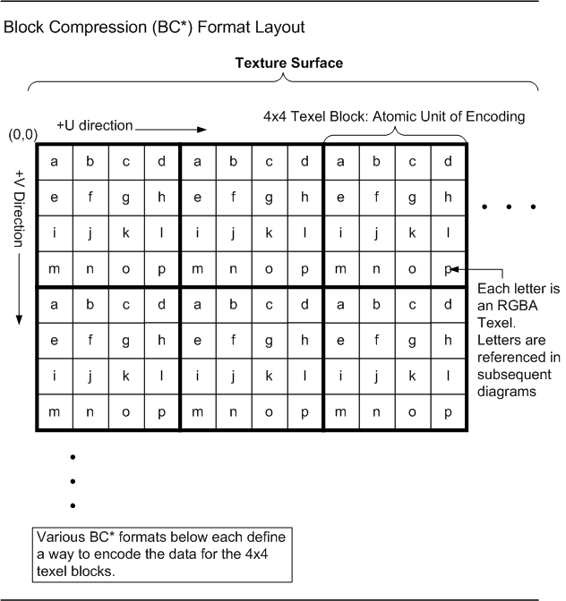

<!-- d3d12-review-alert:end:formats:N-bc-19-5-5:0 -->

<a id="bc1"></a>

### BC1 (UNORM and sRGB)

<!-- d3d12-review-alert:begin:formats:N-bc-19-5-6:0 -->

> [!WARNING]
> **Mixed source and authored adaptation - human review pending.**
>
> BC1U/BC1G (DXGI\_FORMAT\_BC1\_UNORM[\_SRGB]) is known in older APIs as D3DFMT\_DXT1.
>
> 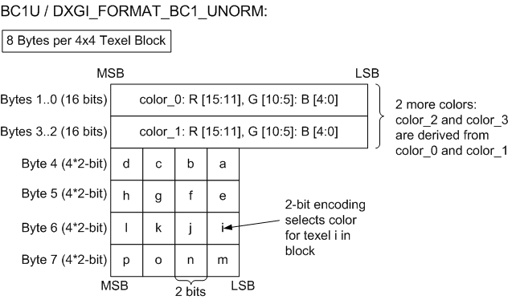
>
> ```cpp
> color_0_p = promoteToUNORM8(color_0)
> color_1_p = promoteToUNORM8(color_1)
> if (color_0 > color_1) // unsigned compare
> {
>     // Four-color block:
>     color_2 = (2 * color_0_p + color_1_p) / 3;
>     color_3 = (color_0_p + 2 * color_1_p) / 3;
>     alpha_3 = 1.0f
> } else {
>     // Three-color block:
>     color_2 = (color_0_p + color_1_p) / 2;
>     color_3 = (0.0f,0.0f,0.0f); alpha_3 = 0.0f
> }
> // color_*: Actually 3 independent calculations for R,G,B.
>
> // The following 2-bit codes select
> // a UNORM8 color for each texel:
> // (MSB)00(LSB) = color_0_p, alpha=1.0f
> //      01      = color_1_p, alpha=1.0f
> //      10      = color_2,   alpha=1.0f
> //      11      = color_3,   alpha=alpha_3
> ```
>
> - Filtering must occur with at least UNORM8 precision.
> - Values specified as 0.0f or 1.0f must be exact.
> - **absolute\_error = 1.0 / 255.0**
>
> **BC1G / DXGI\_FORMAT\_BC1\_UNORM\_SRGB:**
>
> Same as BC1U, but colors are in sRGB space, linearized pre-filter on read. sRGB conversion should occur the same as with uncompressed UNORM8 formats.
> If an implementation provides more precise palette entries than it can linearize, it may have up to 1 UNORM8 ULP error in conversion on input to linearization.

<!-- d3d12-review-alert:end:formats:N-bc-19-5-6:0 -->

<a id="bc2"></a>

### BC2 (UNORM and sRGB)

<!-- d3d12-review-alert:begin:formats:N-bc-19-5-7:0 -->

> [!WARNING]
> **Mixed source and authored adaptation - human review pending.**
>
> BC2U/BC2G (DXGI\_FORMAT\_BC2\_UNORM[\_SRGB]) is known in older APIs as both D3DFMT\_DXT2 and D3DFMT\_DXT3, where DXT2 is the same as DXT3 except whether or not the color data is assumed to be pre-multiplied by alpha. This pre-multiplied alpha distinction is meaningless to the graphics system, as the hardware doesn't care about pre-multiplied alpha. It is up to application to change Shader code if appropriate for handling the distinction. Separate format names are not used in Direct3D 12 to distinguish pre-multiplied alpha from non-pre-multiplied alpha. If applications want to keep track of whether a format contains pre-multiplied alpha, that can be done by other means (such as storing private data for resources), which would work equally well for all formats, and not just the Block Compression formats. Note that in contrast to the pre-multiplied alpha property, the distinction of whether the resource contains SRGB data or not is indeed important for hardware, so separate formats are used for linear vs SRGB data where appropriate.
>
> 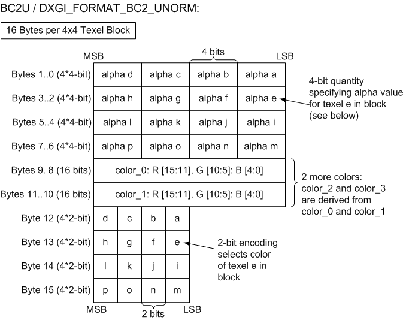
>
> ```cpp
> // Four-color block: derive the other two colors
> color_0_p = promoteToUNORM8(color_0)
> color_1_p = promoteToUNORM8(color_1)
> color_2 = (2 * color_0_p + color_1_p) / 3;
> color_3 = (color_0_p + 2 * color_1_p) / 3;
> // color_*: Actually 3 independent calculations for R,G,B.
>
> // The following 2-bit codes select
> // a UNORM8 color for each texel:
> // (MSB)00(LSB) = color_0_p,
> //      01      = color_1_p,
> //      10      = color_2,
> //      11      = color_3
>
> // Derive alpha value for texel t:
> alpha = alpha[t]/15.0f
> ```
>
> - Implementations must follow the same precision rules as BC1 for color palette entries.
> - Alpha values must be filtered with at least UNORM8 precision.
> - **absolute\_error = 1.0/255.0**
>
> **BC2G / DXGI\_FORMAT\_BC2\_UNORM\_SRGB:**
>
> - Color is decoded prior to gamma conversion the same as BC2U.
> - Gamma conversion then occurs the same way as BC1G.
> - Alpha decodes the same as BC2U.

<!-- d3d12-review-alert:end:formats:N-bc-19-5-7:0 -->

<a id="bc3"></a>

### BC3 (UNORM and sRGB)

<!-- d3d12-review-alert:begin:formats:N-bc-19-5-8:0 -->

> [!WARNING]
> **Mixed source and authored adaptation - human review pending.**
>
> BC3U/BC3G (DXGI\_FORMAT\_BC3\_UNORM[\_SRGB]) is known in older APIs as both D3DFMT\_DXT4 and D3DFMT\_DXT5, where DXT4 is the same as DXT5 except whether or not the color data is assumed to be pre-multiplied by alpha. This pre-multiplied alpha distinction is meaningless to the graphics system, as the hardware doesn't care about pre-multiplied alpha. It is up to the application to change Shader code if appropriate for handling the distinction. Separate format names are not used in Direct3D 12 to distinguish pre-multiplied alpha from non-pre-multiplied alpha. If applications want to keep track of whether a format contains pre-multiplied alpha, that can be done by other means (such as storing private data for resources), which would work equally well for all formats, and not just the Block Compression formats. Note that in contrast to the pre-multiplied alpha property, the distinction of whether the resource contains SRGB data or not is indeed important for hardware, so separate format names distinguish linear vs SRGB data where appropriate.
>
> 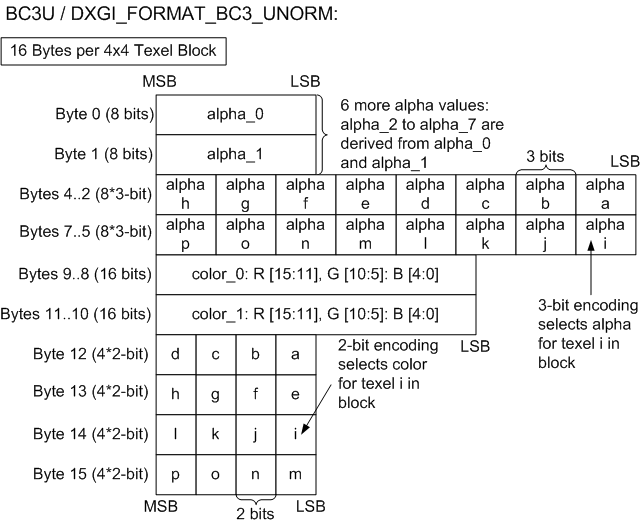
>
> ```cpp
> // Four-color block: derive the other two colors
> color_0_p = promoteToUNORM8(color_0)
> color_1_p = promoteToUNORM8(color_1)
> color_2 = (2 * color_0_p + color_1_p) / 3;
> color_3 = (color_0_p + 2 * color_1_p) / 3;
> // color_*: Actually 3 independent calculations for R,G,B.
>
> // The following 2-bit codes select
> // a UNORM8 color for each texel:
> // (MSB)00(LSB) = color_0_p,
> //      01      = color_1_p,
> //      10      = color_2,
> //      11      = color_3
> ```
>
> - Implementations must follow the same guidelines as BC1 for color palette entries.
> - Alpha values decode as with BC4U
> - Filtering must occur with at least UNORM8 precision.
> - **absolute\_error = 1.0/255.0**
>
> **BC3G / DXGI\_FORMAT\_BC3\_UNORM\_SRGB:**
>
> - Color is decoded prior to gamma conversion the same as BC3U.
> - Gamma conversion then occurs the same way as BC1G.
> - Alpha decodes the same as BC3U.

<!-- d3d12-review-alert:end:formats:N-bc-19-5-8:0 -->

<a id="bc4-unorm"></a>

### BC4 UNORM

<!-- d3d12-review-alert:begin:formats:N-bc-19-5-9:0 -->

> [!WARNING]
> **Mixed source and authored adaptation - human review pending.**
>
> This general purpose format compresses single-component UNORM data.
>
> 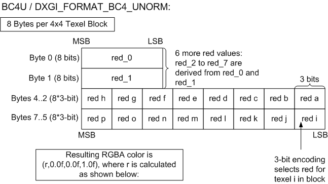
>
> ```cpp
> redf_0 = UNORM8ToFloat(red_0)
> redf_1 = UNORM8ToFloat(red_1)
> if (red_0 > red_1) // unsigned compare
> {
>     // 8-red block
>     // Bit code 000 = redf_0, 001 = redf_1, others are interpolated.
>     redf_2 = (6 * redf_0 + 1 * redf_1) / 7.0f;   // bit code 010
>     redf_3 = (5 * redf_0 + 2 * redf_1) / 7.0f;   // bit code 011
>     redf_4 = (4 * redf_0 + 3 * redf_1) / 7.0f;   // bit code 100
>     redf_5 = (3 * redf_0 + 4 * redf_1) / 7.0f;   // bit code 101
>     redf_6 = (2 * redf_0 + 5 * redf_1) / 7.0f;   // bit code 110
>     redf_7 = (1 * redf_0 + 6 * redf_1) / 7.0f;   // bit code 111
> } else {
>     // 6-red block.
>     // Bit code 000 = redf_0, 001 = redf_1, others are interpolated.
>     redf_2 = (4 * redf_0 + 1 * redf_1) / 5.0f; // bit code 010
>     redf_3 = (3 * redf_0 + 2 * redf_1) / 5.0f; // bit code 011
>     redf_4 = (2 * redf_0 + 3 * redf_1) / 5.0f; // bit code 100
>     redf_5 = (1 * redf_0 + 4 * redf_1) / 5.0f; // bit code 101
>     redf_6 = 0.0f;                             // bit code 110
>     redf_7 = 1.0f;                             // bit code 111
> }
> ```
>
> - Filtering must occur with at least UNORM16 precision.
> - red\_0, red\_1, 0.0f and 1.0f must be exact.
> - **absolute\_error = 1.0/65535.0**

<!-- d3d12-review-alert:end:formats:N-bc-19-5-9:0 -->

<a id="bc4-snorm"></a>

### BC4 SNORM

<!-- d3d12-review-alert:begin:formats:N-bc-19-5-10:0 -->

> [!WARNING]
> **Mixed source and authored adaptation - human review pending.**
>
> This general purpose format compresses single-component SNORM data.
>
> 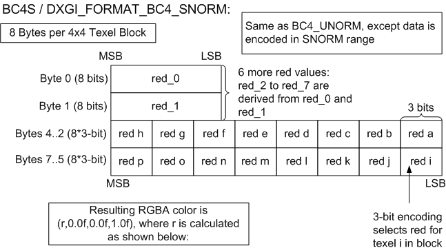
>
> ```cpp
> redf_0 = SNORM8ToFloat(red_0)
> redf_1 = SNORM8ToFloat(red_1)
> if (red_0 > red_1) // signed compare.
> {
>     // 8-red block
>     // Bit code 000 = redf_0, 001 = redf_1, others are interpolated.
>     redf_2 = (6 * redf_0 + 1 * redf_1) / 7.0f;   // bit code 010
>     redf_3 = (5 * redf_0 + 2 * redf_1) / 7.0f;   // bit code 011
>     redf_4 = (4 * redf_0 + 3 * redf_1) / 7.0f;   // bit code 100
>     redf_5 = (3 * redf_0 + 4 * redf_1) / 7.0f;   // bit code 101
>     redf_6 = (2 * redf_0 + 5 * redf_1) / 7.0f;   // bit code 110
>     redf_7 = (1 * redf_0 + 6 * redf_1) / 7.0f;   // bit code 111
> } else {
>     // 6-red block.
>     // Bit code 000 = redf_0, 001 = redf_1, others are interpolated.
>     redf_2 = (4 * redf_0 + 1 * redf_1) / 5.0f; // bit code 010
>     redf_3 = (3 * redf_0 + 2 * redf_1) / 5.0f; // bit code 011
>     redf_4 = (2 * redf_0 + 3 * redf_1) / 5.0f; // bit code 100
>     redf_5 = (1 * redf_0 + 4 * redf_1) / 5.0f; // bit code 101
>     redf_6 = -1.0f;                            // bit code 110
>     redf_7 = 1.0f;                             // bit code 111
> }
> ```
>
> - Filtering must occur with at least SNORM16 precision.
> - red\_0, red\_1, -1.0f and 1.0f must be exact.
> - **absolute\_error = 1.0/32767.0**

<!-- d3d12-review-alert:end:formats:N-bc-19-5-10:0 -->

<a id="bc5-unorm"></a>

### BC5 UNORM

<!-- d3d12-review-alert:begin:formats:N-bc-19-5-11:0 -->

> [!WARNING]
> **Mixed source and authored adaptation - human review pending.**
>
> This general purpose format compresses dual-component UNORM data.
>
> 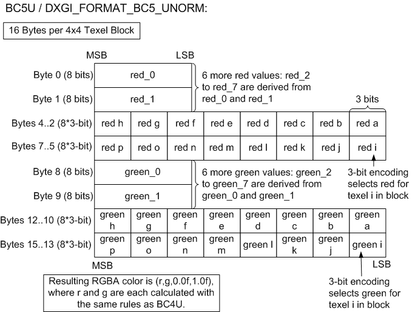
>
> **absolute\_error = 1.0/65535.0**
>
> The R and G channels are decoded independently using the [BC4 UNORM rules](#bc4-unorm). The resulting B and A components are 0.0f and 1.0f, respectively.

<!-- d3d12-review-alert:end:formats:N-bc-19-5-11:0 -->

<a id="bc5-snorm"></a>

### BC5 SNORM

<!-- d3d12-review-alert:begin:formats:N-bc-19-5-12:0 -->

> [!WARNING]
> **Mixed source and authored adaptation - human review pending.**
>
> 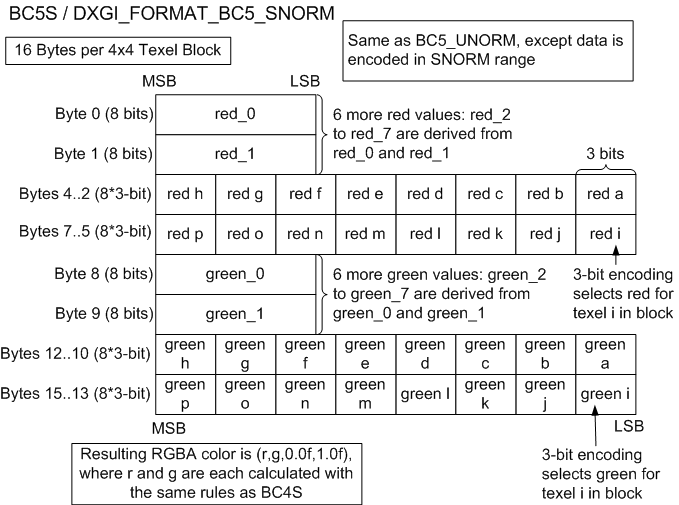
>
> **absolute\_error = 1.0/32767.0**
>
> The R and G channels are decoded independently using the [BC4 SNORM rules](#bc4-snorm). The resulting B and A components are 0.0f and 1.0f, respectively.

<!-- d3d12-review-alert:end:formats:N-bc-19-5-12:0 -->

<a id="bc6h"></a>

### BC6H

<!-- d3d12-review-alert:begin:formats:N-bc-19-5-13:0 -->

> [!WARNING]
> **Mixed source and authored adaptation - human review pending.**
>
> The following DXGI\_FORMATs are in this category: DXGI\_FORMAT\_BC6H\_TYPELESS, DXGI\_FORMAT\_BC6H\_UF16, and DXGI\_FORMAT\_BC6H\_SF16.
>
> The BC6H format can be used for Texture2D (including arrays), Texture3D or TextureCube (incl. arrays). All of these uses include mipmap surfaces in these resources.
>
> BC6H uses a fixed block size of 16 bytes and a fixed tile size of 4x4 pixels. Just as with previous BC formats, images larger than BC6H's tile size are compressed using multiple blocks. The same addressing identity also applies to three-dimensional images as well as mip-maps, cubemaps, and texture arrays.
>
> BC6H compresses three-channel images that have high dynamic range greater than 8 bits per channel. The supported per-channel formats are:
>
> - Unsigned 16 bit floating point (DXGI\_FORMAT\_BC6H\_UF16)
> - Signed 16 bit floating point (DXGI\_FORMAT\_BC6H\_SF16)
>
> All image tiles must be of the same format.
>
> Note that the 16 bit floating point format is often referred to as "half" format, containing 1 sign bit, 5 exponent bits, and 10 mantissa bits.
>
> BC6H supports floating point denorms. NaN is not represented. Signed BC6H can produce infinity, as determined by the bit-accurate decoder below. Encoders can clamp infinite input values to the corresponding maximum finite value and map NaN to zero before compression.
>
> BC6H does not store any alpha data.
>
> The BC6H decoder decompresses to the specified format prior to filtering.
>
> BC6H decompression hardware is required to be bit accurate; the hardware must give results that are identical to the decoder described in this specification.

<!-- d3d12-review-alert:end:formats:N-bc-19-5-13:0 -->

<a id="bc6h-implementation"></a>

#### BC6H implementation

<!-- d3d12-review-alert:begin:formats:N-bc-19-5-13-1:0 -->

> [!WARNING]
> **Mixed source and authored adaptation - human review pending.**
>
> A BC6H block consists of mode bits, compressed endpoints, sometimes a partition index, and compressed indices.
>
> BC6H uses 14 different modes.
>
> BC6H stores endpoint colors as a red, green, and blue (RGB) triplet, defining a palette of colors on an approximate line between two endpoints.
> Depending upon the mode, a tile is divided into one or two regions, each having its own pair of endpoints. BC6H stores one palette index per pixel.
>
> In the two region case (hereafter referred to as TWO), there are 32 possible partitions. (The one region case will hereafter be referred to as ONE.)

<!-- d3d12-review-alert:end:formats:N-bc-19-5-13-1:0 -->

<a id="bc6h-decoding"></a>

#### BC6H decoding

<!-- d3d12-review-alert:begin:formats:N-bc-19-5-13-2:0 -->

> [!WARNING]
> **Mixed source and authored adaptation - human review pending.**
>
> For valid block modes, the pseudocode below outlines the steps to decompress the pixel at *(x,y)* given the 16-byte BC6H block.
>
> ```cpp
> decompress(x, y, block)
> {
>     mode = extract_mode(block);
>     endpoints;
>     index;
>
>     if(mode.type == ONE)
>     {
>         endpoints = extract_compressed_endpoints(mode, block);
>         index = extract_index_ONE(x, y, block);
>     }
>     else //mode.type == TWO
>     {
>         partition = extract_partition(block);
>         region = get_region(partition, x, y);
>         endpoints = extract_compressed_endpoints(mode, region, block);
>         index = extract_index_TWO(x, y, partition, block);
>     }
>
>     sign_extend(mode, endpoints);
>     if(mode.transformed)
>         transform_inverse(mode, endpoints);
>     unquantize(endpoints);
>     color = interpolate(index, endpoints);
>     finish_unquantize(color);
> }
> ```
>
> The [sign extension](#bc6h-sign-extension) and [inverse endpoint transform](#bc6h-inverse-transform) algorithms are defined below.

<!-- d3d12-review-alert:end:formats:N-bc-19-5-13-2:0 -->

<a id="bc6h-memory-encoding"></a>

#### BC6H block memory encoding

<!-- d3d12-review-alert:begin:formats:N-bc-19-5-13-3:0 -->

> [!WARNING]
> **Mixed source and authored adaptation - human review pending.**
>
> 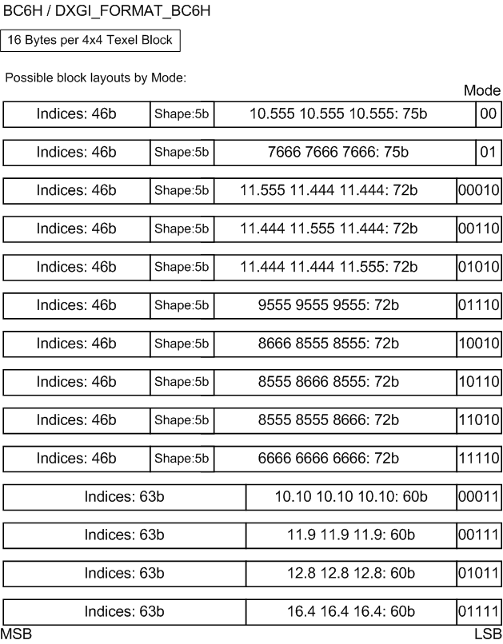
>
> The diagram above shows the 14 possible formats for BC6H blocks. The formats can be uniquely identified by the Mode bits. The first ten modes are used by TWO, and the mode field can be either 2 or 5 bits long. These blocks also have fields for the compressed endpoints (75 bits for a 2-bit mode field or 72 bits for a 5-bit mode field), partition (5 bits), and indices (46 bits). As an example, the code "11.555 11.444 11.444" indicates both the precision of the red, green, and blue endpoints stored (11), as well as the number of bits used to store the delta values for the transformed endpoints (5, 4, and 4 bits for red, green, and blue, respectively, for 3 delta values.) The "6666" mode handles the case when the endpoints cannot be transformed; only the quantized endpoints are stored.
>
> The last four modes are used by ONE, and the mode field is 5 bits. These blocks have fields for the endpoints (60 bits) and indices (63 bits). For ONE,
> the example endpoint code "11.9 11.9 11.9" indicates
> both the precision of the red,
> green, and blue endpoints stored (11), as well as the number of bits used to store the delta values for the transformed endpoints (9 bits for red, green,
> and blue, respectively, for 1 delta value.)
> The "10.10" mode handles the case when the endpoints cannot be transformed; only the quantized endpoints are stored.
>
> Modes 10011, 10111, 11011, and 11111 are reserved and should not be used by the encoder. If hardware is given these modes, the resulting decompressed block must contain zeroes
> in all channels except the alpha channel. For BC6H, the alpha channel should always return 1.0 regardless of the mode.

<!-- d3d12-review-alert:end:formats:N-bc-19-5-13-3:0 -->

<a id="bc6h-partitions"></a>

#### BC6H partition sets

<!-- d3d12-review-alert:begin:formats:N-bc-19-5-13-4:0 -->

> [!WARNING]
> **Mixed source and authored adaptation - human review pending.**
>
> There are 32 partition sets for TWO, which are defined by Table 1 below. Each 4x4 block represents a single shape. Note that this table is equivalent to the first 32 entries of BC7's 2
> subset partition table.
>
> 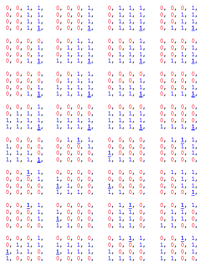
>
> **Table 1: Partition Sets for TWO**
>
> In the table of partitions above, the bolded and underlined entry is the location of the fix-up index for subset 1 which is specified with one less bit.
> The fix-up index for subset 0 is always index 0 (i.e. the partitioning is arranged so that index 0 is always in subset 0). Partition order goes from top-left to bottom right,
> walking left-to-right, then top-to-bottom.

<!-- d3d12-review-alert:end:formats:N-bc-19-5-13-4:0 -->

<a id="bc6h-endpoint-encoding"></a>

#### BC6H compressed endpoint format

<!-- d3d12-review-alert:begin:formats:N-bc-19-5-13-5:0 -->

> [!WARNING]
> **Mixed source and authored adaptation - human review pending.**
>
> 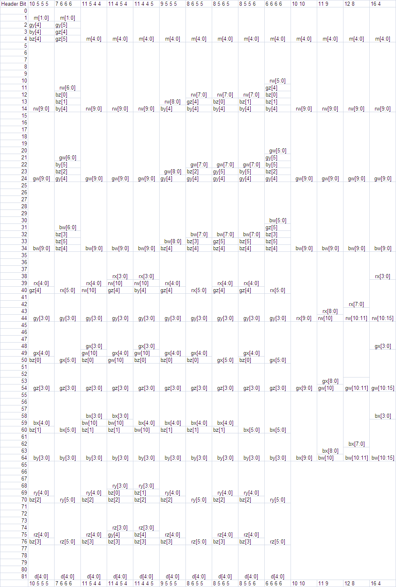
>
> **Table 2: Compressed Endpoint Formats**
>
> Table 2 above shows the bit fields for the packed compressed endpoints as a function of the endpoint format. This takes up 82 bits for TWO and 65 bits for ONE.
> As an example, the first 5 bits of the header for the last encoding above (i.e. the right-most column) are bits m[4:0], the next 10 bits of the header are the bits rw[9:0],
> and so forth.
>
> The field names are defined by the following table
>
> ```text
> FIELD   VARIABLE    FIELD   VARIABLE        FIELD    VARIABLE        FIELD    VARIABLE
> m       mode        rw        endpt[0].A[0]   gw          endpt[0].A[1]        bw          endpt[0].A[2]
> d       shape index rx        endpt[0].B[0]   gx          endpt[0].B[1]        bx          endpt[0].B[2]
>                     ry        endpt[1].A[0]   gy          endpt[1].A[1]        by            endpt[1].A[2]
>                     rz        endpt[1].B[0]   gz          endpt[1].B[1]        bz            endpt[1].B[2]
> ```
>
> Endpt[i] refers to the 0th or 1st pair of endpoints. A is one endpoint of 3 channels A[0]..A[2], and similarly B is the other endpoint of 3 channels.

<!-- d3d12-review-alert:end:formats:N-bc-19-5-13-5:0 -->

<a id="bc6h-sign-extension"></a>

#### BC6H endpoint sign extension

<!-- d3d12-review-alert:begin:formats:N-bc-19-5-13-6:0 -->

> [!WARNING]
> **Mixed source and authored adaptation - human review pending.**
>
> For TWO, there are four endpoint values to possibly sign-extend. *endpts[0].A* is signed only if the format is a signed format. The other endpoints are signed only if the endpoint
> was transformed, or the format is a signed format.
>
> ```cpp
> static void sign_extend(Pattern &p, IntEndpts endpts[NREGIONS_TWO])
> {
>     for (int i=0; i<NCHANNELS; ++i)
>     {
>     if (BC6H::FORMAT == SIGNED_F16)
>         endpts[0].A[i] = SIGN_EXTEND(endpts[0].A[i], p.chan[i].prec);
>     if (p.transformed || BC6H::FORMAT == SIGNED_F16)
>     {
>         endpts[0].B[i] = SIGN_EXTEND(endpts[0].B[i], p.chan[i].delta[0]);
>         endpts[1].A[i] = SIGN_EXTEND(endpts[1].A[i], p.chan[i].delta[1]);
>         endpts[1].B[i] = SIGN_EXTEND(endpts[1].B[i], p.chan[i].delta[2]);
>     }
>     }
> }
> ```
>
> The code for ONE is similar and just removes *endpts[1]*.
>
> ```cpp
> static void sign_extend(Pattern &p, IntEndpts endpts[NREGIONS_ONE])
> {
>     for (int i=0; i<NCHANNELS; ++i)
>     {
>     if (BC6H::FORMAT == SIGNED_F16)
>         endpts[0].A[i] = SIGN_EXTEND(endpts[0].A[i], p.chan[i].prec);
>     if (p.transformed || BC6H::FORMAT == SIGNED_F16)
>         endpts[0].B[i] = SIGN_EXTEND(endpts[0].B[i], p.chan[i].delta[0]);
>     }
> }
> ```
>
> There is also sign extending for signed formats in the transform\_inverse step shown below.

<!-- d3d12-review-alert:end:formats:N-bc-19-5-13-6:0 -->

<a id="bc6h-inverse-transform"></a>

#### BC6H inverse endpoint transform

<!-- d3d12-review-alert:begin:formats:N-bc-19-5-13-7:0 -->

> [!WARNING]
> **Mixed source and authored adaptation - human review pending.**
>
> For TWO, the transform applies the inverse of the difference encoding, adding the base value at *endpt[0].A* to the other three entries, for a total of 9 adds. In the diagram below, the
> base value is represented as *A0* and has the highest precision. *A1, B0, and B1* are all deltas off of the anchor value, and these deltas are represented with
> lower precision. (A0 corresponds to endpt[0].A, B0 to endpt[0].B, and similarly for A1 and B1.)
>
> 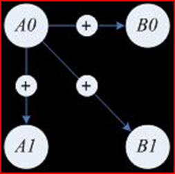
>
> The ONE case is similar, except there is only 1 delta offset, and thus a total of only 3 adds.
>
> The decompressor should ensure that the results of the inverse transform will not overflow the precision of *endpt[0].A*. In the case of overflow, the values resulting from the inverse transform should wrap
> within the same number of bits. If the precision of A0 is 'p' bits, the transform is:
>
> ```cpp
>     B0 = (B0+A0) & ((1 << p) - 1)
> ```
>
> and similarly for the other cases.
>
> For signed formats the results of the delta arithmetic must be sign extended as well. If the sign extend operation is thought of as extending both signs: 1 (negative) and
> 0 (positive), then the sign extending of 0 takes care of the clamp above. Or equivalently after the clamp above, only 1 (negative) needs to be extended.

<!-- d3d12-review-alert:end:formats:N-bc-19-5-13-7:0 -->

<a id="bc6h-palette-interpolation"></a>

#### BC6H unquantized palette generation

<!-- d3d12-review-alert:begin:formats:N-bc-19-5-13-8:0 -->

> [!WARNING]
> **Mixed source and authored adaptation - human review pending.**
>
> Given the uncompressed endpoints, the next steps are to perform an initial unquantization step, interpolate, and then do a final unquantize. Separating the unquantize step into two substeps reduces the number of multiplications required compared to doing a full unquantize before interpolating.
>
> The code below illustrates the unquantizing process to retrieve estimates of the original 16 bit value,
> and then using the specified weights to derive the remaining palette entries. The same operation is performed on each channel.
>
> Unquantized values range from -32768 to 65535 and require 17 signed bits. The reference interpolation expressions are evaluated without intermediate overflow.
>
> After interpolation, the values are passed to the finish\_unquantize function, which applies the final scaling.
>
> All hardware decompressors are required to return bit accurate results with this function.
>
> ```cpp
> int aWeight3[] = {0, 9, 18, 27, 37, 46, 55, 64};
> int aWeight4[] = {0, 4, 9, 13, 17, 21, 26, 30, 34, 38, 43, 47, 51, 55, 60, 64};
>
> // c1, c2: endpoints of a component
> void generate_palette_unquantized(UINT8 uNumIndices, int c1, int c2, int prec, UINT16 palette[NINDICES])
> {
>     int* aWeights;
>     if(uNumIndices == 8)
>         aWeights = aWeight3;
>     else  // uNumIndices == 16
>         aWeights = aWeight4;
>
>     int a = unquantize(c1, prec);
>     int b = unquantize(c2, prec);
>
>     // interpolate
>     for(int i = 0; i < uNumIndices; ++i)
>         palette[i] = finish_unquantize((a * (64 - aWeights[i]) + b * aWeights[i] + 32) >> 6);
> }
> ```

<!-- d3d12-review-alert:end:formats:N-bc-19-5-13-8:0 -->

<a id="bc6h-unquantize"></a>

#### BC6H initial unquantization

<!-- d3d12-review-alert:begin:formats:N-bc-19-5-13-9:0 -->

> [!WARNING]
> **Mixed source and authored adaptation - human review pending.**
>
> The following describes how unquantize works. For UF16, 'comp' is unquantized into 0x0000 ~ 0xFFFF range to maximize the usage of bits.
>
> ```cpp
> int unquantize(int comp, int uBitsPerComp)
> {
>     int unq, s = 0;
>     switch(BC6H::FORMAT)
>     {
>     case UNSIGNED_F16:
>         if(uBitsPerComp >= 15)
>             unq = comp;
>         else if(comp == 0)
>             unq = 0;
>         else if(comp == ((1 << uBitsPerComp) - 1))
>             unq = 0xFFFF;
>         else
>             unq = ((comp << 16) + 0x8000) >> uBitsPerComp;
>         break;
>
>     case SIGNED_F16:
>         if(uBitsPerComp >= 16)
>             unq = comp;
>         else
>         {
>             if(comp < 0)
>             {
>                 s = 1;
>                 comp = -comp;
>             }
>
>             if(comp == 0)
>                 unq = 0;
>             else if(comp >= ((1 << (uBitsPerComp - 1)) - 1))
>                 unq = 0x7FFF;
>             else
>                 unq = ((comp << 15) + 0x4000) >> (uBitsPerComp-1);
>
>             if(s)
>                 unq = -unq;
>         }
>         break;
>     }
>     return unq;
> }
> ```

<!-- d3d12-review-alert:end:formats:N-bc-19-5-13-9:0 -->

<a id="bc6h-finish-unquantize"></a>

#### BC6H final unquantization

<!-- d3d12-review-alert:begin:formats:N-bc-19-5-13-10:0 -->

> [!WARNING]
> **Mixed source and authored adaptation - human review pending.**
>
> finish\_unquantize is called after palette interpolation. The unquantize function postpones scaling by 31/32 for signed values and 31/64 for unsigned values until after palette interpolation, reducing the number of multiplications. finish\_unquantize applies the final scaling and returns an unsigned short value that is reinterpreted as half.
>
> ```cpp
> unsigned short finish_unquantize(int comp)
> {
>     if(BC6H::FORMAT == UNSIGNED_F16)
>     {
>         comp = (comp * 31) >> 6;                                         // scale the magnitude by 31/64
>         return (unsigned short) comp;
>     }
>     else // (BC6H::FORMAT == SIGNED_F16)
>     {
>         comp = (comp < 0) ? -(((-comp) * 31) >> 5) : (comp * 31) >> 5;   // scale the magnitude by 31/32
>         int s = 0;
>         if(comp < 0)
>         {
>             s = 0x8000;
>             comp = -comp;
>         }
>         return (unsigned short) (s | comp);
>     }
> }
> ```

<!-- d3d12-review-alert:end:formats:N-bc-19-5-13-10:0 -->

<a id="bc7"></a>

### BC7 (UNORM and sRGB)

<!-- d3d12-review-alert:begin:formats:N-bc-19-5-14:0 -->

> [!WARNING]
> **Mixed source and authored adaptation - human review pending.**
>
> The following DXGI\_FORMATs are in this category: DXGI\_FORMAT\_BC7\_TYPELESS, DXGI\_FORMAT\_BC7\_UNORM, and DXGI\_FORMAT\_BC7\_UNORM\_SRGB
>
> The BC7 format can be used for Texture2D (including arrays), Texture3D or TextureCube (incl. arrays). All of these uses include mipmap surfaces in these resources.
>
> BC7 uses a fixed block size of 16 bytes and a fixed tile size of 4x4 pixels. As with other BC formats, images larger than BC7's tile size are compressed using multiple blocks.
> The same addressing identity also applies to three-dimensional images as well as mip-maps, cubemaps, and texture arrays.
>
> BC7 compresses both three-channel and four-channel fixed-point data images. Typically source data will be 8-bits per component fixed point,
> although the format is capable of encoding source data with higher bits per component. All image tiles must be of the same format.
>
> The BC7 decoder decompresses to the specified format prior to filtering.
>
> BC7 decompression hardware is required to be bit accurate; the hardware must give results that are identical to the decoder described in this specification.
>
> For `DXGI_FORMAT_BC7_UNORM_SRGB`, RGB values are linearized before filtering by the [sRGB conversion rules](numeric-and-data-rules.md#numeric-3-2-3-7). Alpha remains linear.

<!-- d3d12-review-alert:end:formats:N-bc-19-5-14:0 -->

<a id="bc7-implementation"></a>

#### BC7 implementation

<!-- d3d12-review-alert:begin:formats:N-bc-19-5-14-1:0 -->

> [!WARNING]
> **Mixed source and authored adaptation - human review pending.**
>
> A BC7 block can take one of 8 modes, and the block mode is always stored in the LSBs of the 128-bit block. The block mode is encoded by zero or more "0"'s followed by a "1".
> This mode string starts from the block LSB.
>
> A BC7 block may contain multiple endpoint pairs. For the purposes of this document, the set of indices that correspond to an endpoint pair may be referred to as a subset.
>
> In some block modes the endpoint representation is encoded in a form that for the purposes of this document will be called RGBP – in these cases the P bit represents a shared LSB for the components
> of the endpoint.
> For example, if the endpoint representation for the format was RGBP 5.5.5.1 then the endpoint would be interpreted as an RGB 6.6.6 value, with the LSB of each component being taken from the state of
> the P bit. If the representation was RGBAP 5.5.5.5.1 then the endpoint would be interpreted as an RGBA 6.6.6.6 value.
> Depending on the block mode the shared LSB may either be specified for both endpoints of a subset individually (2 P-bits per subset), or shared between the endpoints of the subset (1 P-bit per subset)
>
> BC7 uses 8 different modes.
>
> BC7 defines a palette of colors on an approximate line between two endpoints. The mode specifies the number of interpolating endpoint pairs per block. BC7 stores palette indices per pixel, with separate color and alpha indices in modes 4 and 5.
>
> In BC7, alpha can be encoded in several different ways:
>
> - **Block types without explicit alpha encoding:** In these blocks the endpoints have an R.G.B-only representation and alpha is decoded as 1.0 for all texels. The block contains mode bits, partition bits, compressed endpoints, sometimes a P-bit, and compressed indices.
> - **Block types with combined color and alpha:** In these blocks the endpoint color values are specified in an R.G.B.A format, and alpha values are interpolated along with the color values. The block contains mode bits, sometimes partition bits, compressed endpoints, and compressed indices.
> - **Block types with separated color and alpha:** The block contains mode bits, rotation bits, sometimes an index selector bit, compressed endpoints, and compressed indices. In these blocks the alpha values and color values are specified separately, each with their own sets of indices.
>   These blocks effectively have a vector channel (R.G.B) and a scalar channel (A) separately encoded.
>   In these blocks a separate 2-bit field is also encoded that allows specification on a per-block basis of the channel that is encoded separately as a scalar,
>   so the block can have 4 different representations – RGB|A, AGB|R, RAB|G, RGA|B. The channel order is swizzled back to RGBA after decoding, so the internal block format is transparent to the developer.
>   Blocks with separate color and alpha also have two sets of index data – one for the vector channel and one for the scalar channel. In the case of Mode 4, these indices are of differing widths
>   (3 or 2 bits). Mode 4 contains a one-bit selector which chooses whether the vector or scalar data uses the 3-bit indices.
>
> For each subset of indices that corresponds to a pair of endpoints, the encoder fixes the state of one bit of the compressed index data for that subset. This is done
> by choosing an endpoint order that allows the index for the designated fixup index to have 0 as its MSB, which can therefore be discarded saving one bit per subset.
> The indices with the "fix-up" bit are noted in the partition tables for [2 subsets](#bc7-partitions-two)
> and [3 subsets](#bc7-partitions-three) below. For block modes with only a single subset, the fix-up index is always index 0.

<!-- d3d12-review-alert:end:formats:N-bc-19-5-14-1:0 -->

<a id="bc7-decoding"></a>

#### BC7 decoding

<!-- d3d12-review-alert:begin:formats:N-bc-19-5-14-2:0 -->

> [!WARNING]
> **Mixed source and authored adaptation - human review pending.**
>
> For valid block modes, the pseudocode below outlines the steps to decompress the pixel at *(x,y)* given the 16-byte BC7 block.
>
> ```cpp
> decompress(x, y, block)
> {
>     mode = extract_mode(block);
>
>     //decode partition data from explicit partition bits
>     subset_index = 0;
>     num_subsets = 1;
>
>     if (mode.type == 0 OR == 1 OR == 2 OR == 3 OR == 7)
>     {
>         num_subsets = get_num_subsets(mode.type);
>         partition_set_id = extract_partition_set_id(mode, block);
>         subset_index = get_partition_index(num_subsets, partition_set_id, x, y);
>     }
>
>     //extract raw, compressed endpoint bits
>     UINT8 endpoint_array[2 * num_subsets][4] = extract_endpoints(mode, block);
>
>     //decode endpoint color and alpha for each subset
>     fully_decode_endpoints(endpoint_array, mode, block);
>
>     //endpoints are now complete.
>     UINT8 endpoint_start[4] = endpoint_array[2 * subset_index];
>     UINT8 endpoint_end[4]   = endpoint_array[2 * subset_index + 1];
>
>     //Determine the palette index for this pixel
>     alpha_index     = get_alpha_index(block, mode, x, y);
>     alpha_bitcount  = get_alpha_bitcount(block, mode);
>     color_index     = get_color_index(block, mode, x, y);
>     color_bitcount  = get_color_bitcount(block, mode);
>
>     //determine output
>     UINT8 output[4];
>     output.rgb = interpolate(endpoint_start.rgb, endpoint_end.rgb, color_index, color_bitcount);
>     output.a   = interpolate(endpoint_start.a,   endpoint_end.a,   alpha_index, alpha_bitcount);
>
>     if (mode.type == 4 OR == 5)
>     {
>         //Decode the 2 color rotation bits as follows:
>         // 00 - Block format is Scalar(A) Vector(RGB) - no swapping
>         // 01 - Block format is Scalar(R) Vector(AGB) - swap A and R
>         // 10 - Block format is Scalar(G) Vector(RAB) - swap A and G
>         // 11 - Block format is Scalar(B) Vector(RGA) - swap A and B
>         rotation = extract_rot_bits(mode, block);
>         output = swap_channels(output, rotation);
>     }
>
> }
> ```

<!-- d3d12-review-alert:end:formats:N-bc-19-5-14-2:0 -->

<a id="bc7-decoding-helpers"></a>

#### BC7 endpoint and index decoding

<!-- d3d12-review-alert:begin:formats:N-bc-19-5-14-3:0 -->

> [!WARNING]
> **Mixed source and authored adaptation - human review pending.**
>
> The pseudocode below outlines the steps to fully decode endpoint color and alpha for each subset given the 16-byte BC7 block.
>
> ```cpp
> fully_decode_endpoints(endpoint_array, mode, block)
> {
>     //first handle modes that have P-bits
>     if (mode.type == 0 OR == 1 OR == 3 OR == 6 OR == 7)
>     {
>         for each endpoint i
>         {
>             //component-wise left-shift
>             endpoint_array[i].rgba = endpoint_array[i].rgba << 1;
>         }
>
>         //if P-bit is shared
>         if (mode.type == 1)
>         {
>             pbit_zero = extract_pbit_zero(mode, block);
>             pbit_one = extract_pbit_one(mode, block);
>
>             //rgb component-wise insert pbits
>             endpoint_array[0].rgb |= pbit_zero;
>             endpoint_array[1].rgb |= pbit_zero;
>             endpoint_array[2].rgb |= pbit_one;
>             endpoint_array[3].rgb |= pbit_one;
>         }
>         else //unique P-bit per endpoint
>         {
>             pbit_array = extract_pbit_array(mode, block);
>             for each endpoint i
>             {
>                 endpoint_array[i].rgba |= pbit_array[i];
>             }
>         }
>     }
>
>     for each endpoint i
>     {
>         // Color_component_precision & alpha_component_precision includes pbit
>         // left shift endpoint components so that their MSB lies in bit 7
>         endpoint_array[i].rgb = endpoint_array[i].rgb << (8 - color_component_precision(mode));
>         endpoint_array[i].a = endpoint_array[i].a << (8 - alpha_component_precision(mode));
>
>         // Replicate each component's MSB into the LSBs revealed by the left-shift operation above
>         endpoint_array[i].rgb = endpoint_array[i].rgb | (endpoint_array[i].rgb >> color_component_precision(mode));
>         endpoint_array[i].a = endpoint_array[i].a | (endpoint_array[i].a >> alpha_component_precision(mode));
>     }
>
>     //If this mode does not explicitly define the alpha component
>     //set alpha equal to 1.0
>     if (mode.type == 0 OR == 1 OR == 2 OR == 3)
>     {
>         for each endpoint i
>         {
>             endpoint_array[i].a = 255; //i.e. alpha = 1.0f
>         }
>     }
> }
> ```
>
> In order to generate each interpolated component for each subset the following algorithm is used:
> Let "c" be the component being generated, "e0" be that component of endpoint 0 of the subset, "e1" be that component of endpoint 1 of the subset.
>
> ```cpp
> UINT16 aWeight2[] = {0, 21, 43, 64};
> UINT16 aWeight3[] = {0, 9, 18, 27, 37, 46, 55, 64};
> UINT16 aWeight4[] = {0, 4, 9, 13, 17, 21, 26, 30, 34, 38, 43, 47, 51, 55, 60, 64};
>
> UINT8 interpolate(UINT8 e0, UINT8 e1, UINT8 index, UINT8 indexprecision)
> {
>     if(indexprecision == 2)
>         return (UINT8) (((64 - aWeight2[index])*UINT16(e0) + aWeight2[index]*UINT16(e1) + 32) >> 6);
>     else if(indexprecision == 3)
>         return (UINT8) (((64 - aWeight3[index])*UINT16(e0) + aWeight3[index]*UINT16(e1) + 32) >> 6);
>     else // indexprecision == 4
>         return (UINT8) (((64 - aWeight4[index])*UINT16(e0) + aWeight4[index]*UINT16(e1) + 32) >> 6);
> }
> ```
>
> The following pseudocode illustrates how to extract indices and bitcounts for color and alpha components.
> Blocks with separate color and alpha also have two sets of index data – one for the vector channel and one for the scalar channel.
> For Mode 4, these indices are of differing widths (3 or 2 bits) and there is a one-bit selector which chooses whether
> the vector or scalar data uses the 3-bit indices. (Extracting the alpha bitcount is similar to extracting color bitcount
> but with inverse behavior based on the idxMode bit.)
>
> ```cpp
> bitcount get_color_bitcount(block, mode)
> {
>     if (mode.type == 0 OR == 1)
>         return 3;
>
>     if (mode.type == 2 OR == 3 OR == 5 OR == 7)
>         return 2;
>
>     if (mode.type == 6)
>         return 4;
>
>     //Only remaining case is Mode 4 with 1-bit index selector
>     idxMode = extract_idxMode(block);
>     if (idxMode == 0)
>         return 2;
>     else
>         return 3;
> }
> ```

<!-- d3d12-review-alert:end:formats:N-bc-19-5-14-3:0 -->

<a id="bc7-memory-encoding"></a>

#### BC7 block memory encoding

<!-- d3d12-review-alert:begin:formats:N-bc-19-5-14-4:0 -->

> [!WARNING]
> **Mixed source and authored adaptation - human review pending.**
>
> Below is a list of the 8 block modes and bit allocations for the 8 possible BC7 blocks. The colors for each subset within a block are represented using two explicit endpoint colors and a set of interpolated colors between them. Depending on the block's index precision, each subset may have 4, 8 or 16 possible colors.
>
> Mode 8 (LSB 0x00) is reserved and should not be used by the encoder. If this mode is given to the hardware, an all 0 block will be returned.

<!-- d3d12-review-alert:end:formats:N-bc-19-5-14-4:0 -->

<a id="bc7-mode-0"></a>

##### BC7 mode 0

<!-- d3d12-review-alert:begin:formats:N-bc-19-5-14-4-1:0 -->

> [!WARNING]
> **Mixed source and authored adaptation - human review pending.**
>
> - Color Only
> - 3 Subsets
> - R.G.B.P 4.4.4.1 endpoints (unique P-bit per endpoint)
> - 3-bit indices
> - 16 partitions
>
> 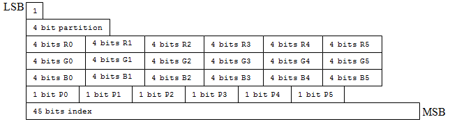

<!-- d3d12-review-alert:end:formats:N-bc-19-5-14-4-1:0 -->

<a id="bc7-mode-1"></a>

##### BC7 mode 1

<!-- d3d12-review-alert:begin:formats:N-bc-19-5-14-4-2:0 -->

> [!WARNING]
> **Mixed source and authored adaptation - human review pending.**
>
> - Color Only
> - 2 Subsets
> - R.G.B.P 6.6.6.1 endpoints (shared P-bit per subset)
> - 3-bit indices
> - 64 partitions
>
> 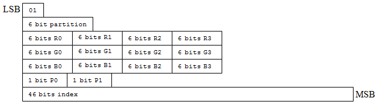

<!-- d3d12-review-alert:end:formats:N-bc-19-5-14-4-2:0 -->

<a id="bc7-mode-2"></a>

##### BC7 mode 2

<!-- d3d12-review-alert:begin:formats:N-bc-19-5-14-4-3:0 -->

> [!WARNING]
> **Mixed source and authored adaptation - human review pending.**
>
> - Color Only
> - 3 Subsets
> - R.G.B 5.5.5 endpoints
> - 2-bit indices
> - 64 partitions
>
> 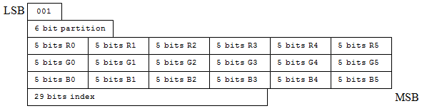

<!-- d3d12-review-alert:end:formats:N-bc-19-5-14-4-3:0 -->

<a id="bc7-mode-3"></a>

##### BC7 mode 3

<!-- d3d12-review-alert:begin:formats:N-bc-19-5-14-4-4:0 -->

> [!WARNING]
> **Mixed source and authored adaptation - human review pending.**
>
> - Color Only
> - 2 Subsets
> - R.G.B.P. 7.7.7.1 Endpoints (unique P-bit per endpoint)
> - 2-bit indices
> - 64 partitions
>
> 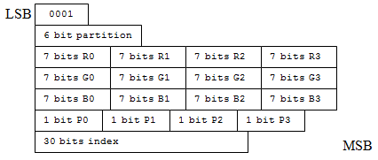

<!-- d3d12-review-alert:end:formats:N-bc-19-5-14-4-4:0 -->

<a id="bc7-mode-4"></a>

##### BC7 mode 4

<!-- d3d12-review-alert:begin:formats:N-bc-19-5-14-4-5:0 -->

> [!WARNING]
> **Mixed source and authored adaptation - human review pending.**
>
> - Color with Separate Alpha
> - One Subset
> - R.G.B 5.5.5 Color endpoints
> - 6-bit Alpha endpoints
> - 16x2-bit indices
> - 16x3-bit indices
> - 2-bit component rotation
> - 1-bit index selector
>
> 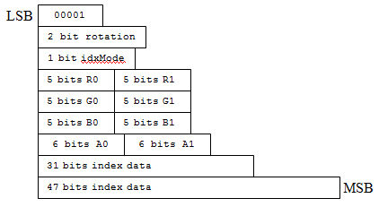

<!-- d3d12-review-alert:end:formats:N-bc-19-5-14-4-5:0 -->

<a id="bc7-mode-5"></a>

##### BC7 mode 5

<!-- d3d12-review-alert:begin:formats:N-bc-19-5-14-4-6:0 -->

> [!WARNING]
> **Mixed source and authored adaptation - human review pending.**
>
> - Color with Separate Alpha
> - One Subset
> - R.G.B 7.7.7 Color endpoints
> - 8-bit Alpha endpoints
> - 16x2-bit color indices
> - 16x2-bit alpha indices
> - 2-bit component rotation
>
> 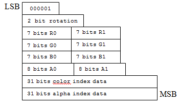

<!-- d3d12-review-alert:end:formats:N-bc-19-5-14-4-6:0 -->

<a id="bc7-mode-6"></a>

##### BC7 mode 6

<!-- d3d12-review-alert:begin:formats:N-bc-19-5-14-4-7:0 -->

> [!WARNING]
> **Mixed source and authored adaptation - human review pending.**
>
> - Combined Color and Alpha
> - One Subset
> - R.G.B.A.P 7.7.7.7.1 endpoints (unique P bit per endpoint)
> - 16x4-bit indices
>
> 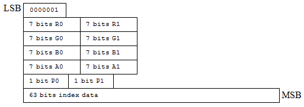

<!-- d3d12-review-alert:end:formats:N-bc-19-5-14-4-7:0 -->

<a id="bc7-mode-7"></a>

##### BC7 mode 7

<!-- d3d12-review-alert:begin:formats:N-bc-19-5-14-4-8:0 -->

> [!WARNING]
> **Mixed source and authored adaptation - human review pending.**
>
> - Combined Color and Alpha
> - 2 Subsets
> - R.G.B.A.P. 5.5.5.5.1 Endpoints (unique P-bit per endpoint)
> - 2-bit indices
> - 64 partitions
>
> 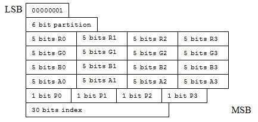

<!-- d3d12-review-alert:end:formats:N-bc-19-5-14-4-8:0 -->

<a id="bc7-partitions-two"></a>

#### BC7 partition sets for two subsets

<!-- d3d12-review-alert:begin:formats:N-bc-19-5-14-5:0 -->

> [!WARNING]
> **Mixed source and authored adaptation - human review pending.**
>
> 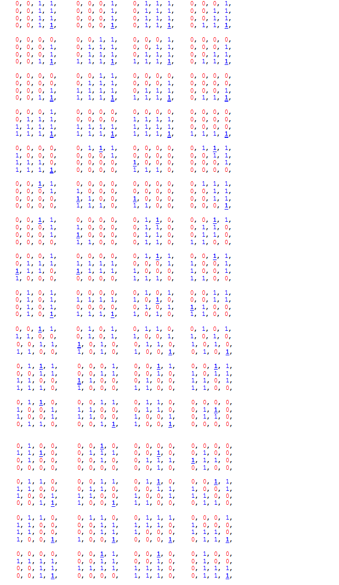
>
> In the table of partitions above, the bolded, underlined entry is the location of the fix-up index for subset 1 which is specified with one less bit.
> The fix-up index for subset 0 is always index 0 (the partitioning is arranged so that index 0 is always in subset 0).
> Partition order goes from top-left to bottom right, walking left-to-right, then top-to-bottom.

<!-- d3d12-review-alert:end:formats:N-bc-19-5-14-5:0 -->

<a id="bc7-partitions-three"></a>

#### BC7 partition sets for three subsets

<!-- d3d12-review-alert:begin:formats:N-bc-19-5-14-6:0 -->

> [!WARNING]
> **Mixed source and authored adaptation - human review pending.**
>
> 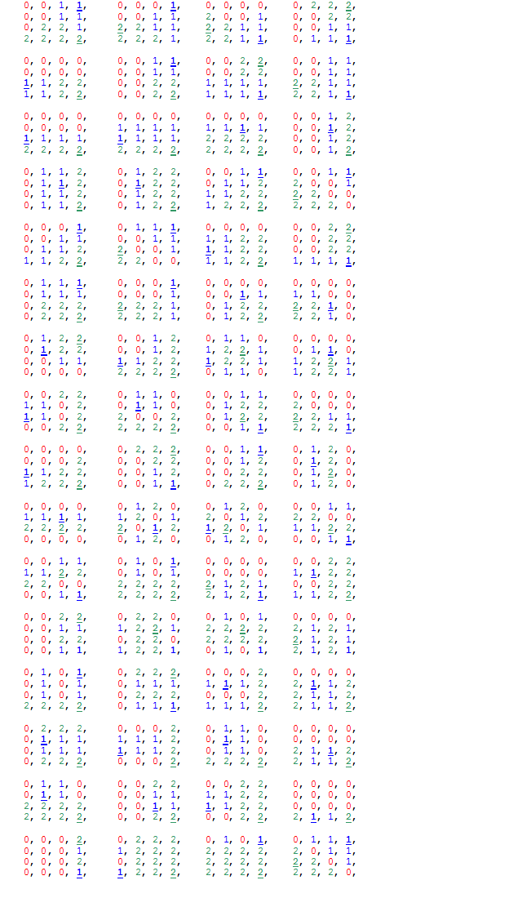
>
> For this table of partitions, underneath the entry in each subset, printed in bold and underlined, is the location of the fix-up index which is specified with one less bit.
> Index 0 always contains the fixed index bit for subset 0. Partition order goes from top-left to bottom right, walking left-to-right, then top-to-bottom.

<!-- d3d12-review-alert:end:formats:N-bc-19-5-14-6:0 -->

<a id="casting"></a>

## Format casting

<ins><!-- d3d12-review-inline:begin:formats:C-typed:0 -->When `D3D12_FEATURE_DATA_D3D12_OPTIONS3.CastingFullyTypedFormatSupported` is true, the runtime supports creating resources
with fully typed formats and subsequently creating UAVs, SRVs, DSVs or
RTVs with any fully qualified format within the same format family. The
views just reinterpret the data in memory as if it is the type in the
view format, ignoring the resource's original format. For
example a resource created with format R8G8B8A8_UNORM can have an
R8G8B8A8_UNORM_SRGB SRV created and the SRV just interprets the data
as if it is UNORM_SRGB.<!-- d3d12-review-inline:end:formats:C-typed:0 --></ins>

<ins><!-- d3d12-review-inline:begin:formats:C-typed:1 -->Support is reported by `ID3D12Device::CheckFeatureSupport` with
`D3D12_FEATURE_D3D12_OPTIONS3`. The associated struct,
`D3D12_FEATURE_DATA_D3D12_OPTIONS3` has a member BOOL
CastingFullyTypedFormatSupported. The runtime reports this capability for drivers supporting the corresponding casting contract.<!-- d3d12-review-inline:end:formats:C-typed:1 --></ins>

Two exceptions to this relaxed casting are:

(1) Casting from _FLOAT to non-_FLOAT formats and vice versa is never
    allowed. For instance casting from R32_FLOAT to/from R32_UINT is
    not allowed.

(2) Casting from _SNORM to _UNORM and vice versa is never allowed.
    This case was missed by the time RS3 shipped, so the runtime doesn't
    validate it. The debug layer will at least print an error.

Some hardware uses different memory compression techniques and/or clear
behaviors across these that could appear as corruption as opposed to the
expected reinterpret-cast.

<ins><!-- d3d12-review-inline:begin:formats:C-clear:0 -->In the ordinary fully typed casting case described here, the fast-clear behavior follows the resource's created format. [Optimized clear values](resources.md#optimized-clear-value) retain their separately typed `Format` definition; this observation does not define a clear operation for typeless resources.
Views that do format casting will just reinterpret the data as if it is
the view format.<!-- d3d12-review-inline:end:formats:C-clear:0 --></ins>

<!-- d3d12-review-alert:begin:formats:N-legacy-cast:0 -->

> [!WARNING]
> **Authored synthesis - human review pending.**
>
> For ordinary format family casting without the fully typed casting capability, a fully typed resource retains its own view format. A typeless resource can use compatible typed members of its family. [R32_UINT UAV casting](#r32-uav-casting) and [explicit castable format lists](#cast-lists) are distinct paths. Casting is reinterpretation of stored bits, not numerical conversion. A view format must also support the requested view use, resource flags, dimension and sample configuration.

<!-- d3d12-review-alert:end:formats:N-legacy-cast:0 -->

<a id="r32-uav-casting"></a>

### Ordinary R32_UINT UAV casting

<!-- d3d12-review-alert:begin:formats:N-r32-casting:0 -->

> [!WARNING]
> **Authored synthesis - human review pending.**
>
> An `R32_UINT` UAV can reinterpret a UAV-eligible texture created with `R10G10B10A2_TYPELESS`, `R8G8B8A8_TYPELESS`, `B8G8R8A8_TYPELESS`, `B8G8R8X8_TYPELESS`, `R16G16_TYPELESS`, or `R32_TYPELESS`. This is a special UAV interpretation, not permission for arbitrary cross-family SRVs/RTVs or arbitrary equal-byte-size casts. A nonempty explicit cast list takes precedence.

<!-- d3d12-review-alert:end:formats:N-r32-casting:0 -->

<a id="cast-lists"></a>

### Explicit castable format lists

<!-- d3d12-review-alert:begin:formats:N-resource-operations-format-consumer:0 -->

> [!WARNING]
> **Authored synthesis - human review pending.**
>
> Bit-preserving [copy reinterpretation](resource-operations.md#reinterpret-copy), [clear conversion](resource-operations.md#clear-conversion) and [resolve/transcoding modes](resource-operations.md#resolve-commands) are distinct operation contracts. A view/resource casting permission does not by itself grant an arbitrary equal-byte-size copy or resolve.

<!-- d3d12-review-alert:end:formats:N-resource-operations-format-consumer:0 -->

<!-- d3d12-review-alert:begin:formats:N-common-raw-gather-behavior:0 -->

> [!WARNING]
> **Authored synthesis - human review pending.**
>
> The permitted integer aliases are used by [raw gather](common-shader-internals.md#raw-gather) for bitwise element retrieval. That shader operation does not replace the resource/view cast list creation and compatibility requirements here.

<!-- d3d12-review-alert:end:formats:N-common-raw-gather-behavior:0 -->

<ins><!-- d3d12-review-inline:begin:formats:C-list:0 -->D3D12 provides an API at resource creation to specify a list of castable formats for the resource.<!-- d3d12-review-inline:end:formats:C-list:0 --></ins>

The list
* MAY be empty
* MAY contain uncompressed formats whose unit size matches the resource's format's unit size.
* MAY NOT contain planar formats.
* If the resource's format is non-compressed, then the list may ONLY contain non-compressed formats.

<ins><!-- d3d12-review-inline:begin:formats:C-list:2 -->If the resource's format is compressed, a view casting to an uncompressed format selects one mip. Ordinary array views select one array slice: `MipLevels` and `ArraySize` are 1 where those members exist. Writable and non-array views have their implicit one-mip/non-array extents. Cube array SRVs use `MipLevels == 1` and `NumCubes == 1`; cube SRVs select one cube with `MipLevels == 1`. This does not require a nonexistent `ArraySize` member on cube or non-array descriptions.<!-- d3d12-review-inline:end:formats:C-list:2 --></ins>

<ins><!-- d3d12-review-inline:begin:formats:C-list:3 -->Apart from the resource's own format, formats outside a nonempty explicit cast list MAY NOT be used as view target formats.<!-- d3d12-review-inline:end:formats:C-list:3 --></ins>

Formats "casted" in this way are _reinterpreted_ as the target format for consumption in shaders.

<ins><!-- d3d12-review-inline:begin:formats:C-list:5 -->The [resource creation contract](resources.md#initial-layout-and-format-lists) defines `NumCastableFormats`, `pCastableFormats`, and their creation-method applicability.<!-- d3d12-review-inline:end:formats:C-list:5 --></ins>

<!-- d3d12-review-alert:begin:formats:N-list-cap:0 -->

> [!WARNING]
> **Authored synthesis - human review pending.**
>
> A zero-count, null castable format list retains ordinary format-casting rules. The resource's own format need not be repeated in a nonempty list. Explicit format list casting requires `D3D12_FEATURE_DATA_D3D12_OPTIONS12.RelaxedFormatCastingSupported`. This is distinct from OPTIONS3's fully typed family casting capability.

<!-- d3d12-review-alert:end:formats:N-list-cap:0 -->

<ins><!-- d3d12-review-inline:begin:formats:C-integer:0 -->To enable retrieval of elements into raw integers,
single-channel unsigned integer resource views can be created
by `ID3D12Device::CreateShaderResourceView`
for resources with identical element bit widths
that have been appropriately flagged at creation.
For example,
a resource view of type `DXGI_FORMAT_R32_UINT`
can be created for a resource of type `DXGI_FORMAT_R8G8B8A8_UINT`
and a resource view of type `DXGI_FORMAT_R16_UINT`
can be created for a resource of type `DXGI_FORMAT_R8G8_UINT`.
Additionally, same-size and same-channel aliasing can be performed
 as with a resource view of type `DXGI_FORMAT_R16_UINT`
 created for a resource of type `DXGI_FORMAT_R16_FLOAT`.<!-- d3d12-review-inline:end:formats:C-integer:0 --></ins>

<ins><!-- d3d12-review-inline:begin:formats:C-integer:1 -->In order to be able to create a single-channel integer resource view,
a resource must be created using the
[CreateCommittedResource3](../D3D12EnhancedBarriers.md#id3d12device10-createcommittedresource3),
[CreatePlacedResource2](../D3D12EnhancedBarriers.md#id3d12device10-createplacedresource2),
or [CreateReservedResource2](resources.md#create-reserved-resource2)
using the API fields, `NumCastableFormats` and `pCastableFormats`
to specify the list of acceptable casts.<!-- d3d12-review-inline:end:formats:C-integer:1 --></ins>

<a id="planes"></a>

## Logical planes and view subresources

<!-- d3d12-review-alert:begin:formats:N-plane-identity:0 -->

> [!WARNING]
> **Authored synthesis - human review pending.**
>
> View selection uses the [resource's logical subresource identity](resources.md#subresources). A plane index is not a physical byte offset. Plane count, format interpretation and permitted view uses are separate queries/constraints. Depth/stencil and video formats can expose logical planes while their texture storage remains opaque.

<!-- d3d12-review-alert:end:formats:N-plane-identity:0 -->

<ins><!-- d3d12-review-inline:begin:formats:P-depth:0 -->The `DXGI_FORMAT_R24G8_TYPELESS` and `DXGI_FORMAT_R32G8X24_TYPELESS` family of resource/view formats are defined to be planar in D3D12.<!-- d3d12-review-inline:end:formats:P-depth:0 --></ins>

<ins><!-- d3d12-review-inline:begin:formats:P-depth:1 -->Each format has a depth plane as plane 0, and a stencil plane as plane 1. Logical subresource indexing is defined in [Resources and memory](resources.md#subresources).<!-- d3d12-review-inline:end:formats:P-depth:1 --></ins>

<ins><!-- d3d12-review-inline:begin:formats:P-opaque:0 -->Logical plane selection does not reveal the actual memory representation used by Depth and Stencil textures. They are indexed as planar where subresource index is used, independently of the physical representation. Buffer staging layouts are defined below.<!-- d3d12-review-inline:end:formats:P-opaque:0 --></ins>

<a id="depth-stencil-views"></a>

### Depth/stencil view selection

<ins><!-- d3d12-review-inline:begin:formats:P-selection:0 -->Depth/stencil SRV formats select the logical aspect. Non-multisampled 2D and 2D-array SRVs additionally specify the matching `PlaneSlice`; the 1D and multisampled descriptions have no such member. DSV formats identify the depth/stencil components without a `PlaneSlice` member.<!-- d3d12-review-inline:end:formats:P-selection:0 --></ins>

<!-- d3d12-review-alert:begin:formats:P-srv-table:0 -->

> [!WARNING]
> **Mixed source and authored adaptation - human review pending.**
>
> | Planar Format                     | Logical plane / PlaneSlice where present | SRV Format                           |
> | --------------------------------- | ---------- | ------------------------------------ |
> | **`DXGI_FORMAT_R24G8_TYPELESS`**    | 0          | `DXGI_FORMAT_R24_UNORM_X8_TYPELESS`    |
> | **`DXGI_FORMAT_R24G8_TYPELESS`**    | 1          | `DXGI_FORMAT_X24_TYPELESS_G8_UINT`     |
> | **`DXGI_FORMAT_R32G8X24_TYPELESS`** | 0          | `DXGI_FORMAT_R32_FLOAT_X8X24_TYPELESS` |
> | **`DXGI_FORMAT_R32G8X24_TYPELESS`** | 1          | `DXGI_FORMAT_X32_TYPELESS_G8X24_UINT`  |

<!-- d3d12-review-alert:end:formats:P-srv-table:0 -->

<!-- d3d12-review-alert:begin:formats:P-dsv-table:0 -->

> [!WARNING]
> **Mixed source and authored adaptation - human review pending.**
>
> | Planar Format                     | Plane covered | DSV Format                       |
>   | --------------------------------- | ---------- | -------------------------------- |
>   | **`DXGI_FORMAT_R24G8_TYPELESS`**    | 0          | `DXGI_FORMAT_D24_UNORM_S8_UINT`    |
>   | **`DXGI_FORMAT_R24G8_TYPELESS`**    | 1          | `DXGI_FORMAT_D24_UNORM_S8_UINT`    |
>   | **`DXGI_FORMAT_R32G8X24_TYPELESS`** | 0          | `DXGI_FORMAT_D32_FLOAT_S8X24_UINT` |
>   | **`DXGI_FORMAT_R32G8X24_TYPELESS`** | 1          | `DXGI_FORMAT_D32_FLOAT_S8X24_UINT` |

<!-- d3d12-review-alert:end:formats:P-dsv-table:0 -->

<a id="plane-buffer-layouts"></a>

### Buffer staging representations

<ins><!-- d3d12-review-inline:begin:formats:P-layouts:0 -->Staging to depth and stencil formats uses a planar placed texture data layout. The `CopyTextureRegion` API uses subresource index to identify which plane of the texture (either depth or stencil) that the operation applies to.<!-- d3d12-review-inline:end:formats:P-layouts:0 --></ins>

### `DXGI_FORMAT_R24G8_TYPELESS`

#### Depth Plane

<ins><!-- d3d12-review-inline:begin:formats:P-layouts:3 -->The depth plane placed texture data for this format is 32 bits per element, but only 24 bits are used to express a 24 bit normalized unsigned integer. A format from the `DXGI_FORMAT_R32_TYPELESS` family is used to specify planar depth placed texture data when copying to or from the depth plane of a `DXGI_FORMAT_R24G8_TYPELESS` texture.<!-- d3d12-review-inline:end:formats:P-layouts:3 --></ins>

( ElementAddress + 0 ) : D24X8

Using a least significant bit/most significant bit definition of the entire element:

D24: bits 0-23

X8: bits 24-31 (unused\*)

> Applications must initialize the X8 bits to zero when providing source planar depth placed texture data. Drivers must initialize X8 bits to zero when copying to planar depth placed texture data.

#### Stencil Plane

<ins><!-- d3d12-review-inline:begin:formats:P-layouts:10 -->The stencil plane placed texture data for this format is 8 bits per
element used to express an 8 bit unsigned integer. A format from the
`DXGI_FORMAT_R8_TYPELESS` family is used to specify planar stencil placed
texture data when copying to or from the stencil plane of a
`DXGI_FORMAT_R24G8_TYPELESS` texture.<!-- d3d12-review-inline:end:formats:P-layouts:10 --></ins>

( ElementAddress + 0 ) : S8

  | S8                       | MSB                                 LSB |
  | ------------------------ | --------------------------------------- |
  | ( ComponentAddress + 0 ) | 07 : 06 : 05 : 04 : 03 : 02 : 01 : 00   |

### `DXGI_FORMAT_R32G8X24_TYPELESS`

#### Depth Plane

<ins><!-- d3d12-review-inline:begin:formats:P-layouts:15 -->The depth plane placed texture data for this format is 32 bits per
element used to express a 32 bit floating point value. A format from the
`DXGI_FORMAT_R32_TYPELESS` family is used to specify depth plane placed
texture data when copying to or from the depth plane of a
`DXGI_FORMAT_R32G8X24_TYPELESS` texture.<!-- d3d12-review-inline:end:formats:P-layouts:15 --></ins>

( ElementAddress + 0 ) : D32

  | Little Endian D32        | MSB                                  LSB |
  | ------------------------ | ---------------------------------------- |
  | ( ComponentAddress + 0 ) | 07 : 06 : 05 : 04 : 03 : 02 : 01 : 00    |
  | ( ComponentAddress + 1 ) | 15 : 14 : 13 : 12 : 11 : 10 : 09 : 08    |
  | ( ComponentAddress + 2 ) | 23 : 22 : 21 : 20 : 19 : 18 : 17 : 16    |
  | ( ComponentAddress + 3 ) | 31 : 30 : 29 : 28 : 27 : 26 : 25 : 24    |

  | Big Endian D32           | MSB                                 LSB |
  | ------------------------ | --------------------------------------- |
  | ( ComponentAddress + 0 ) | 31 : 30 : 29 : 28 : 27 : 26 : 25 : 24   |
  | ( ComponentAddress + 1 ) | 23 : 22 : 21 : 20 : 19 : 18 : 17 : 16   |
  | ( ComponentAddress + 2 ) | 15 : 14 : 13 : 12 : 11 : 10 : 09 : 08   |
  | ( ComponentAddress + 3 ) | 07 : 06 : 05 : 04 : 03 : 02 : 01 : 00   |

#### Stencil Plane

<ins><!-- d3d12-review-inline:begin:formats:P-layouts:19 -->The stencil plane placed texture data for this format is 8 bits per element used to express an 8 bit unsigned integer. A format from the `DXGI_FORMAT_R8_TYPELESS` family is used to specify stencil plane placed
texture data when copying to or from the stencil plane of a `DXGI_FORMAT_R32G8X24_TYPELESS` texture.<!-- d3d12-review-inline:end:formats:P-layouts:19 --></ins>

( ElementAddress + 0 ) : S8

  | S8                       | MSB                                 LSB |
  | ------------------------ | --------------------------------------- |
  | ( ComponentAddress + 0 ) | 07 : 06 : 05 : 04 : 03 : 02 : 01 : 00   |

<a id="video-views"></a>

### Video format views

<ins><!-- d3d12-review-inline:begin:formats:P-video:0 -->For the two-plane NV12/P010/P016 cases, the luma (Y) plane and chroma (UV) plane are selected separately. Developers do this by calling **CreateShaderResourceView** twice for the same texture and passing in 1-channel and 2-channel formats. Passing in a 1-channel format compatible with the Y plane maps only the Y plane. Passing in a 2-channel format compatible with the UV planes (together) maps only the U and V planes as a single resource view.
YUV 4:2:0 formats are listed in [DXGI_FORMAT](#dxgi-format).<!-- d3d12-review-inline:end:formats:P-video:0 --></ins>

<!-- d3d12-review-alert:begin:formats:N-video-planes:0 -->

> [!WARNING]
> **Authored synthesis - human review pending.**
>
> For non-multisampled 2D/array views, `PlaneSlice` and the selected compatible view format identify the same logical plane. NV12, NV11 and P208 use R8_UNORM/R8_UINT for plane 0 and R8G8_UNORM/R8G8_UINT for plane 1. P010/P016 use R16_UNORM/R16_UINT for plane 0 and R16G16_UNORM/R16G16_UINT for plane 1, with the documented R32_UINT UAV interpretation for plane 1. V208/V408 expose three R8 planes, not a universal two-channel UV view.

<!-- d3d12-review-alert:end:formats:N-video-planes:0 -->

<!-- d3d12-review-alert:begin:formats:N-video-planes:1 -->

> [!WARNING]
> **Authored synthesis - human review pending.**
>
> The format entries below define compatible interpretations and possible view kinds, not an unconditional guarantee that every view/use is supported. Resource flags and the relevant format support bits still apply. Packed video formats have their own mappings. A logical plane does not reveal physical texture layout.

<!-- d3d12-review-alert:end:formats:N-video-planes:1 -->

#### DXGI_FORMAT_AYUV

<ins><!-- d3d12-review-inline:begin:formats:P-video-AYUV:0 -->Most common YUV 4:4:4 video resource format. Valid view formats for this video resource format are DXGI\_FORMAT\_R8G8B8A8\_UNORM and DXGI\_FORMAT\_R8G8B8A8\_UINT. For UAVs, an additional valid view format is DXGI\_FORMAT\_R32\_UINT.  Supported view types are SRV, RTV, and UAV. One view provides a straightforward mapping of the entire surface. The mapping to the view channel is V->R8, U->G8, Y->B8, and A->A8.<!-- d3d12-review-inline:end:formats:P-video-AYUV:0 --></ins>

#### DXGI_FORMAT_Y410

<ins><!-- d3d12-review-inline:begin:formats:P-video-Y410:0 -->10-bit per channel packed YUV 4:4:4 video resource format. Valid view formats for this video resource format are DXGI\_FORMAT\_R10G10B10A2\_UNORM and DXGI\_FORMAT\_R10G10B10A2\_UINT. For UAVs, an additional valid view format is DXGI\_FORMAT\_R32\_UINT.  Supported view types are SRV and UAV. One view provides a straightforward mapping of the entire surface. The mapping to the view channel is U->R10,Y->G10,V->B10,and A->A2.<!-- d3d12-review-inline:end:formats:P-video-Y410:0 --></ins>

#### DXGI_FORMAT_Y416

<ins><!-- d3d12-review-inline:begin:formats:P-video-Y416:0 -->16-bit per channel packed YUV 4:4:4 video resource format. Valid view formats for this video resource format are DXGI\_FORMAT\_R16G16B16A16\_UNORM and DXGI\_FORMAT\_R16G16B16A16\_UINT. Supported view types are SRV and UAV. One view provides a straightforward mapping of the entire surface. The mapping to the view channel is U->R16,Y->G16,V->B16,and A->A16.<!-- d3d12-review-inline:end:formats:P-video-Y416:0 --></ins>

#### DXGI_FORMAT_NV12

<ins><!-- d3d12-review-inline:begin:formats:P-video-NV12:0 -->Most common YUV 4:2:0 video resource format. Valid luminance data view formats for this video resource format are DXGI\_FORMAT\_R8\_UNORM and DXGI\_FORMAT\_R8\_UINT. Valid chrominance data view formats (width and height are each 1/2 of luminance view) for this video resource format are DXGI\_FORMAT\_R8G8\_UNORM and DXGI\_FORMAT\_R8G8\_UINT. Supported view types are SRV, RTV, and UAV. For luminance data view, the mapping to the view channel is Y->R8. For chrominance data view, the mapping to the view channel is U->R8 and V->G8. Width and height must be even.<!-- d3d12-review-inline:end:formats:P-video-NV12:0 --></ins>

#### DXGI_FORMAT_P010

<ins><!-- d3d12-review-inline:begin:formats:P-video-P010:0 -->10-bit per channel planar YUV 4:2:0 video resource format. Valid luminance data view formats for this video resource format are DXGI\_FORMAT\_R16\_UNORM and DXGI\_FORMAT\_R16\_UINT. The runtime does not enforce whether the lowest 6 bits are 0 (given that this video resource format is a 10-bit format that uses 16 bits). If required, application shader code would have to enforce this manually. From the runtime's point of view, DXGI\_FORMAT\_P010 is no different than DXGI\_FORMAT\_P016. Valid chrominance data view formats (width and height are each 1/2 of luminance view) for this video resource format are DXGI\_FORMAT\_R16G16\_UNORM and DXGI\_FORMAT\_R16G16\_UINT. For UAVs, an additional valid chrominance data view format is DXGI\_FORMAT\_R32\_UINT.  Supported view types are SRV, RTV, and UAV. For luminance data view, the mapping to the view channel is Y->R16. For chrominance data view, the mapping to the view channel is U->R16 and V->G16. Width and height must be even.<!-- d3d12-review-inline:end:formats:P-video-P010:0 --></ins>

#### DXGI_FORMAT_P016

<ins><!-- d3d12-review-inline:begin:formats:P-video-P016:0 -->16-bit per channel planar YUV 4:2:0 video resource format. Valid luminance data view formats for this video resource format are DXGI\_FORMAT\_R16\_UNORM and DXGI\_FORMAT\_R16\_UINT. Valid chrominance data view formats (width and height are each 1/2 of luminance view) for this video resource format are DXGI\_FORMAT\_R16G16\_UNORM and DXGI\_FORMAT\_R16G16\_UINT. For UAVs, an additional valid chrominance data view format is DXGI\_FORMAT\_R32\_UINT.  Supported view types are SRV, RTV, and UAV. For luminance data view, the mapping to the view channel is Y->R16. For chrominance data view, the mapping to the view channel is U->R16 and V->G16. Width and height must be even.<!-- d3d12-review-inline:end:formats:P-video-P016:0 --></ins>

#### DXGI_FORMAT_420_OPAQUE

<ins><!-- d3d12-review-inline:begin:formats:P-video-420_OPAQUE:0 -->8-bit per channel planar YUV 4:2:0 video resource format. This format is subsampled where each pixel has its own Y value, but each 2x2 pixel block shares a single U and V value. The runtime requires that the width and height of all resources that are created with this format are multiples of 2. The runtime also requires that the left, right, top, and bottom members of any RECT that are used for this format are multiples of 2. This format differs from DXGI\_FORMAT\_NV12 in that the layout of the data within the resource is completely opaque to applications. Applications cannot use the CPU to map the resource and then access the data within the resource. You cannot use shaders with this format. Because of this behavior, legacy hardware that supports a non-NV12 4:2:0 layout (for example, YV12, and so on) can be used. Also, new hardware that has a 4:2:0 implementation better than NV12 can be used when the application does not need the data to be in a standard layout.  Width and height must be even.<!-- d3d12-review-inline:end:formats:P-video-420_OPAQUE:0 --></ins>

#### DXGI_FORMAT_YUY2

<ins><!-- d3d12-review-inline:begin:formats:P-video-YUY2:0 -->Most common YUV 4:2:2 video resource format. Valid view formats for this video resource format are DXGI\_FORMAT\_R8G8B8A8\_UNORM and DXGI\_FORMAT\_R8G8B8A8\_UINT. For UAVs, an additional valid view format is DXGI\_FORMAT\_R32\_UINT.  Supported view types are SRV and UAV. One view provides a straightforward mapping of the entire surface. The mapping to the view channel is Y0->R8, U0->G8, Y1->B8, and V0->A8.A unique valid view format for this video resource format is DXGI\_FORMAT\_R8G8\_B8G8\_UNORM. With this view format, the width of the view appears to be twice what the DXGI\_FORMAT\_R8G8B8A8\_UNORM or DXGI\_FORMAT\_R8G8B8A8\_UINT view would be when hardware reconstructs RGBA automatically on read and before filtering.  With this view format, the mapping to the view channel is Y0->R8, U0->G8[0], Y1->B8, and V0->G8[1]. Width must be even.<!-- d3d12-review-inline:end:formats:P-video-YUY2:0 --></ins>

#### DXGI_FORMAT_Y210

<ins><!-- d3d12-review-inline:begin:formats:P-video-Y210:0 -->10-bit per channel packed YUV 4:2:2 video resource format. Valid view formats for this video resource format are DXGI\_FORMAT\_R16G16B16A16\_UNORM and DXGI\_FORMAT\_R16G16B16A16\_UINT. The runtime does not enforce whether the lowest 6 bits are 0 (given that this video resource format is a 10-bit format that uses 16 bits). If required, application shader code would have to enforce this manually. From the runtime's point of view, DXGI\_FORMAT\_Y210 is no different than DXGI\_FORMAT\_Y216. Supported view types are SRV and UAV. One view provides a straightforward mapping of the entire surface. The mapping to the view channel is Y0->R16,U->G16,Y1->B16,and V->A16. Width must be even.<!-- d3d12-review-inline:end:formats:P-video-Y210:0 --></ins>

#### DXGI_FORMAT_Y216

<ins><!-- d3d12-review-inline:begin:formats:P-video-Y216:0 -->16-bit per channel packed YUV 4:2:2 video resource format. Valid view formats for this video resource format are DXGI\_FORMAT\_R16G16B16A16\_UNORM and DXGI\_FORMAT\_R16G16B16A16\_UINT. Supported view types are SRV and UAV. One view provides a straightforward mapping of the entire surface. The mapping to the view channel is Y0->R16,U->G16,Y1->B16,and V->A16. Width must be even.<!-- d3d12-review-inline:end:formats:P-video-Y216:0 --></ins>

#### DXGI_FORMAT_NV11

<ins><!-- d3d12-review-inline:begin:formats:P-video-NV11:0 -->Most common planar YUV 4:1:1 video resource format. Valid luminance data view formats for this video resource format are DXGI\_FORMAT\_R8\_UNORM and DXGI\_FORMAT\_R8\_UINT. Valid chrominance data view formats (width is 1/4 of the luminance view and height is unchanged) for this video resource format are DXGI\_FORMAT\_R8G8\_UNORM and DXGI\_FORMAT\_R8G8\_UINT. Supported view types are SRV, RTV, and UAV. For luminance data view, the mapping to the view channel is Y->R8. For chrominance data view, the mapping to the view channel is U->R8 and V->G8. Width must be a multiple of 4.<!-- d3d12-review-inline:end:formats:P-video-NV11:0 --></ins>

<a id="support"></a>

## Format support and capability queries

<!-- d3d12-review-alert:begin:formats:N-support:0 -->

> [!WARNING]
> **Authored synthesis - human review pending.**
>
> The [feature discovery contract](devices-and-capabilities.md#feature-discovery) defines `ID3D12Device::CheckFeatureSupport`. The format-specific payloads below expose independent capabilities. A plane count or a successful query does not by itself permit every view or operation. Resource flags, casting, view shape and stage/operation conditions still apply.

<!-- d3d12-review-alert:end:formats:N-support:0 -->

<a id="check-feature-support"></a>

### Feature query dispatch and selected diagnostics

<a id="id3d12devicecheckfeaturesupport"></a>

<!-- d3d12-review-alert:begin:formats:N-device-query-owner:1 -->

> [!WARNING]
> **Authored synthesis - human review pending.**
>
> The complete `ID3D12Device::CheckFeatureSupport` declaration, dispatch, payload size and negotiation contract is defined in [Devices and capabilities](devices-and-capabilities.md#id3d12device-checkfeaturesupport). The format/MSAA-specific query cases and diagnostics remain defined here.

<!-- d3d12-review-alert:end:formats:N-device-query-owner:1 -->

#### Runtime validation for the selected query cases

<!-- d3d12-review-alert:begin:formats:N-query-errors:0 -->

> [!WARNING]
> **Authored synthesis - human review pending.**
>
> For the format-specific cases below, a payload size mismatch returns `E_INVALIDARG`. `D3D12_FEATURE_FORMAT_INFO` rejects nonexistent API format values with `E_INVALIDARG`. `D3D12_FEATURE_FORMAT_SUPPORT` initializes its output masks to NONE and returns `E_FAIL` when format support cannot be computed or no support is reported.

<!-- d3d12-review-alert:end:formats:N-query-errors:0 -->

<!-- d3d12-review-alert:begin:formats:N-query-errors:1 -->

> [!WARNING]
> **Authored synthesis - human review pending.**
>
> `D3D12_FEATURE_MULTISAMPLE_QUALITY_LEVELS` returns `E_FAIL` if its support calculation fails, including `SampleCount == 0` or counts exceeding the supported API maximum of 32. Unsupported configurations and tiled resource restrictions can instead produce a successful query with `NumQualityLevels == 0`. That differs from an invalid-count failure. No unsupported configuration is made legal by a successful query returning zero.

<!-- d3d12-review-alert:end:formats:N-query-errors:1 -->

<a id="format-query-cases"></a>

### Selected format queries

<!-- d3d12-review-alert:begin:formats:N-query-cases:0 -->

> [!WARNING]
> **Authored synthesis - human review pending.**
>
> | Feature | Payload | Input/output |
> |---|---|---|
> | `D3D12_FEATURE_FORMAT_SUPPORT` | `D3D12_FEATURE_DATA_FORMAT_SUPPORT` | Input `Format`; output `Support1` and `Support2` |
> | `D3D12_FEATURE_FORMAT_INFO` | `D3D12_FEATURE_DATA_FORMAT_INFO` | Input `Format`; output logical `PlaneCount` |
> | `D3D12_FEATURE_MULTISAMPLE_QUALITY_LEVELS` | `D3D12_FEATURE_DATA_MULTISAMPLE_QUALITY_LEVELS` | Input `Format`, `SampleCount`, `Flags`; output `NumQualityLevels` |

<!-- d3d12-review-alert:end:formats:N-query-cases:0 -->

<!-- d3d12-review-alert:begin:formats:N-query-cases:1 -->

> [!WARNING]
> **Authored synthesis - human review pending.**
>
> These query cases require the corresponding exact payload size. `NumQualityLevels` describes quality indices from zero through `NumQualityLevels - 1` when nonzero; zero does not establish a supported multisample configuration.

<!-- d3d12-review-alert:end:formats:N-query-cases:1 -->

<!-- d3d12-review-alert:begin:formats:FQ-api-driver-forward:0 -->

> [!WARNING]
> **Authored synthesis - human review pending.**
>
> The [current driver queries](#driver-format-queries) provide optional-format flags and multisample quality data. Their [driver mask/API mask relationship](#driver-format-mask) is not raw bitwise identity.

<!-- d3d12-review-alert:end:formats:FQ-api-driver-forward:0 -->

#### D3D12_FORMAT_SUPPORT1

<a id="d3d12-format-support1"></a>

```cpp
typedef enum D3D12_FORMAT_SUPPORT1
{
    D3D12_FORMAT_SUPPORT1_NONE                       = 0,
    D3D12_FORMAT_SUPPORT1_BUFFER                      = 0x00000001,
    D3D12_FORMAT_SUPPORT1_IA_VERTEX_BUFFER            = 0x00000002,
    D3D12_FORMAT_SUPPORT1_IA_INDEX_BUFFER             = 0x00000004,
    D3D12_FORMAT_SUPPORT1_SO_BUFFER                   = 0x00000008,
    D3D12_FORMAT_SUPPORT1_TEXTURE1D                   = 0x00000010,
    D3D12_FORMAT_SUPPORT1_TEXTURE2D                   = 0x00000020,
    D3D12_FORMAT_SUPPORT1_TEXTURE3D                   = 0x00000040,
    D3D12_FORMAT_SUPPORT1_TEXTURECUBE                 = 0x00000080,
    D3D12_FORMAT_SUPPORT1_SHADER_LOAD                 = 0x00000100,
    D3D12_FORMAT_SUPPORT1_SHADER_SAMPLE               = 0x00000200,
    D3D12_FORMAT_SUPPORT1_SHADER_SAMPLE_COMPARISON    = 0x00000400,
    D3D12_FORMAT_SUPPORT1_SHADER_SAMPLE_MONO_TEXT     = 0x00000800,
    D3D12_FORMAT_SUPPORT1_MIP                         = 0x00001000,
    D3D12_FORMAT_SUPPORT1_RENDER_TARGET               = 0x00004000,
    D3D12_FORMAT_SUPPORT1_BLENDABLE                   = 0x00008000,
    D3D12_FORMAT_SUPPORT1_DEPTH_STENCIL               = 0x00010000,
    D3D12_FORMAT_SUPPORT1_MULTISAMPLE_RESOLVE         = 0x00040000,
    D3D12_FORMAT_SUPPORT1_DISPLAY                     = 0x00080000,
    D3D12_FORMAT_SUPPORT1_CAST_WITHIN_BIT_LAYOUT      = 0x00100000,
    D3D12_FORMAT_SUPPORT1_MULTISAMPLE_RENDERTARGET    = 0x00200000,
    D3D12_FORMAT_SUPPORT1_MULTISAMPLE_LOAD            = 0x00400000,
    D3D12_FORMAT_SUPPORT1_SHADER_GATHER               = 0x00800000,
    D3D12_FORMAT_SUPPORT1_BACK_BUFFER_CAST            = 0x01000000,
    D3D12_FORMAT_SUPPORT1_TYPED_UNORDERED_ACCESS_VIEW = 0x02000000,
    D3D12_FORMAT_SUPPORT1_SHADER_GATHER_COMPARISON    = 0x04000000,
    D3D12_FORMAT_SUPPORT1_DECODER_OUTPUT              = 0x08000000,
    D3D12_FORMAT_SUPPORT1_VIDEO_PROCESSOR_OUTPUT      = 0x10000000,
    D3D12_FORMAT_SUPPORT1_VIDEO_PROCESSOR_INPUT       = 0x20000000,
    D3D12_FORMAT_SUPPORT1_VIDEO_ENCODER               = 0x40000000,
} D3D12_FORMAT_SUPPORT1;
```

#### D3D12_FORMAT_SUPPORT2

<a id="d3d12-format-support2"></a>

```cpp
typedef enum D3D12_FORMAT_SUPPORT2
{
    D3D12_FORMAT_SUPPORT2_NONE                                              = 0,
    D3D12_FORMAT_SUPPORT2_UAV_ATOMIC_ADD                                    = 0x00000001,
    D3D12_FORMAT_SUPPORT2_UAV_ATOMIC_BITWISE_OPS                            = 0x00000002,
    D3D12_FORMAT_SUPPORT2_UAV_ATOMIC_COMPARE_STORE_OR_COMPARE_EXCHANGE      = 0x00000004,
    D3D12_FORMAT_SUPPORT2_UAV_ATOMIC_EXCHANGE                               = 0x00000008,
    D3D12_FORMAT_SUPPORT2_UAV_ATOMIC_SIGNED_MIN_OR_MAX                      = 0x00000010,
    D3D12_FORMAT_SUPPORT2_UAV_ATOMIC_UNSIGNED_MIN_OR_MAX                    = 0x00000020,
    D3D12_FORMAT_SUPPORT2_UAV_TYPED_LOAD                                    = 0x00000040,
    D3D12_FORMAT_SUPPORT2_UAV_TYPED_STORE                                   = 0x00000080,
    D3D12_FORMAT_SUPPORT2_OUTPUT_MERGER_LOGIC_OP                            = 0x00000100,
    D3D12_FORMAT_SUPPORT2_TILED                                             = 0x00000200,
    D3D12_FORMAT_SUPPORT2_MULTIPLANE_OVERLAY                                = 0x00004000,
    D3D12_FORMAT_SUPPORT2_SAMPLER_FEEDBACK                                  = 0x00008000,
    D3D12_FORMAT_SUPPORT2_DISPLAYABLE                                       = 0x00010000,
} D3D12_FORMAT_SUPPORT2;
```

#### D3D12_FEATURE_DATA_FORMAT_SUPPORT

```cpp
typedef struct D3D12_FEATURE_DATA_FORMAT_SUPPORT
{
    DXGI_FORMAT Format;
    D3D12_FORMAT_SUPPORT1 Support1;
    D3D12_FORMAT_SUPPORT2 Support2;
} D3D12_FEATURE_DATA_FORMAT_SUPPORT;
```

#### D3D12_FEATURE_DATA_FORMAT_INFO

```cpp
typedef struct D3D12_FEATURE_DATA_FORMAT_INFO
{
    DXGI_FORMAT Format;
    UINT8 PlaneCount;
} D3D12_FEATURE_DATA_FORMAT_INFO;
```

#### D3D12_MULTISAMPLE_QUALITY_LEVEL_FLAGS

<a id="d3d12-multisample-quality-level-flags"></a>

```cpp
typedef enum D3D12_MULTISAMPLE_QUALITY_LEVEL_FLAGS
{
    D3D12_MULTISAMPLE_QUALITY_LEVELS_FLAG_NONE           = 0,
    D3D12_MULTISAMPLE_QUALITY_LEVELS_FLAG_TILED_RESOURCE = 0x00000001,
} D3D12_MULTISAMPLE_QUALITY_LEVEL_FLAGS;
```

#### D3D12_FEATURE_DATA_MULTISAMPLE_QUALITY_LEVELS

```cpp
typedef struct D3D12_FEATURE_DATA_MULTISAMPLE_QUALITY_LEVELS
{
    DXGI_FORMAT Format;
    UINT SampleCount;
    D3D12_MULTISAMPLE_QUALITY_LEVEL_FLAGS Flags;
    UINT NumQualityLevels;
} D3D12_FEATURE_DATA_MULTISAMPLE_QUALITY_LEVELS;
```

<a id="d3d12-feature-data-format-support"></a>

### D3D12_FEATURE_DATA_FORMAT_SUPPORT

`Format`

A [DXGI_FORMAT](#dxgi-format)-typed value for the format to return info about.

`Support1`

<ins><!-- d3d12-review-inline:begin:formats:S-D3D12_FEATURE_DATA_FORMAT_SUPPORT:3 -->A combination of [`D3D12_FORMAT_SUPPORT1`](#d3d12-format-support1)-typed values that are combined by using a bitwise OR operation. The resulting value specifies which resources are supported.<!-- d3d12-review-inline:end:formats:S-D3D12_FEATURE_DATA_FORMAT_SUPPORT:3 --></ins>

`Support2`

<ins><!-- d3d12-review-inline:begin:formats:S-D3D12_FEATURE_DATA_FORMAT_SUPPORT:5 -->A combination of [`D3D12_FORMAT_SUPPORT2`](#d3d12-format-support2)-typed values that are combined by using a bitwise OR operation. The resulting value specifies which unordered resource options are supported.<!-- d3d12-review-inline:end:formats:S-D3D12_FEATURE_DATA_FORMAT_SUPPORT:5 --></ins>

<a id="d3d12-feature-data-format-info"></a>

### D3D12_FEATURE_DATA_FORMAT_INFO

`Format`

A [DXGI_FORMAT](#dxgi-format)-typed value for the format to return info about.

`PlaneCount`

<ins><!-- d3d12-review-inline:begin:formats:S-D3D12_FEATURE_DATA_FORMAT_INFO:3 -->The number of logical planes in the specified format.<!-- d3d12-review-inline:end:formats:S-D3D12_FEATURE_DATA_FORMAT_INFO:3 --></ins>

<a id="d3d12-feature-data-multisample-quality-levels"></a>

### D3D12_FEATURE_DATA_MULTISAMPLE_QUALITY_LEVELS

`Format`

A [DXGI_FORMAT](#dxgi-format)-typed value for the format to return info about.

`SampleCount`

The number of multi-samples per pixel to return info about.

`Flags`

<ins><!-- d3d12-review-inline:begin:formats:S-D3D12_FEATURE_DATA_MULTISAMPLE_QUALITY_LEVELS:5 -->Flags to control quality levels, as a bitwise-OR'd combination of [`D3D12_MULTISAMPLE_QUALITY_LEVEL_FLAGS`](#d3d12-multisample-quality-level-flags) enumeration constants. The resulting value specifies options for determining quality levels.<!-- d3d12-review-inline:end:formats:S-D3D12_FEATURE_DATA_MULTISAMPLE_QUALITY_LEVELS:5 --></ins>

`NumQualityLevels`

The number of quality levels.

<!-- d3d12-review-alert:begin:formats:N-support-bits:0 -->

> [!WARNING]
> **Authored synthesis - human review pending.**
>
> `D3D12_FEATURE_FORMAT_SUPPORT` returns `Support1` and `Support2` for `Format`. The relevant combinations include resource dimension and view kind support, shader load/sample support, depth/stencil or render target/blend support, multisample support, and typed UAV load/store/atomic capabilities. These bits are not interchangeable. In particular, UAV view creation, typed load, typed store and each atomic capability are separately represented.

<!-- d3d12-review-alert:end:formats:N-support-bits:0 -->

<a id="typed-uav-loads"></a>

### Typed UAV load formats

<ins><!-- d3d12-review-inline:begin:formats:S-typed-formats:0 -->The following three formats support typed UAV loads on D3D12 hardware:<!-- d3d12-review-inline:end:formats:S-typed-formats:0 --></ins>

- R32\_FLOAT
- R32\_UINT
- R32\_SINT

<ins><!-- d3d12-review-inline:begin:formats:S-typed-formats:2 -->The following formats are supported as a set on D3D12  hardware, so if any one is supported, all are supported.<!-- d3d12-review-inline:end:formats:S-typed-formats:2 --></ins>

- R32G32B32A32\_FLOAT
- R32G32B32A32\_UINT
- R32G32B32A32\_SINT
- R16G16B16A16\_FLOAT
- R16G16B16A16\_UINT
- R16G16B16A16\_SINT
- R8G8B8A8\_UNORM
- R8G8B8A8\_UINT
- R8G8B8A8\_SINT
- R16\_FLOAT
- R16\_UINT
- R16\_SINT
- R8\_UNORM
- R8\_UINT
- R8\_SINT

<ins><!-- d3d12-review-inline:begin:formats:S-typed-formats:4 -->The following formats are optionally and individually supported on D3D12  hardware, so a single query would need to be made on each format to test for support.<!-- d3d12-review-inline:end:formats:S-typed-formats:4 --></ins>

- R16G16B16A16\_UNORM
- R16G16B16A16\_SNORM
- R32G32\_FLOAT
- R32G32\_UINT
- R32G32\_SINT
- R10G10B10A2\_UNORM
- R10G10B10A2\_UINT
- R11G11B10\_FLOAT
- R8G8B8A8\_SNORM
- R16G16\_FLOAT
- R16G16\_UNORM
- R16G16\_UINT
- R16G16\_SNORM
- R16G16\_SINT
- R8G8\_UNORM
- R8G8\_UINT
- R8G8\_SNORM
- R8G8\_SINT
- R16\_UNORM
- R16\_SNORM
- R8\_SNORM
- A8\_UNORM
- B5G6R5\_UNORM
- B5G5R5A1\_UNORM
- B4G4R4A4\_UNORM

<!-- d3d12-review-alert:begin:formats:N-typed-cap:0 -->

> [!WARNING]
> **Authored synthesis - human review pending.**
>
> `D3D12_FEATURE_DATA_D3D12_OPTIONS.TypedUAVLoadAdditionalFormats` identifies support for the additional all-or-nothing set. Individually optional formats require their `D3D12_FORMAT_SUPPORT2_UAV_TYPED_LOAD` result. Additional typed load support also requires typed store support. The reverse implication does not hold, and atomic support remains separately specified. Typed view access uses the bound format's interpretation, not a reinterpretation inferred from the shader's integer or floating-point spelling.

<!-- d3d12-review-alert:end:formats:N-typed-cap:0 -->

<ins><!-- d3d12-review-inline:begin:formats:S-bgra:0 -->BGRA UAV support can be
exposed by drivers (including typed UAV load). This is optional. This capability is independent of format casting
(though relaxed format casting described above applies to BGRA too).<!-- d3d12-review-inline:end:formats:S-bgra:0 --></ins>

<ins><!-- d3d12-review-inline:begin:formats:S-bgra:1 -->Applications can discover support for BGRA UAV store (and separately,
load) via the usual mechanism -- CheckFeatureSupport() with
`D3D12_FEATURE_FORMAT_SUPPORT`.<!-- d3d12-review-inline:end:formats:S-bgra:1 --></ins>

<a id="shared-exponent-support"></a>

### R9G9B9E5 optional view support

<ins><!-- d3d12-review-inline:begin:formats:S-999:0 -->`DXGI_FORMAT_R9G9B9E5_SHAREDEXP` render target/UAV support is optional. Applications can use [CheckFeatureSupport](devices-and-capabilities.md#id3d12device-checkfeaturesupport) with `D3D12_FEATURE_FORMAT_SUPPORT` to check the support for a format.<!-- d3d12-review-inline:end:formats:S-999:0 --></ins>

Relevant bits (from [here](#d3d12-format-support1)):

<!-- d3d12-review-alert:begin:formats:S-999:2 -->

> [!WARNING]
> **Mixed source and authored adaptation - human review pending.**
>
> | **D3D12** |
> | --------------------------------------------------- |
> | `D3D12_FORMAT_SUPPORT1_RENDER_TARGET` |
> | `D3D12_FORMAT_SUPPORT1_MULTISAMPLE_RENDERTARGET` |
> | `D3D12_FORMAT_SUPPORT1_MULTISAMPLE_RESOLVE` |
> | `D3D12_FORMAT_SUPPORT1_MULTISAMPLE_LOAD` |
> | `D3D12_FORMAT_SUPPORT1_TYPED_UNORDERED_ACCESS_VIEW` |
> | `D3D12_FORMAT_SUPPORT1_BLENDABLE` |
> | `D3D12_FORMAT_SUPPORT2_UAV_TYPED_LOAD` |
> | `D3D12_FORMAT_SUPPORT2_UAV_TYPED_STORE` |

<!-- d3d12-review-alert:end:formats:S-999:2 -->

As each support group is **all-or-nothing**, applications need only check one of these bits to assume if all the above bits are set.

<ins><!-- d3d12-review-inline:begin:formats:S-999:4 -->Multisample quality is queried separately with `D3D12_FEATURE_MULTISAMPLE_QUALITY_LEVELS`.<!-- d3d12-review-inline:end:formats:S-999:4 --></ins>

<!-- d3d12-review-alert:begin:formats:N-999-write-mask:0 -->

> [!WARNING]
> **Authored synthesis - human review pending.**
>
> Render target use of `DXGI_FORMAT_R9G9B9E5_SHAREDEXP` also has the [RenderTargetWriteMask requirement](../D3D12R9G9B9E5Format.md#interaction-with-rendertargetwritemask); format support alone does not remove that pipeline state constraint.

<!-- d3d12-review-alert:end:formats:N-999-write-mask:0 -->

<a id="driver"></a>

## Driver contracts

Driver support for format list casting is reported via `RelaxedFormatCastingSupported` in `D3D12DDI_OPTIONS_DATA_0090` when `GetCaps` is called with `D3D12DDICAPS_TYPE_OPTIONS_0090`; available starting with DDI version `e_DDI_12_8_0090`.

<a id="driver-format-queries"></a>

<a id="current-driver-format-query-callbacks"></a>

### Current driver format query DDIs

```cpp
#define D3D12DDI_FORMAT_SUPPORT_SHADER_SAMPLE            0x00000001 // format can be sampled with any filter in shaders
#define D3D12DDI_FORMAT_SUPPORT_RENDERTARGET             0x00000002 // format can be a renderTarget
#define D3D12DDI_FORMAT_SUPPORT_BLENDABLE                0x00000004 // format is blendable (can only be set if format can be renderTarget)
#define D3D12DDI_FORMAT_SUPPORT_MULTISAMPLE_RENDERTARGET 0x00000008 // format can be used as RenderTarget with some sample count > 1.
#define D3D12DDI_FORMAT_SUPPORT_MULTISAMPLE_LOAD         0x00000010 // format can be used as source for 'ld2dms'
#define D3D12DDI_FORMAT_SUPPORT_DECODER_OUTPUT           0x00000020 // format can be used as decoder output
#define D3D12DDI_FORMAT_SUPPORT_VIDEO_PROCESSOR_OUTPUT   0x00000040 // format can be used as video processor output
#define D3D12DDI_FORMAT_SUPPORT_VIDEO_PROCESSOR_INPUT    0x00000080 // format can be used as video processor input
#define D3D12DDI_FORMAT_SUPPORT_VERTEX_BUFFER            0x00000100 // format can be used as vertex buffer
#define D3D12DDI_FORMAT_SUPPORT_UAV_WRITES               0x00000200 // format can be written to through a UAV
#define D3D12DDI_FORMAT_SUPPORT_BUFFER                   0x00000400 // format can used in a typed Buffer view
#define D3D12DDI_FORMAT_SUPPORT_CAPTURE                  0x00000800 // format that can be supported as an output to the video capture engine
#define D3D12DDI_FORMAT_SUPPORT_VIDEO_ENCODER            0x00001000 // format can be supported as an input to a hardware MFT
#define D3D12DDI_FORMAT_SUPPORT_OUTPUT_MERGER_LOGIC_OP   0x00002000 // format supports logic op
#define D3D12DDI_FORMAT_SUPPORT_SHADER_GATHER            0x00004000 // format supports gather4
#define D3D12DDI_FORMAT_SUPPORT_MULTIPLANE_OVERLAY       0x00008000 // format supports multi plane overlay
#define D3D12DDI_FORMAT_SUPPORT_TILED                    0x00010000 // format supports use in a tiled Texture1D/2D/Cube/Array (not incl Texture3D)
#define D3D12DDI_FORMAT_SUPPORT_UAV_READS                0x00020000 // format supports Typed UAV Loads
#define D3D12DDI_FORMAT_SUPPORT_DISPLAY                  0x00200000 // format supports Display (0x00100000 is reserved for displayables in d3d11)
#define D3D12DDI_FORMAT_SUPPORT_NOT_SUPPORTED            0x80000000 // format is not supported at all. Currently only valid for DXGI_FORMAT_R10G10B10_XR_BIAS_A2_UNORM. (Set only this bit)

typedef enum D3D12DDI_MULTISAMPLE_QUALITY_LEVEL_FLAGS
{
    D3D12DDI_MULTISAMPLE_QUALITY_LEVEL_FLAG_NONE            = 0,
    D3D12DDI_MULTISAMPLE_QUALITY_LEVEL_FLAG_TILED_RESOURCE  = 0x1
} D3D12DDI_MULTISAMPLE_QUALITY_LEVEL_FLAGS;

typedef VOID ( APIENTRY* PFND3D12DDI_CHECKFORMATSUPPORT )(
    D3D12DDI_HDEVICE, DXGI_FORMAT, _Out_ UINT* );

typedef VOID ( APIENTRY* PFND3D12DDI_CHECKMULTISAMPLEQUALITYLEVELS )(
    D3D12DDI_HDEVICE hDevice,
    DXGI_FORMAT Format,
    UINT SampleCount,
    D3D12DDI_MULTISAMPLE_QUALITY_LEVEL_FLAGS Flags,
    _Out_ UINT* pNumQualityLevels
);
```

<!-- d3d12-review-alert:begin:formats:FQ-query-roles:0 -->

> [!WARNING]
> **Authored synthesis - human review pending.**
>
> `pfnCheckFormatSupport` and `pfnCheckMultisampleQualityLevels` are members of `D3D12DDI_DEVICE_FUNCS_CORE_0119`.

<!-- d3d12-review-alert:end:formats:FQ-query-roles:0 -->

<!-- d3d12-review-alert:begin:formats:FQ-query-roles:1 -->

> [!WARNING]
> **Authored synthesis - human review pending.**
>
> Both queries write their results into caller-provided CPU storage before returning.

<!-- d3d12-review-alert:end:formats:FQ-query-roles:1 -->

<!-- d3d12-review-alert:begin:formats:FQ-query-roles:2 -->

> [!WARNING]
> **Authored synthesis - human review pending.**
>
> API validation or runtime initialization can answer or issue queries without a one-to-one API/DDI call mapping.

<!-- d3d12-review-alert:end:formats:FQ-query-roles:2 -->

<a id="driver-format-support"></a>

#### PFND3D12DDI_CHECKFORMATSUPPORT

Implemented by the client driver to check the format support.

<!-- d3d12-review-alert:begin:formats:FQ-format-reporting:0 -->

> [!WARNING]
> **Authored synthesis - human review pending.**
>
> `D3D12DDI_FORMAT_SUPPORT_*` reports optional format capabilities. A zero mask does not remove capabilities required for the format.

<!-- d3d12-review-alert:end:formats:FQ-format-reporting:0 -->

<!-- d3d12-review-alert:begin:formats:FQ-format-reporting:1 -->

> [!WARNING]
> **Authored synthesis - human review pending.**
>
> The runtime combines required format capabilities with eligible optional driver reports. The driver mask is not an API support word. For example, driver `SHADER_SAMPLE` is `0x1`, while API `D3D12_FORMAT_SUPPORT1_SHADER_SAMPLE` is `0x200`.

<!-- d3d12-review-alert:end:formats:FQ-format-reporting:1 -->

<!-- d3d12-review-alert:begin:formats:FQ-format-reporting:2 -->

> [!WARNING]
> **Authored synthesis - human review pending.**
>
> `D3D12DDI_FORMAT_SUPPORT_NOT_SUPPORTED` rejects `DXGI_FORMAT_R10G10B10_XR_BIAS_A2_UNORM` as a whole. It must be returned alone and is not valid for other formats.

<!-- d3d12-review-alert:end:formats:FQ-format-reporting:2 -->

<a id="driver-format-mask"></a>

##### Optional driver bits and API reporting

<!-- d3d12-review-alert:begin:formats:FQ-driver-bit-mapping:0 -->

> [!WARNING]
> **Authored synthesis - human review pending.**
>
> The table names the meanings of all published driver bits. API names shortened to `Support1.*` and `Support2.*` have prefixes `D3D12_FORMAT_SUPPORT1_` and `D3D12_FORMAT_SUPPORT2_`. An indicated optional mapping is applied only where that format is eligible; required capabilities do not need the corresponding optional driver bit.

<!-- d3d12-review-alert:end:formats:FQ-driver-bit-mapping:0 -->

<!-- d3d12-review-alert:begin:formats:FQ-driver-bit-mapping:1 -->

> [!WARNING]
> **Authored synthesis - human review pending.**
>
> | Driver bit suffix | API reporting relationship / meaning |
> | --- | --- |
> | `SHADER_SAMPLE` | Optional shader sampling -> `Support1.SHADER_SAMPLE`. |
> | `RENDERTARGET` | Optional render target use -> `Support1.RENDER_TARGET`. It does not by itself establish optional scanout support under the current separate-display-bit rule. |
> | `BLENDABLE` | Optional blending -> `Support1.BLENDABLE`, only when render target use is supported. |
> | `MULTISAMPLE_RENDERTARGET` | Optional multisampled render target use -> `Support1.MULTISAMPLE_RENDERTARGET`; sample count quality is queried separately. |
> | `MULTISAMPLE_LOAD` | Optional multisample loads -> `Support1.MULTISAMPLE_LOAD`. |
> | `DECODER_OUTPUT` | Decoder output format reporting -> `Support1.DECODER_OUTPUT` when the applicable video interface and format support are exposed. |
> | `VIDEO_PROCESSOR_OUTPUT` | Video processor output -> `Support1.VIDEO_PROCESSOR_OUTPUT` under video/format eligibility. |
> | `VIDEO_PROCESSOR_INPUT` | Video processor input -> `Support1.VIDEO_PROCESSOR_INPUT` under video/format eligibility. |
> | `VERTEX_BUFFER` | Optional vertex input -> `Support1.IA_VERTEX_BUFFER`. |
> | `UAV_WRITES` | Optional typed UAV view/store -> `Support1.TYPED_UNORDERED_ACCESS_VIEW` and `Support2.UAV_TYPED_STORE`. This is not typed load or atomic support. |
> | `BUFFER` | Optional typed buffer view support -> `Support1.BUFFER`. |
> | `CAPTURE` | Capture-engine output format reporting. This driver bit is not an extra bit in the public API support words declared above. |
> | `VIDEO_ENCODER` | Video encoder input format reporting -> `Support1.VIDEO_ENCODER` under video/format eligibility. |
> | `OUTPUT_MERGER_LOGIC_OP` | Published per-format logic operation report. The API result also follows format requirements and device logic operation capability, not a raw copy of this bit. |
> | `SHADER_GATHER` | Optional gather -> `Support1.SHADER_GATHER`. |
> | `MULTIPLANE_OVERLAY` | Multiplane-overlay reporting -> `Support2.MULTIPLANE_OVERLAY`. It is not permission for every view or display configuration. |
> | `TILED` | Published tiled 1D/2D/cube/array report, excluding 3D in this bit's definition; API `Support2.TILED` is derived from format requirements and tiled resource capability, not a raw copy. |
> | `UAV_READS` | Optional typed UAV load -> `Support2.UAV_TYPED_LOAD`, additionally gated by the applicable typed load capability/group and typed UAV write eligibility. |
> | `DISPLAY` | Required for optional scanout reporting as `Support1.DISPLAY` under the current separate-display-bit interface; eligible displayable formats also use it for `Support2.DISPLAYABLE`. The two API uses remain distinct. |
> | `NOT_SUPPORTED` | Whole-format rejection under the restricted format rule above; not an API support bit. |

<!-- d3d12-review-alert:end:formats:FQ-driver-bit-mapping:1 -->

<!-- d3d12-review-alert:begin:formats:FQ-driver-bit-mapping:2 -->

> [!WARNING]
> **Authored synthesis - human review pending.**
>
> Mapping `UAV_READS` also requires the applicable [typed UAV load format group](#typed-uav-loads) and typed UAV store eligibility.

<!-- d3d12-review-alert:end:formats:FQ-driver-bit-mapping:2 -->

<!-- d3d12-review-alert:begin:formats:FQ-driver-bit-mapping:3 -->

> [!WARNING]
> **Authored synthesis - human review pending.**
>
> Logic-op, tiled and sampler feedback support are derived from their format/device requirements, not additional optional driver mask bits.

<!-- d3d12-review-alert:end:formats:FQ-driver-bit-mapping:3 -->

<!-- d3d12-review-alert:begin:formats:FQ-driver-bit-mapping:4 -->

> [!WARNING]
> **Authored synthesis - human review pending.**
>
> From DDI revision `_0107`, optional scanout requires the driver's `DISPLAY` bit. Render target support alone does not produce API `Support1.DISPLAY`. Displayable-format reporting retains its separate eligibility rules.

<!-- d3d12-review-alert:end:formats:FQ-driver-bit-mapping:4 -->

<!-- d3d12-review-alert:begin:formats:FQ-driver-bit-mapping:5 -->

> [!WARNING]
> **Authored synthesis - human review pending.**
>
> Below DDI revision `_0107`, optional render target/UAV support for `DXGI_FORMAT_R9G9B9E5_SHAREDEXP` is not reported regardless of the driver bits. Its shader resource support is unchanged. For eligible drivers, the [shared exponent group](#shared-exponent-support) retains its all-or-nothing and derived-resolve rules. `NV12` shader load reporting follows shader sample support because this DDI has no independent shader load flag.

<!-- d3d12-review-alert:end:formats:FQ-driver-bit-mapping:5 -->

<a id="driver-multisample-quality"></a>

#### PFND3D12DDI_CHECKMULTISAMPLEQUALITYLEVELS

Implemented by the client driver to check multi-sample quality levels.

<!-- d3d12-review-alert:begin:formats:FQ-quality-reporting:0 -->

> [!WARNING]
> **Authored synthesis - human review pending.**
>
> `D3D12DDI_MULTISAMPLE_QUALITY_LEVEL_FLAG_TILED_RESOURCE` requests the tiled resource configuration.

<!-- d3d12-review-alert:end:formats:FQ-quality-reporting:0 -->

<!-- d3d12-review-alert:begin:formats:FQ-quality-reporting:1 -->

> [!WARNING]
> **Authored synthesis - human review pending.**
>
> The runtime can answer sample count 1 without invoking the DDI.

<!-- d3d12-review-alert:end:formats:FQ-quality-reporting:1 -->

<!-- d3d12-review-alert:begin:formats:FQ-quality-reporting:2 -->

> [!WARNING]
> **Authored synthesis - human review pending.**
>
> Format/tiled resource capability can reduce the exposed quality count to zero after a positive driver result. The runtime caps the exposed count at `0x80000000`, reserving the upper half of the `UINT` quality value range for standard/custom sample pattern values.

<!-- d3d12-review-alert:end:formats:FQ-quality-reporting:2 -->


