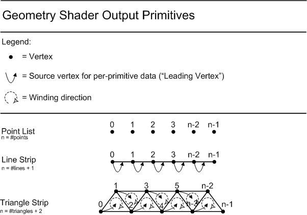
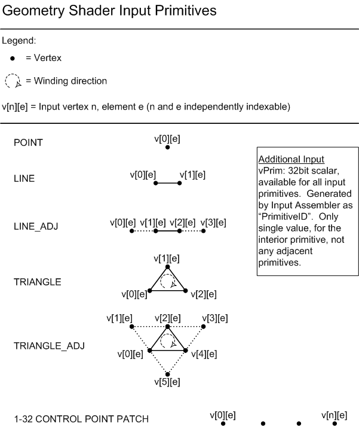
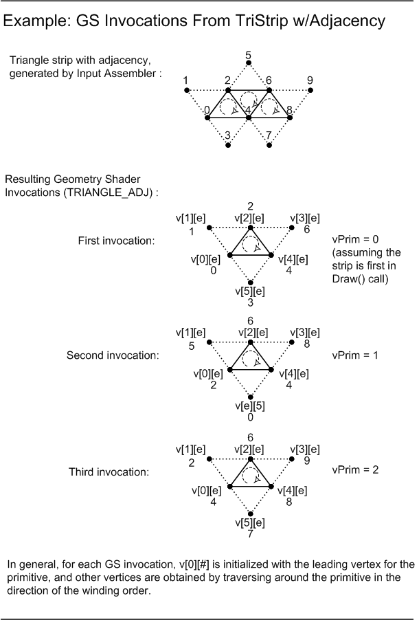
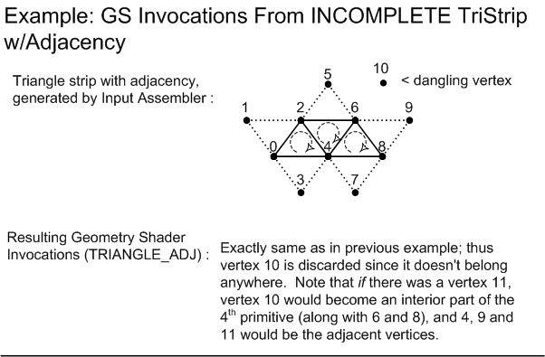

<a id="geometry-stream-output"></a>

# Geometry shaders and stream output

<!-- d3d12-review-legend:begin -->

> [!NOTE]
> **Draft provenance annotations.**
> Underlining marks pending replacement wording or authored list items. Warning boxes
> mark authored, mixed or reopened passages awaiting editorial review.
> Editorial adoption does not establish factual or hardware verification. Exact approved factual
> corrections do not trigger a marker. Unmarked text elsewhere, declarations
> and structural Markdown are not assertions of approval.
> [Annotation scope and approvals](../../spec-maintenance/d3d12/prose-annotations.md).

<!-- d3d12-review-legend:end -->

<!-- d3d12-review-alert:begin:gs-so:PC-stage-creation-owner:0 -->

> [!WARNING]
> **Authored synthesis - human review pending.**
>
> The current geometry and stream-output driver object creation/sizing/destruction contracts
> are defined with [pipeline component creation](pipeline-state.md#driver-shader-objects)
> and its [exact slot associations](pipeline-state.md#driver-object-slots).
> They do not add application shader/state object APIs or replace this stage's
> execution, linkage, capability or resource-lifetime rules.

<!-- d3d12-review-alert:end:gs-so:PC-stage-creation-owner:0 -->

<a id="geometry-shader"></a>

## Geometry shader

<!-- d3d12-review-alert:begin:gs-so:N-selection:0 -->

> [!WARNING]
> **Authored synthesis - human review pending.**
>
> The graphics PSO selects the geometry shader and stream-output declaration. [Pipeline creation/linkage](pipeline-state.md#compatibility), [root-signature compatibility](binding.md#pipeline-compatibility), [shared graphics capacities](vertex-processing.md#geometry-interface-capacities) and [view-instancing rules](vertex-processing.md#geometry-view-instancing) apply. Geometry input comes from vertex processing or the tessellator/domain-shader path; stream output can also capture the last active vertex-processing stage when no GS is selected.

<!-- d3d12-review-alert:end:gs-so:N-selection:0 -->

<!-- d3d12-review-alert:begin:gs-so:N-representation:0 -->

> [!WARNING]
> **Authored synthesis - human review pending.**
>
> Invocation, primitive topology and capture rules describe the stage contract. The register names and legacy instruction spellings used in the inherited descriptions are DXBC notation; [DXIL geometry-shader processing](#gs-dxil-model) defines its peer entry/signature model. Representation-specific output-budget calculations are identified separately.

<!-- d3d12-review-alert:end:gs-so:N-representation:0 -->

<a id="gs-invocation"></a>

### Invocation and primitive inputs

<ins><!-- d3d12-review-inline:begin:gs-so:H-invocation:0 -->When a Geometry Shader is active, it is invoked once for every primitive passed down or generated earlier in the Pipeline. Each invocation of the Geometry Shader sees as input the data for the invoking primitive, whether that is a single point, a single line, a single triangle, or the Control Points for a Patch (if a Patch arrives with Tessellation disabled). A triangle strip from earlier in the Pipeline would result in an invocation of the Geometry Shader for each individual triangle in the strip (as if the strip were expanded out into a triangle list). All the input data for each vertex in the individual primitive is available (i.e. 3 verts for triangle), plus adjacent vertex data if applicable/available. All vertex inputs/Element-layout/adjacency to be read must be declared, and this declaration must be compatible with the data being produced above in the Pipeline. Other inputs include textures, and also Primitive ID as a 32-bit scalar integer input.<!-- d3d12-review-inline:end:gs-so:H-invocation:0 --></ins>

<!-- d3d12-review-alert:begin:gs-so:N-identifiers:0 -->

> [!WARNING]
> **Authored synthesis - human review pending.**
>
> `SV_PrimitiveID` and `SV_GSInstanceID` identify the invoking primitive and GS instance, not the draw instance. For tessellated input, [patch identity](tessellation.md#tessellated-primitive-id) is preserved across the generated primitives. VertexID and draw InstanceID reach later stages only through the upstream shader outputs as defined by the [generated-identifier contract](vertex-processing.md#generated-identifiers). If a pixel shader consumes PrimitiveID after an active GS, it consumes the value supplied by the GS output.

<!-- d3d12-review-alert:end:gs-so:N-identifiers:0 -->

<a id="gs-instancing"></a>

### Instancing

<ins><!-- d3d12-review-inline:begin:gs-so:H-instancing:0 -->An alternate method of invoking the Geometry Shader is via instancing. A GS Instancing [declaration](../archive/D3D11_3_FunctionalSpec.htm#inst_vGSInstanceIDDCL) specifies a (fixed) number of times for the GS to be invoked for each primitive. Each instance that executes is identified by a GS instance ID value [0...n-1], and the outputs of each GS instance are appended to the end of the outputs of the previous invocation (with an implicit cut of the topology between instances - see the description of cutting further below). The maximum instance count that can be declared is 32, but for a full explanation of constraints of GS instancing, see the description of the GS instancing [declaration](../archive/D3D11_3_FunctionalSpec.htm#inst_vGSInstanceIDDCL).<!-- d3d12-review-inline:end:gs-so:H-instancing:0 --></ins>

<!-- d3d12-review-alert:begin:gs-so:N-instance-limits:0 -->

> [!WARNING]
> **Authored synthesis - human review pending.**
>
> The declared GS instance count is 1 through 32. Without instancing there is one logical invocation per input primitive. The declared maximum output vertex count applies per instance, and its product with the instance count must not exceed `D3D12_GS_MAX_OUTPUT_VERTEX_COUNT_ACROSS_INSTANCES` (1024). This vertex-count restriction is separate from the output-component budget. Instance outputs appear as if instance IDs ran from zero upward, with an implicit topology cut between instances; this does not require physical shader invocation serialization.

<!-- d3d12-review-alert:end:gs-so:N-instance-limits:0 -->

<a id="gs-statistics"></a>

### Invocation statistics

<!-- d3d12-review-alert:begin:gs-so:QF-gs-stats:0 -->

> [!WARNING]
> **Authored synthesis - human review pending.**
>
> The [pipeline-statistics contract](counters-queries-and-predication.md#pipeline-statistics) defines GSInvocations, including the GS-instance multiplicity defined above.

<!-- d3d12-review-alert:end:gs-so:QF-gs-stats:0 -->

<a id="gs-output"></a>

### Emission, cuts and output limits

<ins><!-- d3d12-review-inline:begin:gs-so:H-output:0 -->The Geometry Shader outputs data one vertex at a time using the ["emit"](../archive/D3D11_3_FunctionalSpec.htm#inst_EMIT) command. The topology of these vertices is determined by a fixed [declaration](../archive/D3D11_3_FunctionalSpec.htm#inst_outputTopologyDCL), choosing one of: pointlist, linestrip, or trianglestrip as the output for the GS. Strips can be restarted by using the ["cut"](../archive/D3D11_3_FunctionalSpec.htm#inst_CUT) command, which ends the current strip at the last emitted vertex, so that the next emitted vertex begins a new strip. The ["emitThenCut"](../archive/D3D11_3_FunctionalSpec.htm#inst_EMITTHENCUT) instruction both emits a vertex, and stops the current strip on this vertex, so that the next vertex that is emitted begins a new strip. For pointlist output, "cut" has no effect (including the "cut" part of "emitThenCut").<!-- d3d12-review-inline:end:gs-so:H-output:0 --></ins>

<ins><!-- d3d12-review-inline:begin:gs-so:H-output:1 -->The outputs of a given invocation of the Geometry Shader are independent of other invocations (though [ordering](../archive/D3D11_3_FunctionalSpec.htm#FixedOrder) is respected). A Geometry Shader emitting triangle strips will start a new strip on every invocation. In addition, as mentioned above, an invocation of the Geometry Shader can produce multiple separate strips using "cut"s.<!-- d3d12-review-inline:end:gs-so:H-output:1 --></ins>

<ins><!-- d3d12-review-inline:begin:gs-so:H-output:2 -->The Geometry Shader must declare the maximum number of vertices an invocation of the Shader will output. The total amount of data that a Geometry Shader invocation can produce is 1024 32-bit values. In the DXBC register model, the calculation of the output record with one or more streams is as follows: Given that each stream declares its outputs in its own clean slate view of the full output register set, the total output record size is the number of scalars in the union of all the stream declarations. This size multiplied by the max output vertex count must not exceed 1024. When Geometry Shader instancing is used, the Stream Output record size restriction applies to each instance individually.<!-- d3d12-review-inline:end:gs-so:H-output:2 --></ins>

<ins><!-- d3d12-review-inline:begin:gs-so:H-output:3 -->The limit on Geometry Shader output is based on how many "emit" calls the Shader makes. The limit on Geometry Shader output is not affected in any way by the size of the output buffer(s) that are present or whether or not they have even been bound. Even if no output Buffers happen to be bound to a Stream and a vertex is output (and therefore dropped), it still counts against the limit.<!-- d3d12-review-inline:end:gs-so:H-output:3 --></ins>

Hardware must enforce the limit above by stopping writes if the Geometry Shader program continues after emitting the declared maximum number of vertices.

<ins><!-- d3d12-review-inline:begin:gs-so:H-output:5 -->See the documentation of the GS maximum output vertex count [declaration](../archive/D3D11_3_FunctionalSpec.htm#inst_maxOutputVertexCount), as well as the GS Instancing [declaration](../archive/D3D11_3_FunctionalSpec.htm#inst_vGSInstanceIDDCL) for more details.<!-- d3d12-review-inline:end:gs-so:H-output:5 --></ins>

<a id="gs-output-data"></a>

### Output attributes

<ins><!-- d3d12-review-inline:begin:gs-so:H-output-data:0 -->In DXBC, the o# registers to be written by the Geometry Shader must be declared (e.g. "dcl_output o[3].xyz"). The set of these declarations defines which registers are read when an ["emit"](../archive/D3D11_3_FunctionalSpec.htm#inst_EMIT) command is issued, defining a vertex. Therefore, all vertices emitted by the Geometry Shader have the same data layout.<!-- d3d12-review-inline:end:gs-so:H-output-data:0 --></ins>

<ins><!-- d3d12-review-inline:begin:gs-so:H-output-data:1 -->When a Geometry Shader output is identified as a [System Interpreted Value](../archive/D3D11_3_FunctionalSpec.htm#SystemInterpretedValues) (e.g. "renderTargetArrayIndex" or "position"), hardware looks at this data and performs some behavior dependent on the value, in addition to being able to pass the data itself to the next Shader stage for input. When such data output from the Geometry Shader has meaning to the hardware on a per-primitive basis (such as "renderTargetArrayIndex" or "ViewportArrayIndex"), rather than on a per-vertex basis (such as "clipDistance" or "position"), the per-primitive data is taken from the [Leading Vertex](vertex-processing.md#leading-vertex) emitted for the primitive.<!-- d3d12-review-inline:end:gs-so:H-output-data:1 --></ins>

<ins><!-- d3d12-review-inline:begin:gs-so:H-output-data:2 -->Each time an ["emit"](../archive/D3D11_3_FunctionalSpec.htm#inst_EMIT) or ["emitThenCut"](../archive/D3D11_3_FunctionalSpec.htm#inst_EMITTHENCUT) is issued the contents of the declared DXBC Geometry Shader output registers are read to produce a vertex, and in addition the Geometry Shader outputs immediately become uninitialized. In other words, if any output data needs to be repeated for consecutive vertices, the Geometry Shader program must write the data over again to the output registers for each vertex.<!-- d3d12-review-inline:end:gs-so:H-output-data:2 --></ins>

<ins><!-- d3d12-review-inline:begin:gs-so:H-output-data:3 -->The Geometry Shader outputs have a close relationship to the Stream Output Stage/functionality, described [here](#so-declarations).<!-- d3d12-review-inline:end:gs-so:H-output-data:3 --></ins>

<ins><!-- d3d12-review-inline:begin:gs-so:H-output-data:4 --><!-- d3d12-review-inline:end:gs-so:H-output-data:4 --></ins>

<a id="output-streams"></a>

### Streams and buffers

<ins><!-- d3d12-review-inline:begin:gs-so:H-streams-buffers:0 -->**STREAM:** For the discussion here, let us define a stream as a sequence of writes of a structure of data out of a shader. A Geometry Shader can output up to 4 streams, each at different rates, with independent data going to each stream. The utility of this is in conjunction with [Stream Output](#stream-output).<!-- d3d12-review-inline:end:gs-so:H-streams-buffers:0 --></ins>

<ins><!-- d3d12-review-inline:begin:gs-so:H-streams-buffers:1 -->**BUFFER:** For the discussion in this section, in the context of [Stream Output](#stream-output), a Buffer denotes one bound target view that can receive any subset of the data from one stream. A stream can have its data split out (not replicated) across multiple buffers, and this mapping is defined by a Stream Output declaration (which is not visible in the Geometry Shader code). A Buffer cannot receive data from multiple streams at once.<!-- d3d12-review-inline:end:gs-so:H-streams-buffers:1 --></ins>

<a id="gs-multiple-streams"></a>

### Multiple streams and rasterizer selection

<ins><!-- d3d12-review-inline:begin:gs-so:H-multiple-streams:0 -->4 streams can be [declared](../archive/D3D11_3_FunctionalSpec.htm#inst_DCL_STREAM) by the GS. Without the GS present, all vertex data is a single stream.<!-- d3d12-review-inline:end:gs-so:H-multiple-streams:0 --></ins>

<ins><!-- d3d12-review-inline:begin:gs-so:H-multiple-streams:1 -->When the GS defines multiple streams, variants of the ["emit"](../archive/D3D11_3_FunctionalSpec.htm#inst_EMIT), [cut](../archive/D3D11_3_FunctionalSpec.htm#inst_CUT) or ["emitThenCut"](../archive/D3D11_3_FunctionalSpec.htm#inst_EMITTHENCUT) instructions which take an immediate stream # [0..4-1] parameter must be used by the GS to indicate which stream is being output. These instructions are ["emit_stream"](../archive/D3D11_3_FunctionalSpec.htm#inst_EMIT_STREAM), [cut_stream](../archive/D3D11_3_FunctionalSpec.htm#inst_CUT_STREAM) and ["emitThenCut_stream"](../archive/D3D11_3_FunctionalSpec.htm#inst_EMITTHENCUT_STREAM), respectively.<!-- d3d12-review-inline:end:gs-so:H-multiple-streams:1 --></ins>

<ins><!-- d3d12-review-inline:begin:gs-so:H-multiple-streams:2 -->In DXBC, all the declarations of its output registers appear multiple times independently, once per stream. A statement appears in the bytecode setting the current output stream being declared, and subsequent declarations of output registers define what data gets latched when vertex data is emitted to each stream. The set of output registers available to the GS program during execution is the union of all output registers declared for each stream (individual streams can use the same output registers). When a vertex is emitted to a given stream, only the output registers declared for that stream feed the output to the stream, however ALL declared output registers for all streams become uninitialized.<!-- d3d12-review-inline:end:gs-so:H-multiple-streams:2 --></ins>

<ins><!-- d3d12-review-inline:begin:gs-so:H-multiple-streams:3 -->If output register indexing is [declared](../archive/D3D11_3_FunctionalSpec.htm#inst_indexRange), specifying a range of output registers that can be dynamically indexed, the register space that can be declared for indexing is the union of all stream output register declarations.<!-- d3d12-review-inline:end:gs-so:H-multiple-streams:3 --></ins>

<ins><!-- d3d12-review-inline:begin:gs-so:H-multiple-streams:4 -->When outputting to multiple streams, the GS output topology [declaration](../archive/D3D11_3_FunctionalSpec.htm#inst_outputTopologyDCL) must appear for each stream, and must be set to "point". In other words, multiple streams means that non-point output is unavailable.<!-- d3d12-review-inline:end:gs-so:H-multiple-streams:4 --></ins>

<ins><!-- d3d12-review-inline:begin:gs-so:H-multiple-streams:5 -->When outputting to only a single stream, the output from the GS can be a point list, line strip or triangle strip (strips are expanded to lists when streamed to memory).<!-- d3d12-review-inline:end:gs-so:H-multiple-streams:5 --></ins>

<ins><!-- d3d12-review-inline:begin:gs-so:H-multiple-streams:6 -->When outputting to multiple streams, one of them can be sent to the rasterizer (independently of whether it is also streaming to memory). The Stream Output declaration specifies this (outside the shader code, but appearing to the driver side by side). Interpolation modes, System Interpreted Values and System Generated Values can be declared on any combination of Streams in the Shader, but the only ones that have any meaning are the ones corresponding to the Stream (if any) declared (outside the shader) as going to the rasterizer (if any). For Streams that are not going to the Rasterizer, the names are ignored. Notice that the same shader bytecode can be used by different graphics PSOs with different Stream Output declarations, each time selecting a different Stream to go to Rasterization.<!-- d3d12-review-inline:end:gs-so:H-multiple-streams:6 --></ins>

<ins><!-- d3d12-review-inline:begin:gs-so:H-multiple-streams:7 -->If no stream-output capture declaration or explicit rasterizer-stream selection is supplied in the PSO, the active stream defaults to 0. So stream 0 goes to rasterization if rasterization is enabled, and the absence of a Stream Output declaration means nothing is streamed out to memory. A rasterized stream must be declared by the GS and provide the position required for active rasterization; an invalid selection fails PSO creation. Depth/stencil rasterization can be active without a pixel shader.<!-- d3d12-review-inline:end:gs-so:H-multiple-streams:7 --></ins>

<ins><!-- d3d12-review-inline:begin:gs-so:H-multiple-streams:8 -->Interpolation modes declared for the outputs on one Stream don’t have to match those on another Stream. Note that when the graphics PSO is created, a choice of which stream (if any) is going to rasterization is made, so the driver shader compiler only needs to pay attention to interpolation modes and System Interpreted Values (such as "position") only on at most a single Stream’s declarations.<!-- d3d12-review-inline:end:gs-so:H-multiple-streams:8 --></ins>

<ins><!-- d3d12-review-inline:begin:gs-so:H-multiple-streams:9 -->The rasterizer-specific interpretation of system values does not remove the signature names and indices used to select capture data.<!-- d3d12-review-inline:end:gs-so:H-multiple-streams:9 --></ins>

<a id="gs-attribute-initialization"></a>

### Per-primitive attributes and capture

<ins><!-- d3d12-review-inline:begin:gs-so:H-output-limitations:0 -->When the application knows that some GS outputs will be treated as per-primitive constant at the subsequent Pixel Shader, the Geometry Shader need only initialize such output registers when they represent the [Leading Vertex](vertex-processing.md#leading-vertex) for a primitive. For example, on the last 2 vertices in a triangle strip, outputs that (on Leading vertices) would have been treated as constant by the Pixel Shader need not be written. If Stream Output is being used, which has no knowledge of what data is per-primitive constant or not, in the expansion of GS output strips to lists, Stream Output simply dumps out all the declared outputs for each vertex for each primitive. If the GS chooses to not write out what it knows is non-Leading-Vertex data for Elements that will be used to drive per-primitive constants in a later pass, uninitialized data gets written to these unwritten Elements in Stream Output. This is fine as long as the application never attempts to later read such uninitialized Stream Output data. If the application later recirculates the Streamed Out data in a way that correctly interprets only per-primitive constant data at Leading Vertices and never interprets the uninitialized data at non-Leading-Vertices (even though it does get read back into the pipeline), no undefined behavior results.<!-- d3d12-review-inline:end:gs-so:H-output-limitations:0 --></ins>

<ins><!-- d3d12-review-inline:begin:gs-so:H-output-limitations:1 -->There is a mechanism to retrieve the number of output primitives in the output buffer. Further details regarding writing to memory from the Geometry Shader are described [elsewhere in the spec.](#stream-output)<!-- d3d12-review-inline:end:gs-so:H-output-limitations:1 --></ins>

<a id="gs-incomplete"></a>

### Incomplete primitives

<ins><!-- d3d12-review-inline:begin:gs-so:H-incomplete:0 -->Partially completed primitives could be generated by the Geometry Shader if the Geometry Shader ends and the primitive is incomplete. Incomplete primitives are silently discarded and no completed-output-primitive counters are incremented. This is similar to the way the IA treats [Partially Completed Primitives](vertex-processing.md#partial-primitives).<!-- d3d12-review-inline:end:gs-so:H-incomplete:0 --></ins>

<a id="consistent-edge-evaluation"></a>

### Consistent edge evaluation

<ins><!-- d3d12-review-inline:begin:gs-so:H-consistent-edges:0 -->To ensure consistent order of operations on an edge and primitive level for primitives that show up in multiple invocations of the Geometry Shader (as an adjacent primitive in some invocations, or the root primitive for one invocation), it is up to the application to write Shader code that traverses vertices in a consistent manner. This ordering can be obtained by a variety of methods, including simply sorting of vertices based on position in Shader code. A more robust ordering can be achieved by providing a vertex "coloring" (a number) as vertex attribute, such that for any primitive, the coloring is guaranteed to be unique for each vertex in the primitive. This method has the benefit that the sorting operation in the Geometry Shader is more efficient (and robust) than sorting xyz vertex positions. Colorings can be generated offline by an authoring tool.<!-- d3d12-review-inline:end:gs-so:H-consistent-edges:0 --></ins>

<a id="gs-dxbc-interface"></a>

### DXBC logical interface

<ins><!-- d3d12-review-inline:begin:gs-so:H-registers:0 -->The following registers are available in the gs_5_0 model:<!-- d3d12-review-inline:end:gs-so:H-registers:0 --></ins>

<!-- d3d12-review-alert:begin:gs-so:H-registers:1 -->

> [!WARNING]
> **Mixed source and authored adaptation - human review pending.**
>
> | Register Type | Count | r/w | Dimension | Indexable by r# | Defaults | Requires DCL |
> | --- | --- | --- | --- | --- | --- | --- |
> | 32-bit Input (v[vertex][element]) | 32 | r | 4(comp)*32(vert) | y | none | y |
> | 32-bit Input Primitive ID (vPrim) | 1 | r | 1 | n | none | y |
> | 32-bit Input GS Instance ID (vGSInstanceID) | 1 | r | 1 | n | none | y |
> | 32-bit output Vertex Data Element (o#) | 32 | w | 4 | as declared | none | y |

<!-- d3d12-review-alert:end:gs-so:H-registers:1 -->

<a id="input-layout"></a>

### DXBC primitive input layouts

<ins><!-- d3d12-review-inline:begin:gs-so:H-input-layout:0 -->The Geometry Shader must declare which type of primitive it expects as input, out of the set of choices: {point,line,triangle,line_adj,triangle_adj,1-32 control point patch list}. The input primitive type specifies the number of vertices that are present, and the vertices are always fully indexed (there is no declaration for vertex indexing range). Even if strips are being used earlier in the Pipeline, individual primitives cause Geometry Shader Invocations. See the [GS Input Primitive Declaration Statement](../archive/D3D11_3_FunctionalSpec.htm#inst_inputPrimitiveDCL) in the instruction reference.<!-- d3d12-review-inline:end:gs-so:H-input-layout:0 --></ins>

The following diagrams depict the layout of Geometry Shader Input Primitives into the input v# registers:

<ins><!-- d3d12-review-inline:begin:gs-so:H-input-layout:2 -->

<!-- d3d12-review-inline:end:gs-so:H-input-layout:2 --></ins>

<!-- d3d12-review-alert:begin:gs-so:N-input-figure-note:0 -->

> [!WARNING]
> **Authored synthesis - human review pending.**
>
> The diagrams use the DXBC logical `v[vertex][element]` notation. In the second invocation of the triangle-strip example, the label printed `v[e][5]` denotes `v[5][e]`. The historical `Draw()` label denotes the corresponding one-instance direct draw; [direct draw APIs](vertex-processing.md#direct-draws) define the current methods.

<!-- d3d12-review-alert:end:gs-so:N-input-figure-note:0 -->

<a id="gs-dxil-model"></a>

### DXIL geometry-shader processing

<!-- d3d12-review-alert:begin:gs-so:N-dxil-model:0 -->

> [!WARNING]
> **Authored synthesis - human review pending.**
>
> A DXIL geometry shader has a shader entry function with input/output signatures and geometry-stage properties. Its vertex inputs are addressed by input element, row/component and vertex within the declared input primitive. `SV_PrimitiveID` and `SV_GSInstanceID` use the identifier provenance defined above; these system values are supplied through DXIL operations rather than ordinary input signature elements. Output signature elements identify their output stream. The function stores output attributes and uses the stream emission/cut operations to produce vertices and terminate strips. Every emitted vertex must define the components later consumed; a previous vertex's attributes are not a promise of initialized data for a later vertex. The logical invocation, output topology and stream rules above apply, with the representation-specific output budgets below.

<!-- d3d12-review-alert:end:gs-so:N-dxil-model:0 -->

<!-- d3d12-review-alert:begin:gs-so:N-dxil-properties:0 -->

> [!WARNING]
> **Authored synthesis - human review pending.**
>
> The geometry-stage properties identify:

<!-- d3d12-review-alert:end:gs-so:N-dxil-properties:0 -->

<!-- d3d12-review-alert:begin:gs-so:N-dxil-properties:1 -->

> [!WARNING]
> **Authored synthesis - human review pending.**
>
> | Property | Role |
> | --- | --- |
> | Input primitive | The primitive/vertex-array shape the GS consumes |
> | Maximum vertex count | Declared maximum output vertices per invocation |
> | Active stream mask | Which output streams are used |
> | Output topology | The topology assigned to the active output streams |
> | GS instance count | Logical invocations per input primitive |

<!-- d3d12-review-alert:end:gs-so:N-dxil-properties:1 -->

<!-- d3d12-review-alert:begin:gs-so:N-dxil-properties:2 -->

> [!WARNING]
> **Authored synthesis - human review pending.**
>
> `StoreOutput`, `EmitStream`, `CutStream` and `EmitThenCutStream` provide the stage's output data-flow roles. Their complete intrinsic behavior is defined separately; this overview does not replace operand, effect, availability or validation rules.

<!-- d3d12-review-alert:end:gs-so:N-dxil-properties:2 -->

<!-- d3d12-review-alert:begin:gs-so:N-dxil-budget:0 -->

> [!WARNING]
> **Authored synthesis - human review pending.**
>
> For DXIL GS output signatures, the output-scalar count is the sum of the row-count times column-count for every output signature element, including the elements of different streams. The declared maximum vertex count multiplied by that scalar count must not exceed 1024. This signature-element sum is not the DXBC cross-stream register-location union used in the [worked example](#so-example). The GS instance-count and per-stream signature-capacity restrictions remain separate.

<!-- d3d12-review-alert:end:gs-so:N-dxil-budget:0 -->

<a id="stream-output"></a>

## Stream output

<!-- d3d12-review-alert:begin:gs-so:N-buffer-terms:0 -->

> [!WARNING]
> **Authored synthesis - human review pending.**
>
> In stream-to-buffer mapping and capacity rules, an output buffer denotes a bound target view/slot. The GPU-address view defines the accessible data range; the filled-size location defines its progress state. These rules do not describe a hidden cursor attached to a resource object.

<!-- d3d12-review-alert:end:gs-so:N-buffer-terms:0 -->

<ins><!-- d3d12-review-inline:begin:gs-so:H-so-overview:0 -->The Pipeline can stream vertices out to memory just before clipping and rasterization (even if rasterization is still enabled). Vertices are always written out as complete primitives (e.g. 3 vertices at a time for triangles); incomplete primitives are never written out.<!-- d3d12-review-inline:end:gs-so:H-so-overview:0 --></ins>

<ins><!-- d3d12-review-inline:begin:gs-so:H-so-overview:1 -->Just before Streaming Out, all topologies are always expanded to lists (i.e. if the topology is a triangle strip, it is expanded to a triangle list, having 3 vertices per primitive).<!-- d3d12-review-inline:end:gs-so:H-so-overview:1 --></ins>

<ins><!-- d3d12-review-inline:begin:gs-so:H-so-overview:2 -->If the Geometry Shader is active, it is capable of producing outputs with up to 32 Elements per-vertex (each Element up to 4 components) for the Rasterizer, any subset of which can be routed to Stream Output. The presence of the GS allows multiple streams to be generated as well, as described [here](#output-streams).<!-- d3d12-review-inline:end:gs-so:H-so-overview:2 --></ins>

<ins><!-- d3d12-review-inline:begin:gs-so:H-so-overview:3 -->If the Geometry Shader is not active, whatever data arrives at the point in the pipeline where Stream Output appears (just before clipping and rasterization) can be Streamed Out (after expansion to a list topology as described above). Topologies with adjacency discard the "adjacent" vertices and only Stream Out the "interior" vertices. For untessellated patch capture, the rasterizer must be disabled. [Untessellated-patch routing](tessellation.md#untessellated-patches-rasterizer) defines the invalid active-rasterization configuration and its contingent undefined behavior.<!-- d3d12-review-inline:end:gs-so:H-so-overview:3 --></ins>

<ins><!-- d3d12-review-inline:begin:gs-so:H-so-overview:4 -->In the expansion of strips to lists of primitives on Stream Output from the Geometry Shader, there is no notion of any data being able to be treated as "constant"; for each Geometry Shader output primitive (after expansion from a strip to a list), the vertices each originate from separate ["emit"](../archive/D3D11_3_FunctionalSpec.htm#inst_EMIT) instructions. Applications can still take advantage of this behavior to store primitive data, simply by relying on the fact that if streamed out geometry is recirculated back into the Pipeline in another pass, the Rasterizer will treat the [Leading Vertex](vertex-processing.md#leading-vertex) in each primitive as the source for attributes that are declared as constant by the Pixel Shader.<!-- d3d12-review-inline:end:gs-so:H-so-overview:4 --></ins>

<a id="streams-to-buffers"></a>

### Mapping streams to buffers

<ins><!-- d3d12-review-inline:begin:gs-so:H-mapping:0 -->A description of the distinction between a Stream and Buffer is given [here](#output-streams). Up to 4 Streams can be present when the GS is used, otherwise there is a single Stream, Stream 0.<!-- d3d12-review-inline:end:gs-so:H-mapping:0 --></ins>

<ins><!-- d3d12-review-inline:begin:gs-so:H-mapping:1 -->Stream Output can send data from any Stream to up to 4 Buffers simultaneously. The total number of output Buffers across all Streams is also constrained to 4. Data from multiple Streams cannot go to a single Buffer, but each Stream can send its output to multiple Buffers. Stream data cannot be replicated across multiple buffers.<!-- d3d12-review-inline:end:gs-so:H-mapping:1 --></ins>

<ins><!-- d3d12-review-inline:begin:gs-so:H-mapping:2 -->Up to 128 scalar components of data per-vertex can be streamed out across the output Buffers, as long as the total window of data being output per-vertex to any one Buffer is 512 bytes or less. Vertex stride to a given Buffer can be up to 2048 bytes.<!-- d3d12-review-inline:end:gs-so:H-mapping:2 --></ins>

<a id="so-format"></a>

### Stored data format

<ins><!-- d3d12-review-inline:begin:gs-so:H-format:0 -->In all cases, the only supported output data formats at Stream Output are 32-bit per component integer and floating point formats, with 1 to 4 components. This is not as general as the other Resource input/output paths in the D3D12 Pipeline. The [format-support query](formats.md#support) reports `D3D12_FORMAT_SUPPORT1_SO_BUFFER` for stream-output use. When any given 32-bit component of data in the Pipeline goes out the Stream Output path and gets written to memory, the hardware must simply dump out the 32 bits (per component) of data out unaltered, which is consistent with the sorts of formats supported for Stream Output described here.<!-- d3d12-review-inline:end:gs-so:H-format:0 --></ins>

<a id="so-declarations"></a>

### Stream-output declaration

<!-- d3d12-review-alert:begin:gs-so:N-so-object:0 -->

> [!WARNING]
> **Authored synthesis - human review pending.**
>
> Stream output is described by the graphics PSO's `D3D12_STREAM_OUTPUT_DESC`, not a separately bound GS+SO object. The declaration selects source signature components, destination buffer slots, per-buffer strides and the rasterized stream. Without a GS, stream 0 carries the last active VS or DS output; HS output is not a direct stream-output source. Stream-output use requires the root signature's `D3D12_ROOT_SIGNATURE_FLAG_ALLOW_STREAM_OUTPUT` permission, as specified by [PSO/root validation](pipeline-state.md#input-layout-constraints).

<!-- d3d12-review-alert:end:gs-so:N-so-object:0 -->

<a id="so-declaration-entry"></a>

#### D3D12_SO_DECLARATION_ENTRY

```cpp
typedef struct D3D12_SO_DECLARATION_ENTRY
{
    UINT Stream;
    LPCSTR SemanticName;
    UINT SemanticIndex;
    BYTE StartComponent;
    BYTE ComponentCount;
    BYTE OutputSlot;
} D3D12_SO_DECLARATION_ENTRY;
```

<ins><!-- d3d12-review-inline:begin:gs-so:P-D3D12_SO_DECLARATION_ENTRY:0 -->`Stream`<!-- d3d12-review-inline:end:gs-so:P-D3D12_SO_DECLARATION_ENTRY:0 --></ins>

Zero-based, stream number.

`SemanticName`

<ins><!-- d3d12-review-inline:begin:gs-so:P-D3D12_SO_DECLARATION_ENTRY:3 -->The name is the semantic base name and must not end with a numeric suffix. Supply the numeric index separately through `SemanticIndex`.<!-- d3d12-review-inline:end:gs-so:P-D3D12_SO_DECLARATION_ENTRY:3 --></ins>

<ins><!-- d3d12-review-inline:begin:gs-so:P-D3D12_SO_DECLARATION_ENTRY:4 -->Type of output element; possible values include: **"POSITION"**, **"NORMAL"**, or **"TEXCOORD"**. Note that if **SemanticName** is **NULL** then **ComponentCount** can be greater than 4 and the described entry will be a gap in the stream out where no data will be written.<!-- d3d12-review-inline:end:gs-so:P-D3D12_SO_DECLARATION_ENTRY:4 --></ins>

`SemanticIndex`

Output element's zero-based index. Use, for example, if you have more than one texture coordinate stored in each vertex.

`StartComponent`

The component of the entry to begin writing out to. Valid values are 0 to 3. For example, if you only wish to output to the y and z components of a position, **StartComponent** is 1 and **ComponentCount** is 2.

`ComponentCount`

The number of components of the entry to write out to. Valid values are 1 to 4. For example, if you only wish to output to the y and z components of a position, **StartComponent** is 1 and **ComponentCount** is 2. Note that if **SemanticName** is **NULL** then **ComponentCount** can be greater than 4 and the described entry will be a gap in the stream out where no data will be written.

`OutputSlot`

The associated stream output buffer that is bound to the pipeline. The valid range for **OutputSlot** is 0 to 3.

<a id="stream-output-desc"></a>

#### D3D12_STREAM_OUTPUT_DESC

```cpp
typedef struct D3D12_STREAM_OUTPUT_DESC
{
    const D3D12_SO_DECLARATION_ENTRY* pSODeclaration;
    UINT NumEntries;
    const UINT* pBufferStrides;
    UINT NumStrides;
    UINT RasterizedStream;
} D3D12_STREAM_OUTPUT_DESC;
```

<ins><!-- d3d12-review-inline:begin:gs-so:P-D3D12_STREAM_OUTPUT_DESC:0 -->`pSODeclaration`<!-- d3d12-review-inline:end:gs-so:P-D3D12_STREAM_OUTPUT_DESC:0 --></ins>

<ins><!-- d3d12-review-inline:begin:gs-so:P-D3D12_STREAM_OUTPUT_DESC:1 -->An array of [`D3D12_SO_DECLARATION_ENTRY`](https://learn.microsoft.com/en-us/windows/desktop/api/d3d12/ns-d3d12-d3d12_so_declaration_entry) structures. Can't be **NULL** if **NumEntries** &gt; 0.<!-- d3d12-review-inline:end:gs-so:P-D3D12_STREAM_OUTPUT_DESC:1 --></ins>

`NumEntries`

The number of entries in the stream output declaration array that the **pSODeclaration** member points to.

`pBufferStrides`

An array of buffer strides; each stride is the size of an element for that buffer.

`NumStrides`

The number of strides (or buffers) that the **pBufferStrides** member points to.

`RasterizedStream`

The index number of the stream to be sent to the rasterizer stage.

<!-- d3d12-review-alert:begin:gs-so:N-layout-constraints:0 -->

> [!WARNING]
> **Authored synthesis - human review pending.**
>
> Declaration entries for a buffer are laid out consecutively. A null `SemanticName` creates a gap whose memory is not written; otherwise `StartComponent` and `ComponentCount` select a contiguous subset of the named source signature element. A stream's source components cannot be replicated into multiple destination buffers or overlap in repeated selections; separate streams have independent declarations. Buffer strides include gaps, must cover the declared structure, and may leave untouched trailing padding. The capture window is at most 512 bytes per buffer and the stride at most 2048 bytes; stream and buffer-slot counts are each at most four.

<!-- d3d12-review-alert:end:gs-so:N-layout-constraints:0 -->

<!-- d3d12-review-alert:begin:gs-so:N-declaration-validation:0 -->

> [!WARNING]
> **Authored synthesis - human review pending.**
>
> Entries are ordered by nondecreasing `Stream`, with stream and output-slot indices in 0..3. There are at most 128 declaration entries per stream, including gaps, and at most 512 across four streams. For each output slot, the sum of `ComponentCount` values, including gaps, must not exceed 128 components (512 bytes). Each used slot must have a non-gap entry and can receive only one stream. Non-gap selections have `StartComponent` in 0..3, count 1..4 and a selected range within the source element. Gap entries have zero `SemanticIndex` and `StartComponent` and a nonzero count; a count greater than four still must fit the independent per-slot window.

<!-- d3d12-review-alert:end:gs-so:N-declaration-validation:0 -->

<!-- d3d12-review-alert:begin:gs-so:N-strides:0 -->

> [!WARNING]
> **Authored synthesis - human review pending.**
>
> When explicit strides are supplied, `NumStrides` is at most four and the array covers every used output slot. Each used stride is a multiple of four bytes, at least that slot's declared structure size including gaps, and at most 2048 bytes. With `NumStrides == 0` and no stride array, tight per-slot strides are derived from the declaration.

<!-- d3d12-review-alert:end:gs-so:N-strides:0 -->

<a id="so-target-view"></a>

### Target view

```cpp
typedef struct D3D12_STREAM_OUTPUT_BUFFER_VIEW
{
    D3D12_GPU_VIRTUAL_ADDRESS BufferLocation;
    UINT64 SizeInBytes;
    D3D12_GPU_VIRTUAL_ADDRESS BufferFilledSizeLocation;
} D3D12_STREAM_OUTPUT_BUFFER_VIEW;
```

<ins><!-- d3d12-review-inline:begin:gs-so:P-view:0 -->`BufferLocation`<!-- d3d12-review-inline:end:gs-so:P-view:0 --></ins>

A D3D12\_GPU\_VIRTUAL\_ADDRESS (a UINT64) that points to the stream output buffer. If **SizeInBytes** is 0, this member isn't used and can be any value.

`SizeInBytes`

The size of the stream output buffer in bytes.

`BufferFilledSizeLocation`

The location of the value of how much data has been filled into the buffer, as a D3D12\_GPU\_VIRTUAL\_ADDRESS (a UINT64). This member can't be NULL; a filled size location must be supplied (which the hardware will increment as data is output). If **SizeInBytes** is 0, this member isn't used and can be any value.

<a id="sosettargets"></a>

### ID3D12GraphicsCommandList::SOSetTargets

#### Declaration

```cpp
void SOSetTargets(
    UINT StartSlot,
    UINT NumViews,
    const D3D12_STREAM_OUTPUT_BUFFER_VIEW* pViews
    );
```

#### Behavior

Sets the stream output buffer views.

#### Parameters

<ins><!-- d3d12-review-inline:begin:gs-so:P-SOSetTargets:0 -->`[in] StartSlot`<!-- d3d12-review-inline:end:gs-so:P-SOSetTargets:0 --></ins>

Index into the device's zero-based array to begin setting stream output buffers.

`[in] NumViews`

<ins><!-- d3d12-review-inline:begin:gs-so:P-SOSetTargets:3 -->The number of entries in the *pViews* array.<!-- d3d12-review-inline:end:gs-so:P-SOSetTargets:3 --></ins>

`[in, optional] pViews`

Specifies an array of [D3D12_STREAM_OUTPUT_BUFFER_VIEW](https://learn.microsoft.com/en-us/windows/desktop/api/d3d12/ns-d3d12-d3d12_stream_output_buffer_view) structures.

#### Return values

<ins><!-- d3d12-review-inline:begin:gs-so:Q-SOSetTargets:0 -->None<!-- d3d12-review-inline:end:gs-so:Q-SOSetTargets:0 --></ins>

#### Recording constraints

<!-- d3d12-review-alert:begin:gs-so:N-binding:0 -->

> [!WARNING]
> **Authored synthesis - human review pending.**
>
> `StartSlot` must be less than four and `NumViews` must not exceed `4 - StartSlot`. A null `pViews` clears the specified range; a valid zero count changes no slots. Higher slots outside the range are unchanged. This is a DIRECT recording command, not a COMPUTE, COPY or BUNDLE command. Bundle draws can still use inherited targets. [Initial/reset and bundle bindings](command-list-state.md#buffer-bindings), [recording/execution lifetime](execution.md#lifetime), [residency](resources.md#residency) and [synchronization/access](synchronization.md#barrier-access) remain application obligations. Binding views does not initialize their filled-size storage, extend resource lifetime or perform a resource-state transition.

<!-- d3d12-review-alert:end:gs-so:N-binding:0 -->

<!-- d3d12-review-alert:begin:gs-so:N-view-validity:0 -->

> [!WARNING]
> **Authored synthesis - human review pending.**
>
> For a nonempty view, data and filled-size GPU addresses must be valid, nonzero, four-byte-aligned addresses in buffer resources, with their referenced ranges contained in the allocations. The application-managed filled-size value is a 32-bit quantity; the 64-bit GPU address that points to it does not make the value 64-bit. Data and counter storage may occupy the same resource, as specified by the counter contract, but the counter must not lie in the target data range. The zero-size exceptions in the member descriptions above apply to empty views.

<!-- d3d12-review-alert:end:gs-so:N-view-validity:0 -->

<a id="filled-size"></a>

### Filled-size storage and append

<ins><!-- d3d12-review-inline:begin:gs-so:P-counter-ownership:0 -->As a part of the stream output process, the GPU has to know the current location in the buffer that it is writing to. Apps allocate memory to store this current location. There are no special ways to manipulate this value, and apps are free to read/write the value with the CPU or GPU.<!-- d3d12-review-inline:end:gs-so:P-counter-ownership:0 --></ins>

The application is responsible for allocating storage for a 32-bit quantity called the *BufferFilledSize*. This contains the number of bytes of data in the stream-output buffer. This storage can be placed in the same, or a different, resource as the one that contains the stream-output data. This value is accessed by the GPU in the stream-output stage to determine where to append new vertex data in the buffer. Additionally, this value is accessed by the GPU to determine when overflow has occurred.

<ins><!-- d3d12-review-inline:begin:gs-so:P-counter-state:0 -->With the legacy resource-state model, when a resource is used as a stream-output target, the resources used must be in the D3D12\_RESOURCE\_STATE\_STREAM\_OUT state. This applies to both the vertex data and the *BufferFilledSize* (which can be in the same or separate resources).<!-- d3d12-review-inline:end:gs-so:P-counter-state:0 --></ins>

<!-- d3d12-review-alert:begin:gs-so:N-counter-protocol:0 -->

> [!WARNING]
> **Authored synthesis - human review pending.**
>
> The application initializes the filled-size value to the byte offset at which capture should begin; initializing it to zero starts at the beginning of the target view. Successive draws append according to that value. Rebinding does not supply a D3D11 append sentinel or reset an implicit per-resource cursor: the selected `BufferFilledSizeLocation` identifies the application-managed state. CPU/GPU writes, capture updates and later reads of that storage require the normal lifetime, access and ordering contracts.

<!-- d3d12-review-alert:end:gs-so:N-counter-protocol:0 -->

<!-- d3d12-review-alert:begin:gs-so:N-access:0 -->

> [!WARNING]
> **Authored synthesis - human review pending.**
>
> With enhanced barriers, target data and filled-size storage use the [stream-output access and synchronization scopes](synchronization.md#barrier-access). A resource's heap/state restrictions still apply. Changing the filled-size value with CPU/GPU work must be ordered before the capture that consumes it; later consumers likewise require the appropriate access synchronization.

<!-- d3d12-review-alert:end:gs-so:N-access:0 -->

<a id="overflow-and-statistics"></a>

### Overflow and statistics

<ins><!-- d3d12-review-inline:begin:gs-so:H-overflow:0 -->The [SO statistics query](counters-queries-and-predication.md#stream-output-statistics) measures the overflow behavior below.<!-- d3d12-review-inline:end:gs-so:H-overflow:0 --></ins>

<ins><!-- d3d12-review-inline:begin:gs-so:H-overflow:1 -->The NumPrimitivesWritten and PrimitivesStorageNeeded results will not be equal if the draw calls covered by that query interval generate more primitives than there is space left in the smallest of the currently bound Buffer(s) to store them. Note there is only one NumPrimitivesWritten counter per Stream even though it is possible to have multiple simultaneous Buffers bound for writing by a Stream. Stream Output is defined to stop all writes to a Stream if one of the Buffers being written by that stream does not have room for another complete primitive.<!-- d3d12-review-inline:end:gs-so:H-overflow:1 --></ins>

<ins><!-- d3d12-review-inline:begin:gs-so:H-overflow:2 -->The hardware always writes as many complete primitives (e.g. 3 vertices for a triangle) as possible to the Buffer(s) for a Stream; a given primitive is written only if there is enough space for its entire contents (e.g. 3 times the vertex stride for triangles must be available in the Buffer) in all the output Buffers for the Stream. If any Buffer for a Stream becomes full before the draw call has completed (i.e. no more space for a complete primitive to be appended), Shader execution continues, along with sustained incrementing of the PrimitivesStorageNeeded counter for that Stream, but not the NumPrimitivesWritten counter for that Stream. In addition, the Shader's outputs are no longer written to any of the output Buffers for that Stream. Output to other Streams functions independently.<!-- d3d12-review-inline:end:gs-so:H-overflow:2 --></ins>

<ins><!-- d3d12-review-inline:begin:gs-so:H-overflow:3 -->If multiple Buffers are being written by a given Stream, as soon as one of the Buffers can no longer hold any more complete primitives, writes to ALL Buffers for that Stream are stopped, while as mentioned above, Shader execution continues, and the PrimitivesStorageNeeded counter continues to tally for that Stream. Other Streams operate independently.<!-- d3d12-review-inline:end:gs-so:H-overflow:3 --></ins>

<a id="so-statistics-payload"></a>

#### D3D12_QUERY_DATA_SO_STATISTICS

<!-- d3d12-review-alert:begin:gs-so:QF-so-stats:0 -->

> [!WARNING]
> **Authored synthesis - human review pending.**
>
> The complete [SO query payload, member meanings and per-stream interval semantics](counters-queries-and-predication.md#stream-output-statistics) are defined in the general query chapter; overflow and capture mechanics remain here.

<!-- d3d12-review-alert:end:gs-so:QF-so-stats:0 -->

<a id="so-slot-behavior"></a>

### Bound and unused slots

<ins><!-- d3d12-review-inline:begin:gs-so:H-slot-behavior:0 -->If an output buffer slot (0..3) has data streamed out to it (as indicated by the stream output declaration), but no buffer is attached, then that output buffer slot is treated as if a full buffer is attached, resulting in the overflow behavior described [here](#overflow-and-statistics).<!-- d3d12-review-inline:end:gs-so:H-slot-behavior:0 --></ins>

<ins><!-- d3d12-review-inline:begin:gs-so:H-slot-behavior:1 -->If an output buffer slot does not have data being streamed out to it, and a buffer is attached, then that buffer is fully ignored, including having no impact on overflow and output tracking.<!-- d3d12-review-inline:end:gs-so:H-slot-behavior:1 --></ins>

<a id="so-rasterization"></a>

### Capture and rasterization

<ins><!-- d3d12-review-inline:begin:gs-so:H-orthogonal:0 -->The path through Rasterizer output is always available, even if Stream Output is active. When the Stream Output declaration is provided (created), the application selects the rasterized stream or `D3D12_SO_NO_RASTERIZED_STREAM`. The [`D3D12_STREAM_OUTPUT_DESC`](#stream-output-desc) declaration defines this selection.<!-- d3d12-review-inline:end:gs-so:H-orthogonal:0 --></ins>

<a id="so-example"></a>

### DXBC multi-stream output-budget example

<!-- d3d12-review-alert:begin:gs-so:N-example-scope:0 -->

> [!WARNING]
> **Authored synthesis - human review pending.**
>
> This is a DXBC register-allocation and emission-budget illustration, not a complete shader/PSO declaration. Rasterization still requires the selected stream's position and the other stage/linkage conditions. It is not a validity proof for a DXIL signature with the same source-level attributes.

<!-- d3d12-review-alert:end:gs-so:N-example-scope:0 -->

<ins><!-- d3d12-review-inline:begin:gs-so:H-example:0 -->Below is a very rough example (using pseudocode) of the sequence of operations an application might perform and how to calculate vertex counts.<!-- d3d12-review-inline:end:gs-so:H-example:0 --></ins>

<ins><!-- d3d12-review-inline:begin:gs-so:H-example:1 -->**What the Shader wants to do:**
 Suppose the GS needs to output:<!-- d3d12-review-inline:end:gs-so:H-example:1 --></ins>

```hlsl
float2 A;
int4 B;
float3 C;
float3 D;
```

<ins><!-- d3d12-review-inline:begin:gs-so:H-example:3 -->The shader needs {A, B} to be output at one frequency as a point list.<!-- d3d12-review-inline:end:gs-so:H-example:3 --></ins>

{C, D} are to be output at another frequency as a point list.

A needs to go to buffer 0.

B needs to go to buffer 1.

A and B both need to go to the rasterizer as well.

C and D need to go to buffer 2.

The shader needs to output up to 100 of {A,B} and up to 70 of {C,D}, worst case 170 (100+70) emits total.

<ins><!-- d3d12-review-inline:begin:gs-so:H-example:10 -->**How this is accomplished by the application (basically by declaring exactly what is needed):**
 The Geometry Shader declares A and B into one stream (say stream 0), so emits of the data to stream 0 are done via emit(0). HLSL declares in the shader IL that A goes to o0.xy, B goes to o1.xyzw.<!-- d3d12-review-inline:end:gs-so:H-example:10 --></ins>

<ins><!-- d3d12-review-inline:begin:gs-so:H-example:11 -->C and D are declared into another stream (stream 1), so emits to stream 1 are done via emit(1). HLSL declares in the shader IL that C goes to o0.xyz and D goes to o1.xyz.<!-- d3d12-review-inline:end:gs-so:H-example:11 --></ins>

<ins><!-- d3d12-review-inline:begin:gs-so:H-example:12 -->The graphics PSO's stream-output declaration selects stream 0 for rasterization.<!-- d3d12-review-inline:end:gs-so:H-example:12 --></ins>

Stream 0 and Stream 1 are declared as a point list topology (in fact whenever producing multiple streams, the only available topology is point list for each of them).

Vertices can be emitted to either stream in any order.

<ins><!-- d3d12-review-inline:begin:gs-so:H-example:15 -->The shader code doesn’t need to know anything about the mapping of A,B,C,D to buffers/formats/memory layout. The PSO's stream-output declaration is responsible for those assignments and format definitions. PSO creation validates stream constraints, like enforcing that outputs declared in different streams in the shader cannot be sent to the same buffer. In contrast, what this example does is valid – parts of a single output stream are split across multiple buffers.<!-- d3d12-review-inline:end:gs-so:H-example:15 --></ins>

<ins><!-- d3d12-review-inline:begin:gs-so:H-example:16 -->The GS output declaration declares the max output vertex count as 170. **As a result, shader compilation fails for this example!** The reason is that the output vertex record size, based on the output declarations for the 2 streams, is the union of the declarations of each. Since stream 0 defines o0.xy and o1.xyzw, and stream 1 defines o0.xyz and o1.xyz, the union is {o0.xyz,o1.xyzw} = 7 scalars. 7 * 170 vertices = 1190, which is greater than 1024. If it happened that stream 1 also declared o0.xy and o1.xyzw (same as stream 0), the record size would have been 6 scalars, and 6*170 = 1020 which would have been valid.<!-- d3d12-review-inline:end:gs-so:H-example:16 --></ins>

<a id="gs-so-driver"></a>

## Driver responsibilities

<!-- d3d12-review-alert:begin:gs-so:N-driver:0 -->

> [!WARNING]
> **Authored synthesis - human review pending.**
>
> The runtime resolves semantic stream-output selections against the last active shader's output signature during PSO creation. The driver implements the selected GS input/output/instance state, ordered primitive streams and stream-output mapping, view extents and filled-size updates under the negotiated DDI. These responsibilities do not replace resource lifetime, access-state or synchronization obligations, and invalid programs are not legalized by missing retail diagnostics.

<!-- d3d12-review-alert:end:gs-so:N-driver:0 -->

<ins><!-- d3d12-review-inline:begin:gs-so:P-driver-field:0 -->The published command-list function table identifies:<!-- d3d12-review-inline:end:gs-so:P-driver-field:0 --></ins>

```cpp
PFND3D12DDI_SO_SET_TARGETS_0003                                        pfnSOSetTargets;
```

<a id="driver-so-binding"></a>

### Stream-output target binding

<!-- d3d12-review-alert:begin:gs-so:SF-current-roles:0 -->

> [!WARNING]
> **Authored synthesis - human review pending.**
>
> These runtime-to-driver entries implement [SOSetTargets](#sosettargets).
> The ordinary form receives `D3D12DDI_HCOMMANDLIST`, identifying driver
> recording state. The API-handle form receives `D3D12DDI_API_HCOMMANDLIST`,
> identifying the application-side header rather than ordinary driver-private
> storage; use the [shared header/conversion contract](execution.md#work-command-handles).
> They are conditional alternative table representations, not universal
> availability or a transfer of COM ownership.

<!-- d3d12-review-alert:end:gs-so:SF-current-roles:0 -->

<!-- d3d12-review-alert:begin:gs-so:SF-current-roles:1 -->

> [!WARNING]
> **Authored synthesis - human review pending.**
>
> | Current table member | Signature | API contract |
> |---|---|---|
> | `D3D12DDI_COMMAND_LIST_FUNCS_3D_0108::pfnSOSetTargets` | `PFND3D12DDI_SO_SET_TARGETS_0003` | [SOSetTargets](#sosettargets) |
> | `D3D12DDI_COMMAND_LIST_FUNCS_3D_0114::pfnSOSetTargets` | `PFND3D12DDI_SO_SET_TARGETS_0114` | [SOSetTargets](#sosettargets) |

<!-- d3d12-review-alert:end:gs-so:SF-current-roles:1 -->

```cpp
typedef struct D3D12DDI_STREAM_OUTPUT_BUFFER_VIEW
{
    D3D12DDI_GPU_VIRTUAL_ADDRESS BufferLocation;
    UINT64 SizeInBytes;
    D3D12DDI_GPU_VIRTUAL_ADDRESS BufferFilledSizeLocation;
} D3D12DDI_STREAM_OUTPUT_BUFFER_VIEW;

typedef VOID ( APIENTRY* PFND3D12DDI_SO_SET_TARGETS_0003 )(
    D3D12DDI_HCOMMANDLIST,
    _In_ UINT StartSlot,
    _In_ UINT NumViews,
    _In_reads_opt_(NumViews) CONST D3D12DDI_STREAM_OUTPUT_BUFFER_VIEW* pViews );

typedef VOID ( APIENTRY* PFND3D12DDI_SO_SET_TARGETS_0114 )(D3D12DDI_API_HCOMMANDLIST, _In_ UINT StartSlot, _In_ UINT NumViews, _In_reads_opt_(NumViews) CONST D3D12DDI_STREAM_OUTPUT_BUFFER_VIEW* pViews );
```

<!-- d3d12-review-alert:begin:gs-so:SF-view-values:0 -->

> [!WARNING]
> **Authored synthesis - human review pending.**
>
> Both forms receive `StartSlot`, `NumViews`, then `pViews`. The slot is a
> logical stream-output target slot; the count is a number of views, not
> bytes. The [four-slot range contract](#sosettargets) applies: null `pViews`
> clears the selected range, a valid zero count changes no slots, and slots
> outside the range remain unchanged. The driver captures the view values
> during the call; it cannot retain the caller's array as a later source
> of those values.

<!-- d3d12-review-alert:end:gs-so:SF-view-values:0 -->

<!-- d3d12-review-alert:begin:gs-so:SF-view-values:1 -->

> [!WARNING]
> **Authored synthesis - human review pending.**
>
> Each view supplies a data GPU virtual address, a `UINT64` byte extent,
> and a filled-size GPU virtual address. These are not descriptor-heap
> handles or retained resource COM objects. The [nonempty address/alignment/
> allocation requirements](#sosettargets) and
> [zero-size view exceptions](#so-target-view) are unchanged; an empty view's
> unused address fields are not a general null-address rule for nonempty views.
> CPU array capture does not extend the referenced GPU storage's lifetime.

<!-- d3d12-review-alert:end:gs-so:SF-view-values:1 -->

<!-- d3d12-review-alert:begin:gs-so:SF-progress-state:0 -->

> [!WARNING]
> **Authored synthesis - human review pending.**
>
> `BufferFilledSizeLocation` is a 64-bit GPU address of the
> [application-managed 32-bit byte-progress value](#filled-size), not a
> 64-bit progress quantity. Setting, clearing or rebinding views does not
> initialize that storage or select a hidden per-resource append cursor.
> Data and progress storage retain the owner's initialization, non-overlap,
> resource access and ordering requirements.

<!-- d3d12-review-alert:end:gs-so:SF-progress-state:0 -->

<!-- d3d12-review-alert:begin:gs-so:SF-progress-state:1 -->

> [!WARNING]
> **Authored synthesis - human review pending.**
>
> The PSO's [stream-output declaration](#so-declarations) still selects streams,
> target slots, strides and the rasterized stream; binding a view changes
> none of those declarations. GPU capture and filled-size updates obey the
> [complete-primitive capacity/overflow rules](#overflow-and-statistics) and
> [bound versus unused slot behavior](#so-slot-behavior). The setter does not
> itself execute a capture or report GPU completion.

<!-- d3d12-review-alert:end:gs-so:SF-progress-state:1 -->

<!-- d3d12-review-alert:begin:gs-so:SF-context-errors:0 -->

> [!WARNING]
> **Authored synthesis - human review pending.**
>
> The setter remains DIRECT-only and cannot be called from a bundle.
> Bundle draws can still use inherited targets under the
> [canonical input/output binding rules](command-list-state.md#buffer-bindings).
> A new DIRECT recording starts with unbound targets; unbinding or resetting
> recording does not initialize filled-size resource data.
> The [root-signature/PSO stream-output requirements](#so-declarations) and
> [render-pass recording conditions](output-merger.md#render-pass-operation-surface)
> remain applicable.

<!-- d3d12-review-alert:end:gs-so:SF-context-errors:0 -->

<!-- d3d12-review-alert:begin:gs-so:SF-context-errors:1 -->

> [!WARNING]
> **Authored synthesis - human review pending.**
>
> Both data and filled-size storage retain
> [execution lifetime](execution.md#lifetime), [residency](resources.md#residency)
> and [legacy/enhanced access synchronization](#filled-size) obligations.
> Binding is not a resource transition or synchronization operation.
> These `VOID` setters use the
> [recording-error/deferred-Close contract](execution.md#lifecycle-driver-errors),
> not a recoverable creation `HRESULT`. The handle change is not proof of
> argument validation or clamping.

<!-- d3d12-review-alert:end:gs-so:SF-context-errors:1 -->
