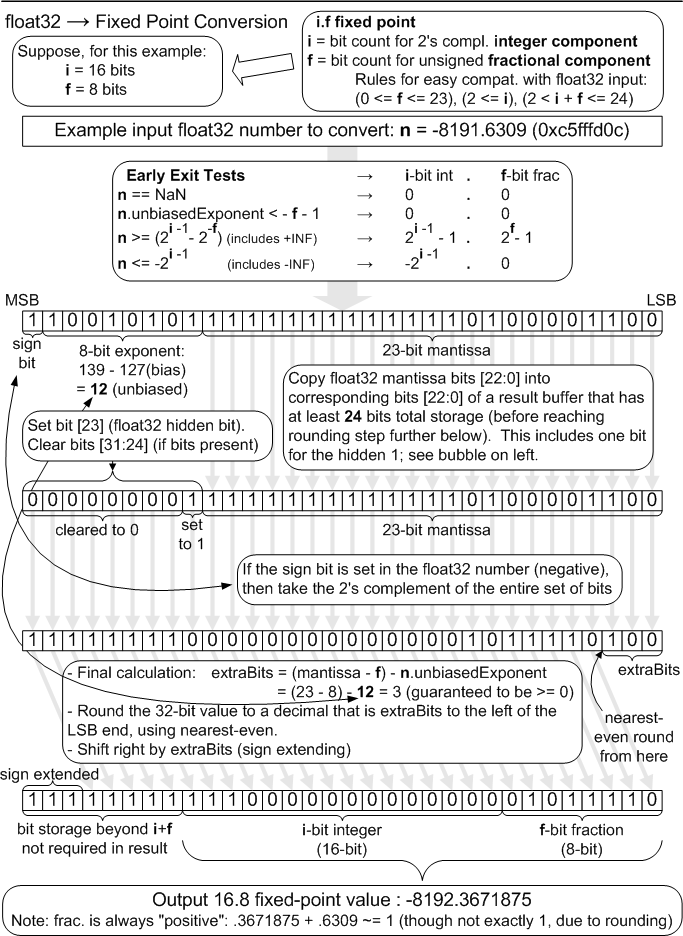
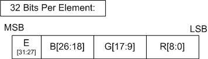
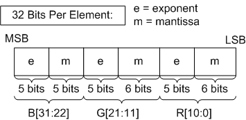

# Numeric and data rules

<!-- d3d12-review-legend:begin -->

> [!NOTE]
> **Draft provenance annotations.**
> Underlining marks pending replacement wording or authored list items. Warning boxes
> mark authored, mixed or reopened passages awaiting editorial review.
> Editorial adoption does not establish factual or hardware verification. Exact approved factual
> corrections do not trigger a marker. Unmarked text elsewhere, declarations
> and structural Markdown are not assertions of approval.
> [Annotation scope and approvals](../../spec-maintenance/d3d12/prose-annotations.md).

<!-- d3d12-review-legend:end -->

<ins><!-- d3d12-review-inline:begin:numeric-rules:N-owners:0:authored:migration-3f7023d97d6da825-0 -->The common representations, arithmetic requirements and conversion algorithms are defined here. [Common shader internals](common-shader-internals.md#minimum-precision) defines minimum-precision execution. [Formats](formats.md#modifiers) defines component interpretation and [missing-component defaults](formats.md#missing-components). The operation-specific requirements in [texture filtering](common-shader-internals.md#archive-7-18-16-2), [rasterizer interpolation](rasterization.md#interpolator-precision), [depth clamping](output-merger.md#depth-clamp), [blending precision](output-merger.md#blending-precision), and [clear conversion](resource-operations.md#clear-conversion) retain their own qualifications. Native shader FP16 arithmetic does not change the clear command denormal and clamping rules.<!-- d3d12-review-inline:end:numeric-rules:N-owners:0:authored:migration-3f7023d97d6da825-0 --></ins>

<a id="numeric-3-1"></a>

## Floating Point Rules

<a id="numeric-3-1-1"></a>

### Overview

<ins><!-- d3d12-review-inline:begin:numeric-rules:L-3.1.1:0 -->Direct3D supports several different floating point representations for storage. Floating point computations in Shader programs and fixed function operations such as texture filtering or RenderTarget blending
operate under the applicable rules in this chapter, including the distinct 32-bit, 64-bit and 16-bit requirements.<!-- d3d12-review-inline:end:numeric-rules:L-3.1.1:0 --></ins>

<a id="numeric-3-1-2"></a>

### Term: Unit-Last-Place (ULP)

<ins><!-- d3d12-review-inline:begin:numeric-rules:L-3.1.2:0:modified:migration-def5ddae1b214638-0 -->One ULP is the smallest representable delta from one value in a numeric representation to an adjacent value. The absolute magnitude of this delta varies with the magnitude of the number in
the case of a floating point number. If, hypothetically, the result of an arithmetic operation were allowed to have a tolerance 1 ULP from the infinitely
precise result, this would allow an implementation that always truncated its result (without rounding), resulting in an error of at most one unit in the last (least significant) place in the
number representation. On the other hand, it would be much more desirable to require 0.5 ULP tolerance on arithmetic results, since that requires the result be the closest possible
representation to the infinitely precise result, using round to nearest-even.<!-- d3d12-review-inline:end:numeric-rules:L-3.1.2:0:modified:migration-def5ddae1b214638-0 --></ins>

<a id="numeric-3-1-3"></a>

### 32-bit Floating Point

<a id="numeric-3-1-3-1"></a>

#### Partial Listing of Honored IEEE-754 Rules

<ins><!-- d3d12-review-inline:begin:numeric-rules:L-3.1.3.1:0 -->Here is a summary of expected 32-bit floating point
behaviors for Direct3D. Some
of these points choose a single option in cases where IEEE-754 offers choices. This is followed by a listing
of deviations or additions to IEEE-754 (some of which are significant). Refer to IEEE-754 for topics not mentioned.<!-- d3d12-review-inline:end:numeric-rules:L-3.1.3.1:0 --></ins>

- IEEE-754 requires floating point operations to produce a result that is the nearest representable value to
  an infinitely precise result, known as "round to nearest even". Direct3D has
  the same requirement: 32-bit floating point operations must produce a result that is within 0.5 [ULP](#numeric-3-1-2) of
  the infinitely precise result. This applies only to addition, subtraction and multiplication.
- Divide by 0 produces +/- INF, except 0/0 which results in NaN.
- <ins><!-- d3d12-review-inline:begin:numeric-rules:L-3.1.3.1:1 -->log of (+/-) 0 produces -INF. log of a negative value (other than -0) produces NaN.<!-- d3d12-review-inline:end:numeric-rules:L-3.1.3.1:1 --></ins>
- <ins><!-- d3d12-review-inline:begin:numeric-rules:L-3.1.3.1:1 -->rsq or sqrt of a negative number produces NaN. The exception is -0; sqrt(-0) produces -0, and rsq(-0) produces -INF.<!-- d3d12-review-inline:end:numeric-rules:L-3.1.3.1:1 --></ins>
- <ins><!-- d3d12-review-inline:begin:numeric-rules:L-3.1.3.1:1 -->INF - INF = NaN<!-- d3d12-review-inline:end:numeric-rules:L-3.1.3.1:1 --></ins>
- <ins><!-- d3d12-review-inline:begin:numeric-rules:L-3.1.3.1:1 -->(+/-)INF / (+/-)INF = NaN<!-- d3d12-review-inline:end:numeric-rules:L-3.1.3.1:1 --></ins>
- <ins><!-- d3d12-review-inline:begin:numeric-rules:L-3.1.3.1:1 -->(+/-)INF \* 0 = NaN<!-- d3d12-review-inline:end:numeric-rules:L-3.1.3.1:1 --></ins>
- <ins><!-- d3d12-review-inline:begin:numeric-rules:L-3.1.3.1:1 -->NaN (any OP) any-value = NaN<!-- d3d12-review-inline:end:numeric-rules:L-3.1.3.1:1 --></ins>
- <ins><!-- d3d12-review-inline:begin:numeric-rules:L-3.1.3.1:1 -->The comparisons EQ, GT, GE, LT, and LE, when either or both operands is NaN returns FALSE.<!-- d3d12-review-inline:end:numeric-rules:L-3.1.3.1:1 --></ins>
- Comparisons ignore the sign of 0 (so +0 equals -0).
- The comparison NE, when either or both operands is NaN returns TRUE.
- <ins><!-- d3d12-review-inline:begin:numeric-rules:L-3.1.3.1:1 -->Comparisons of any non-NaN value against +/- INF return the correct result.<!-- d3d12-review-inline:end:numeric-rules:L-3.1.3.1:1 --></ins>
- <ins><!-- d3d12-review-inline:begin:numeric-rules:L-3.1.3.1:1 -->min(x,NaN) == min(NaN,x) == x (same for max). This used to be a deviation from IEEE 754 but now aligns with IEEE-754-2019's minimumNumber and maximumNumber operations.<!-- d3d12-review-inline:end:numeric-rules:L-3.1.3.1:1 --></ins>

<a id="numeric-3-1-3-2"></a>

#### Complete Listing of Deviations or Additional Requirements vs. IEEE-754

<ins><!-- d3d12-review-inline:begin:numeric-rules:N-denorm-scope:0:authored:migration-f12954750b58ff2b-0 -->For Shader Model 6.2 and later, the [shader denormal mode](#shader-denorm-mode) controls FP32 add, subtract, multiply and divide. The inherited flush-to-zero requirements in this list do not override that mode for those four operations. Data movement, min/max, fixed-function operations and format conversions retain their separately specified rules.<!-- d3d12-review-inline:end:numeric-rules:N-denorm-scope:0:authored:migration-f12954750b58ff2b-0 --></ins>

- <ins><!-- d3d12-review-inline:begin:numeric-rules:L-3.1.3.2:0 -->There is no support for floating point exceptions, status bits or traps.<!-- d3d12-review-inline:end:numeric-rules:L-3.1.3.2:0 --></ins>
- <ins><!-- d3d12-review-inline:begin:numeric-rules:L-3.1.3.2:0 -->Denorms MUST be flushed to sign-preserved zero on input and output of any floating point mathematical operation.<!-- d3d12-review-inline:end:numeric-rules:L-3.1.3.2:0 --></ins>
- <ins><!-- d3d12-review-inline:begin:numeric-rules:L-3.1.3.2:0 -->An exception to the requirement to flush denorms<!-- d3d12-review-inline:end:numeric-rules:L-3.1.3.2:0 --></ins>
  is that any I/O or data movement operation that does not manipulate the data,
  such as using the [ld](../archive/D3D11_3_FunctionalSpec.htm#inst_LD) instruction to access Resource data, or executing mov instruction or
  conditional move/swap instruction (excluding min or max instructions), must not alter data at all (so a denorm remains denorm).
  Note that doing something that amounts to just moving data, but isn't explicitly doing so, such as multiplying a
  number by 1.0f is not detected as just a "mov", and in this case a denorm flush would happen.
- <ins><!-- d3d12-review-inline:begin:numeric-rules:L-3.1.3.2:0 -->Floating point values provided to hardware through states, such as Viewport MinDepth/MaxDepth, BorderColor<!-- d3d12-review-inline:end:numeric-rules:L-3.1.3.2:0 --></ins>
  values etc., may be provided as denorm values and may or may not be flushed before use by the hardware.
- <ins><!-- d3d12-review-inline:begin:numeric-rules:L-3.1.3.2:0 -->min or max operations must flush denorms for comparison, but the result may or may not be denorm flushed.<!-- d3d12-review-inline:end:numeric-rules:L-3.1.3.2:0 --></ins>
- <ins><!-- d3d12-review-inline:begin:numeric-rules:L-3.1.3.2:0 -->NaN input to an operation obviously always produces NaN on output, however the exact bit pattern<!-- d3d12-review-inline:end:numeric-rules:L-3.1.3.2:0 --></ins>
  of the NaN is not required to stay the same (unless the operation is a raw "mov" instruction which
  does not alter data at all.)
- <ins><!-- d3d12-review-inline:begin:numeric-rules:L-3.1.3.2:0 -->The arithmetic rules in D3D10+ do not make any distinctions between "quiet" and "signaling" NaN values (QNaN vs SNaN). All "NaN" values are handled the same way.<!-- d3d12-review-inline:end:numeric-rules:L-3.1.3.2:0 --></ins>
- <ins><!-- d3d12-review-inline:begin:numeric-rules:L-3.1.3.2:0 -->If both inputs to min() or max() are NaN, any NaN is returned.<!-- d3d12-review-inline:end:numeric-rules:L-3.1.3.2:0 --></ins>
- <ins><!-- d3d12-review-inline:begin:numeric-rules:L-3.1.3.2:0 -->An IEEE 754R rule is that min(-0,+0) == min(+0,-0) == -0,<!-- d3d12-review-inline:end:numeric-rules:L-3.1.3.2:0 --></ins>
  and max(-0,+0) == max(+0,-0) == +0, which honor the sign, in contrast
  to the comparison rules for signed zero (stated in [Honored IEEE-754 Rules](#numeric-3-1-3-1)). Direct3D recommends the
  IEEE 754R behavior here, but it will not be enforced; it is permissible
  for the result of comparing zeros to be dependent on the order of parameters,
  using a comparison that ignores the signs.
- <ins><!-- d3d12-review-inline:begin:numeric-rules:L-3.1.3.2:0 -->x\*1.0f must always result in x (except denorm flushed).<!-- d3d12-review-inline:end:numeric-rules:L-3.1.3.2:0 --></ins>
- <ins><!-- d3d12-review-inline:begin:numeric-rules:L-3.1.3.2:0 -->x/1.0f must always result in x (except denorm flushed).<!-- d3d12-review-inline:end:numeric-rules:L-3.1.3.2:0 --></ins>
- <ins><!-- d3d12-review-inline:begin:numeric-rules:L-3.1.3.2:0 -->x +/- 0.0f must always result in x (except denorm flushed). But -0 + 0 = +0.<!-- d3d12-review-inline:end:numeric-rules:L-3.1.3.2:0 --></ins>
- <ins><!-- d3d12-review-inline:begin:numeric-rules:L-3.1.3.2:0 -->Fused operations (such as mad, dp3) must produce results that are no less accurate<!-- d3d12-review-inline:end:numeric-rules:L-3.1.3.2:0 --></ins>
  than the worst possible serial ordering of evaluation of the unfused expansion of the operation.
  Note that the definition of the worst possible ordering, for the purpose of tolerance,
  is not a fixed definition for a given fused operation; it depends on the particular values of
  the inputs. The individual steps in the unfused expansion must adhere to 0.5 ULP tolerance (except in cases
  where instructions in Direct3D are called out with a relaxed tolerance, the relaxed tolerance is allowed).
- <ins><!-- d3d12-review-inline:begin:numeric-rules:L-3.1.3.2:0 -->A corollary of the tolerance for fused operations that leeway is provided for<!-- d3d12-review-inline:end:numeric-rules:L-3.1.3.2:0 --></ins>
  intermediate operations overflowing or underflowing. Implementations may either saturate to
  the appropriate extreme representable value for the output format during intermediate
  operations that go outside the input/output number format range, or implementations may
  maintain extra intermediate precision (possibly arriving at an output result that
  falls back into correct, representable form).
- <ins><!-- d3d12-review-inline:begin:numeric-rules:L-3.1.3.2:0 -->Fused operations must adhere to the NaN rules defined for non-fused operations, with behavior<!-- d3d12-review-inline:end:numeric-rules:L-3.1.3.2:0 --></ins>
  that matches that of executing any one of the possible combinations of multiple non-fused operations
  that constitute the fused operation.
- <ins><!-- d3d12-review-inline:begin:numeric-rules:L-3.1.3.2:0 -->sqrt and rcp have 1 ULP tolerance. The shader reciprocal and reciprocal square-root instructions,<!-- d3d12-review-inline:end:numeric-rules:L-3.1.3.2:0 --></ins>
  [rcp](../archive/D3D11_3_FunctionalSpec.htm#inst_RCP) and [rsq](../archive/D3D11_3_FunctionalSpec.htm#inst_RSQ), have their own separate relaxed precision requirement.
- <ins><!-- d3d12-review-inline:begin:numeric-rules:L-3.1.3.2:0 -->Divide operations may be implemented as x\*(1.0f/y), although implementing<!-- d3d12-review-inline:end:numeric-rules:L-3.1.3.2:0 --></ins>
  divide directly as x/y, is permitted. If the two-step method, x\*(1.0f/y), is chosen by
  the implementation, the multiply and the divide must each independently operate at
  the Direct3D 32-bit floating point precision level (accuracy to 0.5 ULP for multiply, 1.0 ULP for reciprocal). If x/y is implemented
  directly, results must be of greater or equal accuracy than a two-step method.
- <ins><!-- d3d12-review-inline:begin:numeric-rules:L-3.1.3.2:0 -->See the [Floating Point Conversion](#numeric-3-2-2) section for rules on converting to/from float representations.<!-- d3d12-review-inline:end:numeric-rules:L-3.1.3.2:0 --></ins>

<a id="shader-denorm-mode"></a>

#### Shader FP32 denormal mode

<ins><!-- d3d12-review-inline:begin:numeric-rules:W-denorm-mode:0 -->Shader Model 6.2 and later support the `-denorm` command line option<!-- d3d12-review-inline:end:numeric-rules:W-denorm-mode:0 --></ins> <ins><!-- d3d12-review-inline:begin:numeric-rules:W-denorm-mode:0:modified:migration-1615d7ecf5dbddf8-1 -->to specify behaviors for 32-bit floating point denormal numbers.<!-- d3d12-review-inline:end:numeric-rules:W-denorm-mode:0:modified:migration-1615d7ecf5dbddf8-1 --></ins>

Available values for this option are "preserve", "ftz", and "any". These options <ins><!-- d3d12-review-inline:begin:numeric-rules:W-denorm-mode:1:modified:source-c38c03b6b17da058-0-0 -->are<!-- d3d12-review-inline:end:numeric-rules:W-denorm-mode:1:modified:source-c38c03b6b17da058-0-0 --></ins> represented as function attributes in DXIL.

Affected instructions for this mode are basic arithmetic operations (add, subtract, multiply, and divide).

Note that fp16/fp64 need to preserve denorms regardless of this option.

| -denorm \<value\>    | function attribute          | behavior                                      |
| :------------------: |:---------------------------:| :-------------------------------------------: |
| preserve             |"fp32-denorm-mode"="preserve"| denorm input/output should be preserved       |
| ftz                  |"fp32-denorm-mode"="ftz"     | denorm input/output should be flushed to zero |
| any                  |"fp32-denorm-mode"="any"     | any behavior is allowed                       |

<ins><!-- d3d12-review-inline:begin:numeric-rules:N-denorm-default:0:authored:migration-56fc4b8344d05f7b-0 -->The compiler's `-denorm` option defaults to `any`. This is a shader arithmetic mode, not a change to the [clear conversion contract](resource-operations.md#clear-conversion), the [format conversion algorithms](#numeric-3-2-2), or the minimum-precision model.<!-- d3d12-review-inline:end:numeric-rules:N-denorm-default:0:authored:migration-56fc4b8344d05f7b-0 --></ins>

<a id="numeric-3-1-4"></a>

### 64-bit (Double Precision) Floating Point

<ins><!-- d3d12-review-inline:begin:numeric-rules:L-3.1.4:0 -->Double-precision floating-point support is optional, however all double-precision floating point instructions listed in this spec
([here (arithmetic)](../archive/D3D11_3_FunctionalSpec.htm#DoublePrecisionFloatingPointArithmeticInstructions), [here (conditional)](../archive/D3D11_3_FunctionalSpec.htm#DoublePrecisionConditionInstructions),
[here (move)](../archive/D3D11_3_FunctionalSpec.htm#DoublePrecisionMoveInstructions) and [here (type conversion)](../archive/D3D11_3_FunctionalSpec.htm#DoublePrecisionTypeConversionInstructions) )
must be implemented if double support is enabled.<!-- d3d12-review-inline:end:numeric-rules:L-3.1.4:0 --></ins>

<ins><!-- d3d12-review-inline:begin:numeric-rules:L-3.1.4:1:modified:migration-fee2611c789b43ef-0 -->Double-precision shader operations require [`D3D12_FEATURE_DATA_D3D12_OPTIONS::DoublePrecisionFloatShaderOps`](devices-and-capabilities.md#d3d12_feature_data_d3d12_options).<!-- d3d12-review-inline:end:numeric-rules:L-3.1.4:1:modified:migration-fee2611c789b43ef-0 --></ins>

<ins><!-- d3d12-review-inline:begin:numeric-rules:L-3.1.4:2 -->When supported, double-precision instructions match IEEE 754R behavior requirements (with the exception of [double precision reciprocal](../archive/D3D11_3_FunctionalSpec.htm#inst_DRCP) which
is permitted 1.0 ULP tolerance and the exact result if representable).<!-- d3d12-review-inline:end:numeric-rules:L-3.1.4:2 --></ins>

<ins><!-- d3d12-review-inline:begin:numeric-rules:L-3.1.4:3 -->Support for generation of denormalized values is required for double-precision data (no flush-to-zero behavior). Likewise, instructions do not read denormalized data as a signed zero - they honor the denorm value.<!-- d3d12-review-inline:end:numeric-rules:L-3.1.4:3 --></ins>

<a id="numeric-3-1-5"></a>

### 16-bit Floating Point

<ins><!-- d3d12-review-inline:begin:numeric-rules:L-3.1.5:0 -->Several resource formats in Direct3D contain 16-bit representations of floating point numbers.
This section describes the float16 representation.<!-- d3d12-review-inline:end:numeric-rules:L-3.1.5:0 --></ins>

Format:

- <ins><!-- d3d12-review-inline:begin:numeric-rules:L-3.1.5:2 -->1 sign bit in MSB, (s)<!-- d3d12-review-inline:end:numeric-rules:L-3.1.5:2 --></ins>
- 5 bits of biased exponent, (e)
- 10 bits of fraction, (f), with an additional hidden bit

<ins><!-- d3d12-review-inline:begin:numeric-rules:L-3.1.5:3 -->A float16 value, v, made from this format takes the following meaning:<!-- d3d12-review-inline:end:numeric-rules:L-3.1.5:3 --></ins>

- (a) if e == 31 and f != 0, then v is NaN regardless of s
- <ins><!-- d3d12-review-inline:begin:numeric-rules:L-3.1.5:4 -->(b) if e == 31 and f == 0, then v = (-1)<sup>s</sup>\*infinity (signed infinity)<!-- d3d12-review-inline:end:numeric-rules:L-3.1.5:4 --></ins>
- <ins><!-- d3d12-review-inline:begin:numeric-rules:L-3.1.5:4 -->(c) if 0 < e < 31, then v = (-1)<sup>s</sup>\*2<sup>(e-15)</sup>\*(1.f)<!-- d3d12-review-inline:end:numeric-rules:L-3.1.5:4 --></ins>
- <ins><!-- d3d12-review-inline:begin:numeric-rules:L-3.1.5:4 -->(d) if e == 0 and f != 0, then v = (-1)<sup>s</sup>\*2<sup>(e-14)</sup>\*(0.f) (denormalized numbers)<!-- d3d12-review-inline:end:numeric-rules:L-3.1.5:4 --></ins>
- <ins><!-- d3d12-review-inline:begin:numeric-rules:L-3.1.5:4 -->(e) if e == 0 and f == 0, then v = (-1)<sup>s</sup>\*0 (signed zero)<!-- d3d12-review-inline:end:numeric-rules:L-3.1.5:4 --></ins>

32-bit floating point rules also hold for 16-bit floating point numbers, adjusted for <ins><!-- d3d12-review-inline:begin:numeric-rules:L-3.1.5:5:modified:migration-5028d7f3caf8da2f-0 -->the specified bit layout<!-- d3d12-review-inline:end:numeric-rules:L-3.1.5:5:modified:migration-5028d7f3caf8da2f-0 --></ins>.

The exceptions are:

- Precision: Unfused operations on 16-bit floating point numbers must produce a result that is the nearest representable value to
  an infinitely precise result (round to nearest even, per IEEE-754, applied to 16-bit values). Anywhere in the
  [32-bit floating point rules](#numeric-3-1-3) where 1 ULP tolerance is stated, the same rules apply for unfused float16 arithmetic, but with the 1 ULP tightened to 0.5 ULP.
  For fused float16 operations, the rules are the same as fused
  operations are described in the [32-bit floating point rules](#numeric-3-1-3), but with 1 ULP replaced with [0.6](../archive/D3D11_3_FunctionalSpec.htm#D3D11_FLOAT16_FUSED_TOLERANCE_IN_ULP "D3D11_FLOAT16_FUSED_TOLERANCE_IN_ULP") ULP.
- <ins><!-- d3d12-review-inline:begin:numeric-rules:L-3.1.5:7 -->Denorms: 16-bit floating point numbers must preserve denorms.<!-- d3d12-review-inline:end:numeric-rules:L-3.1.5:7 --></ins>

<a id="native16"></a>

### Native 16-bit shader execution

<ins><!-- d3d12-review-inline:begin:numeric-rules:N-native-mode:0:authored:migration-e33d7ae8b7f87317-0 -->Native `float16_t` shader execution and binary16 resource storage both use the [16-bit representation](#numeric-3-1-5). Native 16-bit scalar types require Shader Model 6.2 or later, HLSL 2018 or later and `-enable-16bit-types`. Their device gate is [`D3D12_FEATURE_DATA_D3D12_OPTIONS4::Native16BitShaderOpsSupported`](devices-and-capabilities.md#d3d12_feature_data_d3d12_options4). In this mode `half` maps to `float16_t`, and 16-bit minimum-precision names map to their exact-width types.<!-- d3d12-review-inline:end:numeric-rules:N-native-mode:0:authored:migration-e33d7ae8b7f87317-0 --></ins>

<ins><!-- d3d12-review-inline:begin:numeric-rules:N-native-mode:0:authored:migration-a18ee15f4c40151b-0 -->Without this native mode, minimum-precision names retain the [minimum-precision model](common-shader-internals.md#minimum-precision), and `half` maps to 32-bit `float`.<!-- d3d12-review-inline:end:numeric-rules:N-native-mode:0:authored:migration-a18ee15f4c40151b-0 --></ins>

All intrinsics and arithmetic operations that <ins><!-- d3d12-review-inline:begin:numeric-rules:W-native-arithmetic:0:modified:source-b43f68920bed54a5-0-0 -->support min16float/min16int also<!-- d3d12-review-inline:end:numeric-rules:W-native-arithmetic:0:modified:source-b43f68920bed54a5-0-0 --></ins> support float16/int16 types. For float16 operations, denormal numbers must be preserved.

<ins><!-- d3d12-review-inline:begin:numeric-rules:N-native-numeric:0:authored:migration-c3c70195bed3f2b9-0 -->Native FP16 arithmetic follows the [16-bit floating-point requirements](#numeric-3-1-5), not the [lowered minimum-precision float16 allowances](common-shader-internals.md#archive-7-20-2). The `-denorm` option for FP32 does not permit native FP16 or FP64 denormals to be flushed.<!-- d3d12-review-inline:end:numeric-rules:N-native-numeric:0:authored:migration-c3c70195bed3f2b9-0 --></ins>

<ins><!-- d3d12-review-inline:begin:numeric-rules:N-integer-availability:0:authored:migration-f3a8c516d60e4c03-0 -->The native mode also enables `int16_t` and `uint16_t`. It is separate from the [`Int64ShaderOps`](devices-and-capabilities.md#d3d12_feature_data_d3d12_options1) support condition for 64-bit integer operations and the [double-precision support condition](#numeric-3-1-4). The Shader Model 6.9 native16 requirement and 16-bit classification intrinsics are defined in [Common shader internals](common-shader-internals.md#core-operations).<!-- d3d12-review-inline:end:numeric-rules:N-integer-availability:0:authored:migration-f3a8c516d60e4c03-0 --></ins>

<a id="numeric-3-1-6"></a>

### 11-bit and 10-bit Floating Point

<ins><!-- d3d12-review-inline:begin:numeric-rules:L-3.1.6:0 -->A single resource format in Direct3D contains 11-bit and 10-bit representations of floating point numbers.
This section describes the float11 and float10 representations.<!-- d3d12-review-inline:end:numeric-rules:L-3.1.6:0 --></ins>

Format:

- <ins><!-- d3d12-review-inline:begin:numeric-rules:L-3.1.6:2 -->No sign bit<!-- d3d12-review-inline:end:numeric-rules:L-3.1.6:2 --></ins>
- 5 bits of biased exponent. (e)
- 6 bits of fraction for an 11-bit format, 5 bits of fraction for a 10-bit format, with an additional hidden bit. (f)

<ins><!-- d3d12-review-inline:begin:numeric-rules:L-3.1.6:3 -->A float11/float10 value, v, made from this format takes the following meaning:<!-- d3d12-review-inline:end:numeric-rules:L-3.1.6:3 --></ins>

- (a) if e == 31 and f != 0, then v is NaN
- (b) if e == 31 and f == 0, then v = +infinity
- <ins><!-- d3d12-review-inline:begin:numeric-rules:L-3.1.6:4 -->(c) if 0 < e < 31, then v = 2<sup>(e-15)</sup>\*(1.f)<!-- d3d12-review-inline:end:numeric-rules:L-3.1.6:4 --></ins>
- <ins><!-- d3d12-review-inline:begin:numeric-rules:L-3.1.6:4 -->(d) if e == 0 and f != 0, then v = 2<sup>(e-14)</sup>\*(0.f) (denormalized numbers)<!-- d3d12-review-inline:end:numeric-rules:L-3.1.6:4 --></ins>
- (e) if e == 0 and f == 0, then v = 0 (zero)

<ins><!-- d3d12-review-inline:begin:numeric-rules:L-3.1.6:5 -->32-bit floating point rules also hold for 11-bit and 10-bit floating point numbers, adjusted for the specified bit layout.<!-- d3d12-review-inline:end:numeric-rules:L-3.1.6:5 --></ins>

The exceptions are:

- Precision: Operations on 10/11-bit floating point numbers must produce a result that is the nearest representable value to
  an infinitely precise result (round to nearest even, per IEEE-754, applied to 10/11-bit values). Anywhere in the
  [32-bit floating point rules](#numeric-3-1-3) where 1 ULP tolerance is stated, the same rules apply for 10/11-bit arithmetic,
  but with the 1 ULP tightened to 0.5 ULP.
- Denorms: 10/11-bit floating point numbers must preserve denorms.
- <ins><!-- d3d12-review-inline:begin:numeric-rules:L-3.1.6:7 -->Sign: Since there is no sign bit, any operation that would result in a number less than zero clamps to zero before being stored in 11-bit or 10-bit float.<!-- d3d12-review-inline:end:numeric-rules:L-3.1.6:7 --></ins>

<a id="numeric-3-2"></a>

## Data Conversion

<a id="numeric-3-2-1"></a>

### Overview

<ins><!-- d3d12-review-inline:begin:numeric-rules:L-3.2.1:0:modified:migration-1af9632b8d4f40c5-0 -->This section describes the rules for various data conversions in Direct3D. Other
relevant information regarding data conversion is in the [Data Invertability](#numeric-19-1-2)
section.<!-- d3d12-review-inline:end:numeric-rules:L-3.2.1:0:modified:migration-1af9632b8d4f40c5-0 --></ins>

<ins><!-- d3d12-review-inline:begin:numeric-rules:N-conversion-boundary:0:authored:migration-8aa18956fa7ebd97-0 -->The format conversions in this section do not redefine shader instruction-specific conversion rules. For example, integer `trunc` discards high-order bits, `zext` zero-extends and `sext` sign-extends in [DXIL's admitted core operations](https://github.com/microsoft/DirectXShaderCompiler/blob/194bb75bea2becb42810d72a16195089c1908e10/docs/DXIL.rst#operations-via-instructions), whereas the [integer format width conversions](#numeric-3-2-3-9) specify their own extension and clamping. Native DXIL `FPTrunc` and `FPExt` are distinct from `LegacyF32ToF16` and `LegacyF16ToF32`.<!-- d3d12-review-inline:end:numeric-rules:N-conversion-boundary:0:authored:migration-8aa18956fa7ebd97-0 --></ins>

<a id="numeric-19-1-2"></a>

### Data Invertability

<ins><!-- d3d12-review-inline:begin:numeric-rules:L-19.1.2:0 -->Consider a number expressed in some data format sitting in memory.<!-- d3d12-review-inline:end:numeric-rules:L-19.1.2:0 --></ins>

<ins><!-- d3d12-review-inline:begin:numeric-rules:L-19.1.2:1 -->Suppose this number travels along the following path: First it is input into a Shader by a mechanism that does no
other transformation on the data (examples: sampling without filtering, or an Input Assembler fetch) except perhaps conversion
into a format compatible with the target Shader register. Then, the value is passed from Shader to Shader in the Pipeline unmodified.
Finally, this unmodified value sitting in a Shader is written back out to memory by a mechanism that does no other transformation on
it (i.e. blending disabled when rasterizing) except perhaps conversion to the output format.<!-- d3d12-review-inline:end:numeric-rules:L-19.1.2:1 --></ins>

Other examples of operations on read or write that qualify in <ins><!-- d3d12-review-inline:begin:numeric-rules:L-19.1.2:2:modified:migration-f3bf93d1c3ea0db4-0 -->this path<!-- d3d12-review-inline:end:numeric-rules:L-19.1.2:2:modified:migration-f3bf93d1c3ea0db4-0 --></ins> are:

- <ins><!-- d3d12-review-inline:begin:numeric-rules:L-19.1.2:3 -->blending disabled<!-- d3d12-review-inline:end:numeric-rules:L-19.1.2:3 --></ins>
- blending enabled with a 1.0 multiplier for the source color
- point sampled texture read
- filtered texture read with texture coordinates precisely on a texel (weighted 1, with any other texels weighted 0)

<ins><!-- d3d12-review-inline:begin:numeric-rules:L-19.1.2:4 -->Direct3D requires that for the path described, if the output data format is the same as the original input format, then the input and the
output data must be identical in memory.<!-- d3d12-review-inline:end:numeric-rules:L-19.1.2:4 --></ins>

<!-- d3d12-review-context:begin:numeric-rules:L-19.1.2:4:authored:BC-I05-point-flush-scope -->

> [!WARNING]
> **Authored synthesis - human review pending.**

> [!NOTE]
> The [FP32 point-sampling denormal allowance](common-shader-internals.md#point-sample-float32) remains applicable. A read that performs that permitted flush is not a no-transformation round-trip path.

<!-- d3d12-review-context:end:numeric-rules:L-19.1.2:4:authored:BC-I05-point-flush-scope -->

<a id="numeric-19-1-2-1"></a>

#### Exceptions to Data Invertability Requirements

- <ins><!-- d3d12-review-inline:begin:numeric-rules:L-19.1.2.1:0 -->The SNORM data format (defined in [Terminology](#numeric-3-2-3-1), and conversions defined here: [SNORM -> FLOAT](#numeric-3-2-3-3), [FLOAT -> SNORM](#numeric-3-2-3-4))<!-- d3d12-review-inline:end:numeric-rules:L-19.1.2.1:0 --></ins>
  contains two encodings for -1.0f when converting from SNORM to float32. When converting from float32 back to SNORM, only one of the -1.0f encodings is achievable.
  As long as SNORM data is originally encoded in a form that does not use the "extra" -1.0f encoding (the minimum integer), Data Invertability from SNORM to float32 and back
  is guaranteed.
- <ins><!-- d3d12-review-inline:begin:numeric-rules:L-19.1.2.1:0 -->Data Invertability holds for NaN, except that the exact bit pattern of NaN is not required to be maintained when round-trip data conversions are involved.<!-- d3d12-review-inline:end:numeric-rules:L-19.1.2.1:0 --></ins>

<a id="numeric-3-2-2"></a>

### Floating Point Conversion

<ins><!-- d3d12-review-inline:begin:numeric-rules:L-3.2.2:0 -->Whenever a floating point conversion between different representations occurs,
including to/from non-floating point representations, the following rules apply.<!-- d3d12-review-inline:end:numeric-rules:L-3.2.2:0 --></ins>

These are rules
for converting from a higher range representation to a lower range
representation:

- <ins><!-- d3d12-review-inline:begin:numeric-rules:L-3.2.2:2 -->Round-to-zero must be used during conversion to another float format. If the<!-- d3d12-review-inline:end:numeric-rules:L-3.2.2:2 --></ins>
  target is an integer or fixed point format, round-to-nearest-even must be used, unless
  the conversion is explicitly documented in the spec using another rounding behavior, such
  as round-to-nearest for [FLOAT->SNORM](#numeric-3-2-3-4), [FLOAT->UNORM](#numeric-3-2-3-6),
  [FLOAT->SRGB](#numeric-3-2-3-8). Other exceptions are the [ftoi](../archive/D3D11_3_FunctionalSpec.htm#inst_FTOI)
  and [ftou](../archive/D3D11_3_FunctionalSpec.htm#inst_FTOU) shader instructions, which use round-to-zero. Finally,
  the [float-to-fixed](#numeric-3-2-4-1) conversions used by the texture sampler and rasterizer
  have a specified tolerance measured in [ULP](#numeric-3-1-2) from an infinitely precise ideal.
- For source values greater than the dynamic range of a lower range target format (eg. a
  large 32-bit float value is written into a 16-bit float RenderTarget), the maximum
  representable (appropriately signed) value results, NOT including signed infinity
  (due to the specified round to zero).
- NaN in a higher range format must get converted to NaN representation in
  the lower range format if the NaN representation exists in the lower range
  format. If the lower format does not have a NaN representation, the result
  must be 0.
- INF in a higher range format must get converted to INF in
  the lower range format if available. If the lower format does not have an INF
  representation, it must be converted to the maximum value representable.
  The sign must be preserved if available in the target format.
- Denorm in a higher range format must get converted to the Denorm
  representation in the lower range format if available in the lower
  range format and the conversion is possible, otherwise the result is 0.
  The sign bit must be preserved if available in the target format.

These are rules for converting from a lower precision/range
representation to a higher precision/range representation:

- <ins><!-- d3d12-review-inline:begin:numeric-rules:L-3.2.2:4 -->NaN in a lower range format must get converted to the NaN representation in<!-- d3d12-review-inline:end:numeric-rules:L-3.2.2:4 --></ins>
  the higher range format if available in the higher range
  format. If the higher range format does not have a NaN representation, it must be
  converted to 0.
- INF in a lower range format must get converted to the INF representation in
  the higher range format if available in the higher range
  format. If the higher format does not have an INF representation, it must be
  converted to the maximum value representable (MAX\_FLOAT in that format). The sign
  must be preserved if available in the target format.
- Denorm in a lower range format must get converted to a normalized
  representation in the higher range format if possible, or else to a Denorm
  representation in the higher range format if the Denorm representation exists.
  Failing those, if the higher range format does not have a Denorm representation, it
  must be converted to 0. The sign must be preserved if available in the target format.
  For these format conversions, 32-bit float numbers count as a format without a Denorm representation. The separate [shader denormal mode](#shader-denorm-mode) applies to the specified arithmetic operations, not to this format-conversion rule.

<ins><!-- d3d12-review-inline:begin:numeric-rules:N-native-explicit-cast:0:authored:migration-74ee87d7b2be2776-0 -->Explicit casts from FP32 to native FP16 use round-to-zero (RTZ). Finite values outside the FP16 range produce the appropriately signed maximum finite FP16 value (`+65504` or `-65504`), not infinity.<!-- d3d12-review-inline:end:numeric-rules:N-native-explicit-cast:0:authored:migration-74ee87d7b2be2776-0 --></ins>

<a id="numeric-3-2-3"></a>

### Integer Conversion

<a id="numeric-3-2-3-1"></a>

#### Terminology

<ins><!-- d3d12-review-inline:begin:numeric-rules:L-3.2.3.1:0:modified:migration-40483f62a4776714-0 -->The following set of terms is used<!-- d3d12-review-inline:end:numeric-rules:L-3.2.3.1:0:modified:migration-40483f62a4776714-0 --></ins> to characterize various integer format conversions.

<!-- d3d12-review-alert:begin:numeric-rules:L-3.2.3.1:1:modified:migration-092fb17c934b3993-0 -->

> [!WARNING]
> **Mixed source and authored adaptation - human review pending.**
>
> | Term | Definition |
> | --- | --- |
> | SNORM | Signed normalized integer, meaning that for an n-bit 2's complement number, the maximum value means 1.0f (e.g. the 5-bit value 01111 maps to 1.0f), and the minimum value means -1.0f (e.g. the 5-bit value 10000 maps to -1.0f). In addition, the second-minimum number maps to -1.0f (e.g. the 5-bit value 10001 maps to -1.0f). There are thus two integer representations for -1.0f. There is a single representation for 0.0f, and a single representation for 1.0f. This results in a set of integer representations for evenly spaced floating point values in the range (-1.0f...0.0f), and also a complementary set of representations for numbers in the range (0.0f...1.0f) |
> | UNORM | Unsigned normalized integer, meaning that for an n-bit number, all 0's means 0.0f, and all 1's means 1.0f. A sequence of evenly spaced floating point values from 0.0f to 1.0f are represented. e.g. a 2-bit UNORM represents 0.0f, 1/3, 2/3, and 1.0f. |
> | SINT | Signed integer. 2's complement integer. e.g. a 3-bit SINT represents the integral values -4, -3, -2, -1, 0, 1, 2, 3. |
> | UINT | Unsigned integer. e.g. a 3-bit UINT represents the integral values 0, 1, 2, 3, 4, 5, 6, 7 |
> | FLOAT | A floating-point value in any of the representations defined by Direct3D. |
> | SRGB | Similar to UNORM, in that for an n-bit number, all 0's means 0.0f and all 1's means 1.0f. However unlike UNORM, with SRGB the sequence of unsigned integer encodings between all 0's to all 1's represent a nonlinear progression in the floating point interpretation of the numbers, between 0.0f to 1.0f. Roughly, if this nonlinear progression, SRGB, is displayed as a sequence of colors, it would appear as a linear ramp of luminosity levels to an "average" observer, under "average" viewing conditions, on an "average" display. For complete detail, refer to the SRGB color standard, IEC 61966-2-1, at IEC (International Electrotechnical Commission) |

<!-- d3d12-review-alert:end:numeric-rules:L-3.2.3.1:1:modified:migration-092fb17c934b3993-0 -->

<ins><!-- d3d12-review-inline:begin:numeric-rules:L-3.2.3.1:2 -->Note that these terms are also used as [Format Name Modifiers](formats.md#modifiers), where they describe both how data
is laid out in memory and what conversion to perform in the transport path (potentially including filtering) from memory to/from
a Pipeline unit such as a Shader. See the [Formats](formats.md#interpretation) section to see exactly how these names are used in the context
of resource formats.<!-- d3d12-review-inline:end:numeric-rules:L-3.2.3.1:2 --></ins>

<ins><!-- d3d12-review-inline:begin:numeric-rules:L-3.2.3.1:3 -->What follows are descriptions of conversions from these representations to other representations. Not all
permutations are shown, but at least all the ones that show up in Direct3D somewhere are shown.<!-- d3d12-review-inline:end:numeric-rules:L-3.2.3.1:3 --></ins>

<a id="numeric-3-2-3-2"></a>

#### Integer Conversion Precision

<ins><!-- d3d12-review-inline:begin:numeric-rules:L-3.2.3.2:0 -->Unless otherwise specified for specific cases, all conversions to/from integer representations to float representations described
in this section must be done exactly. Where float arithmetic is involved, FULL IEEE-754 precision is required (1/2 [ULP](#numeric-3-1-2) of the infinitely precise result),
which is stricter than the general Direct3D [Floating Point Rules](#numeric-3-1).<!-- d3d12-review-inline:end:numeric-rules:L-3.2.3.2:0 --></ins>

<a id="numeric-3-2-3-3"></a>

#### SNORM -> FLOAT

<ins><!-- d3d12-review-inline:begin:numeric-rules:L-3.2.3.3:0 -->Given an n-bit integer value representing the signed range [-1.0f to 1.0f],
conversion to floating-point is as follows:<!-- d3d12-review-inline:end:numeric-rules:L-3.2.3.3:0 --></ins>

- <ins><!-- d3d12-review-inline:begin:numeric-rules:L-3.2.3.3:1 -->The most-negative value maps to -1.0f. e.g. the 5-bit value 10000 maps to -1.0f.<!-- d3d12-review-inline:end:numeric-rules:L-3.2.3.3:1 --></ins>
- Every other value is converted to a float (call it c), and then result = c / (2<sup>(n-1)</sup>-1).
  e.g. the 5-bit value 10001 is converted to -15.0f, and then divided by 15.0f, yielding
  -1.0f.

<a id="numeric-3-2-3-4"></a>

#### FLOAT -> SNORM

<ins><!-- d3d12-review-inline:begin:numeric-rules:L-3.2.3.4:0 -->Given a floating-point number, conversion to an n-bit integer value representing the signed range
[-1.0f to 1.0f] is as follows:<!-- d3d12-review-inline:end:numeric-rules:L-3.2.3.4:0 --></ins>

- Suppose the starting value is c
- If c is NaN, the result is 0
- <ins><!-- d3d12-review-inline:begin:numeric-rules:L-3.2.3.4:1 -->If c > 1.0f, including INF, it is clamped to 1.0f. If c < -1.0f, including -INF, it is clamped to -1.0f.<!-- d3d12-review-inline:end:numeric-rules:L-3.2.3.4:1 --></ins>
- <ins><!-- d3d12-review-inline:begin:numeric-rules:L-3.2.3.4:1 -->Convert from float scale to integer scale: c = c \* (2<sup>n-1</sup>-1).<!-- d3d12-review-inline:end:numeric-rules:L-3.2.3.4:1 --></ins>
- Convert to integer:
  - <ins><!-- d3d12-review-inline:begin:numeric-rules:L-3.2.3.4:1 -->If c >= 0, c = c + 0.5f, else, c = c - 0.5f.<!-- d3d12-review-inline:end:numeric-rules:L-3.2.3.4:1 --></ins>
  - <ins><!-- d3d12-review-inline:begin:numeric-rules:L-3.2.3.4:1 -->Drop the decimal fraction, and the remaining floating point (integral) value is converted directly to an integer.<!-- d3d12-review-inline:end:numeric-rules:L-3.2.3.4:1 --></ins>

<ins><!-- d3d12-review-inline:begin:numeric-rules:L-3.2.3.4:2 -->This conversion is permitted tolerance of [0.6f](../archive/D3D11_3_FunctionalSpec.htm#D3D11_FLOAT32_TO_INTEGER_TOLERANCE_IN_ULP "D3D11_FLOAT32_TO_INTEGER_TOLERANCE_IN_ULP") [ULP](#numeric-3-1-2) (on the integer side).
This means that after converting from float to integer scale, any value within [0.6f](../archive/D3D11_3_FunctionalSpec.htm#D3D11_FLOAT32_TO_INTEGER_TOLERANCE_IN_ULP "D3D11_FLOAT32_TO_INTEGER_TOLERANCE_IN_ULP") [ULP](#numeric-3-1-2)
of a representable target format value is permitted to map to that value. The additional [Data Invertability](#numeric-19-1-2) requirement
ensures that the conversion is nondecreasing across the range and all output values are attainable.<!-- d3d12-review-inline:end:numeric-rules:L-3.2.3.4:2 --></ins>

<ins><!-- d3d12-review-inline:begin:numeric-rules:L-3.2.3.4:3 -->Requiring exact (1/2 ULP) conversion precision is acknowledged to be too expensive.<!-- d3d12-review-inline:end:numeric-rules:L-3.2.3.4:3 --></ins>

<a id="numeric-3-2-3-5"></a>

#### UNORM -> FLOAT

- <ins><!-- d3d12-review-inline:begin:numeric-rules:L-3.2.3.5:0 -->The starting n-bit value is converted to float (0.0f, 1.0f, 2.0f, etc.) and then divided by (2<sup>n</sup>-1).<!-- d3d12-review-inline:end:numeric-rules:L-3.2.3.5:0 --></ins>

<a id="numeric-3-2-3-6"></a>

#### FLOAT -> UNORM

- <ins><!-- d3d12-review-inline:begin:numeric-rules:L-3.2.3.6:0 -->Suppose the starting value is c<!-- d3d12-review-inline:end:numeric-rules:L-3.2.3.6:0 --></ins>
- If c is NaN, the result is 0
- <ins><!-- d3d12-review-inline:begin:numeric-rules:L-3.2.3.6:0 -->If c > 1.0f, including INF, it is clamped to 1.0f. If c < 0.0f, including -INF, it is clamped to 0.0f.<!-- d3d12-review-inline:end:numeric-rules:L-3.2.3.6:0 --></ins>
- <ins><!-- d3d12-review-inline:begin:numeric-rules:L-3.2.3.6:0 -->Convert from float scale to integer scale: c = c \* (2<sup>n</sup>-1).<!-- d3d12-review-inline:end:numeric-rules:L-3.2.3.6:0 --></ins>
- Convert to integer:
  - c = c + 0.5f.
  - <ins><!-- d3d12-review-inline:begin:numeric-rules:L-3.2.3.6:0 -->Drop the decimal fraction, and the remaining floating point (integral) value is converted directly to an integer.<!-- d3d12-review-inline:end:numeric-rules:L-3.2.3.6:0 --></ins>

<ins><!-- d3d12-review-inline:begin:numeric-rules:L-3.2.3.6:1 -->This conversion is permitted tolerance of [0.6f](../archive/D3D11_3_FunctionalSpec.htm#D3D11_FLOAT32_TO_INTEGER_TOLERANCE_IN_ULP "D3D11_FLOAT32_TO_INTEGER_TOLERANCE_IN_ULP") [ULP](#numeric-3-1-2) (on the integer side).
This means that after converting from float to integer scale, any value within [0.6f](../archive/D3D11_3_FunctionalSpec.htm#D3D11_FLOAT32_TO_INTEGER_TOLERANCE_IN_ULP "D3D11_FLOAT32_TO_INTEGER_TOLERANCE_IN_ULP") [ULP](#numeric-3-1-2)
of a representable target format value is permitted to map to that value. The additional [Data Invertability](#numeric-19-1-2) requirement
ensures that the conversion is nondecreasing across the range and all output values are attainable.<!-- d3d12-review-inline:end:numeric-rules:L-3.2.3.6:1 --></ins>

<ins><!-- d3d12-review-inline:begin:numeric-rules:L-3.2.3.6:2 -->Requiring exact (1/2 ULP) conversion precision is acknowledged to be too expensive.<!-- d3d12-review-inline:end:numeric-rules:L-3.2.3.6:2 --></ins>

<a id="numeric-3-2-3-7"></a>

#### SRGB -> FLOAT

<ins><!-- d3d12-review-inline:begin:numeric-rules:L-3.2.3.7:0 -->The following is the ideal SRGB to FLOAT conversion.<!-- d3d12-review-inline:end:numeric-rules:L-3.2.3.7:0 --></ins>

- Take the starting n-bit value, convert it <ins><!-- d3d12-review-inline:begin:numeric-rules:L-3.2.3.7:0:modified:weekend-conversion-preposition -->to<!-- d3d12-review-inline:end:numeric-rules:L-3.2.3.7:0:modified:weekend-conversion-preposition --></ins> a float (0.0f, 1.0f, 2.0f, etc.); call this c.
- <ins><!-- d3d12-review-inline:begin:numeric-rules:L-3.2.3.7:1 -->c = c \* (1.0f / (2<sup>n</sup>-1))<!-- d3d12-review-inline:end:numeric-rules:L-3.2.3.7:1 --></ins>
- <ins><!-- d3d12-review-inline:begin:numeric-rules:L-3.2.3.7:1 -->If (c <= [0.04045f](../archive/D3D11_3_FunctionalSpec.htm#D3D11_SRGB_TO_FLOAT_THRESHOLD "D3D11_SRGB_TO_FLOAT_THRESHOLD")) then: result = c / [12.92f](../archive/D3D11_3_FunctionalSpec.htm#D3D11_SRGB_TO_FLOAT_DENOMINATOR_1 "D3D11_SRGB_TO_FLOAT_DENOMINATOR_1"), else: result = ((c + [0.055f](../archive/D3D11_3_FunctionalSpec.htm#D3D11_SRGB_TO_FLOAT_OFFSET "D3D11_SRGB_TO_FLOAT_OFFSET"))/[1.055f](../archive/D3D11_3_FunctionalSpec.htm#D3D11_SRGB_TO_FLOAT_DENOMINATOR_2 "D3D11_SRGB_TO_FLOAT_DENOMINATOR_2"))<sup>[2.4f](../archive/D3D11_3_FunctionalSpec.htm#D3D11_SRGB_TO_FLOAT_EXPONENT "D3D11_SRGB_TO_FLOAT_EXPONENT")</sup><!-- d3d12-review-inline:end:numeric-rules:L-3.2.3.7:1 --></ins>

<ins><!-- d3d12-review-inline:begin:numeric-rules:L-3.2.3.7:2 -->This conversion is permitted a tolerance of [0.5f](../archive/D3D11_3_FunctionalSpec.htm#D3D11_SRGB_TO_FLOAT_TOLERANCE_IN_ULP "D3D11_SRGB_TO_FLOAT_TOLERANCE_IN_ULP") [ULP](#numeric-3-1-2) (on the SRGB side).
The procedure for measuring this tolerance, given that it is relative to the SRGB side even though the result is a FLOAT, is to convert the
result back into SRGB space using the ideal FLOAT -> SRGB conversion specified in [FLOAT -> SRGB](#numeric-3-2-3-8), but WITHOUT the rounding to integer, and
taking the floating point difference versus the original SRGB value to yield the error. There are a couple of exceptions to this
tolerance, where exact conversion is required: 0.0f and 1.0f (the ends) must be exactly achievable.<!-- d3d12-review-inline:end:numeric-rules:L-3.2.3.7:2 --></ins>

<a id="numeric-3-2-3-8"></a>

#### FLOAT -> SRGB

<ins><!-- d3d12-review-inline:begin:numeric-rules:L-3.2.3.8:0 -->The following is the ideal FLOAT -> SRGB conversion.<!-- d3d12-review-inline:end:numeric-rules:L-3.2.3.8:0 --></ins>

Assuming the target SRGB color component has n bits:

- Suppose the starting value is c
- If c is NaN, the result is 0
- If c > 1.0f, including INF, <ins><!-- d3d12-review-inline:begin:numeric-rules:L-3.2.3.8:2:modified:weekend-clamp-subject -->it<!-- d3d12-review-inline:end:numeric-rules:L-3.2.3.8:2:modified:weekend-clamp-subject --></ins> is clamped to 1.0f. If c < 0.0f, including -INF, it is clamped to 0.0f.
- <ins><!-- d3d12-review-inline:begin:numeric-rules:L-3.2.3.8:2 -->If (c <= [0.0031308f](../archive/D3D11_3_FunctionalSpec.htm#D3D11_FLOAT_TO_SRGB_THRESHOLD "D3D11_FLOAT_TO_SRGB_THRESHOLD")) then: c = [12.92f](../archive/D3D11_3_FunctionalSpec.htm#D3D11_FLOAT_TO_SRGB_SCALE_1 "D3D11_FLOAT_TO_SRGB_SCALE_1") \* c, else: c = [1.055f](../archive/D3D11_3_FunctionalSpec.htm#D3D11_FLOAT_TO_SRGB_SCALE_2 "D3D11_FLOAT_TO_SRGB_SCALE_2") \* c<sup>([1.0f](../archive/D3D11_3_FunctionalSpec.htm#D3D11_FLOAT_TO_SRGB_EXPONENT_NUMERATOR "D3D11_FLOAT_TO_SRGB_EXPONENT_NUMERATOR")/[2.4f](../archive/D3D11_3_FunctionalSpec.htm#D3D11_FLOAT_TO_SRGB_EXPONENT_DENOMINATOR "D3D11_FLOAT_TO_SRGB_EXPONENT_DENOMINATOR"))</sup> - [0.055f](../archive/D3D11_3_FunctionalSpec.htm#D3D11_FLOAT_TO_SRGB_OFFSET "D3D11_FLOAT_TO_SRGB_OFFSET")<!-- d3d12-review-inline:end:numeric-rules:L-3.2.3.8:2 --></ins>
- <ins><!-- d3d12-review-inline:begin:numeric-rules:L-3.2.3.8:2 -->Convert from float scale to integer scale: c = c \* (2<sup>n</sup>-1).<!-- d3d12-review-inline:end:numeric-rules:L-3.2.3.8:2 --></ins>
- Convert to integer:
  - c = c + 0.5f.
  - <ins><!-- d3d12-review-inline:begin:numeric-rules:L-3.2.3.8:2 -->Drop the decimal fraction, and the remaining floating point (integral) value is converted directly to an integer.<!-- d3d12-review-inline:end:numeric-rules:L-3.2.3.8:2 --></ins>

<ins><!-- d3d12-review-inline:begin:numeric-rules:L-3.2.3.8:3 -->This conversion is permitted tolerance of [0.6f](../archive/D3D11_3_FunctionalSpec.htm#D3D11_FLOAT32_TO_INTEGER_TOLERANCE_IN_ULP "D3D11_FLOAT32_TO_INTEGER_TOLERANCE_IN_ULP") [ULP](#numeric-3-1-2) (on the integer side).
This means that after converting from float to integer scale, any value within [0.6f](../archive/D3D11_3_FunctionalSpec.htm#D3D11_FLOAT32_TO_INTEGER_TOLERANCE_IN_ULP "D3D11_FLOAT32_TO_INTEGER_TOLERANCE_IN_ULP") [ULP](#numeric-3-1-2)
of a representable target format value is permitted to map to that value. The additional [Data Invertability](#numeric-19-1-2) requirement
ensures that the conversion is nondecreasing across the range and all output values are attainable.<!-- d3d12-review-inline:end:numeric-rules:L-3.2.3.8:3 --></ins>

<ins><!-- d3d12-review-inline:begin:numeric-rules:L-3.2.3.8:4 -->Requiring exact (1/2 ULP) conversion precision is acknowledged to be too expensive.<!-- d3d12-review-inline:end:numeric-rules:L-3.2.3.8:4 --></ins>

<a id="numeric-3-2-3-9"></a>

#### SINT -> SINT (With More Bits)

<ins><!-- d3d12-review-inline:begin:numeric-rules:L-3.2.3.9:0:modified:migration-c5fe97b0bbfb5c82-0 -->To convert from SINT to an SINT with more bits, the MSB bit of the starting
number is "sign-extended" to the additional bits available in the target format.<!-- d3d12-review-inline:end:numeric-rules:L-3.2.3.9:0:modified:migration-c5fe97b0bbfb5c82-0 --></ins>

<a id="numeric-3-2-3-10"></a>

#### UINT -> SINT (With More Bits)

<ins><!-- d3d12-review-inline:begin:numeric-rules:L-3.2.3.10:0:modified:migration-8aa371fb9e9cdbde-0 -->To convert from UINT to an SINT with more bits, the number is copied
to the target format's LSBs and additional MSB's are padded with 0.<!-- d3d12-review-inline:end:numeric-rules:L-3.2.3.10:0:modified:migration-8aa371fb9e9cdbde-0 --></ins>

<a id="numeric-3-2-3-11"></a>

#### SINT -> UINT (With More Bits)

<ins><!-- d3d12-review-inline:begin:numeric-rules:L-3.2.3.11:0:modified:migration-8c27ee902cade1ef-0 -->To convert from SINT to UINT with more bits: If negative, the value
is clamped to 0. Otherwise the number is copied to the target format's LSBs and additional MSB's are padded with 0.<!-- d3d12-review-inline:end:numeric-rules:L-3.2.3.11:0:modified:migration-8c27ee902cade1ef-0 --></ins>

<a id="numeric-3-2-3-12"></a>

#### UINT -> UINT (With More Bits)

<ins><!-- d3d12-review-inline:begin:numeric-rules:L-3.2.3.12:0:modified:migration-1e879bf7056bdf56-0 -->To convert from UINT to UINT with more bits the number is copied to the target format's LSBs and additional MSB's are padded with 0.<!-- d3d12-review-inline:end:numeric-rules:L-3.2.3.12:0:modified:migration-1e879bf7056bdf56-0 --></ins>

<a id="numeric-3-2-3-13"></a>

#### SINT or UINT -> SINT or UINT (With Fewer or Equal Bits)

<ins><!-- d3d12-review-inline:begin:numeric-rules:L-3.2.3.13:0:modified:migration-b2cc761eb6ddf61e-0 -->To convert from a SINT or UINT to SINT or UINT with fewer or equal bits (and/or change in signedness),
the starting value is simply clamped to the range of the target format.<!-- d3d12-review-inline:end:numeric-rules:L-3.2.3.13:0:modified:migration-b2cc761eb6ddf61e-0 --></ins>

<a id="numeric-3-2-4"></a>

### Fixed Point Integers

<ins><!-- d3d12-review-inline:begin:numeric-rules:L-3.2.4:0 -->Fixed point integers are simply integers of some bit size that have an implicit decimal point
at a fixed location. The ubiquitous "integer" data type is a special case of a fixed point
integer with the decimal at the end of the number. Fixed point number representations are
characterized as: i.f, where i is the number of integer bits and f is the number of
fractional bits. e.g. 16.8 means 16 bits integer followed by 8 bits of fraction. The integer part is stored in 2's complement,
at least as defined here (though it can be defined equally for unsigned integers as well). The fractional
part is stored in unsigned form. The fractional part always
represents the positive fraction between the two nearest integral values, starting from
the most negative. Exact details of fixed point representation, and mechanics of conversion
from floating point numbers are provided in [Fixed-point conversions](#numeric-3-2-4-1).<!-- d3d12-review-inline:end:numeric-rules:L-3.2.4:0 --></ins>

<ins><!-- d3d12-review-inline:begin:numeric-rules:L-3.2.4:1 -->Addition and subtraction operations on fixed point numbers are performed simply using standard
integer arithmetic, without any consideration for where the implied decimal lies. Adding
1 to a 16.8 fixed point number just means adding 256, since the decimal is 8 places in from
the least significant end of the number. Other operations such as multiplication, can be performed as
well simply using integer arithmetic, provided the effect on the fixed decimal is accounted for.
For example, multiplying two 16.8 integers using an integer multiply produces a 32.16 result.<!-- d3d12-review-inline:end:numeric-rules:L-3.2.4:1 --></ins>

<ins><!-- d3d12-review-inline:begin:numeric-rules:L-3.2.4:2 -->Fixed point integer representations are used in a couple of places in Direct3D:<!-- d3d12-review-inline:end:numeric-rules:L-3.2.4:2 --></ins>

- <ins><!-- d3d12-review-inline:begin:numeric-rules:L-3.2.4:3 -->Post-clipped vertex positions in the rasterizer are snapped to fixed point, to uniformly<!-- d3d12-review-inline:end:numeric-rules:L-3.2.4:3 --></ins>
  distribute precision across the RenderTarget area. Many rasterizer operations, including
  face culling as one example, occur on fixed point snapped positions, while other operations,
  such as attribute interpolator setup, use positions that have been converted back to floating point
  from the fixed point snapped positions.
- Texture coordinates for sampling operations are snapped to fixed point (after being scaled by
  texture size), to uniformly distribute precision across texture space, in choosing filter tap
  locations/weights. Weight values are converted back to floating point before actual filtering arithmetic
  is performed.

<a id="numeric-3-2-4-1"></a>

#### FLOAT -> Fixed Point Integer

<ins><!-- d3d12-review-inline:begin:numeric-rules:L-3.2.4.1:0 -->The following is the general procedure for converting a floating point number n to a fixed point integer i.f,
where i is the number of (signed) integer bits and f is the number of fractional bits:<!-- d3d12-review-inline:end:numeric-rules:L-3.2.4.1:0 --></ins>

- <ins><!-- d3d12-review-inline:begin:numeric-rules:L-3.2.4.1:1 -->Compute FixedMin = -2<sup>(i-1)</sup><!-- d3d12-review-inline:end:numeric-rules:L-3.2.4.1:1 --></ins>
- <ins><!-- d3d12-review-inline:begin:numeric-rules:L-3.2.4.1:1 -->Compute FixedMax = 2<sup>(i-1)</sup> - 2<sup>(-f)</sup><!-- d3d12-review-inline:end:numeric-rules:L-3.2.4.1:1 --></ins>
- <ins><!-- d3d12-review-inline:begin:numeric-rules:L-3.2.4.1:1 -->If n is a NaN, result = 0; if n is +Inf, result = FixedMax\*2<sup>f</sup>; if n is -Inf, result = FixedMin\*2<sup>f</sup><!-- d3d12-review-inline:end:numeric-rules:L-3.2.4.1:1 --></ins>
- <ins><!-- d3d12-review-inline:begin:numeric-rules:L-3.2.4.1:1 -->If n >= FixedMax, result = FixedMax\*2<sup>f</sup>; if n <= FixedMin, result = FixedMin\*2<sup>f</sup><!-- d3d12-review-inline:end:numeric-rules:L-3.2.4.1:1 --></ins>
- <ins><!-- d3d12-review-inline:begin:numeric-rules:L-3.2.4.1:1 -->Else compute n\*2<sup>f</sup> and convert to integer.<!-- d3d12-review-inline:end:numeric-rules:L-3.2.4.1:1 --></ins>

<ins><!-- d3d12-review-inline:begin:numeric-rules:L-3.2.4.1:2:modified:migration-c9d1898767d909be-0 -->The fixed-point integer result has a single zero encoding.<!-- d3d12-review-inline:end:numeric-rules:L-3.2.4.1:2:modified:migration-c9d1898767d909be-0 --></ins>

<ins><!-- d3d12-review-inline:begin:numeric-rules:L-3.2.4.1:3 -->Direct3D implementations are permitted [0.6f](../archive/D3D11_3_FunctionalSpec.htm#D3D11_FLOAT32_TO_INTEGER_TOLERANCE_IN_ULP "D3D11_FLOAT32_TO_INTEGER_TOLERANCE_IN_ULP")
[ULP](#numeric-3-1-2) tolerance in the integer result vs. the infinitely precise value n\*2<sup>f</sup> after the last step.<!-- d3d12-review-inline:end:numeric-rules:L-3.2.4.1:3 --></ins>

<ins><!-- d3d12-review-inline:begin:numeric-rules:L-3.2.4.1:4 -->The diagram depicts the ideal/reference float to fixed conversion
(including round-to-nearest-even), yielding 1/2 ULP accuracy to an infinitely precise result,
which is more accurate than required by the specified tolerance.<!-- d3d12-review-inline:end:numeric-rules:L-3.2.4.1:4 --></ins>

Specific choices of bit allocations for fixed point integers are listed in the places in the
<ins><!-- d3d12-review-inline:begin:numeric-rules:L-3.2.4.1:5:modified:migration-654e3c1f99d133ae-0 -->specification<!-- d3d12-review-inline:end:numeric-rules:L-3.2.4.1:5:modified:migration-654e3c1f99d133ae-0 --></ins> where they are used.

<ins><!-- d3d12-review-inline:begin:numeric-rules:L-3.2.4.1:6 --><!-- d3d12-review-inline:end:numeric-rules:L-3.2.4.1:6 --></ins>

<ins><!-- d3d12-review-inline:begin:numeric-rules:N-fixed-figure-correction:0:authored:migration-33fed5de3e18203b-0 -->**Diagram arithmetic note:** The diagram's final integer and fractional fields denote `-8192 + 0.3671875 = -8191.6328125`. The printed `-8192.3671875` is not their decimal numerical value. The original diagram is retained. Its nearest-even construction is a reference result, not a tightening of the permitted 0.6 ULP tolerance.<!-- d3d12-review-inline:end:numeric-rules:N-fixed-figure-correction:0:authored:migration-33fed5de3e18203b-0 --></ins>

<a id="numeric-3-2-4-2"></a>

#### Fixed Point Integer -> FLOAT

<ins><!-- d3d12-review-inline:begin:numeric-rules:L-3.2.4.2:0 -->Assume that the specific fixed point representation being converted to float
does not contain more than a total of 24 bits of information, no more than 23 bits of
which is in the fractional component. Suppose a given fixed point number, fxp, is in
i.f form (i bits integer, f bits fraction). The conversion to float is akin
to the following pseudocode:<!-- d3d12-review-inline:end:numeric-rules:L-3.2.4.2:0 --></ins>

```
float result = (float)(fxp >> f) +              // extract integer
               ((float)(fxp & (2^(f) - 1)) / (2^(f))); // extract fraction
```

<ins><!-- d3d12-review-inline:begin:numeric-rules:L-3.2.4.2:2 -->Although the situation rarely, if ever arises, consider that a number that originates as
fixed point, gets converted to float32, and then gets converted back to fixed point will
remain identical to its original value. This holds provided that bit representation for the
fixed point number does not contain more information than can be represented in a float32. This
lossless conversion property does not hold when making the opposite round-trip, starting from
float32, moving to fixed-point, and back; indeed lossy conversion is in fact the "point" of
converting from float32 to fixed-point in the first place.<!-- d3d12-review-inline:end:numeric-rules:L-3.2.4.2:2 --></ins>

<ins><!-- d3d12-review-inline:begin:numeric-rules:L-3.2.4.2:3 -->One final note on round-trip conversion. Observe that when the float32 number -2.75 is converted
to fixed-point, it becomes -3 +0.25, that is, the integer part is negative but the fixed point part,
considered by itself, is positive. When that is converted back to float32, it becomes -2.75 again,
since floating point stores negative numbers in sign-magnitude form, instead of in two's complement form.<!-- d3d12-review-inline:end:numeric-rules:L-3.2.4.2:3 --></ins>

<a id="numeric-19-3-2"></a>

### RGBE Floating Point Format: DXGI_FORMAT_R9G9B9E5_SHAREDEXP

<ins><!-- d3d12-review-inline:begin:numeric-rules:L-19.3.2:0 --><!-- d3d12-review-inline:end:numeric-rules:L-19.3.2:0 --></ins>

A color is represented by 3 mantissas and an exponent as follows:

- <ins><!-- d3d12-review-inline:begin:numeric-rules:L-19.3.2:2 -->Three 9-bit fields representing the fractional component (frac) of each channel, with no implied 1 before the decimal<!-- d3d12-review-inline:end:numeric-rules:L-19.3.2:2 --></ins>
- <ins><!-- d3d12-review-inline:begin:numeric-rules:L-19.3.2:2 -->a 5-bit exponent (e), with bias 15, similar to the normalized exponent in [16-bit floating point](#numeric-3-1-5)<!-- d3d12-review-inline:end:numeric-rules:L-19.3.2:2 --></ins>
- <ins><!-- d3d12-review-inline:begin:numeric-rules:L-19.3.2:2 -->There are no INF's or NAN's in this format.<!-- d3d12-review-inline:end:numeric-rules:L-19.3.2:2 --></ins>

<ins><!-- d3d12-review-inline:begin:numeric-rules:L-19.3.2:3 -->For each component in {R,G,B}, the value "v" of the component is:<!-- d3d12-review-inline:end:numeric-rules:L-19.3.2:3 --></ins>

<ins><!-- d3d12-review-inline:begin:numeric-rules:L-19.3.2:4 -->v = (0.frac)\*2<sup>(e-15)</sup><!-- d3d12-review-inline:end:numeric-rules:L-19.3.2:4 --></ins>

<ins><!-- d3d12-review-inline:begin:numeric-rules:L-19.3.2:5 -->`DXGI_FORMAT_R9G9B9E5_SHAREDEXP` render target and UAV availability is defined by [optional shared exponent format support](formats.md#shared-exponent-support).<!-- d3d12-review-inline:end:numeric-rules:L-19.3.2:5 --></ins>

<a id="numeric-19-3-2-1"></a>

#### RGBE -> FLOAT Conversion

```
float scale = 2^((float)E[31:27] - 15)
float r = (float)(0.R[8:0])*scale
float g = (float)(0.G[17:9])*scale
float b = (float)(0.B[26:18])*scale
float a = 1.0f

Example: 32-bit value 0x999320c8
R = 011001000 = 0.390625f
G = 110010000 = 0.78125f
B = 001100100 = 0.1953125f
E = 10011 = 19.f

scale = 2^(19 - 15) = 16.f

Resulting rgba vector:
r = 0.390625*16 = 6.25
g = 0.78125*16 = 12.5
b = 0.1953125*16 = 3.125
a = 1.0
```

<ins><!-- d3d12-review-inline:begin:numeric-rules:L-19.3.2.1:1 -->Due to the lack of an implied 1, all RGBE colors can be represented by legal 16-bit floating point numbers. In particular,
values with an encoded exponent of 31 may not be treated as INF or NAN.<!-- d3d12-review-inline:end:numeric-rules:L-19.3.2.1:1 --></ins>

<a id="numeric-19-3-2-2"></a>

#### FLOAT -> RGBE Conversion

<ins><!-- d3d12-review-inline:begin:numeric-rules:L-19.3.2.2:0 -->The following algorithm is used to convert from floating point to RGBE:<!-- d3d12-review-inline:end:numeric-rules:L-19.3.2.2:0 --></ins>

<ins><!-- d3d12-review-inline:begin:numeric-rules:L-19.3.2.2:1 -->**Historical note (D3D11.3):** This conversion to RGBE was never performed in D3D11.3 (i.e. hardware). In that specification, this conversion was listed merely for completeness and might be used by a software encoder. Current render target/UAV availability is defined by [shared exponent format support](formats.md#shared-exponent-support).<!-- d3d12-review-inline:end:numeric-rules:L-19.3.2.2:1 --></ins>

```
    sharedExponent =  max(redExponent, greenExponent, blueExponent); [note, these are treated as unbiased]

    foreach component {R,G,B}:

        convert fraction to 9 bits
        output fraction = (converted fraction) >> (sharedExponent - componentExponent)

        bias exponent (add 15) and store
```

- <ins><!-- d3d12-review-inline:begin:numeric-rules:L-19.3.2.2:3 -->it is required that the exponent of the most significant channel be chosen as<!-- d3d12-review-inline:end:numeric-rules:L-19.3.2.2:3 --></ins>
  the shared exponent to ensure proper and consistent mapping of the color space.
- <ins><!-- d3d12-review-inline:begin:numeric-rules:L-19.3.2.2:3 -->conversion from 32-bit and 16-bit floating point formats should be done with nearest<!-- d3d12-review-inline:end:numeric-rules:L-19.3.2.2:3 --></ins>
  even. Round to nearest is allowed
- <ins><!-- d3d12-review-inline:begin:numeric-rules:L-19.3.2.2:3 -->since the exponent bias is 15, and since there is no implied 1<!-- d3d12-review-inline:end:numeric-rules:L-19.3.2.2:3 --></ins>
  to the left of the decimal point, we have MAXFLOAT defined as follows:

  - <ins><!-- d3d12-review-inline:begin:numeric-rules:L-19.3.2.2:3 -->0.111111111\*(2<sup>(31-15)</sup>) = 65408<!-- d3d12-review-inline:end:numeric-rules:L-19.3.2.2:3 --></ins>
- <ins><!-- d3d12-review-inline:begin:numeric-rules:L-19.3.2.2:3 -->there are no NAN's or INF's in this format.<!-- d3d12-review-inline:end:numeric-rules:L-19.3.2.2:3 --></ins>
- <ins><!-- d3d12-review-inline:begin:numeric-rules:L-19.3.2.2:3 -->There is no sign bit. All negative numbers must clamp to zero.<!-- d3d12-review-inline:end:numeric-rules:L-19.3.2.2:3 --></ins>
- <ins><!-- d3d12-review-inline:begin:numeric-rules:L-19.3.2.2:3 -->values outside of the representable range (including INF) must saturate to RGBE range.<!-- d3d12-review-inline:end:numeric-rules:L-19.3.2.2:3 --></ins>

<a id="numeric-19-3-3"></a>

### float11/float10 Floating Point Format: DXGI_FORMAT_R11G11B10_FLOAT

<ins><!-- d3d12-review-inline:begin:numeric-rules:L-19.3.3:0 -->This format consists of 3 independent, reduced-mantissa floating point channels.
See the [11-bit and 10-bit Floating Point](#numeric-3-1-6) section for a description
of the mechanics of these reduced precision numbers.<!-- d3d12-review-inline:end:numeric-rules:L-19.3.3:0 --></ins>

<ins><!-- d3d12-review-inline:begin:numeric-rules:L-19.3.3:1 --><!-- d3d12-review-inline:end:numeric-rules:L-19.3.3:1 --></ins>
