<a id="rasterization"></a>

# Rasterization

<!-- d3d12-review-legend:begin -->

> [!NOTE]
> **Draft provenance annotations.**
> Underlining marks pending replacement wording or authored list items. Warning boxes
> mark authored, mixed or reopened passages awaiting editorial review.
> Editorial adoption does not establish factual or hardware verification. Exact approved factual
> corrections do not trigger a marker. Unmarked text elsewhere, declarations
> and structural Markdown are not assertions of approval.
> [Annotation scope and approvals](../../spec-maintenance/d3d12/prose-annotations.md).

<!-- d3d12-review-legend:end -->

<!-- d3d12-review-alert:begin:rasterization:N-stage:0 -->

> [!WARNING]
> **Authored synthesis - human review pending.**
>
> Rasterization takes the positions and attributes from the last active vertex processing stage or a mesh shader and determines covered pixels/samples. Clipping, perspective divide, viewport transformation, primitive setup, culling and coverage generation precede pixel shader/output merger processing. The [shared graphics interface](vertex-processing.md#geometry-interface-capacities), [leading-vertex rule](vertex-processing.md#leading-vertex) and [view instancing execution/dependency contract](vertex-processing.md#geometry-view-instancing) retain their canonical owners.

<!-- d3d12-review-alert:end:rasterization:N-stage:0 -->

<!-- d3d12-review-alert:begin:rasterization:N-stage:1 -->

> [!WARNING]
> **Authored synthesis - human review pending.**
>
> The [pipeline rasterizer descriptions](pipeline-state.md#rasterizer) select fill/cull, depth clip/bias, line and conservative modes. The PSO's `SampleMask` filters coverage as described below. It is not the legacy `MultisampleEnable` line selector. [Command list state](command-list-state.md#base-graphics) owns initial/reset state and bundle inheritance. This chapter defines the behavior of those settings, not a separate mutable rasterizer state object.

<!-- d3d12-review-alert:end:rasterization:N-stage:1 -->

<a id="rasterizer-state"></a>

## State and capabilities

<!-- d3d12-review-alert:begin:rasterization:N-capabilities:0 -->

> [!WARNING]
> **Authored synthesis - human review pending.**
>
> Optional rasterization contributions have independent capabilities:

<!-- d3d12-review-alert:end:rasterization:N-capabilities:0 -->

<!-- d3d12-review-alert:begin:rasterization:N-capabilities:1 -->

> [!WARNING]
> **Authored synthesis - human review pending.**
>
> | Contribution | Capability |
> |---|---|
> | Inverted viewport height / depth | `OPTIONS13.InvertedViewportHeightFlipsYSupported` / `InvertedViewportDepthFlipsZSupported` |
> | Dynamic depth bias | `OPTIONS16.DynamicDepthBiasSupported` |
> | Revised line mode description / narrow quadrilateral lines | `OPTIONS19.RasterizerDesc2Supported` / `NarrowQuadrilateralLinesSupported` |
> | Conservative rasterization | `OPTIONS.ConservativeRasterizationTier` |
> | Programmable sample positions | `OPTIONS2.ProgrammableSamplePositionsTier` |
> | Mismatched output dimensions / no-output sample counts | `OPTIONS19.MismatchingOutputDimensionsSupported` / `SupportedSampleCountsWithNoOutputs` |

<!-- d3d12-review-alert:end:rasterization:N-capabilities:1 -->

<!-- d3d12-review-alert:begin:rasterization:N-capabilities:2 -->

> [!WARNING]
> **Authored synthesis - human review pending.**
>
> These are `CheckFeatureSupport` results in the corresponding `D3D12_FEATURE_DATA_D3D12_OPTIONS*` structures, not consequences of merely accepting a shader semantic or enum value.

<!-- d3d12-review-alert:end:rasterization:N-capabilities:2 -->

<a id="rasterization-enable"></a>

## Rasterization enablement

<ins><!-- d3d12-review-inline:begin:rasterization:A-disable:0 -->Rasterization is disabled when the following are all true:<!-- d3d12-review-inline:end:rasterization:A-disable:0 --></ins>

- <ins><!-- d3d12-review-inline:begin:rasterization:A-disable:1 -->[The graphics pipeline has no pixel shader](pixel-shaders.md#output-writes)<!-- d3d12-review-inline:end:rasterization:A-disable:1 --></ins>

- <ins><!-- d3d12-review-inline:begin:rasterization:A-disable:1 -->`DepthEnable` is set to FALSE<!-- d3d12-review-inline:end:rasterization:A-disable:1 --></ins>

- <ins><!-- d3d12-review-inline:begin:rasterization:A-disable:1 -->`StencilEnable` is set to FALSE<!-- d3d12-review-inline:end:rasterization:A-disable:1 --></ins>

<a id="pixel-coordinates"></a>

## Pixel coordinates

<ins><!-- d3d12-review-inline:begin:rasterization:A-pixel-coordinates:0 -->The Pixel Coordinate System defines the origin as the upper-left corner of the RenderTarget.
Pixel centers are therefore offset by (0.5f,0.5f) from integer locations on the RenderTarget. This choice
of origin makes rendering screen-aligned textures trivial, as the pixel coordinate system is
aligned with the texel coordinate system.<!-- d3d12-review-inline:end:rasterization:A-pixel-coordinates:0 --></ins>

<ins><!-- d3d12-review-inline:begin:rasterization:A-pixel-coordinates:1 -->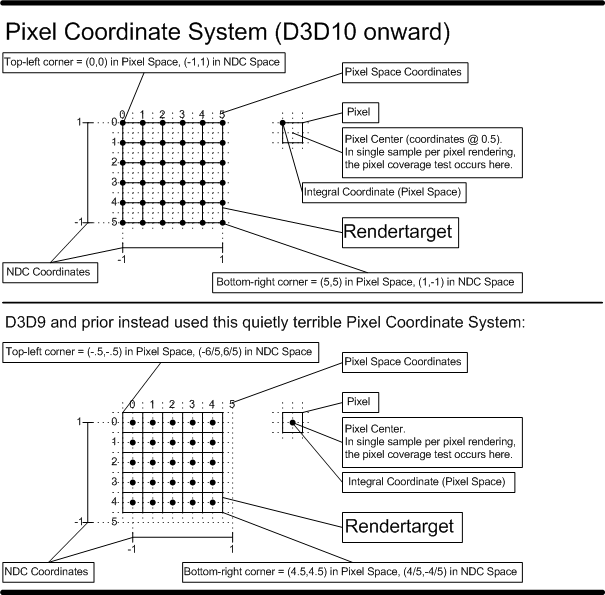<!-- d3d12-review-inline:end:rasterization:A-pixel-coordinates:1 --></ins>

<a id="clipping"></a>

## Clipping

<ins><!-- d3d12-review-inline:begin:rasterization:A-transform-enable:0 -->There is NO facility for disabling clipping of X and Y coordinates, the viewport scale, or
the perspective divide if the rasterizer is enabled.
Clipping of the Z coordinates can be disabled by setting the DepthClipEnable [Rasterizer State](pipeline-state.md#rasterizer) to FALSE.<!-- d3d12-review-inline:end:rasterization:A-transform-enable:0 --></ins>

<ins><!-- d3d12-review-inline:begin:rasterization:A-transform-enable:1 -->Note that this means there is no way for an application to directly pass RenderTarget-space coordinates for vertices.
Vertex positions are always assumed to be in homogeneous clip space, so the Viewport transformation must always be relied upon
to map to specific pixel locations.<!-- d3d12-review-inline:end:rasterization:A-transform-enable:1 --></ins>

<a id="clip-volume"></a>

### Clip volume

<ins><!-- d3d12-review-inline:begin:rasterization:A-clipping:0 -->In clip space primitives are clipped to the following volume:<!-- d3d12-review-inline:end:rasterization:A-clipping:0 --></ins>

<ins><!-- d3d12-review-inline:begin:rasterization:A-clipping:1 -->0 < w<!-- d3d12-review-inline:end:rasterization:A-clipping:1 --></ins>

<ins><!-- d3d12-review-inline:begin:rasterization:A-clipping:2 -->-w <= x <= w (or arbitrarily wider range if implementation uses a guard band to reduce clipping burden)<!-- d3d12-review-inline:end:rasterization:A-clipping:2 --></ins>

<ins><!-- d3d12-review-inline:begin:rasterization:A-clipping:3 -->-w <= y <= w (or arbitrarily wider range if implementation uses a guard band to reduce clipping burden)<!-- d3d12-review-inline:end:rasterization:A-clipping:3 --></ins>

<ins><!-- d3d12-review-inline:begin:rasterization:A-clipping:4 -->0 <= z <= w<!-- d3d12-review-inline:end:rasterization:A-clipping:4 --></ins>

<ins><!-- d3d12-review-inline:begin:rasterization:A-clipping:5 -->By default primitives are clipped to a volume that includes a 0 <= z <= w depth range clip.
Clipping of the Z coordinates can be disabled by setting the DepthClipEnable [Rasterizer State](pipeline-state.md#rasterizer) to FALSE.
Primitives that fall outside of the depth range are thus still rendered, but are given the value of the nearest limit of the viewport depth range.
Even when Z clipping is disabled, primitives must be clipped such that only w > 0 vertices result.
Coordinates coming in to clipping with infinities at x,y,z may or may not result in a discarded primitive.
Coordinates with NaN at x,y,z or w coming out of clipping are discarded.<!-- d3d12-review-inline:end:rasterization:A-clipping:5 --></ins>

<ins><!-- d3d12-review-inline:begin:rasterization:A-clipping:6 -->The reason to allow disabling depth clip is that it causes problems for applications such as stencil shadows,
necessitating complex code to draw end-caps on geometry that exceeds the depth range. When Z clipping is disabled, primitives may not be
correctly depth-sorted at the pixel level, but this is unimportant for some applications (and can be dealt with via painter's algorithm).<!-- d3d12-review-inline:end:rasterization:A-clipping:6 --></ins>

<ins><!-- d3d12-review-inline:begin:rasterization:A-clipping:7 -->There are no restrictions to the range of input vertex coordinates to clipping. Clipping operations are performed using at
least float32 precision, and accordingly NaNs and infinities are processed using the floating point rules.<!-- d3d12-review-inline:end:rasterization:A-clipping:7 --></ins>

<ins><!-- d3d12-review-inline:begin:rasterization:A-clipping:8 -->Two additional mechanisms for slicing geometry against application defined planes are provided, similar to each other
in programming method but different in behavior:<!-- d3d12-review-inline:end:rasterization:A-clipping:8 --></ins>

<ins><!-- d3d12-review-inline:begin:rasterization:A-clipping:9 -->(a) A method for clipping primitives against a plane at the rasterization level (i.e. allowing for
intersection within an individual primitive)<!-- d3d12-review-inline:end:rasterization:A-clipping:9 --></ins>

<ins><!-- d3d12-review-inline:begin:rasterization:A-clipping:10 -->(b) A method for culling primitives if all vertices are on the "out" side of a plane.<!-- d3d12-review-inline:end:rasterization:A-clipping:10 --></ins>

<ins><!-- d3d12-review-inline:begin:rasterization:A-clipping:11 -->These mechanisms, dubbed "Clip Distances" and "Cull Distances" respectively, are described below.<!-- d3d12-review-inline:end:rasterization:A-clipping:11 --></ins>

<a id="clip-distances"></a>

### Clip distances

<ins><!-- d3d12-review-inline:begin:rasterization:A-clip-distances:0 -->To enable primitive setup / rasterizer to perform clipping against arbitrary planes
defined by the application, vertex component(s) can be identified as the
[System Interpreted Value](../archive/D3D11_3_FunctionalSpec.htm#SystemInterpretedValues) `SV_ClipDistance`. When component(s) of
vertex Element(s) are identified this way, these values are each assumed to be a float32 signed distance to a plane.
Primitive setup only invokes rasterization on pixels for which the interpolated plane distance(s) are >= 0.<!-- d3d12-review-inline:end:rasterization:A-clip-distances:0 --></ins>

<ins><!-- d3d12-review-inline:begin:rasterization:A-clip-distances:1 -->Multiple clip planes can be implemented simultaneously, by declaring multiple
component(s) of one or more vertex elements as the System Interpreted Value `SV_ClipDistance`.<!-- d3d12-review-inline:end:rasterization:A-clip-distances:1 --></ins>

When multisampling, implementations MUST clip against clip distances at subsample
resolution.

If a vertex has a clip distance of NaN, the primitives containing that vertex are discarded.

<ins><!-- d3d12-review-inline:begin:rasterization:A-clip-distances:4 -->For further information about `SV_ClipDistance`, see its [listing](../archive/D3D11_3_FunctionalSpec.htm#interpretedvalue_CLIP_DISTANCE) in the System Interpreted Values reference.<!-- d3d12-review-inline:end:rasterization:A-clip-distances:4 --></ins>

<a id="cull-distances"></a>

### Cull distances

<ins><!-- d3d12-review-inline:begin:rasterization:A-cull-distances:0 -->To enable rough primitive-level culling against arbitrary planes defined by
the application, vertex component(s) can be identified as [System Interpreted Value](../archive/D3D11_3_FunctionalSpec.htm#SystemInterpretedValues) `SV_CullDistance`.
When component(s) of vertex Element(s) are given this label, these values are each assumed to be a float32
signed distance to a plane. Primitives will be completely discarded
if the plane distance(s) for all of the vertices in the primitive are < 0. Said another way,
if any of the plane distance(s) (data labeled as the System Interpreted Value `SV_CullDistance`) in a primitive is >= 0, the primitive is not culled (though
other culling such as backface culling could still occur and is orthogonal).<!-- d3d12-review-inline:end:rasterization:A-cull-distances:0 --></ins>

<ins><!-- d3d12-review-inline:begin:rasterization:A-cull-distances:1 -->Multiple cull planes can be used simultaneously, by declaring multiple
component(s) of one or more vertex elements as the System Interpreted Value `SV_CullDistance`.<!-- d3d12-review-inline:end:rasterization:A-cull-distances:1 --></ins>

<ins><!-- d3d12-review-inline:begin:rasterization:A-cull-distances:2 -->Since cullDistance culling can be done simply by looking at vertices, this can
be more efficient (though more coarse) than using clipDistances, which must be able to operate at rasterization level,
without having to enable a path in the Rasterizer for clipping within primitives.<!-- d3d12-review-inline:end:rasterization:A-cull-distances:2 --></ins>

<ins><!-- d3d12-review-inline:begin:rasterization:A-cull-distances:3 -->If a vertex has a cull distance of NaN, that vertex counts as "out" (as if it is < 0).<!-- d3d12-review-inline:end:rasterization:A-cull-distances:3 --></ins>

<ins><!-- d3d12-review-inline:begin:rasterization:A-cull-distances:4 -->For further information about `SV_CullDistance`, see its [listing](../archive/D3D11_3_FunctionalSpec.htm#interpretedvalue_CULL_DISTANCE) in the System Interpreted Values reference.<!-- d3d12-review-inline:end:rasterization:A-cull-distances:4 --></ins>

<a id="clip-cull-budget"></a>

### Combined clip/cull distances

<ins><!-- d3d12-review-inline:begin:rasterization:A-clip-cull-budget:0 -->At most 8 components in at most 2 vertex elements may be defined as System
Interpreted Values "clipDistance" or "cullDistance".<!-- d3d12-review-inline:end:rasterization:A-clip-cull-budget:0 --></ins>

<ins><!-- d3d12-review-inline:begin:rasterization:A-clip-cull-budget:1 -->For a given primitive with one or multiple components labeled as System Interpreted Value "cullDistance", the
rejection test (primitive rejected if all distances < 0) is applied using all vertices for each
cullDistance component, and if the primitive is rejected by any one or more
of the tests it is discarded.<!-- d3d12-review-inline:end:rasterization:A-clip-cull-budget:1 --></ins>

<ins><!-- d3d12-review-inline:begin:rasterization:A-clip-cull-budget:2 -->After cullDistance processing is complete, for remaining primitives going into rasterization setup,
if there are one or multiple components labeled as System Interpreted Value "clipDistance", any region(s) of a primitive that result
in one or more of the clipDistances being < 0 after interpolation are not rasterized.<!-- d3d12-review-inline:end:rasterization:A-clip-cull-budget:2 --></ins>

Inside the Pixel Shader it is valid to declare input Element(s) labeled as System Interpreted Values "clipDistance" and
"cullDistance", in which case the appropriately interpolated clip distances or cull distances show up,
as expected.

<ins><!-- d3d12-review-inline:begin:rasterization:A-clip-cull-budget:4 -->The interpolation mode [declared](../archive/D3D11_3_FunctionalSpec.htm#inst_vDCL) by the Pixel Shader on any input v# register labeled as
System Interpreted Value "clipDistance" must be D3DINTERPOLATION_LINEAR. No such limitation exists for input v# registers
labeled as System Interpreted Value "cullDistance"; these can be interpolated any way into the Pixel Shader.<!-- d3d12-review-inline:end:rasterization:A-clip-cull-budget:4 --></ins>

<ins><!-- d3d12-review-inline:begin:rasterization:A-clip-cull-budget:5 -->Note that clip/cull distances have no effect on GS stream output if it is active. The clip/cull can be thought of
as appearing after the stream output in the Pipeline.<!-- d3d12-review-inline:end:rasterization:A-clip-cull-budget:5 --></ins>

<a id="perspective-divide"></a>

## Perspective divide

<ins><!-- d3d12-review-inline:begin:rasterization:A-perspective:0 -->After clipping, position X,Y,Z coordinates and non-constant vertex attributes with interpolation mode linear (meaning with perspective), are divided by the position W value.<!-- d3d12-review-inline:end:rasterization:A-perspective:0 --></ins>

<a id="viewport-transform"></a>

## Viewport transformation

<ins><!-- d3d12-review-inline:begin:rasterization:A-viewport:0 -->Viewports map post-perspective-divide vertex positions into RenderTarget space. In the RenderTarget space Y axes points down,
so the Y coordinates are flipped during the viewport scale. Multiple Viewports can be made available simultaneously, so that
primitives can choose their one (see [Viewport Index](#viewport-selection)),
however the basic case is to simply use a single Viewport for all rendering in a particular scene. Only one Viewport can ever apply to an individual primitive being rasterized.<!-- d3d12-review-inline:end:rasterization:A-viewport:0 --></ins>

<ins><!-- d3d12-review-inline:begin:rasterization:A-viewport:1 -->Viewport extents and depth endpoints are float32 values; the viewport transform uses float32 arithmetic.<!-- d3d12-review-inline:end:rasterization:A-viewport:1 --></ins>

<ins><!-- d3d12-review-inline:begin:rasterization:A-viewport:2 -->There is always an implicit scissoring by the Viewport x/y extents, orthogonal to other [Scissor](#scissor) state. In other words,
regardless of whether or not an implementation has a guard band in its clipper or not, rendering will never touch any area outside the
Viewport's x/y extents (except a small nondeterministic region that appears if the viewport left and top extents have fractional coordinates, discussed in the
[Viewport Range](#viewport-range) section).<!-- d3d12-review-inline:end:rasterization:A-viewport:2 --></ins>

<ins><!-- d3d12-review-inline:begin:rasterization:A-viewport:3 -->Changing render targets does not automatically update viewports. Initial/reset and bundle viewport state follow the [canonical state contract](command-list-state.md#base-graphics).<!-- d3d12-review-inline:end:rasterization:A-viewport:3 --></ins>

<ins><!-- d3d12-review-inline:begin:rasterization:A-viewport:4 -->Viewport scale is performed using float32 arithmetic according to the following formulas:<!-- d3d12-review-inline:end:rasterization:A-viewport:4 --></ins>

```text
X_rt = (X + 1) * Viewport.Width * 0.5 + Viewport.TopLeftX
Y_rt = (1 - Y) * Viewport.Height * 0.5 + Viewport.TopLeftY
Z_rt = Viewport.MinDepth + Z * (Viewport.MaxDepth - Viewport.MinDepth)
```

<ins><!-- d3d12-review-inline:begin:rasterization:A-viewport:6 -->An additional effect of the Viewport is that in the Output Merger, just before the final rounding of z to depth-buffer format before depth compare,
the z value is always clamped: `z = min(max(Viewport.MinDepth,Viewport.MaxDepth), max(min(Viewport.MinDepth,Viewport.MaxDepth),z))`, in compliance
with the [Floating Point Rules](numeric-and-data-rules.md#numeric-3-1) for min and max. This clamping occurs regardless of where z came from:
out of interpolation, or from z output by the Pixel Shader (replacing the interpolated value). Z input to the Pixel Shader is not clamped (since
the clamp described here occurs after the Pixel Shader).<!-- d3d12-review-inline:end:rasterization:A-viewport:6 --></ins>

<a id="viewport-range"></a>

### Viewport range and precision

<ins><!-- d3d12-review-inline:begin:rasterization:A-viewport-range:0 -->Viewport MinDepth and MaxDepth must both be in the range [0.0f...1.0f],
and MinDepth must be less than or equal to MaxDepth unless inverted viewport depth is supported.<!-- d3d12-review-inline:end:rasterization:A-viewport-range:0 --></ins>

<ins><!-- d3d12-review-inline:begin:rasterization:A-viewport-range:1 -->The Rasterizer must [support](#rasterizer-precision) fixed-point x,y positions after Viewport
scale with 16.8 precision (approximately
[-32768…32767] range).
The baseline defines the following constraints on the float Viewport Width, Height, TopLeftX and TopLeftY parameters:<!-- d3d12-review-inline:end:rasterization:A-viewport-range:1 --></ins>

<ins><!-- d3d12-review-inline:begin:rasterization:A-viewport-range:2 -->-32768 <= Viewport.TopLeftX <= 32767<!-- d3d12-review-inline:end:rasterization:A-viewport-range:2 --></ins>

<ins><!-- d3d12-review-inline:begin:rasterization:A-viewport-range:3 -->-32768 <= Viewport.Width + Viewport.TopLeftX <= 32767<!-- d3d12-review-inline:end:rasterization:A-viewport-range:3 --></ins>

<ins><!-- d3d12-review-inline:begin:rasterization:A-viewport-range:4 -->-32768 <= Viewport.TopLeftY <= 32767<!-- d3d12-review-inline:end:rasterization:A-viewport-range:4 --></ins>

<ins><!-- d3d12-review-inline:begin:rasterization:A-viewport-range:5 -->-32768 <= Viewport.Height + Viewport.TopLeftY <= 32767<!-- d3d12-review-inline:end:rasterization:A-viewport-range:5 --></ins>

<ins><!-- d3d12-review-inline:begin:rasterization:A-viewport-range:6 -->The behavior of the implicit scissor to the viewport with fractional viewport extents is described in the [Scissor](#scissor) section (basically rounding X and Y to negative infinity to get integers).<!-- d3d12-review-inline:end:rasterization:A-viewport-range:6 --></ins>

<ins><!-- d3d12-review-inline:begin:rasterization:A-viewport-range:7 -->Observe that when the viewport location is fractional, which results in rounding to determine the implicit scissor, there is effectively a non-deterministic zone of up to
1/2 pixel wide along the left and top edges within the scissor area, not covered by the viewport. Because it is optional for implementations to perform guard-band clipping to viewport extents,
and even if they do, implementations of it could vary, this means that rendering results in the non-deterministic zone will be some undefined combination of
background values and primitives that may or may not have been clipped off the zone.<!-- d3d12-review-inline:end:rasterization:A-viewport-range:7 --></ins>

<ins><!-- d3d12-review-inline:begin:rasterization:A-viewport-range:8 -->If an application needs to avoid artifacts from this non-deterministic zone, one approach is to simply never use fractional viewport extents.
Another approach, if fractional viewports are needed, is to always subtract 1 from the intended viewport TopLeftX and TopLeftY,
while adding 1 to the intended Viewport Width and Height, then defining the Scissor extents over the intended pixel area.
This will crop out the non-deterministic zone and allow fractional viewports that, for example, smoothly move the inside contents
(even thought the extents are rounded), without any non-deterministic rendering.<!-- d3d12-review-inline:end:rasterization:A-viewport-range:8 --></ins>

<!-- d3d12-review-alert:begin:rasterization:N-viewport-dimensions:0 -->

> [!WARNING]
> **Authored synthesis - human review pending.**
>
> Viewport Width must be nonnegative. Height must be nonnegative unless `InvertedViewportHeightFlipsYSupported` permits a negative value. Both depth endpoints remain in `[0,1]`; reversed ordering requires `InvertedViewportDepthFlipsZSupported`. The bounds above constrain both transformed X/Y endpoints, including an inverted height's second endpoint.

<!-- d3d12-review-alert:end:rasterization:N-viewport-dimensions:0 -->

<a id="inverted-viewports"></a>

### Inverted viewports

<ins><!-- d3d12-review-inline:begin:rasterization:V-inverted:0 -->On devices supporting the respective inverted-viewport capability, a viewport can use negative height and/or reversed depth endpoints. Negative height flips the Y-axis interpretation.<!-- d3d12-review-inline:end:rasterization:V-inverted:0 --></ins>

<ins><!-- d3d12-review-inline:begin:rasterization:V-inverted:1 -->Given a screen height `H`, then setting the viewport with `TopLeftY = H` and `Height = -H` maps the viewport-local origin to the _bottom_ left corner of the screen, with _up_ being in the negative Y direction.<!-- d3d12-review-inline:end:rasterization:V-inverted:1 --></ins>

<ins><!-- d3d12-review-inline:begin:rasterization:V-inverted:2 -->Additionally, setting `MinDepth = 1`, `MaxDepth = 0` is valid. The interpretation remains the same, and `MinDepth` must still be in the range `[0, 1]`, but `MinDepth <= MaxDepth` is not required.<!-- d3d12-review-inline:end:rasterization:V-inverted:2 --></ins>

<a id="scissor"></a>

## Scissor test

<ins><!-- d3d12-review-inline:begin:rasterization:A-scissor:0 -->Scissor cuts out a rectangle in RenderTarget space where pixels are permitted to appear. Any pixel outside these extents is discarded. Multiple Scissor rectangles can be active simultaneously,
from which individual primitives can choose one (see [Selecting Viewport/Scissor](#viewport-selection) below). Only one scissor rectangle can
ever apply to an individual primitive being rasterized, though this does not count the implied scissoring that is always applied to the [Viewport](#viewport-transform)'s
x/y extents.<!-- d3d12-review-inline:end:rasterization:A-scissor:0 --></ins>

<ins><!-- d3d12-review-inline:begin:rasterization:A-scissor:1 -->Scissor extents are signed `LONG` coordinates in `D3D12_RECT`, with right/bottom excluded. With equal-sized output views, the effective region is intersected with their dimensions. The [mismatched-output rules](#output-dimensions) instead require the application to stay within the smallest output. Scissor testing cannot be disabled. Initial/reset and bundle scissor state follow the [canonical state contract](command-list-state.md#base-graphics).<!-- d3d12-review-inline:end:rasterization:A-scissor:1 --></ins>

<ins><!-- d3d12-review-inline:begin:rasterization:A-scissor:2 -->The implicit scissor to the viewport (mentioned in the [Viewport](#viewport-transform) section) rounds the viewport X and Y extents to negative infinity.
This way the scissor extents are always integers. The rounding to derive scissor extents applies to the locations where the fractional
left/right/top/bottom edges would be after the float viewport transform. E.g. the viewport width and height cannot be rounded;
they must be added to unrounded TopLeftX and TopLeftY to determine the right and bottom extents, which then get rounded to determine the scissor extents.<!-- d3d12-review-inline:end:rasterization:A-scissor:2 --></ins>

<!-- d3d12-review-alert:begin:rasterization:N-inverted-intervals:0 -->

> [!WARNING]
> **Authored synthesis - human review pending.**
>
> For a negative viewport height, the implicit vertical scissor is formed from the ordered Y endpoints: `floor(min(TopLeftY,TopLeftY+Height))` through `floor(max(TopLeftY,TopLeftY+Height))`, with the upper bound excluded. Depth is clamped between the ordered minimum and maximum of the two viewport depth endpoints. The transform still uses the signed height and signed `MaxDepth-MinDepth` scale; ordering the clipping interval does not undo the inversion.

<!-- d3d12-review-alert:end:rasterization:N-inverted-intervals:0 -->

<a id="viewport-selection"></a>

## Viewport and render target selection

<!-- d3d12-review-alert:begin:rasterization:N-view-selection:0 -->

> [!WARNING]
> **Authored synthesis - human review pending.**
>
> There are at most 16 viewport/scissor slots. `SV_ViewportArrayIndex` selects a viewport and its paired scissor for a primitive; absence of the semantic selects zero. Values outside the supported 16-slot range select slot zero for rasterization. A pixel shader receiving the semantic sees its original, unclamped value. Slots not supplied by the current viewport/scissor array setting call are disabled.

<!-- d3d12-review-alert:end:rasterization:N-view-selection:0 -->

<!-- d3d12-review-alert:begin:rasterization:N-view-selection:1 -->

> [!WARNING]
> **Authored synthesis - human review pending.**
>
> Geometry shaders can supply these primitive indices. Drivers must also support `SV_ViewportArrayIndex` and `SV_RenderTargetArrayIndex` output from a vertex shader feeding the rasterizer. `OPTIONS.VPAndRTArrayIndexFromAnyShaderFeedingRasterizerSupportedWithoutGSEmulation` reports whether the hardware supports these values natively. When FALSE, an implicit geometry shader inserted into the PSO provides emulation. It is not a prerequisite for vertex shader output of these values. Mesh output instead uses its [per-primitive attributes](amplification-and-mesh-shaders.md#primitive-attributes). The ordinary leading-vertex rule applies to vertex-produced primitive data; mesh output uses its per-primitive definition.

<!-- d3d12-review-alert:end:rasterization:N-view-selection:1 -->

<!-- d3d12-review-alert:begin:rasterization:N-view-selection:2 -->

> [!WARNING]
> **Authored synthesis - human review pending.**
>
> Per-primitive VRS combined with multiple viewports or `SV_ViewportArrayIndex` also requires `OPTIONS6.PerPrimitiveShadingRateSupportedWithViewportIndexing`. The [VRS viewport qualification](pixel-shaders.md#vrs-tiering) applies. Every supported view instancing tier permits these shader outputs, independently of the native or emulated implementation path. View counts and declarations follow the [PSO view contract](pipeline-state.md#view-instancing).

<!-- d3d12-review-alert:end:rasterization:N-view-selection:2 -->

<a id="render-target-selection"></a>

### Render target array selection

<ins><!-- d3d12-review-inline:begin:rasterization:A-rt-selection:0 -->When a Texture1D/2D array or Texture3D view is set as the RenderTarget in the Pipeline (or multiple of these via MRT rendering), it is
possible to select which array slice is being rendered to on a per-primitive basis from an allowed shader feeding the rasterizer. If the [Leading Vertex](vertex-processing.md#leading-vertex)
for a primitive reaching the rasterizer from an allowed shader feeding the rasterizer has a scalar component of its data labeled as System Interpreted Value ["renderTargetArrayIndex"](../archive/D3D11_3_FunctionalSpec.htm#interpretedvalue_RENDER_TARGET_ARRAY_INDEX),
then the rasterizer will use this 32-bit unsigned integer to select which surface to render to from the Pixel Shader for that primitive. This is useful with a RenderTarget that is a
Texture1D/2D array or Texture3D view exposing multiple layers/slices, including cube faces through a Texture2D array view.<!-- d3d12-review-inline:end:rasterization:A-rt-selection:0 --></ins>

<ins><!-- d3d12-review-inline:begin:rasterization:A-rt-selection:1 -->If the System Interpreted Value "renderTargetArrayIndex" is not used, the default array index rendered to is 0. Permitted producer stages and view instance offsets follow the shared graphics contract.<!-- d3d12-review-inline:end:rasterization:A-rt-selection:1 --></ins>

<ins><!-- d3d12-review-inline:begin:rasterization:A-rt-selection:2 -->The range supported for renderTargetArrayIndex must be enough to accommodate the [maximum resource array size](../archive/D3D11_3_FunctionalSpec.htm#SystemLimits). When bound outputs have matching array sizes, if the value written to "renderTargetArrayIndex" is out of range of the
particular resource array that is set as a RenderTarget, the 0-th RenderTarget is used. If the
renderTargetArrayIndex value is input to the Pixel Shader, it arrives unmodified, not incorporating any clamping that occurred in selecting which of the available Array slices as the RenderTarget.<!-- d3d12-review-inline:end:rasterization:A-rt-selection:2 --></ins>

<ins><!-- d3d12-review-inline:begin:rasterization:A-rt-selection:3 -->For further information about "renderTargetArrayIndex", see its [listing](../archive/D3D11_3_FunctionalSpec.htm#interpretedvalue_RENDER_TARGET_ARRAY_INDEX) in the System Interpreted Values reference.<!-- d3d12-review-inline:end:rasterization:A-rt-selection:3 --></ins>

<!-- d3d12-review-alert:begin:rasterization:N-layer-scope:0 -->

> [!WARNING]
> **Authored synthesis - human review pending.**
>
> Layer selection is relative to the bound render target/depth-stencil views, not a cube SRV binding. Cube faces are rendered through the applicable array views. A mesh shader additionally follows its [render target array index range](amplification-and-mesh-shaders.md#render-target-array-index). The view instance location arithmetic below produces the indices used by these rasterizer lookups.

<!-- d3d12-review-alert:end:rasterization:N-layer-scope:0 -->

<a id="view-locations"></a>

### View instance locations

A part of the view instancing declaration is an array of view instance
locations of size equal to the view instance count. Each view instance
location specifies a viewport array index (which selects both a viewport
and paired scissor) and rendertarget array index to be used for the
view.

<ins><!-- d3d12-review-inline:begin:rasterization:V-view-locations:1 -->The shader feeding the rasterizer can output RenderTargetArrayIndex
and/or ViewportArrayIndex if desired (may or may not be dependent on
SV_ViewID). These get added to the view instance locations in the PSO's
view instancing declaration via 32 bit UINT arithmetic (which can wrap)
to determine the final location to send primitives. Out-of-range viewport indices select slot zero. Render target array fallback applies only to matching output array sizes; the [mismatched-output rules](#output-dimensions) apply otherwise.<!-- d3d12-review-inline:end:rasterization:V-view-locations:1 --></ins>

If the shader will be dynamically selecting render target or viewport
array index, a scenario that can make sense for an application is to set
all the view instance locations in the PSO to the same values (such as
0), acting as uniform base value for all views.

---

<a id="output-dimensions"></a>

### Mismatched output dimensions

<ins><!-- d3d12-review-inline:begin:rasterization:V-output-dimensions:0 -->`OPTIONS19.MismatchingOutputDimensionsSupported` permits rendering with mismatched texture output dimensions under these rules:<!-- d3d12-review-inline:end:rasterization:V-output-dimensions:0 --></ins>

* Rendering to buffers cannot be mixed with 1D/2D/3D render targets, nor depth buffers which are inherently 2D, nor buffer views of differing sizes.
* When rendering to 1D textures, the effective render target dimensionality should be treated as 2D with a height of 1.
* When rendering to 3D textures, the effective render target dimensionality should be treated as 2D. The `WSize` field of `D3D12_TEX3D_RTV` is used to determine the equivalent `ArraySize` for interpretation as a 2D render target.
* When all render target and depth buffer dimensions (width/height) are the same, the scissor definition remains the same: there is an implicit intersection that occurs with the region of {0, 0, width, height}.
* When the width and height of the render targets and/or depth buffers mismatch, this implicit intersection no longer applies. The application is responsible for ensuring that the region defined by the combination of viewport and scissor does not exceed the dimensions of the *smallest* output view. Behavior is undefined if it exceeds this size.
  * Possible results include intersecting with the smallest output, intersecting with the largest, or GPU hangs/faults.
* <ins><!-- d3d12-review-inline:begin:rasterization:V-output-dimensions:1 -->Array size for render targets and depth stencil is allowed to be different. The index-zero fallback for out-of-bounds index values only applies when array size dimensionality matches for all outputs. When they are different, a value that is out-of-bounds for any of them will produce undefined results.<!-- d3d12-review-inline:end:rasterization:V-output-dimensions:1 --></ins>

<a id="coordinate-snapping"></a>

## Coordinate snapping and precision

<ins><!-- d3d12-review-inline:begin:rasterization:A-snapping:0 -->Consider a set of vertices going through the Rasterizer, after having gone through clipping, perspective divide and viewport scale.
Suppose that any further primitive expansion has been done (e.g. rectangular lines can be drawn
by implementations as 2 triangles, described later). After the final primitives to be rasterized have
been obtained, the x and y positions of the vertices are snapped to exactly n.8 fixed point integers. Any
front/back culling is applied (if applicable) after vertices have been snapped. Interpolation of pixel attributes is set up based on
the snapped vertex positions of primitives being rasterized.<!-- d3d12-review-inline:end:rasterization:A-snapping:0 --></ins>

<a id="rasterizer-precision"></a>

### Addressability and fractional precision

<ins><!-- d3d12-review-inline:begin:rasterization:A-precision:0 -->After [Viewport](#viewport-transform) scale has been applied (but before Scissor Test), positions are
converted to fixed-point, to evenly distribute precision across the RenderTarget range and to enable face
culling. The [Rasterizer](rasterization.md#rasterization) must support
16.8
(integer.fraction) fixed point precision for x and y. Particularly for the fractional part, the requirement is EXACTLY 8 bits.
This conversion is also subject to the rules specified in [float-to-fixed](numeric-and-data-rules.md#numeric-3-2-4-1), including round-to-nearest.<!-- d3d12-review-inline:end:rasterization:A-precision:0 --></ins>

<ins><!-- d3d12-review-inline:begin:rasterization:A-precision:1 -->After the [Scissor Test](#scissor) has been applied, the number of pixels along a given RenderTarget axis (x or y) that must be addressable starting from
a base location is at least `2^15`.<!-- d3d12-review-inline:end:rasterization:A-precision:1 --></ins>

<ins><!-- d3d12-review-inline:begin:rasterization:A-precision:2 -->The number of slices along the Array axis of a RenderTarget
that must be addressable starting from a base is at least `2^9`<!-- d3d12-review-inline:end:rasterization:A-precision:2 --></ins>

<a id="position-range"></a>

### Valid position range

<ins><!-- d3d12-review-inline:begin:rasterization:A-position-range:0 -->After Clipping, Perspective Divide and Viewport Scale have occurred, if the float32 x, y or z has
the value NaN, the primitive is discarded. No validation of w is done.<!-- d3d12-review-inline:end:rasterization:A-position-range:0 --></ins>

<ins><!-- d3d12-review-inline:begin:rasterization:A-position-range:1 -->If x,y,z and w components of vertex position going into the Clip/Perspective Divide/Viewport Scale
are all within the range [-3.402823466e+34f,3.402823466e+34f], then Clip/Divide/Scale must never generate NaN or +-INF in position
components, though +-INF can be handled by the rasterizer cleanly (x/y clamped to the furthest representable position extent in the hardware).<!-- d3d12-review-inline:end:rasterization:A-position-range:1 --></ins>

<ins><!-- d3d12-review-inline:begin:rasterization:A-position-range:2 -->The above range is intended to allow for some wiggle room for arithmetic in the Clip/Perspective Divide/Viewport Scale
while providing a reasonably large range of position values that are guaranteed to be stable.
Note that this guarantee means that if an implementation uses a Guard Band for x/y clipping, the size of the Guard Band
must be significantly narrower than the range described above, to ensure that Viewport Scale does not
produce INF.<!-- d3d12-review-inline:end:rasterization:A-position-range:2 --></ins>

<a id="interpolator-precision"></a>

### Interpolator setup

<ins><!-- d3d12-review-inline:begin:rasterization:A-interpolator:0 -->Attribute Interpolators follow the [Floating Point Rules](numeric-and-data-rules.md#numeric-3-1), including propagation of
NaN and handling of +/-INF. Interpolator setup is done based on vertex positions that have already been
converted (snapped) to whatever [fixed-point](#rasterizer-precision) representation is supported by the Rasterizer
(this is also stated in the [Coordinate Snapping](#coordinate-snapping) section).
This does mean that attributes are slightly moved, but avoids extrapolating attributes off the intended "gamut" of the primitive that
would happen if interpolators were set up before snapping positions for rasterization. Other than that, the input Z must exactly
match the fixed function interpolated Z (they are one and the same).<!-- d3d12-review-inline:end:rasterization:A-interpolator:0 --></ins>

<a id="culling"></a>

## Culling and facing

<ins><!-- d3d12-review-inline:begin:rasterization:A-cull:0 -->The [Rasterizer State](pipeline-state.md#rasterizer) FrontCounterClockwise governs whether clockwise primitives
are considered front- or back- facing, and the [Rasterizer State](pipeline-state.md#rasterizer) CullMode chooses
which primitives to cull, front, back or none. Culling of primitives is done after they are [snapped](#rasterizer-precision)
to fixed point during rasterization.<!-- d3d12-review-inline:end:rasterization:A-cull:0 --></ins>

<a id="degenerate-primitives"></a>

### Degenerate primitives

<ins><!-- d3d12-review-inline:begin:rasterization:A-degenerate:0 -->Zero area geometry is considered back facing.<!-- d3d12-review-inline:end:rasterization:A-degenerate:0 --></ins>

<ins><!-- d3d12-review-inline:begin:rasterization:A-degenerate:1 -->e.g. This affects what gets output when a zero area triangle is rendered in wireframe mode.<!-- d3d12-review-inline:end:rasterization:A-degenerate:1 --></ins>

<a id="front-face"></a>

### Front face shader input

<ins><!-- d3d12-review-inline:begin:rasterization:A-frontface:0 -->The rasterizer can generate a scalar value that is constant per-primitive which represents whether the
primitive being rasterized is front or back facing. The [Rasterizer State](pipeline-state.md#rasterizer) FrontCounterClockwise
governs whether clockwise primitives are considered front- or back- facing. For front-facing primitives, IsFrontFace has the (DXBC 32-bit unsigned integer)
value 0xFFFFFFFF, and for backfacing primitives, IsFrontFace has the value 0x00000000. For lines and points,
IsFrontFace has the value 0xFFFFFFFF. The exception is lines drawn out of triangles ([wireframe mode](#fill-modes)),
which sets IsFrontFace the same way as rasterizing the triangle in solid mode.<!-- d3d12-review-inline:end:rasterization:A-frontface:0 --></ins>

<ins><!-- d3d12-review-inline:begin:rasterization:A-frontface:1 -->IsFrontFace can be input by the Pixel Shader by declaring a scalar component of one of its inputs as the [System Generated Value](../archive/D3D11_3_FunctionalSpec.htm#SystemGeneratedValues) "IsFrontFace".<!-- d3d12-review-inline:end:rasterization:A-frontface:1 --></ins>

<ins><!-- d3d12-review-inline:begin:rasterization:A-frontface:2 -->The mere presence of IsFrontFace in the Pixel Shader's input declarations activates the feature (there is no other control outside the shader).<!-- d3d12-review-inline:end:rasterization:A-frontface:2 --></ins>

<ins><!-- d3d12-review-inline:begin:rasterization:A-frontface:3 -->See the general discussion of [System Generated Values](../archive/D3D11_3_FunctionalSpec.htm#SystemGeneratedValues) for more information, the reference for IsFrontFace
[here](../archive/D3D11_3_FunctionalSpec.htm#generatedvalue_IS_FRONT_FACE), and the System Interpreted/Generated Value [input](../archive/D3D11_3_FunctionalSpec.htm#inst_vDCL_SV) declaration for Shaders.<!-- d3d12-review-inline:end:rasterization:A-frontface:3 --></ins>

<!-- d3d12-review-alert:begin:rasterization:N-frontface-representations:0 -->

> [!WARNING]
> **Authored synthesis - human review pending.**
>
> The HLSL semantic is `SV_IsFrontFace` (`bool`). The raw all-ones/zero encoding above describes the DXBC logical input representation. DXIL also requires a scalar 32-bit integer signature element for IsFrontFace. The HLSL Boolean does not imply an `i1` signature element. Point/line front-facing defaults and wireframe inheritance are the same stage behavior for both shader representations.

<!-- d3d12-review-alert:end:rasterization:N-frontface-representations:0 -->

<a id="fill-modes"></a>

## Fill modes

<ins><!-- d3d12-review-inline:begin:rasterization:A-fill:0 -->Triangles can be rasterized in one of two modes selected by the [Rasterizer State](pipeline-state.md#rasterizer) FillMode
as solid or wireframe.<!-- d3d12-review-inline:end:rasterization:A-fill:0 --></ins>


<ins><!-- d3d12-review-inline:begin:rasterization:A-fill:1 -->In solid mode, triangles are rasterized using the triangle rasterization rules below.<!-- d3d12-review-inline:end:rasterization:A-fill:1 --></ins>

<ins><!-- d3d12-review-inline:begin:rasterization:A-fill:2 -->In wireframe mode, triangles are drawn using a line for each clipped original triangle edge reaching
the rasterizer, but drawing nothing for new edges introduced by the clipper. If [Depth Bias](#depth-bias) is
being performed, it is calculated once for each post-clip triangle (as in SOLID mode), added to each
vertex to be drawn as a line for the surviving clipped edges of the original triangle. The lines
are drawn using line rasterization rules for whatever line mode is currently set, be it aliased
lines, antialiased lines, or multisample antialiased lines. Wireframe rendering of triangle strips
is no different than drawing each triangle independently in wireframe mode.<!-- d3d12-review-inline:end:rasterization:A-fill:2 --></ins>

<ins><!-- d3d12-review-inline:begin:rasterization:A-fill:3 -->The IsFrontFace input to the Pixel Shader is set the same way for triangles drawn in wireframe mode
as it is for triangles drawn in solid mode (unlike normal lines, which set IsFrontFace to 0xFFFFFFFF).
This is also discussed in the [IsFrontFace](#front-face) section.<!-- d3d12-review-inline:end:rasterization:A-fill:3 --></ins>

<ins><!-- d3d12-review-inline:begin:rasterization:A-fill:4 -->Only triangles reaching the rasterizer are affected by fill mode; line and point primitives reaching the
rasterizer are not affected at all.<!-- d3d12-review-inline:end:rasterization:A-fill:4 --></ins>

<a id="depth-bias"></a>

## Depth bias

```text
Rasterizer State defining Depth Biasing:
    FLOAT   DepthBias
    float   SlopeScaledDepthBias
    float   DepthBiasClamp

Formulas:

MaxDepthSlope = max(abs(dZ/dX),abs(dz/dy)) // approximation of max depth
                                           // slope for polygon

if( SlopeScaledDepthBias != 0 )
    SlopeScaledDepthBias = SlopeScaledDepthBias * MaxDepthSlope;
    // Above: only doing SlopeScaledDepthBias math when nonzero to avoid
    // a 0*INF = NaN scenario with edge-on wireframe triangles.

When UNORM Depth Buffer is at Output Merger:
    Bias = (float)DepthBias * r + SlopeScaledDepthBias

    Where r is the minimum representable value > 0 in the depth buffer
    format, converted to float32.

When Floating Point Depth Buffer at Output Merger:
    Bias = (float)DepthBias * 2^(exponent(max abs(z) in primitive) - r) +
            SlopeScaledDepthBias

    Where r is the number of mantissa bits in the floating point representation
    (excluding the hidden bit), e.g. 23 for float32.

Adding Bias to z:

if(DepthBiasClamp > 0)
    Bias = min(DepthBiasClamp, Bias)
else if(DepthBiasClamp < 0)
    Bias = max(DepthBiasClamp, Bias)
// else if DepthBiasClamp == 0, no clamping occurs

if ( (DepthBias != 0) || (SlopeScaledDepthBias != 0.) )
    z = z + Bias
```

<ins><!-- d3d12-review-inline:begin:rasterization:A-depth-bias:1 -->Biasing is constant for a given primitive, with the same value added to the z
for each vertex before interpolator setup.<!-- d3d12-review-inline:end:rasterization:A-depth-bias:1 --></ins>

<ins><!-- d3d12-review-inline:begin:rasterization:A-depth-bias:2 -->The biasing formulas are performed with float32 arithmetic.<!-- d3d12-review-inline:end:rasterization:A-depth-bias:2 --></ins>

<ins><!-- d3d12-review-inline:begin:rasterization:A-depth-bias:3 -->Depth Bias is not applied to any point or line primitives, except for lines drawn in wireframe mode
as described in the [Fill Modes](#fill-modes) section.<!-- d3d12-review-inline:end:rasterization:A-depth-bias:3 --></ins>

<ins><!-- d3d12-review-inline:begin:rasterization:A-depth-bias:4 -->Depth Bias is disabled by setting both DepthBias and SlopeScaledDepthBias to zero, in which case the
depth value is unmodified. Note that this disables propagation of IEEE specials that may be generated
if the operation is performed even with zero DepthBias and SlopeScaledDepthBias values.<!-- d3d12-review-inline:end:rasterization:A-depth-bias:4 --></ins>

<ins><!-- d3d12-review-inline:begin:rasterization:A-depth-bias:5 -->Comments on one of the usage scenarios for Depth Biasing:<!-- d3d12-review-inline:end:rasterization:A-depth-bias:5 --></ins>

<ins><!-- d3d12-review-inline:begin:rasterization:A-depth-bias:6 -->One of the artifacts with shadow buffer based
shadows is “shadow acne”, or a surface shadowing itself in a spotty way because of inexactness in computing
the depth of a surface from the shader to be compared against the depth of the same surface in the shadow buffer.
A way to alleviate this is to use DepthBias and SlopeScaledDepthBias when rendering a shadow buffer. The intent
is to push surfaces out enough when rendering a shadow buffer so that when compared against themselves via
shader-computed z during the shadow test, the comparison result is consistent across the surface,
and local-self-shadowing is avoided.<!-- d3d12-review-inline:end:rasterization:A-depth-bias:6 --></ins>

<ins><!-- d3d12-review-inline:begin:rasterization:A-depth-bias:7 -->However, using DepthBias and SlopeScaledDepthBias alone introduces a few of its own artifacts, where an
extremely steep polygon causes the bias equation to explode, pushing the polygon extremely far away from the
originating surface in the shadow map. Consider a steep face, with respect to a light, that gets pushed away
extremely far in relation to the dimensions of the parent object by Depth Biasing. Suppose this face is surrounded
by shallower faces which the Bias equation pushed out much, much less. The resulting shadow map has a huge discontinuity,
which can cause holes in the shadow cast by one surface onto another
surface closer than the exploded faces. One way to help alleviate this particular problem is to use DepthBiasClamp,
which provides API settable upper bound (positive or negative) on the magnitude of z biasing.<!-- d3d12-review-inline:end:rasterization:A-depth-bias:7 --></ins>

<!-- d3d12-review-context:begin:rasterization:N-no-depth-bias-scale:0 -->

> [!WARNING]
> **Authored synthesis - human review pending.**

> **Unresolved no-depth-buffer case:** The primary baseline also places rendering without a depth buffer in the UNORM branch, but defines its scale `r` only through a depth buffer format. The no-depth-buffer scale is unresolved in this draft; no zero, fixed-format or PSO format default is inferred.

<!-- d3d12-review-context:end:rasterization:N-no-depth-bias-scale:0 -->

<a id="floating-depth-bias"></a>

### Floating and dynamic bias

<ins><!-- d3d12-review-inline:begin:rasterization:V-float-bias:0 -->DDI 0099 revs the rasterizer description to change `DepthBias` from `INT` to `FLOAT`. The calculation of `DepthBias` is not changed, as it was previously casting to a `FLOAT` first anyway (see the [depth bias equation](#depth-bias)).<!-- d3d12-review-inline:end:rasterization:V-float-bias:0 --></ins>

<!-- d3d12-review-alert:begin:rasterization:N-bias-state:0 -->

> [!WARNING]
> **Authored synthesis - human review pending.**
>
> Legacy rasterizer descriptions provide integer `DepthBias`, converted to float for the equation. The revised float description and dynamic setter use the same equation without requiring an integral input. Unsupported non-integral legacy-driver handling follows the [versioned rasterizer payload](pipeline-state.md#versioned-rasterizer). Dynamic updates require the corresponding capability and PSO flag. [PSO reselection and bundle state](command-list-state.md#dynamic-state) remain canonical there.

<!-- d3d12-review-alert:end:rasterization:N-bias-state:0 -->

<a id="primitive-coverage"></a>

## Primitive coverage

<a id="triangle-coverage"></a>

### Triangles

<ins><!-- d3d12-review-inline:begin:rasterization:A-triangles:0 -->Any pixel sample locations which fall inside the triangle are drawn. An example with a single sample per pixel (at the center) is shown below.
If a sample location falls exactly on the edge of the triangle, the Top-Left Rule applies,
to ensure that adjacent triangles do not overdraw. The Top-Left rule is described below.<!-- d3d12-review-inline:end:rasterization:A-triangles:0 --></ins>

<a id="top-left-rule"></a>

#### Top-left rule

<ins><!-- d3d12-review-inline:begin:rasterization:A-top-left:0 -->Top edge: If an edge is exactly horizontal, and it is above the other edges of the triangle in pixel space, then it is a "top" edge.<!-- d3d12-review-inline:end:rasterization:A-top-left:0 --></ins>

<ins><!-- d3d12-review-inline:begin:rasterization:A-top-left:1 -->Left edge: If an edge is not exactly horizontal, and it is on the left side of the triangle in pixel space, then it is a "left" edge.
A triangle can have one or two left edges.<!-- d3d12-review-inline:end:rasterization:A-top-left:1 --></ins>

<ins><!-- d3d12-review-inline:begin:rasterization:A-top-left:2 -->Top-Left Rule: If a sample location falls exactly on the edge of a triangle, the sample is inside the triangle if the edge is a
"top" edge or a "left" edge. If two edges from the same triangle touch the pixel center, then if both edges are "top" or "left"
then the sample is inside the triangle.<!-- d3d12-review-inline:end:rasterization:A-top-left:2 --></ins>

<ins><!-- d3d12-review-inline:begin:rasterization:A-top-left:3 -->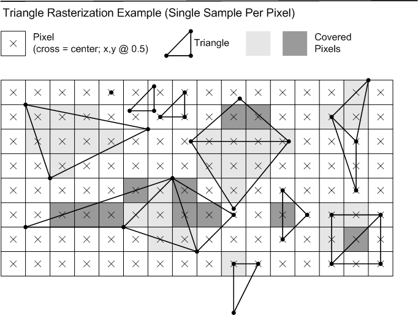<!-- d3d12-review-inline:end:rasterization:A-top-left:3 --></ins>

<a id="aliased-lines"></a>

### Aliased lines

<ins><!-- d3d12-review-inline:begin:rasterization:A-aliased:0 -->Rasterization rules for infinitely-thin lines, with no antialiasing, are described below.<!-- d3d12-review-inline:end:rasterization:A-aliased:0 --></ins>

<ins><!-- d3d12-review-inline:begin:rasterization:A-aliased:1 -->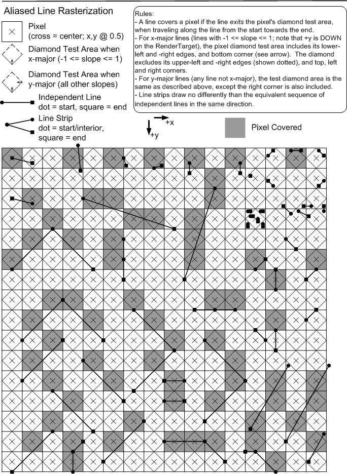<!-- d3d12-review-inline:end:rasterization:A-aliased:1 --></ins>

<!-- d3d12-review-alert:begin:rasterization:N-diamond-rules:0 -->

> [!WARNING]
> **Authored synthesis - human review pending.**
>
> A line covers a pixel if the line exits the pixel's diamond test area while traveling from its start toward its end.

<!-- d3d12-review-alert:end:rasterization:N-diamond-rules:0 -->

- <ins><!-- d3d12-review-inline:begin:rasterization:N-diamond-rules:1 -->For X-major lines (`-1 <= slope <= 1`, with positive Y downward), the diamond includes its lower-left and lower-right edges and bottom corner. It excludes its upper-left and upper-right edges and its top, left and right corners.<!-- d3d12-review-inline:end:rasterization:N-diamond-rules:1 --></ins>
- <ins><!-- d3d12-review-inline:begin:rasterization:N-diamond-rules:1 -->For Y-major lines (all non-X-major lines), the same test applies except that the right corner is also included.<!-- d3d12-review-inline:end:rasterization:N-diamond-rules:1 --></ins>
- <ins><!-- d3d12-review-inline:begin:rasterization:N-diamond-rules:1 -->A line strip draws no differently than the equivalent sequence of independent lines in the same direction.<!-- d3d12-review-inline:end:rasterization:N-diamond-rules:1 --></ins>

<a id="line-clipping"></a>

#### Line endpoints and clipping

<ins><!-- d3d12-review-inline:begin:rasterization:A-line-clipping:0 -->One further implication of these line rasterization rules is that lines that are geometrically clipped to
the viewport extent may set one less pixel than lines that are rendered to a larger 2D extent
with the pixels outside the viewport discarded. (This is due to the handling of the line endpoints.)<!-- d3d12-review-inline:end:rasterization:A-line-clipping:0 --></ins>

<ins><!-- d3d12-review-inline:begin:rasterization:A-line-clipping:1 -->Since geometric clip to the viewport is neither required nor disallowed, aliased line
rendering is allowed to differ in viewport-edge pixels due to geometric clipping.<!-- d3d12-review-inline:end:rasterization:A-line-clipping:1 --></ins>

<a id="alpha-lines"></a>

### Alpha-antialiased lines

<ins><!-- d3d12-review-inline:begin:rasterization:A-alpha-lines:0 -->The alpha-based antialiased rasterization of a line (defined by two end vertices)
is implemented as the visualization of a rectangle, with the line's two vertices centered on two
opposite "ends" of the rectangle, and the other two edges separated by a width (in D3D12 width is only 1.0f). No accounting
for connected line segments is done. The region of intersection of this rectangle with the RenderTarget is estimated by some
algorithm, producing "Coverage" values [0.0f..1.0f] for each pixel in a region around the line. The Coverage values are multiplied into the
Pixel Shader output `SV_Target0.a` (DXBC `o0.a`) value before the Output Merger Stage. Undefined results are produced if the PS does not output that alpha component.
D3D12 exposes no controls for this line mode.<!-- d3d12-review-inline:end:rasterization:A-alpha-lines:0 --></ins>

<ins><!-- d3d12-review-inline:begin:rasterization:A-alpha-lines:1 -->It is deemed that there is no single "best" way to perform alpha-based antialiased line rendering.
D3D12 adopts as a guideline the method shown in the diagram below. This method was derived empirically,
exhibiting a number of visual properties deemed desirable. Hardware need not exactly match this algorithm; tests against this
reference shall have "reasonable" tolerances, guided by some of the principles listed further below, permitting various hardware implementations and
filter kernel sizes. None of this flexibility permitted in hardware implementation, however, can be communicated up through D3D12 to applications,
beyond simply drawing lines and observing/measuring how they look.<!-- d3d12-review-inline:end:rasterization:A-alpha-lines:1 --></ins>

<ins><!-- d3d12-review-inline:begin:rasterization:A-alpha-lines:2 -->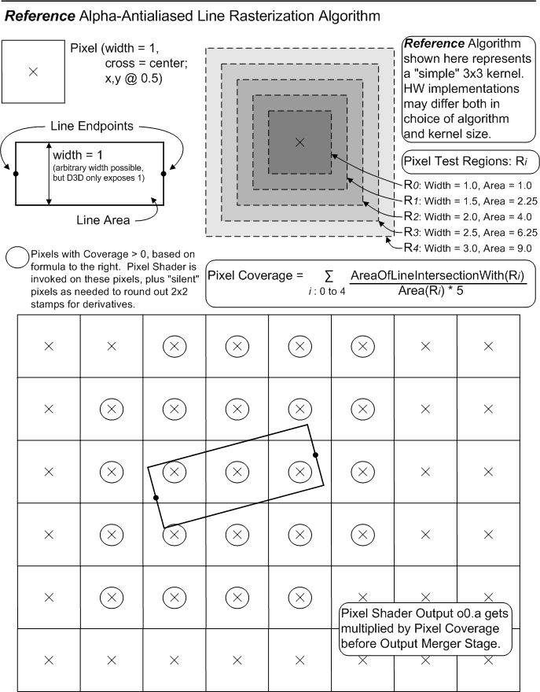<!-- d3d12-review-inline:end:rasterization:A-alpha-lines:2 --></ins>

The following is a listing of the "nice" properties that fall out of the above algorithm, which in general will be expected of hardware
implementations (admittedly many of which are likely difficult to test):

- <ins><!-- d3d12-review-inline:begin:rasterization:A-alpha-lines:4 -->Lines are "smooth", with minimal jagged edges or braiding.<!-- d3d12-review-inline:end:rasterization:A-alpha-lines:4 --></ins>

- There is virtually no variation in intensity along a line, including during animation.

- There is virtually no moire patterning with close lines, including during animation.

- There is virtually no variation in intensity at junctions between line segments placed end-to-end.

- The total numerical contribution of a line to an image is virtually equal to the visible area of the line, regardless
of line orientation, except appropriately accounting for color variation along the line from shading. This stipulation is based
on using the Coverage multiplied into Pixel Shader o0.a (srcAlpha) in the following blend formula at the Output Merger: srcColor * srcAlpha + destColor * (1-srcAlpha).

<ins><!-- d3d12-review-inline:begin:rasterization:A-alpha-lines:5 -->Note that the wider the filter kernel an implementation uses, the blurrier the line,
and thus the more sensitive the resulting perceived line intensity is to display gamma. The reference implementation's kernel is quite large,
at 3x3 pixel units about each pixel.<!-- d3d12-review-inline:end:rasterization:A-alpha-lines:5 --></ins>

<a id="quadrilateral-lines"></a>

### Quadrilateral lines

<ins><!-- d3d12-review-inline:begin:rasterization:A-quad-lines:0 -->Wide quadrilateral lines take 2 endpoints and turn them into a simple rectangle with width 1.4f, drawn with triangles.
The attributes at each end of the line are duplicated for the 2 vertices at each end of the rectangle.<!-- d3d12-review-inline:end:rasterization:A-quad-lines:0 --></ins>

<ins><!-- d3d12-review-inline:begin:rasterization:A-quad-lines:1 -->This mode is not supported with center sample patterns (D3D12_CENTER_MULTISAMPLE_PATTERN)
where there is more than one sample overlapping the center of the pixel, in which case results of drawing this style of line are undefined. See [here](#center-patterns).<!-- d3d12-review-inline:end:rasterization:A-quad-lines:1 --></ins>

<a id="narrow-quadrilateral"></a>

#### Narrow quadrilateral mode

<ins><!-- d3d12-review-inline:begin:rasterization:V-narrow-lines:0 -->Narrow quadrilateral mode draws quadrilateral lines with a width of 1.0.<!-- d3d12-review-inline:end:rasterization:V-narrow-lines:0 --></ins>

<a id="line-mode-selection"></a>

### Line mode selection

<!-- d3d12-review-alert:begin:rasterization:N-lines:0 -->

> [!WARNING]
> **Authored synthesis - human review pending.**
>
> | Legacy MultisampleEnable | Legacy AntialiasedLineEnable | Explicit line mode |
> |---|---|---|
> | FALSE | FALSE | `D3D12_LINE_RASTERIZATION_MODE_ALIASED` |
> | FALSE | TRUE | `D3D12_LINE_RASTERIZATION_MODE_ALPHA_ANTIALIASED` |
> | TRUE | Either | `D3D12_LINE_RASTERIZATION_MODE_QUADRILATERAL_WIDE` |

<!-- d3d12-review-alert:end:rasterization:N-lines:0 -->

<!-- d3d12-review-alert:begin:rasterization:N-lines:1 -->

> [!WARNING]
> **Authored synthesis - human review pending.**
>
> `D3D12_RASTERIZER_DESC2` additionally selects `QUADRILATERAL_NARROW` when supported. Wide quadrilateral mode uses the 1.4-width baseline above; narrow mode uses 1.0. The legacy `MultisampleEnable` name does not enable/disable multisampling for points or triangles. The [pipeline descriptions](pipeline-state.md#versioned-rasterizer) own enum/payload availability and legacy-driver translation.

<!-- d3d12-review-alert:end:rasterization:N-lines:1 -->

<a id="line-sampling"></a>

#### Sampling and line interpolation

<ins><!-- d3d12-review-inline:begin:rasterization:A-line-state:0 -->Regardless of what the MSAA sample count is, when the MultisampleEnable state is **false**, the Pixel Shader executes based on non-MSAA rasterization rules for aliased or alpha-based AA lines.
This means that when the line covers a pixel, given these sample-pattern-agnostic line algorithms, all of the MSAA samples in the pixel are hit. Furthermore, for alpha-based AA lines
all samples receive an identical coverage alpha value.
If, however, the Pixel Shader requests [Sample-Frequency](#sample-frequency) operation when MultisampleEnable is false, line rasterization behavior is defined only in the trivial
case when sample count is 1, and left undefined for sample count > 1.<!-- d3d12-review-inline:end:rasterization:A-line-state:0 --></ins>

<ins><!-- d3d12-review-inline:begin:rasterization:A-line-state:1 -->On the other hand with MultisampleEnable **true**, a shader requesting [Sample-Frequency](#sample-frequency) execution will encounter well defined line rasterization behavior
for any sample count. With MultisampleEnable true,
the coverage rules for lines are equivalent to 2 triangles making a rectangle. Also, the way attribute evaluation works for MSAA lines is that attributes can vary along the
length, but are constant across the perpendicular. So for example given MultisampleEnable is true, if a line with sample-frequency interpolated attributes covers multiple samples in a pixel, each
Pixel Shader invocation within the pixel sees independently evaluated attributes.<!-- d3d12-review-inline:end:rasterization:A-line-state:1 --></ins>

<a id="point-coverage"></a>

### Points

<ins><!-- d3d12-review-inline:begin:rasterization:A-points:0 -->For the purpose of rasterization, a point is represented as a square of width 1 oriented to the RenderTarget.
Actual implementation may vary, but output behavior should be identical to what is described here.
The coordinate for a point identifies where the center of the square is located. Pixel coverage for points follows
Triangle Rasterization Rules, interpreted as though a point is composed of 2 triangles in a Z pattern, with attributes
duplicated at the 4 vertices. Cull modes do not apply to points.<!-- d3d12-review-inline:end:rasterization:A-points:0 --></ins>

<ins><!-- d3d12-review-inline:begin:rasterization:A-points:1 -->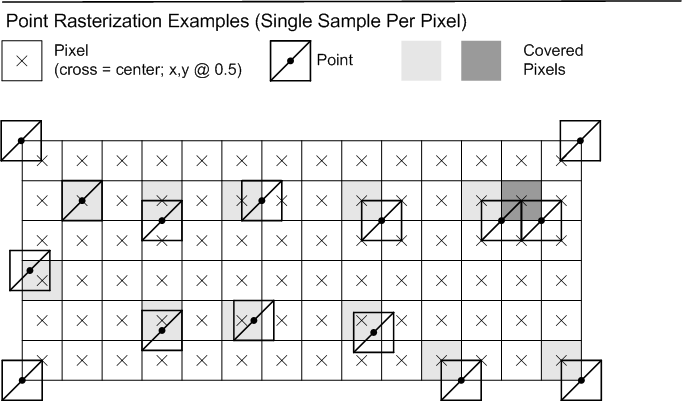<!-- d3d12-review-inline:end:rasterization:A-points:1 --></ins>

<a id="point-state"></a>

#### Point sample-frequency attributes

<ins><!-- d3d12-review-inline:begin:rasterization:A-point-state:0 -->The legacy MultisampleEnable state does not affect point rasterization.<!-- d3d12-review-inline:end:rasterization:A-point-state:0 --></ins>

<ins><!-- d3d12-review-inline:begin:rasterization:A-point-state:1 -->The coverage rules for a point are like drawing a unit area square out of 2 triangles,
and attributes are all constant over the area. This behavior holds regardless of the legacy MultisampleEnable state. Furthermore, these rasterization and attribute evaluation behaviors continue to apply
during sample-frequency evaluation, except that each shader invocation is uniquely aware of its sample position (and sample index) if
the shader requests it.<!-- d3d12-review-inline:end:rasterization:A-point-state:1 --></ins>

<a id="triangle-state"></a>

### Triangle sampling state

<!-- d3d12-review-alert:begin:rasterization:N-triangle-state:0 -->

> [!WARNING]
> **Authored synthesis - human review pending.**
>
> The legacy `MultisampleEnable` state does not alter triangle coverage. Triangle samples follow the render target/sample pattern and the multisample rules below.

<!-- d3d12-review-alert:end:rasterization:N-triangle-state:0 -->

<a id="multisampling"></a>

## Multisampling

<!-- d3d12-review-alert:begin:rasterization:N-msaa-scope:0 -->

> [!WARNING]
> **Authored synthesis - human review pending.**
>
> The fine pixel coverage and pixel/sample-frequency explanations below describe 1x1 shading. Variable rate shading changes shader execution frequency, not fine pixel/sample storage. The [shading rate/sample count limits](pixel-shaders.md#vrs-support), [sample-based execution](pixel-shaders.md#vrs-grid), [centroid behavior](pixel-shaders.md#vrs-centroid) and [coverage packing](pixel-shaders.md#vrs-sv_coverage) apply when coarse shading is selected. Full pixel shader execution remains separate from this coverage interface.

<!-- d3d12-review-alert:end:rasterization:N-msaa-scope:0 -->

<!-- d3d12-review-alert:begin:rasterization:N-centroid-owner:0 -->

> [!WARNING]
> **Authored synthesis - human review pending.**
>
> Pixel shader [centroid evaluation](pixel-shaders.md#centroid) owns fine pixel full-coverage/first-covered/helper selection, including programmed sample patterns. The [conservative interpolation override](#conservative-attribute-interpolation-interaction) and [coarse VRS selection](pixel-shaders.md#vrs-centroid) remain distinct.

<!-- d3d12-review-alert:end:rasterization:N-centroid-owner:0 -->

<a id="multisample-overview"></a>

### Coverage and shading frequency

<ins><!-- d3d12-review-inline:begin:rasterization:A-msaa-overview:0 -->Multisample Antialiasing seeks to fight geometry aliasing, without necessarily dealing with surface aliasing (leaving that
as a shading problem, e.g. texture filtering). This is accomplished by performing pixel coverage tests and depth/stencil tests at multiple sample
locations per pixel, backed by storage for each sample, while only performing pixel shading calculations
once for covered pixels (broadcasting Pixel Shader output across covered samples). It is also possible to request Pixel Shader invocations to
occur at sample-frequency rather than at pixel-frequency.<!-- d3d12-review-inline:end:rasterization:A-msaa-overview:0 --></ins>

<a id="multisample-coverage"></a>

### Covered samples

<ins><!-- d3d12-review-inline:begin:rasterization:A-msaa-effects:0 -->Rasterization behavior when sample count is greater than 1 is simply that primitive coverage tests are done for each sample
location within a pixel. If one or more sample locations in a pixel are covered, the Pixel Shader is run once for the pixel in Pixel-Frequency
mode, or in Sample-Frequency mode once for each covered sample that is also in the Rasterizer SampleMask. Pixel-frequency execution produces a single set of Pixel
Shader output data that is replicated to all covered samples that pass their individual depth/stencil tests and blended to the
RenderTarget per-sample. Sample-frequency execution produces a unique set of Pixel Shader output data per covered sample (and in SampleMask),
each output getting blended 1:1 to the corresponding RenderTarget sample if its depth/stencil test passes.<!-- d3d12-review-inline:end:rasterization:A-msaa-effects:0 --></ins>

<ins><!-- d3d12-review-inline:begin:rasterization:A-msaa-effects:1 -->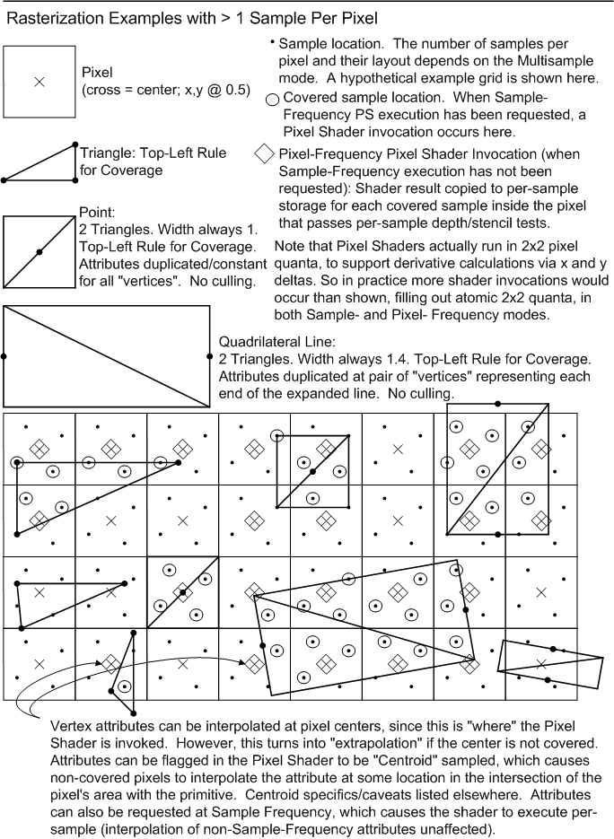<!-- d3d12-review-inline:end:rasterization:A-msaa-effects:1 --></ins>

<a id="sample-frequency"></a>

### Sample-frequency rasterization

<ins><!-- d3d12-review-inline:begin:rasterization:A-sample-frequency:0 -->Note that [points](#point-coverage) and [quadrilateral lines](#quadrilateral-lines) are functionally equivalent to drawing
their area with triangles. So Sample-Frequency execution is easily defined for all of these primitives. For points, the samples
covered by the point area (and in the RasterizerState's SampleMask) each get Pixel Shader invocations with attributes replicated from its single vertex (except one parameter
is available that is varying - an ID identifying each sample from the total set of samples in the pixel). For quadrilateral lines,
the two end vertices define how attributes interpolate along the length, staying constant across the perpendicular. Again, the samples covered by
the area of the primitive (and in the SampleMask) each get a Pixel Shader invocations in Sample-Frequency execution mode, with unique input attributes per sample, including
an ID identifying which sample it is.<!-- d3d12-review-inline:end:rasterization:A-sample-frequency:0 --></ins>

<ins><!-- d3d12-review-inline:begin:rasterization:A-sample-frequency:1 -->[Alpha-Antialiased Lines](#alpha-lines) and [Aliased Lines](#aliased-lines) are algorithms that inherently do not
deal with discrete sample locations within a pixel's area, and thus it is illegal/undefined to request Sample-Frequency
execution for these primitives, unless the sample count is 1, which is identical to Pixel-Frequency execution.<!-- d3d12-review-inline:end:rasterization:A-sample-frequency:1 --></ins>

<a id="sample-patterns"></a>

### Standard and center sample patterns

<!-- d3d12-review-alert:begin:rasterization:N-sample-pattern-selector:0 -->

> [!WARNING]
> **Authored synthesis - human review pending.**
>
> Format/sample support and quality level queries are defined by [Formats](formats.md#d3d12-feature-data-multisample-quality-levels). For supported sample counts with standard patterns, `DXGI_SAMPLE_DESC::Quality` selects `D3D12_STANDARD_MULTISAMPLE_PATTERN` (`0xffffffff`) or `D3D12_CENTER_MULTISAMPLE_PATTERN` (`0xfffffffe`). Supported ordinary quality levels do not replace these special selectors. Standard patterns are defined for 1, 2, 4, 8 and 16 samples. Their locations and index ordering follow the original grids below.

<!-- d3d12-review-alert:end:rasterization:N-sample-pattern-selector:0 -->

<!-- d3d12-review-alert:begin:rasterization:N-standard-pattern-figures:0 -->

> [!WARNING]
> **Authored synthesis - human review pending.**
>
> 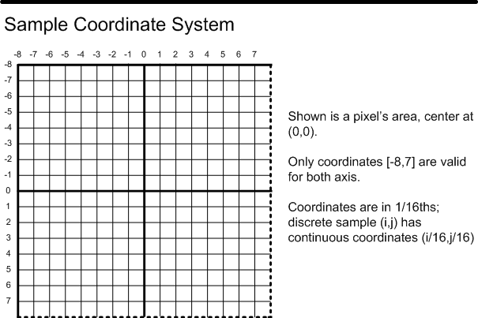

<!-- d3d12-review-alert:end:rasterization:N-standard-pattern-figures:0 -->

<!-- d3d12-review-alert:begin:rasterization:N-standard-pattern-figures:1 -->

> [!WARNING]
> **Authored synthesis - human review pending.**
>
> 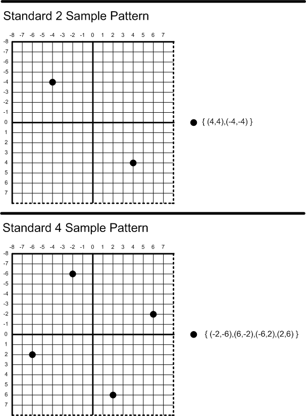

<!-- d3d12-review-alert:end:rasterization:N-standard-pattern-figures:1 -->

<!-- d3d12-review-alert:begin:rasterization:N-standard-pattern-figures:2 -->

> [!WARNING]
> **Authored synthesis - human review pending.**
>
> 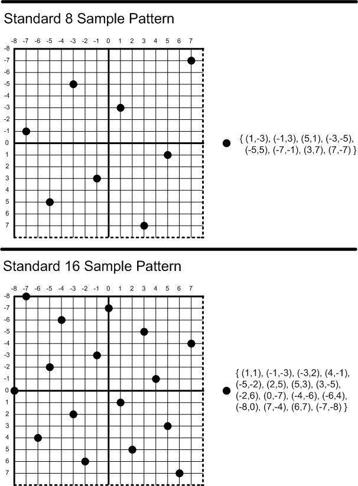

<!-- d3d12-review-alert:end:rasterization:N-standard-pattern-figures:2 -->

<a id="center-patterns"></a>

#### Overlapping center samples

<ins><!-- d3d12-review-inline:begin:rasterization:A-center-restrictions:0 -->The standard center sample patterns (D3D12_CENTER_MULTISAMPLE_PATTERN) that have more than one sample overlapping
at the center of the pixel have a couple of usage restrictions:<!-- d3d12-review-inline:end:rasterization:A-center-restrictions:0 --></ins>

- (1) Sample-frequency Pixel Shader execution is undefined.

- <ins><!-- d3d12-review-inline:begin:rasterization:A-center-restrictions:1 -->(2) MSAA lines (lines drawn as quadrilaterals / 2 triangles) are undefined.<!-- d3d12-review-inline:end:rasterization:A-center-restrictions:1 --></ins>

<a id="target-independent"></a>

## Target-independent rasterization

<a id="forced-sample-count"></a>

### Forced sample count

<ins><!-- d3d12-review-inline:begin:rasterization:A-forced-count:0 -->Overriding the Rasterizer sample count means defining the multisample pattern at the Rasterizer
independent of what [RenderTargetViews](binding.md#view-descriptions) (or [UnorderedAccessView](binding.md#buffer-uav)s) may be bound at the Output Merger (and their associated sample count / Quality Level).<!-- d3d12-review-inline:end:rasterization:A-forced-count:0 --></ins>

<ins><!-- d3d12-review-inline:begin:rasterization:A-forced-count:1 -->The ForcedSampleCount state setting is part of the [rasterizer description](pipeline-state.md#rasterizer).<!-- d3d12-review-inline:end:rasterization:A-forced-count:1 --></ins>

```text
    UINT ForcedSampleCount; // Valid values for Target Independent Rasterization (TIR): 0, 1, 4, 8, 16
                            // Valid values for UAV only render: 0, 1, 4, 8, 16
                            // 0 means don't force sample count.
```

<ins><!-- d3d12-review-inline:begin:rasterization:A-forced-count:3 -->Full target-independent rasterization support on Feature Level 11_1 requires all standard sample patterns up to and including 16 for ForcedSampleCount.
This is even if the device does not support that many samples in RenderTarget / DepthStencil resources.<!-- d3d12-review-inline:end:rasterization:A-forced-count:3 --></ins>

<a id="forced-pattern-behavior"></a>

### Forced-pattern behavior

<ins><!-- d3d12-review-inline:begin:rasterization:A-forced-behavior:0 -->With a forced sample count/pattern selected at the rasterizer (ForcedSampleCount > 0), pixels are candidates for shader invocation based on the selected sample pattern,
independent of the RTV ("output") sample count. The burden is then on shader code to make sense of the possible mismatch between rasterizer and output storage sample count,
given the defined semantics.<!-- d3d12-review-inline:end:rasterization:A-forced-behavior:0 --></ins>

<ins><!-- d3d12-review-inline:begin:rasterization:A-forced-behavior:1 -->Here are the behaviors with ForcedSampleCount > 0.<!-- d3d12-review-inline:end:rasterization:A-forced-behavior:1 --></ins>

- <ins><!-- d3d12-review-inline:begin:rasterization:A-forced-behavior:2 -->In the absence of a programmable position override, ForcedSampleCount identifies a D3D standard sample pattern of 1, 4, 8 or 16 samples (0 means no override). A matching [programmable sample pattern](#programmable-samples) replaces those default positions.<!-- d3d12-review-inline:end:rasterization:A-forced-behavior:2 --></ins>

- If ForcedSampleCount is greater than 1, any RTVs that are bound while rendering must only have a single sample, otherwise rendering behavior is undefined.

- If ForcedSampleCount is 1, RTVs that are bound can be any sample count.

- If a rendered primitive covers any samples in the ForcedSampleCount sample pattern, the pixel is a candidate for Pixel Shader invocation.

- Output sample locations have no bearing on whether a pixel is a candidate for Pixel Shader invocation.

- Depth/Stencil Views must not be bound, depth testing must be disabled, and the shader must not output depth while rendering with ForcedSampleCount 1 or greater,
otherwise rendering behavior is undefined.

- Shader invocation happens for a candidate pixel if any of the output sample locations is in the SampleMask Rasterizer State.

- In pixel-frequency shader invocation, one invocation occurs if any output sample is in the SampleMask.

- Sample-frequency shader invocation cannot be requested, otherwise rendering results are undefined.

- Pixel Shader input coverage to the shader sees the primitive's coverage of the ForcedSampleCount sample pattern for the pixel.

- Pull Model attribute interpolation is based on the ForcedSampleCount pattern when selecting sample location by sample index.

- The centroid interpolation algorithm doesn't take into account the SampleMask Rasterizer State, since the SampleMask is relevant to the output sample pattern only, not the ForcedSampleCount pattern.

- <ins><!-- d3d12-review-inline:begin:rasterization:A-forced-behavior:2 -->See [D3D12_QUERY_TYPE_OCCLUSION](counters-queries-and-predication.md#occlusion) for description of interaction of ForcedSampleCount, SampleMask and the occlusion query sample count.<!-- d3d12-review-inline:end:rasterization:A-forced-behavior:2 --></ins>

<ins><!-- d3d12-review-inline:begin:rasterization:A-forced-behavior:3 -->Availability based on feature level and rasterizer creation constraints follow the selected pipeline contract.<!-- d3d12-review-inline:end:rasterization:A-forced-behavior:3 --></ins>

<a id="forced-feature-levels"></a>

### Feature level differences

<ins><!-- d3d12-review-inline:begin:rasterization:A-forced-feature-level:0 -->Feature Level 11_0 hardware supports ForcedSampleCount set to 1 (and any sample count for RTV) along with the described limitations (e.g. no depth/stencil).<!-- d3d12-review-inline:end:rasterization:A-forced-feature-level:0 --></ins>

<ins><!-- d3d12-review-inline:begin:rasterization:A-forced-feature-level:1 -->For Feature Level 11_0 hardware, when ForcedSampleCount is set to 1, line rendering cannot be configured to 2-triangle (quadrilateral) based mode (i.e. the MultisampleEnable state cannot be
set to true). This limitation isn't present for Feature Level 11_1 hardware. Note the naming of the 'MultisampleEnable' state is misleading since it no longer has anything to do with enabling multisampling; instead it is now one of the controls along with AntialiasedLineEnable
for selecting line rendering mode.<!-- d3d12-review-inline:end:rasterization:A-forced-feature-level:1 --></ins>

<a id="uav-only"></a>

### UAV-only forced-count rasterization

<ins><!-- d3d12-review-inline:begin:rasterization:A-uav-only:0 -->[UAV](binding.md#buffer-uav)-only rendering with multisampling at the rasterizer is possible by keying off the
ForcedSampleCount state described earlier, with the sample patterns limited to 0, 1, 4, 8 and 16. (The UAVs themselves are not multisampled in terms of allocation.)
On the legacy forced-count path with ordinary PSO SampleDesc.Count at most 1, a ForcedSampleCount of 0 is equivalent to 1: single-sample rasterization. The [newer no-output PSO sample count path](#no-output-samples) is separate.<!-- d3d12-review-inline:end:rasterization:A-uav-only:0 --></ins>

<ins><!-- d3d12-review-inline:begin:rasterization:A-uav-only:1 -->On this forced-count path, shaders can request pixel-frequency invocation, but requesting sample-frequency invocation is invalid (produces undefined shading results). The [no-output PSO sample count path](#no-output-samples) permits sample-frequency execution.<!-- d3d12-review-inline:end:rasterization:A-uav-only:1 --></ins>

The SampleMask Rasterizer State does not affect rasterization behavior at all here.

<ins><!-- d3d12-review-inline:begin:rasterization:A-uav-only:3 -->On Feature Level 11_0 hardware, ForcedSampleCount can be 0, 1, 4 and 8 with UAV only Rasterization. Feature Level 11_1 hardware additionally supports 16.<!-- d3d12-review-inline:end:rasterization:A-uav-only:3 --></ins>

<ins><!-- d3d12-review-inline:begin:rasterization:A-uav-only:4 -->Attempting to render with unsupported ForcedSampleCount produces undefined rendering results - though if a ForcedSampleCount is chosen that could never be valid for TIR or UAV-only rendering
the rasterizer description is invalid at pipeline creation.<!-- d3d12-review-inline:end:rasterization:A-uav-only:4 --></ins>

<a id="no-output-samples"></a>

### Sample-frequency execution with no output views

<ins><!-- d3d12-review-inline:begin:rasterization:V-no-output-samples:0 -->D3D12 allows `DXGI_SAMPLE_DESC::Count` to be > 1 when no render targets or depth stencil are bound. When this is the case, behavior is expected to be basically identical to setting `ForcedSampleCount` > 1, except that sample-frequency pixel shader execution is allowed and well-defined. `DXGI_SAMPLE_DESC::Quality` must be 0 or `D3D12_STANDARD_MULTISAMPLE_PATTERN`. When programmable sample positions are set on the command list, those sample positions are used by this type of rendering as well.<!-- d3d12-review-inline:end:rasterization:V-no-output-samples:0 --></ins>

Existing interactions with `ForcedSampleCount` remain:
* If `DXGI_SAMPLE_DESC::Count` > 1, `ForcedSampleCount` must be 0 or 1. 0 indicates multisample rasterization, while 1 indicates single-sample rasterization. If there are render targets or depth stencil bound, the results of rasterization and pixel shading are broadcast to all samples for the pixel.
* If `DXGI_SAMPLE_DESC::Count` == 1, `ForcedSampleCount` may be larger, but all existing rules around TIR remain.

<ins><!-- d3d12-review-inline:begin:rasterization:V-no-output-samples:2 -->`OPTIONS19.SupportedSampleCountsWithNoOutputs` supplies the supported counts, using the [pipeline no-output sample count encoding](pipeline-state.md#no-output-samples).<!-- d3d12-review-inline:end:rasterization:V-no-output-samples:2 --></ins>

<!-- d3d12-review-alert:begin:rasterization:N-no-output-scope:0 -->

> [!WARNING]
> **Authored synthesis - human review pending.**
>
> The no-output sample-frequency path has `NumRenderTargets == 0`, `DSVFormat == DXGI_FORMAT_UNKNOWN`, a reported `SampleDesc.Count > 1` and `ForcedSampleCount == 0`. It is distinct from forced-count rasterization, whose sample-frequency prohibition remains. Target-independent rasterization is not supported with coarse variable rate shading. [The VRS interaction](pixel-shaders.md#vrs-raster-order-views) remains explicit.

<!-- d3d12-review-alert:end:rasterization:N-no-output-scope:0 -->

<!-- d3d12-review-alert:begin:rasterization:N-no-output-floor:0 -->

> [!WARNING]
> **Authored synthesis - human review pending.**
>
> For Feature Level 11_1 hardware using DDI version 0102 or later, `SupportedSampleCountsWithNoOutputs` must report at least mask `0b11101`, corresponding to 1, 4, 8 and 16 samples. This is a no-output rasterization reporting requirement, not a requirement that every render target/depth format support those resource sample counts.

<!-- d3d12-review-alert:end:rasterization:N-no-output-floor:0 -->

<a id="conservative"></a>

## Conservative rasterization

<!-- d3d12-review-alert:begin:rasterization:N-conservative-scope:0 -->

> [!WARNING]
> **Authored synthesis - human review pending.**
>
> Conservative rasterization is selected by the pipeline rasterizer description and requires the reported `ConservativeRasterizationTier`. The coverage/inner coverage interface below describes fine 1x1 shading. The [coarse shading contribution](#conservative-vrs) applies separately. The three tiers refine this common behavior rather than introduce a separate D3D12 rasterizer state object.

<!-- d3d12-review-alert:end:rasterization:N-conservative-scope:0 -->

<!-- d3d12-review-alert:begin:rasterization:N-conservative-scope:1 -->

> [!WARNING]
> **Authored synthesis - human review pending.**
>
> InputCoverage and InnerCoverage denote the logical HLSL `SV_Coverage` and `SV_InnerCoverage` inputs. Output coverage (`oMask` in DXBC) is the pixel shader's `SV_Coverage` output; `oDepth` denotes its depth output. These feature interactions apply to DXBC and DXIL representations. `SV_InnerCoverage` requires a pixel shader of Shader Model 5.0 or later and Conservative Rasterization Tier 3.

<!-- d3d12-review-alert:end:rasterization:N-conservative-scope:1 -->

<a id="conservative-overview"></a>

### Overview

Conservative Rasterization in this context means that all pixels that
are at least partially covered by a rendered primitive are rasterized,
meaning the Pixel Shader is invoked. Behavior is not dependent on the
sample point coverage that is used when Conservative Rasterization is
not enabled: if any part of a primitive overlaps a pixel, then that
pixel is considered covered and is then rasterized. When an edge or
corner of a primitive falls along the edge or corner of a pixel, the
application of the Top-Left Rule is implementation-specific (with the
exception of implementations using the minimum uncertainty region).
However, for implementations that support degenerate triangles, a
degenerate triangle along an edge or corner must cover at least one
pixel; so nothing falls through the cracks.

<ins><!-- d3d12-review-inline:begin:rasterization:C-overview:1 -->This type of rasterization is sometimes referred to as Overestimated
Conservative Rasterization. There is also the concept of Underestimated
Conservative Rasterization, which means that only pixels that are fully
covered by a rendered primitive are rasterized. Underestimated
Conservative Rasterization is only exposed via the InnerCoverage
System Generated Value, described later. The D3D Rasterizer's
Conservative Rasterization mode specified here is only Overestimated
Conservative Rasterization.<!-- d3d12-review-inline:end:rasterization:C-overview:1 --></ins>

Conservative Rasterization implementations are allowed to produce false
positives, meaning they incorrectly decide that pixels are covered. This
can happen due to implementation-specific details like primitive growing
or snapping error inherent in the fixed-point vertex coordinates used in
rasterization. The reason false positives (with respect to fixed point
vertex coordinates) are valid is because some amount of false positives
are needed to allow an implementation to do coverage evaluation against
post-snapped vertices (i.e. vertex coordinates that have been converted
from floating point to the 16.8 fixed-point used in the Rasterizer), but
honor the coverage produced by the original floating point vertex
coordinates. Beyond that, implementations are encouraged to reduce the
number of false positives as much as possible. Limits on false positives
are detailed in Rasterization Rules interaction.

Conservative Rasterization implementations must never produce false
negatives with respect to the floating-point vertex coordinates for
non-degenerate post-snap primitives: if any part of a primitive overlaps
any part of a pixel, then that pixel must be rasterized.

Triangles that are degenerate (duplicate indices in an index buffer or
collinear in 3D), or become degenerate after fixed-point conversion
(collinear vertices in the Rasterizer), may or may not be culled; both
are valid behaviors. However, Tier 2 and above require an implementation
to never produce false negatives with respect to the floating-point
vertex coordinates and therefore they must rasterize degenerates, with
the exception that triangles with duplicate indices in an index buffer
may be culled (some hardware automatically discards triangles with
duplicate indices and this case is not considered useful enough to force
a hardware change). Degenerate triangles must be considered back facing,
so if a specific behavior is required by an application, it can use
back-face culling or the IsFrontFace System Generated Value. Degenerate
triangles must use the values assigned to Vertex 0 for all interpolated
values.

<ins><!-- d3d12-review-inline:begin:rasterization:C-overview:5 -->Conservative Rasterization support is defined by three tiers, as
described in the Tiered Support section.<!-- d3d12-review-inline:end:rasterization:C-overview:5 --></ins>

<a id="conservative-rasterization-rules-interaction"></a>

### Rasterization Rules interaction

<ins><!-- d3d12-review-inline:begin:rasterization:C-rasterization-rules-interaction:0 -->In Conservative Rasterization mode, Rasterization Rules apply the same
way as when Conservative Rasterization mode is not enabled with
exceptions for the Top-Left Rule, as described previously, and [input coverage](#conservative-inputcoverage-interaction). 16.8 Fixed-Point
Rasterizer precision must be used.<!-- d3d12-review-inline:end:rasterization:C-rasterization-rules-interaction:0 --></ins>

<ins><!-- d3d12-review-inline:begin:rasterization:C-rasterization-rules-interaction:1 -->Pixels that would not be covered if hardware was using full floating
point vertex coordinates may only be included if they are within an
uncertainty region no larger than half a pixel in the fixed point domain.
Note that this requirement prevents sliver
triangles from extending further than necessary.<!-- d3d12-review-inline:end:rasterization:C-rasterization-rules-interaction:1 --></ins>

A similar valid uncertainty region applies to InnerCoverage as well, but
it is tighter since no implementations require a larger uncertainty
region for this case. See InnerCoverage for more detail.

Inner and outer uncertainty regions must be greater than or equal to the
size of half the subpixel grid, or 1/512 of a pixel, in the fixed point
domain. This is the minimum valid uncertainty region. 1/512 comes from
the 16.8 fixed point Rasterizer coordinate representation and the
round-to-nearest rule that applies when converting floating point vertex
coordinates to 16.8 fixed point coordinates. 1/512 can change if the
Rasterizer precision changes. If an implementation implements this
minimum uncertainty region, then they must follow the Top-Left Rule when
an edge or corner of the uncertainty region falls along the edge or
corner of a pixel. The clipped edges of the uncertainty region should be
treated as the closest vertex, meaning that it counts as two edges: the
two that join at the associated vertex. Top-Left Rule is required when
the minimum uncertainty region is used because if it is not, then a
Conservative Rasterization implementation would fail to rasterize pixels
that could be covered when Conservative Rasterization mode is disabled.

The included diagram illustrates a valid outer uncertainty region
produced by sweeping a square around the edges of the primitive in the
fixed point domain (i.e. the vertices have been quantized by the 16.8
fixed point representation). The dimensions of this square are based on
the valid outer uncertainty region size: for the 1/2 of a pixel, the
square is 1 pixel in width and height, for 1/512 of a pixel, the square
is 1/256 of a pixel in width and height. The green triangle represents a
given primitive, the red dotted line represents the bound on
Overestimated Conservative Rasterization, the solid black squares
represent the square that is swept along the primitive edges, and the
blue checkered area is the outer uncertainty region:


<ins><!-- d3d12-review-inline:begin:rasterization:C-rasterization-rules-interaction:5 -->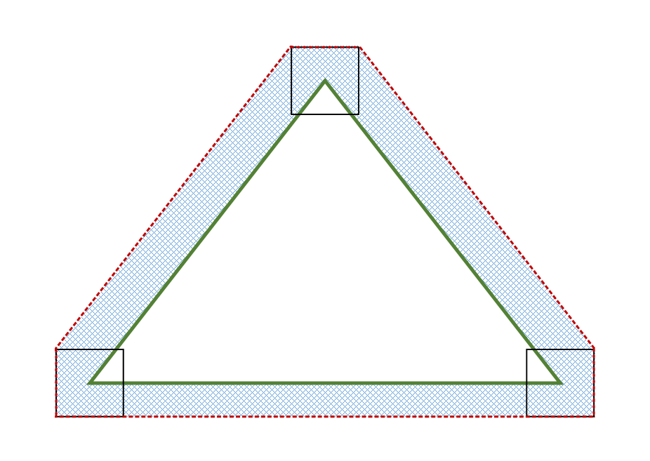<!-- d3d12-review-inline:end:rasterization:C-rasterization-rules-interaction:5 --></ins>

<a id="conservative-multisampling-interaction"></a>

### Multisampling interaction

Regardless of the number of samples in RenderTarget/DepthStencil
surfaces (or whether ForcedSampleCount is being used or not), all
samples are covered for pixels rasterized by Conservative Rasterization.
Individual sample locations are not tested for whether they fall in the
primitive or not.

<a id="conservative-samplemask-interaction"></a>

### SampleMask interaction

The SampleMask Rasterizer State applies the same way as when
Conservative Rasterization is not enabled for InputCoverage, but does
not affect InnerCoverage (i.e. it is not AND'ed into an input declared
with InnerCoverage). This is because InnerCoverage is unrelated to
whether MSAA samples are masked out: 0 InnerCoverage only means that the
pixel is not guaranteed to be fully covered, not that no samples will be
updated.

<a id="conservative-depthstencil-test-interaction"></a>

### Depth/Stencil Test interaction

<ins><!-- d3d12-review-inline:begin:rasterization:C-depthstencil-test-interaction:0 -->Depth/Stencil Testing proceeds for a conservatively rasterized pixel the
same way as if all samples are covered when Conservative Rasterization
is not enabled. Proceeding with all samples covered can cause Depth
extrapolation, which is valid and must be clamped to the viewport as
specified when Conservative Rasterization is not enabled. This is
similar to when pixel-frequency interpolation modes are used on a
RenderTarget with sample count \> 1 ([centroid locations](../archive/D3D11_3_FunctionalSpec.htm#Centroid)), although in the
case of Conservative Rasterization, it is the depth value going into the
fixed function depth test that can be extrapolated.<!-- d3d12-review-inline:end:rasterization:C-depthstencil-test-interaction:0 --></ins>

Use of early depth culling behavior in combination with conservative rasterization is undefined.
This includes early depth culling where depth extrapolation occurs. This
is because some Early Depth culling hardware cannot properly support
extrapolated depth values. However, Early Depth culling behavior in the
presence of Depth Extrapolation is problematic even with hardware that
can support extrapolated depth values. This issue can be worked around
by clamping the Pixel Shader input depth to the min and max depth values
of the primitive being rasterized and writing that value to oDepth.
Implementations are required to disable Early Depth culling in this
case, due to the oDepth write.

<a id="conservative-helper-pixel-interaction"></a>

### Helper Pixel interaction

Helper Pixel rules apply the same way as when Conservative Rasterization
is not enabled. As part of this, all pixels including Helper Pixels must
report InputCoverage accurately as specified in the InputCoverage
interaction section. So fully noncovered pixels report 0 coverage.

<a id="conservative-output-coverage-interaction"></a>

### Output Coverage interaction

Output Coverage (oMask) behaves for a conservatively rasterized pixel as
it does when Conservative Rasterization is not enabled with all samples
covered.

<a id="conservative-inputcoverage-interaction"></a>

### InputCoverage interaction

<ins><!-- d3d12-review-inline:begin:rasterization:C-inputcoverage-interaction:0 -->In Conservative Rasterization mode, this input register is populated as
if all samples are covered when Conservative Rasterization is not
enabled for a given conservatively rasterized pixel. That is to say, all
existing interactions apply (e.g. SampleMask is applied), and the first
n bits in the generated geometric-coverage mask from the LSB are set to 1 for a conservatively
rasterized pixel, before applicable masking, given an n sample per pixel RenderTarget and/or
Depth/Stencil buffer is bound at the Output Merger, or an n sample
ForcedSampleCount. The rest of the bits are 0.<!-- d3d12-review-inline:end:rasterization:C-inputcoverage-interaction:0 --></ins>

<ins><!-- d3d12-review-inline:begin:rasterization:C-inputcoverage-interaction:1 -->This input is available regardless of Conservative Rasterization. Conservative rasterization generates full geometric coverage for covered fine pixels and zero for noncovered helper pixels; it does not bypass the applicable mask. In ordinary fine pixel MSAA, the shader input is the geometric mask AND SampleMask. For example, four covered samples with SampleMask `0x5` produce input coverage `0x5`, not `0xf`. Forced-count and coarse shading paths retain their stated mask interactions.<!-- d3d12-review-inline:end:rasterization:C-inputcoverage-interaction:1 --></ins>

<a id="conservative-innercoverage"></a>

### InnerCoverage

<ins><!-- d3d12-review-inline:begin:rasterization:C-innercoverage:0 -->This feature is required by, and only available in, Tier 3. The runtime
fails pipeline creation for shaders that use this mode when an
implementation supports a Tier less than Tier 3.<!-- d3d12-review-inline:end:rasterization:C-innercoverage:0 --></ins>

<ins><!-- d3d12-review-inline:begin:rasterization:C-innercoverage:1 -->The Pixel Shader has a 32-bit scalar integer System Generated Value
available: InnerCoverage. This is a bitfield that has bit 0 from the LSB
set to 1 for a given conservatively rasterized pixel, only when that
pixel is guaranteed to be entirely inside the current primitive. All
other input register bits must be set to 0 when bit 0 is not set, but
are undefined when bit 0 is set to 1 (essentially, this bitfield
represents a Boolean value where false must be exactly 0, but true can
be any odd (i.e. bit 0 set) non-zero value). This input is used for
underestimated Conservative Rasterization information. It informs the
Pixel Shader whether the current pixel lies completely inside the
geometry.<!-- d3d12-review-inline:end:rasterization:C-innercoverage:1 --></ins>

This must account for snapping error at resolutions greater than or
equal to the resolution at which the current Draw is operating. There
must not be false positives (setting InnerCoverage bits when the pixel
is not fully covered for any snapping error at resolutions greater than
or equal to the resolution at which the current Draw is operating), but
false negatives are allowed. Said another way, the implementation must
not incorrectly identify pixels as fully covered that would not be with
full floating point vertex coordinates in the Rasterizer.

Pixels that would be fully covered if hardware was using full floating
point vertex coordinates may only be omitted if they intersect the inner
uncertainty region, which must be no larger than the size of the
subpixel grid, or 1/256 of a pixel, in the fixed point domain. Said
another way, pixels entirely within the inner boundary of the inner
uncertainty region must be marked as fully covered. The inner boundary
of the uncertainty region is illustrated in the diagram below by the
bold black dotted line. 1/256 comes from the 16.8 fixed point Rasterizer
coordinate representation, which can change if the Rasterizer precision
changes. This uncertainty region is enough to account for snapping error
caused by the conversion of floating point vertex coordinates to fixed
point vertex coordinates in the Rasterizer.

The same 1/512 minimum uncertainty region requirements defined in
Rasterization Rules interaction apply here as well.

The included diagram illustrates a valid inner uncertainty region
produced by sweeping a square around the edges of the primitive in the
fixed point domain (i.e. the vertices have been quantized by the 16.8
fixed point representation). The dimensions of this square are based on
the valid inner uncertainty region size: for 1/256 of a pixel, the
square is 1/128 of a pixel in width and height. The green triangle
represents a given primitive, the bold black dotted line represents the
boundary of the inner uncertainty region, the solid black squares
represent the square that is swept along the primitive edges, and the
orange checkered area is the inner uncertainty region:


<ins><!-- d3d12-review-inline:begin:rasterization:C-innercoverage:6 -->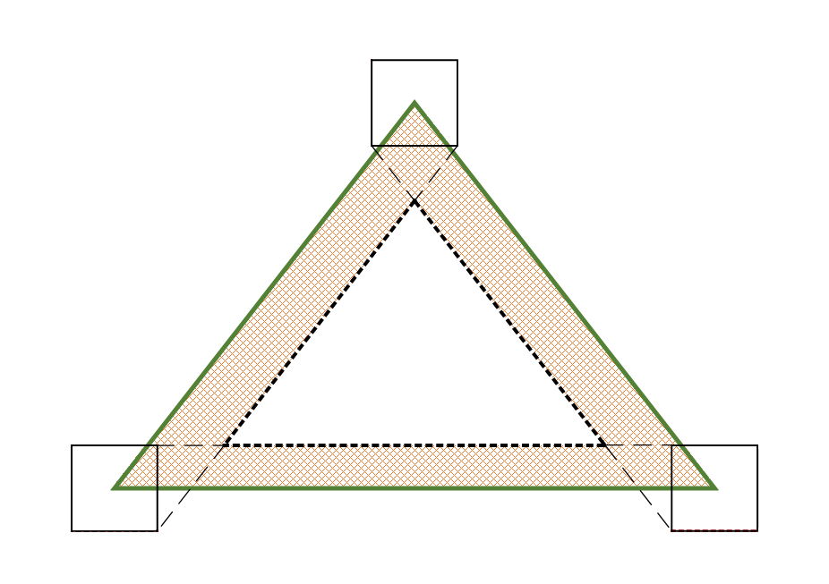<!-- d3d12-review-inline:end:rasterization:C-innercoverage:6 --></ins>


The use of InnerCoverage does not affect whether a pixel is
conservatively rasterized, i.e. using one of these InputCoverage modes
does not affect which pixels are rasterized when Conservative
Rasterization mode is enabled. Therefore, when InnerCoverage is used and
the Pixel Shader is processing a pixel that is not completely covered by
the geometry its value will be 0, but the Pixel Shader invocation will
have samples updated. This is different from when InputCoverage is 0,
meaning that no samples will be updated.

This input is mutually exclusive with InputCoverage: both cannot be
used.

<ins><!-- d3d12-review-inline:begin:rasterization:C-innercoverage:9 -->In DXBC, InnerCoverage is declared as a single component of a Pixel Shader input register with constant interpolation. In DXIL it is not a packed signature element (`NotInSig`); the `InnerCoverage` operation obtains the value.<!-- d3d12-review-inline:end:rasterization:C-innercoverage:9 --></ins>

<ins><!-- d3d12-review-inline:begin:rasterization:C-innercoverage:10 -->The InnerCoverage bitfield is not affected by depth/stencil tests, nor
is it ANDed with the SampleMask Rasterizer state.<!-- d3d12-review-inline:end:rasterization:C-innercoverage:10 --></ins>

This input is only valid in Conservative Rasterization mode. That is to
say, when Conservative Rasterization is not enabled, InnerCoverage
produces an undefined value.

Pixel Shader invocations caused by the need for Helper Pixels, but
otherwise not covered by the primitive, must have the InnerCoverage
register set to 0.

<a id="conservative-attribute-interpolation-interaction"></a>

### Attribute Interpolation interaction

<ins><!-- d3d12-review-inline:begin:rasterization:C-attribute-interpolation-interaction:0 -->Attribute interpolation modes are unchanged and proceed the same way as
when Conservative Rasterization is not enabled, where the
viewport-scaled and fixed-point-converted vertices are used. Because all
samples in a conservatively rasterized pixel are considered covered, it
is valid for values to be extrapolated, similar to when pixel-frequency
interpolation modes are used on a RenderTarget with sample count \> 1
([centroid locations](../archive/D3D11_3_FunctionalSpec.htm#Centroid)). Centroid interpolation modes produce results
identical to the corresponding non-centroid interpolation mode; the
notion of centroid is meaningless in this scenario -- where sample
coverage is only either full or 0.<!-- d3d12-review-inline:end:rasterization:C-attribute-interpolation-interaction:0 --></ins>

Conservative Rasterization allows for degenerate triangles to produce
Pixel Shader invocations, therefore, degenerate triangles must use the
values assigned to Vertex 0 for all interpolated values.

<a id="conservative-clipping-interaction"></a>

### Clipping interaction

When Conservative Rasterization mode is enabled and depth clip is
disabled (i.e. DepthClipEnable Rasterizer State set to FALSE), there may
be variances in attribute interpolation for segments of a primitive that
fall outside the 0 \<= z \<= w range, depending on implementation:
either constant values are used from a point where the primitive
intersects the relevant plane (near or far), or attribute interpolation
behaves as when Conservative Rasterization mode is disabled. However,
the depth value behavior is the same regardless of Conservative
Rasterization mode, i.e. primitives that fall outside of the depth range
must still be given the value of the nearest limit of the viewport depth
range. Attribute interpolation behavior inside the 0 \<= z \<= w range
must remain unchanged.

<a id="conservative-clip-distance-interaction"></a>

### Clip Distance interaction

Clip Distance is valid when Conservative Rasterization mode is enabled,
and behaves for a conservatively rasterized pixel as it does when
Conservative Rasterization is not enabled with all samples covered.

Note that Conservative Rasterization can cause extrapolation of the W
vertex coordinate, which may cause W \<= 0. This could cause per-pixel
Clip Distance implementations to operate on a Clip Distance that has
been Perspective Divided by an invalid W value. Clip Distance
implementations must guard against invoking rasterization for pixels
where vertex coordinate W \<= 0 (e.g. due to extrapolation when in
Conservative Rasterization mode).

<a id="conservative-target-independent-rasterization-interaction"></a>

### Target Independent Rasterization interaction

Conservative Rasterization mode is compatible with TIR. TIR rules and
restrictions apply, behaving for a conservatively rasterized pixel as if
all samples are covered.

<a id="conservative-ia-primitive-topology-interaction"></a>

### IA Primitive Topology interaction

Conservative Rasterization is not defined for line or point primitives.
Therefore, Primitive Topologies that specify points or lines produce
undefined behavior if they are fed to the rasterizer unit when
Conservative Rasterization is enabled.

<ins><!-- d3d12-review-inline:begin:rasterization:C-ia-primitive-topology-interaction:1 -->Point/line topology remains invalid regardless of diagnostic coverage.<!-- d3d12-review-inline:end:rasterization:C-ia-primitive-topology-interaction:1 --></ins>

<a id="conservative-query-interaction"></a>

### Query interaction

<ins><!-- d3d12-review-inline:begin:rasterization:C-query-interaction:0 -->For a conservatively rasterized pixel, D3D12 queries must behave as they
do when Conservative Rasterization is not enabled when all samples are
covered. E.g. For a conservatively rasterized pixel,
D3D12_QUERY_TYPE_OCCLUSION and D3D12_QUERY_DATA_PIPELINE_STATISTICS
must behave as they would when Conservative Rasterization is not enabled
when all samples are covered.<!-- d3d12-review-inline:end:rasterization:C-query-interaction:0 --></ins>

<ins><!-- d3d12-review-inline:begin:rasterization:C-query-interaction:1 -->Pixel Shader invocation counts follow the [canonical pipeline statistics definition](counters-queries-and-predication.md#pipeline-statistics), not a separate count of coverage candidates.<!-- d3d12-review-inline:end:rasterization:C-query-interaction:1 --></ins>

<a id="conservative-cull-state-interaction"></a>

### Cull State interaction

All Cull States are valid in Conservative Rasterization mode and follow
the same rules as when Conservative Rasterization is not enabled.

<ins><!-- d3d12-review-inline:begin:rasterization:C-cull-state-interaction:1 -->*Note: When comparing Conservative Rasterization across resolutions to
itself or without Conservative Rasterization enabled, there is the
possibility that some primitives may have mismatched facedness (i.e. one
back facing, the other front facing). Applications can avoid this
uncertainty by using D3D12_CULL_MODE_NONE and not using the IsFrontFace
System Generated Value.*<!-- d3d12-review-inline:end:rasterization:C-cull-state-interaction:1 --></ins>

<a id="conservative-isfrontface-interaction"></a>

### IsFrontFace interaction

The IsFrontFace System Generated Value is valid to use in Conservative
Rasterization mode, and follows the behavior defined when Conservative
Rasterization is not enabled.

<ins><!-- d3d12-review-inline:begin:rasterization:C-isfrontface-interaction:1 -->Note: see [cull state interaction](#conservative-cull-state-interaction).<!-- d3d12-review-inline:end:rasterization:C-isfrontface-interaction:1 --></ins>

<a id="conservative-fill-modes-interaction"></a>

### Fill Modes interaction

<ins><!-- d3d12-review-inline:begin:rasterization:C-fill-modes-interaction:0 -->The only valid Fill Mode for Conservative Rasterization is
D3D12_FILL_MODE_SOLID, any other Fill Mode is an invalid parameter for the
Rasterizer State.<!-- d3d12-review-inline:end:rasterization:C-fill-modes-interaction:0 --></ins>

<ins><!-- d3d12-review-inline:begin:rasterization:C-fill-modes-interaction:1 -->This is because wireframe behavior specifies that wireframe
Fill Mode should convert triangle edges to lines and follow the line
rasterization rules and conservative line rasterization behavior has not
been defined.<!-- d3d12-review-inline:end:rasterization:C-fill-modes-interaction:1 --></ins>

<a id="conservative-tiers"></a>

### Tiered support

<a id="conservative-tier-1"></a>

#### Tier 1

This tier captures use cases that don't rely on degenerates being
rasterized or inner coverage.

<ins><!-- d3d12-review-inline:begin:rasterization:C-tier-1:1 -->Conservative Rasterization behaves as defined above.<!-- d3d12-review-inline:end:rasterization:C-tier-1:1 --></ins>

<a id="conservative-tier-2"></a>

#### Tier 2

This tier captures use cases that rely on degenerates being rasterized,
such as voxelization.

<ins><!-- d3d12-review-inline:begin:rasterization:C-tier-2:1 -->Conservative Rasterization behaves as defined above, with these additional requirements:<!-- d3d12-review-inline:end:rasterization:C-tier-2:1 --></ins>

<a id="conservative-degenerate-triangle-culling"></a>

##### Degenerate Triangle Culling

Conservative Rasterization must not fail to rasterize pixels that would
be rasterized with full floating point vertex coordinates in the
Rasterizer (note that (especially post-snap) degenerate culling prevents
this from being true).

Therefore, degenerate triangles **must not be culled**, with the
exception that triangles with duplicate indices may be culled. This
simplifies the distinction between Standard and Conservative
Rasterization: standard always has degenerate culling, conservative does
not.

Note that degenerate triangles must be back-facing, so if a specific
behavior is required by an application, it can use back-face culling or
the IsFrontFace System Generated Value.

<a id="conservative-smaller-outer-uncertainty-region"></a>

##### Smaller Outer Uncertainty Region

Pixels that would not be covered if hardware was using floating point
vertex coordinates must only be included if they are within an outer
uncertainty region no larger than the size the subpixel grid, or 1/256
of a pixel as the Rasterizer exists today, in the fixed point domain.
1/256 comes from the 16.8 fixed point Rasterizer coordinate
representation, which can change if the Rasterizer precision changes.
This uncertainty region is enough to account for snapping error caused
by the conversion of floating point vertex coordinates to fixed point
vertex coordinates in the Rasterizer. Note that this requirement
prevents sliver triangles from extending further than necessary.

The previously included outer uncertainty region diagram illustrates
this smaller valid outer uncertainty region when the swept square
measures 1/128 of a pixel in width and height.

<a id="conservative-tier-3"></a>

#### Tier 3

This tier captures use cases that require inner input coverage, such as
occlusion culling.

<ins><!-- d3d12-review-inline:begin:rasterization:C-tier-3:1 -->Conservative Rasterization behaves as defined above (including previous tier requirements), with these additional
requirements:<!-- d3d12-review-inline:end:rasterization:C-tier-3:1 --></ins>

<a id="conservative-inner-conservative-coverage-system-generated-value"></a>

##### Inner-Conservative Coverage System Generated Value

<ins><!-- d3d12-review-inline:begin:rasterization:C-inner-conservative-coverage-system-generated-value:0 -->InnerCoverage System Generated Value is **required**.<!-- d3d12-review-inline:end:rasterization:C-inner-conservative-coverage-system-generated-value:0 --></ins>

---

<a id="conservative-vrs"></a>

### Coarse shading interaction

<ins><!-- d3d12-review-inline:begin:rasterization:V-conservative-vrs:0 -->Conservative rasterization is allowed to be used with variable rate shading. It is fully orthogonal with coarse pixel shading for VRS Tier 2 devices and higher; on some VRS Tier 1 devices, it may cause drop-down into fine shading. In any case, when conservative rasterization is used with coarse pixel shading, fine pixels within coarse pixels are conservatively rasterized by being given full coverage.<!-- d3d12-review-inline:end:rasterization:V-conservative-vrs:0 --></ins>

Given conservative rasterization is applied on a fine-pixel basis, SV_InnerCoverage also operates on a fine-pixel basis when coarse shading is used.

<ins><!-- d3d12-review-inline:begin:rasterization:V-conservative-vrs:2 -->The mapping of cover-able samples to bits in SV_InnerCoverage follows the same scheme as [SV_Coverage](pixel-shaders.md#vrs-sv_coverage).<!-- d3d12-review-inline:end:rasterization:V-conservative-vrs:2 --></ins>

For SV_InnerCoverage:
* If a fine pixel has partial or no coverage, the corresponding bits for that fine pixel are set to 0.
* And if a fine pixel has full coverage, the corresponding bits for that fine pixel are set to 1.

#### Coverage
When conservative rasterization is used, the coverage semantic contains full masks for fine pixels that are covered and 0 for fine pixels that are not covered.

#### An intersection: coarse shading, conservative rasterization, and centroid
<!-- d3d12-review-context:begin:rasterization:V-conservative-vrs:7 -->

> [!WARNING]
> **Mixed source and authored adaptation - human review pending.**

According to the [conservative interpolation rule](#conservative-attribute-interpolation-interaction),
> centroid interpolation modes produce results identical to the corresponding non-centroid interpolation mode

<!-- d3d12-review-context:end:rasterization:V-conservative-vrs:7 -->

<ins><!-- d3d12-review-inline:begin:rasterization:V-conservative-vrs:8 -->The above concept still holds when using coarse pixel shading. When coarse shading with conservative rasterization on VRS Tier 2 or coarse-shading-compatible VRS Tier 1 platforms, centroid interpolation is simply treated as center.<!-- d3d12-review-inline:end:rasterization:V-conservative-vrs:8 --></ins>

<a id="programmable-samples"></a>

## Programmable sample positions

<!-- d3d12-review-alert:begin:rasterization:N-resource-operations-sample-consumer:0 -->

> [!WARNING]
> **Authored synthesis - human review pending.**
>
> The full ordinary [copy](resource-operations.md#copy-commands), [clear](resource-operations.md#clear-commands) and [resolve](resource-operations.md#resolve-commands) entries link these operation-specific sample pattern requirements. Format/region/capability rules do not erase the source/destination depth pattern identity defined here.

<!-- d3d12-review-alert:end:rasterization:N-resource-operations-sample-consumer:0 -->

<!-- d3d12-review-alert:begin:rasterization:N-pattern-operation-scope:0 -->

> [!WARNING]
> **Authored synthesis - human review pending.**
>
> The rules below add sample pattern requirements to operations that are otherwise valid under their own API/resource contracts. They do not expand the allowed copy regions, formats, resource states/layouts or resolve modes.

<!-- d3d12-review-alert:end:rasterization:N-pattern-operation-scope:0 -->

<a id="sample-position-coordinates"></a>

### Position coordinates

Sample positions have the origin (0,0) at the pixel center.

X spans [-8..7], left to right.

Y spans [-8..7], top to bottom.

So the right and bottom edges of a pixel are not reachable by samples
(the neighboring pixels get them). Positions outside this range are
invalid.

Integer position values represent 1/16ths of a pixel. So for example
integer position (-8,4) means (-0.5,0.25) in floating point.

---

<!-- d3d12-review-alert:begin:rasterization:N-programmable-tiers:0 -->

> [!WARNING]
> **Authored synthesis - human review pending.**
>
> `OPTIONS2.ProgrammableSamplePositionsTier` controls support. Tier 0 has no programmable positions. Tier 1 accepts one repeated pixel pattern and 2x/4x/8x sample counts. Tier 2 accepts one or four pixel patterns and additionally allows 1x/16x, subject to the total of at most 16 programmed positions. A four-pixel pattern therefore has at most four samples per pixel.

<!-- d3d12-review-alert:end:rasterization:N-programmable-tiers:0 -->

<!-- d3d12-review-alert:begin:rasterization:N-programmable-tiers:1 -->

> [!WARNING]
> **Authored synthesis - human review pending.**
>
> Position ordering is all samples of the upper-left pixel, then upper-right, lower-left and lower-right. A four-pixel pattern repeats over render target/viewport coordinates aligned to even pixel coordinates. The position list also determines centroid sample priority.

<!-- d3d12-review-alert:end:rasterization:N-programmable-tiers:1 -->

<a id="sample-clear-rendertarget"></a>

### Clear RenderTarget

Sample positions are ignored when clearing an RT.

<a id="sample-clear-depthstencil"></a>

### Clear DepthStencil

Sample positions set at time of clearing of the *depth* portion of a
depth/stencil surface must be configured consistently with future
rendering to the cleared portion of the surface, and the contents of any
uncleared region become undefined if they contain content that was
produced with a different sample pattern.

Sample positions set at time of clearing of the *stencil* portion of a
depth/stencil are ignored.

<a id="sample-draw-using-rendertarget"></a>

### Draw using RenderTarget

Sample positions can be changed between rendering to an RT via separate
draws, whether for separate areas of the RT or even rendering to the
same pixels. At any given draw, the current sample locations dictate the
semantics, and whatever colors happen to be in the RT get used as the
colors for the current sample locations (even if the colors got there
from being rendered with different sample locations).

<a id="sample-draw-using-depthstencil"></a>

### Draw using DepthStencil

Draws to read/writing DepthStencil surface must be done with the current
sample positions matching the sample positions set at the previous clear
(for the region being rendered).

To use a different sample position state, the region to be rendered in
the surface must be Cleared first. The state of pixels outside the clear
region is unaffected.

*Implementations may store plane equations for depth as an optimization,
evaluating the plane equations to produce specific depth values when the
application issues a read. Only the rasterizer and Output Merger's
depth/stencil portion are required to be able to correctly sample at
programmed sample locations when reading/writing Depth. Any other read
or write of a depth buffer that has been rendered with programmed sample
positions may ignore the programmed locations and instead sample at the
standard/default sample positions.*

<a id="sample-resolve-rendertarget"></a>

### Resolve RenderTarget

Sample positions are ignored when using the Resolve*() APIs on
RenderTargets. These APIs simply operate on stored color values.

<a id="sample-resolve-depthstencil"></a>

### Resolve DepthStencil

Currently set sample positions at calls to Resolve*() on the depth
portion of depth/stencil surfaces must match the sample positions used
when previously writing to the area being resolved.

Currently set sample positions at calls to Resolve*() on the stencil
portion of depth/stencil surfaces are ignored. Just like RenderTarget
resolves, stencil resolves just operate on the stored values.

<a id="sample-copy-rendertarget"></a>

### Copy RenderTarget

Sample positions are ignored when using RenderTarget data as input to
Copy*() APIs, regardless of full or partial copy.

<a id="sample-copy-depthstencil-full-subresource"></a>

### Copy DepthStencil (Full Subresource)

Full subresource DepthStencil copies via Copy*() APIs require sample
positions to be set, matching content in the source. Not all
implementations need this, but the API simply requires this uniformly.
On some hardware the implementation details in the source surface (such
as stored plane equations for depth values) transfer to the destination.
So if the destination content is subsequently drawn to, the sample
positions originally used to generate the source content need to be used
with the destination surface. The API requires this on all hardware for
consistency even if it may only apply to some.

<a id="sample-copy-depthstencil-partial-subresource"></a>

### Copy DepthStencil (Partial Subresource)

Partial subresource copies via Copy*() APIs of the *depth* portion of
DepthStencil require sample positions to be set, matching content in the
source, similar to full resource copies. If any content in affected
destination subresources is only partially covered by the copy, the
contents of the uncovered portion within those subresources becomes
undefined unless all of it was generated using the same sample positions
as the copy source.

Partial subresource copies via Copy* APIs of the *stencil* portion of
DepthStencil ignore the currently set sample positions and it doesn't
matter what sample positions were used to generate content for any other
areas of the destination buffer not covered by the copy -- those
contents remain valid.

<a id="sample-shader-samplepos"></a>

### Shader SamplePos

The HLSL SamplePos intrinsic is not aware of programmable sample
positions and results returned to shaders calling this on a surface
rendered with programmable positions is undefined. Applications must
pass coordinates into their shader manually if needed. Similarly
evaluating attributes by sample index is undefined with programmable
sample positions.

<a id="sample-transitioning-out-of-depth_read-or-depth_write-state"></a>

### Transitioning out of DEPTH_READ or DEPTH_WRITE state

If a subresource in DEPTH_* state is transitioned to any other state,
including even COPY_SOURCE or RESOLVE_SOURCE, some implementations may
need to perform a decompress on the surface. Therefore, the same sample
positions used to put content into the source surface must be set on the
command list. Furthermore, any subsequent transitions of the surface,
with the same depth data remaining in it, must continue to be done with
the same sample positions set on the command list.

If an application wants to minimize the decompressed area (knowing only
a portion needs to be used) and/or preserve compression,
ResolveSubresourceRegion() can be called in DECOMPRESS mode with a rect
specified. This will decompress just the relevant area to a separate
resource, leaving the source intact *on some implementations*, though on
others implementations even the source area gets decompressed. The
separate explicitly decompressed resource (which may be a smaller size)
can then be transitioned to the desired state (such as
SHADER_RESOURCE).

<a id="sample-transitioning-out-of-render_target-state"></a>

### Transitioning out of RENDER_TARGET state

If a subresource in RENDER_TARGET state is transitioned to anything
other than COPY_SOURCE or RESOLVE_SOURCE, some implementations may
need to perform a decompress on the surface. This decompression is
agnostic to sample patterns, so the currently set sample positions don't
matter.

If an application wants to minimize the decompressed area (knowing only
a portion needs to be used) and/or preserve compression,
ResolveSubresourceRegion() can be called in DECOMPRESS mode with a rect
specified. This will decompress just the relevant area to a separate
resource leaving the source intact *on some implementations*, though on
others implementations even the source area gets decompressed. The
separate explicitly decompressed resource (which may be a smaller size)
can then be transitioned to the desired state (such as
SHADER_RESOURCE).

<!-- d3d12-review-alert:begin:rasterization:N-enhanced-patterns:0 -->

> [!WARNING]
> **Authored synthesis - human review pending.**
>
> These pattern requirements apply to depth content and decompression, not only to the spelling of a legacy state transition. Enhanced barrier layouts/accesses follow [Synchronization](synchronization.md#layout-transitions); using that model does not erase the sample pattern identity required by the operation. The current depth data retains its pattern requirement through subsequent transitions. With coarse shading, programmed positions remain positions of fine pixels, as defined by [VRS](pixel-shaders.md#vrs-sv_coverage).

<!-- d3d12-review-alert:end:rasterization:N-enhanced-patterns:0 -->

<a id="rasterizer-apis"></a>

## Rasterizer binding APIs

<a id="rssetviewports"></a>

### ID3D12GraphicsCommandList::RSSetViewports

#### Declaration

```cpp
void RSSetViewports(
        UINT NumViewports,
        const D3D12_VIEWPORT* pViewports
        );
```

#### Behavior

Bind an array of viewports to the rasterizer stage of the pipeline.

#### Parameters

`[in] NumViewports`

Type: **UINT**

<ins><!-- d3d12-review-inline:begin:rasterization:P-RSSetViewports:2 -->Number of viewports to bind. The range of valid values is 0 through 16 inclusive.<!-- d3d12-review-inline:end:rasterization:P-RSSetViewports:2 --></ins>

`[in] pViewports`

Type: **const [D3D12_VIEWPORT](#d3d12-viewport)\***

An array of [D3D12_VIEWPORT](#d3d12-viewport) structures to bind to the device.

#### Return values

<!-- d3d12-review-alert:begin:rasterization:R-RSSetViewports:0 -->

> [!WARNING]
> **Authored synthesis - human review pending.**
>
> None

<!-- d3d12-review-alert:end:rasterization:R-RSSetViewports:0 -->

#### Recording and state

All viewports must be set atomically as one operation. Any viewports not defined by the call are disabled.

<!-- d3d12-review-alert:begin:rasterization:N-RSSetViewports-recording:0 -->

> [!WARNING]
> **Authored synthesis - human review pending.**
>
> This setter is valid on DIRECT command lists, not COMPUTE/COPY lists or bundles. It is permitted both inside and outside a render pass, subject to the [canonical render pass context](command-list-state.md#render-pass). Bundles inherit the parent's viewport/scissor state without setting it. Initial/reset state and subsequent inheritance follow the [canonical base-graphics state](command-list-state.md#base-graphics). Selection follows the [primitive viewport/scissor index](#viewport-selection), including allowed non-GS producers.

<!-- d3d12-review-alert:end:rasterization:N-RSSetViewports-recording:0 -->

<a id="rssetscissorrects"></a>

### ID3D12GraphicsCommandList::RSSetScissorRects

#### Declaration

```cpp
void RSSetScissorRects(
        UINT NumRects,
        const D3D12_RECT* pRects
        );
```

#### Behavior

Binds an array of scissor rectangles to the rasterizer stage.

#### Parameters

`[in] NumRects`

Type: **UINT**

<ins><!-- d3d12-review-inline:begin:rasterization:P-RSSetScissorRects:2 -->The number of scissor rectangles to bind, from 0 through 16 inclusive.<!-- d3d12-review-inline:end:rasterization:P-RSSetScissorRects:2 --></ins>

`[in] pRects`

Type: **const D3D12\_RECT\***

An array of scissor rectangles.

#### Return values

<!-- d3d12-review-alert:begin:rasterization:R-RSSetScissorRects:0 -->

> [!WARNING]
> **Authored synthesis - human review pending.**
>
> None

<!-- d3d12-review-alert:end:rasterization:R-RSSetScissorRects:0 -->

#### Recording and state

All scissor rectangles must be set atomically as one operation. Any scissor rectangles not defined by the call are disabled.

<!-- d3d12-review-alert:begin:rasterization:N-RSSetScissorRects-recording:0 -->

> [!WARNING]
> **Authored synthesis - human review pending.**
>
> This setter is valid on DIRECT command lists, not COMPUTE/COPY lists or bundles. It is permitted both inside and outside a render pass, subject to the [canonical render pass context](command-list-state.md#render-pass). Bundles inherit the parent's viewport/scissor state without setting it. Initial/reset state and subsequent inheritance follow the [canonical base-graphics state](command-list-state.md#base-graphics). Selection follows the [primitive viewport/scissor index](#viewport-selection), including allowed non-GS producers.

<!-- d3d12-review-alert:end:rasterization:N-RSSetScissorRects-recording:0 -->

<a id="rssetdepthbias"></a>

### ID3D12GraphicsCommandList9::RSSetDepthBias

#### Declaration

```cpp
void RSSetDepthBias(
        FLOAT DepthBias,
        FLOAT DepthBiasClamp,
        FLOAT SlopeScaledDepthBias
    );
```

#### Behavior

<!-- d3d12-review-alert:begin:rasterization:N-dynamic-bias-behavior:0 -->

> [!WARNING]
> **Authored synthesis - human review pending.**
>
> Changes the current `DepthBias`, `DepthBiasClamp` and `SlopeScaledDepthBias` for subsequent draws. The selected PSO must permit dynamic depth bias, using `D3D12_PIPELINE_STATE_FLAG_DYNAMIC_DEPTH_BIAS`, and the device must support `OPTIONS16.DynamicDepthBiasSupported`. It does not modify the PSO description.

<!-- d3d12-review-alert:end:rasterization:N-dynamic-bias-behavior:0 -->

#### Parameters

<!-- d3d12-review-alert:begin:rasterization:N-dynamic-bias-parameters:0 -->

> [!WARNING]
> **Authored synthesis - human review pending.**
>
> `DepthBias`: float constant bias value used by the [depth bias equation](#depth-bias).

<!-- d3d12-review-alert:end:rasterization:N-dynamic-bias-parameters:0 -->

<!-- d3d12-review-alert:begin:rasterization:N-dynamic-bias-parameters:1 -->

> [!WARNING]
> **Authored synthesis - human review pending.**
>
> `DepthBiasClamp`: signed clamp on the calculated bias; zero disables bias clamping.

<!-- d3d12-review-alert:end:rasterization:N-dynamic-bias-parameters:1 -->

<!-- d3d12-review-alert:begin:rasterization:N-dynamic-bias-parameters:2 -->

> [!WARNING]
> **Authored synthesis - human review pending.**
>
> `SlopeScaledDepthBias`: coefficient multiplied by the maximum depth slope when nonzero.

<!-- d3d12-review-alert:end:rasterization:N-dynamic-bias-parameters:2 -->

#### Return values

<!-- d3d12-review-alert:begin:rasterization:R-RSSetDepthBias:0 -->

> [!WARNING]
> **Authored synthesis - human review pending.**
>
> None

<!-- d3d12-review-alert:end:rasterization:R-RSSetDepthBias:0 -->

#### Recording and state

<!-- d3d12-review-alert:begin:rasterization:N-dynamic-bias-recording:0 -->

> [!WARNING]
> **Authored synthesis - human review pending.**
>
> The call is valid on DIRECT command lists and bundles, not COMPUTE/COPY lists. It is permitted inside and outside a render pass. A bundle executes under its parent's [render pass context](command-list-state.md#render-pass). Bundle changes persist on return. Setting a PSO again restores its described bias values even when its dynamic flag is present. The [canonical dynamic state contract](command-list-state.md#dynamic-state) governs selection and inheritance.

<!-- d3d12-review-alert:end:rasterization:N-dynamic-bias-recording:0 -->

<a id="setsamplepositions"></a>

### ID3D12GraphicsCommandList1::SetSamplePositions

#### Declaration

```cpp
void SetSamplePositions(
        UINT NumSamplesPerPixel,
        UINT NumPixels,
        D3D12_SAMPLE_POSITION* pSamplePositions
        );
```

#### Behavior

This method configures the sample positions used by subsequent draw, copy, resolve, and similar operations.

<!-- d3d12-review-alert:begin:rasterization:N-sample-availability:0 -->

> [!WARNING]
> **Authored synthesis - human review pending.**
>
> The setter requires programmable sample position Tier 1 or Tier 2 support. Calling it on a device without Tier 1 support causes device removal; resetting the position pattern does not bypass feature availability.

<!-- d3d12-review-alert:end:rasterization:N-sample-availability:0 -->

#### Parameters

`[in] NumSamplesPerPixel`

Type: **UINT**

<ins><!-- d3d12-review-inline:begin:rasterization:P-SetSamplePositions:2 -->Specifies the number of samples to take, per pixel. This value can be 1, 2, 4, 8, or 16, otherwise the custom-pattern arguments are invalid. The number of samples must match the sample count configured in the PSO at draw time, otherwise the behavior is undefined.<!-- d3d12-review-inline:end:rasterization:P-SetSamplePositions:2 --></ins>

`[in] NumPixels`

Type: **UINT**

<ins><!-- d3d12-review-inline:begin:rasterization:P-SetSamplePositions:5 -->Specifies the number of pixels that sample patterns are being specified for. This value can be either 1 or 4, otherwise the custom-pattern arguments are invalid. A value of 1 configures a single sample pattern to be used for each pixel; a value of 4 configures separate sample patterns for each pixel in a 2x2 pixel grid which is repeated over the render-target or viewport space, aligned to even coordinates.<!-- d3d12-review-inline:end:rasterization:P-SetSamplePositions:5 --></ins>

<ins><!-- d3d12-review-inline:begin:rasterization:P-SetSamplePositions:6 -->Note that the maximum number of combined samples can't exceed 16, otherwise the custom-pattern arguments are invalid. If NumPixels is set to 4, NumSamplesPerPixel can specify no more than 4 samples.<!-- d3d12-review-inline:end:rasterization:P-SetSamplePositions:6 --></ins>

`[in] pSamplePositions`

Type: **[D3D12_SAMPLE_POSITION](#d3d12-sample-position)\***

Specifies an array of D3D12\_SAMPLE\_POSITION elements. The size of the array is NumPixels \* NumSamplesPerPixel. If NumPixels is set to 4, then the first group of sample positions corresponds to the upper-left pixel in the 2x2 grid of pixels; the next group of sample positions corresponds to the upper-right pixel, the next group to the lower-left pixel, and the final group to the lower-right pixel.

<ins><!-- d3d12-review-inline:begin:rasterization:P-SetSamplePositions:10 -->If centroid interpolation is used during rendering, the order of positions for each pixel determines centroid-sampling priority. When the centroid rule selects a covered sample, the first covered sample in the order specified is chosen. This priority does not replace the [full-coverage pixel center exception](pixel-shaders.md#centroid).<!-- d3d12-review-inline:end:rasterization:P-SetSamplePositions:10 --></ins>

#### Return values

<!-- d3d12-review-alert:begin:rasterization:R-SetSamplePositions:0 -->

> [!WARNING]
> **Authored synthesis - human review pending.**
>
> None

<!-- d3d12-review-alert:end:rasterization:R-SetSamplePositions:0 -->

#### Recording, reset and operation constraints

<!-- d3d12-review-alert:begin:rasterization:N-sample-recording:0 -->

> [!WARNING]
> **Authored synthesis - human review pending.**
>
> `SetSamplePositions(0,0,NULL)` restores default positions. This explicit reset is the exception to the nonzero custom-pattern parameter combinations above. The operation otherwise obeys its reported [tier and pattern shape](#programmable-samples).

<!-- d3d12-review-alert:end:rasterization:N-sample-recording:0 -->

<!-- d3d12-review-alert:begin:rasterization:N-sample-recording:1 -->

> [!WARNING]
> **Authored synthesis - human review pending.**
>
> DIRECT command lists and bundles may set sample positions. COMPUTE/COPY lists may not. Bundles inherit the pattern and changes persist on return, following the [established current state contract](command-list-state.md#sample-positions).

<!-- d3d12-review-alert:end:rasterization:N-sample-recording:1 -->

<!-- d3d12-review-alert:begin:rasterization:N-sample-recording:2 -->

> [!WARNING]
> **Authored synthesis - human review pending.**
>
> The setter is permitted inside and outside render passes, including under the parent's [render pass context](command-list-state.md#render-pass) when called from a bundle. This permission does not waive depth content/pattern compatibility with clears or drawing.

<!-- d3d12-review-alert:end:rasterization:N-sample-recording:2 -->

<!-- d3d12-review-alert:begin:rasterization:N-sample-recording:3 -->

> [!WARNING]
> **Authored synthesis - human review pending.**
>
> At draw, the programmed sample count must match the effective PSO/forced sample count. The [operation-specific pattern requirements](#programmable-samples) apply to subsequent depth clears, drawing, copies, resolves and decompression/transitions, not just draw calls. Invalid custom-pattern arguments are not guaranteed to be dropped by retail recording. Parameter validity and pattern compatibility remain requirements even when diagnostics cannot prove the content history of a resource.

<!-- d3d12-review-alert:end:rasterization:N-sample-recording:3 -->

<a id="viewport-state"></a>

## Supporting API types

<a id="d3d12-viewport"></a>

### D3D12_VIEWPORT

```cpp
typedef struct D3D12_VIEWPORT
{
    FLOAT TopLeftX;
    FLOAT TopLeftY;
    FLOAT Width;
    FLOAT Height;
    FLOAT MinDepth;
    FLOAT MaxDepth;
} D3D12_VIEWPORT;
```

<a id="d3d12-sample-position"></a>

### D3D12_SAMPLE_POSITION

```cpp
typedef struct D3D12_SAMPLE_POSITION
{
    INT8 X;
    INT8 Y;
} D3D12_SAMPLE_POSITION;
```

<a id="d3d12-rect"></a>

### D3D12_RECT

```cpp
typedef struct tagRECT {
  LONG left;
  LONG top;
  LONG right;
  LONG bottom;
} RECT, *PRECT, *NPRECT, *LPRECT;
```

```cpp
typedef RECT D3D12_RECT;
```

<!-- d3d12-review-alert:begin:rasterization:N-rect-fields:0 -->

> [!WARNING]
> **Authored synthesis - human review pending.**
>
> `RECT` has signed `LONG` members `left`, `top`, `right` and `bottom`. The right and bottom edges are excluded.

<!-- d3d12-review-alert:end:rasterization:N-rect-fields:0 -->

<a id="driver"></a>

## Driver responsibilities and validation boundaries

```cpp
typedef VOID(APIENTRY* PFND3D12DDI_SET_DEPTH_BIAS_STATE_0099)(
    D3D12DDI_HCOMMANDLIST, FLOAT DepthBias, FLOAT DepthBiasClamp, FLOAT SlopeScaledDepthBias);
```

<!-- d3d12-review-alert:begin:rasterization:N-driver:1 -->

> [!WARNING]
> **Authored synthesis - human review pending.**
>
> Driver PSO selection restores the PSO's depth bias and strip-cut values even when dynamic state is enabled. See [dynamic pipeline state](command-list-state.md#dynamic-state).

<!-- d3d12-review-alert:end:rasterization:N-driver:1 -->

<a id="driver-state"></a>

### Rasterizer recording state DDIs

```cpp
typedef struct D3D12DDI_VIEWPORT
{
    FLOAT TopLeftX;
    FLOAT TopLeftY;
    FLOAT Width;
    FLOAT Height;
    FLOAT MinDepth;
    FLOAT MaxDepth;
} D3D12DDI_VIEWPORT;

typedef struct D3D12DDI_SAMPLE_POSITION
{
    INT8 X;
    INT8 Y;
} D3D12DDI_SAMPLE_POSITION;

typedef RECT D3D12DDI_RECT;
```

```cpp
typedef VOID ( APIENTRY* PFND3D12DDI_RS_SETVIEWPORTS_0003 )(
    D3D12DDI_HCOMMANDLIST, _In_range_(0, D3D12_VIEWPORT_AND_SCISSORRECT_OBJECT_COUNT_PER_PIPELINE) UINT Count, _In_reads_(Count) CONST D3D12DDI_VIEWPORT* );

typedef VOID ( APIENTRY* PFND3D12DDI_RS_SETSCISSORRECTS_0003 )(
    D3D12DDI_HCOMMANDLIST, _In_range_(0, D3D12_VIEWPORT_AND_SCISSORRECT_OBJECT_COUNT_PER_PIPELINE) UINT Count, _In_reads_(Count) CONST D3D12DDI_RECT* );

typedef VOID ( APIENTRY* PFND3D12DDI_SETSAMPLEPOSITIONS_0027 )(
    D3D12DDI_HCOMMANDLIST,
    UINT NumSamplesPerPixel,
    UINT NumPixels,
    __in_ecount(NumSamplesPerPixel*NumPixels) D3D12DDI_SAMPLE_POSITION* pSamplePositions
);
```

<!-- d3d12-review-alert:begin:rasterization:GS-R-associations:0 -->

> [!WARNING]
> **Authored synthesis - human review pending.**
>
> | Driver entry | Canonical API contract |
> |---|---|
> | `PFND3D12DDI_RS_SETVIEWPORTS_0003` | [RSSetViewports](#rssetviewports): replace the complete counted viewport set |
> | `PFND3D12DDI_RS_SETSCISSORRECTS_0003` | [RSSetScissorRects](#rssetscissorrects): replace the complete counted scissor set |
> | `PFND3D12DDI_SETSAMPLEPOSITIONS_0027` | [SetSamplePositions](#setsamplepositions): the declared pixel/sample dimensions and ordered sample position pattern |
> | `PFND3D12DDI_SET_DEPTH_BIAS_STATE_0099` | [RSSetDepthBias](#rssetdepthbias): constant bias, clamp and slope-scaled bias, with the API's capability/PSO permission requirements |

<!-- d3d12-review-alert:end:rasterization:GS-R-associations:0 -->

<!-- d3d12-review-alert:begin:rasterization:GS-R-roles:0 -->

> [!WARNING]
> **Authored synthesis - human review pending.**
>
> The driver captures viewport and scissor array values during the call.

<!-- d3d12-review-alert:end:rasterization:GS-R-roles:0 -->

<a id="driver-raster-state-forms"></a>

#### Current rasterizer state representations

<!-- d3d12-review-alert:begin:rasterization:FC-raster-roles:0 -->

> [!WARNING]
> **Authored synthesis - human review pending.**
>
> The `_0114` rasterizer setters participate in [runtime bypass](execution.md#work-command-handles).

<!-- d3d12-review-alert:end:rasterization:FC-raster-roles:0 -->

<!-- d3d12-review-alert:begin:rasterization:FC-raster-roles:1 -->

> [!WARNING]
> **Authored synthesis - human review pending.**
>
> | Member in each table | Ordinary type | API handle type | API contract |
> |---|---|---|---|
> | `pfnRsSetViewports` | `PFND3D12DDI_RS_SETVIEWPORTS_0003` | `PFND3D12DDI_RS_SETVIEWPORTS_0114` | [RSSetViewports](#rssetviewports) |
> | `pfnRsSetScissorRects` | `PFND3D12DDI_RS_SETSCISSORRECTS_0003` | `PFND3D12DDI_RS_SETSCISSORRECTS_0114` | [RSSetScissorRects](#rssetscissorrects) |
> | `pfnSetSamplePositions` | `PFND3D12DDI_SETSAMPLEPOSITIONS_0027` | `PFND3D12DDI_SETSAMPLEPOSITIONS_0114` | [SetSamplePositions](#setsamplepositions) |
> | `pfnRSSetDepthBias` | `PFND3D12DDI_SET_DEPTH_BIAS_STATE_0099` | `PFND3D12DDI_SET_DEPTH_BIAS_STATE_0114` | [RSSetDepthBias](#rssetdepthbias) |

<!-- d3d12-review-alert:end:rasterization:FC-raster-roles:1 -->

```cpp
typedef VOID ( APIENTRY* PFND3D12DDI_RS_SETVIEWPORTS_0114 )(D3D12DDI_API_HCOMMANDLIST, _In_range_(0, D3D12_VIEWPORT_AND_SCISSORRECT_OBJECT_COUNT_PER_PIPELINE) UINT Count, _In_reads_(Count) CONST D3D12DDI_VIEWPORT* );
typedef VOID ( APIENTRY* PFND3D12DDI_RS_SETSCISSORRECTS_0114 )(D3D12DDI_API_HCOMMANDLIST, _In_range_(0, D3D12_VIEWPORT_AND_SCISSORRECT_OBJECT_COUNT_PER_PIPELINE) UINT Count, _In_reads_(Count) CONST D3D12DDI_RECT* );
typedef VOID ( APIENTRY* PFND3D12DDI_SETSAMPLEPOSITIONS_0114 )(D3D12DDI_API_HCOMMANDLIST, UINT NumSamplesPerPixel, UINT NumPixels, __in_ecount(NumSamplesPerPixel*NumPixels) D3D12DDI_SAMPLE_POSITION* pSamplePositions);
typedef VOID ( APIENTRY* PFND3D12DDI_SET_DEPTH_BIAS_STATE_0114)(D3D12DDI_API_HCOMMANDLIST, FLOAT, FLOAT, FLOAT);
```

<!-- d3d12-review-alert:begin:rasterization:FC-array-values:1 -->

> [!WARNING]
> **Authored synthesis - human review pending.**
>
> The driver captures custom sample positions during the call.

<!-- d3d12-review-alert:end:rasterization:FC-array-values:1 -->

<!-- d3d12-review-alert:begin:rasterization:FC-bias-values:0 -->

> [!WARNING]
> **Authored synthesis - human review pending.**
>
> Dynamic depth bias DDIs receive floating-point `DepthBias`, `DepthBiasClamp` and `SlopeScaledDepthBias`, including in the API handle form.

<!-- d3d12-review-alert:end:rasterization:FC-bias-values:0 -->


