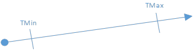
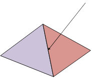
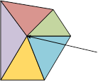
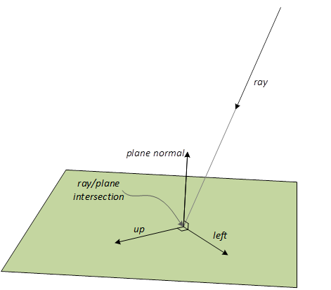
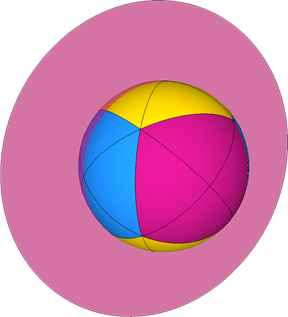
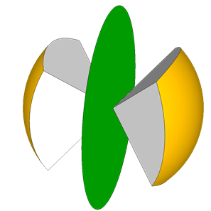
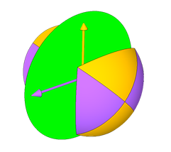
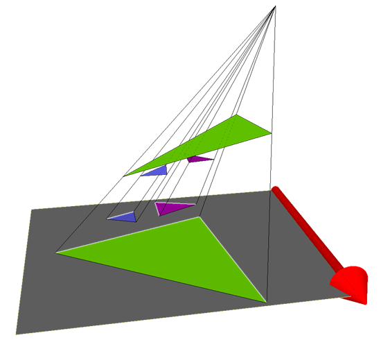
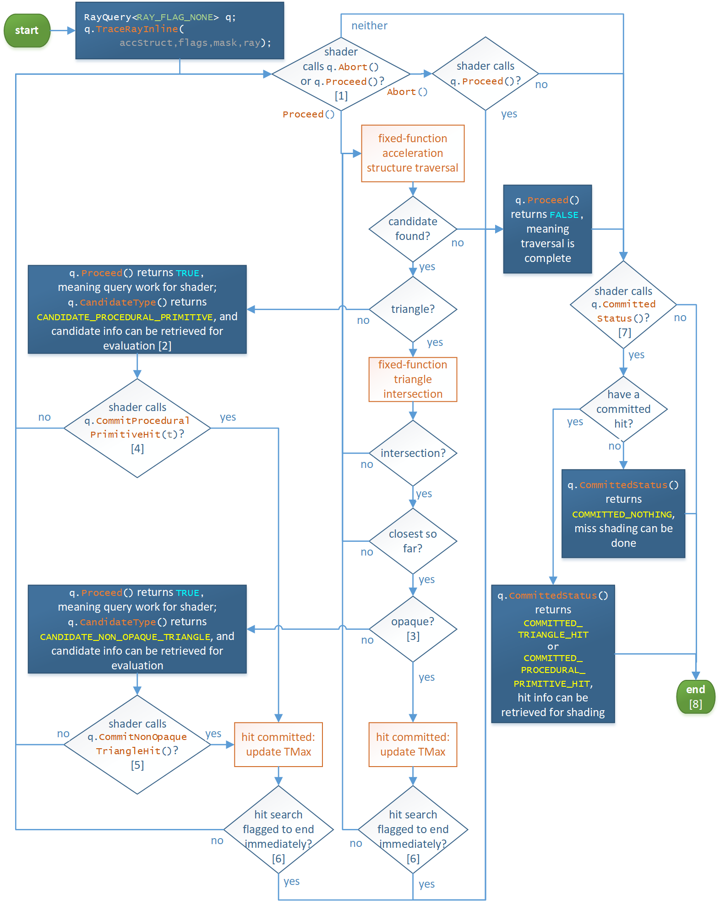
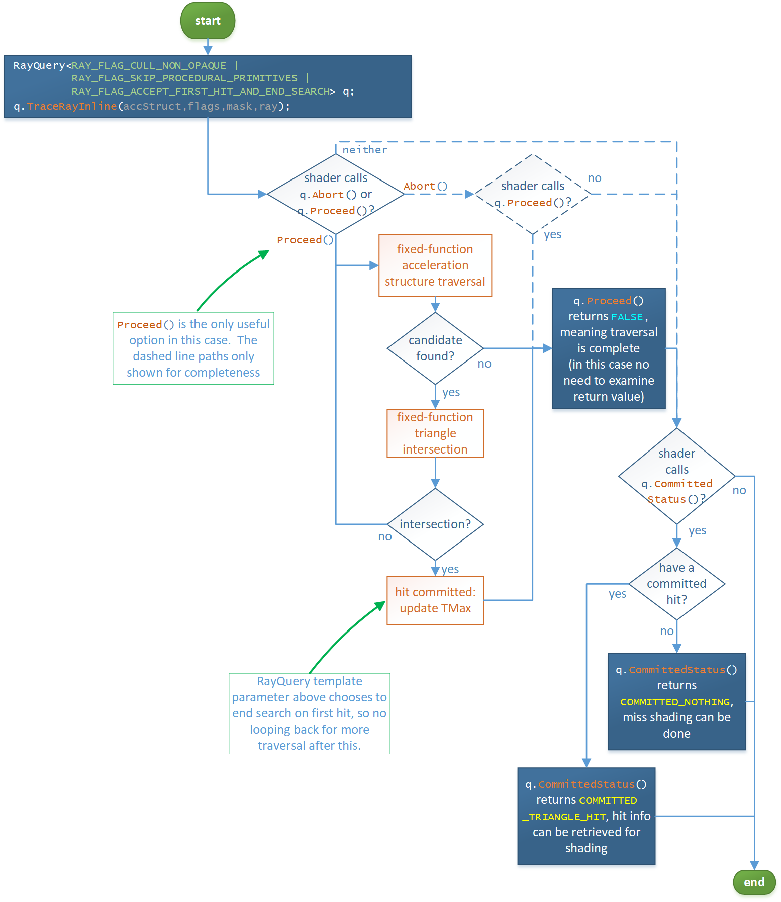

<a id="ray-traversal-and-inline-raytracing"></a>

# Ray traversal and inline raytracing

<!-- d3d12-review-legend:begin -->

> [!NOTE]
> **Draft provenance annotations.**
> Underlining marks pending replacement wording or authored list items. Warning boxes
> mark authored, mixed or reopened passages awaiting editorial review.
> Editorial adoption does not establish factual or hardware verification. Exact approved factual
> corrections do not trigger a marker. Unmarked text elsewhere, declarations
> and structural Markdown are not assertions of approval.
> [Annotation scope and approvals](../../spec-maintenance/d3d12/prose-annotations.md).

<!-- d3d12-review-legend:end -->

<!-- d3d12-review-alert:begin:ray-traversal:N-scope:0 -->

> [!WARNING]
> **Authored synthesis - human review pending.**
>
> This chapter defines the shared ray-intersection and traversal contract, including inline raytracing through HLSL `RayQuery` objects. The calling shader drives an inline query; inline traversal does not invoke separate raytracing shaders.

<!-- d3d12-review-alert:end:ray-traversal:N-scope:0 -->

<!-- d3d12-review-alert:begin:ray-traversal:N-owners:0 -->

> [!WARNING]
> **Authored synthesis - human review pending.**
>
> The scene representation, build and update rules, determinism, inactive and degenerate geometry, and opacity-micromap storage are defined in [Acceleration structures](acceleration-structures.md). The [Acceleration-structure SRVs](binding.md#acceleration-structure-srvs) section defines binding, including the distinction between a NULL acceleration structure and an uninitialized root argument. [State objects](state-objects.md) defines pipeline configuration declarations. Shared [shader execution](common-shader-internals.md) and [synchronization](synchronization.md) retain their own contracts. The dynamic-shader traversal entrypoint and its shader interactions are defined in [TraceRay](raytracing-pipelines.md#traceray) and [TraceRay control flow](raytracing-pipelines.md#traceray-control-flow).

<!-- d3d12-review-alert:end:ray-traversal:N-owners:0 -->

<a id="rays"></a>

## Rays

A ray is: an origin, direction and parametric interval (TMin, TMax) in
which intersections may occur at T locations along the interval. To be
concrete, positions along the ray are: origin + T*direction (the
direction does not get normalized).

There is some nuance to the exact bounds used, (TMin..TMax) vs \[TMin...TMax\]
for intersections to count, depending on the geometry type, defined in [ray extents](#ray-extents).

A ray is accompanied by a user defined payload that is modifiable as the
ray interacts with geometry in a scene and also visible to the caller of
[TraceRay()](raytracing-pipelines.md#traceray) upon its return.  In the case of the [Inline raytracing](#inline-raytracing) variation, the payload isn't an explicit entity, rather it is just a part of whatever user variables the caller of [RayQuery::TraceRayInline()](#rayquery-tracerayinline) has in its execution scope.



The TMin value tracked by the system never changes over the lifetime of
a ray. On the other hand, as intersections are discovered (in arbitrary
spatial order), the system reduces TMax to reflect the closest
intersection so far. When all intersections are complete, TMax
represents the closest intersection, the relevance of which appears
later.

<a id="ray-description-structure"></a>

### Ray description structure

The RayDesc structure is passed to [TraceRay()](raytracing-pipelines.md#traceray) or [RayQuery::TraceRayInline()](#rayquery-tracerayinline) to define the
origin, direction, and extents of the ray.

```hlsl
struct RayDesc
{
    float3 Origin;
    float TMin;
    float3 Direction;
    float TMax;
};
```

<a id="coordinate-spaces-and-transforms"></a>

### Coordinate spaces and transforms

<!-- d3d12-review-alert:begin:ray-traversal:N-spaces:0 -->

> [!WARNING]
> **Authored synthesis - human review pending.**
>
> The instance-to-world matrix is the `Transform[3][4]` member of [D3D12_RAYTRACING_INSTANCE_DESC](acceleration-structures.md#d3d12_raytracing_instance_desc). Implementations transform rays, rather than all the geometry/AABBs. Per-geometry transforms are defined in [D3D12_RAYTRACING_GEOMETRY_TRIANGLES_DESC](acceleration-structures.md#d3d12_raytracing_geometry_triangles_desc). `RayQuery` exposes the world ray, the object ray for the current candidate or committed hit, and both matrix directions in transposed forms; the individual [operations](#rayquery-operations) define their applicability.

<!-- d3d12-review-alert:end:ray-traversal:N-spaces:0 -->

<a id="triangle-and-procedural-intersections"></a>

## Triangle and procedural intersections

<ins><!-- d3d12-review-inline:begin:ray-traversal:R-triangle-overview:0 -->Geometry<!-- d3d12-review-inline:end:ray-traversal:R-triangle-overview:0 --></ins> in a bottom-level acceleration structure
can be represented as triangle meshes which use built-in ray-triangle
intersection support that passes triangle barycentrics describing the
intersection to subsequent shaders.

An alternative representation for geometry in a bottom-level
acceleration structure is an axis aligned bounding box which contains a
procedural primitive. The surface is defined by running an application
defined intersection shader to evaluate intersections when a ray hits
the bounding box. The shader defines the attributes describing
intersections to pass on to subsequent shaders, including the current T
value.

Using intersection shaders instead of the <ins><!-- d3d12-review-inline:begin:ray-traversal:R-procedural-overview:1 -->built-in ray-triangle<!-- d3d12-review-inline:end:ray-traversal:R-procedural-overview:1 --></ins>
intersection is less efficient but offers far more flexibility.

HLSL details are [here](raytracing-pipelines.md#intersection-shader).

<!-- d3d12-review-alert:begin:ray-traversal:N-procedural-inline:0 -->

> [!WARNING]
> **Authored synthesis - human review pending.**
>
> For inline traversal the application performs procedural intersection and opacity evaluation in the calling shader, rather than in an intersection shader. [CommitProceduralPrimitiveHit](#rayquery-commitproceduralprimitivehit) defines the caller's range checks and storage responsibilities. Acceleration-structure [AABB volume](acceleration-structures.md#aabb-volume) rules permit conservative bounding volumes; the input AABB planes are not clipping planes for the procedural surface.

<!-- d3d12-review-alert:end:ray-traversal:N-procedural-inline:0 -->

<a id="fixed-function-ray-triangle-intersection-specification"></a>

## Fixed function ray-triangle intersection specification

For manifold geometry:

- A single ray striking an edge in a scene must report an intersection
with only one of the incident triangles. A ray striking a vertex must
report an intersection with only one of the incident triangles. Which
triangle is chosen may vary for different rays intersecting the same
edge.



In the above examples of a shared edge intersection and a shared vertex
intersection, only one triangle must be reported as intersected in each
case.

For non-manifold geometry:

- When a ray strikes an edge shared by more than two triangles all
triangles on one side of the edge (from the point of view of the ray)
are intersected. When a ray strikes a vertex shared by separate
surfaces, one triangle per surface is intersected. When a ray strikes
a vertex shared by separate surfaces and strikes edges in the same
place, the intersections for the points and the intersections for the
edges each appear based on the individual rules for points and edges.

### Watertightness

The implementation must use a ray-triangle intersection that is
watertight. Regardless of where in the 32-bit float precision range
ray-triangle intersections occur, gaps between triangles sharing edges
must never appear. The scope of "sharing" for this definition of
watertightness spans only a given bottom level acceleration structure
for geometries that have matching transforms.

One example of an implementation of watertight ray-triangle intersection
is here:

&nbsp;&nbsp;&nbsp;&nbsp;&nbsp;&nbsp;&nbsp;&nbsp;<http://jcgt.org/published/0002/01/05/paper.pdf>

The following is another example focused on being efficient with an
acceleration structure implementation while maintaining watertightness:

&nbsp;&nbsp;&nbsp;&nbsp;&nbsp;&nbsp;&nbsp;&nbsp;<https://www.intel.com/content/dam/develop/external/us/en/documents/rptraversal.pdf>

It is expected that implementations of watertight ray triangle
intersections are possible without having to resort to costly paths such
as double precision fallbacks. <ins><!-- d3d12-review-inline:begin:ray-traversal:R-triangle-math:12 -->This includes following a form<!-- d3d12-review-inline:end:ray-traversal:R-triangle-math:12 --></ins>
of top-left rule discussed below to remove double hits on edges.

#### Top-left rule

In triangle rasterization, the top-left rule guarantees consistent
in/out determination on triangle edges across implementations with no
holes or double hits on shared edges. This is possible because there is
a consistent space involved ("screen space") and snapping vertex
positions to fixed point precision is done during rasterization,
eliminating variance.

These conditions are not present with raytracing. So while some form of
top-left rule (or equivalent) must be used by each implementation doing
ray triangle intersection to decide whether intersections on edges are
in or out, this only guarantees watertightness for that implementation
and not exactly the same results across implementations.

What follows is an example top-left rule that can be applied by an
implementation. The requirement is merely that implementations do
something like this to guarantee the intersection properties described
earlier.

### Example top-left rule implementation

#### Determining a coordinate system

- For each ray, choose a plane where ray-triangle intersections are
  performed. Obviously, the plane must be intersected by the ray and
  may not contain the ray. This plane is only a function of the ray
  itself (origin and direction) and might not be the same plane chosen
  by any other ray.

- Compute the ray/plane intersection.

- Originating at the intersection point, choose a direction within the
  plane, also a function of only the ray. Consider this direction to
  be left.

- Take the cross product of left direction and the plane normal to
  establish the up direction. This yields the coordinate system needed
  to implement the top-left rule.



#### Hypothetical scheme for establishing plane for ray-tri intersection

Using the dominant ray direction is one way to establish a plane within
which to perform intersection. This involves choosing from one of three
plane orientations, matching the three major axes. The offset of the
intersection plane is not important.

The below images show example ray direction to intersection plane
mappings. Ray directions on the unit sphere map to three possible
intersection planes.



Choose the left direction within the plane based on next largest
magnitude component of the normal.

In the below image, this corresponds to the colored triangular regions
and corresponding left directions within the plane. There are two
possible left directions within each of the three possible planes.



#### Triangle intersection

- <ins><!-- d3d12-review-inline:begin:ray-traversal:R-triangle-math:29 -->Project the triangle onto the ray's plane.<!-- d3d12-review-inline:end:ray-traversal:R-triangle-math:29 --></ins>

- Test the triangle against the ray/plane intersection. If the
  ray/plane intersection is strictly interior to the triangle, report
  an intersection.

- If the ray/plane intersection lies directly on one of the projected
  triangle's edges, apply the top-left rule to establish whether the
  triangle is considered intersected:

  **Top edge**: If a projected edge is exactly parallel to the left
  direction, and the *up* direction points away from the projected
  triangle's interior in the space of the ray's plane, then it is a
  "top" edge.

  **Left edge**: If a projected edge is not exactly parallel to the
  left direction, and the *left* direction points away from the
  projected triangle's interior in the space of the ray's plane, then it
  is a "left" edge. A triangle can have one or two left edges.

  **Top-left rule**: If the ray-plane intersection falls exactly on the
  edge of a projected triangle, the triangle is considered intersected
  if the edge is a "top" edge or a "left" edge. If two edges from the
  same projected triangle (a vertex) coincide with the ray-plane
  intersection, then if both edges are "top" or "left" then the triangle
  is considered intersected.

#### Examples of classifying triangle edges

In the below image, a single left direction (red) is shown in the
intersection plane. Inclusive edges are shown in black and exclusive
edges shown in white. Note that the blue and magenta triangles have
edges parallel to the left direction. In one case, the edge in question
is an upper edge in the other case the edge is a lower edge, inclusive
and exclusive respectively.



As a series of rays strike an edge, the left direction can change 90°.
Because of the change in left direction, the inclusive/exclusive
classification of an edge can change along the length of the edge.
Classification may also change if the intersection plane changes (also a
function of ray direction) along the length of an edge.

<a id="ray-extents"></a>

## Ray extents

Ray-triangle intersection can only occur if the intersection t-value
satisfies TMin \< t \< TMax.

Ray-procedural-primitive intersection can only occur if the intersection t-value
satisfies TMin \<= t \<= TMax.

> The reason procedural primitives use an inclusive bounds test is to
> give apps a choice about how to handle exactly overlapping intersections.
> For instance, an app could choose to compare primitiveID or somesuch for
> currently committed hit versus a candidate for intersection to decide whether
> to accept a new overlapping hit or not.

Ray TMin must be nonnegative and \<= TMax. +INF is a valid TMin/TMax
value (really only makes sense for TMax).

No part of ray origin, direction, T range can be NaN.

<ins><!-- d3d12-review-inline:begin:ray-traversal:R-extents:5 -->The runtime does not enforce these limits.<!-- d3d12-review-inline:end:ray-traversal:R-extents:5 --></ins>

Violating these rules produces undefined behavior.

<a id="traversal-order-hit-selection-and-repeated-intersections"></a>

## Traversal order, hit selection and repeated intersections

<!-- d3d12-review-alert:begin:ray-traversal:N-order:0 -->

> [!WARNING]
> **Authored synthesis - human review pending.**
>
> Intersections are discovered in arbitrary spatial order, and committing a hit reduces the current TMax. Triangle tests use the strict interval; procedural commits use the inclusive interval specified in [Ray extents](#ray-extents). Equal-distance procedural hits can therefore be selected by application logic. `RAY_FLAG_ACCEPT_FIRST_HIT_AND_END_SEARCH` terminates at the first committed hit, not necessarily the nearest possible hit. Its complete definition is in [Ray flags](#ray-flags).

<!-- d3d12-review-alert:end:ray-traversal:N-order:0 -->

<!-- d3d12-review-alert:begin:ray-traversal:N-duplication:0 -->

> [!WARNING]
> **Authored synthesis - human review pending.**
>
> [Determinism based on fixed acceleration structure build input](acceleration-structures.md#determinism-based-on-fixed-acceleration-structure-build-input), [varying build input](acceleration-structures.md#determinism-based-varying-acceleration-structure-build-input), [Preservation of triangle set](acceleration-structures.md#preservation-of-triangle-set), and [AABB volume](acceleration-structures.md#aabb-volume) define the representation and traversal-order guarantees. Preservation includes original-vertex-order barycentrics and the exact exceptions for observable duplication. Repeated intersection-shader invocations and repeated any-hit invocations are distinct: [Minor intersection shader details](raytracing-pipelines.md#minor-intersection-shader-details) preserves the geometry's no-duplicate-any-hit guarantee even when intersection shaders execute redundantly. Inline candidate processing is governed by the [RayQuery state tables](#rayquery-intrinsics) and the selected geometry flags, not by a claim that every procedural bounding-volume encounter is a unique surface hit.

<!-- d3d12-review-alert:end:ray-traversal:N-duplication:0 -->

<a id="instance-masking"></a>

## Instance masking

<ins><!-- d3d12-review-inline:begin:ray-traversal:R-mask:0 -->[Geometry instances](acceleration-structures.md#d3d12_raytracing_instance_desc) in top-level
acceleration structures each contain an 8-bit user defined InstanceMask.
[TraceRay()](raytracing-pipelines.md#traceray) and [RayQuery::TraceRayInline()](#rayquery-tracerayinline) use the bottom 8 bits of the input parameter
InstanceInclusionMask which gets ANDed with the InstanceMask from any
geometry instance that is a candidate for intersection. If the result of
the AND is zero, the intersection is ignored.<!-- d3d12-review-inline:end:ray-traversal:R-mask:0 --></ins>

> This feature allows apps to represent different subsets of geometry within a single acceleration structure as opposed to having to build separate acceleration structures for each subset. The app can choose how to trade traversal performance versus overhead for maintaining multiple acceleration structures.
>
> An example would be culling objects that an app doesn't want to contribute to a shadow determination but otherwise remain visible.
>
> Another way to look at this is:
>
> The bits in InstanceMask define which "groups" an instance belongs to. (If it is set to zero the instance will always be rejected\!)
>
>The bits in the ray's InstanceInclusionMask define which groups to include during traversal.

<a id="flags-per-ray"></a>

## Flags per ray

[TraceRay()](raytracing-pipelines.md#traceray) supports a selection of [ray flags](#ray-flags) to override transparency, culling, and early-out
behavior.

<!-- d3d12-review-context:begin:ray-traversal:R-flags-example:1 -->

> [!WARNING]
> **Mixed source and authored adaptation - human review pending.**

> To illustrate the utility of ray flags, consider how they would help implement one of multiple approaches to rendering shadows. Suppose an app wants to trace rays to distant light sources to accumulate light contributions for rays that don't hit any geometry, using tail recursion.
>
> [TraceRay()](raytracing-pipelines.md#traceray) could be called with `RAY_FLAG_ACCEPT_FIRST_HIT_AND_END_SEARCH | RAY_FLAG_SKIP_CLOSEST_HIT_SHADER` flags from the [ray generation shader](raytracing-pipelines.md#ray-generation-shaders), followed by exiting the shader with nothing else to do. Any hit shaders, if present on geometry, would execute to determine transparency, though these shader invocations could be skipped if desired by also including `RAY_FLAG_FORCE_OPAQUE`.
>
>If any geometry hit is encountered (not necessarily the closest hit), ray processing stops, due to `RAY_FLAG_ACCEPT_FIRST_HIT_AND_END_SEARCH`. A hit has been committed/found, but there is no [closest hit shader](raytracing-pipelines.md#closest-hit-shaders) invocation, due to `RAY_FLAG_SKIP_CLOSEST_HIT_SHADER`. So processing of the ray ends with no action.
>
>Rays that don't hit anything cause the [miss shader](raytracing-pipelines.md#miss-shaders) to run, where light contribution is evaluated and written to a UAV. So in this scenario, geometry in the acceleration structure acted to cull miss shader invocations,  ignoring every other type of shader (unless needed for transparency evaluation).
>
>Skipping shaders can alternatively be accomplished by setting shader bindings to NULL (shader bindings details are discussed [later on](raytracing-pipelines.md#shader-identifier)). But the use of ray flags in this example means the implementation doesn't even have to look up shader bindings (only to find that they are NULL). Which also means the app doesn't have to bother configuring NULL bindings anywhere.

<!-- d3d12-review-context:end:ray-traversal:R-flags-example:1 -->

<a id="ray-flags"></a>

## Ray flags

Ray flags are passed to [TraceRay()](raytracing-pipelines.md#traceray) or [RayQuery::TraceRayInline()](#rayquery-tracerayinline) to override
transparency, culling, and early-out behavior. For an example, see
[here](#flags-per-ray).

Ray flags are also a template parameter to [RayQuery](#rayquery) objects to enable static specialization - runtime behavior of [RayQuery::TraceRayInline()](#rayquery-tracerayinline) takes on the OR of dynamic and static/template ray flags.

Shaders that interact with rays can query the
current flags via [RayFlags()](raytracing-pipelines.md#rayflags) or [RayQuery::RayFlags()](#rayquery-rayflags) intrinsics.

```hlsl
enum RAY_FLAG : uint
{
    RAY_FLAG_NONE = 0x00,
    RAY_FLAG_FORCE_OPAQUE = 0x01,
    RAY_FLAG_FORCE_NON_OPAQUE = 0x02,
    RAY_FLAG_ACCEPT_FIRST_HIT_AND_END_SEARCH = 0x04,
    RAY_FLAG_SKIP_CLOSEST_HIT_SHADER = 0x08,
    RAY_FLAG_CULL_BACK_FACING_TRIANGLES = 0x10,
    RAY_FLAG_CULL_FRONT_FACING_TRIANGLES = 0x20,
    RAY_FLAG_CULL_OPAQUE = 0x40,
    RAY_FLAG_CULL_NON_OPAQUE = 0x80,
    RAY_FLAG_SKIP_TRIANGLES = 0x100,
    RAY_FLAG_SKIP_PROCEDURAL_PRIMITIVES = 0x200,
    RAY_FLAG_FORCE_OMM_2_STATE = 0x400,
};
```

(d3d12.h has equivalent `D3D12_RAY_FLAG_*` defined for convenience)

<!-- d3d12-review-alert:begin:ray-traversal:T-RayFlags:5 -->

> [!WARNING]
> **Mixed source and authored adaptation - human review pending.**
>
> | Value | Definition |
> | --------- | ---------- |
> | `RAY_FLAG_NONE` | No options selected. |
> | `RAY_FLAG_FORCE_OPAQUE` | <p>All ray-primitive intersections encountered in a raytrace are treated as opaque. So no [any hit](raytracing-pipelines.md#any-hit-shaders) shaders will be executed regardless of whether or not the hit geometry specifies [D3D12_RAYTRACING_GEOMETRY_FLAG_OPAQUE](acceleration-structures.md#d3d12_raytracing_geometry_flags), and regardless of the [instance flags](acceleration-structures.md#d3d12_raytracing_instance_flags) on the instance that was hit.</p><p>In the case of [RayQuery::TraceRayInline()](#rayquery-tracerayinline), the impact of opacity isn't on shader invocations but instead on [TraceRayInline control flow](#tracerayinline-control-flow).</p> <p>Mutually exclusive to `RAY_FLAG_FORCE_NON_OPAQUE`, `RAY_FLAG_CULL_OPAQUE` and `RAY_FLAG_CULL_NON_OPAQUE`.</p> |
> | `RAY_FLAG_FORCE_NON_OPAQUE` | <p>All ray-primitive intersections encountered in a raytrace are treated as non-opaque. So [any hit](raytracing-pipelines.md#any-hit-shaders) shaders, if present, will be executed regardless of whether or not the hit geometry specifies [D3D12_RAYTRACING_GEOMETRY_FLAG_OPAQUE](acceleration-structures.md#d3d12_raytracing_geometry_flags), and regardless of the [instance flags](acceleration-structures.md#d3d12_raytracing_instance_flags) on the instance that was hit.</p><p>In the case of [RayQuery::TraceRayInline()](#rayquery-tracerayinline), the impact of opacity isn't on shader invocations but instead on [TraceRayInline control flow](#tracerayinline-control-flow).</p> <p>Mutually exclusive to `RAY_FLAG_FORCE_OPAQUE`, `RAY_FLAG_CULL_OPAQUE` and `RAY_FLAG_CULL_NON_OPAQUE`.</p> |
> | `RAY_FLAG_ACCEPT_FIRST_HIT_AND_END_SEARCH` | <p>The first ray-primitive intersection encountered in a raytrace automatically causes [AcceptHitAndEndSearch()](raytracing-pipelines.md#accepthitandendsearch) to be called immediately after the any hit shader (including if there is no any hit shader).</p><p>The only exception is when the preceding [any hit](raytracing-pipelines.md#any-hit-shaders) shader calls [IgnoreHit()](raytracing-pipelines.md#ignorehit), in which case the ray continues unaffected (such that the next hit becomes another candidate to be the first hit). For this exception to apply, the any hit shader has to actually be executed. So if the any hit shader is skipped because the hit is treated as opaque (e.g. due to `RAY_FLAG_FORCE_OPAQUE` or [D3D12_RAYTRACING_GEOMETRY_FLAG_OPAQUE](acceleration-structures.md#d3d12_raytracing_geometry_flags) or [D3D12_RAYTRACING_INSTANCE_FLAG_FORCE_OPAQUE](acceleration-structures.md#d3d12_raytracing_instance_flags) being set), then [AcceptHitAndEndSearch()](raytracing-pipelines.md#accepthitandendsearch) is called.</p><p>If a [closest hit](raytracing-pipelines.md#closest-hit-shaders) shader is present at the first hit, it gets invoked (unless `RAY_FLAG_SKIP_CLOSEST_HIT_SHADER` is also present). The one hit that was found is considered "closest", even though other potential hits that might be closer on the ray may not have been visited.</p><p>A typical use for this flag is for shadows, where only a single hit needs to be found.</p><p>In the case of [RayQuery::TraceRayInline()](#rayquery-tracerayinline), the impact of this flag is similar to the above, except applied to [TraceRayInline control flow](#tracerayinline-control-flow), where after the first committed hit, either from fixed function intersection or from the shader, traversal completes.</p> |
> | `RAY_FLAG_SKIP_CLOSEST_HIT_SHADER` | <p>Even if at least one hit has been committed, and the hit group for the closest hit contains a closest hit shader, skip execution of that shader.</p><p>One example where this flag could help is illustrated [here](#flags-per-ray).</p><p>This flag is not allowed (makes no sense for) [RayQuery::TraceRayInline()](#rayquery-tracerayinline) or [RayQuery](#rayquery)'s template parameter.</p> |
> | `RAY_FLAG_CULL_BACK_FACING_TRIANGLES` | <p>Enables culling of back facing triangles. See [D3D12_RAYTRACING_INSTANCE_FLAGS](acceleration-structures.md#d3d12_raytracing_instance_flags) for selecting which triangles are back facing, per-instance.</p><p>On instances that specify [D3D12_RAYTRACING_INSTANCE_FLAG_TRIANGLE_CULL_DISABLE](acceleration-structures.md#d3d12_raytracing_instance_flags), this flag has no effect.</p><p>On [procedural primitive geometry](acceleration-structures.md#d3d12_raytracing_geometry_type), this flag has no effect.</p><p>This flag is mutually exclusive to `RAY_FLAG_CULL_FRONT_FACING_TRIANGLES`.</p> |
> | `RAY_FLAG_CULL_FRONT_FACING_TRIANGLES` | <p>Enables culling of front facing triangles. See [D3D12_RAYTRACING_INSTANCE_FLAGS](acceleration-structures.md#d3d12_raytracing_instance_flags) for selecting which triangles are back facing, per-instance.</p><p>On instances that specify [D3D12_RAYTRACING_INSTANCE_FLAG_TRIANGLE_CULL_DISABLE](acceleration-structures.md#d3d12_raytracing_instance_flags), this flag has no effect.</p><p> On [procedural primitive geometry](acceleration-structures.md#d3d12_raytracing_geometry_type), this flag has no effect.</p><p>This flag is mutually exclusive to `RAY_FLAG_CULL_BACK_FACING_TRIANGLES`.</p> |
> | `RAY_FLAG_CULL_OPAQUE` | <p>Culls all primitives that are considered opaque based on their [geometry](acceleration-structures.md#d3d12_raytracing_geometry_flags) and [instance](acceleration-structures.md#d3d12_raytracing_instance_flags) flags.</p><p>This flag is mutually exclusive to `RAY_FLAG_FORCE_OPAQUE`, `RAY_FLAG_FORCE_NON_OPAQUE`, and `RAY_FLAG_CULL_NON_OPAQUE`.</p> |
> | `RAY_FLAG_CULL_NON_OPAQUE` | <p>Culls all primitives that are considered non-opaque based on their [geometry](acceleration-structures.md#d3d12_raytracing_geometry_flags) and [instance](acceleration-structures.md#d3d12_raytracing_instance_flags) flags.</p><p>This flag is mutually exclusive to `RAY_FLAG_FORCE_OPAQUE`, `RAY_FLAG_FORCE_NON_OPAQUE`, and `RAY_FLAG_CULL_OPAQUE`.</p> |
> | `RAY_FLAG_SKIP_TRIANGLES` | <p>Culls all triangles.</p><p>This flag is mutually exclusive to `RAY_FLAG_CULL_FRONT_FACING_TRIANGLES`, `RAY_FLAG_CULL_BACK_FACING_TRIANGLES` and `RAY_FLAG_SKIP_PROCEDURAL_PRIMITIVES`.</p><p>If instances specify [D3D12_RAYTRACING_INSTANCE_FLAG_TRIANGLE_CULL_DISABLE](acceleration-structures.md#d3d12_raytracing_instance_flags) it has no effect, as that flag is meant for disabling front or back culling only.  In other words `RAY_FLAG_SKIP_TRIANGLES` cannot be overruled.</p><p>This flag is only supported as of [Tier 1.1](devices-and-capabilities.md#raytracing-tiers) implementations.</p> |
> | `RAY_FLAG_SKIP_PROCEDURAL_PRIMITIVES` | <p>Culls all procedural primitives.</p><p>This flag is mutually exclusive to `RAY_FLAG_SKIP_TRIANGLES`.</p><p>This flag is only supported as of [Tier 1.1](devices-and-capabilities.md#raytracing-tiers) implementations.</p> |
> | `RAY_FLAG_FORCE_OMM_2_STATE` | <p>Treat unknown opaque and unknown transparent as opaque and transparent, respectively during traversal. If an instance is flagged with [D3D12_RAYTRACING_INSTANCE_FLAG_DISABLE_OMMS](acceleration-structures.md#d3d12_raytracing_instance_flags) that takes precedence over this flag.</p><p>Applications must not set this flag without OMM capability; this is the [provisional conservative condition](#omm-force-two-state-provisional-condition). This flag is also documented in a separate [HLSL Opacity Micromaps](https://github.com/microsoft/hlsl-specs/blob/main/proposals/0024-opacity-micromaps.md) spec.</p> |

<!-- d3d12-review-alert:end:ray-traversal:T-RayFlags:5 -->

<a id="geometry-flag-traversal-behavior"></a>

### Geometry flag traversal behavior

<!-- d3d12-review-alert:begin:ray-traversal:N-geometry-decl:0 -->

> [!WARNING]
> **Authored synthesis - human review pending.**
>
> The flag declaration and geometry member contract are defined in [D3D12_RAYTRACING_GEOMETRY_FLAGS](acceleration-structures.md#d3d12_raytracing_geometry_flags). Their traversal effects are:

<!-- d3d12-review-alert:end:ray-traversal:N-geometry-decl:0 -->

<!-- d3d12-review-alert:begin:ray-traversal:R-geometry-flags:0 -->

> [!WARNING]
> **Mixed source and authored adaptation - human review pending.**
>
> | Value | Definition |
> | --------- | ---------- |
> | `D3D12_RAYTRACING_GEOMETRY_FLAG_NONE` | No options specified. |
> | `D3D12_RAYTRACING_GEOMETRY_FLAG_OPAQUE` | When rays encounter this geometry, the geometry acts as if no any hit shader is present. It is recommended to use this flag liberally, as it can enable important ray processing optimizations. Note that this behavior can be overridden on a per-instance basis with [D3D12_RAYTRACING_INSTANCE_FLAGS](acceleration-structures.md#d3d12_raytracing_instance_flags) and on a per-ray basis using [Ray flags](#ray-flags) in [TraceRay()](raytracing-pipelines.md#traceray) and [RayQuery::TraceRayInline()](#rayquery-tracerayinline). |
> | `D3D12_RAYTRACING_GEOMETRY_FLAG_NO_DUPLICATE_ANYHIT_INVOCATION` | <p>By default, the system is free to trigger an [any hit shader](raytracing-pipelines.md#any-hit-shaders) more than once for a given ray-primitive intersection. This flexibility helps improve the traversal efficiency of acceleration structures in certain cases. For instance, if the acceleration structure is implemented internally with bounding volumes, the implementation may find it beneficial to store relatively long triangles in multiple bounding boxes rather than a larger single box.</p><p>However, some application use cases require that intersections be reported to the any hit shader at most once. This flag enables that guarantee for the given geometry, potentially with some performance impact.</p><p>This flag applies to all [geometry types](acceleration-structures.md#d3d12_raytracing_geometry_type).</p> |

<!-- d3d12-review-alert:end:ray-traversal:R-geometry-flags:0 -->

<a id="instance-flag-traversal-behavior"></a>

### Instance flag traversal behavior

<!-- d3d12-review-alert:begin:ray-traversal:N-instance-decl:0 -->

> [!WARNING]
> **Authored synthesis - human review pending.**
>
> The flag declaration and instance member layout are defined in [D3D12_RAYTRACING_INSTANCE_FLAGS](acceleration-structures.md#d3d12_raytracing_instance_flags). Their traversal effects, including object-space facing, are:

<!-- d3d12-review-alert:end:ray-traversal:N-instance-decl:0 -->

<!-- d3d12-review-alert:begin:ray-traversal:R-instance-flags:0 -->

> [!WARNING]
> **Mixed source and authored adaptation - human review pending.**
>
> | Value | Definition |
> | --------- | ---------- |
> | `D3D12_RAYTRACING_INSTANCE_FLAG_NONE` | No options specified. |
> | `D3D12_RAYTRACING_INSTANCE_FLAG_TRIANGLE_CULL_DISABLE` | Disables front/back face culling for this instance. The [Ray flags](#ray-flags) `RAY_FLAG_CULL_BACK_FACING_TRIANGLES` and `RAY_FLAG_CULL_FRONT_FACING_TRIANGLES` will have no effect on this instance. `RAY_FLAG_SKIP_TRIANGLES` takes precedence however - if that flag is set, then `D3D12_RAYTRACING_INSTANCE_FLAG_TRIANGLE_CULL_DISABLE` has no effect, and all triangles will be skipped. |
> | `D3D12_RAYTRACING_INSTANCE_FLAG_TRIANGLE_FRONT_COUNTERCLOCKWISE` | <p> This flag reverses front and back facings, which is useful if for example, the application's natural winding order differs from the default (described below).</p><p>By default, a triangle is front facing if its vertices appear clockwise from the ray origin and back facing if its vertices appear counter-clockwise from the ray origin, in object space in a left-handed coordinate system.</p><p>Since these winding direction rules are defined in object space, they are unaffected by instance transforms. For example, an instance transform matrix with negative determinant (e.g. mirroring some geometry) does not change the facing of the triangles within the instance. Per-geometry transforms, by contrast, (defined in [D3D12_RAYTRACING_GEOMETRY_TRIANGLES_DESC](acceleration-structures.md#d3d12_raytracing_geometry_triangles_desc)), get combined with the associated vertex data in object space, so a negative determinant matrix there *does* flip triangle winding.</p> |
> | `D3D12_RAYTRACING_INSTANCE_FLAG_FORCE_OPAQUE` | <p>The instance will act as if [D3D12_RAYTRACING_GEOMETRY_FLAG_OPAQUE](acceleration-structures.md#d3d12_raytracing_geometry_flags) had been specified for all the geometries in the bottom-level acceleration structure referenced by the instance. Note that this behavior can be overridden by the [ray flag](#ray-flags) `RAY_FLAG_FORCE_NON_OPAQUE`.</p><p>Mutually exclusive to the `D3D12_RAYTRACING_INSTANCE_FLAG_FORCE_NON_OPAQUE` flag.</p> |
> | `D3D12_RAYTRACING_INSTANCE_FLAG_FORCE_NON_OPAQUE` | <p>The instance will act as if [D3D12_RAYTRACING_GEOMETRY_FLAG_OPAQUE](acceleration-structures.md#d3d12_raytracing_geometry_flags) had not been specified for any of the geometries in the bottom-level acceleration structure referenced by the instance. Note that this behavior can be overridden by the [ray flag](#ray-flags) `RAY_FLAG_FORCE_OPAQUE`.</p><p>Mutually exclusive to the `D3D12_RAYTRACING_INSTANCE_FLAG_FORCE_OPAQUE` flag.</p> |
> | `D3D12_RAYTRACING_INSTANCE_FLAG_FORCE_OMM_2_STATE` | Ignore the Unknown state and only consider the Transparent/Opaque bit for all 4-state Opacity Micromaps encountered during traversal. This flag has no effect if `D3D12_RAYTRACING_INSTANCE_FLAG_DISABLE_OMMS` is set. This is part of the [Opacity Micromaps](#opacity-micromaps) feature. |
> | `D3D12_RAYTRACING_INSTANCE_FLAG_DISABLE_OMMS` | Disable Opacity Micromaps for all triangles, and revert to using geometry opaque/non-opaque state instead (original behavior). This flag is only valid if the referenced BLAS was built with the [D3D12_RAYTRACING_ACCELERATION_STRUCTURE_BUILD_FLAG_ALLOW_DISABLE_OMMS](acceleration-structures.md#d3d12_raytracing_acceleration_structure_build_flags) flag. Omitting the flag during BLAS build will result in undefined behavior. This is part of the [Opacity micromaps](#opacity-micromaps) feature. |

<!-- d3d12-review-alert:end:ray-traversal:R-instance-flags:0 -->

<a id="pipeline-flag-traversal-behavior"></a>

### Pipeline flag traversal behavior

<!-- d3d12-review-alert:begin:ray-traversal:N-pipeline-decl:0 -->

> [!WARNING]
> **Authored synthesis - human review pending.**
>
> The API flag declaration and `D3D12_RAYTRACING_PIPELINE_CONFIG1` member contract are defined in [D3D12_RAYTRACING_PIPELINE_FLAGS](state-objects.md#d3d12_raytracing_pipeline_flags). These flags affect the dynamic-shader traversal path as follows; the inline opt-in is specified separately under [RayQuery flags](#rayquery-flags).

<!-- d3d12-review-alert:end:ray-traversal:N-pipeline-decl:0 -->

<!-- d3d12-review-alert:begin:ray-traversal:R-pipeline-flags:0 -->

> [!WARNING]
> **Mixed source and authored adaptation - human review pending.**
>
> | Value | Definition |
> | --------- | ---------- |
> | `D3D12_RAYTRACING_PIPELINE_FLAG_SKIP_TRIANGLES` | <p>For any [TraceRay()](raytracing-pipelines.md#traceray) call within this raytracing pipeline, add in the `RAY_FLAG_SKIP_TRIANGLES` [Ray flag](#ray-flags). The resulting combination of ray flags must be valid.  The presence of this flag in a raytracing pipeline config does not show up in a [RayFlags()](raytracing-pipelines.md#rayflags) call from a shader.  Implementations may be able to optimize pipelines knowing that a particular primitive type need not be considered.</p> |
> | `D3D12_RAYTRACING_PIPELINE_FLAG_SKIP_PROCEDURAL_PRIMITIVES` | <p>For any [TraceRay()](raytracing-pipelines.md#traceray) call within this raytracing pipeline, add in the `RAY_FLAG_SKIP_PROCEDURAL_PRIMITIVES` [Ray flag](#ray-flags). The resulting combination of ray flags must be valid.  The presence of this flag in a raytracing pipeline config does not show up in a [RayFlags()](raytracing-pipelines.md#rayflags) call from a shader. Implementations may be able to optimize pipelines knowing that a particular primitive type need not be considered.</p> |
> | `D3D12_RAYTRACING_PIPELINE_FLAG_ALLOW_OPACITY_MICROMAPS` | If this flag is specified, the pipeline supports Opacity Micromaps. If a triangle with an OMM is encountered during traversal with this flag cleared, behavior is undefined. This flag should not be set if there are no OMMs present, since it may incur a small penalty on traversal performance overall.  This flag is part of the [Opacity Micromaps](#opacity-micromaps) feature. This flag applies to accessing OMMs via [TraceRay()](raytracing-pipelines.md#traceray), whereas for [RayQuery::TraceRayInline()](#rayquery-tracerayinline), the same is accomplished by specifying [RAYQUERY_FLAG_ALLOW_OPACITY_MICROMAPS](#rayquery-flags) in the second template parameter to [RayQuery](#rayquery). |

<!-- d3d12-review-alert:end:ray-traversal:R-pipeline-flags:0 -->

<a id="opacity-micromaps"></a>

## Opacity-micromap traversal

<!-- d3d12-review-alert:begin:ray-traversal:N-omm-storage:0 -->

> [!WARNING]
> **Authored synthesis - human review pending.**
>
> Opacity micromaps subdivide triangles and classify micro-triangles. Their [formats, states and encoding](acceleration-structures.md#opacity-micromap-encoding), construction, special indices, and BLAS linkage are defined in [Acceleration structures](acceleration-structures.md#opacity-micromaps). The following rules define how traversal interprets the linked micromap.

<!-- d3d12-review-alert:end:ray-traversal:N-omm-storage:0 -->

<a id="opacity-micromaps-and-traceray"></a>

### Opacity micromaps and TraceRay

<ins><!-- d3d12-review-inline:begin:ray-traversal:R-omm-pipeline:0 -->The pipeline flag,<!-- d3d12-review-inline:end:ray-traversal:R-omm-pipeline:0 --></ins> [D3D12_RAYTRACING_PIPELINE_FLAG_ALLOW_OPACITY_MICROMAPS](state-objects.md#d3d12_raytracing_pipeline_flags), <ins><!-- d3d12-review-inline:begin:ray-traversal:R-omm-pipeline:0 -->lets<!-- d3d12-review-inline:end:ray-traversal:R-omm-pipeline:0 --></ins> the driver know that the opacity micromap feature is going to be used.

- If OMMs are known not to be used, it is more efficient to not specify the [D3D12_RAYTRACING_PIPELINE_FLAG_ALLOW_OPACITY_MICROMAPS](state-objects.md#d3d12_raytracing_pipeline_flags) flag.
- If the flag is omitted and an OMM is encountered during ray traversal, behavior is undefined.

Opacity micromaps classify micro-triangles as opaque, transparent or unknown. When a ray intersects a triangle with a linked OMM, the intersection point within the barycentric space of the triangle is used to look up the opacity at that location.

<ins><!-- d3d12-review-inline:begin:ray-traversal:R-omm-pipeline:3 -->The following lists the base classification and default outcomes before the ray and instance flag overrides described below:<!-- d3d12-review-inline:end:ray-traversal:R-omm-pipeline:3 --></ins>

- If it is opaque, then the hit is committed.
- If it is transparent the hit is ignored and traversal resumes.
- If it is unknown, the attached any hit shader is invoked.

The additions to [TraceRay()](raytracing-pipelines.md#traceray) are depicted in this diagram:


<figure>
  <figcaption>Updated `TraceRay()` behavior to handle opacity micromaps.</figcaption>
</figure>

The geometry opaque/non-opaque flag state is ignored for triangles which have linked OMMs (that aren't disabled via flags), as OMMs give much more fine-grained control and are intended to replace the geometry-wide state where possible.

Ray flags and instance flags may still alter the state of opaque or unknown hits, but note that any such flags are only applied *after* the OMM hit classification has occurred. This means that once the OMM has been evaluated, there is no way to turn a transparent micro-triangle miss into a hit even by using force-opaque ray or instance flags.

It is still possible to turn off OMMs and revert to the geometry-specified behavior for individual instances using the [D3D12_RAYTRACING_INSTANCE_FLAG_DISABLE_OMMS](acceleration-structures.md#d3d12_raytracing_instance_flags) instance flag.
This flag is only valid if the referenced BLAS was originally built with the [D3D12_RAYTRACING_ACCELERATION_STRUCTURE_BUILD_FLAG_ALLOW_DISABLE_OMMS](acceleration-structures.md#d3d12_raytracing_acceleration_structure_build_flags) build flag.

> Disabling OMMs on a per-instance basis is useful to implement certain level-of-detail schemes.

<a id="opacity-micromaps-and-tracerayinline"></a>

### Opacity micromaps and TraceRayInline

For inline raytracing via [RayQuery](#rayquery) objects, the `RayQuery` object takes an additional template parameter (as of Shader Model 6.9) allowing each instance of the object to indicate that the opacity micromap feature is going to be used.

```hlsl
RayQuery<RAY_FLAGS,RAYQUERY_FLAGS>
```
<ins><!-- d3d12-review-inline:begin:ray-traversal:R-omm-inline:2 -->See [RayQuery flags](#rayquery-flags), which has a `RAYQUERY_FLAG_ALLOW_OPACITY_MICROMAPS` flag.  The nonzero second template parameter requires Shader Model 6.9 or later.<!-- d3d12-review-inline:end:ray-traversal:R-omm-inline:2 --></ins>

- If OMMs are known not to be used, it is more efficient to not specify the `RAYQUERY_FLAG_ALLOW_OPACITY_MICROMAPS` flag.
- If the flag is omitted and an OMM is encountered during ray traversal, behavior is undefined.

Opacity micromaps classify micro-triangles as opaque, transparent or unknown. When a ray intersects a triangle <ins><!-- d3d12-review-inline:begin:ray-traversal:R-omm-inline:4 -->with a linked OMM<!-- d3d12-review-inline:end:ray-traversal:R-omm-inline:4 --></ins>, the intersection point within the barycentric space of the triangle is used to look up the opacity at that location.

<ins><!-- d3d12-review-inline:begin:ray-traversal:R-omm-inline:5 -->The following lists the base classification and default outcomes before the ray and instance flag overrides described below:<!-- d3d12-review-inline:end:ray-traversal:R-omm-inline:5 --></ins>

- If it is opaque, then the hit is committed.
- If it is transparent the hit is ignored and traversal resumes.
- If it is unknown, a candidate hit is returned.

The geometry opaque/non-opaque flag state is ignored for triangles which have linked OMMs, as OMMs give much more fine-grained control and are intended to replace the geometry-wide state where possible.

Ray flags and instance flags <ins><!-- d3d12-review-inline:begin:ray-traversal:R-omm-inline:8 -->may still alter the state of opaque or unknown hits<!-- d3d12-review-inline:end:ray-traversal:R-omm-inline:8 --></ins>, but note that any such flags are only applied *after* the OMM hit classification has occurred. This means that once the OMM has been evaluated, there is no way to turn a transparent micro-triangle miss into a hit even by using force-opaque ray or instance flags.

It is still possible to turn off OMMs and revert to the geometry-specified behavior for individual instances using the [D3D12_RAYTRACING_INSTANCE_FLAG_DISABLE_OMMS](acceleration-structures.md#d3d12_raytracing_instance_flags) instance flag.
This flag is only valid if the referenced BLAS was originally built with the [D3D12_RAYTRACING_ACCELERATION_STRUCTURE_BUILD_FLAG_ALLOW_DISABLE_OMMS](acceleration-structures.md#d3d12_raytracing_acceleration_structure_build_flags) build flag.

> Disabling OMMs on a per-instance basis is useful to implement certain level-of-detail schemes.

<a id="inline-raytracing"></a>

## Inline raytracing

[TraceRayInline()](#rayquery-tracerayinline) is an alternative to [TraceRay()](raytracing-pipelines.md#traceray) that doesn't use any separate shaders - all shading is handled by the caller.  Both styles of raytracing use the same acceleration structures.

`TraceRayInline()`, as a member of the [RayQuery](#rayquery) object, actually does very little itself - it initializes raytracing parameters. This sets up the shader to call other methods of the [RayQuery](#rayquery) object to work through the actual raytracing process.

Shaders can instantiate `RayQuery` objects as local variables, each of which acts as a state machine for ray query.  The shader interacts with the `RayQuery` object's methods to advance the query through an acceleration structure and query traversal information.  Accesses to the acceleration structure (e.g. box and triangle intersection) are abstracted and thus left to the hardware.  Surrounding these fixed-function acceleration structure accesses, all necessary app shader code, for handling both enumerated candidate hits and the final result of a query (e.g. hit vs miss) can be contained in the individual shader driving the RayQuery.

`RayQuery` objects can be used in any shader stage, including compute shaders, pixel shaders etc.  <ins><!-- d3d12-review-inline:begin:ray-traversal:R-inline-overview:3 -->These can even be used in<!-- d3d12-review-inline:end:ray-traversal:R-inline-overview:3 --></ins> any raytracing shaders: any hit, closest hit etc., combining both raytracing styles.

Inline raytracing is supported by [Tier 1.1](devices-and-capabilities.md#raytracing-tiers) raytracing implementations.

Pseudocode examples are [here](#tracerayinline-examples).

<!-- d3d12-review-context:begin:ray-traversal:R-inline-overview:6 -->

> [!WARNING]
> **Mixed source and authored adaptation - human review pending.**

> The motivations for this second parallel raytracing system are both the any-shader-stage property as well as being open to the possibility that for certain scenarios the full dynamic-shader-based raytracing system may be overkill.  The tradeoff is that by inlining shading work with the caller, the system has far less opportunity to make performance optimizations on behalf of the app.  Still, if the app can constrain the complexity of its raytracing related shading work (while inlining with other non raytracing shaders) this path could be a win versus spawning separate shaders with the fully general path.
>
> One simple scenario for inline raytracing is tracing rays with the `RayQuery` object initialized with template flags: `RAY_FLAG_CULL_NON_OPAQUE | RAY_FLAG_SKIP_PROCEDURAL_PRIMITIVES | RAY_FLAG_ACCEPT_FIRST_HIT_AND_END_SEARCH`, using an acceleration structure with only triangle based geometry.  In this case the system can see that it is only being asked to find either a hit or a miss in one step, which it could potentially fast-path.  This could enable basic shadow determination from any shader stage as long as no transparency is involved.  Should more complexity in traversal be required, of course the full state machine is available for completeness and generality.
>
> It is likely that shoehorning fully dynamic shading via heavy uber-shading through inline raytracing will have performance that depends extra heavily on the degree of coherence across threads.  Being careful not to lose too much performance here may be a burden largely if not entirely for the application and its data organization as opposed to the system.

<!-- d3d12-review-context:end:ray-traversal:R-inline-overview:6 -->

<a id="tracerayinline-control-flow"></a>

### TraceRayInline control flow

The image below depicts what happens when a shader uses a [RayQuery](#rayquery) object to call [RayQuery::TraceRayInline()](#rayquery-tracerayinline) and related methods for performing inline raytracing.  It offers similar functionality to the full dynamic-shader-based [TraceRay() control flow](raytracing-pipelines.md#traceray-control-flow), except refactored to make more sense when driven from a single shader.  The orange boxes represent fixed function operations while the blue boxes represent cases where control has returned to the originating shader to drive what happens next, if anything.  In each of these states of shader control, the shader can choose to further interact with the `RayQuery` object via a subset of [RayQuery intrinsics](#rayquery-intrinsics) currently valid based on the current state.



\[1\] [RayQuery::Proceed()](#rayquery-proceed) searches the acceleration structure to enumerate
primitives that may intersect the ray, conservatively: If a primitive is
intersected by the ray and is within the current [ray extents](#ray-extents)
interval, it is guaranteed to be enumerated eventually. If a primitive
is not intersected by the ray or is outside the current [ray extents](#ray-extents), it may or may not be enumerated. Note that TMax is updated
when a hit is committed <ins><!-- d3d12-review-inline:begin:ray-traversal:R-inline-flow:2 -->(available to the shader through [RayQuery::CommittedRayT()](#rayquery-committedrayt))<!-- d3d12-review-inline:end:ray-traversal:R-inline-flow:2 --></ins>.  [RayQuery::Proceed()](#rayquery-proceed) represents where the bulk of system acceleration structure traversal is implemented (including code inlining where applicable).  [RayQuery::Abort()](#rayquery-abort) is an optional shortcut for the shader to be able to cause traversal to appear to be complete, via [RayQuery::Proceed()](#rayquery-proceed) returning `FALSE`.  So it is just a convenient way to exit the shader's traversal loop.  A shader can instead choose to break out of its traversal logic manually as well with normal shader code branching (invisible to the system).  This works since, <ins><!-- d3d12-review-inline:begin:ray-traversal:R-inline-flow:2 -->as discussed in \[7\]<!-- d3d12-review-inline:end:ray-traversal:R-inline-flow:2 --></ins>, the shader can call [RayQuery::CommittedStatus()](#rayquery-committedstatus) and related methods for retrieving committed hit information at any time after a [RayQuery::TraceRayInline](#rayquery-tracerayinline) call.

<ins><!-- d3d12-review-inline:begin:ray-traversal:R-inline-flow:3 -->\[2\] Consider the case where the geometry is not triangle based.  Instead of fixed function triangle intersection [RayQuery::Proceed()](#rayquery-proceed) returns control to the shader.  It is the responsibility of the shader to evaluate all procedural intersections for this acceleration structure node, including resolving transparency for them if necessary without the system seeing what's happening.  The net result in terms of traversal is to call [RayQuery::CommitProceduralPrimitiveHit()](#rayquery-commitproceduralprimitivehit) zero or more times for hits the shader determines are closest so far.<!-- d3d12-review-inline:end:ray-traversal:R-inline-flow:3 --></ins>

\[3\] Opaqueness is determined by examining the geometry and instance
flags of the intersection as well as the selection of [ray flags](#ray-flags) (template parameter and dynamic flags OR'd together).

\[4\] While in `CANDIDATE_PROCEDURAL_PRIMITIVE` state it is ok to call [RayQuery::CommitProceduralPrimitiveHit()](#rayquery-commitproceduralprimitivehit) zero or more times for a given candidate, as long as each time called, the shader has manually ensured that the latest hit being committed is within the current [ray extents](#ray-extents).  The system does not do this work for procedural primitives.  So new committed hits will update TMax multiple times as they are encountered.  For simplicity, the flow diagram doesn't visually depict the situation of multiple commits per candidate.  Alternatively the shader could enumerate all procedural hits for the current candidate and just call `CommitProceduralPrimitiveHit()` once for the closest hit found that the shader has calculated will be the new TMax.

\[5\] While in `CANDIDATE_NON_OPAQUE_TRIANGLE` state, the system has already determined that the candidate would be the closest hit so far in the [ray extents](#ray-extents) (e.g. would be new TMax if committed).  It is ok for the shader to call [RayQuery::CommitNonOpaqueTriangleHit()](#rayquery-commitnonopaquetrianglehit) zero or more times for a given candidate.  If called more than once, subsequent calls <ins><!-- d3d12-review-inline:begin:ray-traversal:R-inline-flow:6 -->simply have no effect<!-- d3d12-review-inline:end:ray-traversal:R-inline-flow:6 --></ins> as the hit has already been committed.  For simplicity, the flow diagram doesn't visually depict the situation of multiple commits per candidate.

\[6\] The search for hits is ended at this point if the
`RAY_FLAG_ACCEPT_FIRST_HIT_AND_END_SEARCH` [ray flag](#ray-flags) is set.

\[7\] The shader can call [RayQuery::CommittedStatus()](#rayquery-committedstatus) from anywhere - a careful look at the flow diagram will reveal this.  It doesn't have to be after traversal has completed.  The status (including values returned from methods that report <ins><!-- d3d12-review-inline:begin:ray-traversal:R-inline-flow:8 -->committed values<!-- d3d12-review-inline:end:ray-traversal:R-inline-flow:8 --></ins>) simply reflect the current state of the query.  What is not depicted in the diagram is that if [RayQuery::CommittedStatus()](#rayquery-committedstatus) is called before traversal has completed, the shader can still continue with the ray query.  One scenario where it can be interesting to call [RayQuery::CommittedStatus()](#rayquery-committedstatus) before [RayQuery::Proceed()](#rayquery-proceed) has returned false is if the shader has chosen to manually break out of its traversal loop without calling [RayQuery::Abort()](#rayquery-abort) discussed in \[1\].

\[8\] The endpoint of the graph is trivially reachable anytime the shader has control simply by not calling methods that advance `RayQuery` state.  The shader can arbitrarily choose to stop using the `RayQuery` object, or do final shading based on whatever the current state of the `RayQuery` object is.  The shader can even reset the query regardless of its current state at any time by calling [RayQuery::TraceRayInline()](#rayquery-tracerayinline) again to initialize a new trace.

<a id="specialized-tracerayinline-control-flow"></a>

### Specialized TraceRayInline control flow

The image below depicts how a particular choice of template flags used with the initial declaration of `RayQuery` can prune down the full flow graph (depicted above).  There is no shader participation needed in the search for intersections here.  Further, the search is configured to end upon the first hit.  Simplifications like this can free the system to generate more performant inline raytracing code.



<a id="rayquery"></a>

## RayQuery

```hlsl
RayQuery<RAY_FLAGS,RAYQUERY_FLAGS>
```

`RayQuery` represents the state of an [inline raytracing](#inline-raytracing) call into an acceleration structure via member function [RayQuery::TraceRayInline()](#rayquery-tracerayinline).  It is "inline" in the sense that this form of raytracing doesn't automatically invoke other shader invocations during traversal as [TraceRay()](raytracing-pipelines.md#traceray) does.  The shader observes `RayQuery` to be in one of a set of states, each of which exposes relevant [methods](#rayquery-intrinsics) to retrieve information about the current state or continue the query into the acceleration structure.

<ins><!-- d3d12-review-inline:begin:ray-traversal:T-RayQuery:2 -->`RayQuery` takes template parameter(s) on instantiation: a set of [RAY_FLAGS](#ray-flags) that are inline/literal at compile time, and with Shader Model 6.9+ support an additional optional [RAYQUERY_FLAGS](#rayquery-flags) parameter with rayquery-specific flags.  These flags enable implementations to produce more efficient inline code generation by drivers customized to the selected flags.  For example, declaring `RayQuery<RAY_FLAG_SKIP_PROCEDURAL_PRIMITIVES> myRayQuery` means ray traversals done via `myRayQuery` will not enumerate procedural primitives.  Applications can also customize their code to rely on the impact of the selected flags - in this example not having to write code to handle the procedural primitives showing up. [RayQuery::TraceRayInline()](#rayquery-tracerayinline) also has a [RAY_FLAGS](#ray-flags) field which allows dynamic ray flags configuration - the template flags are OR'd with the dynamic flags during a raytrace.<!-- d3d12-review-inline:end:ray-traversal:T-RayQuery:2 --></ins>

Pseudocode examples are [here](#tracerayinline-examples).

The size of `RayQuery` is implementation specific and opaque.  Shaders can have any number of live `RayQuery` objects during shader execution, but at the cost of an unknown (and relatively high) amount of hardware register storage, which can limit how many shaders can run in parallel. This unknown size is in contrast to traditional shader variables (e.g. `float4 foo`), whose register cost is obvious by the data type of the variable (e.g. 16 bytes for a `float4`).

If a variable of type `RayQuery` is assigned to another (which must have been declared with a  matching template specification), a reference to the original is passed (rather than a clone), so they are both now operating on the same shared state machine.  If a variable of type `RayQuery` is passed into a function as a parameter, it is passed by reference.  If a variable of type `RayQuery` is overwritten by another (such as by assignment), the overwritten object disappears.

<a id="rayquery-availability"></a>

### Availability and implementation responsibilities

<!-- d3d12-review-alert:begin:ray-traversal:N-query-availability:0 -->

> [!WARNING]
> **Authored synthesis - human review pending.**
>
> `RayQuery` and its baseline operations require Shader Model 6.5 and raytracing Tier 1.1. The tier is a device capability; the shader-model target is a separate shader/compiler requirement. Inline raytracing is available in any shader stage, including raytracing stages. It does not require a raytracing pipeline state object or its pipeline stack to drive the query. The shader owns procedural intersection, custom attributes and opacity decisions; hardware and driver-generated traversal code own acceleration-structure access and built-in tests.

<!-- d3d12-review-alert:end:ray-traversal:N-query-availability:0 -->

<!-- d3d12-review-alert:begin:ray-traversal:N-omm-availability:0 -->

> [!WARNING]
> **Authored synthesis - human review pending.**
>
> The nonzero `RAYQUERY_FLAGS` template argument and the OMM shader flags are available starting at Shader Model 6.9. OMM scene support is raytracing Tier 1.2; that capability and the shader-model requirement are not interchangeable. Static/template flags are compile-time constants, while `TraceRayInline` supplies dynamic ray flags. The complete combination must satisfy [Ray flags](#ray-flags). The HLSL contract requires `RAYQUERY_FLAG_ALLOW_OPACITY_MICROMAPS` when `RAY_FLAG_FORCE_OMM_2_STATE` is specified in the query's static flags, and specifies a call-site check when the `TraceRayInline` ray-flags argument is constant and contains this bit. Encountering OMM data still requires the query's OMM opt-in, whether its ray flags are static or dynamic.

<!-- d3d12-review-alert:end:ray-traversal:N-omm-availability:0 -->

<a id="shader-target-metadata"></a>

### Shader target metadata

Any statically-determined use of <ins><!-- d3d12-review-inline:begin:ray-traversal:R-omm-target-metadata:0 -->`RayFlag::ForceOMM2State` (`RAY_FLAG_FORCE_OMM_2_STATE` in HLSL)<!-- d3d12-review-inline:end:ray-traversal:R-omm-target-metadata:0 --></ins> in a ray flags
<ins><!-- d3d12-review-inline:begin:ray-traversal:R-omm-target-metadata:0 -->parameter of a DXIL operation<!-- d3d12-review-inline:end:ray-traversal:R-omm-target-metadata:0 --></ins> will set the
`RuntimeDataFunctionInfo::MinShaderTarget` shader model to a minimum of 6.9 for
the calling function. However, since RayFlags parameters are not required to be
an immediate constant for some of the intrinsics, dynamic usage of this flag
will not impact the shader model minimum.

<a id="omm-flags-on-implementations-without-omm-support"></a>

### OMM flags on implementations without OMM support

<ins><!-- d3d12-review-inline:begin:ray-traversal:R-omm-driver-ignore:0 -->The `AllocateRayQuery2` DXIL op is a required part of shader model 6.9.
Drivers that do not support OMM must ignore the flags:
`RAYTRACING_PIPELINE_FLAG_ALLOW_OPACITY_MICROMAPS` and
`RAYQUERY_FLAG_ALLOW_OPACITY_MICROMAPS`.
This is equivalent to a driver that does support OMM traversing a BVH built
without OMM data.<!-- d3d12-review-inline:end:ray-traversal:R-omm-driver-ignore:0 --></ins>

<a id="omm-force-two-state-provisional-condition"></a>

### Provisional conservative force-two-state condition

<!-- d3d12-review-context:begin:ray-traversal:N-omm-provisional:0 -->

> [!WARNING]
> **Authored synthesis - human review pending.**

> **Provisional conservative caller condition:** applications must not set `RAY_FLAG_FORCE_OMM_2_STATE` when the device does not support OMM capability. This condition applies only to that ray flag. It is pending confirmation of the unsupported-device contract and is not a guarantee of how a driver handles the flag on an unsupported device.

<!-- d3d12-review-context:end:ray-traversal:N-omm-provisional:0 -->

<a id="rayquery-flags"></a>

### RayQuery flags

<ins><!-- d3d12-review-inline:begin:ray-traversal:T-RayQueryFlags:0 -->RayQuery flags are optionally specified as a second template parameter to [RayQuery](#rayquery) objects to enable static specialization. The ray flags used by [RayQuery::TraceRayInline()](#rayquery-tracerayinline) are `StaticRayFlags | dynamicRayFlags`. The separate `RayQueryFlags` template parameter is not OR'd into that ray-flag mask.<!-- d3d12-review-inline:end:ray-traversal:T-RayQueryFlags:0 --></ins>

```hlsl
enum RAYQUERY_FLAG : uint
{
    RAYQUERY_FLAG_NONE = 0x00, // default
    RAYQUERY_FLAG_ALLOW_OPACITY_MICROMAPS = 0x01,
};
```

<!-- d3d12-review-alert:begin:ray-traversal:T-RayQueryFlags:2 -->

> [!WARNING]
> **Mixed source and authored adaptation - human review pending.**
>
> | Value | Definition |
> | --------- | ---------- |
> | `RAYQUERY_FLAG_NONE` | No options selected. |
> | `RAYQUERY_FLAG_ALLOW_OPACITY_MICROMAPS` | If this flag is specified, the rayquery object supports Opacity Micromaps. If a triangle with an OMM is encountered during traversal with this flag cleared, behavior is undefined. This flag should not be set if there are no OMMs present, since it may incur a small penalty on traversal performance overall.  This is the rayquery equivalent for [TraceRayInline()](#rayquery-tracerayinline) of what the [D3D12_RAYTRACING_PIPELINE_FLAG_ALLOW_OPACITY_MICROMAPS](state-objects.md#d3d12_raytracing_pipeline_flags) flag accomplishes for non-inline [TraceRay()](raytracing-pipelines.md#traceray). This flag is also documented in a separate [HLSL Opacity Micromaps](https://github.com/microsoft/hlsl-specs/blob/main/proposals/0024-opacity-micromaps.md) spec. |

<!-- d3d12-review-alert:end:ray-traversal:T-RayQueryFlags:2 -->

<a id="rayquery-template-declaration"></a>

### RayQuery template declaration

```hlsl
template<uint StaticRayFlags, uint RayQueryFlags = RAYQUERY_FLAG_NONE>
class RayQuery;
```

<a id="rayquery-intrinsics"></a>

### RayQuery intrinsics

<ins><!-- d3d12-review-inline:begin:ray-traversal:R-query-states:0 -->`RayQuery` supports the methods (\*) in the following tables depending on its current state. The intrinsics are listed across several tables for readability (with entries repeated as applicable). Calling unsupported methods is invalid and produces undefined results.<!-- d3d12-review-inline:end:ray-traversal:R-query-states:0 --></ins>

<ins><!-- d3d12-review-inline:begin:ray-traversal:R-query-states:1 -->The first table lists intrinsics available after the two steps in `RayQuery` initialization:  First, declaring a [RayQuery](#rayquery) object (with [RayFlags](#ray-flags) template parameter), followed by calling [RayQuery::TraceRayInline()](#rayquery-tracerayinline) to initialize trace parameters but not yet begin the traversal.  [RayQuery::TraceRayInline()](#rayquery-tracerayinline) can be called over again any time to initialize a new trace, discarding the current one regardless of what state it is in.<!-- d3d12-review-inline:end:ray-traversal:R-query-states:1 --></ins>

<!-- d3d12-review-alert:begin:ray-traversal:R-query-states:2 -->

> [!WARNING]
> **Mixed source and authored adaptation - human review pending.**
>
> | **Intrinsic** \ State | New `RayQuery` object | `TraceRayInline()` was called |
> | :-------------- | :-----------: | :-----------: |
> | [TraceRayInline()](#rayquery-tracerayinline) | \* | \* |
> | `bool` [Proceed()](#rayquery-proceed) |  | \* |
> | [Abort()](#rayquery-abort) |  | \* |
> | `COMMITTED_STATUS` [CommittedStatus()](#rayquery-committedstatus) |  | \* |

<!-- d3d12-review-alert:end:ray-traversal:R-query-states:2 -->

<ins><!-- d3d12-review-inline:begin:ray-traversal:R-query-states:3 -->The following table lists intrinsics available when [RayQuery::Proceed()](#rayquery-proceed) returned `TRUE`, meaning a type of hit candidate that requires shader evaluation has been found.  Methods named Committed*() in this table may not actually be available depending on the current [CommittedStatus()](#rayquery-committedstatus) (i.e what type of hit has been committed yet if any?) - this is further clarified in another table further below.<!-- d3d12-review-inline:end:ray-traversal:R-query-states:3 --></ins>

<!-- d3d12-review-alert:begin:ray-traversal:R-query-states:4 -->

> [!WARNING]
> **Mixed source and authored adaptation - human review pending.**
>
> | **Intrinsic** \ [CandidateType()](#rayquery-candidatetype) | `CANDIDATE_NON_OPAQUE_TRIANGLE` | `CANDIDATE_PROCEDURAL_PRIMITIVE` |
> | :-------------- | :-----------: | :-----------: |
> | [TraceRayInline()](#rayquery-tracerayinline) | \* | \* |
> | `bool` [Proceed()](#rayquery-proceed) | \* | \* |
> | [Abort()](#rayquery-abort) | \* | \* |
> | `CANDIDATE_TYPE` [CandidateType()](#rayquery-candidatetype) | \* | \* |
> | bool [CandidateProceduralPrimitiveNonOpaque()](#rayquery-candidateproceduralprimitivenonopaque) |  | \* |
> | [CommitNonOpaqueTriangleHit()](#rayquery-commitnonopaquetrianglehit) | \* |  |
> | [CommitProceduralPrimitiveHit(float t)](#rayquery-commitproceduralprimitivehit) |  | \* |
> | `COMMITTED_STATUS` [CommittedStatus()](#rayquery-committedstatus) | \* | \* |
> | **Ray system values:** |  |  |
> | uint [RayFlags()](#rayquery-rayflags) | \* | \* |
> | float3 [WorldRayOrigin()](#rayquery-worldrayorigin) | \* | \* |
> | float3 [WorldRayDirection()](#rayquery-worldraydirection) | \* | \* |
> | float [RayTMin()](#rayquery-raytmin) | \* | \* |
> | float [CandidateTriangleRayT()](#rayquery-candidatetrianglerayt) | \* |  |
> | float [CommittedRayT()](#rayquery-committedrayt) | \* | \* |
> | **Primitive/object space system values:** |  |  |
> | uint [CandidateInstanceIndex()](#rayquery-candidateinstanceindex) | \* | \* |
> | uint [CandidateInstanceID()](#rayquery-candidateinstanceid) | \* | \* |
> | uint [CandidateInstanceContributionToHitGroupIndex()](#rayquery-candidateinstancecontributiontohitgroupindex) | \* | \* |
> | uint [CandidateGeometryIndex()](#rayquery-candidategeometryindex) | \* | \* |
> | uint [CandidatePrimitiveIndex()](#rayquery-candidateprimitiveindex) | \* | \* |
> | float3 [CandidateObjectRayOrigin()](#rayquery-candidateobjectrayorigin) | \* | \* |
> | float3 [CandidateObjectRayDirection()](#rayquery-candidateobjectraydirection) | \* | \* |
> | float3x4 [CandidateObjectToWorld3x4()](#rayquery-candidateobjecttoworld3x4) | \* | \* |
> | float4x3 [CandidateObjectToWorld4x3()](#rayquery-candidateobjecttoworld4x3) | \* | \* |
> | float3x4 [CandidateWorldToObject3x4()](#rayquery-candidateworldtoobject3x4) | \* | \* |
> | float4x3 [CandidateWorldToObject4x3()](#rayquery-candidateworldtoobject4x3) | \* | \* |
> | uint [CommittedInstanceIndex()](#rayquery-committedinstanceindex) | \* | \* |
> | uint [CommittedInstanceID()](#rayquery-committedinstanceid) | \* | \* |
> | uint [CommittedInstanceContributionToHitGroupIndex()](#rayquery-committedinstancecontributiontohitgroupindex) | \* | \* |
> | uint [CommittedGeometryIndex()](#rayquery-committedgeometryindex) | \* | \* |
> | uint [CommittedPrimitiveIndex()](#rayquery-committedprimitiveindex) | \* | \* |
> | float3 [CommittedObjectRayOrigin()](#rayquery-committedobjectrayorigin) | \* | \* |
> | float3 [CommittedObjectRayDirection()](#rayquery-committedobjectraydirection) | \* | \* |
> | float3x4 [CommittedObjectToWorld3x4()](#rayquery-committedobjecttoworld3x4) | \* | \* |
> | float4x3 [CommittedObjectToWorld4x3()](#rayquery-committedobjecttoworld4x3) | \* | \* |
> | float3x4 [CommittedWorldToObject3x4()](#rayquery-committedworldtoobject3x4) | \* | \* |
> | float4x3 [CommittedWorldToObject4x3()](#rayquery-committedworldtoobject4x3) | \* | \* |
> | **Hit specific system values:** |  |  |
> | float2 [CandidateTriangleBarycentrics()](#rayquery-candidatetrianglebarycentrics) | \* |  |
> | bool [CandidateTriangleFrontFace()](#rayquery-candidatetrianglefrontface) | \* |  |
> | float2 [CommittedTriangleBarycentrics()](#rayquery-committedtrianglebarycentrics) | \* | \* |
> | bool [CommittedTriangleFrontFace()](#rayquery-committedtrianglefrontface) | \* | \* |

<!-- d3d12-review-alert:end:ray-traversal:R-query-states:4 -->

<ins><!-- d3d12-review-inline:begin:ray-traversal:R-query-states:5 -->The following table lists intrinsics available depending on the current [COMMITTED_STATUS](#committed_status) (i.e. what type of hit has been committed, if any?).  This applies regardless of whether [RayQuery::Proceed()](#rayquery-proceed) has returned `TRUE` (shader evaluation needed for traversal), or `FALSE` (traversal complete).  If `TRUE`, additional methods than shown below are available based on the table above.<!-- d3d12-review-inline:end:ray-traversal:R-query-states:5 --></ins>

<!-- d3d12-review-alert:begin:ray-traversal:R-query-states:6 -->

> [!WARNING]
> **Mixed source and authored adaptation - human review pending.**
>
> | **Intrinsic** \ [CommittedStatus()](#rayquery-committedstatus) | `COMMITTED_TRIANGLE_HIT` | `COMMITTED_PROCEDURAL_PRIMITIVE_HIT` | `COMMITTED_NOTHING` |
> | :-------------- | :-----------: | :-----------: | :-----------: |
> | [TraceRayInline()](#rayquery-tracerayinline) | \* | \* | \* |
> | `COMMITTED_STATUS` [CommittedStatus()](#rayquery-committedstatus) | \* | \* | \* |
> | **Ray system values:** |  |  |  |
> | uint [RayFlags()](#rayquery-rayflags) | \* | \* | \* |
> | float3 [WorldRayOrigin()](#rayquery-worldrayorigin) | \* | \* | \* |
> | float3 [WorldRayDirection()](#rayquery-worldraydirection) | \* | \* | \* |
> | float [RayTMin()](#rayquery-raytmin) | \* | \* | \* |
> | float [CommittedRayT()](#rayquery-committedrayt) | \* | \* | \* |
> | **Primitive/object space system values:** |  |  |  |
> | uint [CommittedInstanceIndex()](#rayquery-committedinstanceindex) | \* | \* |  |
> | uint [CommittedInstanceID()](#rayquery-committedinstanceid) | \* | \* |  |
> | uint [CommittedInstanceContributionToHitGroupIndex()](#rayquery-committedinstancecontributiontohitgroupindex) | \* | \* |  |
> | uint [CommittedGeometryIndex()](#rayquery-committedgeometryindex) | \* | \* |  |
> | uint [CommittedPrimitiveIndex()](#rayquery-committedprimitiveindex) | \* | \* |  |
> | float3 [CommittedObjectRayOrigin()](#rayquery-committedobjectrayorigin) | \* | \* |  |
> | float3 [CommittedObjectRayDirection()](#rayquery-committedobjectraydirection) | \* | \* |  |
> | float3x4 [CommittedObjectToWorld3x4()](#rayquery-committedobjecttoworld3x4) | \* | \* |  |
> | float4x3 [CommittedObjectToWorld4x3()](#rayquery-committedobjecttoworld4x3) | \* | \* |  |
> | float3x4 [CommittedWorldToObject3x4()](#rayquery-committedworldtoobject3x4) | \* | \* |  |
> | float4x3 [CommittedWorldToObject4x3()](#rayquery-committedworldtoobject4x3) | \* | \* |  |
> | **Hit specific system values:** |  |  |  |
> | float2 [CommittedTriangleBarycentrics()](#rayquery-committedtrianglebarycentrics) | \* |  |  |
> | bool [CommittedTriangleFrontFace()](#rayquery-committedtrianglefrontface) | \* |  |  |

<!-- d3d12-review-alert:end:ray-traversal:R-query-states:6 -->

<a id="state-table-interpretation"></a>

### State-table interpretation

<!-- d3d12-review-alert:begin:ray-traversal:N-state-interpretation:0 -->

> [!WARNING]
> **Authored synthesis - human review pending.**
>
> Declaring the object does not initialize a trace: before `TraceRayInline`, only `TraceRayInline` is available. Initialization discards any prior trace and does not begin traversal. After `TraceRayInline`, the committed-status table also applies before the first `Proceed`; the initialization table is not an exhaustive getter allowlist. In `COMMITTED_NOTHING`, the common ray getters are available and `CommittedRayT` returns the initialized `RayDesc::TMax`, but committed identity, object-space and triangle metadata are not available. Candidate getters require a current candidate from `Proceed`. Calling an unsupported operation has undefined results; an implementation's stored values do not authorize a getter in an unsupported state.

<!-- d3d12-review-alert:end:ray-traversal:N-state-interpretation:0 -->

<!-- d3d12-review-alert:begin:ray-traversal:N-state-completion:0 -->

> [!WARNING]
> **Authored synthesis - human review pending.**
>
> `Proceed` returning `FALSE` means traversal has finished, not that it missed. Inspect `CommittedStatus` for the result. An opaque triangle can be committed internally without ever returning a triangle candidate. `Abort` forces the finished state and preserves the committed result reached so far; it is not a request to commit the current candidate. After `Proceed` has returned `FALSE` or after `Abort`, use the committed-status table rather than the candidate table. A previous `TRUE` does not authorize getters for an old candidate after the query has advanced to another candidate, returned `FALSE`, been aborted or been reinitialized. While evaluating a current candidate, repeated commits are governed by the individual commit definitions. As the individual `Proceed` and `Abort` definitions specify, `Proceed` remains a no-op returning `FALSE` after completion, and `Abort` can be called any time after initialization.

<!-- d3d12-review-alert:end:ray-traversal:N-state-completion:0 -->

<!-- d3d12-review-alert:begin:ray-traversal:N-state-getters:0 -->

> [!WARNING]
> **Authored synthesis - human review pending.**
>
> The common ray getters and `CommittedRayT` are listed even for `COMMITTED_NOTHING`; in that state the initialized TMax has not been replaced by a committed hit. Committed identity and object-space getters require a committed triangle or procedural hit. Committed barycentrics and facing require `COMMITTED_TRIANGLE_HIT`. Candidate identity, object ray and transforms require a current candidate; candidate triangle T, barycentrics and facing require `CANDIDATE_NON_OPAQUE_TRIANGLE`, while `CandidateProceduralPrimitiveNonOpaque` requires `CANDIDATE_PROCEDURAL_PRIMITIVE`. These are independent predicates: a procedural candidate can coexist with a previously committed triangle, or vice versa.

<!-- d3d12-review-alert:end:ray-traversal:N-state-getters:0 -->

<a id="committed_status"></a>

### COMMITTED_STATUS

```hlsl
enum COMMITTED_STATUS : uint
{
    COMMITTED_NOTHING,
    COMMITTED_TRIANGLE_HIT,
    COMMITTED_PROCEDURAL_PRIMITIVE_HIT
};
```

Return value for [RayQuery::CommittedStatus()](#rayquery-committedstatus).

<!-- d3d12-review-alert:begin:ray-traversal:T-CommittedStatus:2 -->

> [!WARNING]
> **Mixed source and authored adaptation - human review pending.**
>
> | Value | Definition |
> | --------- | ---------- |
> | `COMMITTED_NOTHING` | No hits have been committed yet. |
> | `COMMITTED_TRIANGLE_HIT` | Closest hit so far is a triangle, a result of either the shader previously calling [RayQuery::CommitNonOpaqueTriangleHit()](#rayquery-commitnonopaquetrianglehit) or a fixed function opaque triangle intersection. |
> | `COMMITTED_PROCEDURAL_PRIMITIVE_HIT` | Closest hit so far is a procedural primitive, a result of the shader previously calling [RayQuery::CommitProceduralPrimitiveHit()](#rayquery-commitproceduralprimitivehit). |

<!-- d3d12-review-alert:end:ray-traversal:T-CommittedStatus:2 -->

<a id="candidate_type"></a>

### CANDIDATE_TYPE

```hlsl
enum CANDIDATE_TYPE : uint
{
    CANDIDATE_NON_OPAQUE_TRIANGLE,
    CANDIDATE_PROCEDURAL_PRIMITIVE
};
```

Return value for [RayQuery::CandidateType()](#rayquery-candidatetype).

<!-- d3d12-review-alert:begin:ray-traversal:T-CandidateType:2 -->

> [!WARNING]
> **Mixed source and authored adaptation - human review pending.**
>
> | Value | Definition |
> | --------- | ---------- |
> | `CANDIDATE_NON_OPAQUE_TRIANGLE` | Acceleration structure traversal has encountered a non opaque triangle (that would be the closest hit so far if committed) for the shader to evaluate.  If the shader decides this is opaque, it needs to call [RayQuery::CommitNonOpaqueTriangleHit()](#rayquery-commitnonopaquetrianglehit). |
> | `CANDIDATE_PROCEDURAL_PRIMITIVE` | Acceleration structure traversal has encountered a procedural primitive for the shader to evaluate.  It is up to the shader to calculate all possible intersections for this procedural primitive and commit hits that it sees would be the closest so far, via [RayQuery::CommitProceduralPrimitiveHit()](#rayquery-commitproceduralprimitivehit). |

<!-- d3d12-review-alert:end:ray-traversal:T-CandidateType:2 -->

<a id="triangle-intersection-attributes"></a>

### Triangle intersection attributes

<ins><!-- d3d12-review-inline:begin:ray-traversal:T-TriangleAttributes:0 -->For triangle geometry via fixed-function triangle intersection, the
structure used is the following:<!-- d3d12-review-inline:end:ray-traversal:T-TriangleAttributes:0 --></ins>

```hlsl
struct BuiltInTriangleIntersectionAttributes
{
    float2 barycentrics;
};
```

[any hit](raytracing-pipelines.md#any-hit-shaders) and [closest hit](raytracing-pipelines.md#closest-hit-shaders) shaders invoked using fixed-function triangle
intersection must use this structure for hit attributes.

Given attributes `a0`, `a1` and `a2` for the 3 vertices of a triangle,
`barycentrics.x` is the weight for `a1` and `barycentrics.y` is the weight
for `a2`. For example, the app can interpolate by doing: `a = a0 +
barycentrics.x * (a1-a0) + barycentrics.y * (a2-a0)`.

<a id="rayquery-operations"></a>

## RayQuery operations

<!-- d3d12-review-alert:begin:ray-traversal:N-operation-conventions:0 -->

> [!WARNING]
> **Authored synthesis - human review pending.**
>
> These are HLSL member operations, not CPU COM methods. All entries use the stage, shader-model and capability conditions in [Availability](#rayquery-availability), and the operation-specific legal states in [RayQuery intrinsics](#rayquery-intrinsics). Declarations below describe the HLSL-facing types; they are not DXIL opcode encodings.

<!-- d3d12-review-alert:end:ray-traversal:N-operation-conventions:0 -->

<a id="rayquery-tracerayinline"></a>

### RayQuery::TraceRayInline

#### Declaration

```hlsl
void RayQuery::TraceRayInline(
    RaytracingAccelerationStructure AccelerationStructure,
    uint RayFlags,
    uint InstanceInclusionMask,
    RayDesc Ray);
```

#### Behavior

<ins><!-- d3d12-review-inline:begin:ray-traversal:B-TraceRayInline:0 -->Initialize parameters for an inline raytrace, invoking no other shader invocations, into an acceleration structure.  Actual traversal does not begin yet.  The calling shader manages the progress of the query via the [RayQuery](#rayquery) object.<!-- d3d12-review-inline:end:ray-traversal:B-TraceRayInline:0 --></ins>

See [Inline raytracing](#inline-raytracing) for an overview and the [TraceRayInline() control flow](#tracerayinline-control-flow) diagram for more detail.  Pseudocode examples are [here](#tracerayinline-examples).

<!-- d3d12-review-alert:begin:ray-traversal:B-TraceRayInline:2 -->

> [!WARNING]
> **Mixed source and authored adaptation - human review pending.**
>
> | Parameter | Definition |
> | --------- | ---------- |
> | `RaytracingAccelerationStructure AccelerationStructure` | Top-level acceleration structure to use. Specifying a NULL acceleration structure forces a miss, see [Acceleration-structure SRVs](binding.md#acceleration-structure-srvs) for what NULL means here. |
> | `uint RayFlags` | Valid combination of [Ray flags](#ray-flags). Only defined ray flags are propagated by the system, e.g. visible to the [RayQuery::RayFlags()](#rayquery-rayflags) getter.  These flags are OR'd with the [RayQuery](#rayquery)'s ray flags, and the combination must be valid (see the definition of each flag).  Presence of unknown flags results in undefined behavior. |
> | `uint InstanceInclusionMask` | <p>Bottom 8 bits of InstanceInclusionMask are used to include/reject geometry instances based on the InstanceMask in each [instance](acceleration-structures.md#d3d12_raytracing_instance_desc):</p><p>`if(!((InstanceInclusionMask & InstanceMask) & 0xff)) { ignore intersection }`</p> |
> | `RayDesc Ray` | [Ray](#ray-description-structure) to be traced. See [Ray-extents](#ray-extents) for bounds on valid ray parameters. |

<!-- d3d12-review-alert:end:ray-traversal:B-TraceRayInline:2 -->

[RayQuery intrinsics](#rayquery-intrinsics) illustrates when this is valid to call.

<a id="rayquery-proceed"></a>

### RayQuery::Proceed

#### Declaration

```hlsl
bool RayQuery::Proceed();
```

#### Behavior

This is the main worker function for an inline raytrace. While [RayQuery::TraceRayInline()](#rayquery-tracerayinline) initializes the parameters for a raytrace, `RayQuery::Proceed()` is the function that causes the system to search the acceleration structure for hit candidates.

If candidates are found, they are either automatically processed in the case of opaque triangles, or the function returns to the shader (see `TRUE` below) for assistance in deciding what to do next - in particular when non-opaque triangles or procedural primitives are encountered.

<!-- d3d12-review-context:begin:ray-traversal:B-Proceed:2 -->

> [!WARNING]
> **Mixed source and authored adaptation - human review pending.**

| Parameter | Definition |
| --------- | ---------- |
| Return: `bool` | <p>`TRUE` means there is a candidate for a hit that requires shader consideration.  Calling [RayQuery::CandidateType()](#rayquery-candidatetype) after this reveals what the situation is.</p><p>`FALSE` means that the search for hit candidates is finished. Once `RayQuery::Proceed()` has returned `FALSE` for a given [RayQuery::TraceRayInline()](#rayquery-tracerayinline), further calls to `RayQuery::Proceed()` will continue to return `FALSE` and do nothing, unless the shader chooses to issue a new [RayQuery::TraceRayInline()](#rayquery-tracerayinline) call on the `RayQuery` object.</p> |

> For an inline raytrace to be at all useful, `RayQuery::Proceed()` must be called at least once, and typically called repeatedly until it returns `FALSE`, unless the shader chooses to just bail out of a search early for any reason.

<!-- d3d12-review-context:end:ray-traversal:B-Proceed:2 -->

[RayQuery intrinsics](#rayquery-intrinsics) illustrates when this is valid to call.

<a id="rayquery-abort"></a>

### RayQuery::Abort

#### Declaration

```hlsl
void RayQuery::Abort();
```

#### Behavior

Force a ray query into the finished state.  In particular, calls to [RayQuery::Proceed()](#rayquery-proceed) will return `FALSE`.

`RayQuery::Abort()` can be called any time after [RayQuery::TraceRayInline()](#rayquery-tracerayinline) has been called.

[RayQuery intrinsics](#rayquery-intrinsics) also illustrates when this is valid to call.

> This method is provided for convenience for telling an outer loop that calls `RayQuery::Proceed()` such as below to break out, from within some nested code within the loop.  The shader can accomplish the same thing manually as well, effectively abandoning a search.  Either way, [RayQuery::CommittedStatus()](#rayquery-committedstatus) can be called to inform how to do any final shading.

```hlsl
    while(rayQ.Proceed()) // `FALSE` after Abort() below
                          // (or search actually ended)
    {
        ...
        {
            ...
            {
                rayQ.Abort();
            }
            ...
        }
        ...
    }
```

<a id="rayquery-candidatetype"></a>

### RayQuery::CandidateType

#### Declaration

```hlsl
CANDIDATE_TYPE RayQuery::CandidateType();
```

#### Behavior

When [RayQuery::Proceed()](#rayquery-proceed) has returned `TRUE` and there is a candidate hit for the shader to evaluate, `RayQuery::CandidateType()` reveals what type of candidate it is.

<!-- d3d12-review-alert:begin:ray-traversal:B-CandidateType:1 -->

> [!WARNING]
> **Mixed source and authored adaptation - human review pending.**
>
> | Parameter | Definition |
> | --------- | ---------- |
> | `Return value: CANDIDATE_TYPE` | See [CANDIDATE_TYPE](#candidate_type). |

<!-- d3d12-review-alert:end:ray-traversal:B-CandidateType:1 -->

[RayQuery intrinsics](#rayquery-intrinsics) illustrates when this is valid to call.

<a id="rayquery-candidateproceduralprimitivenonopaque"></a>

### RayQuery::CandidateProceduralPrimitiveNonOpaque

#### Declaration

```hlsl
bool RayQuery::CandidateProceduralPrimitiveNonOpaque();
```

#### Behavior

When [RayQuery::CandidateType()](#rayquery-candidatetype) has returned `CANDIDATE_PROCEDURAL_PRIMITIVE`, this indicates whether the acceleration structure combined with ray flags consider this procedural primitive candidate to be non-opaque.  The only action the system might have taken with this information is to cull opaque or non-opaque primitives if the shader requested it via [RAY_FLAGS](#ray-flags).  If a candidate has been produced however, culling obviously did not apply. At this point it is completely up to the shader if it wants to act any further on this opaque/non-opaque information.

<ins><!-- d3d12-review-inline:begin:ray-traversal:B-CandidateProceduralPrimitiveNonOpaque:1 -->The shader could choose to not even bother calling this method and make its own opacity determination for the procedural hits it finds, ignoring whatever the acceleration structure / ray flags may have decided.<!-- d3d12-review-inline:end:ray-traversal:B-CandidateProceduralPrimitiveNonOpaque:1 --></ins>

<a id="rayquery-commitnonopaquetrianglehit"></a>

### RayQuery::CommitNonOpaqueTriangleHit

#### Declaration

```hlsl
void RayQuery::CommitNonOpaqueTriangleHit();
```

#### Behavior

When [RayQuery::CandidateType()](#rayquery-candidatetype) has returned `CANDIDATE_NON_OPAQUE_TRIANGLE` and the shader determines this hit location is actually opaque, it needs to call `RayQuery::CommitNonOpaqueTriangleHit()`.  `RayQuery::CommitNonOpaqueTriangleHit()` can be called multiple times per non opaque triangle candidate - after the first call, subsequent calls simply have no effect for the current candidate.

<ins><!-- d3d12-review-inline:begin:ray-traversal:B-CommitNonOpaqueTriangleHit:1 -->The system will have already determined this candidate hit T would be \> the ray's TMin and \< TMax ([RayQuery::CommittedRayT()](#rayquery-committedrayt)), so the shader need not manually verify these conditions.<!-- d3d12-review-inline:end:ray-traversal:B-CommitNonOpaqueTriangleHit:1 --></ins>

Once committed, the system remembers hit properties like barycentrics, front/back facing of the hit, acceleration structure node information like PrimitiveIndex.  As long as this remains the closest hit, [RayQuery::CommittedTriangleBarycentrics()](#rayquery-committedtrianglebarycentrics) etc. will return the properties for this hit.

[RayQuery intrinsics](#rayquery-intrinsics) illustrates when this is valid to call.

<a id="rayquery-commitproceduralprimitivehit"></a>

### RayQuery::CommitProceduralPrimitiveHit

#### Declaration

```hlsl
void RayQuery::CommitProceduralPrimitiveHit(float tHit);
```

#### Behavior

<ins><!-- d3d12-review-inline:begin:ray-traversal:B-CommitProceduralPrimitiveHit:0 -->When [RayQuery::CandidateType()](#rayquery-candidatetype) has returned `CANDIDATE_PROCEDURAL_PRIMITIVE`, the shader is responsible for procedurally finding all intersections for this candidate.  If the shader is manually accumulating transparency, it can do so manually without the system knowing this.  The one responsibility the system expects of the shader is that it must only commit hit(s) when it manually determines that a given hit being reported satisfies TMin \<= t \<= TMax ( [RayQuery::CommittedRayT()](#rayquery-committedrayt)).  When the range condition is satisfied, the shader can validly commit a hit via `RayQuery::CommitProceduralPrimitiveHit()`.  See [ray extents](#ray-extents) for some further discussion.<!-- d3d12-review-inline:end:ray-traversal:B-CommitProceduralPrimitiveHit:0 --></ins>

<ins><!-- d3d12-review-inline:begin:ray-traversal:B-CommitProceduralPrimitiveHit:1 -->The shader must manually store (e.g. in local variables) any hit information that it might want later.  The exception is data that the system tracks, such as the t value, or acceleration structure node information such as InstanceIndex, which can be retrieved via methods like [RayQuery::CommittedInstanceIndex()](#rayquery-committedinstanceindex) for whatever the current closest committed hit is.<!-- d3d12-review-inline:end:ray-traversal:B-CommitProceduralPrimitiveHit:1 --></ins>

It is ok to call `RayQuery::CommitProceduralPrimitiveHit()` multiple times while processing a given candidate procedural primitive.  In this case, each time it is called, the shader must ensure the hit being committed is within the most recent \[TMin ... TMax\] (inclusive) range based on previous hits that have been committed.  Another way to get the job done is to manually determine which one hit is closest in range (if any) and just commit once.

[RayQuery intrinsics](#rayquery-intrinsics) illustrates when this is valid to call.

<!-- d3d12-review-alert:begin:ray-traversal:B-CommitProceduralPrimitiveHit:4 -->

> [!WARNING]
> **Mixed source and authored adaptation - human review pending.**
>
> | Parameter | Definition |
> | --------- | ---------- |
> | `float tHit` | t value for intersection that shader determined is closest so far and >= the ray's TMin. |

<!-- d3d12-review-alert:end:ray-traversal:B-CommitProceduralPrimitiveHit:4 -->

<a id="rayquery-committedstatus"></a>

### RayQuery::CommittedStatus

#### Declaration

```hlsl
COMMITTED_STATUS RayQuery::CommittedStatus();
```

#### Behavior

Status of the closest hit that has been committed so far (if any).  This can be called any time after [RayQuery::TraceRayInline()](#rayquery-tracerayinline) has been called.

[RayQuery intrinsics](#rayquery-intrinsics) illustrates when this is valid to call.

<!-- d3d12-review-alert:begin:ray-traversal:B-CommittedStatus:2 -->

> [!WARNING]
> **Mixed source and authored adaptation - human review pending.**
>
> | Parameter | Definition |
> | --------- | ---------- |
> | `Return value: COMMITTED_STATUS` | See [COMMITTED_STATUS](#committed_status). |

<!-- d3d12-review-alert:end:ray-traversal:B-CommittedStatus:2 -->

<a id="rayquery-rayflags"></a>

### RayQuery::RayFlags

#### Declaration

```hlsl
uint RayQuery::RayFlags();
```

#### Behavior

This is a uint containing the current [ray flags](#ray-flags) (template flags ORd with dynamic flags).

<ins><!-- d3d12-review-inline:begin:ray-traversal:B-RayFlags:1 -->This can be useful if, for instance, during handling of a procedural primitive candidate an app
wants to look at the current ray's culling flags and apply corresponding
culling in its custom intersection code.<!-- d3d12-review-inline:end:ray-traversal:B-RayFlags:1 --></ins>

> It is arguable that this method appears redundant given the shader could just remember what flags it originally passed into [RayQuery::TraceRayInline()](#rayquery-tracerayinline).  The rationale is that since the system needs to keep this information anyway, no need for the app to waste a live register storing it, so in effect it can eliminate redundancy.

[RayQuery intrinsics](#rayquery-intrinsics) illustrates when this is valid to call.

<a id="rayquery-worldrayorigin"></a>

### RayQuery::WorldRayOrigin

#### Declaration

```hlsl
float3 RayQuery::WorldRayOrigin();
```

#### Behavior

The world-space origin for the current ray.

<!-- d3d12-review-context:begin:ray-traversal:B-WorldRayOrigin:1 -->

> [!WARNING]
> **Mixed source and authored adaptation - human review pending.**

> It is arguable that this method appears redundant given the shader could just remember what origin it originally passed into [RayQuery::TraceRayInline()](#rayquery-tracerayinline).  The rationale is that since the system needs to keep this information anyway, no need for the app to waste a live register storing it, so in effect it can eliminate redundancy.

<!-- d3d12-review-context:end:ray-traversal:B-WorldRayOrigin:1 -->

[RayQuery intrinsics](#rayquery-intrinsics) illustrates when this is valid to call.

<a id="rayquery-worldraydirection"></a>

### RayQuery::WorldRayDirection

#### Declaration

```hlsl
float3 RayQuery::WorldRayDirection();
```

#### Behavior

The world-space direction for the current ray.

<!-- d3d12-review-context:begin:ray-traversal:B-WorldRayDirection:1 -->

> [!WARNING]
> **Mixed source and authored adaptation - human review pending.**

> It is arguable that this method appears redundant given the shader could just remember what direction it originally passed into [RayQuery::TraceRayInline()](#rayquery-tracerayinline).  The rationale is that since the system needs to keep this information anyway, no need for the app to waste a live register storing it, so in effect it can eliminate redundancy.

<!-- d3d12-review-context:end:ray-traversal:B-WorldRayDirection:1 -->

[RayQuery intrinsics](#rayquery-intrinsics) illustrates when this is valid to call.

<a id="rayquery-raytmin"></a>

### RayQuery::RayTMin

#### Declaration

```hlsl
float RayQuery::RayTMin();
```

#### Behavior

This is a float representing the parametric starting point for the ray.

<ins><!-- d3d12-review-inline:begin:ray-traversal:B-RayTMin:1 -->RayTMin defines the starting point of the ray according to the following
formula: `Origin + (Direction * RayTMin)`. `Origin` and `Direction` may be in
either world or object space, which results in either a world or an
object space starting point.<!-- d3d12-review-inline:end:ray-traversal:B-RayTMin:1 --></ins>

RayTMin is defined when calling [RayQuery::TraceRayInline()](#rayquery-tracerayinline), and is constant
for the duration of that call.

<!-- d3d12-review-context:begin:ray-traversal:B-RayTMin:3 -->

> [!WARNING]
> **Mixed source and authored adaptation - human review pending.**

> It is arguable that this method appears redundant given the shader could just remember what TMin it originally passed into [RayQuery::TraceRayInline()](#rayquery-tracerayinline).  The rationale is that since the system needs to keep this information anyway, no need for the app to waste a live register storing it, so in effect it can eliminate redundancy.

<!-- d3d12-review-context:end:ray-traversal:B-RayTMin:3 -->

[RayQuery intrinsics](#rayquery-intrinsics) illustrates when this is valid to call.

<a id="rayquery-candidatetrianglerayt"></a>

### RayQuery::CandidateTriangleRayT

#### Declaration

```hlsl
float RayQuery::CandidateTriangleRayT();
```

#### Behavior

This is a float representing the parametric distance at which a candidate triangle for hit consideration lies.

`CandidateTriangleRayT()` defines the candidate point for non-opaque triangles along the ray according to the
following formula: `Origin + (Direction * CandidateTriangleRayT)`. `Origin` and
`Direction` may be in either world or object space, which results in
either a world or an object space ending point.

[RayQuery intrinsics](#rayquery-intrinsics) illustrates when this is valid to call.

<a id="rayquery-committedrayt"></a>

### RayQuery::CommittedRayT

#### Declaration

```hlsl
float RayQuery::CommittedRayT();
```

#### Behavior

This is a float representing the parametric distance at which the closest committed hit so far lies.

`CommittedRayT()` defines the current TMax point along the ray according to the
following formula: `Origin + (Direction * CommittedRayT)`. `Origin` and
`Direction` may be in either world or object space, which results in
either a world or an object space ending point.

<ins><!-- d3d12-review-inline:begin:ray-traversal:B-CommittedRayT:2 -->`CommittedRayT()` is initialized by the [RayQuery::TraceRayInline()](#rayquery-tracerayinline) call to
`RayDesc::TMax`, and updated during the trace query as new intersections are committed.<!-- d3d12-review-inline:end:ray-traversal:B-CommittedRayT:2 --></ins>

[RayQuery intrinsics](#rayquery-intrinsics) illustrates when this is valid to call.

<a id="rayquery-candidateinstanceindex"></a>

### RayQuery::CandidateInstanceIndex

#### Declaration

```hlsl
uint RayQuery::CandidateInstanceIndex();
```

#### Behavior

The autogenerated index of the current instance in the top-level
structure for the current hit candidate.

[RayQuery intrinsics](#rayquery-intrinsics) illustrates when this is valid to call.

<a id="rayquery-candidateinstanceid"></a>

### RayQuery::CandidateInstanceID

#### Declaration

```hlsl
uint RayQuery::CandidateInstanceID();
```

#### Behavior

The user-provided `InstanceID` on the bottom-level acceleration structure
instance within the top-level structure for the current hit candidate.

[RayQuery intrinsics](#rayquery-intrinsics) illustrates when this is valid to call.

<a id="rayquery-candidateinstancecontributiontohitgroupindex"></a>

### RayQuery::CandidateInstanceContributionToHitGroupIndex

#### Declaration

```hlsl
uint RayQuery::CandidateInstanceContributionToHitGroupIndex();
```

#### Behavior

The user-provided `InstanceContributionToHitGroupIndex` on the bottom-level acceleration structure
instance within the top-level structure for the current hit candidate.

With inline raytracing, this value has no functional effect, even though the name describes
contributing to hit group indexing.  The name refers to the behavior with dynamic-shader-based raytracing.
It is simply made available via [RayQuery](#rayquery) for completeness, enabling inline raytracing to see everything
in an acceleration structure.

<!-- d3d12-review-context:begin:ray-traversal:B-CandidateInstanceContributionToHitGroupIndex:2 -->

> [!WARNING]
> **Mixed source and authored adaptation - human review pending.**

> An app might use this as a way to store another arbitrary user value per instance into instance data.
> Or it might be sharing an acceleration structure between dynamic-shader-based and inline raytracing:
> In the dynamic-shader-based case, the value participates in [shader table indexing](raytracing-pipelines.md#addressing-calculations-within-shader-tables)
> and in the inline case the app may achieve some similar equivalent effect manually indexing into its own data structures.

<!-- d3d12-review-context:end:ray-traversal:B-CandidateInstanceContributionToHitGroupIndex:2 -->

[RayQuery intrinsics](#rayquery-intrinsics) illustrates when this is valid to call.

<a id="rayquery-candidategeometryindex"></a>

### RayQuery::CandidateGeometryIndex

#### Declaration

```hlsl
uint RayQuery::CandidateGeometryIndex();
```

#### Behavior

The autogenerated index of the current geometry in the bottom-level acceleration structure for the current hit candidate.

[RayQuery intrinsics](#rayquery-intrinsics) illustrates when this is valid to call.

<a id="rayquery-candidateprimitiveindex"></a>

### RayQuery::CandidatePrimitiveIndex

#### Declaration

```hlsl
uint RayQuery::CandidatePrimitiveIndex();
```

#### Behavior

The autogenerated index of the primitive within the geometry inside the
bottom-level acceleration structure instance for the current hit candidate.

<ins><!-- d3d12-review-inline:begin:ray-traversal:B-CandidatePrimitiveIndex:1 -->For triangle geometry (`D3D12_RAYTRACING_GEOMETRY_TYPE_TRIANGLES` or `D3D12_RAYTRACING_GEOMETRY_TYPE_OMM_TRIANGLES`), this is the triangle
index within the geometry object.<!-- d3d12-review-inline:end:ray-traversal:B-CandidatePrimitiveIndex:1 --></ins>

For `D3D12_RAYTRACING_GEOMETRY_TYPE_PROCEDURAL_PRIMITIVE_AABBS`,
this is the index into the AABB array defining the geometry object.

[RayQuery intrinsics](#rayquery-intrinsics) illustrates when this is valid to call.

<a id="rayquery-candidateobjectrayorigin"></a>

### RayQuery::CandidateObjectRayOrigin

#### Declaration

```hlsl
float3 RayQuery::CandidateObjectRayOrigin();
```

#### Behavior

Object-space origin for the current ray. Object-space refers to the
space of the current bottom-level acceleration structure for the current hit candidate.

[RayQuery intrinsics](#rayquery-intrinsics) illustrates when this is valid to call.

<a id="rayquery-candidateobjectraydirection"></a>

### RayQuery::CandidateObjectRayDirection

#### Declaration

```hlsl
float3 RayQuery::CandidateObjectRayDirection();
```

#### Behavior

Object-space direction for the current ray. Object-space refers to the
space of the current bottom-level acceleration structure for the current hit candidate.

[RayQuery intrinsics](#rayquery-intrinsics) illustrates when this is valid to call.

<a id="rayquery-candidateobjecttoworld3x4"></a>

### RayQuery::CandidateObjectToWorld3x4

#### Declaration

```hlsl
float3x4 RayQuery::CandidateObjectToWorld3x4();
```

#### Behavior

Matrix for transforming from object-space to world-space. Object-space
refers to the space of the current bottom-level acceleration structure for the current hit candidate.

The only difference between this and `CandidateObjectToWorld4x3()` is the matrix is
transposed -- use whichever is convenient.

[RayQuery intrinsics](#rayquery-intrinsics) illustrates when this is valid to call.

<a id="rayquery-candidateobjecttoworld4x3"></a>

### RayQuery::CandidateObjectToWorld4x3

#### Declaration

```hlsl
float4x3 RayQuery::CandidateObjectToWorld4x3();
```

#### Behavior

Matrix for transforming from object-space to world-space. Object-space
refers to the space of the current bottom-level acceleration structure for the current hit candidate.

The only difference between this and `CandidateObjectToWorld3x4()` is the matrix is
transposed -- use whichever is convenient.

[RayQuery intrinsics](#rayquery-intrinsics) illustrates when this is valid to call.

<a id="rayquery-candidateworldtoobject3x4"></a>

### RayQuery::CandidateWorldToObject3x4

#### Declaration

```hlsl
float3x4 RayQuery::CandidateWorldToObject3x4();
```

#### Behavior

<ins><!-- d3d12-review-inline:begin:ray-traversal:B-CandidateWorldToObject3x4:0 -->Matrix for transforming from world-space to object-space. Object-space
refers to the space of the current bottom-level acceleration structure for the current hit candidate.<!-- d3d12-review-inline:end:ray-traversal:B-CandidateWorldToObject3x4:0 --></ins>

The only difference between this and `CandidateWorldToObject4x3()` is the matrix is
transposed -- use whichever is convenient.

[RayQuery intrinsics](#rayquery-intrinsics) illustrates when this is valid to call.

<a id="rayquery-candidateworldtoobject4x3"></a>

### RayQuery::CandidateWorldToObject4x3

#### Declaration

```hlsl
float4x3 RayQuery::CandidateWorldToObject4x3();
```

#### Behavior

Matrix for transforming from world-space to object-space. Object-space
refers to the space of the current bottom-level acceleration structure for the current hit candidate.

The only difference between this and `CandidateWorldToObject3x4()` is the matrix is
transposed -- use whichever is convenient.

[RayQuery intrinsics](#rayquery-intrinsics) illustrates when this is valid to call.

<a id="rayquery-committedinstanceindex"></a>

### RayQuery::CommittedInstanceIndex

#### Declaration

```hlsl
uint RayQuery::CommittedInstanceIndex();
```

#### Behavior

The autogenerated index of the instance in the top-level
structure for the closest hit committed so far.

[RayQuery intrinsics](#rayquery-intrinsics) illustrates when this is valid to call.

<a id="rayquery-committedinstanceid"></a>

### RayQuery::CommittedInstanceID

#### Declaration

```hlsl
uint RayQuery::CommittedInstanceID();
```

#### Behavior

The user-provided `InstanceID` on the bottom-level acceleration structure
instance within the top-level structure for the closest hit committed so far.

[RayQuery intrinsics](#rayquery-intrinsics) illustrates when this is valid to call.

<a id="rayquery-committedinstancecontributiontohitgroupindex"></a>

### RayQuery::CommittedInstanceContributionToHitGroupIndex

#### Declaration

```hlsl
uint RayQuery::CommittedInstanceContributionToHitGroupIndex();
```

#### Behavior

The user-provided `InstanceContributionToHitGroupIndex` on the bottom-level acceleration structure
instance within the top-level structure for the closest hit committed so far.

With inline raytracing, this value has no functional effect, even though the name describes
contributing to hit group indexing.  The name refers to the behavior with dynamic-shader-based raytracing.
It is simply made available via [RayQuery](#rayquery) for completeness, enabling inline raytracing to see everything
in an acceleration structure.

<!-- d3d12-review-context:begin:ray-traversal:B-CommittedInstanceContributionToHitGroupIndex:2 -->

> [!WARNING]
> **Mixed source and authored adaptation - human review pending.**

> An app might use this as a way to store another arbitrary user value per instance into instance data.
> Or it might be sharing an acceleration structure between dynamic-shader-based and inline raytracing:
> In the dynamic-shader-based case, the value participates in [shader table indexing](raytracing-pipelines.md#addressing-calculations-within-shader-tables)
> and in the inline case the app may implement some similar equivalent effect manually indexing into its own data structures.

<!-- d3d12-review-context:end:ray-traversal:B-CommittedInstanceContributionToHitGroupIndex:2 -->

[RayQuery intrinsics](#rayquery-intrinsics) illustrates when this is valid to call.

<a id="rayquery-committedgeometryindex"></a>

### RayQuery::CommittedGeometryIndex

#### Declaration

```hlsl
uint RayQuery::CommittedGeometryIndex();
```

#### Behavior

The autogenerated index of the geometry in the bottom-level acceleration structure for the closest hit committed so far.

[RayQuery intrinsics](#rayquery-intrinsics) illustrates when this is valid to call.

<a id="rayquery-committedprimitiveindex"></a>

### RayQuery::CommittedPrimitiveIndex

#### Declaration

```hlsl
uint RayQuery::CommittedPrimitiveIndex();
```

#### Behavior

The autogenerated index of the primitive within the geometry inside the
bottom-level acceleration structure instance for the closest hit committed so far.

<ins><!-- d3d12-review-inline:begin:ray-traversal:B-CommittedPrimitiveIndex:1 -->For triangle geometry (`D3D12_RAYTRACING_GEOMETRY_TYPE_TRIANGLES` or `D3D12_RAYTRACING_GEOMETRY_TYPE_OMM_TRIANGLES`), this is the triangle
index within the geometry object.<!-- d3d12-review-inline:end:ray-traversal:B-CommittedPrimitiveIndex:1 --></ins>

For `D3D12_RAYTRACING_GEOMETRY_TYPE_PROCEDURAL_PRIMITIVE_AABBS`,
this is the index into the AABB array defining the geometry object.

[RayQuery intrinsics](#rayquery-intrinsics) illustrates when this is valid to call.

<a id="rayquery-committedobjectrayorigin"></a>

### RayQuery::CommittedObjectRayOrigin

#### Declaration

```hlsl
float3 RayQuery::CommittedObjectRayOrigin();
```

#### Behavior

Object-space origin for the ray. Object-space refers to the
space of the bottom-level acceleration structure for the closest hit committed so far.

[RayQuery intrinsics](#rayquery-intrinsics) illustrates when this is valid to call.

<a id="rayquery-committedobjectraydirection"></a>

### RayQuery::CommittedObjectRayDirection

#### Declaration

```hlsl
float3 RayQuery::CommittedObjectRayDirection();
```

#### Behavior

Object-space direction for the ray. Object-space refers to the
space of the bottom-level acceleration structure for the closest hit committed so far.

[RayQuery intrinsics](#rayquery-intrinsics) illustrates when this is valid to call.

<a id="rayquery-committedobjecttoworld3x4"></a>

### RayQuery::CommittedObjectToWorld3x4

#### Declaration

```hlsl
float3x4 RayQuery::CommittedObjectToWorld3x4();
```

#### Behavior

Matrix for transforming from object-space to world-space. Object-space
refers to the space of the bottom-level acceleration structure for the closest hit committed so far.

The only difference between this and `CommittedObjectToWorld4x3()` is the matrix is
transposed -- use whichever is convenient.

[RayQuery intrinsics](#rayquery-intrinsics) illustrates when this is valid to call.

<a id="rayquery-committedobjecttoworld4x3"></a>

### RayQuery::CommittedObjectToWorld4x3

#### Declaration

```hlsl
float4x3 RayQuery::CommittedObjectToWorld4x3();
```

#### Behavior

Matrix for transforming from object-space to world-space. Object-space
refers to the space of the bottom-level acceleration structure for the closest hit committed so far.

The only difference between this and `CommittedObjectToWorld3x4()` is the matrix is
transposed -- use whichever is convenient.

[RayQuery intrinsics](#rayquery-intrinsics) illustrates when this is valid to call.

<a id="rayquery-committedworldtoobject3x4"></a>

### RayQuery::CommittedWorldToObject3x4

#### Declaration

```hlsl
float3x4 RayQuery::CommittedWorldToObject3x4();
```

#### Behavior

Matrix for transforming from world-space to object-space. Object-space
refers to the space of the bottom-level acceleration structure for the closest hit committed so far.

The only difference between this and `CommittedWorldToObject4x3()` is the matrix is
transposed -- use whichever is convenient.

[RayQuery intrinsics](#rayquery-intrinsics) illustrates when this is valid to call.

<a id="rayquery-committedworldtoobject4x3"></a>

### RayQuery::CommittedWorldToObject4x3

#### Declaration

```hlsl
float4x3 RayQuery::CommittedWorldToObject4x3();
```

#### Behavior

Matrix for transforming from world-space to object-space. Object-space
refers to the space of the bottom-level acceleration structure for the closest hit committed so far.

The only difference between this and `CommittedWorldToObject3x4()` is the matrix is
transposed -- use whichever is convenient.

[RayQuery intrinsics](#rayquery-intrinsics) illustrates when this is valid to call.

<a id="rayquery-candidatetrianglebarycentrics"></a>

### RayQuery::CandidateTriangleBarycentrics

#### Declaration

```hlsl
float2 RayQuery::CandidateTriangleBarycentrics();
```

#### Behavior

Applicable for the current hit candidate, if [RayQuery::CandidateType()](#rayquery-candidatetype) returns `CANDIDATE_NON_OPAQUE_TRIANGLE`.  Returns hit location barycentric coordinates.

[RayQuery intrinsics](#rayquery-intrinsics) illustrates when this is valid to call.

<!-- d3d12-review-alert:begin:ray-traversal:B-CandidateTriangleBarycentrics:2 -->

> [!WARNING]
> **Mixed source and authored adaptation - human review pending.**
>
> | Parameter | Definition |
> | --------- | ---------- |
> | `Return value: float2` | <p>Given attributes `a0`, `a1` and `a2` for the 3 vertices of a triangle, `float2.x` is the weight for `a1` and `float2.y` is the weight for `a2`. For example, the app can interpolate by doing: `a = a0 + float2.x * (a1-a0) + float2.y * (a2-a0)`.</p> |

<!-- d3d12-review-alert:end:ray-traversal:B-CandidateTriangleBarycentrics:2 -->

<a id="rayquery-candidatetrianglefrontface"></a>

### RayQuery::CandidateTriangleFrontFace

#### Declaration

```hlsl
bool RayQuery::CandidateTriangleFrontFace();
```

#### Behavior

<ins><!-- d3d12-review-inline:begin:ray-traversal:B-CandidateTriangleFrontFace:0 -->Applicable for the current hit candidate, if [RayQuery::CandidateType()](#rayquery-candidatetype) returns `CANDIDATE_NON_OPAQUE_TRIANGLE`.  Reveals whether hit triangle is front or back facing.<!-- d3d12-review-inline:end:ray-traversal:B-CandidateTriangleFrontFace:0 --></ins>

[RayQuery intrinsics](#rayquery-intrinsics) illustrates when this is valid to call.

<!-- d3d12-review-alert:begin:ray-traversal:B-CandidateTriangleFrontFace:2 -->

> [!WARNING]
> **Mixed source and authored adaptation - human review pending.**
>
> | Parameter | Definition |
> | --------- | ---------- |
> | `Return value: bool` | <p>`TRUE` means front face, `FALSE` means back face.</p> |

<!-- d3d12-review-alert:end:ray-traversal:B-CandidateTriangleFrontFace:2 -->

<a id="rayquery-committedtrianglebarycentrics"></a>

### RayQuery::CommittedTriangleBarycentrics

#### Declaration

```hlsl
float2 RayQuery::CommittedTriangleBarycentrics();
```

#### Behavior

<ins><!-- d3d12-review-inline:begin:ray-traversal:B-CommittedTriangleBarycentrics:0 -->Applicable for the closest committed hit so far, if that hit is a triangle (which can be determined from [RayQuery::CommittedStatus()](#rayquery-committedstatus)). Returns hit location barycentric coordinates.<!-- d3d12-review-inline:end:ray-traversal:B-CommittedTriangleBarycentrics:0 --></ins>

[RayQuery intrinsics](#rayquery-intrinsics) illustrates when this is valid to call.

<!-- d3d12-review-alert:begin:ray-traversal:B-CommittedTriangleBarycentrics:2 -->

> [!WARNING]
> **Mixed source and authored adaptation - human review pending.**
>
> | Parameter | Definition |
> | --------- | ---------- |
> | `Return value: float2` | <p>Given attributes `a0`, `a1` and `a2` for the 3 vertices of a triangle, `float2.x` is the weight for `a1` and `float2.y` is the weight for `a2`. For example, the app can interpolate by doing: `a = a0 + float2.x * (a1-a0) + float2.y * (a2-a0)`.</p> |

<!-- d3d12-review-alert:end:ray-traversal:B-CommittedTriangleBarycentrics:2 -->

<a id="rayquery-committedtrianglefrontface"></a>

### RayQuery::CommittedTriangleFrontFace

#### Declaration

```hlsl
bool RayQuery::CommittedTriangleFrontFace();
```

#### Behavior

<ins><!-- d3d12-review-inline:begin:ray-traversal:B-CommittedTriangleFrontFace:0 -->Applicable for the closest committed hit so far, if that hit is a triangle (which can be determined from [RayQuery::CommittedStatus()](#rayquery-committedstatus)). Reveals whether hit triangle is front or back facing.<!-- d3d12-review-inline:end:ray-traversal:B-CommittedTriangleFrontFace:0 --></ins>

[RayQuery intrinsics](#rayquery-intrinsics) illustrates when this is valid to call.

<!-- d3d12-review-alert:begin:ray-traversal:B-CommittedTriangleFrontFace:2 -->

> [!WARNING]
> **Mixed source and authored adaptation - human review pending.**
>
> | Parameter | Definition |
> | --------- | ---------- |
> | `Return value: bool` | <p>`TRUE` means front face, `FALSE` means back face.</p> |

<!-- d3d12-review-alert:end:ray-traversal:B-CommittedTriangleFrontFace:2 -->

<a id="tracerayinline-examples"></a>

## TraceRayInline examples

- [Example 1](#tracerayinline-example-1): Trivially get a simple hit/miss from tracing a ray.
- [Example 2](#tracerayinline-example-2): More general case, handling all the possible states.
- [Example 3](#tracerayinline-example-3): Expensive scenario with simultaneous traces.

### TraceRayInline example 1

(back to [examples list](#tracerayinline-examples))

Trivial example, just get a simple triangle hit/miss from tracing a ray.

Here is a diagram that matches this example, illustrating what happens behind the scenes: [Specialized TraceRayInline control flow](#specialized-tracerayinline-control-flow).

```hlsl
RaytracingAccelerationStructure myAccelerationStructure : register(t3);

float4 MyPixelShader(float2 uv : TEXCOORD) : SV_Target0
{
    ...
    // Instantiate ray query object.
    // Template parameter allows driver to generate a specialized
    // implementation.
    RayQuery<RAY_FLAG_CULL_NON_OPAQUE |
             RAY_FLAG_SKIP_PROCEDURAL_PRIMITIVES |
             RAY_FLAG_ACCEPT_FIRST_HIT_AND_END_SEARCH> q;

    // Set up a trace.  No work is done yet.
    q.TraceRayInline(
        myAccelerationStructure,
        myRayFlags, // OR'd with flags above
        myInstanceMask,
        myRay);

    // Proceed() below is where behind-the-scenes traversal happens,
    // including the heaviest of any driver inlined code.
    // In this simplest of scenarios, Proceed() only needs
    // to be called once rather than a loop:
    // Based on the template specialization above,
    // traversal completion is guaranteed.
    q.Proceed();

    // Examine and act on the result of the traversal.
    // Was a hit committed?
    if(q.CommittedStatus() == COMMITTED_TRIANGLE_HIT)
    {
        ShadeMyTriangleHit(
            q.CommittedInstanceIndex(),
            q.CommittedPrimitiveIndex(),
            q.CommittedGeometryIndex(),
            q.CommittedRayT(),
            q.CommittedTriangleBarycentrics(),
            q.CommittedTriangleFrontFace() );
    }
    else // COMMITTED_NOTHING
         // From template specialization,
         // COMMITTED_PROCEDURAL_PRIMITIVE_HIT can't happen.
    {
        // Do miss shading
        MyMissColorCalculation(
            q.WorldRayOrigin(),
            q.WorldRayDirection());
    }
    ...
}
```

### TraceRayInline example 2

(back to [examples list](#tracerayinline-examples))

More general case, handling all the possible states.

<ins><!-- d3d12-review-inline:begin:ray-traversal:R-query-examples:9 -->This diagram illustrates<!-- d3d12-review-inline:end:ray-traversal:R-query-examples:9 --></ins> the full control flow to support this type of scenario: [TraceRayInline control flow](#tracerayinline-control-flow).

```hlsl
RaytracingAccelerationStructure myAccelerationStructure : register(t3);

struct MyCustomIntersectionAttributes { float4 a; float3 b; };

[numthreads(64,1,1)]
void MyComputeShader(uint3 DTid : SV_DispatchThreadID)
{
    ...
    // Instantiate ray query object.
    // Template parameter allows driver to generate a specialized
    // implementation.  No specialization in this example.
    RayQuery<RAY_FLAG_NONE> q;

    // Set up a trace
    q.TraceRayInline(
        myAccelerationStructure,
        myRayFlags,
        myInstanceMask,
        myRay);

    // Storage for procedural primitive hit attributes
    MyCustomIntersectionAttributes committedCustomAttribs;

    // Proceed() is where behind-the-scenes traversal happens,
    // including the heaviest of any driver inlined code.
    // Returns TRUE if there's a task for the shader to perform
    // as part of traversal
    while(q.Proceed())
    {
        switch(q.CandidateType())
        {
        case CANDIDATE_PROCEDURAL_PRIMITIVE:
        {
            float tHit;
            MyCustomIntersectionAttributes candidateAttribs;

            // For procedural primitives, opacity is handled manually -
            // if an intersection is determined to not be opaque, just don't consider it
            // as a candidate.
            while(MyProceduralIntersectionEnumerator(
                tHit,
                candidateAttribs,
                q.CandidateInstanceIndex(),
                q.CandidatePrimitiveIndex(),
                q.CandidateGeometryIndex()))
            {
                if( (q.RayTMin() <= tHit) && (tHit <= q.CommittedRayT()) )
                {
                    if(q.CandidateProceduralPrimitiveNonOpaque() &&
                        !MyProceduralAlphaTestLogic(
                            tHit,
                            candidateAttribs,
                            q.CandidateInstanceIndex(),
                            q.CandidatePrimitiveIndex(),
                            q.CandidateGeometryIndex()))
                    {
                        continue; // non opaque
                    }

                    q.CommitProceduralPrimitiveHit(tHit);
                    committedCustomAttribs = candidateAttribs;
                }
            }
            break;
        }
        case CANDIDATE_NON_OPAQUE_TRIANGLE:
        {
            if( MyAlphaTestLogic(
                q.CandidateInstanceIndex(),
                q.CandidatePrimitiveIndex(),
                q.CandidateGeometryIndex(),
                q.CandidateTriangleRayT(),
                q.CandidateTriangleBarycentrics(),
                q.CandidateTriangleFrontFace() ))
            {
                q.CommitNonOpaqueTriangleHit();
            }
            if(MyLogicSaysStopSearchingForSomeReason()) // not typically applicable
            {
                q.Abort(); // Stop traversing and next call to Proceed()
                           // will return FALSE.
                           // Post-traversal results will just be based
                           // on what has been encountered so far.
            }
            break;
        }
        }
    }
    switch(q.CommittedStatus())
    {
    case COMMITTED_TRIANGLE_HIT:
    {
        // Do hit shading
        ShadeMyTriangleHit(
            q.CommittedInstanceIndex(),
            q.CommittedPrimitiveIndex(),
            q.CommittedGeometryIndex(),
            q.CommittedRayT(),
            q.CommittedTriangleBarycentrics(),
            q.CommittedTriangleFrontFace() );
        break;
    }
    case COMMITTED_PROCEDURAL_PRIMITIVE_HIT:
    {
        // Do hit shading for procedural hit,
        // using manually saved hit attributes (customAttribs)
        ShadeMyProceduralPrimitiveHit(
            committedCustomAttribs,
            q.CommittedInstanceIndex(),
            q.CommittedPrimitiveIndex(),
            q.CommittedGeometryIndex(),
            q.CommittedRayT());
        break;
    }
    case COMMITTED_NOTHING:
    {
        // Do miss shading
        MyMissColorCalculation(
            q.WorldRayOrigin(),
            q.WorldRayDirection());
        break;
    }
    }
    ...
}
```

### TraceRayInline example 3

(back to [examples list](#tracerayinline-examples))

Expensive scenario with multiple simultaneous traces:

```hlsl
RaytracingAccelerationStructure myAccelerationStructure : register(t3);

float4 MyPixelShader(float2 uv : TEXCOORD) : SV_Target0
{
    ...
    RayQuery<RAY_FLAG_FORCE_OPAQUE> rayQ1;
    rayQ1.TraceRayInline(
      myAccelerationStructure,
      RAY_FLAG_NONE,
      myInstanceMask,
      myRay1);

    RayQuery<RAY_FLAG_FORCE_OPAQUE> rayQ2;
    rayQ2.TraceRayInline(
      myAccelerationStructure,
      RAY_FLAG_NONE,
      myInstanceMask,
      myRay2);

    // traverse rayQ1 and rayQ2 state machines simultaneously for some reason

    ...

    // Assignment from another generates a reference:
    RayQuery<RAY_FLAG_FORCE_OPAQUE> rayQ3 = rayQ2; // template config must match
                                  // rayQ3 and rayQ2 are aliases of each other

    ...

    // Reusing rayQ1 for a new query:
    // This is the one part of this example that's more likely to be useful: tracing a ray
    // sequentially after a previous trace is finished (so just reusing its state for convenience).
    // It's also fine to just declare a different query object, relying on the compiler
    // to notice the lifetimes of each don't overlap.
    rayQ1.TraceRayInline(
      myAccelerationStructure,
      RAY_FLAG_NONE,
      myInstanceMask,
      myRay1);
    // This could be done any time, no need to wait for the original query to be in some state
    // to be allowed to replace with a new trace.
}
```

<a id="stored-results"></a>

## Stored hit, miss and no-operation results

This is part of the [Shader Execution Reordering](raytracing-pipelines.md#shader-execution-reordering) feature.

```hlsl
namespace dx {
  HitObject
}
```

The `HitObject` type encapsulates information about a hit or a miss. It is constructed using [HitObject::TraceRay](raytracing-pipelines.md#hitobject-traceray), [HitObject::FromRayQuery](raytracing-pipelines.md#hitobject-fromrayquery), [HitObject::MakeMiss](raytracing-pipelines.md#hitobject-makemiss), or [HitObject::MakeNop](raytracing-pipelines.md#hitobject-makenop). It can be used to invoke closesthit or miss shading using [HitObject::Invoke](raytracing-pipelines.md#hitobject-invoke), and to reorder threads for shading coherence with [MaybeReorderThread](raytracing-pipelines.md#maybereorderthread).

The `HitObject` has value semantics, so modifying one `HitObject` will not impact any other HitObject in the shader. A shader can have any number of active `HitObject`s at a time. Each `HitObject` will take up some hardware resources to hold information related to the hit or miss, including ray, intersection attributes and information about the shader to invoke. The size of a `HitObject` is unspecified, and thus considered intangible. As a consequence, `HitObject` cannot be stored in memory buffers, in groupshared memory, in ray payloads, or in intersection attributes. `HitObject` supports assignment (by-value copy) and can be passed as arguments to and returned from local inlined functions.

A `HitObject` is default-initialized to encode a NOP-HitObject (see [HitObject::MakeNop](raytracing-pipelines.md#hitobject-makenop)). A NOP-HitObject can be used with [HitObject::Invoke](raytracing-pipelines.md#hitobject-invoke) and [MaybeReorderThread](raytracing-pipelines.md#maybereorderthread) but does not call shaders or provide additional information for reordering. Most accessors will return zero-initialized values for a NOP-HitObject.

The HitObject type and related functions are available only in the following shader stages: raygeneration, closesthit, miss (the shader stages that may call TraceRay).

<!-- d3d12-review-alert:begin:ray-traversal:N-stored-boundary:0 -->

> [!WARNING]
> **Authored synthesis - human review pending.**
>
> A completed query with `COMMITTED_NOTHING` is a miss result for the inline caller; this is distinct from a no-operation stored object. In particular, `HitObject::FromRayQuery` returns a NOP object when no hit has been committed, not a stored miss. Stored-object construction and shader invocation are defined by [HitObject](raytracing-pipelines.md#hitobject), [MakeMiss](raytracing-pipelines.md#hitobject-makemiss), [MakeNop](raytracing-pipelines.md#hitobject-makenop), and [FromRayQuery](raytracing-pipelines.md#hitobject-fromrayquery). These types and operations are available with Shader Model 6.9; `HitObject` is restricted to the raygeneration, closesthit and miss stages, unlike the any-stage `RayQuery` object.

<!-- d3d12-review-alert:end:ray-traversal:N-stored-boundary:0 -->
