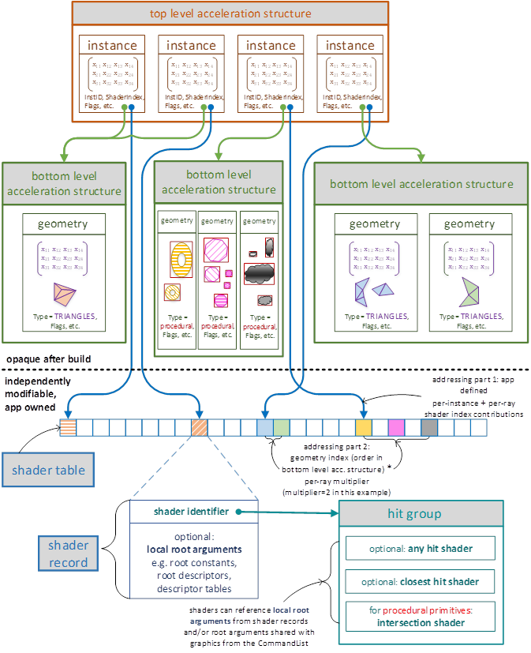
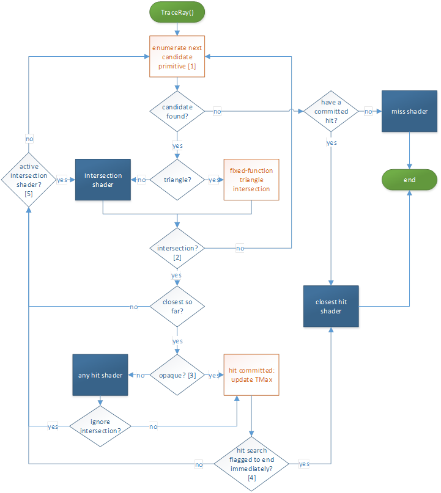
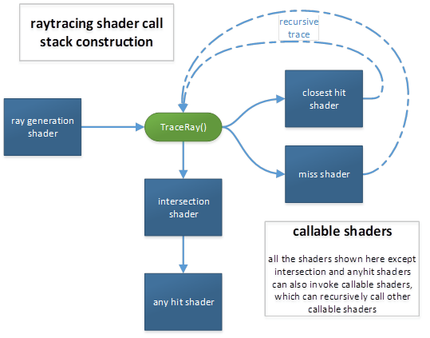

<a id="raytracing-shader-pipelines-shader-tables-and-execution-reordering"></a>

# Raytracing shader pipelines, shader tables and execution reordering

<!-- d3d12-review-legend:begin -->

> [!NOTE]
> **Draft provenance annotations.**
> Underlining marks pending replacement wording or authored list items. Warning boxes
> mark authored, mixed or reopened passages awaiting editorial review.
> Editorial adoption does not establish factual or hardware verification. Exact approved factual
> corrections do not trigger a marker. Unmarked text elsewhere, declarations
> and structural Markdown are not assertions of approval.
> [Annotation scope and approvals](../../spec-maintenance/d3d12/prose-annotations.md).

<!-- d3d12-review-legend:end -->

<!-- d3d12-review-alert:begin:raytracing-pipelines:N-scope:0 -->

> [!WARNING]
> **Authored synthesis - human review pending.**
>
> Raytracing pipelines execute raygeneration, intersection, any-hit, closest-hit, miss and callable shaders. This chapter defines their execution, shader table addressing, dispatch and stack contracts, and shader execution reordering.

<!-- d3d12-review-alert:end:raytracing-pipelines:N-scope:0 -->

<!-- d3d12-review-alert:begin:raytracing-pipelines:N-owners:0 -->

> [!WARNING]
> **Authored synthesis - human review pending.**
>
> The [ray and coordinate space definitions](ray-traversal.md#rays), [ray extents](ray-traversal.md#ray-extents), [triangle intersection rules](ray-traversal.md#fixed-function-ray-triangle-intersection-specification), [instance masking](ray-traversal.md#instance-masking), [ray flags](ray-traversal.md#ray-flags), [opacity micromap traversal](ray-traversal.md#opacity-micromap-traversal), and [RayQuery operations](ray-traversal.md#rayquery-operations) are canonical in Ray traversal. The [Acceleration structures chapter](acceleration-structures.md) defines geometry, build/update, storage and determinism. The [local/global root signature contract](binding.md#local-signatures) defines the 4064-byte local footprint (4096-byte record minus 32-byte identifier), register non-overlap, static sampler identity/limits and root representation. The [acceleration structure SRV contract](binding.md#acceleration-structure-srvs) defines NULL versus uninitialized acceleration structure bindings.

<!-- d3d12-review-alert:end:raytracing-pipelines:N-owners:0 -->

<!-- d3d12-review-alert:begin:raytracing-pipelines:N-owners:1 -->

> [!WARNING]
> **Authored synthesis - human review pending.**
>
> The [State objects chapter](state-objects.md#object-model) defines libraries, collections, exports, configuration and associations. In particular, [shader configuration](state-objects.md#d3d12_raytracing_shader_config), [recursion configuration](state-objects.md#d3d12_raytracing_pipeline_config), [configuration flags](state-objects.md#d3d12_raytracing_pipeline_config1), [default associations](state-objects.md#default-associations), [creation](state-objects.md#id3d12device5createstateobject), [incremental addition](state-objects.md#id3d12device7addtostateobject), [identifier retrieval](state-objects.md#id3d12stateobjectpropertiesgetshaderidentifier), [SetPipelineState1](state-objects.md#id3d12graphicscommandlist4setpipelinestate1) and [SetProgram](state-objects.md#id3d12graphicscommandlist10setprogram) retain their exact API owners. Resource [storage models](resources.md#storage-models), [heap lifetime](resources.md#lifetime), and [committed storage/residency/lifetime](resources.md#storage-residency-and-lifetime) define the shader tables' backing obligations; object/driver lifetime is defined in [State objects](state-objects.md#driver-lifetime).

<!-- d3d12-review-alert:end:raytracing-pipelines:N-owners:1 -->

<!-- d3d12-review-alert:begin:raytracing-pipelines:N-ray-visibility-owner:0 -->

> [!WARNING]
> **Authored synthesis - human review pending.**
>
> [Raytracing shader visibility](binding.md#raytracing-shader-visibility) is defined with root binding. Both global and local root argument visibility retain that shared contract.

<!-- d3d12-review-alert:end:raytracing-pipelines:N-ray-visibility-owner:0 -->

<a id="initiating-raytracing"></a>

## Initiating raytracing

First a pipeline state containing raytracing shaders must be set on a
command list, via [SetPipelineState1()](state-objects.md#id3d12graphicscommandlist4setpipelinestate1).

Then, just as rasterization is invoked by Draw() and compute is invoked
via Dispatch(), raytracing is invoked via [DispatchRays()](#id3d12graphicscommandlist4dispatchrays).
DispatchRays() can be called from graphics command lists, compute
command lists or bundles.

[Tier 1.1](devices-and-capabilities.md#raytracing-tiers) implementations also support GPU initiated DispatchRays() via [ExecuteIndirect()](indirect-execution.md#id3d12graphicscommandlistexecuteindirect).

[Tier 1.1](devices-and-capabilities.md#raytracing-tiers) implementations also support a variant of raytracing that can be invoked from any shader stage (including compute and graphics shaders), but does not involve any other shaders - instead processing happens logically inline with the calling shader.  See [Inline raytracing](ray-traversal.md#inline-raytracing).

<a id="ray-generation-shaders"></a>

## Ray generation shaders

[DispatchRays()](#id3d12graphicscommandlist4dispatchrays) invokes a grid of ray generation shader invocations.
Each invocation (thread) of a ray generation shader knows its location
in the overall grid, can generate arbitrary rays via TraceRay(), and
operates independently of other invocations. So there is no defined
order of execution of threads with respect to each
other.

HLSL details are [here](#ray-generation-shader).

<a id="raytracing-output"></a>

## Raytracing output

In raytracing, shaders output results, such as color samples for an
image, manually through UAVs.

<a id="ray-geometry-interaction-diagram"></a>

## Ray-geometry interaction diagram

Upcoming sections describe this picture, plus concepts not shown that
aren't specific to geometry, like "miss shaders".



<a id="built-in-ray-triangle-intersection---triangle-mesh-geometry"></a>

## Built-in ray-triangle intersection - triangle mesh geometry

<ins><!-- d3d12-review-inline:begin:raytracing-pipelines:R-built-in-ray-triangle-intersection-%2D-triangle-mesh-geometry:0 -->Geometry<!-- d3d12-review-inline:end:raytracing-pipelines:R-built-in-ray-triangle-intersection-%2D-triangle-mesh-geometry:0 --></ins> in a bottom-level acceleration structure
can be represented as triangle meshes which use built-in ray-triangle
intersection support that passes triangle barycentrics describing the
intersection to subsequent shaders.

<a id="intersection-shaders---procedural-primitive-geometry"></a>

## Intersection shaders - procedural primitive geometry

An alternative representation for geometry in a bottom-level
acceleration structure is an axis aligned bounding box which contains a
procedural primitive. The surface is defined by running an application
defined intersection shader to evaluate intersections when a ray hits
the bounding box. The shader defines the attributes describing
intersections to pass on to subsequent shaders, including the current T
value.

Using intersection shaders instead of the <ins><!-- d3d12-review-inline:begin:raytracing-pipelines:R-intersection-shaders-%2D-procedural-primitive-geometry:1 -->built-in<!-- d3d12-review-inline:end:raytracing-pipelines:R-intersection-shaders-%2D-procedural-primitive-geometry:1 --></ins> ray-triangle
intersection is less efficient but offers far more flexibility.

HLSL details are [here](#intersection-shader).

<a id="minor-intersection-shader-details"></a>

### Minor intersection shader details

Intersection shaders may be executed redundantly. There is no guarantee
that for a given ray that the intersection shader only executes once for
a given procedural primitive encountered in the acceleration structure.
Multiple invocations for a given ray and primitive would be redundant
(wasteful), yet implementations are free to have this behavior if the
implementation believes the tradeoff is worth it for some reason. The
implication of this is apps must be careful about authoring side effects
into intersection shaders, such as doing UAV writes from them or in
particular finding different intersections each invocation. The results
may differ depending on the implementation.

Regardless if multiple invocations of intersection shaders occur for a
given ray, the implementation must always honor the app's choice of
[flags](ray-traversal.md#geometry-flag-traversal-behavior) on the geometry, which may include
`D3D12_RAYTRACING_GEOMETRY_FLAG_NO_DUPLICATE_ANYHIT_INVOCATION`.
With this flag, the [any hit shader](#any-hit-shaders) (described next)
must only execute once for a given intersection on a given ray.

<a id="any-hit-shaders"></a>

## Any hit shaders

A unique shader can be defined to run whenever a ray intersects a
geometry instance within the current [ray extents](ray-traversal.md#ray-extents),
regardless of position along the ray relative to other intersections.
This is an any hit shader.

Any hit shaders can read intersection attributes, modify ray payload,
indicate a hit should be ignored ([IgnoreHit()](#ignorehit)), accept
the hit and continue (by exiting execution) or accept the hit and tell
the system to stop searching for more intersections
([AcceptHitAndEndSearch()](#accepthitandendsearch)).

There is no defined order of execution of any hit shaders for the
intersections along a ray path. If an any hit shader accepts a hit, its
T value becomes the new TMax. So depending on the order that
intersections are found all else being equal, different numbers of any
hit shader invocations would occur.

The system cannot execute multiple any hit shaders for a given ray at the
same time - as such, any hit shaders can freely modify their
[ray payload](#ray-payload-structure) without worrying about conflicting
with other shaders.

Any hit shaders are useful, for instance, when geometry has
transparency. A particular case is transparency in shadow determination,
where if the any hit shader finds that the current hit location is
opaque it can tell the system to take this hit but stop searching for
more intersections (just looking for anything in a ray's path). In
many cases though, any hit shaders are not needed, yielding some
execution efficiency: In the absence of an any hit shader for a given
geometry instance that has an intersection T within the current ray
interval, the implementation simply accepts the intersection and reduces
TMax of the current ray interval to T.

Unlike some of the other shader types to be described, any hit shaders
cannot trace new rays, as doing so here would lead to an unreasonable
explosion of work for the system.

HLSL details are [here](#any-hit-shader).

<a id="closest-hit-shaders"></a>

## Closest hit shaders

A unique shader can be defined to run for each geometry in an instance
if it produced the closest accepted intersection within the [ray extents](ray-traversal.md#ray-extents). This is a closest hit shader.

Closest hit shaders can read intersection attributes, modify ray
payload, and generate additional rays.

> A typical use of a closest hit shader would be to evaluate the color of a surface and either contribute to the ray payload or store data to memory (via UAV).

Any hit shaders (if any) along a ray's path are all executed before a
closest hit shader (if any). In particular, if both shader types are
defined for the geometry instance at the closest hit's T value, the any
hit shader will always run before the closest hit shader.

HLSL details are [here](#closest-hit-shader).

<a id="miss-shaders"></a>

## Miss shaders

For rays that do not intersect any geometry, a miss shader can be
specified. Miss shaders can modify ray payload and generate additional
rays. Since there was no intersection, there are no intersection
attributes available.

HLSL details are [here](#miss-shader).

<a id="hit-groups"></a>

## Hit groups

A hit group is one or more shaders consisting of: {0 or 1 intersection
shader, 0 or 1 any hit shader, 0 or 1 closest hit shader}. Individual
geometries in a given instance each refer to a hit group to provide
their shader code. The point of the grouping is to allow implementations
to be able to compile and execute the group efficiently as rays interact
with geometry.

Ray generation shaders and miss shaders aren't part of hit groups
because they aren't involved directly with geometry.

If a hit group contains an intersection shader, it can only be used with
procedural primitive geometry. If a hit group does not contain an
intersection shader, it can only be used with triangle geometry.

A hit group with no shaders at all is also possible, by simply using
<ins><!-- d3d12-review-inline:begin:raytracing-pipelines:R-hit-groups:3 -->NULL as its<!-- d3d12-review-inline:end:raytracing-pipelines:R-hit-groups:3 --></ins> [shader identifier](#shader-identifier) (concept described
later).  This counts as opaque geometry.

> An empty hit group can be useful, for example, if the app doesn't want to do anything for hits and only cares about the [miss shader](#miss-shaders) running when nothing has been hit.

<a id="traceray-control-flow"></a>

## TraceRay control flow

This is what happens when a shader calls [TraceRay()](#traceray):



\[1\] This stage searches acceleration structures to enumerate
primitives that may intersect the ray, conservatively: If a primitive is
intersected by the ray and is within the current [ray extents](ray-traversal.md#ray-extents), it is guaranteed to be enumerated eventually. If a primitive
is not intersected by the ray or is outside the current [ray extents](ray-traversal.md#ray-extents), it may or may not be enumerated. Note that TMax is updated
when a hit is committed <ins><!-- d3d12-review-inline:begin:raytracing-pipelines:R-traceray-control-flow:2 -->(internal traversal state, observable to shaders as specified by [RayTCurrent()](#raytcurrent), not a write-back to the input RayDesc)<!-- d3d12-review-inline:end:raytracing-pipelines:R-traceray-control-flow:2 --></ins>.

\[2\] If the intersection shader is running and calls
[ReportHit()](#reporthit), the subsequent logic handles the intersection
and then returns to the intersection shader via \[5\].

\[3\] Opaqueness is determined by examining the geometry and instance
flags of the intersection as well as the [ray flags](ray-traversal.md#ray-flags). Also
if there is no any hit shader, the geometry is considered opaque.

\[4\] The search for hits is ended at this point if either the
`RAY_FLAG_ACCEPT_FIRST_HIT_AND_END_SEARCH` [ray flag](ray-traversal.md#ray-flags)
is set, or if the any hit shader called
[AcceptHitAndEndSearch()](#accepthitandendsearch), which aborts the
execution of the any hit shader at the
[AcceptHitAndEndSearch()](#accepthitandendsearch)
call site. Since at least this hit was committed, whichever hit is
closest so far has the closest hit shader run on it, if present (and not
disabled via `RAY_FLAG_SKIP_CLOSEST_HIT_SHADER`).

\[5\] If the primitive that was intersected was not a triangle, an
intersection shader is still active and resumes execution, given it may
contain more calls to [ReportHit()](#reporthit).

<a id="callable-shaders"></a>

## Callable shaders

Callable shaders are meant to assist with pathological shader
permutations or shader networks, at the potential expense of some
execution efficiency.

<ins><!-- d3d12-review-inline:begin:raytracing-pipelines:R-callable-shaders:1 -->Callable shaders are defined through a [shader table](#shader-tables),
described later, but basically a user defined function table. The table
is identified by providing a GPU virtual address (CallableShaderTable in
[D3D12_DISPATCH_RAYS_DESC](#d3d12_dispatch_rays_desc)) to
[DispatchRays()](#id3d12graphicscommandlist4dispatchrays) calls. The contents of the table
contain shader identifiers retrieved from [state objects](state-objects.md#object-model) via
[GetShaderIdentifier()](state-objects.md#id3d12stateobjectpropertiesgetshaderidentifier).<!-- d3d12-review-inline:end:raytracing-pipelines:R-callable-shaders:1 --></ins>

A given callable shader is called (via [CallShader()](#callshader) in
HLSL) by indexing into the shader table to pick which callable shader to
<ins><!-- d3d12-review-inline:begin:raytracing-pipelines:R-callable-shaders:2 -->call from raygeneration, closesthit, miss or callable shaders.<!-- d3d12-review-inline:end:raytracing-pipelines:R-callable-shaders:2 --></ins> A shader invocation making a
call just produces one invocation of a callable shader, like a
subroutine call with arbitrary in/out parameters. So when the call
returns, the caller continues as would be expected. Callable shaders are
separately compiled from other shaders, so compilers can't make any
assumptions about caller/callee other than the agreed on function
signature. The implementation chooses how to make use of a stack of user
defined maximum size to store parameters (that it didn't decide to pass
via registers) and/or live state -- see [Pipeline stack](#pipeline-stack).

Implementations are expected to schedule callable shaders for execution
separately from the calling shader, as opposed to the code being
optimally inlined with the caller. This is similar to the way tracing
rays causes other shaders to run. So using this feature to execute a
tiny program may not be worth the minimum overhead of scheduling the
shader to run.

> In the absence of callable shaders as a feature, applications could achieve the same result by tracing rays with a NULL acceleration structure, which causes a miss shader to run, repurposing the ray payload and potentially the ray itself as function parameters. Except doing this miss shader hack would be wasteful in terms of defining a ray that is guaranteed to miss for no reason. Rather than supporting this hack, callable shaders are seen as a cleaner equivalent.
>
> The bottom line is implementations should not have difficulty supporting callable shaders given the system has to support miss shaders anyway. At the same time, apps must not expect execution efficiency that would greatly exceed that of invoking a miss shader from a raytrace (minus the actual ray processing overhead).

<a id="shader-identifier"></a>

## Shader identifier

A shader identifier is an opaque data blob of 32 bytes that uniquely
identifies (within the current device / process) one of the raytracing
shaders: ray generation shader, hit group, miss shader, callable shader.
The application can request the shader identifier for any of these
shaders from the system. It can be thought of as a pointer to a shader.

If the raytracing process encounters a NULL shader identifier from an
app when looking for a shader to run, no shader is executed for that
purpose, and the raytracing process continues. In the case of a [hit group](#hit-groups),
a NULL shader identifier simply means no shader is executed for any of
the types of shaders it contains.

<ins><!-- d3d12-review-inline:begin:raytracing-pipelines:R-shader-identifier:2 -->An application might create the same shader multiple times. This could
be the same code but with same or different export names, potentially
across separate raytracing pipelines or collections of code ([state-object types](state-objects.md#state-object-types)).
In this case the seemingly identical shaders may or may not return
the same identifier depending on the implementation. Regardless, execution
behavior will be consistent with the specified shader code.<!-- d3d12-review-inline:end:raytracing-pipelines:R-shader-identifier:2 --></ins>

<a id="shader-record"></a>

## Shader record

```text
shader record = {shader identifier, local root arguments for the shader}
```

A shader record simply refers to a region of memory owned by an
application in the above layout. Since an application can retrieve a
shader identifier for any raytracing shader, it can create shader
records any way it wants, anywhere it wants. If a shader uses a local
root signature, its shader record contains the arguments for that root
signature. The maximum stride for shader records is 4096 bytes.

<a id="shader-tables"></a>

## Shader tables

```text
shader table = {shader record A}, {shader record B} ...
```

A shader table is a set of shader records in a contiguous region of
memory. The start address must be aligned to 64 bytes
([D3D12_RAYTRACING_SHADER_TABLE_BYTE_ALIGNMENT](#constants)).

Raytracing indexes in to shader tables (in various ways) to enable
running unique shaders and resource bindings for all the different parts
of a scene. Only the particular shader records that will be accessed
need to be validly populated.

There is no API object for a shader table; the app merely identifies a
region in memory as being a shader table. Rather, the parameters to
[DispatchRays()](#id3d12graphicscommandlist4dispatchrays)
include pointers to memory that let apps identify (among other things)
the following types of shader tables:

- [ray generation shader](#ray-generation-shaders) (single entry since only one shader record is
needed)

- [hit groups](#hit-groups)

- [miss shaders](#miss-shaders)

- [callable shaders](#callable-shaders)

<a id="indexing-into-shader-tables"></a>

## Indexing into shader tables

The location in shader tables to find the appropriate shaders to use at
a given geometry intersection is computed as the sum of various offsets
provided by the application at different places, for flexibility.

Details are provided in [Addressing calculations within shader tables](#addressing-calculations-within-shader-tables),
but basically the process starts at [DispatchRays()](#id3d12graphicscommandlist4dispatchrays), which provides
base addresses and record strides for shader tables. Then each
geometry and each geometry instance definition in a raytracing
acceleration structure contribute values to the indexing. And the final
contributions are provided <ins><!-- d3d12-review-inline:begin:raytracing-pipelines:R-indexing-into-shader-tables:1 -->by [TraceRay()](#traceray) calls within shaders, allowing<!-- d3d12-review-inline:end:raytracing-pipelines:R-indexing-into-shader-tables:1 --></ins>
further differentiation of which shaders and arguments (bindings) to
use with a given geometry instance, without having to change the geometries /
instances or acceleration structures themselves.

<a id="shader-record-stride"></a>

### Shader record stride

The application indicates a data stride it wants the system to use for
records as a parameter to [DispatchRays()](#id3d12graphicscommandlist4dispatchrays). All shader table indexing
arithmetic is done as multiples of this record stride. It can be any multiple
of 32 bytes ([D3D12_RAYTRACING_SHADER_RECORD_BYTE_ALIGNMENT](#constants))
of size \[0...4096\] bytes.

If the stride is nonzero, the stride must be at least as large as the
largest shader record. So there is some unused memory between shader
records when they are smaller than the stride.

If the stride is 0, all indexing points to the same shader record. This
is unlikely to be interesting, particularly given this would cause the
local root signature to behave in a global way redundantly with the
explicit global root signature. This could be handy for testing or
manual debugging though.

<a id="shader-table-memory-initialization"></a>

### Shader table memory initialization

When the system indexes in to a shader table using the stride and
arrives at a record, a valid shader identifier must be there, followed
by the appropriate amount of local root arguments. Individual local root
arguments need only be initialized if the shader executing references
them.

In a given record in a shader table, the root arguments that follow the
shader identifier must match the local root signature the specified
shader was compiled with.

<!-- d3d12-review-alert:begin:raytracing-pipelines:N-record-root-owner:0 -->

> [!WARNING]
> **Authored synthesis - human review pending.**
>
> The arguments following the 32-byte shader identifier use the shared [local root argument layout](binding.md#local-root-argument-layout). The [local/global root signature contract](binding.md#local-signatures) defines their footprint limits.

<!-- d3d12-review-alert:end:raytracing-pipelines:N-record-root-owner:0 -->

<a id="ranges-empty-tables-and-null-identifiers"></a>

### Ranges, empty tables and NULL identifiers

<!-- d3d12-review-alert:begin:raytracing-pipelines:N-range-validity:0 -->

> [!WARNING]
> **Authored synthesis - human review pending.**
>
> `RayGenerationShaderRecord` describes a single record, not an indexed table: it has `StartAddress` and `SizeInBytes`, with no `StrideInBytes`. Its start has the same 64-byte table-base alignment. A record contains the 32-byte identifier and its serialized local root arguments. The [local root footprint limit](binding.md#local-signatures) leaves at most 4064 bytes after that identifier.

<!-- d3d12-review-alert:end:raytracing-pipelines:N-range-validity:0 -->

<!-- d3d12-review-alert:begin:raytracing-pipelines:N-range-validity:1 -->

> [!WARNING]
> **Authored synthesis - human review pending.**
>
> Only shader records that will be accessed need valid contents. An unused miss, hit group or callable table does not cause a shader invocation. A zero stride selects the same record for every index. It does not make a missing, empty or uninitialized record valid. A NULL shader identifier consists of exactly 32 zero bytes. A NULL shader identifier in a valid record is distinct from a missing table, an uninitialized identifier or an out-of-bounds record. The CPU `nullptr` returned for an unavailable shader by [GetShaderIdentifier](state-objects.md#id3d12stateobjectpropertiesgetshaderidentifier) is not the identifier data of a valid NULL shader record. The NULL identifier behavior above does not exempt a lookup from the initialization and bounds rules.

<!-- d3d12-review-alert:end:raytracing-pipelines:N-range-validity:1 -->

<a id="addressing-calculations-within-shader-tables"></a>

## Addressing calculations within shader tables

> The very fixed nature of shader table indexing described here is a result of IHV limitation. The hope is these limitations aren't too annoying for apps (which have to live with them). The extent to which the fixed function choices made here conflict with what an app actually wants may force app to do inefficient things like duplicating entries in shader tables to accomplish what they want. That said, such inefficiencies in shader table layout may not turn out to be an overall bottleneck. So this might be no worse than simply being slightly awkward to use.

<a id="hit-group-table-indexing"></a>

### Hit group table indexing

> HitGroupRecordAddress =<br>[D3D12_DISPATCH_RAYS_DESC](#d3d12_dispatch_rays_desc).HitGroupTable.StartAddress \+ <small>// from: [DispatchRays()](#id3d12graphicscommandlist4dispatchrays)</small><br>[D3D12_DISPATCH_RAYS_DESC](#d3d12_dispatch_rays_desc).HitGroupTable.StrideInBytes \*  <small>// from: [DispatchRays()](#id3d12graphicscommandlist4dispatchrays)</small><br>(<br>RayContributionToHitGroupIndex \+ <small>// from shader: [TraceRay()](#traceray)</small><br>(MultiplierForGeometryContributionToHitGroupIndex \* <small>// from shader: [TraceRay()](#traceray)</small><br>GeometryContributionToHitGroupIndex) \+ <small>// system generated index of geometry in bottom-level acceleration structure (0,1,2,3..)</small><br><br>[D3D12_RAYTRACING_INSTANCE_DESC](acceleration-structures.md#d3d12_raytracing_instance_desc).InstanceContributionToHitGroupIndex <small>// from instance</small><br>)

Setting MultiplierForGeometryContributionToHitGroupIndex \> 1 lets apps
group shaders for multiple ray types adjacent to each other per-geometry
in a shader table. The acceleration structure doesn't need to know this
is happening, as it merely stores an InstanceContributionToHitGroupIndex
per-instance. GeometryContributionToHitGroupIndex is a fixed function
sequential index (0,1,2,3..) incrementing per geometry, mirroring the
order each geometry was placed by the app in the current bottom-level
acceleration structure.

As of raytracing [Tier 1.1](devices-and-capabilities.md#raytracing-tiers) implementations, it can be interesting to set MultiplierForGeometryContributionToHitGroupIndex to 0, meaning geometry index does not contribute to shader table indexing at all.  This can work if the shaders will be calling the [GeometryIndex()](#geometryindex) intrinsic (added for [Tier 1.1](devices-and-capabilities.md#raytracing-tiers) implementations) to be able to distinguish geometries within shaders manually.

<a id="miss-shader-table-indexing"></a>

### Miss shader table indexing

> MissShaderRecordAddress =<br>D3D12_DISPATCH_RAYS_DESC.MissShaderTable.StartAddress \+ <small>// from: [DispatchRays()](#id3d12graphicscommandlist4dispatchrays)</small><br>D3D12_DISPATCH_RAYS_DESC.MissShaderTable.StrideInBytes \* <small>// from: [DispatchRays()](#id3d12graphicscommandlist4dispatchrays)</small><br>MissShaderIndex <small>// from shader: [TraceRay()](#traceray)</small><br>

<a id="callable-shader-table-indexing"></a>

### Callable shader table indexing

> CallableShaderRecordAddress =<br>D3D12_DISPATCH_RAYS_DESC.CallableShaderTable.StartAddress + <small>// from: [DispatchRays()](#id3d12graphicscommandlist4dispatchrays)</small><br>D3D12_DISPATCH_RAYS_DESC.CallableShaderTable.StrideInBytes \* <small>//  from: [DispatchRays()](#id3d12graphicscommandlist4dispatchrays)</small><br>ShaderIndex <small>// from shader: [CallShader()](#callshader)</small>

<a id="out-of-bounds-shader-table-indexing"></a>

### Out of bounds shader table indexing

Behavior is undefined if shader tables are indexed out of range. The
same applies to referencing a region within a shader table that is
uninitialized or contains stale data.

<a id="index-widths-and-address-bounds"></a>

### Index widths and address bounds

<!-- d3d12-review-alert:begin:raytracing-pipelines:N-index-widths:0 -->

> [!WARNING]
> **Authored synthesis - human review pending.**
>
> The HLSL index inputs are unsigned `uint`. `TraceRay` uses the low 4 bits of `RayContributionToHitGroupIndex`, the low 4 bits of `MultiplierForGeometryContributionToHitGroupIndex`, and the low 16 bits of `MissShaderIndex`. `CallShader` supplies its `uint ShaderIndex` directly. `HitObject::SetShaderTableIndex` instead selects a final hit group index using 28 bits, or a miss index using 16 bits.

<!-- d3d12-review-alert:end:raytracing-pipelines:N-index-widths:0 -->

<!-- d3d12-review-alert:begin:raytracing-pipelines:N-index-widths:1 -->

> [!WARNING]
> **Authored synthesis - human review pending.**
>
> For the hit group calculation, the [geometry count limit](acceleration-structures.md#geometry-limits) is 2^24 and the instance contribution has 24 bits. Therefore the greatest index from legal `TraceRay` contributions is `15 + 15 * (2^24 - 1) + (2^24 - 1) = 2^28 - 1`. The intermediate record index does not require unsigned 32-bit wraparound. This is distinct from multiplication by the byte stride and addition to the GPU virtual address. GPU address ranges and strides are 64-bit. The addressing formulas do not grant permission to wrap an overflowing address into an unrelated range: an accessed record outside the supplied table is governed by the undefined out-of-bounds rule.

<!-- d3d12-review-alert:end:raytracing-pipelines:N-index-widths:1 -->

<a id="ray-recursion-limit"></a>

## Ray recursion limit

Raytracing pipeline state objects must [declare](state-objects.md#d3d12_raytracing_pipeline_config) a maximum ray recursion
depth (in the range [\[0..31\]](#constants)). The ray generation shader
is depth 0. Below the maximum recursion depth, shader invocations such
as closest hit or miss shaders can call [TraceRay()](#traceray) any
number of times. At the maximum recursion depth, [TraceRay()](#traceray)
calls result in the device going into removed state.

The current level of recursion cannot be retrieved from the system, due
to the overhead that might be required to be able to report it to
shaders. If applications need to track the level of ray recursion it can
be done manually in the ray payload.

This recursion depth limit does not include callable shaders, which are
not bounded except in the context of overall [pipeline stack](#pipeline-stack)
allocation.

<!-- d3d12-review-context:begin:raytracing-pipelines:R-ray-recursion-limit:3 -->

> [!WARNING]
> **Mixed source and authored adaptation - human review pending.**

> Apps should pick a limit that is as low as absolutely necessary. There may be performance implications in how the implementation chooses to handle upper limits set at obvious thresholds -- e.g. 0 means no tracing of rays at all (perhaps only using callable shaders or not even that), 1 means single bounce rays, and numbers above 1 might imply a different implementation strategy.
>
> It isn't expected that most apps would ever need to declare very large recursion limits. The upper limit of 31 is there to put a bound on the number of bits hardware has to reserve for a counter -- inexpensive yet large enough range to likely never have to worry about.

<!-- d3d12-review-context:end:raytracing-pipelines:R-ray-recursion-limit:3 -->

<a id="pipeline-stack"></a>

## Pipeline stack

Raytracing shaders including callable shaders may consume memory out of
a driver managed stack allocation. This memory is internally
allocated/reserved by the driver during command list recording, such
that command list recording will fail if the driver wouldn't be able to
execute the command list due to the selected stack size. The stack
memory requirement is expressed in terms of how much memory a call chain
starting from an individual ray generation shader thread can consume,
considering tracing rays, the various shaders that can be invoked in the
process, including callable shaders, and nesting/recursion.

> In practice typical systems will support many thousands of threads in flight at once, so the actual memory footprint for driver managed stack storage will be much larger than the space required for just one thread. This multiplication factor is an implementation detail not directly exposed to the app. That said, it is in the app's best interest (if memory footprint is important) to make an optimal choice for the one number it has control over -- individual thread stack size -- to match what the app actually needs.

Raytracing pipeline state objects can optionally set a maximum pipeline
stack size, otherwise a default value is used, which is typically overly
conservative (though could underestimate if callable shaders recurse
more than 2 levels). The way an app can calculate an optimal stack size
if desired is described next, followed by an explanation of how the
default is selected.

> Here is an example of a situation where it really matters for an app to manually calculate the stack size rather than rely on the default: Suppose there is a complex closest hit shader with lots of state doing complex shading that recursively shoots a shadow ray that's known to hit only trivial shaders with very small stack requirements. The default calculation described further below doesn't know this and will assume all levels of recursion might invoke the expensive closest hit shader, resulting in wasted stack space reservation, multiplied by the number of threads in flight on the GPU.

<a id="optimal-pipeline-stack-size-calculation"></a>

### Optimal pipeline stack size calculation

Apps can retrieve the stack space requirement for individual shaders in
a raytracing pipeline via [GetShaderStackSize()](#id3d12stateobjectpropertiesgetshaderstacksize).
(The result will be the same for a given shader if it appears in other
raytracing pipelines.) If the app combines these sizes with what it may
know about the worst case call stack amongst individual shaders during
raytracing, along with the MaxTraceRecursionDepth it
[declared](state-objects.md#d3d12_raytracing_pipeline_config), it can calculate the
correct stack size. This is something the system cannot do on its own.

The diagram below depicts how an app author can reason about calculating
an optimal stack size based on the shaders being used in the raytracing
pipeline and which ones might potentially be reachable (which only the
app author can reasonably know).



The app can set the overall stack storage per thread for a raytracing
pipeline state via [SetPipelineStackSize()](#id3d12stateobjectpropertiessetpipelinestacksize). The specification for that
method describes rules about when and how often the stack size can be
set for a pipeline state.

<a id="default-pipeline-stack-size"></a>

### Default pipeline stack size

The system initializes raytracing pipeline state objects with a default
pipeline stack size computed as follows. <ins><!-- d3d12-review-inline:begin:raytracing-pipelines:R-default-pipeline-stack-size:0 -->This calculation is<!-- d3d12-review-inline:end:raytracing-pipelines:R-default-pipeline-stack-size:0 --></ins>
intentionally simplified because it cannot account for what combination
of shaders might actually execute (as that depends on application
content and shader table layout, which are both unknown from the
perspective of a raytracing pipeline state). The default stack size
calculation takes the worst case combination of shaders in the
raytracing pipeline in terms of individual stack sizes and factors in
the maximum recursion level. For callable shaders, a default assumption
is that every raytracing shader calls the callable shader with the
maximum stack size to a recursion depth of 2.

The net result is that for raytracing pipelines with no callable
shaders, the default stack size is guaranteed to safely fit the maximum
declared level of recursion and the worst case combination of shaders.
With callable shader in the mix, the default might be unsafe if the app
happens to make more than 2 levels of recursive calls to the worst case
callable shader on top of maxing out all other shaders.

The exact calculation is as follows. First a definition of the input
variables.

For each shader type in the pipeline state, for which multiple instance
of that shader type might be in the pipeline state, find the maximum
individual shader stack size for that shader type. For this discussion,
let us name these maximum values:

**RGSMax** (for max ray generation shader stack size)
**ISMax** (intersection shader)
**AHSMax** (any hit shader)
**CHSMax** (closest hit shader)
**MSMax** (miss shader)
**CSMax** (callable shader)

The other relevant <ins><!-- d3d12-review-inline:begin:raytracing-pipelines:R-default-pipeline-stack-size:5 -->input comes from<!-- d3d12-review-inline:end:raytracing-pipelines:R-default-pipeline-stack-size:5 --></ins> the
[D3D12_RAYTRACING_PIPELINE_CONFIG](state-objects.md#d3d12_raytracing_pipeline_config)
subobject in the pipeline state: **MaxTraceRecursionDepth**.

Using these values, considering the raytracing shader call stack
construction diagram above, and arbitrarily estimating callable shaders
to be called 2 levels deep per shader stage, the default stack size
calculation becomes:

```text
DefaultPipelineStackSizeInBytes =
  RGSMax
  + max( CHSMax, MSMax, ISMax+AHSMax ) * min( 1, MaxTraceRecursionDepth )
  + max( CHSMax, MSMax ) * max( MaxTraceRecursionDepth - 1, 0 )
  + 2 * CSMax // if CS aren't used, this term will just be 0.
              // 2 is a completely arbitrary choice

  // Observe that ISMax and AHSMax are only counted once, which results in
  // the split clauses involving MaxTraceRecursionDepth. Intersection and
  // anyhit shaders can't recurse.
```

<a id="pipeline-stack-limit-behavior"></a>

### Pipeline stack limit behavior

If making a call exceeds the declared stack size the device goes into
removed state, similar to ray recursion overflow.

There is no practical limit on declared stack size. The runtime drops
calls to [SetPipelineStackSize()](#id3d12stateobjectpropertiessetpipelinestacksize) for extreme
stack size values, \>= 0xffffffff though (the parameter is actually
UINT64 for this purpose). This is to catch the app blindly passing the
return value of calling [GetShaderStackSize()](#id3d12stateobjectpropertiesgetshaderstacksize) with
invalid parameters, which returns 0xffffffff, either directly into
SetPipelineStackSize or into a calculation summing stack sizes, multiple
of which could be invalid values.

<a id="shader-limitations-resulting-from-independence"></a>

## Shader limitations resulting from independence

Given that raytracing shader invocations are all independent of each
other, features within shaders that explicitly rely on cross-shader
communication are not allowed, with the exception of Wave Intrinsics
described further below. Examples of features not available to shaders
during raytracing: 2x2 shader invocation based derivatives (available in
pixel shaders), thread execution syncing (available in compute).

<a id="wave-intrinsics"></a>

### Wave Intrinsics

Wave intrinsics are allowed in raytracing shaders, with the intent
that they are for tools (PIX) logging. That said, applications are also
not blocked from using wave intrinsics in case they might find safe use.

Implementations may repack threads at certain (well defined) points in
raytracing shader execution such as calls to [TraceRay()](#traceray). As
such, the results of wave intrinsics called within a shader are valid
only until a potential thread repacking point is encountered in program
execution order. <ins><!-- d3d12-review-inline:begin:raytracing-pipelines:R-wave-intrinsics:1 -->Wave intrinsics have<!-- d3d12-review-inline:end:raytracing-pipelines:R-wave-intrinsics:1 --></ins> scopes of validity that are
bounded by repacking points as well as the start/end of the shader.

Repacking points that bound wave intrinsic scope:

- [CallShader()](#callshader)

- [TraceRay()](#traceray)

- [ReportHit()](#reporthit)

Other intrinsics that result in a bound due to ending the shader
invocation:

- [IgnoreHit()](#ignorehit)

- [AcceptHitAndEndSearch()](#accepthitandendsearch)

Note that use of [RayQuery](ray-traversal.md#rayquery) objects for inline raytracing
does not count as a repacking point.

When [Shader Execution Reordering](#shader-execution-reordering) is supported
see [reorder points](#reorder-points).

<a id="execution-and-memory-ordering"></a>

## Execution and memory ordering

When [TraceRay()](#traceray) or [CallShader()](#callshader) are called, any resulting shader invocations complete by the time the call returns.

Memory operations (stores, atomics) performed by the caller can be guaranteed to be visible to the callee with a `DeviceMemoryBarrier()` in the caller after writes.  The UAV must be declared `[globallycoherent]`. Input payload/parameter data is passed to callees by-value so does not require a barrier.

Memory operations performed by the callee can similarly be guaranteed to be visible to the caller (and any subsequent calls made by the caller) with similar UAV declaration and writes followed by memory barrier in the writing shader.  Output payload/parameter data is returned to the caller by-value so does not require a barrier.

Also see [Reorder points](#reorder-points) and [Reorder points - memory coherence and visibility](#reorder-points---memory-coherence-and-visibility).

<a id="default-stack-boundary-cases-and-incremental-addition"></a>

## Default-stack boundary cases and incremental addition

<!-- d3d12-review-alert:begin:raytracing-pipelines:N-stack-cases:0 -->

> [!WARNING]
> **Authored synthesis - human review pending.**
>
> The default-stack expression is mathematical: at recursion depth zero, `max(MaxTraceRecursionDepth - 1, 0)` is zero, not an unsigned underflow. Writing `H = max(CHSMax, MSMax, ISMax + AHSMax)` and `C = max(CHSMax, MSMax)`, the formula gives:

<!-- d3d12-review-alert:end:raytracing-pipelines:N-stack-cases:0 -->

<!-- d3d12-review-alert:begin:raytracing-pipelines:N-stack-cases:1 -->

> [!WARNING]
> **Authored synthesis - human review pending.**
>
> | MaxTraceRecursionDepth | Default stack size |
> | --- | --- |
> | 0 | `RGSMax + 2 * CSMax` |
> | 1 | `RGSMax + H + 2 * CSMax` |
> | 2 | `RGSMax + H + C + 2 * CSMax` |
> | 31 | `RGSMax + H + 30 * C + 2 * CSMax` |

<!-- d3d12-review-alert:end:raytracing-pipelines:N-stack-cases:1 -->

<!-- d3d12-review-alert:begin:raytracing-pipelines:N-stack-cases:2 -->

> [!WARNING]
> **Authored synthesis - human review pending.**
>
> Depth zero permits no `TraceRay` call, but does not forbid callable shaders; nested `CallShader` usage is bounded by the pipeline stack, not by ray recursion depth. The `ISMax + AHSMax` contribution accounts for an intersection shader suspended while its any-hit shader runs. Intersection and any-hit do not recursively trace rays, so that contribution is included only once in the formula. Callable nesting beyond the default assumption still requires an adequate explicit budget.

<!-- d3d12-review-alert:end:raytracing-pipelines:N-stack-cases:2 -->

<!-- d3d12-review-alert:begin:raytracing-pipelines:N-stack-cases:3 -->

> [!WARNING]
> **Authored synthesis - human review pending.**
>
> The [incremental-addition contract](state-objects.md#id3d12device7addtostateobject) specifies that the new object inherits the previous object's stack setting, not a recomputed budget for its newly added shaders. It also specifies family locking for export property queries and the separate application synchronization requirement for stack setting changes during addition.

<!-- d3d12-review-alert:end:raytracing-pipelines:N-stack-cases:3 -->

<a id="id3d12graphicscommandlist4dispatchrays"></a>

## ID3D12GraphicsCommandList4::DispatchRays

<a id="id3d12graphicscommandlist4dispatchrays-declaration"></a>

### Declaration

```cpp
void DispatchRays(const D3D12_DISPATCH_RAYS_DESC* pDesc);
```

<a id="id3d12graphicscommandlist4dispatchrays-behavior"></a>

### Behavior

Launch threads of a ray generation shader. See [Initiating raytracing](#initiating-raytracing)
for an overview. Can be called from graphics or compute command lists and bundles.

A raytracing pipeline state must be set on the command list otherwise
behavior of this call is undefined.

There are 3 dimensions passed in to set the grid size:
width/height/depth. These dimensions are constrained such that
width\*height\*depth \<= 2^30. Exceeding this produces undefined
behavior.

If any grid dimension is 0, no threads are launched.

[Tier 1.1](devices-and-capabilities.md#raytracing-tiers) implementations also support GPU initiated DispatchRays() via [ExecuteIndirect()](indirect-execution.md#id3d12graphicscommandlistexecuteindirect).

### Parameters

Parameter                           | Definition
---------                           | ----------
`const D3D12_DISPATCH_RAYS_DESC* pDesc` | Description of the ray dispatch. See [D3D12_DISPATCH_RAYS_DESC](#d3d12_dispatch_rays_desc).

<a id="dispatchrays-return-values"></a>

### Return values

<!-- d3d12-review-alert:begin:raytracing-pipelines:N-dispatch-return:0 -->

> [!WARNING]
> **Authored synthesis - human review pending.**
>
> `DispatchRays` returns no value.

<!-- d3d12-review-alert:end:raytracing-pipelines:N-dispatch-return:0 -->

<a id="dispatchrays-recording-and-validation"></a>

### Recording and validation

<!-- d3d12-review-alert:begin:raytracing-pipelines:N-dispatch-context:0 -->

> [!WARNING]
> **Authored synthesis - human review pending.**
>
> Command list type, initial/reset and pipeline selection state are defined in [Command list state](command-list-state.md). Recording errors follow the [Close contract](execution.md#close). `DispatchRays` is forbidden inside an open render pass, whether direct or issued by `ExecuteIndirect`. See the [render pass operation surface](output-merger.md#render-pass-operation-surface). [Predication](counters-queries-and-predication.md#predication-operation-matrix) defines predicate evaluation, and [query lifecycle](counters-queries-and-predication.md#query-lifecycle) and [pipeline statistics](counters-queries-and-predication.md#pipeline-statistics) define eligible query scopes and measured workloads. Shader table reads use the [resource state and barrier rules](synchronization.md).

<!-- d3d12-review-alert:end:raytracing-pipelines:N-dispatch-context:0 -->

<!-- d3d12-review-alert:begin:raytracing-pipelines:N-dispatch-context:1 -->

> [!WARNING]
> **Authored synthesis - human review pending.**
>
> The description supplies GPU addresses, sizes and strides. It does not supply CPU pointers to shader records. CPU recording validation of the description does not establish that GPU shader identifiers, local root arguments or dynamically selected records are initialized or in bounds. The [out-of-bounds rule](#out-of-bounds-shader-table-indexing) and [initialization rule](#shader-table-memory-initialization) apply when those records are used. Debug layer diagnostics are not a substitute for those GPU content requirements.

<!-- d3d12-review-alert:end:raytracing-pipelines:N-dispatch-context:1 -->

<a id="dispatchrays-debug-layer"></a>

### Debug layer

<!-- d3d12-review-alert:begin:raytracing-pipelines:N-dispatch-diagnostics:0 -->

> [!WARNING]
> **Authored synthesis - human review pending.**
>
> Source-inspected debug layer checks include a null `pDesc`, unsupported raytracing, missing or mismatched pipeline state, a null or non-64-byte-aligned raygeneration start, and GPU address range/resource references. For a nonzero miss/hit group/callable base, the inspected path checks 64-byte base alignment, 32-byte stride alignment, and `SizeInBytes` being a multiple of a nonzero stride. These are description/command state diagnostics. They do not establish CPU inspection of the eventual GPU records.

<!-- d3d12-review-alert:end:raytracing-pipelines:N-dispatch-diagnostics:0 -->

<a id="shader-table-access"></a>

### Shader table access and synchronization

<!-- d3d12-review-alert:begin:raytracing-pipelines:N-shader-table-access:0 -->

> [!WARNING]
> **Authored synthesis - human review pending.**
>
> Shader tables and the raygeneration record are buffer shader resource reads. With enhanced barriers, the consumer access is `D3D12_BARRIER_ACCESS_SHADER_RESOURCE` and the raytracing execution scope is `D3D12_BARRIER_SYNC_RAYTRACING`. See [barrier access](synchronization.md#barrier-access) and [synchronization scopes](synchronization.md#barrier-sync). The producer's access and scope depend on how the table data was written. Buffer accesses do not assign a texture layout.

<!-- d3d12-review-alert:end:raytracing-pipelines:N-shader-table-access:0 -->

<!-- d3d12-review-alert:begin:raytracing-pipelines:N-shader-table-access:1 -->

> [!WARNING]
> **Authored synthesis - human review pending.**
>
> With legacy barriers, shader table memory must be in `D3D12_RESOURCE_STATE_NON_PIXEL_SHADER_RESOURCE`, as qualified in the member descriptions below. That legacy state is not an additional state assignment for an enhanced barrier consumer. Switching barrier models follows the [model-interoperation contract](synchronization.md#model-interoperation), including its COMMON and completion/flush requirements.

<!-- d3d12-review-alert:end:raytracing-pipelines:N-shader-table-access:1 -->

<a id="d3d12_dispatch_rays_desc"></a>

### D3D12_DISPATCH_RAYS_DESC

```cpp
typedef struct D3D12_DISPATCH_RAYS_DESC
{
    D3D12_GPU_VIRTUAL_ADDRESS_RANGE RayGenerationShaderRecord;
    D3D12_GPU_VIRTUAL_ADDRESS_RANGE_AND_STRIDE MissShaderTable;
    D3D12_GPU_VIRTUAL_ADDRESS_RANGE_AND_STRIDE HitGroupTable;
    D3D12_GPU_VIRTUAL_ADDRESS_RANGE_AND_STRIDE CallableShaderTable;
    UINT Width;
    UINT Height;
    UINT Depth;
} D3D12_DISPATCH_RAYS_DESC;
```

<!-- d3d12-review-alert:begin:raytracing-pipelines:R-d3d12_dispatch_rays_desc:1 -->

> [!WARNING]
> **Mixed source and authored adaptation - human review pending.**
>
> Member                              | Definition
> ---------                           | ----------
> `D3D12_GPU_VIRTUAL_ADDRESS_RANGE RayGenerationShaderRecord` | [Shader record](#shader-record) for the [Ray generation shader](#ray-generation-shaders) to use. With legacy barriers, memory must be in state `D3D12_RESOURCE_STATE_NON_PIXEL_SHADER_RESOURCE`. Address must be aligned to 64 bytes ([D3D12_RAYTRACING_SHADER_TABLE_BYTE_ALIGNMENT](#constants)).
> `D3D12_GPU_VIRTUAL_ADDRESS_RANGE_AND_STRIDE MissShaderTable` | [Shader table](#shader-tables) for [Miss shader](#miss-shaders). The stride is record stride, and must be aligned to 32 bytes ([D3D12_RAYTRACING_SHADER_RECORD_BYTE_ALIGNMENT](#constants)), and in the range \[0...4096\] bytes.<br><br>With legacy barriers, memory must be in state `D3D12_RESOURCE_STATE_NON_PIXEL_SHADER_RESOURCE`. Address must be aligned to 64 bytes([D3D12_RAYTRACING_SHADER_TABLE_BYTE_ALIGNMENT](#constants)).
> `D3D12_GPU_VIRTUAL_ADDRESS_RANGE_AND_STRIDE HitGroupTable` | [Shader table](#shader-tables) for [Hit Group](#hit-groups). The stride is record stride, and must be aligned to 32 bytes ([D3D12_RAYTRACING_SHADER_RECORD_BYTE_ALIGNMENT](#constants)), and in the range \[0...4096\] bytes.<br><br> With legacy barriers, memory must be in state `D3D12_RESOURCE_STATE_NON_PIXEL_SHADER_RESOURCE`. Address must be aligned to 64 bytes ([D3D12_RAYTRACING_SHADER_TABLE_BYTE_ALIGNMENT](#constants)).
> `D3D12_GPU_VIRTUAL_ADDRESS_RANGE_AND_STRIDE CallableShaderTable` |  [Shader table](#shader-tables) for [Callable shaders](#callable-shaders). The stride is record stride, and must be aligned to 32 bytes ([D3D12_RAYTRACING_SHADER_RECORD_BYTE_ALIGNMENT](#constants)), and in the range \[0...4096\] bytes.<br><br>With legacy barriers, memory must be in state `D3D12_RESOURCE_STATE_NON_PIXEL_SHADER_RESOURCE`. Address must be aligned to 64 bytes ([D3D12_RAYTRACING_SHADER_TABLE_BYTE_ALIGNMENT](#constants)).
> `UINT Width` | Width of ray generation shader thread grid.
> `UINT Height` | Height of ray generation shader thread grid.
> `UINT Depth` | Depth of ray generation shader thread grid.

<!-- d3d12-review-alert:end:raytracing-pipelines:R-d3d12_dispatch_rays_desc:1 -->

<a id="d3d12_gpu_virtual_address_range"></a>

### D3D12_GPU_VIRTUAL_ADDRESS_RANGE

```cpp
typedef struct D3D12_GPU_VIRTUAL_ADDRESS_RANGE
{
    D3D12_GPU_VIRTUAL_ADDRESS StartAddress;
    UINT64 SizeInBytes;
} D3D12_GPU_VIRTUAL_ADDRESS_RANGE;
```

Member                              | Definition
---------                           | ----------
`UINT64 StartAddress` | Beginning of a VA range.
`UINT64 SizeInBytes` | Size of a VA range.

<a id="d3d12_gpu_virtual_address_range_and_stride"></a>

### D3D12_GPU_VIRTUAL_ADDRESS_RANGE_AND_STRIDE

```cpp
typedef struct D3D12_GPU_VIRTUAL_ADDRESS_RANGE_AND_STRIDE
{
    D3D12_GPU_VIRTUAL_ADDRESS StartAddress;
    UINT64 SizeInBytes;
    UINT64 StrideInBytes;
} D3D12_GPU_VIRTUAL_ADDRESS_RANGE_AND_STRIDE;
```

Member                              | Definition
---------                           | ----------
`UINT64 StartAddress` | Beginning of a VA range.
`UINT64 SizeInBytes` | Size of a VA range.
`UINT64 StrideInBytes` | Define record indexing stride within the memory range.

<a id="indirect-dispatch"></a>

## Indirect dispatch

<!-- d3d12-review-alert:begin:raytracing-pipelines:N-indirect:0 -->

> [!WARNING]
> **Authored synthesis - human review pending.**
>
> [Indirect execution](indirect-execution.md) defines `ExecuteIndirect`, command signature construction, argument packing and the 104-byte `D3D12_DISPATCH_RAYS_DESC` indirect payload, including its four trailing padding bytes. There is no implicit interargument padding. The table descriptions above define the dispatch payload's fields. The indirect ABI is unchanged.

<!-- d3d12-review-alert:end:raytracing-pipelines:N-indirect:0 -->

It is invalid for an application to modify the contents of [shader tables](#shader-tables) from an ExecuteIndirect() call if that ExecuteIndirect() call references the same shader tables (e.g. via DispatchRays()).

<a id="id3d12stateobjectpropertiesgetshaderstacksize"></a>

## ID3D12StateObjectProperties::GetShaderStackSize

<a id="id3d12stateobjectpropertiesgetshaderstacksize-declaration"></a>

### Declaration

```cpp
UINT64 GetShaderStackSize(LPCWSTR pExportName);
```

<a id="id3d12stateobjectpropertiesgetshaderstacksize-behavior"></a>

### Behavior

<ins><!-- d3d12-review-inline:begin:raytracing-pipelines:R-api-GetShaderStackSize:0 -->Retrieve the amount of stack memory required to invoke a raytracing
shader in HLSL. Even ray generation shaders may return nonzero despite
being at the bottom of the stack. See [Pipeline stack](#pipeline-stack)
for details on how this contributes to an app's pipeline stack size
calculation. This only needs to be called if the app wants to configure
stack size via [SetPipelineStackSize()](#id3d12stateobjectpropertiessetpipelinestacksize) rather
than relying on the conservative default size.<!-- d3d12-review-inline:end:raytracing-pipelines:R-api-GetShaderStackSize:0 --></ins>

This is only valid for [Ray generation shaders](#ray-generation-shaders), [Hit groups](#hit-groups), [Miss shaders](#miss-shaders)
and [Callable shaders](#callable-shaders).

For [Hit groups](#hit-groups), stack size must be queried for the
individual shaders comprising it: [Intersection shaders](#intersection-shaders---procedural-primitive-geometry), [Any hit shaders](#any-hit-shaders),
[Closest hit shaders](#closest-hit-shaders), as each likely has a different stack size requirement. The
stack size can't be queried on these individual shaders directly, as the way they
are compiled can be influenced by the overall hit group that contains
them. The pExportName parameter described below includes syntax for
identifying individual shaders within a hit group.

This API can be called on either collection state objects or raytracing
pipeline state objects.

### Parameters

Parameter                           | Definition
---------                           | ----------
`LPCWSTR pExportName` | Shader entrypoint in the state object for which to retrieve stack size. For hit groups, an individual shader within the hit group must be specified as follows: "hitGroupName::shaderType", where hitGroupName is the entrypoint name for the hit group and shaderType is one of: intersection, closesthit or anyhit (all case sensitive). E.g. "myTreeLeafHitGroup::anyhit"

### Return values

<p>Amount of stack in bytes required to invoke the shader. If the shader isn't fully resolved in the state object, or the shader is unknown or of a type for which a stack size isn't relevant (such as a [hit group](#hit-groups)) the return value is 0xffffffff. The reason for returning 32-bit 0xffffffff for a UINT64 return value is to ensure that bad return values don't get lost when summed up with other values as part of calculating an overall [Pipeline stack](#pipeline-stack) size.</p><p>This is only UINT64 at the API. In the DDI this is a UINT; drivers cannot return massive values to the runtime.</p>

<a id="id3d12stateobjectpropertiesgetpipelinestacksize"></a>

## ID3D12StateObjectProperties::GetPipelineStackSize

<a id="id3d12stateobjectpropertiesgetpipelinestacksize-declaration"></a>

### Declaration

```cpp
UINT64 GetPipelineStackSize();
```

<a id="id3d12stateobjectpropertiesgetpipelinestacksize-behavior"></a>

### Behavior

Retrieve the current pipeline stack size. See [Pipeline stack](#pipeline-stack) for the
meaning of the size.

This call and [SetPipelineStackSize()](#id3d12stateobjectpropertiessetpipelinestacksize) are not re-entrant. This means if
calling either or both from separate threads, the app must
synchronize on its own.

### Return values

Current pipeline stack size in bytes.

<ins><!-- d3d12-review-inline:begin:raytracing-pipelines:R-api-GetPipelineStackSize:4 -->Calling this method on a state object other than a raytracing pipeline is invalid, including collections and non-raytracing executable state objects. Such a call returns `UINT32_MAX` promoted to `UINT64`, namely `0x00000000ffffffff`; it does not return a valid zero budget or `UINT64_MAX`.<!-- d3d12-review-inline:end:raytracing-pipelines:R-api-GetPipelineStackSize:4 --></ins>

<ins><!-- d3d12-review-inline:begin:raytracing-pipelines:R-api-GetPipelineStackSize:5 -->The 32-bit sentinel is intentional: in ordinary 64-bit stack budget arithmetic it makes the result too large for `SetPipelineStackSize`, which drops values at or above `0xffffffff`, rather than using `UINT64_MAX`, which can overflow back to an apparently valid small value when added. This is not a guarantee against application narrowing, arbitrary arithmetic or overflow of a 64-bit calculation. The invalid/unresolved-export result of `GetShaderStackSize` is a separate contract with the same poisoning purpose. Valid raytracing pipeline calls return the current pipeline budget, including its initialized default until changed.<!-- d3d12-review-inline:end:raytracing-pipelines:R-api-GetPipelineStackSize:5 --></ins>

<a id="id3d12stateobjectpropertiessetpipelinestacksize"></a>

## ID3D12StateObjectProperties::SetPipelineStackSize

<a id="id3d12stateobjectpropertiessetpipelinestacksize-declaration"></a>

### Declaration

```cpp
void SetPipelineStackSize(UINT64 PipelineStackSizeInBytes);
```

<a id="id3d12stateobjectpropertiessetpipelinestacksize-behavior"></a>

### Behavior

Set the current pipeline stack size. See [Pipeline stack](#pipeline-stack)
for the meaning of the size, defaults, and how
to pick a size. This method may optionally be called for a raytracing
pipeline state.

<ins><!-- d3d12-review-inline:begin:raytracing-pipelines:R-api-SetPipelineStackSize:1 -->This call is not re-entrant with [GetPipelineStackSize()](#id3d12stateobjectpropertiesgetpipelinestacksize) or any
use of raytracing pipeline state objects, such as via
[DispatchRays()](#id3d12graphicscommandlist4dispatchrays). This means if
calling any of these from separate threads, the app must synchronize
on its own. At time of recording on command list, any given [DispatchRays()](#id3d12graphicscommandlist4dispatchrays) call or [ExecuteIndirect()](indirect-execution.md#id3d12graphicscommandlistexecuteindirect) call uses the most recent stack size setting. Similarly [GetPipelineStackSize()](#id3d12stateobjectpropertiesgetpipelinestacksize) call always returns the
most recent stack size setting.<!-- d3d12-review-inline:end:raytracing-pipelines:R-api-SetPipelineStackSize:1 --></ins>

The runtime drops calls to state objects other than raytracing pipelines
(such as collections).

### Parameters

Parameter                           | Definition
---------                           | ----------
`UINT64 PipelineStackSizeInBytes` | Stack size in bytes to use during pipeline execution for each shader thread (of which there can be many thousands in flight on the GPU).<br><br>If the value is \>= 0xffffffff (max 32-bit UINT) the runtime drops the call (debug layer will print an error) as this is likely the result of summing up invalid stack sizes returned from [GetShaderStackSize()](#id3d12stateobjectpropertiesgetshaderstacksize) called with invalid parameters (which return 0xffffffff). In this case the previously set stack size (or default) remains.<br><br>This is only UINT64 at the API. In the DDI this is a UINT; as described above, massive stack sizes will not be requested from drivers.

<a id="setpipelinestacksize-return-values"></a>

### Return values

<!-- d3d12-review-alert:begin:raytracing-pipelines:N-stack-set-return:0 -->

> [!WARNING]
> **Authored synthesis - human review pending.**
>
> `SetPipelineStackSize` returns no value.

<!-- d3d12-review-alert:end:raytracing-pipelines:N-stack-set-return:0 -->

<a id="hlsl-types-and-shader-stages"></a>

## HLSL types and shader stages

<a id="intersection-attributes-structure"></a>

### Intersection attributes structure

Intersection attributes come from one of two sources:

<ins><!-- d3d12-review-inline:begin:raytracing-pipelines:R-intersection-attributes-structure:1 -->**(1)** The [triangle-intersection attribute contract](ray-traversal.md#triangle-intersection-attributes) defines `BuiltInTriangleIntersectionAttributes`, its full barycentric interpolation formula, and its required use by any-hit and closest-hit shaders for fixed-function triangle intersections.<!-- d3d12-review-inline:end:raytracing-pipelines:R-intersection-attributes-structure:1 --></ins>

**(2)** Intersection with axis-aligned bounding boxes for procedural
  primitives in the raytracing acceleration structure triggers an
  intersection shader. That shader provides a user-defined
  intersection attribute structure to the [ReportHit()](#reporthit)
  call. The any hit and closest hit shaders bound in the same hit
  group with this intersection shader must use the same structure for
  hit attributes, even if the attributes are not referenced. The
  maximum attribute structure size is 32 bytes
  ([D3D12_RAYTRACING_MAX_ATTRIBUTE_SIZE_IN_BYTES](#constants)).

<a id="ray-payload-structure"></a>

### Ray payload structure

This is a user-defined structure that is provided as an inout argument
in the [TraceRay()](#traceray) call, and as an inout parameter in the
shader types that may access the ray payload ([any hit](#any-hit-shaders),
[closest hit](#closest-hit-shaders), and [miss shaders](#miss-shaders)). Any shaders that access the ray payload must
use the same structure as the one provided at the originating
[TraceRay()](#traceray) call. Even if one of these shaders doesn't
reference the ray payload at all, it still must specify the matching
payload as the originating [TraceRay()](#traceray) call.

See [payload access qualifiers](#payload-access-qualifiers) for a
discussion of annotations on payload members introduced in Shader Models 6.6 and 6.7.

<a id="call-parameter-structure"></a>

### Call parameter structure

This is a user-defined structure provided as an inout argument in the
[CallShader()](#callshader) call, and as an inout parameter for the
[Callable shader](#callable-shaders). The structure type used in the
callable shader must match the structure provided to the corresponding
[CallShader()](#callshader) call.

<!-- d3d12-review-alert:begin:raytracing-pipelines:N-payload-limit-owner:0 -->

> [!WARNING]
> **Authored synthesis - human review pending.**
>
> The [`MaxPayloadSizeInBytes` contract](state-objects.md#d3d12_raytracing_shader_config) counts scalars as four bytes each and excludes callable-shader payloads from that limit. [Payload size](#payload-size) specifies when PAQs make that field unnecessary and when it remains required. Callable parameters and live shader state still contribute to the [pipeline stack](#pipeline-stack).

<!-- d3d12-review-alert:end:raytracing-pipelines:N-payload-limit-owner:0 -->

<a id="shaders"></a>

## Shaders

These shaders are functions compiled into a library (target lib_6_3),
and identified by an attribute \[shader("*shadertype*")\] on the shader
function.

See [Intrinsics](#intrinsics) and [System value intrinsics](#system-value-intrinsics)
to see what is allowed for each shader type.

Certain features supported in graphics or compute shader types are not
supported in raytracing shader types. See
[Shader limitations resulting from independence](#shader-limitations-resulting-from-independence).

<a id="ray-generation-shader"></a>

### Ray generation shader

shader type: `raygeneration`

Overview is [here](#ray-generation-shaders).

Ray generation shaders call [TraceRay()](#traceray) to generate rays (aside: [RayQuery::TraceRayInline()](ray-traversal.md#rayquery-tracerayinline) works too, as it can be called from anywhere).
The initial user-defined ray payload for each ray is provided to the
[TraceRay()](#traceray) call site. [CallShader()](#callshader) may also
be used in ray generation shaders to invoke [callable shaders](#callable-shaders).

Rough Example:

```hlsl
struct SceneConstantStructure { ... };

ConstantBuffer<SceneConstantStructure> SceneConstants;
RaytracingAccelerationStructure MyAccelerationStructure : register(t3);
struct MyPayload { ... };

[shader("raygeneration")]
void raygen_main()
{
    RayDesc myRay = {
        SceneConstants.CameraOrigin,
        SceneConstants.TMin,
        computeRayDirection(SceneConstants.LensParams, DispatchRaysIndex(),
        DispatchRaysDimensions()),
        SceneConstants.TMax
        };

    MyPayload payload = { ... }; // init payload

    TraceRay(
        MyAccelerationStructure,
        SceneConstants.RayFlags,
        SceneConstants.InstanceInclusionMask,
        SceneConstants.RayContributionToHitGroupIndex,
        SceneConstants.MultiplierForGeometryContributionToHitGroupIndex,
        SceneConstants.MissShaderIndex,
        myRay,
        payload);

    WriteFinalPixel(DispatchRaysIndex(), payload);
}
```

<a id="intersection-shader"></a>

### Intersection shader

shader type: `intersection`

Overview is [here](#intersection-shaders---procedural-primitive-geometry).

Used to implement custom intersection primitives, the intersection
shader is invoked for rays intersecting an associated bounding volume
(bounding box). The intersection shader does not have access to the ray
payload, but defines the intersection attributes for each hit through
the [ReportHit()](#reporthit) call. The handling of
[ReportHit()](#reporthit) may stop the intersection shader early, if the
[Ray Flag](ray-traversal.md#ray-flags) `RAY_FLAG_ACCEPT_FIRST_HIT_AND_END_SEARCH`
is set, or [AcceptHitAndEndSearch()](#accepthitandendsearch) is called
from an [any hit](#any-hit-shaders) shader. Otherwise, it returns true if
the hit was accepted or false if rejected (see [ReportHit()](#reporthit)
for details). This means that an [any hit](#any-hit-shaders) shader, if
present, must execute before control conditionally returns to the
intersection shader.

Rough Example:

```hlsl
struct CustomPrimitiveDef { ... };
struct MyAttributes { ... };
struct CustomIntersectionIterator {...};

void InitCustomIntersectionIterator(CustomIntersectionIterator it) {...}

bool IntersectCustomPrimitiveFrontToBack(
    CustomPrimitiveDef prim,
    inout CustomIntersectionIterator it,
    float3 origin, float3 dir,
    float rayTMin, inout float curT,
    out MyAttributes attr);

[shader("intersection")]
void intersection_main()
{
    float THit = RayTCurrent();
    MyAttributes attr;
    CustomIntersectionIterator it;

    InitCustomIntersectionIterator(it);

    while(IntersectCustomPrimitiveFrontToBack(
          CustomPrimitiveDefinitions[LocalConstants.PrimitiveIndex],
          it, ObjectRayOrigin(), ObjectRayDirection(),
          RayTMin(), THit, attr))
    {
        // Exit on the first hit. Note that if the ray has
        // RAY_FLAG_ACCEPT_FIRST_HIT_AND_END_SEARCH or an
        // anyhit shader is used and calls AcceptHitAndEndSearch(),
        // that would also fully exit this intersection shader (making
        // the "break" below moot in that case).
        if (ReportHit(THit, /*hitKind*/ 0, attr) &&
             (RayFlags() & RAY_FLAG_FORCE_OPAQUE))
            break;
    }
}
```

<a id="any-hit-shader"></a>

### Any hit shader

shader type: `anyhit`

Overview is [here](#any-hit-shaders).

The any hit shader is invoked when intersections are not opaque. The any
hit shaders must declare a payload parameter, followed by an attributes
parameter. Each must be a user defined structure type matching types
used for TraceRay and ReportHit respectively (or the
<ins><!-- d3d12-review-inline:begin:raytracing-pipelines:R-any-hit-shader:2 -->BuiltInTriangleIntersectionAttributes<!-- d3d12-review-inline:end:raytracing-pipelines:R-any-hit-shader:2 --></ins> structure when fixed function triangle
intersection is used).

The any hit shader may do the following kinds of things:

- <ins><!-- d3d12-review-inline:begin:raytracing-pipelines:R-any-hit-shader:4 -->Read and modify the ray payload: (inout payload_t rayPayload)<!-- d3d12-review-inline:end:raytracing-pipelines:R-any-hit-shader:4 --></ins>

- Read the intersection attributes: (in attr_t attributes)

- Call AcceptHitAndEndSearch(), which accepts the current hit, ends
  the any hit shader, ends the [intersection shader](#intersection-shaders---procedural-primitive-geometry) (if any),
  and executes the [closest hit](#closest-hit-shaders) shader on the closest hit so far (if
  active).

- Call [IgnoreHit()](#ignorehit), which ends the any hit shader and
  tells the system to continue searching for hits, including returning
  control to an [intersection shader](#intersection-shaders---procedural-primitive-geometry) (if currently executing) returning
  false from the [ReportHit()](#reporthit) call site.

- Return without calling either of these intrinsics, which accepts the
  current hit and tells the system to continue searching for hits,
  including returning control to the [intersection shader](#intersection-shaders---procedural-primitive-geometry) (if any), returning
  true at the [ReportHit()](#reporthit) call site to indicate that the
  hit was accepted.

Even if an any hit shader invocation is ended by
[IgnoreHit()](#ignorehit) or [AcceptHitAndEndSearch()](#accepthitandendsearch), any modifications
made to the ray payload so far must still be retained.

Rough Example:

```hlsl
[shader("anyhit")]
void anyhit_main( inout MyPayload payload, in MyAttributes attr )
{
  float3 hitLocation = ObjectRayOrigin() + ObjectRayDirection() *
      RayTCurrent();

  float alpha = computeAlpha(hitLocation, attr, ...);

  // Processing shadow and only care if a hit is registered?
  if (TerminateShadowRay(alpha))
      AcceptHitAndEndSearch(); // aborts function

  // Save alpha contribution and ignoring hit?
  if (SaveAndIgnore(payload, RayTCurrent(), alpha, attr, ...))
      IgnoreHit(); // aborts function

  // do something else
  // return to accept and update closest hit
}
```

<a id="closest-hit-shader"></a>

### Closest hit shader

shader type: `closesthit`

Overview is [here](#closest-hit-shaders).

When the closest hit has been determined or ray intersection search
[ended](#accepthitandendsearch), the closest hit shader is invoked (if
enabled). This is where surface shading and additional ray generation
will typically occur. Closest hit shaders must declare a payload
parameter, followed by an attributes parameter. Each must be a user
defined structure type matching types used for TraceRay and ReportHit
respectively (or the <ins><!-- d3d12-review-inline:begin:raytracing-pipelines:R-closest-hit-shader:2 -->BuiltInTriangleIntersectionAttributes<!-- d3d12-review-inline:end:raytracing-pipelines:R-closest-hit-shader:2 --></ins> structure when fixed
function triangle intersection is used).

Closest hit shaders may:

- Read and modify the ray payload: (inout payload_t rayPayload)

- Read the closest Intersection Attributes: (in attr_t attributes)

- Use [CallShader()](#callshader) and [TraceRay()](#traceray) to schedule more work
  and read back results.

Rough Example:

```hlsl
[shader("closesthit")]
void closesthit_main(inout MyPayload payload, in MyAttributes attr)
{
    CallShader( ... ); // maybe

    // update payload for surface
    // trace reflection
    float3 worldRayOrigin = WorldRayOrigin() + WorldRayDirection() *
        RayTCurrent();

    float3 worldNormal = mul(attr.normal, (float3x3)ObjectToWorld3x4());
    RayDesc reflectedRay = { worldRayOrigin, SceneConstants.Epsilon,
                              ReflectRay(WorldRayDirection(), worldNormal),
                              SceneConstants.TMax };

    TraceRay(MyAccelerationStructure,
            SceneConstants.RayFlags,
            SceneConstants.InstanceInclusionMask,
            SceneConstants.RayContributionToHitGroupIndex,
            SceneConstants.MultiplierForGeometryContributionToHitGroupIndex,
            SceneConstants.MissShaderIndex,
            reflectedRay,
            payload);

    // Combine final contributions into ray payload
    // this ray query is now complete.

    // Alternately, could look at data in payload result based on that make
    // other TraceRay calls. No constraints on the code structure.
}
```

Alternatively to the above example of calculating a current ray hit
position via "rayOrigin + rayDirection * RayTCurrent()", it is possible
to calculate the hit position via surface parametrization using
barycentrics and vertex positions. The former is faster to calculate,
but more prone to floating point error as any error will offset the
position along the ray direction often away from the surface. This is,
in particular, true for large RayTCurrent() values. The other method,
surface parametrization, is more precise with any computational error
shifting the computed position mostly along the surface, but also more
expensive as it requires loading the vertex positions and doing more
calculations. The extra overhead may be worthwhile if precision is
critical.

<a id="miss-shader"></a>

### Miss shader

shader type: `miss`

Overview is [here](#miss-shaders). The miss shader must include a user
defined structure typed payload parameter matching the one supplied to
[TraceRay()](#traceray).

If no intersections are found or accepted, the miss shader is invoked.
This is useful for background or sky shading. The miss shader may use
[CallShader()](#callshader) and [TraceRay()](#traceray) to schedule more
work.

Rough Example:

```hlsl
[shader("miss")]
void miss_main(inout MyPayload payload)
{
  // Use ray system values to compute contributions of background,
  // sky,etc...

  // Combine contributions into ray payload
  CallShader( ... ); // maybe

  TraceRay( ... ); // maybe

  // this ray query is now complete
}
```

<a id="callable-shader"></a>

### Callable shader

shader type: `callable`

Overview is [here](#callable-shaders).

The callable shader is invoked from another shader by using the
[CallShader()](#callshader) intrinsic. There is a parameter structure
supplied at the [CallShader()](#callshader) call site that must match
the parameter structure used in the callable shader pointed to by the
requested index into the callable shader table supplied through the
[DispatchRays()](#id3d12graphicscommandlist4dispatchrays) API. The callable shader must declare this parameter
as inout. Additionally, the callable shader may read [launch index](#dispatchraysindex) and
[dimension](#dispatchraysdimensions) inputs, see [System value intrinsics](#system-value-intrinsics).

Rough Example:

```hlsl
[shader("callable")]
void callable_main(inout MyParams params)
{
    // Perform some common operations and update params
    CallShader( ... ); // maybe
}
```

<a id="intrinsics"></a>

## Intrinsics

| **intrinsics \\ shaders**                                                | ray generation | intersection | any hit  | closest hit | miss | callable | all shaders including graphics/compute
| ------------------------------------------------------------------------ |:--------------:|:------------:|:-------:|:-----------:|:----:|:--------:|:--------:|
| [CallShader()](#callshader)                                            |     \*          |              |             |    \*       | \*   |  \*      |          |
| [TraceRay()](#traceray)                                                |     \*          |              |             |      \*     |  \*  |          |          |
| [ReportHit()](#reporthit)                                              |                |  \*          |             |             |      |          |          |
| [IgnoreHit()](#ignorehit)                                              |                |              |        \*   |             |      |          |          |
| [AcceptHitAndEndSearch()](#accepthitandendsearch)                      |                |              |        \*   |             |      |          |          |

<a id="callshader"></a>

### CallShader

This intrinsic function definition is equivalent to the following
function template:

```hlsl
template<param_t>
void CallShader(uint ShaderIndex, inout param_t Parameter);
```

Parameter                           | Definition
---------                           | ----------
`uint ShaderIndex` | Provides index into the callable shader table supplied through the [DispatchRays()](#id3d12graphicscommandlist4dispatchrays) API.  See [Callable shader table indexing](#callable-shader-table-indexing).
`inout param_t Parameter` | The user-defined parameters to pass to the callable shader. This parameter structure must match the parameter structure used in the callable shader pointed to in the shader table.

<a id="traceray"></a>

### TraceRay

Send a ray into a search for hits in an acceleration structure,
including various types of shader invocations where applicable. See
[TraceRay() control flow](#traceray-control-flow).

This intrinsic function definition is equivalent to the following
function template:

```hlsl
template<payload_t>
void TraceRay(RaytracingAccelerationStructure AccelerationStructure,
    uint RayFlags,
    uint InstanceInclusionMask,
    uint RayContributionToHitGroupIndex,
    uint MultiplierForGeometryContributionToHitGroupIndex,
    uint MissShaderIndex,
    RayDesc Ray,
    inout payload_t Payload);
```

<!-- d3d12-review-alert:begin:raytracing-pipelines:R-traceray:3 -->

> [!WARNING]
> **Mixed source and authored adaptation - human review pending.**
>
> Parameter                           | Definition
> ---------                           | ----------
> `RaytracingAccelerationStructure AccelerationStructure` | Top-level acceleration structure to use. Specifying a NULL acceleration structure forces a miss, see [Additional SRV type](binding.md#acceleration-structure-srvs) for what NULL means here.
> `uint RayFlags` | Valid combination of [Ray flags](ray-traversal.md#ray-flags). Only defined ray flags are propagated by the system, e.g. visible to the [RayFlags()](#rayflags) shader intrinsic.  Presence of unknown flags results in undefined behavior.
> `uint InstanceInclusionMask` |Bottom 8 bits of InstanceInclusionMask are used to include/reject geometry instances based on the InstanceMask in each [instance](acceleration-structures.md#d3d12_raytracing_instance_desc):<br><br>`if(!((InstanceInclusionMask & InstanceMask) & 0xff)) { ignore intersection }`
> `uint RayContributionToHitGroupIndex` | Offset to add into [Addressing calculations within shader tables](#addressing-calculations-within-shader-tables) for hit group indexing. Only the bottom 4 bits of this value are used.
> `uint MultiplierForGeometryContributionToHitGroupIndex` | Stride to multiply by GeometryContributionToHitGroupIndex (which is just the 0 based index the geometry was supplied by the app into its bottom-level acceleration structure). See [Addressing calculations within shader tables](#addressing-calculations-within-shader-tables) for hit group indexing. Only the bottom 4 bits of this multiplier value are used.
> `uint MissShaderIndex` | Miss shader index in [Addressing calculations within shader tables](#addressing-calculations-within-shader-tables). Only the bottom 16 bits of this value are used.
> `RayDesc Ray` | [Ray](ray-traversal.md#ray-description-structure) to be traced. See [Ray-extents](ray-traversal.md#ray-extents) for bounds on valid ray parameters.
> `inout payload_t Payload` | User defined ray payload accessed for both input and output by shaders invoked during raytracing. After TraceRay completes, the caller can access the payload as well.

<!-- d3d12-review-alert:end:raytracing-pipelines:R-traceray:3 -->

<a id="reporthit"></a>

### ReportHit

This intrinsic definition is equivalent to the following function
template:

```hlsl
template<attr_t>
bool ReportHit(float THit, uint HitKind, attr_t Attributes);
```

Parameter                           | Definition
---------                           | ----------
`float THit` | The parametric distance of the intersection.
`uint HitKind` | A value used to identify the type of hit. This is a user-specified value in the range of 0-127. The value can be read by [any hit](#any-hit-shaders) or [closest hit](#closest-hit-shaders) shaders with the [HitKind()](#hitkind) intrinsic.
`attr_t Attributes` | Intersection attributes. The type attr_t is the user-defined intersection attribute structure. See [Intersection attributes structure](#intersection-attributes-structure).

ReportHit returns true if the hit was accepted. A hit is rejected if
THit is outside the current ray interval, or the any hit shader calls
[IgnoreHit()](#ignorehit). The current ray interval is defined by
[RayTMin()](#raytmin) and [RayTCurrent()](#raytcurrent).

<a id="ignorehit"></a>

### IgnoreHit

```hlsl
void IgnoreHit();
```

Used in an any hit shader to reject the hit and end the shader. The hit
search continues on without committing the distance (hitT) and
attributes for the current hit. The [ReportHit()](#reporthit) call in
the intersection shader (if any) will return false. Any modifications
made to the ray payload up to this point in the any hit shader are
preserved.

<a id="accepthitandendsearch"></a>

### AcceptHitAndEndSearch

```hlsl
void AcceptHitAndEndSearch();
```

Used in an any hit shader to commit the current hit (hitT and
attributes) and then stop searching for more hits for the ray. If there
is an [intersection shader](#intersection-shaders---procedural-primitive-geometry) running, that stops.
Execution passes to the [closest hit shader](#closest-hit-shaders) (if enabled) with
the closest hit recorded so far.

<a id="system-value-intrinsics"></a>

## System value intrinsics

System values are retrieved by using special intrinsic functions, rather
than including parameters with special semantics in your shader function
signature.

<ins><!-- d3d12-review-inline:begin:raytracing-pipelines:R-system-value-intrinsics:1 -->The following table shows where system value intrinsics are available.<!-- d3d12-review-inline:end:raytracing-pipelines:R-system-value-intrinsics:1 --></ins>

| **values \\ shaders**                                     | ray generation | intersection | any hit | closest hit | miss | callable |
|:---------------------------------------------------------:|:--------------:|:------------:|:-------:|:-----------:|:----:|:--------:|
| **Ray dispatch system values:**                         |                |              |         |         |            |      |
| uint3 [DispatchRaysIndex()](#dispatchraysindex)         |   \*           |     \*       |   \*    |    \*   |   \*       |  \*  |
| uint3 [DispatchRaysDimensions()](#dispatchraysdimensions) |     \*       |     \*       |   \*    |    \*   |   \*       |  \*  |
| **Ray system values:**                                      |                |              |         |         |            |      |
| float3 [WorldRayOrigin()](#worldrayorigin)              |                |     \*       |   \*    |    \*   |   \*       |      |
| float3 [WorldRayDirection()](#worldraydirection)        |                |     \*       |   \*    |    \*   |   \*       |      |
| float [RayTMin()](#raytmin)                             |                |     \*       |   \*    |    \*   |   \*       |      |
| float [RayTCurrent()](#raytcurrent)                     |                |     \*       |   \*    |    \*   |   \*       |      |
| uint [RayFlags()](#rayflags)                            |                |     \*       |   \*    |    \*   |   \*       |      |
| **Primitive/object space system values:**               |                |              |         |         |            |      |
| uint [InstanceIndex()](#instanceindex)                  |                |     \*       |   \*    |    \*   |            |      |
| uint [InstanceID()](#instanceid)                        |                |     \*       |   \*    |    \*   |            |      |
| uint [GeometryIndex()](#geometryindex)<br>(requires [Tier 1.1](devices-and-capabilities.md#raytracing-tiers) implementation)                        |                |     \*       |   \*    |    \*   |            |      |
| uint [PrimitiveIndex()](#primitiveindex)                |                |     \*       |   \*    |    \*   |            |      |
| float3 [ObjectRayOrigin()](#objectrayorigin)            |                |     \*       |   \*    |    \*   |            |      |
| float3 [ObjectRayDirection()](#objectraydirection)      |                |     \*       |   \*    |    \*   |            |      |
| float3x4 [ObjectToWorld3x4()](#objecttoworld3x4)        |                |     \*       |   \*    |    \*   |            |      |
| float4x3 [ObjectToWorld4x3()](#objecttoworld4x3)        |                |     \*       |   \*    |    \*   |            |      |
| float3x4 [WorldToObject3x4()](#worldtoobject3x4)        |                |     \*       |   \*    |    \*   |            |      |
| float4x3 [WorldToObject4x3()](#worldtoobject4x3)        |                |     \*       |   \*    |    \*   |            |      |
| **Hit specific system values:**                         |                |              |         |         |            |      |
| uint [HitKind()](#hitkind)                              |                |              |   \*    |    \*   |            |      |

<a id="ray-dispatch-system-values"></a>

### Ray dispatch system values

Launch system values are inputs available to every raytracing shader
type. They return the values at the ray generation shader instance that
led to the current shader instance.

<a id="dispatchraysindex"></a>

#### DispatchRaysIndex

<ins><!-- d3d12-review-inline:begin:raytracing-pipelines:R-dispatchraysindex:0 -->The current x, y and z location within the Width, Height and Depth<!-- d3d12-review-inline:end:raytracing-pipelines:R-dispatchraysindex:0 --></ins> made available
through the [DispatchRaysDimensions()](#dispatchraysdimensions) system
value intrinsic.

```hlsl
uint3 DispatchRaysIndex();
```

<a id="dispatchraysdimensions"></a>

#### DispatchRaysDimensions

The Width, Height and Depth values from the `D3D12_DISPATCH_RAYS_DESC`
structure provided to the originating [DispatchRays()](#id3d12graphicscommandlist4dispatchrays)
call.

```hlsl
uint3 DispatchRaysDimensions();
```

<a id="ray-system-values"></a>

### Ray system values

These system values are available to all shaders in the [hit group](#hit-groups) and [miss shaders](#miss-shaders).

<a id="worldrayorigin"></a>

#### WorldRayOrigin

The world-space origin for the current ray.

```hlsl
float3 WorldRayOrigin();
```

<a id="worldraydirection"></a>

#### WorldRayDirection

The world-space direction for the current ray.

```hlsl
float3 WorldRayDirection();
```

<a id="raytmin"></a>

#### RayTMin

This is a float representing the parametric starting point for the ray.

```hlsl
float RayTMin();
```

RayTMin defines the starting point of the ray according to the following
formula: Origin + (Direction \* RayTMin). Origin and Direction may be in
either world or object space, which results in either a world or an
object space starting point.

RayTMin is defined when calling [TraceRay()](#traceray), and is constant
for the duration of that call.

<a id="raytcurrent"></a>

#### RayTCurrent

This is a float representing the current parametric ending point for the
ray.

```hlsl
float RayTCurrent();
```

RayTCurrent defines the current ending point of the ray according to the
following formula: Origin + (Direction * RayTCurrent). Origin and
Direction may be in either world or object space, which results in
either a world or an object space ending point.

RayTCurrent is initialized by the [TraceRay()](#traceray) call from
RayDesc::TMax, and updated during the trace query as intersections are
reported (in the any hit), and accepted.

In the [intersection shader](#intersection-shaders---procedural-primitive-geometry), it represents the
distance to the closest intersection found so far. It will be updated
after ReportHit() to the THit value provided if the hit was accepted.

In the [any hit](#any-hit-shaders) shader, it represents the distance to
the current intersection being reported.

In the [closest hit](#closest-hit-shaders) shader, it represents the
distance to the closest intersection accepted.

In the [miss shader](#miss-shader), it is equal to TMax passed to the
[TraceRay()](#traceray) call.

<a id="rayflags"></a>

#### RayFlags

This is a uint containing the current [ray flags](ray-traversal.md#ray-flags) (only).  It doesn't
reveal any flags that may have been added externally via [D3D12_RAYTRACING_PIPELINE_CONFIG1](state-objects.md#d3d12_raytracing_pipeline_config1).

```hlsl
uint RayFlags();
```

This can be useful if, for instance, in an intersection shader an app
wants to look at the current ray's culling flags and apply corresponding
culling in its custom intersection code.

<a id="primitiveobject-space-system-values"></a>

### Primitive/object space system values

These system values are available once a primitive has been selected for
intersection. They enable identifying what is being intersected by the
ray, the object space ray origin and direction, and the transformation
matrices between object and world space.

<a id="instanceindex"></a>

#### InstanceIndex

The autogenerated index of the current instance in the top-level
structure.

```hlsl
uint InstanceIndex();
```

<a id="instanceid"></a>

#### InstanceID

The user-provided InstanceID on the bottom-level acceleration structure
instance within the top-level structure.

```hlsl
uint InstanceID();
```

<a id="geometryindex"></a>

#### GeometryIndex

The autogenerated index of the current geometry in the bottom-level acceleration structure.

This method is only available on [Tier 1.1](devices-and-capabilities.md#raytracing-tiers) implementations.


The MultiplierForGeometryContributionToHitGroupIndex parameter to [TraceRay()](#traceray) can be set to 0 to stop the geometry index from contributing to shader table indexing if the shader just wants to rely on GeometryIndex() to distinguish geometries.

```hlsl
uint GeometryIndex();
```

<a id="primitiveindex"></a>

#### PrimitiveIndex

The autogenerated index of the primitive within the geometry inside the
bottom-level acceleration structure instance.


```hlsl
uint PrimitiveIndex();
```

<ins><!-- d3d12-review-inline:begin:raytracing-pipelines:R-primitiveindex:2 -->For `D3D12_RAYTRACING_GEOMETRY_TYPE_TRIANGLES` and
`D3D12_RAYTRACING_GEOMETRY_TYPE_OMM_TRIANGLES`, this is the triangle
index within the geometry object.<!-- d3d12-review-inline:end:raytracing-pipelines:R-primitiveindex:2 --></ins>

For `D3D12_RAYTRACING_GEOMETRY_TYPE_PROCEDURAL_PRIMITIVE_AABBS`,
this is the index into the AABB array defining the geometry object.

<a id="objectrayorigin"></a>

#### ObjectRayOrigin

Object-space origin for the current ray. Object-space refers to the
space of the current bottom-level acceleration structure.

```hlsl
float3 ObjectRayOrigin();
```

<a id="objectraydirection"></a>

#### ObjectRayDirection

Object-space direction for the current ray. Object-space refers to the
space of the current bottom-level acceleration structure.

```hlsl
float3 ObjectRayDirection();
```

<a id="objecttoworld3x4"></a>

#### ObjectToWorld3x4

Matrix for transforming from object-space to world-space. Object-space
refers to the space of the current bottom-level acceleration structure.

```hlsl
float3x4 ObjectToWorld3x4();
```

The only difference between this and `ObjectToWorld4x3()` is the matrix is
transposed -- use whichever is convenient.

<a id="objecttoworld4x3"></a>

#### ObjectToWorld4x3

Matrix for transforming from object-space to world-space. Object-space
refers to the space of the current bottom-level acceleration structure.

```hlsl
float4x3 ObjectToWorld4x3();
```

The only difference between this and `ObjectToWorld3x4()` is the matrix is
transposed -- use whichever is convenient.

<a id="worldtoobject3x4"></a>

#### WorldToObject3x4

Matrix for transforming from world-space to object-space. Object-space
refers to the space of the current bottom-level acceleration structure.

```hlsl
float3x4 WorldToObject3x4();
```

The only difference between this and WorldToObject4x3() is the matrix is
transposed -- use whichever is convenient.

<a id="worldtoobject4x3"></a>

#### WorldToObject4x3

Matrix for transforming from world-space to object-space. Object-space
refers to the space of the current bottom-level acceleration structure.

```hlsl
float4x3 WorldToObject4x3();
```

The only difference between this and WorldToObject3x4() is the matrix is
transposed -- use whichever is convenient.

<a id="hit-specific-system-values"></a>

### Hit specific system values

---

<a id="hitkind"></a>

#### HitKind

Returns the value passed as HitKind in
[ReportHit()](#reporthit). If intersection was reported by
fixed-function triangle intersection, HitKind will be one of
`HIT_KIND_TRIANGLE_FRONT_FACE` (254) or
`HIT_KIND_TRIANGLE_BACK_FACE` (255).

(d3d12.h has equivalent `D3D12_HIT_KIND_*` defined for convenience)

```hlsl
uint HitKind();
```

<a id="shader-execution-reordering"></a>

## Shader Execution Reordering

<!-- d3d12-review-context:begin:raytracing-pipelines:R-shader-execution-reordering:0 -->

> [!WARNING]
> **Mixed source and authored adaptation - human review pending.**

> Motivation:
>
> Many raytracing workloads suffer from divergent shader execution and divergent data access because of their stochastic nature. Improving coherence with high-level application-side logic has many drawbacks, both in terms of achievable performance (compared to a hardware-assisted implementation) and developer effort. The DXR API already allows implementations to dynamically schedule shading work triggered by [TraceRay](#traceray) and [CallShader](#callshader), but does not offer a way for the application to control that scheduling in any way.
>
>Furthermore, the current fused nature of `TraceRay` with its combined execution of traversal, intersection testing, anyhit shading and closesthit or miss shading imposes various restrictions on the programming model that, again, can increase the amount of developer effort and decrease performance. One aspect is that common code, e.g., vertex fetch and interpolation, must be duplicated in all closesthit shaders. This can cause more code to be generated, which is particularly problematic in a divergent execution environment. Furthermore, `TraceRay`'s nature requires that simple visibility rays unnecessarily execute hit shaders in order to access basic information about the hit which must be transferred back to the caller through the payload.

<!-- d3d12-review-context:end:raytracing-pipelines:R-shader-execution-reordering:0 -->

Shader Execution Reordering (SER) introduces a new HLSL built-in intrinsic,
[MaybeReorderThread](#maybereorderthread),
that enables application-controlled reordering of work across the GPU for
improved execution and data coherence.
Additionally, the introduction of [HitObject](#hitobject) allows separation of traversal,
anyhit shading and intersection testing from closesthit and miss shading.

`HitObject` and `MaybeReorderThread` can be combined to improve coherence for
closesthit and miss shader execution in a controlled manner.
Applications can control coherence based on hit properties,
ray generation state, ray payload, or any combination thereof. Applications can
maximize performance by considering coherence for both hit and miss shading as
well as subsequent control flow and data access patterns inside the
raygeneration shader.

`HitObject` improves the flexibility of the ray tracing pipeline in general.
First, common code, such as vertex fetch and interpolation, must no longer be
duplicated in all closesthit shaders. Common code can simply be part of the
raygeneration shader and execute before closesthit shading. Second, simple
visibility rays no longer have to invoke hit shaders in order to access basic
information about the hit, such as the distance to the closest hit. Finally,
`HitObject` can be constructed from a [RayQuery](ray-traversal.md#rayquery), which enables
`MaybeReorderThread` and shader table-based closesthit and miss shading to be combined with
`RayQuery`.

This feature should be relatively straightforward to adopt by
current DXR implementations: `HitObject` merely decouples existing `TraceRay`
functionality into two distinct stages: the traversal stage and the shading
stage. For SER's `MaybeReorderThread`, the minimal allowed implementation is simply a
no-op, while implementations that already employ more sophisticated scheduling
strategies are likely able to reuse existing mechanisms to implement support
for SER. <ins><!-- d3d12-review-inline:begin:raytracing-pipelines:R-shader-execution-reordering:4 -->The shader programming model additions are in HLSL and DXIL; actual-reordering capability is exposed by the device query below.<!-- d3d12-review-inline:end:raytracing-pipelines:R-shader-execution-reordering:4 --></ins>

This feature is a required part of Shader Model 6.9 for devices with raytracing support.  It is also a required part of [D3D12_RAYTRACING_TIER_1_2](devices-and-capabilities.md#raytracing-tiers), though even if a device doesn't support this tier it <ins><!-- d3d12-review-inline:begin:raytracing-pipelines:R-shader-execution-reordering:5 -->must still support<!-- d3d12-review-inline:end:raytracing-pipelines:R-shader-execution-reordering:5 --></ins> SER if it supports Shader Model 6.9.

Note that all new SER types and intrinsics are added to `namespace dx` in
accordance with the [Fast-Track Process for HLSL
Extensions](https://github.com/microsoft/hlsl-specs/blob/main/docs/Process.md#fast-track-for-extensions).
For the sake of legibility, this document only qualifies the namespace
explicitly in the definition of [HitObject](#hitobject) and its members. An implicit `using namespace dx` is assumed
elsewhere, such as code examples.

The canonical use of the features in <ins><!-- d3d12-review-inline:begin:raytracing-pipelines:R-shader-execution-reordering:7 -->SER involves<!-- d3d12-review-inline:end:raytracing-pipelines:R-shader-execution-reordering:7 --></ins> changing a `TraceRay` call to the
following sequence that is functionally equivalent:

```hlsl
HitObject Hit = HitObject::TraceRay( ..., Payload );
MaybeReorderThread( Hit );
HitObject::Invoke( Hit, Payload );
```

This snippet traces a ray and stores the result of traversal, intersection
testing and anyhit shading in `Hit`. The call to [MaybeReorderThread](#maybereorderthread) improves
coherence based on the information inside the `Hit`. Closesthit or miss
shading is then invoked in a more coherent context.

Note that this is a very basic example. Among other things, it is possible to
query information about the hit to influence [MaybeReorderThread](#maybereorderthread) with additional
hints. See [Separation of MaybeReorderThread and HitObject::Invoke](#separation-of-maybereorderthread-and-hitobject-invoke)
for more elaborate examples.

[TraceRay](#hitobject-traceray) returning a [HitObject](#hitobject) can be called on its own as well without
calling [MaybeReorderThread](#maybereorderthread) or [Invoke](#hitobject-invoke).  The caller might just want a `HitObject`
without caring about thread reordering or Closesthit or miss shading.
This is discussed in [SER Device Support](#ser-device-support), in particular
the implication, given that SER is required as part of Shader Model 6.9 for
raytracing capable devices: Even devices that only trivially support SER
by doing nothing on `MaybeReorderThread` must also support `Invoke` not being called,
essentially a new capability to skip final shading not available before.

See [HitObject](#hitobject) and [MaybeReorderThread](#maybereorderthread) for the rest of the documentation
of this feature.

<a id="ser-device-support"></a>

### SER Device Support

Devices that support Shader Model 6.9 and raytracing must support the
[Shader Execution Reordering](#shader-execution-reordering) HLSL methods in this spec. This doesn't mean
all devices must support performing thread reordering - it is valid for
an implementation to do nothing there.  Applications write one codebase
using SER, and devices that can take advantage will, and other devices
will just behave as if no reordering happened.

To help applications understand if the device actually does reordering,
<ins><!-- d3d12-review-inline:begin:raytracing-pipelines:R-ser-device-support:1 -->D3D12 exposes a device capability that can be queried via<!-- d3d12-review-inline:end:raytracing-pipelines:R-ser-device-support:1 --></ins>
`CheckFeatureSupport()`:

<ins><!-- d3d12-review-inline:begin:raytracing-pipelines:R-ser-device-support:2 -->The `BOOL ShaderExecutionReorderingActuallyReorders` member of [D3D12_FEATURE_DATA_D3D12_OPTIONS22](devices-and-capabilities.md#d3d12_feature_data_d3d12_options22) reports whether the device actually performs thread reordering. It is distinct from required SER semantic support. The complete four-field structure is defined at that canonical owner.<!-- d3d12-review-inline:end:raytracing-pipelines:R-ser-device-support:2 --></ins>

e.g.:

```cpp
D3D12_FEATURE_DATA_D3D12_OPTIONS22 Options;
VERIFY_SUCCEEDED(pDevice->CheckFeatureSupport(
    D3D12_FEATURE_D3D12_OPTIONS22, &Options, sizeof(Options)));
if (!Options.ShaderExecutionReorderingActuallyReorders) {
    // Maybe app wants to do it's own manual sorting.
    // Or maybe a developer just wants to double check what's happening
    // on a given device during development.
}
```

Even on devices that don't do reordering, the [HitObject](#hitobject) portion
of SER can be useful.

For instance, suppose an app wants to trace a ray, potentially including AnyHit
shader invocations, and just wants the final `T` value without running
the ClosestHit shader (even if it happens to exist in the HitGroup).

The app can call [TraceRay](#hitobject-traceray) returning a [HitObject](#hitobject), call
[HitObject::GetRayTCurrent](#hitobject-getraytcurrent) on the `HitObject` to get the `T` value and be done.
Not calling [HitObject::Invoke](#hitobject-invoke), skips `ClosestHit`/`Miss` invocation, and this
works on any device with Shader Model 6.9 support.

<ins><!-- d3d12-review-inline:begin:raytracing-pipelines:R-ser-device-support:8 -->The app might still want to call `MaybeReorderThread()` after `TraceRay()`
if the subsequent work could benefit, as illustrated in the [Unified shading example](#maybereorderthread-and-invoke-example-4-unified-shading).  And devices that can't reorder would just
ignore the `MaybeReorderThread()` call.<!-- d3d12-review-inline:end:raytracing-pipelines:R-ser-device-support:8 --></ins>

<a id="hitobject"></a>

## HitObject

<ins><!-- d3d12-review-inline:begin:raytracing-pipelines:R-hitobject:0 -->The [stored result type contract](ray-traversal.md#stored-results) defines HitObject value semantics, default NOP initialization, storage restrictions, hit/miss/NOP distinctions and legal stages. [RayQuery](ray-traversal.md#rayquery) has reference semantics rather than HitObject's value semantics. In particular, converting `COMMITTED_NOTHING` produces a NOP object, not a stored miss. The following operations use that shared type contract.<!-- d3d12-review-inline:end:raytracing-pipelines:R-hitobject:0 --></ins>

|`HitObject` methods:|
|---------------------|
|[HitObject::TraceRay](#hitobject-traceray)|
|[HitObject::FromRayQuery](#hitobject-fromrayquery)|
|[HitObject::MakeMiss](#hitobject-makemiss)|
|[HitObject::MakeNop](#hitobject-makenop)|
|[HitObject::Invoke](#hitobject-invoke)|
|[HitObject::IsMiss](#hitobject-ismiss)|
|[HitObject::IsHit](#hitobject-ishit)|
|[HitObject::IsNop](#hitobject-isnop)|
|[HitObject::GetRayFlags](#hitobject-getrayflags)|
|[HitObject::GetRayTMin](#hitobject-getraytmin)|
|[HitObject::GetRayTCurrent](#hitobject-getraytcurrent)|
|[HitObject::GetWorldRayOrigin](#hitobject-getworldrayorigin)|
|[HitObject::GetWorldRayDirection](#hitobject-getworldraydirection)|
|[HitObject::GetObjectRayOrigin](#hitobject-getobjectrayorigin)|
|[HitObject::GetObjectRayDirection](#hitobject-getobjectraydirection)|
|[HitObject::GetObjectToWorld3x4](#hitobject-getobjecttoworld3x4)|
|[HitObject::GetObjectToWorld4x3](#hitobject-getobjecttoworld4x3)|
|[HitObject::GetWorldToObject3x4](#hitobject-getworldtoobject3x4)|
|[HitObject::GetWorldToObject4x3](#hitobject-getworldtoobject4x3)|
|[HitObject::GetInstanceIndex](#hitobject-getinstanceindex)|
|[HitObject::GetInstanceID](#hitobject-getinstanceid)|
|[HitObject::GetGeometryIndex](#hitobject-getgeometryindex)|
|[HitObject::GetPrimitiveIndex](#hitobject-getprimitiveindex)|
|[HitObject::GetHitKind](#hitobject-gethitkind)|
|[HitObject::GetAttributes](#hitobject-getattributes)|
|[HitObject::GetShaderTableIndex](#hitobject-getshadertableindex)|
|[HitObject::SetShaderTableIndex](#hitobject-setshadertableindex)|
|[HitObject::LoadLocalRootTableConstant](#hitobject-loadlocalroottableconstant)|

<a id="hitobject-interaction-with-payload-access-qualifiers"></a>

### HitObject Interaction with Payload Access Qualifiers

[Payload Access Qualifiers](#payload-access-qualifiers) (PAQs) are based on how information flows between shader stages in [TraceRay](#traceray):

```text
caller -> anyhit -> (closesthit|miss) -> caller
           ^  |
           |__|
```

With [HitObject](#hitobject), control is returned to the caller after [HitObject::TraceRay](#hitobject-traceray) completed and hence caller is inserted between anyhit and (closesthit|miss):

The flow for [HitObject::TraceRay](#hitobject-traceray) is:

```text
caller -> anyhit -> caller
           ^  |
           |__|
```

The flow for [HitObject::Invoke](#hitobject-invoke) is:

```text
caller -> (closesthit|miss) -> caller
```

To allow interchangeability of payload types between [TraceRay](#traceray) and the new execution model introduced with [HitObject::TraceRay](#hitobject-traceray)/[HitObject::Invoke](#hitobject-invoke), the following additional PAQ rules apply:

- At the call to [HitObject::TraceRay](#hitobject-traceray), any field declared as `read(miss)`  or `read(closesthit)` is treated as `read(caller)`
- At the call to [HitObject::Invoke](#hitobject-invoke), any field declared as `write(anyhit)`  is treated as `write(caller)`

<a id="hitobject-traceray"></a>

### HitObject TraceRay

Executes traversal (including anyhit and intersection shaders) and returns the resulting hit or miss information as a [HitObject](#hitobject). Unlike [TraceRay](#traceray), this does not execute closesthit or miss shaders. The resulting payload is not part of the [HitObject](#hitobject). See [HitObject Interaction with Payload Access Qualifiers](#hitobject-interaction-with-payload-access-qualifiers) for details.

```hlsl
template<payload_t>
static dx::HitObject dx::HitObject::TraceRay(
    RaytracingAccelerationStructure AccelerationStructure,
    uint RayFlags,
    uint InstanceInclusionMask,
    uint RayContributionToHitGroupIndex,
    uint MultiplierForGeometryContributionToHitGroupIndex,
    uint MissShaderIndex,
    RayDesc Ray,
    inout payload_t Payload);
```

See [TraceRay](#traceray) for parameter definitions.

The returned [HitObject](#hitobject) will always encode a hit or a miss, i.e. it will never be a NOP-Hitobject.

`HitObject::TraceRay` must not be invoked if the maximum trace recursion depth has been reached.

This function introduces a [reorder point](#reorder-points).

This is part of the [Shader Execution Reordering](#shader-execution-reordering) feature.

<a id="hitobject-fromrayquery"></a>

### HitObject FromRayQuery

Construct a [HitObject](#hitobject) representing the committed hit in a [RayQuery](ray-traversal.md#rayquery). It is not bound to a [shader table](#shader-tables) entry and behaves as NOP (no operation) if invoked. It can be used for reordering based on hit information. If no hit is committed in the `RayQuery`, the `HitObject` returned is a [NOP](#hitobject-makenop) object. A shader table entry can be assigned separately, which in turn allows invoking a shader.

An overload takes a user-defined hit kind and custom attributes associated with `COMMITTED_PROCEDURAL_PRIMITIVE_HIT`. It is ok to always use the overload, even for `COMMITTED_TRIANGLE_HIT`. For anything other than a procedural hit, the specified hit kind and attributes are ignored.

```hlsl
static dx::HitObject dx::HitObject::FromRayQuery(
    RayQuery Query);

template<attr_t>
static dx::HitObject dx::HitObject::FromRayQuery(
    RayQuery Query,
    uint CommittedCustomHitKind,
    attr_t CommittedCustomAttribs);
```

<!-- d3d12-review-alert:begin:raytracing-pipelines:R-hitobject-fromrayquery:3 -->

> [!WARNING]
> **Mixed source and authored adaptation - human review pending.**
>
> Parameter                           | Definition
> ---------                           | ----------
> `Return: HitObject` | The [HitObject](#hitobject) that contains the result of the initialization operation.
> `RayQuery` | RayQuery from which the hit is created.
> `uint CommittedCustomHitKind` | See the `HitKind` parameter of [ReportHit](#reporthit) for definition.
> `attr_t CommittedCustomAttribs` | See the `Attributes` parameter of [ReportHit](#reporthit) for definition. If a closesthit shader is invoked from this `HitObject`, `attr_t` must match the attribute type of the closesthit shader.

<!-- d3d12-review-alert:end:raytracing-pipelines:R-hitobject-fromrayquery:3 -->

The size of `attr_t` must not exceed `MaxAttributeSizeInBytes` specified in the [D3D12_RAYTRACING_SHADER_CONFIG](state-objects.md#d3d12_raytracing_shader_config).

This is part of the [Shader Execution Reordering](#shader-execution-reordering) feature.

<a id="hitobject-makemiss"></a>

### HitObject MakeMiss

Construct a [HitObject](#hitobject) representing a miss, without tracing a ray. It is legal to construct a [HitObject](#hitobject) that differs from the result that would be obtained by passing the same parameters to [HitObject::TraceRay](#hitobject-traceray), e.g. constructing a miss for a ray that would have hit some geometry if it were traced.

```hlsl
static dx::HitObject dx::HitObject::MakeMiss(
    uint RayFlags,
    uint MissShaderIndex,
    RayDesc Ray);
```
Parameter                           | Definition
---------                           | ----------
`Return: HitObject` | The `HitObject` that contains the result of the initialization operation.
`uint RayFlags` | Valid combination of Ray flags as specified by [TraceRay](#traceray). Only defined ray flags are propagated by the system.
`uint MissShaderIndex` | The miss shader index, used to calculate the address of the shader table record. The miss shader index must reference a valid shader table record. Only the least significant 16 bits of this value are used.
`RayDesc Ray` | [Ray](ray-traversal.md#ray-description-structure) for the miss.

This is part of the [Shader Execution Reordering](#shader-execution-reordering) feature.

<a id="hitobject-makenop"></a>

### HitObject MakeNop

Construct a NOP-HitObject (no operation) that represents neither a hit nor a miss. This is the same as a default-initialized [HitObject](#hitobject). NOP-Hitobjects can be useful in certain scenarios when combined with [MaybeReorderThread](#maybereorderthread), e.g. when a thread wants to participate in reordering without executing a closesthit or miss shader.

```hlsl
static dx::HitObject dx::HitObject::MakeNop();
```

Parameter                           | Definition
---------                           | ----------
`Return: HitObject` | The `HitObject` initialized to a NOP-HitObject.

This is part of the [Shader Execution Reordering](#shader-execution-reordering) feature.

<a id="hitobject-invoke"></a>

### HitObject Invoke

Execute closesthit or miss shading for the hit or miss encapsulated in a [HitObject](#hitobject). The [HitObject](#hitobject) fully determines the system values accessible from the closesthit or miss shader. A NOP-HitObject or a `HitObject` constructed from a [RayQuery](ray-traversal.md#rayquery) without setting a shader table index will not invoke a shader and is effectively ignored.

The `HitObject::Invoke` call counts towards the trace recursion depth. It must not be invoked if the maximum trace recursion depth has already been reached. It is legal to call `Invoke` with the same `HitObject` multiple times. The `HitObject` is not modified by `Invoke`.

This function introduces a [reorder point](#reorder-points).

```hlsl
template<payload_t>
static void dx::HitObject::Invoke(
    dx::HitObject Hit,
    inout payload_t Payload);
```

<!-- d3d12-review-context:begin:raytracing-pipelines:R-hitobject-invoke:4 -->

> [!WARNING]
> **Mixed source and authored adaptation - human review pending.**

Parameter                           | Definition
---------                           | ----------
`HitObject Hit` |  `HitObject` that encapsulates information about the closesthit or miss shader to be executed. If the `HitObject` is a NOP-HitObject or a `HitObject` constructed from a `RayQuery` without setting a shader table index, then neither a closesthit nor a miss shader will be executed.
`payload_t Payload` | The ray payload. `payload_t` must match the type expected by the shader being invoked. See [HitObject Interaction With Payload Access Qualifiers](#hitobject-interaction-with-payload-access-qualifiers) for details.

> It is legal to call [HitObject::TraceRay](#hitobject-traceray) with a different payload type than a subsequent [HitObject::Invoke](#hitobject-invoke). One use case for this is a pipeline with anyhit shaders that require only a small payload, combined with closesthit shaders that read inputs from a large payload. Payload Access Qualifiers can express this situation, but don't allow for as much optimization as using two different payloads with [HitObject](#hitobject) does. That is because anyhit would have to preserve the fields read by closesthit in the example above unnecessarily increasing register pressure on anyhit. Note that allowing different payload types within a hit group is not a spec change, because payload compatibility matters at runtime, not compile time. That is, at runtime, the payload type passed to the calling [TraceRay](#traceray)/[HitObject::TraceRay](#hitobject-traceray)/[HitObject::Invoke](#hitobject-invoke) must match the payload type of the *invoked* shaders (only). With the introduction of [HitObject](#hitobject), it can now be desirable for applications to create hit groups where the payload type in anyhit differs from the payload type in closesthit, whereas without [HitObject](#hitobject) this was merely legal but not particularly useful.

<!-- d3d12-review-context:end:raytracing-pipelines:R-hitobject-invoke:4 -->

This is part of the [Shader Execution Reordering](#shader-execution-reordering) feature.


<a id="hitobject-ismiss"></a>

### HitObject IsMiss

```hlsl
bool dx::HitObject::IsMiss();
```

Returns `true` if the [HitObject](#hitobject) encodes a miss. If the `HitObject` encodes a hit or is a NOP-Hitobject, returns `false`.

This is part of the [Shader Execution Reordering](#shader-execution-reordering) feature.

<a id="hitobject-ishit"></a>

### HitObject IsHit

```hlsl
bool dx::HitObject::IsHit();
```

Returns `true` if the [HitObject](#hitobject) encodes a hit. If the `HitObject` encodes a miss or is a NOP-Hitobject, returns `false`.

This is part of the [Shader Execution Reordering](#shader-execution-reordering) feature.

<a id="hitobject-isnop"></a>

### HitObject IsNop

```hlsl
bool dx::HitObject::IsNop();
```

Returns `true` if the [HitObject](#hitobject) is a NOP-Hitobject, otherwise returns `false`.

This is part of the [Shader Execution Reordering](#shader-execution-reordering) feature.

<a id="hitobject-getrayflags"></a>

### HitObject GetRayFlags

```hlsl
uint dx::HitObject::GetRayFlags();
```

Returns the ray flags associated with the hit object.

Returns 0 if the [HitObject](#hitobject) is a NOP-HitObject.

<a id="hitobject-getraytmin"></a>

### HitObject GetRayTMin

```hlsl
float dx::HitObject::GetRayTMin();
```

Returns the parametric starting point for the ray associated with the hit
object.

Returns 0 if the [HitObject](#hitobject) is a NOP-HitObject.

This is part of the [Shader Execution Reordering](#shader-execution-reordering) feature.

<a id="hitobject-getraytcurrent"></a>

### HitObject GetRayTCurrent

```hlsl
float dx::HitObject::GetRayTCurrent();
```

Returns the parametric ending point for the ray associated with the hit
object. For a miss, the ending point indicates the maximum initially specified.

Returns 0 if the [HitObject](#hitobject) is a NOP-HitObject.

This is part of the [Shader Execution Reordering](#shader-execution-reordering) feature.

<a id="hitobject-getworldrayorigin"></a>

### HitObject GetWorldRayOrigin

```hlsl
float3 dx::HitObject::GetWorldRayOrigin();
```

Returns the world-space origin for the ray associated with the hit object.

If the [HitObject](#hitobject) is a NOP-HitObject, all components of the returned `float3`
will be zero.

This is part of the [Shader Execution Reordering](#shader-execution-reordering) feature.

<a id="hitobject-getworldraydirection"></a>

### HitObject GetWorldRayDirection

```hlsl
float3 dx::HitObject::GetWorldRayDirection();
```

Returns the world-space direction for the ray associated with the hit object.

If the [HitObject](#hitobject) is a NOP-HitObject, all components of the returned `float3`
will be zero.

This is part of the [Shader Execution Reordering](#shader-execution-reordering) feature.

<a id="hitobject-getobjectrayorigin"></a>

### HitObject GetObjectRayOrigin

```hlsl
float3 dx::HitObject::GetObjectRayOrigin();
```

Returns the object-space origin for the ray associated with the hit object.

If the [HitObject](#hitobject) encodes a miss, returns the world ray origin.

If the [HitObject](#hitobject) is a NOP-HitObject, all components of the returned `float3`
will be zero.

This is part of the [Shader Execution Reordering](#shader-execution-reordering) feature.

<a id="hitobject-getobjectraydirection"></a>

### HitObject GetObjectRayDirection

```hlsl
float3 dx::HitObject::GetObjectRayDirection();
```

Returns the object-space direction for the ray associated with the hit object.

If the [HitObject](#hitobject) encodes a miss, returns the world ray direction.

If the [HitObject](#hitobject) is a NOP-HitObject, all components of the returned `float3`
will be zero.

This is part of the [Shader Execution Reordering](#shader-execution-reordering) feature.

<a id="hitobject-getobjecttoworld3x4"></a>

### HitObject GetObjectToWorld3x4

```hlsl
float3x4 dx::HitObject::GetObjectToWorld3x4();
```

Returns a matrix for transforming from object-space to world-space.

Returns an identity matrix if the `HitObject` does not encode a hit.

The only difference between this and [HitObject::GetObjectToWorld4x3](#hitobject-getobjecttoworld4x3) is the
matrix is transposed – use whichever is convenient.

This is part of the [Shader Execution Reordering](#shader-execution-reordering) feature.

<a id="hitobject-getobjecttoworld4x3"></a>

### HitObject GetObjectToWorld4x3

```hlsl
float4x3 dx::HitObject::GetObjectToWorld4x3();
```

Returns a matrix for transforming from object-space to world-space.

Returns an identity matrix if the `HitObject` does not encode a hit.

The only difference between this and [HitObject::GetObjectToWorld3x4](#hitobject-getobjecttoworld3x4) is
the matrix is transposed – use whichever is convenient.

This is part of the [Shader Execution Reordering](#shader-execution-reordering) feature.

<a id="hitobject-getworldtoobject3x4"></a>

### HitObject GetWorldToObject3x4

```hlsl
float3x4 dx::HitObject::GetWorldToObject3x4();
```

Returns a matrix for transforming from world-space to object-space.

Returns an identity matrix if the `HitObject` does not encode a hit.

The only difference between this and [HitObject::GetWorldToObject4x3](#hitobject-getworldtoobject4x3) is
the matrix is transposed – use whichever is convenient.

This is part of the [Shader Execution Reordering](#shader-execution-reordering) feature.

<a id="hitobject-getworldtoobject4x3"></a>

### HitObject GetWorldToObject4x3

```hlsl
float4x3 dx::HitObject::GetWorldToObject4x3();
```

Returns a matrix for transforming from world-space to object-space.

Returns an identity matrix if the `HitObject` does not encode a hit.

The only difference between this and <ins><!-- d3d12-review-inline:begin:raytracing-pipelines:R-hitobject-getworldtoobject4x3:3 -->[HitObject::GetWorldToObject3x4](#hitobject-getworldtoobject3x4)<!-- d3d12-review-inline:end:raytracing-pipelines:R-hitobject-getworldtoobject4x3:3 --></ins> is
the matrix is transposed – use whichever is convenient.

This is part of the [Shader Execution Reordering](#shader-execution-reordering) feature.

<a id="hitobject-getinstanceindex"></a>

### HitObject GetInstanceIndex

```hlsl
uint dx::HitObject::GetInstanceIndex();
```

Returns the instance index of a hit.

Returns 0 if the [HitObject](#hitobject) does not encode a hit.

This is part of the [Shader Execution Reordering](#shader-execution-reordering) feature.

<a id="hitobject-getinstanceid"></a>

### HitObject GetInstanceID

```hlsl
uint dx::HitObject::GetInstanceID();
```

Returns the instance ID of a hit.

Returns 0 if the [HitObject](#hitobject) does not encode a hit.

This is part of the [Shader Execution Reordering](#shader-execution-reordering) feature.

<a id="hitobject-getgeometryindex"></a>

### HitObject GetGeometryIndex

```hlsl
uint dx::HitObject::GetGeometryIndex();
```

Returns the geometry index of a hit.

Returns 0 if the [HitObject](#hitobject) does not encode a hit.

This is part of the [Shader Execution Reordering](#shader-execution-reordering) feature.

<a id="hitobject-getprimitiveindex"></a>

### HitObject GetPrimitiveIndex

```hlsl
uint dx::HitObject::GetPrimitiveIndex();
```

Returns the primitive index of a hit.

Returns 0 if the [HitObject](#hitobject) does not encode a hit.

This is part of the [Shader Execution Reordering](#shader-execution-reordering) feature.

<a id="hitobject-gethitkind"></a>

### HitObject GetHitKind

```hlsl
uint dx::HitObject::GetHitKind();
```

Returns the hit kind of a hit. See `HitKind` for definition of possible values.

Returns 0 if the [HitObject](#hitobject) does not encode a hit.

This is part of the [Shader Execution Reordering](#shader-execution-reordering) feature.

<a id="hitobject-getattributes"></a>

### HitObject GetAttributes

```hlsl
template<attr_t>
void dx::HitObject::GetAttributes(out attr_t Attributes);
```

<ins><!-- d3d12-review-inline:begin:raytracing-pipelines:R-hitobject-getattributes:1 -->Stores the attributes of a hit to `Attributes`.<!-- d3d12-review-inline:end:raytracing-pipelines:R-hitobject-getattributes:1 --></ins> `attr_t` must match the committed attributes' type regardless of whether they were committed by an intersection shader, fixed function logic, or using [HitObject::FromRayQuery](#hitobject-fromrayquery).

If the `HitObject` does not encode a hit, <ins><!-- d3d12-review-inline:begin:raytracing-pipelines:R-hitobject-getattributes:2 -->`Attributes` will be zero-initialized.<!-- d3d12-review-inline:end:raytracing-pipelines:R-hitobject-getattributes:2 --></ins> The size of `attr_t` must not exceed `MaxAttributeSizeInBytes` specified in the [D3D12_RAYTRACING_SHADER_CONFIG](state-objects.md#d3d12_raytracing_shader_config).

This is part of the [Shader Execution Reordering](#shader-execution-reordering) feature.

<a id="hitobject-getshadertableindex"></a>

### HitObject GetShaderTableIndex

```hlsl
uint dx::HitObject::GetShaderTableIndex();
```

Returns the index used for shader table lookups. If the [HitObject](#hitobject) encodes a hit, the index relates to the hit group table. If the [HitObject](#hitobject) encodes a miss, the index relates to the miss table. If the [HitObject](#hitobject) is a NOP-Hitobject, or a `HitObject` constructed from a `RayQuery` without setting
a shader table index, the return value is zero.

This is part of the [Shader Execution Reordering](#shader-execution-reordering) feature.

<a id="hitobject-setshadertableindex"></a>

### HitObject SetShaderTableIndex

```hlsl
void dx::HitObject::SetShaderTableIndex(uint RecordIndex);
```

Sets the index used for shader table lookups.

Parameter                           | Definition
---------                           | ----------
`uint RecordIndex` | The index into the hit or miss shader table. If the [HitObject](#hitobject) is a NOP-Hitobject, the value is ignored.

If the `HitObject` encodes a hit, the index relates to the hit group table and only the bottom 28 bits are used:

```hlsl
HitGroupRecordAddress =
    D3D12_DISPATCH_RAYS_DESC.HitGroupTable.StartAddress + // from: DispatchRays()
    D3D12_DISPATCH_RAYS_DESC.HitGroupTable.StrideInBytes * // from: DispatchRays()
    HitGroupRecordIndex; // from shader: HitObject::SetShaderTableIndex(RecordIndex)
```

If the `HitObject` encodes a miss, the index relates to the miss table and only the least significant 16 bits are used:

```hlsl
MissRecordAddress =
    D3D12_DISPATCH_RAYS_DESC.MissShaderTable.StartAddress + // from: DispatchRays()
    D3D12_DISPATCH_RAYS_DESC.MissShaderTable.StrideInBytes * // from: DispatchRays()
    MissRecordIndex; // from shader: HitObject::SetShaderTableIndex(RecordIndex)
```

This is part of the [Shader Execution Reordering](#shader-execution-reordering) feature.

<a id="hitobject-loadlocalroottableconstant"></a>

### HitObject LoadLocalRootTableConstant

```hlsl
uint dx::HitObject::LoadLocalRootTableConstant(uint RootConstantOffsetInBytes);
```

Load a local root table constant from the shader table. The offset is specified from the start of the local root table arguments, after the shader identifier. This function is particularly convenient for applications to "peek" at material properties or flags stored in the shader table and use that information to augment reordering decisions before invoking a hit shader.

`RootConstantOffsetInBytes` must be a multiple of 4.

If the [HitObject](#hitobject) is a NOP-Hitobject, or a `HitObject` constructed from a
`RayQuery` without setting a shader table index, the return value is zero.

This is part of the [Shader Execution Reordering](#shader-execution-reordering) feature.

<a id="maybereorderthread"></a>

## MaybeReorderThread

`MaybeReorderThread` provides an efficient way for the application to reorder work across the physical threads running on the GPU in order to improve the coherence and performance of subsequently executed code. The target ordering is given by the arguments passed to `MaybeReorderThread`. For example, the application can pass a [HitObject](#hitobject), indicating to the system that coherent execution is desired with respect to a ray hit location in the scene. Reordering based on a `HitObject` is particularly useful in situations with highly incoherent hits, e.g., in path tracing applications.

`MaybeReorderThread` is available only in shaders of type [raygeneration](#ray-generation-shader).

This function introduces a [reorder point](#reorder-points).

This is part of the [Shader Execution Reordering](#shader-execution-reordering) feature.

Variants:

- [MaybeReorderThread with HitObject](#maybereorderthread-with-hitobject)
- [MaybeReorderThread with coherence hint](#maybereorderthread-with-coherence-hint)
- [MaybeReorderThread with HitObject and coherence hint](#maybereorderthread-with-hitobject-and-coherence-hint)

Example and other information:

- [Examples](#maybereorderthread-example-1)
- [Reorder Points](#reorder-points)
- [Divergence behavior](#maybereorderthread-divergence-behavior)
- [Memory coherence and visibility](#reorder-points---memory-coherence-and-visibility)
- [Separation of MaybeReorderThread and HitObject::Invoke](#separation-of-maybereorderthread-and-hitobject-invoke)
- [MaybeReorderThread and Invoke examples](#maybereorderthread-and-invoke-example-1-common-computations-that-rely-on-large-raygen-state)

<a id="maybereorderthread-with-hitobject"></a>

### MaybeReorderThread with HitObject

This variant of [MaybeReorderThread](#maybereorderthread) reorders calling threads based on the information contained in a [HitObject](#hitobject).

It is implementation defined which [HitObject](#hitobject) properties are taken into
account when defining the ordering. For example, an implementation may decide
to order threads with respect to their hit group index, hit locations in
3d-space, or other factors.

[MaybeReorderThread](#maybereorderthread) may access both information about the instance in the
acceleration structure as well as the shader record at the shader table
offset contained in the [HitObject](#hitobject). The respective fields in the `HitObject`
must therefore represent valid instances and shader table offsets.
<ins><!-- d3d12-review-inline:begin:raytracing-pipelines:R-maybereorderthread-with-hitobject:2 -->NOP-HitObjects are an exception; they do<!-- d3d12-review-inline:end:raytracing-pipelines:R-maybereorderthread-with-hitobject:2 --></ins> not contain information about a hit
or a miss, but are still legal inputs to `MaybeReorderThread`. Similarly, a
`HitObject` constructed from a [RayQuery](ray-traversal.md#rayquery) but did not set a shader table
index is exempt from having a valid shader table record.

```hlsl
void dx::MaybeReorderThread( dx::HitObject Hit );
```

Parameter                           | Definition
---------                           | ----------
`HitObject Hit` | [HitObject](#hitobject) that encapsulates the hit or miss according to which reordering should be performed.

This is part of the [Shader Execution Reordering](#shader-execution-reordering) feature.

<a id="maybereorderthread-with-coherence-hint"></a>

### MaybeReorderThread with coherence hint

This variant of [MaybeReorderThread](#maybereorderthread) reorders threads based on a generic
user-provided hint. Similarity of hint values should indicate expected
similarity of subsequent work being performed by threads. More significant
bits of the hint value are more important than less significant bits for
determining coherency. Specific scheduling behavior may vary by
implementation. The resolution of
the hint is implementation-specific. If an implementation cannot resolve all
values of `CoherenceHint`, it is free to ignore an arbitrary number of least
significant bits. The thread ordering resulting from this call may be
approximate.

```hlsl
void dx::MaybeReorderThread( uint CoherenceHint, uint NumCoherenceHintBitsFromLSB );
```

Parameter                           | Definition
---------                           | ----------
`uint CoherenceHint` | User-defined value that determines the desired ordering of a thread relative to others.
`uint NumCoherenceHintBitsFromLSB` | Indicates how many of the least significant bits in `CoherenceHint` the implementation should try to take into account. Applications should set this to the lowest value required to represent all possible values of `CoherenceHint` (at the given `MaybeReorderThread` call site). All threads should provide the same value at a given call site to achieve best performance.

This is part of the [Shader Execution Reordering](#shader-execution-reordering) feature.

<a id="maybereorderthread-with-hitobject-and-coherence-hint"></a>

### MaybeReorderThread with HitObject and coherence hint

<ins><!-- d3d12-review-inline:begin:raytracing-pipelines:R-maybereorderthread-with-hitobject-and-coherence-hint:0 -->This variant of [MaybeReorderThread](#maybereorderthread) reorders threads based on the information contained in a [HitObject](#hitobject), supplemented by additional information expressed as a user-defined hint. The user-provided hint should mainly map properties that an implementation cannot infer from the [HitObject](#hitobject) itself. This can represent material- or other application-specific behavior. Examples include stochastic behavior such as loop termination by russian roulette in path tracing, or a material specific trait that is handled in a branch within a closesthit shader.<!-- d3d12-review-inline:end:raytracing-pipelines:R-maybereorderthread-with-hitobject-and-coherence-hint:0 --></ins>

<ins><!-- d3d12-review-inline:begin:raytracing-pipelines:R-maybereorderthread-with-hitobject-and-coherence-hint:1 -->An implementation should<!-- d3d12-review-inline:end:raytracing-pipelines:R-maybereorderthread-with-hitobject-and-coherence-hint:1 --></ins> attempt to group threads both by information in the [HitObject](#hitobject) and by information in the coherence hint. The details of how this information is combined for reordering is implementation specific, but implementations should generally prioritize the hit group specified in the [HitObject](#hitobject) higher than the coherence hint. This lets applications use the coherence hint to reduce divergence from important branches within closesthit shaders, like the aforementioned material traits.

Note that the number of coherence hint bits that the implementation actually
honors can be smaller in this overload of `MaybeReorderThread` compared to the one
<ins><!-- d3d12-review-inline:begin:raytracing-pipelines:R-maybereorderthread-with-hitobject-and-coherence-hint:2 -->described in<!-- d3d12-review-inline:end:raytracing-pipelines:R-maybereorderthread-with-hitobject-and-coherence-hint:2 --></ins> [MaybeReorderThread with coherence hint](#maybereorderthread-with-coherence-hint).

```hlsl
void dx::MaybeReorderThread(
  dx::HitObject Hit,
  uint CoherenceHint,
  uint NumCoherenceHintBitsFromLSB );
```

Parameter                           | Definition
---------                           | ----------
`HitObject Hit` | [HitObject](#hitobject) that encapsulates the hit or miss according to which reordering should be performed.
`uint CoherenceHint` | User-defined value that determines the desired ordering of a thread relative to others.
`uint NumCoherenceHintBitsFromLSB` | Indicates how many of the least significant bits in `CoherenceHint` the implementation should try to take into account. Applications should set this to the lowest value required to represent all possible values of `CoherenceHint` (at the given `MaybeReorderThread` call site). All threads should provide the same value at a given call site to achieve best performance.

This is part of the [Shader Execution Reordering](#shader-execution-reordering) feature.

<a id="maybereorderthread-example-1"></a>

### MaybeReorderThread Example 1

The following example shows a common pattern of combining [HitObject](#hitobject) and [MaybeReorderThread](#maybereorderthread):

```hlsl
// Trace a ray without invoking closesthit/miss shading.
HitObject hit = HitObject::TraceRay( ... );

// Reorder by hit point to increase coherence of subsequent shading.
MaybeReorderThread( hit );

// Invoke shading.
HitObject::Invoke( hit, ... );
```

<a id="maybereorderthread-example-2"></a>

### MaybeReorderThread Example 2

The following pseudocode shows an example of reordering with [coherence hints](#maybereorderthread-with-coherence-hint) as it might be used in a simple path tracer.

```hlsl
for( int bounceCount=0; ; bounceCount++ )
{
    // Trace the next ray
    HitObject hit = HitObject::TraceRay( ray, payload, ... );

    // Assume we have per-geometry albedo information stored in the Shader Table
    float albedo = asfloat( hit.LoadLocalRootTableConstant(0) );

    // Use the albedo information and current bounce count to estimate whether
    // we're likely to exit the loop after shading the current hit, and turn
    // that estimate into a coherence hint for reordering. Note that whether
    // this estimate is correct or not only affects performance, not
    // correctness.
    bool probablyFinished = russianRoulette(albedo) || bounceCount >= maxBounces;
    uint coherenceHints = probablyFinished ? 1 : 0;

    // Reorder based on the hit, while taking into account how likely we are to
    // exit the loop this round.
    MaybeReorderThread( hit, coherenceHints, 1 );

    // Invoke shading for the current hit. Due to the reordering performed
    // above, this will have increased coherence.
    HitObject::Invoke( hit, payload );

    // Test whether the loop should actually exit, or whether we should compute
    // the next light bounce.
    if( payload.needsNextBounce && bounceCount < maxBounces )
        ray = sampleNextBounce( ... );
    else
        break;
}
```

<a id="maybereorderthread-example-3"></a>

### MaybeReorderThread Example 3

The following pseudocode shows another example of reordering used in the context of path tracing with a slightly different loop structure. In this case, NOP-Hitobject are used in reordering to ensure coherent execution not only of shaders, but also of the code after the loop.

```hlsl
for( int bounceCount=0; ; bounceCount++ )
{
    HitObject hit;    // initialize to NOP-hitobject

    // Have threads conditionally participate in the next bounce depending on
    // loop iteration count and path throughput. Instead of having
    // non-participating threads break out of the loop here, we let them
    // participate in the reordering with a NOP-hitobject first.
    // This will cause them to be grouped together and execute the work after
    // the loop with higher coherence. Note that the values of 'bounceCount'
    // might differ between threads in a wave, because reordering may group
    // threads from different iteration counts together if their hit locations
    // are similar.
    if( bounceCount < MaxBounces && throughput > ThroughputThreshold )
    {
        // Trace the next ray
        hit = HitObject::TraceRay( ray, payload, ... );
    }

    // Reorder based on the ray hit. Some of the hit objects may be NOPs; these
    // will be grouped together. Note that ordering by the type of hitobject
    // (hit,miss,nop) can be expected to take precedence over ordering by the
    // shader ID represented by the hitobject. This is as opposed to coherence
    // hint bits, which have lower priority than the shader ID during
    // reordering.
    MaybeReorderThread( hit );

    // Now that we've reordered, break non-participating threads out of the
    // loop.
    if( hit.IsNop() )
        break;

    // Execute shading and update path throughput.
    HitObject::Invoke( hit, payload );
    throughput *= payload.brdfValue;
}

// Assume significant work here that benefits from waves breaking out of the
// loop coherently.
<...>
```

<a id="reorder-points"></a>

### Reorder points

The [Wave Intrinsics](#wave-intrinsics) section defines _repacking points_ at [TraceRay](#traceray), [CallShader](#callshader) and [ReportHit](#reporthit). [Shader Execution Reordering](#shader-execution-reordering) takes this concept further and refers to it as  _reorder points_.

A reorder point is a point in the control flow of a shader or sequence of
shaders where the system may arbitrarily change the physical arrangement of
threads executing on the GPU, usually with the goal of increasing coherence.
That is, the system may choose to migrate thread contexts that arrive at a
reorder point to different processors, different waves or groups, or indices
within waves or groups. Such migrations can be visible to the application if
the application queries certain system state, such as group or thread IDs,
wave lane indices, ballots, etc.

As mentioned, the base API in the absence of [Shader Execution Reordering](#shader-execution-reordering) has reorder points due to [TraceRay](#traceray), [CallShader](#callshader) and [ReportHit](#reporthit). [Shader Execution Reordering](#shader-execution-reordering) adds new reorder
points. The following is a comprehensive list of existing and newly added reorder points:

- [TraceRay](#traceray): transitions to and from `anyhit`, `intersection`, `closesthit`, and `miss` shaders. In the case of multiple `anyhit` or `intersection` shader invocations, each shader stage transition is a separate reorder point.
- [CallShader](#callshader): transitions to and from the `callable` shader.
- [HitObject::TraceRay](#hitobject-traceray): transitions to and from `anyhit` and `intersection` shaders. In the case of multiple `anyhit` or `intersection` shader invocations, each shader stage transition is a separate reorder point.
- <ins><!-- d3d12-review-inline:begin:raytracing-pipelines:R-reorder-points:3 -->[HitObject::Invoke](#hitobject-invoke): transitions to and from `closesthit` and `miss` shaders. Constitutes a reorder point even in cases where no shader is invoked.<!-- d3d12-review-inline:end:raytracing-pipelines:R-reorder-points:3 --></ins>
- [MaybeReorderThread](#maybereorderthread): the `MaybeReorderThread` call site.

[`MaybeReorderThread`](#maybereorderthread) stands out as it explicitly separates reordering from a
transition between shader stages, thus, it allows applications to (carefully)
choose the most effective reorder locations given a specific workload. The
combination of [HitObject](#hitobject) and coherence hints provides additional control
over the reordering itself. These characteristics make `MaybeReorderThread` a
versatile tool for improving performance in a variety of workloads that suffer
from divergent execution or data access.

Similar to [TraceRay](#traceray) and [CallShader](#callshader), the behavior of the actual reorder
operation at any reorder point is implementation specific. An implementation
may, for instance, not reorder at all, reorder within some local domain
(threads on a local processor), reorder only within a certain time window,
reorder globally across the entire GPU and the entire dispatch, or any
variation thereof. The general target is for implementations to make a _best
effort_ to extract as much coherence as possible, while keeping the overhead
of reordering low enough to be practical for use in typical raytracing
scenarios.

While it is understood that reordering at `TraceRay` and `CallShader` is done
at the discretion of the driver, [HitObject::TraceRay](#hitobject-traceray) and [HitObject::Invoke](#hitobject-invoke)
are intended to be used in conjunction with [MaybeReorderThread](#maybereorderthread).
Reordering at `HitObject::TraceRay` and `HitObject::Invoke` is permitted but the
driver should minimize its efforts to reorder for hit coherence and instead
prioritize reordering through `MaybeReorderThread`.

Some implementations may achieve best performance when `HitObject::TraceRay`,
`MaybeReorderThread`, and `HitObject::Invoke` are called back-to-back.
This case is semantically equivalent to DXR 1.0 `TraceRay` but with defined
reordering characteristics.
The back-to-back combination of `MaybeReorderThread` and `HitObject::Invoke` may
similarly see a performance benefit on some implementations.

For performance reasons, it is crucial that the DXIL-generating compiler does
not move non-uniform resource access across reorder points in general, and across
`MaybeReorderThread` in particular. It should be assumed that the shader will perform
the access where coherence is maximized.

### MaybeReorderThread divergence behavior

An implementation may only reorder threads whose control flow arrives at a
reorder point. Threads that do not arrive at a reorder point are guaranteed to
not migrate, even if neighboring threads in the same wave do migrate.

<ins><!-- d3d12-review-inline:begin:raytracing-pipelines:R-reorder-points:11 -->From the physical wave's point of view, an implementation may remove, replace,
or do nothing with threads that arrive at a reorder point. It is also legal for
an implementation to replace threads that were inactive at the start of the
wave or those that exited the shader during execution, as long as any remaining
thread reaches a reorder point. This may indirectly affect threads that
conditionally did not invoke a reorder point, as illustrated in the following
illustrative pseudocode (the scalar mask variables abbreviate the `uint4` result of `WaveActiveBallot`):<!-- d3d12-review-inline:end:raytracing-pipelines:R-reorder-points:11 --></ins>

```hlsl
int MyFunc(int coherenceCoord)
{
    int A = WaveActiveBallot(true);
    if (WaveIsFirstLane())
        MaybeReorderThread(coherenceCoord, 32);
    int B = WaveActiveBallot(true);
    return A - B;
}
```

In this example, a number of different things could happen:
- If the implementation does not honor [MaybeReorderThread](#maybereorderthread) at all, the function
will most likely return zero, as the set of threads before and after the
conditional reorder would be the same.
- If the implementation reorders threads invoking `MaybeReorderThread` but does not
replace them, B will likely be less than A for threads not invoking
`MaybeReorderThread`, while the reordered threads will likely resume execution with
a newly formed full wave, thereby obtaining `A <= B`.
- If the implementation replaces threads in a wave, the threads not
participating in the reorder may possibly be joined by more threads than were
removed from the wave, again observing `A <= B`.

This is part of the [Shader Execution Reordering](#shader-execution-reordering) feature.

<a id="reorder-points---memory-coherence-and-visibility"></a>

#### Reorder points - memory coherence and visibility

Due to the existence of non-coherent caches on most modern GPUs, an
application must take special care when communicating information across
reorder points through memory (UAVs). [Shader Execution Reordering](#shader-execution-reordering) adds a
coherence scope for communication between reorder points within the same
dispatch index, as follows:
- A new `[reordercoherent]` storage class for UAVs.
- A new `REORDER_SCOPE = 0x8` member in the `SEMANTIC_FLAG` enum for use in barriers.

Specifically, if UAV stores or atomics are performed on one side of a
reorder point, and on the other side the data is read via non-atomic
UAV reads, the following steps are required:
1. The UAV must be declared `[reordercoherent]`.
2. The UAV writer must issue a `Barrier(UAV_MEMORY, REORDER_SCOPE)` between the write and the reorder point.

Note that these steps are required to ensure coherence across any reorder point.
For example, between a write performed before `MaybeReorderThread` or `TraceRay` and a
subsequent read in the same shader, or between shader stages (such as data written
in the closesthit shader and read in the raygeneration shader).

When communicating both between threads with different dispatch index and
across reorder points the reorder coherence scope is insufficient.
Instead, global coherency can be utilized as follows:
1. The UAV must be declared `[globallycoherent]`.
2. The UAV writer must issue a `DeviceMemoryBarrier` between the write and the
reorder point.

<a id="separation-of-maybereorderthread-and-hitobject-invoke"></a>

### Separation of MaybeReorderThread and HitObject Invoke

[MaybeReorderThread](#maybereorderthread) and [HitObject::Invoke](#hitobject-invoke) are kept separate. It enables calling
`MaybeReorderThread` without `HitObject::Invoke`, and `HitObject::Invoke` without
calling `MaybeReorderThread`. These are valid use cases as reordering can be
beneficial even when shading happens inline in the raygeneration shader, and
reordering before a known to be coherent or cheap shader can be
counterproductive. For cases in which <ins><!-- d3d12-review-inline:begin:raytracing-pipelines:R-separation-of-maybereorderthread-and-hitobject-invoke:0 -->both are desired<!-- d3d12-review-inline:end:raytracing-pipelines:R-separation-of-maybereorderthread-and-hitobject-invoke:0 --></ins>, keeping `MaybeReorderThread`
and `HitObject::Invoke` separated is still beneficial as detailed below.

<!-- d3d12-review-alert:begin:raytracing-pipelines:R-separation-of-maybereorderthread-and-hitobject-invoke:1 -->

> [!WARNING]
> **Mixed source and authored adaptation - human review pending.**
>
> Common hit processing can happen in the raygeneration shader with the
> additional efficiency gains of hit coherence. Benefits include:
> - Logic otherwise duplicated can be hoisted into the raygeneration shader
> without a loss of hit coherence. This can reduce instruction cache pressure
> and reduce compile times.
> - Logic between `MaybeReorderThread` and `HitObject::Invoke` has access to the
> full state of the raygeneration shader. It can access a large material stack
> keeping track of surface boundaries, for example. This is difficult or
> impossible to communicate through the payload.
> - Modularity between the shader stages is improved by allowing hit shading to
> focus on surface logic. Different raygeneration shaders, and different call
> sites within a raygeneration shader, may want to vary how common logic is
> implemented. E.g., on first bounce a shadow ray may be fired after performing
> common light sampling. On a second bounce a shadow map lookup may be enough.

<!-- d3d12-review-alert:end:raytracing-pipelines:R-separation-of-maybereorderthread-and-hitobject-invoke:1 -->

In addition to the above, API complexity is reduced by only having separate
calls, as opposed to both separate calls and a fused variant. Further,
`MaybeReorderThread` naturally communicates a reorder point, when hit-coherent
execution starts and that it will persist after the call (until the next
reorder point). Reasoning about the execution and that it is hit-coherent is
not as obvious after a call to a hypothetical (fused)
`HitObject::ReorderAndInvoke`. Finally, tools can report live state across
`MaybeReorderThread` and users can optimize live state across it. This is important
as live state across `MaybeReorderThread` may be more expensive on some
architectures.

Some examples follow.

<a id="maybereorderthread-and-invoke-example-1-common-computations-that-rely-on-large-raygen-state"></a>

#### MaybeReorderThread and Invoke example 1: Common computations that rely on large raygen state

In this example, a large number of surface events are tracked in the ray generation shader.
Only the result is communicated to the invoked shader via the payload.

```hlsl
struct IorData
{
    float ior;
    uint id;
};

IorData iorList[16];
uint iorListSize = 0;

for( ... )
{
    HitObject hit = HitObject::TraceRay( ... );
    MaybeReorderThread( hit );

    IorData newEntry = LoadIorDataFromHit( hit );
    bool enter = hit.GetHitKind() == HIT_KIND_TRIANGLE_FRONT_FACE;

    payload.ior = UpdateIorList( newEntry, enter, iorList, iorListSize );

    HitObject::Invoke( hit, payload );
}
```

<a id="maybereorderthread-and-invoke-example-2-do-common-computations-with-hit-coherence"></a>

#### MaybeReorderThread and Invoke example 2: Do common computations with hit coherence

In this example, common code runs in the raygeneration shader, after
the thread has been reordered for hit coherence.

```hlsl
hit = HitObject::TraceRay( ... );
MaybeReorderThread( hit );

payload.giData = GlobalIlluminationCacheLookup( hit );

HitObject::Invoke( hit, payload );
```

<a id="maybereorderthread-and-invoke-example-3-same-surface-shader-but-different-behaviour-in-raygen"></a>

#### MaybeReorderThread and Invoke example 3: Same surface shader but different behaviour in raygen

This example demonstrates varying reordering behavior and shadow logic, despite
using the same shader code.

```hlsl
// Primary ray wants perfect shadows and does not need to explicitly
// reorder for hit coherence as it is coherent enough.
ray = GeneratePrimaryRay();
hit = HitObject::TraceRay( ... );
// NOTE: Although MaybeReorderThread is not explicitly invoked here,
// reordering can still occur at any reorder point based on
// driver-specific decisions.
RayDesc shadowRay = SampleShadow( hit );
payload.shadowTerm = HitObject::TraceRay( shadowRay ).IsHit() ? 0.0f : 1.0f;
HitObject::Invoke( hit, payload );

// Secondary ray is incoherent but does not need perfect shadows.
ray = ContinuePath( payload );
hit = HitObject::TraceRay( ... );
MaybeReorderThread( hit );
payload.shadowTerm = SampleShadowMap( hit );
HitObject::Invoke( hit, payload );
```

<a id="maybereorderthread-and-invoke-example-4-unified-shading"></a>

#### MaybeReorderThread and Invoke example 4: Unified shading

No hit shader is invoked in this example; however, reordering can still
improve data coherence.

```hlsl
hit = HitObject::TraceRay( ... );

MaybeReorderThread( hit );

// Do not call HitObject::Invoke. Shade in raygeneration.
```

<a id="maybereorderthread-and-invoke-example-5-coherently-break-render-loop-on-miss"></a>

#### MaybeReorderThread and Invoke example 5: Coherently break render loop on miss

Executing the miss shader when not needed is unnecessarily inefficient
on some architectures. In this example, miss shader execution is skipped.

Note that behavior can vary. Other architectures may have better efficiency
when `HitObject::TraceRay`, `MaybeReorderThread` and `HitObject::Invoke` are
called back-to-back (see [Reorder Points](#reorder-points)).

```hlsl
for( ;; )
{
    hit = HitObject::TraceRay( ... );
    MaybeReorderThread( hit );

    if( hit.IsMiss() )
        break;

    HitObject::Invoke( hit, payload );
}
```

<a id="maybereorderthread-and-invoke-example-6-two-step-shading-single-reorder"></a>

#### MaybeReorderThread and Invoke example 6: Two-step shading, single reorder

In this example, shading is performed in two steps.
The first step gathers material information, while the second step dispatches a common surface shader.
This approach can help reduce shader permutations.

```hlsl
hit = HitObject::TraceRay( ... );
MaybeReorderThread( hit );

// Gather surface parameters into payload, e.g., compute normal and albedo
// based on surface-specific functions and/or textures.
HitObject::Invoke( hit, payload );

// Alter the hit object to point to a unified surface shader.
hit.SetShaderTableIndex( payload.surfaceShaderIdx );

// Invoke unified surface shading. We are already hit-coherent so it is not
// worth explicitly reordering again.
// Reordering may still occur at any reorder point based on driver-specific
// decisions.
HitObject::Invoke( hit, payload );
```

<a id="maybereorderthread-and-invoke-example-7-live-state-optimization"></a>

#### MaybeReorderThread and Invoke example 7: Live state optimization

In this example, logic is added to compress and uncompress part of the
payload across [MaybeReorderThread](#maybereorderthread).
This can make sense if live state is more expensive across `MaybeReorderThread`.

Some implementations may favor cases where [HitObject::TraceRay](#hitobject-traceray), `MaybeReorderThread`
and [HitObject::Invoke](#hitobject-invoke) are called back-to-back (see [Reorder Points](#reorder-points)),
so performance profiling is necessary.

```hlsl
hit = HitObject::TraceRay( ... );

uint compressedNormal = CompressNormal( payload.normal );
MaybeReorderThread( hit );
payload.normal = UncompressNormal( compressedNormal );

HitObject::Invoke( hit, payload );
```

<a id="maybereorderthread-and-invoke-example-8-back-to-back-calls"></a>

#### MaybeReorderThread and Invoke example 8: Back-to-back calls

This example demonstrates the back-to-back arrangement of [HitObject::TraceRay](#hitobject-traceray),
[MaybeReorderThread](#maybereorderthread), and [HitObject::Invoke](#hitobject-invoke).
For some architectures, this arrangement is the most efficient, as it can be
recognized as a single reorder point, reducing call overhead
(see [Reorder Points](#reorder-points)).

Additional logic between these calls should only be added when necessary.

```hlsl
hit = HitObject::TraceRay( ... );
MaybeReorderThread( hit );
HitObject::Invoke( hit, payload );
```

<a id="payload-access-qualifiers"></a>

## Payload access qualifiers

Shader models 6.6 and 6.7 add payload access qualifiers (PAQs) to the [ray payload structure](#ray-payload-structure). PAQs are annotations which describe the read and write semantics of a payload field, that is, which shader stages read or write a given field. The added semantic information can help implementations reduce register pressure and can avoid spilling of payload state to memory. This incentivizes the use of the narrowest-possible qualifiers for each payload field.

<a id="availability"></a>

### Availability

Prior to shader model 6.6, [payload access qualifiers](#payload-access-qualifiers) (PAQs) are not supported.

With SM 6.6, PAQs are disabled by default. The user may opt-in to the feature by using the
`-enable-payload-qualifiers` command line flag in DXC.

With SM 6.7 and higher, PAQs are enabled by default. The user may opt-out of the feature by using the
`-disable-payload-qualifiers` command line flag in DXC.

It is legal to mix annotated and unannotated payloads within the same library / state object.

<a id="payload-size"></a>

### Payload size

With [payload access qualifiers](#payload-access-qualifiers) (PAQs), the `MaxPayloadSizeInBytes` property of [D3D12_RAYTRACING_SHADER_CONFIG](state-objects.md#d3d12_raytracing_shader_config) is no longer needed.  The field is ignored by drivers if PAQs are enabled (the default per above) in SM 6.7 or higher.

For SM 6.7 and higher but with PAQs disabled, `MaxPayloadSizeInBytes` is still used.

For SM 6.6, in order to ease the transition for driver implementers, applications must still set the `MaxPayloadSizeInBytes` regardless of whether PAQs are used or not.

<a id="syntax"></a>

### Syntax

Any structure type used as payload must carry the `[raypayload]` type attribute as part of the type declaration as follows:

```hlsl
struct [raypayload] MyPayload{ ... };
```

Only structs marked as payload as shown above can be used as argument to [TraceRay](#traceray) calls and as payload parameter in
[closesthit](#closest-hit-shader), [anyhit](#any-hit-shader) or [miss](#miss-shader) shaders.

Payload types require annotating each member variable with PAQs. The [payload access qualifier](#payload-access-qualifiers) (PAQ) syntax follows the syntax of resource bindings. A valid annotation follows this syntax:

```hlsl
Type Field : qualifier1([s0, s1, ...]) : qualifier2([s0, s1, ...]);
```

The two valid qualifiers are `read` and `write`. Each qualifier carries an argument list, containing the shader stages it applies to (`s0..sN` in the above definition). Valid shader stages are: `anyhit`, `closesthit`, `miss`, `caller`.

Each field must declare one `read` and one `write` qualifier. Qualifier argument lists can be empty.

PAQs can only be specified for scalar, array, struct, vector, or matrix types. For payload types containing other types (i.e., structs with PAQs), the PAQs must be specified in the nested type and directly annotating the member is not allowed.

<a id="semantics"></a>

### Semantics

Generally speaking, the `read` qualifier indicates that a shader stage reads the payload field, and the `write` qualifier indicates that a shader stage writes to the field.

For the application developer, the following classification provides a description of the qualifier's behavior that should suffice as a mental model in most scenarios. For a more precise definition of the semantics, see the next section.

<a id="anyhitclosesthitmiss-stages"></a>

#### anyhit/closesthit/miss stages

<!-- d3d12-review-alert:begin:raytracing-pipelines:R-anyhitclosesthitmiss-stages:0 -->

> [!WARNING]
> **Mixed source and authored adaptation - human review pending.**
>
> qualifier|semantic
> ---|---
> `read`|Indicates that for the given stage, the payload field is available for reading and will contain the last value written by a previous stage.
> `write`|Indicates that the payload field will be overwritten by the given stage, if the stage executes. The field will be overwritten regardless of whether the executed shader explicitly assigns a value. If a value is not explicitly written by the shader, then an undefined value is written to the payload field at the end of the shader.<br><br>If the given stage does not execute, the payload field remains unmodified. A shader stage may not execute for various reasons. Examples include [ray flags](ray-traversal.md#ray-flags) (`FORCE_OPAQUE` does not execute anyhit, `SKIP_CLOSESTHIT` does not execute closesthit) or dynamic behavior (rays that miss all geometry do not execute closesthit, rays that hit geometry do not execute miss, etc).<br><br>*Note that invoking a NULL shader identifier in the Shader Table is equivalent to executing an empty shader, so in that case the stage counts as executed.*
> `read+write`|Indicates that the given stage may read and/or write the payload field. This is analogous to inout function parameters. If the shader does not explicitly assign a value or if the stage is not executed, the payload field remains unmodified.
> `<none>`|The payload field is neither available for reading nor are its contents modified by the given stage.

<!-- d3d12-review-alert:end:raytracing-pipelines:R-anyhitclosesthitmiss-stages:0 -->

<a id="caller-stage"></a>

#### caller stage

The `caller` stage denotes the caller of the [TraceRay](#traceray) function (i.e., most commonly a [raygeneration](#ray-generation-shader) shader). Fields that represent "inputs" to [TraceRay](#traceray) (for example a random seed) must first be written by the caller, so the [payload access qualifier](#payload-access-qualifiers) (PAQ) for such fields must include `write(caller)`. Fields that represent "outputs" from [TraceRay](#traceray) (for example an output color) must be read by the caller,
so the PAQ for such fields must include `read(caller)`. Fields can be both inputs and outputs to [TraceRay](#traceray) by specifying both `read(caller)` and `write(caller)`.

<a id="detailed-semantics"></a>

### Detailed semantics

Payload access qualifiers (PAQs) take effect at the transition between shader stages. A shader stage transition occurs when calling or returning from [TraceRay](#traceray), or any time an [anyhit](#any-hit-shaders)/[closesthit](#closest-hit-shaders)/[miss](#miss-shaders) shader is entered or exited. Conceptually, each shader stage that receives a payload as an
argument creates the payload parameter as a local working copy of the actual payload attached to the ray. The PAQs then determine
which fields are copied between the local copy and the actual payload when entering and exiting the shader stage.

Specifically, the following semantics apply:

- At the beginning of a [TraceRay](#traceray) call, any fields of the payload type that are marked `write(caller)` are copied from the payload argument passed to [TraceRay](#traceray) into the actual payload. All other fields of the actual payload have undefined contents.
- At the beginning of execution of a shader stage that receives a payload, any fields that are marked `read` for that stage are
copied from the actual payload to the parameter the shader receives. All other fields of the input parameter are left undefined.
- At the end of execution of a shader stage that receives a payload, any fields that are marked `write` for that stage are copied
back from the parameter of the shader to the actual payload. Any values written to other fields of the parameter are ignored.
- At the end of execution of a [TraceRay](#traceray) call, any fields of the payload type that are marked `read(caller)` are copied from the actual payload back to the payload argument passed to [TraceRay](#traceray). All other fields of the payload parameter will have undefined contents.

The implementation can organize the actual payload however it wants, and need only preserve the values of payload fields that have
well-defined values and might possibly be read in the future.

See [Value preservation across stage transitions](#value-preservation-across-stage-transitions) in the [Advanced examples](#advanced-examples) section for step-by-step walkthroughs of how these rules apply to writes by unqualified stages and recursive [TraceRay](#traceray) calls.

<a id="local-working-copy"></a>

#### Local working copy

Because [payload access qualifiers](#payload-access-qualifiers) (PAQs) only affect stage transitions, the compiler does not restrict how shaders may access the local working copy of the payload; the local copy behaves exactly like an un-annotated struct variable. This ensures that variables of payload type can freely be assigned to each other. In particular, it also enables passing payloads as function arguments (in which case in/out semantics apply just like they would for regular struct parameters).

It is the responsibility of the developer to ensure that shaders honor the specified PAQs when accessing payload fields to achieve the desired behavior. To help guard the developer against unintended effects, the compiler will attempt to warn whenever accesses are detected that could lead to undefined values or ignored writes.

<a id="shader-stage-sequence"></a>

#### Shader stage sequence

The general sequence of relevant shader stages is as follows. ([intersection](#intersection-shader) shaders are left out because they cannot access payloads).

```text
caller -> anyhit -> (closesthit|miss) -> caller
           ^  |
           |__|
```
Because multiple [anyhit](#any-hit-shaders) shaders can be executed during the course of a [TraceRay](#traceray) operation, 'anyhit' both precedes and succeeds itself.

A [TraceRay](#traceray) call may not invoke any shaders at all (e.g. a ray that hits triangle geometry marked as opaque, while also specifying the `SKIP_CLOSESTHIT` [ray flag](#rayflags)). In that case, [payload access qualifiers](#payload-access-qualifiers) still apply to the `caller -> caller` transition.

The following rules are enforced by the compiler at the payload declaration:

1. Any `read` stage must be preceded by a `write` stage
2. Any `write` stage must be succeeded by a `read` stage

For a [HitObject](#hitobject) (part of the [Shader Execution Reordering](#shader-execution-reordering) feature) the semantics are described here: [HitObject Interaction With Payload Access Qualifiers](#hitobject-interaction-with-payload-access-qualifiers).

<a id="example"></a>

### Example

An example payload structure with [payload access qualifiers](#payload-access-qualifiers) <ins><!-- d3d12-review-inline:begin:raytracing-pipelines:R-example:0 -->is shown below (the two `seed` declarations illustrate alternative qualifiers, not simultaneous members):<!-- d3d12-review-inline:end:raytracing-pipelines:R-example:0 --></ins>

```hlsl
struct Nested { float a, b, c; }

struct [raypayload] MyPayload
{
    // "Pure" output from closesthit or miss:
    float4 irradiance : read(caller) : write(closesthit, miss);

    // "Pure" input into all stages, not preserved over TraceRay
    uint seed : read(anyhit,closesthit,miss) : write(caller);

    // Simple input into all stages, preserved over TraceRay
    uint seed : read(anyhit,closesthit,miss,caller) : write(caller);

    // In-out flag, overwritten by miss (e.g. for shadow/visibility):
    bool hasHit : read(caller) : write(caller,miss);

    // Anyhits communicating amongst themselves, with initialization from caller
    float a : read(anyhit) : write(caller,anyhit);

    // Nested struct which itself does not have PAQs:
    Nested n : read(caller) : write(closesthit,miss);

    // Nested payload struct which itself has PAQs:
    MyBasePayload base;
};

```

<a id="guidelines"></a>

### Guidelines

Here are some guidelines to help developers specify [payload access qualifier](#payload-access-qualifiers) definitions correctly:

1. Does the caller need to initialize the field before calling [TraceRay](#traceray) Add `caller` to `write`.
2. Does the caller use the returned field after calling [TraceRay](#traceray) (including in cases like loops)? Add `caller` to `read`.
3. Does any shader of an [anyhit](#any-hit-shaders)/[closesthit](#closest-hit-shaders)/[miss](#miss-shaders) stage read the field, but no shader in the same stage ever writes it? Add the corresponding shader stage to `read` but not `write`.
4. Do all shaders of an [anyhit](#any-hit-shaders)/[closesthit](#closest-hit-shaders)/[miss](#miss-shaders) stage write the field unconditionally and never read it? Add the corresponding shader stage to `write` but not `read`.
5. Does any [anyhit](#any-hit-shaders)/[closesthit](#closest-hit-shaders)/[miss](#miss-shaders) shader conditionally modify the field, or do some shaders in the stage write the field while others don't? Try to make the `write` unconditional in all shaders and apply guideline (4). If that is not possible, add the stage to both `read` and `write`.
6. Specify as few qualifiers/stages as possible for maximum performance. Try to make fields "pure inputs" or "pure outputs" (see later examples) where possible.

<a id="optimization-potential"></a>

### Optimization potential

**1) Shortened lifetimes**

```hlsl
struct [raypayload] MyPayload
{
    float ahInput : write(caller) : read(anyhit);
};
```

In this example, `ahInput` is not accessed after the [anyhit](#any-hit-shaders) stage, that is, its lifetime ends after [anyhit](#any-hit-shaders). The implementation is therefore free to ignore this field for subsequent stages, which can reduce shader register pressure in [closesthit](#closest-hit-shaders) and [miss](#miss-shaders) shaders.

**2) Disjoint lifetimes**

```hlsl
struct [raypayload] MyPayload
{
    float alpha : write(caller,anyhit) : read(closesthit);
    bool didHit : write(closesthit, miss) : read(caller);
    ...
};
```

In this example, the lifetime of `alpha` will end once the [closesthit](#closest-hit-shaders) shader has read the value and resources (e.g. registers) allocated for `alpha` are free to be reused. Since the lifetimes of `alpha` and `didHit` are now provably disjoint, the implementation is allowed to reuse `alpha`'s register to propagate `didHit` back to the caller of [TraceRay](#traceray).

<a id="advanced-examples"></a>

### Advanced examples

---

<a id="various-accesses-and-recursive-traceray"></a>

#### Various accesses and recursive TraceRay

```hlsl

struct [raypayload] Payload
{
    float a : write(closesthit, miss) : read(caller);
    float b : write(miss) : read(caller);
    float c : write(caller, closesthit) : read(caller, closesthit);
    float d : write(caller) : read(closesthit, miss);
};

[shader("closesthit")]
void ClosestHit(inout Payload payload)
{
    float tmp1 = payload.a; // WARNING: reading undefined value ('a' not read(closesthit))
    float tmp2 = payload.b; // WARNING: reading undefined value ('b' not read(closesthit))
    float tmp3 = payload.c;
    float tmp4 = payload.d;

    payload.a = 3;
    payload.b = 3; // WARNING: write will be ignored after CH returns ('b' not write(closesthit))
    payload.c = 3;
    payload.d = 3; // WARNING: write will be ignored after CH returns ('d' not write(closesthit))

    Payload p;
    p.a = 3; // WARNING: value will be undefined inside TraceRay ('a' not write(caller))
    p.b = 3; // WARNING: value will be undefined inside TraceRay ('b' not write(caller))
    p.c = 3;
    p.d = 3;
    TraceRay(p);
    float tmp5 = p.a;
    float tmp6 = p.b;
    float tmp7 = p.c;
    float tmp8 = p.d; // WARNING: reading undefined value ('d' not read(caller))

    Payload p2 = payload; // copying entire payload is OK, but inherits any potential undefined values
    TraceRay(p2);
}

```

<a id="payload-as-function-parameter"></a>

#### Payload as function parameter

```hlsl
struct [raypayload] MyPayload
{
    float a : write(caller, closesthit, miss) : read(caller);
};

// could also use plain 'in' or 'out', behaves like normal struct parameter
void foo(inout MyPayload p)
{
    p.a = 123;
}

[shader("closesthit")]
void ClosestHit(inout MyPayload p)
{
    foo(p);
}
```

<a id="forwarding-payloads-to-recursive-traceray-calls"></a>

#### Forwarding payloads to recursive TraceRay calls

```hlsl
struct [raypayload] MyPayload
{
    float pureInput : write(caller) : read(closesthit);
    float pureOutput : write(closesthit) : read(caller);
};

[shader("closesthit")]
void ClosestHit(inout MyPayload p)
{
    // undefined contents due to lack of read(closesthit) and write(caller)
    float a = p.pureOutput;

    // This write will not be visible inside recursive closesthit stages, due to
    // the lack of write(caller) and read(closesthit) annotations. Once the recursive
    // TraceRay call returns, the value of p.pureOutput will be whatever the recursive
    // closesthit invocation assigned, or undefined if the recursive invocation did
    // not assign anything.
    p.pureOutput = 222;

    // This write will be visible inside the recursive closesthit stages, thanks to
    // write(caller). We are operating on the local copy of the payload here, so the
    // fact that p.pureInput does not specify write(closesthit) is irrelevant for this
    // point (it only matters at the stage transition out of closesthit).
    p.pureInput = 123;
    TraceRay(p);

    float c = p.pureInput; // now undefined due to lack of read(caller)
    float d = p.pureOutput; // result of recursive TraceRay, or undefined
                            // if the recursion didn't write

    p.pureOutput = 444; // visible to the caller
}
```

<a id="pure-input-in-a-loop"></a>

#### Pure input in a loop

```hlsl
struct [raypayload] MyPayload
{
    float pureInput : write(caller) : read(closesthit);
};

[shader("raygeneration")]
void Raygen()
{
    MyPayload p;

    p.pureInput = 123;

    while (condition)
    {
      // p.pureInput will be undefined after the first
      // loop iteration. Either specify read(caller)
      // to preserve the value or manually keep a copy
      // of the value live across the TraceRay call.
      TraceRay(p);
    }
}
```

<a id="conditional-pure-output-overwriting-initial-value"></a>

#### Conditional pure output overwriting initial value

```hlsl
struct [raypayload] MyPayload
{
    float pureOutput : write(caller,closesthit) : read(caller);
};

[shader("closesthit")]
void ClosestHit(inout MyPayload p)
{
    if( condition )
        p.pureOutput = 123;
    else
    {
        // p.pureOutput becomes undefined because we do not
        // write it explicitly and omit read(closesthit)
    }
}
```

<a id="value-preservation-across-stage-transitions"></a>

#### Value preservation across stage transitions

The following examples illustrate how the [detailed semantics](#detailed-semantics) copy rules
interact with writes to fields that a shader stage is not qualified to write, and
with recursive [TraceRay](#traceray) calls that forward the payload.

**Example 1 - Writing to a field without `write` qualification**

```hlsl
struct [raypayload] MyPayload
{
    float callerValue : write(caller) : read(caller);
};

[shader("raygeneration")]
void Raygen()
{
    MyPayload p;
    p.callerValue = 0;
    TraceRay(/* ... */, p);
    // p.callerValue is guaranteed to be 0.
}

[shader("closesthit")]
void ClosestHit(inout MyPayload p, in BuiltInTriangleIntersectionAttributes a)
{
    p.callerValue = 1; // Legal write to the local copy, but ignored on copy-back.
}
```

Here, `callerValue` is only marked `write(caller)`, not
`write(closesthit)`. Per the [detailed semantics](#detailed-semantics):

1. The caller writes 0, and `write(caller)` copies 0 into the actual
   payload.
2. When the closesthit shader begins, `callerValue` is not marked
   `read(closesthit)`, so the local copy's value is **undefined**.
3. The closesthit shader writes 1 to its local copy. This is legal -
   shaders may freely read and write their [local working copy](#local-working-copy).
4. When closesthit exits, `callerValue` is not marked
   `write(closesthit)`, so the write is **not** copied back to the
   actual payload. The actual payload still contains 0.
5. When [TraceRay](#traceray) returns, `read(caller)` copies the actual
   payload's value (0) back to the caller.

**Result:** `p.callerValue` is guaranteed to be 0 after
[TraceRay](#traceray) returns. The closesthit shader's write to its
local copy has no effect on the actual payload.

> The compiler should emit a warning for the write in closesthit because
> the value will be discarded, but it is not an error.

**Example 2 - Recursive TraceRay with payload forwarding**

```hlsl
struct [raypayload] MyPayload
{
    float callerValue : write(caller) : read(caller);
};

[shader("raygeneration")]
void Raygen()
{
    MyPayload p;
    p.callerValue = 0;
    TraceRay(/* ... */, p);
    // p.callerValue is guaranteed to be 0.
}

[shader("closesthit")]
void ClosestHit(inout MyPayload p, in BuiltInTriangleIntersectionAttributes a)
{
    p.callerValue = 1;
    TraceRay(/* ... */, p);  // Forwards the payload to a nested TraceRay.
    // p.callerValue is 1 here.
}
```

In this example, the closesthit shader modifies `callerValue` in its
local copy and then calls a nested [TraceRay](#traceray), forwarding the
payload. Each [TraceRay](#traceray) call operates on its own actual
payload:

1. **Outer TraceRay**: The caller (Raygen) writes 0; `write(caller)`
   copies 0 into the outer actual payload.
2. **Outer closesthit begins**: `callerValue` is not marked
   `read(closesthit)`, so the local copy starts with an undefined value.
3. **Closesthit writes 1** to its local copy.
4. **Inner TraceRay**: Closesthit is now the *caller* of this
   [TraceRay](#traceray). `write(caller)` copies 1 from the local copy
   into the inner actual payload.
5. **Inner TraceRay returns**: `read(caller)` copies from the inner
   actual payload back to closesthit's local copy. Assuming no inner
   shader modifies the field, `callerValue` is still 1 in the local
   copy.
6. **Outer closesthit exits**: `callerValue` is not marked
   `write(closesthit)`, so the local value (1) is **not** copied back
   to the outer actual payload. The outer actual payload still
   contains 0.
7. **Outer TraceRay returns**: `read(caller)` copies the outer actual
   payload's value (0) back to Raygen.

**Result:** The outer caller (Raygen) always observes
`p.callerValue == 0`. The closesthit shader observes
`p.callerValue == 1` after its nested [TraceRay](#traceray). Each
[TraceRay](#traceray) has its own actual payload, and closesthit's
writes are not propagated to the outer actual payload because the field
lacks `write(closesthit)`.

<a id="constants"></a>

## Pipeline constants

```cpp
#define D3D12_RAYTRACING_MAX_ATTRIBUTE_SIZE_IN_BYTES 32

#define D3D12_RAYTRACING_SHADER_RECORD_BYTE_ALIGNMENT 32

#define D3D12_RAYTRACING_SHADER_TABLE_BYTE_ALIGNMENT 64

#define D3D12_RAYTRACING_MAX_DECLARABLE_TRACE_RECURSION_DEPTH 31

#define D3D12_SHADER_IDENTIFIER_SIZE_IN_BYTES 32
```

<a id="availability-and-driver-responsibilities"></a>

## Availability and driver responsibilities

<!-- d3d12-review-alert:begin:raytracing-pipelines:N-maturity:0 -->

> [!WARNING]
> **Authored synthesis - human review pending.**
>
> Shader Model 6.9, shader execution reordering and the HLSL opacity micromap functionality are shipped in retail Agility SDK 1.619. Devices supporting Shader Model 6.9 and raytracing tier 1.0 or higher must support SER semantics. This does not require actual thread reordering. Tier 1.2 is the bundle including opacity micromaps and SER. `ShaderExecutionReorderingActuallyReorders` reports actual-reordering capability separately from semantic support.

<!-- d3d12-review-alert:end:raytracing-pipelines:N-maturity:0 -->

<!-- d3d12-review-alert:begin:raytracing-pipelines:N-maturity:1 -->

> [!WARNING]
> **Authored synthesis - human review pending.**
>
> The [provisional FORCE_OMM_2_STATE caller condition](ray-traversal.md#provisional-conservative-force-two-state-condition) applies to ray flags passed by pipeline operations as well as inline traversal. Other flag domains retain their own stated rules. Baseline dynamic-raytracing shader libraries use Shader Model 6.3. [GeometryIndex](#geometryindex) requires Shader Model 6.5 and raytracing tier 1.1, [payload qualifiers](#availability) have their stated Shader Model 6.6/6.7 behavior, and HitObject/MaybeReorderThread require Shader Model 6.9.

<!-- d3d12-review-alert:end:raytracing-pipelines:N-maturity:1 -->

<a id="driver-dispatch"></a>

### Driver dispatch

<!-- d3d12-review-alert:begin:raytracing-pipelines:N-ddi-ownership:0 -->

> [!WARNING]
> **Authored synthesis - human review pending.**
>
> The [stack property DDIs](state-objects.md#published-driver-declarations) use `UINT` stack sizes, while the API uses `UINT64`. The runtime rejects setter values at or above `0xffffffff` before narrowing.

<!-- d3d12-review-alert:end:raytracing-pipelines:N-ddi-ownership:0 -->

<!-- d3d12-review-alert:begin:raytracing-pipelines:N-ddi-ownership:1 -->

> [!WARNING]
> **Authored synthesis - human review pending.**
>
> Driver stack reservation and failure reporting are specified under [Pipeline stack](#pipeline-stack). Runtime-resolved shader metadata is specified under [resolved export summaries](state-objects.md#resolved-export-summaries-and-link-validation).

<!-- d3d12-review-alert:end:raytracing-pipelines:N-ddi-ownership:1 -->

```cpp
typedef struct D3D12DDI_GPU_VIRTUAL_ADDRESS_RANGE
{
    D3D12DDI_GPU_VIRTUAL_ADDRESS    StartAddress;
    UINT64                          SizeInBytes;
} D3D12DDI_GPU_VIRTUAL_ADDRESS_RANGE;

typedef struct D3D12DDI_GPU_VIRTUAL_ADDRESS_RANGE_AND_STRIDE
{
    D3D12DDI_GPU_VIRTUAL_ADDRESS    StartAddress;
    UINT64                          SizeInBytes;
    UINT64                          StrideInBytes;
} D3D12DDI_GPU_VIRTUAL_ADDRESS_RANGE_AND_STRIDE;
```

```cpp
typedef struct D3D12DDIARG_DISPATCH_RAYS_0054
{
    D3D12DDI_GPU_VIRTUAL_ADDRESS_RANGE RayGenerationShaderRecord;
    D3D12DDI_GPU_VIRTUAL_ADDRESS_RANGE_AND_STRIDE MissShaderTable;
    D3D12DDI_GPU_VIRTUAL_ADDRESS_RANGE_AND_STRIDE HitGroupTable;
    D3D12DDI_GPU_VIRTUAL_ADDRESS_RANGE_AND_STRIDE CallableShaderTable;
    UINT Width;
    UINT Height;
    UINT Depth;
} D3D12DDIARG_DISPATCH_RAYS_0054;

typedef VOID ( APIENTRY* PFND3D12DDI_DISPATCH_RAYS_0054 )(
    D3D12DDI_HCOMMANDLIST, _In_ CONST D3D12DDIARG_DISPATCH_RAYS_0054* );
```

<!-- d3d12-review-alert:begin:raytracing-pipelines:N-ddi-membership:0 -->

> [!WARNING]
> **Authored synthesis - human review pending.**
>
> `PFND3D12DDI_DISPATCH_RAYS_0054` is the `pfnDispatchRays` member of `D3D12DDI_COMMAND_LIST_FUNCS_3D_0054`. Stack property DDI membership in the device DDI tables is listed in [State objects](state-objects.md#callback-table-membership).

<!-- d3d12-review-alert:end:raytracing-pipelines:N-ddi-membership:0 -->

<a id="driver-current-ray-dispatch"></a>

#### Current ray dispatch forms

<!-- d3d12-review-alert:begin:raytracing-pipelines:RD-current-roles:0 -->

> [!WARNING]
> **Authored synthesis - human review pending.**
>
> Both dispatch forms use `D3D12DDIARG_DISPATCH_RAYS_0054`.

<!-- d3d12-review-alert:end:raytracing-pipelines:RD-current-roles:0 -->

<!-- d3d12-review-alert:begin:raytracing-pipelines:RD-current-roles:1 -->

> [!WARNING]
> **Authored synthesis - human review pending.**
>
> | Current table member | Signature | API contract |
> |---|---|---|
> | `D3D12DDI_COMMAND_LIST_FUNCS_3D_0108::pfnDispatchRays` | `PFND3D12DDI_DISPATCH_RAYS_0054` | [DispatchRays](#id3d12graphicscommandlist4dispatchrays) |
> | `D3D12DDI_COMMAND_LIST_FUNCS_3D_0114::pfnDispatchRays` | `PFND3D12DDI_DISPATCH_RAYS_0114` | [DispatchRays](#id3d12graphicscommandlist4dispatchrays) |

<!-- d3d12-review-alert:end:raytracing-pipelines:RD-current-roles:1 -->

<!-- d3d12-review-alert:begin:raytracing-pipelines:RD-current-roles:2 -->

> [!WARNING]
> **Authored synthesis - human review pending.**
>
> The `_0114` form participates in [runtime bypass](execution.md#work-command-handles).

<!-- d3d12-review-alert:end:raytracing-pipelines:RD-current-roles:2 -->

```cpp
typedef VOID ( APIENTRY* PFND3D12DDI_DISPATCH_RAYS_0114 )(D3D12DDI_API_HCOMMANDLIST, _In_ CONST D3D12DDIARG_DISPATCH_RAYS_0054* );
```

<!-- d3d12-review-alert:begin:raytracing-pipelines:RD-cpu-gpu-inputs:0 -->

> [!WARNING]
> **Authored synthesis - human review pending.**
>
> The driver consumes the dispatch description during recording and copies any values needed afterward.

<!-- d3d12-review-alert:end:raytracing-pipelines:RD-cpu-gpu-inputs:0 -->

<!-- d3d12-review-alert:begin:raytracing-pipelines:RD-stack-context:0 -->

> [!WARNING]
> **Authored synthesis - human review pending.**
>
> The driver reserves stack space using the most recent pipeline stack setting at recording, as specified by [SetPipelineStackSize](#id3d12stateobjectpropertiessetpipelinestacksize).

<!-- d3d12-review-alert:end:raytracing-pipelines:RD-stack-context:0 -->


