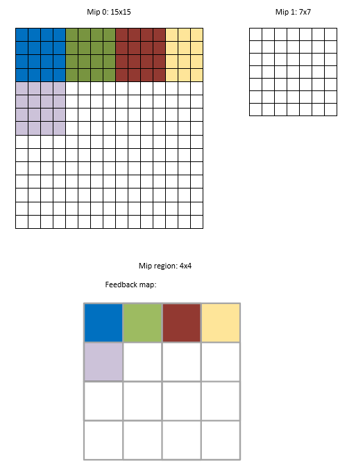
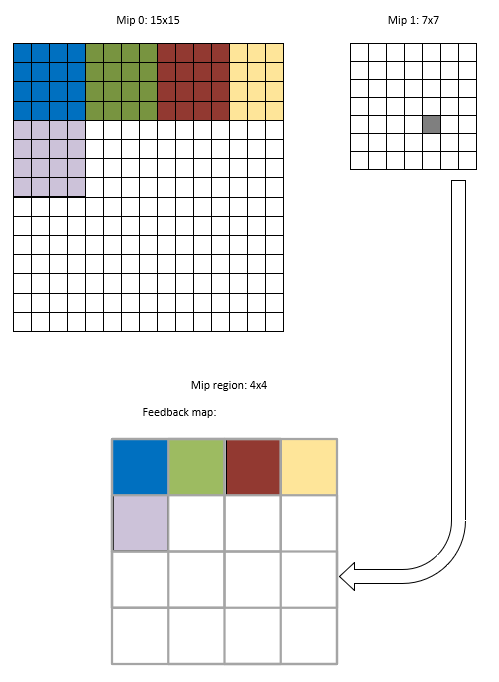
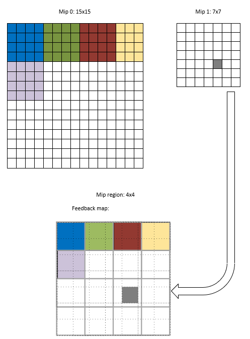
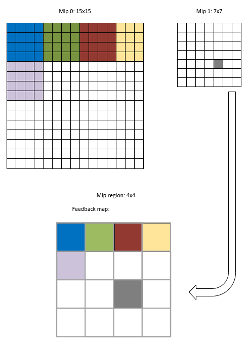

<a id="resource-operations"></a>

# Resource operations

<!-- d3d12-review-legend:begin -->

> [!NOTE]
> **Draft provenance annotations.**
> Underlining marks pending replacement wording or authored list items. Warning boxes
> mark authored, mixed or reopened passages awaiting editorial review.
> Editorial adoption does not establish factual or hardware verification. Exact approved factual
> corrections do not trigger a marker. Unmarked text elsewhere, declarations
> and structural Markdown are not assertions of approval.
> [Annotation scope and approvals](../../spec-maintenance/d3d12/prose-annotations.md).

<!-- d3d12-review-legend:end -->

<!-- d3d12-review-alert:begin:resource-operations:scope:0 -->

> [!WARNING]
> **Authored synthesis - human review pending.**
>
> This chapter specifies command list copies, immediate buffer writes, descriptor-addressed clears, resolves and resource discard. These commands operate on the resources, subresources and views supplied to the call, rather than on draw attachment bindings.

<!-- d3d12-review-alert:end:resource-operations:scope:0 -->

<!-- d3d12-review-alert:begin:resource-operations:scope:1 -->

> [!WARNING]
> **Authored synthesis - human review pending.**
>
> This is a source-preserving draft. The selected copy, clear, resolve and discard contracts include the applicable maintainer resolutions. Source-only requirements are not claims of universal implementation verification.

<!-- d3d12-review-alert:end:resource-operations:scope:1 -->

<!-- d3d12-review-alert:begin:resource-operations:owners:0 -->

> [!WARNING]
> **Authored synthesis - human review pending.**
>
> [Resources and memory](resources.md#resource-storage) defines resource identity, [subresource indexing](resources.md#subresources), [resource flags](resources.md#resource-flags), [heap types](resources.md#heap-types), [CPU mapping](resources.md#cpu-access) and [physical write boundaries](resources.md#hardware-memory-access). [Formats](formats.md#interpretation) defines format interpretation, [casting](formats.md#casting), [planar depth/stencil staging](formats.md#depth-stencil-views) and [format support queries](formats.md#support). Binding owns [view descriptions](binding.md#view-descriptions) and [descriptor storage and lifetime](binding.md#descriptor-population). [Execution](execution.md#lifetime) owns resource lifetime.

<!-- d3d12-review-alert:end:resource-operations:owners:0 -->

<!-- d3d12-review-alert:begin:resource-operations:owners:1 -->

> [!WARNING]
> **Authored synthesis - human review pending.**
>
> [Synchronization](synchronization.md#foundations) defines enhanced access/layouts, legacy resource states, queue interchange and aliasing. General shader memory semantics remain at the [memory model owner](memory-model.md). No additional memory model is defined here.

<!-- d3d12-review-alert:end:resource-operations:owners:1 -->

<!-- d3d12-review-alert:begin:resource-operations:owners:2 -->

> [!WARNING]
> **Authored synthesis - human review pending.**
>
> [Rasterization](rasterization.md#sample-patterns) defines standard and programmed sample patterns. [Output merger](output-merger.md#clear-copy-resolve-interactions) defines attachment/write mask and read-only view interactions. Its [render pass command table](output-merger.md#render-pass-recording) is the canonical recording context contract. [Queries and predication](counters-queries-and-predication.md#predication-operation-matrix) specifies the exact policy for each operation; clear, copy, resolve and discard do not acquire one inferred uniform predication policy.

<!-- d3d12-review-alert:end:resource-operations:owners:2 -->

<a id="recording-and-access"></a>

## Recording, access and availability

<!-- d3d12-review-alert:begin:resource-operations:queue-matrix:0 -->

> [!WARNING]
> **Authored synthesis - human review pending.**
>
> The declaring interface for the base methods is `ID3D12GraphicsCommandList`. The regional resolve is declared by `ID3D12GraphicsCommandList1`. Inheritance does not create additional API identities.

<!-- d3d12-review-alert:end:resource-operations:queue-matrix:0 -->

<!-- d3d12-review-alert:begin:resource-operations:queue-matrix:1 -->

> [!WARNING]
> **Authored synthesis - human review pending.**
>
> | Operations | DIRECT | COMPUTE | COPY | BUNDLE |
> |---|---|---|---|---|
> | `CopyBufferRegion`, `CopyTextureRegion`, `CopyResource`, `CopyTiles` | Yes | Yes | Yes | No |
> | `ClearRenderTargetView`, `ClearDepthStencilView`, `ResolveSubresource`, `ResolveSubresourceRegion` | Yes | No | No | No |
> | `ClearUnorderedAccessViewUint`, `ClearUnorderedAccessViewFloat`, `DiscardResource` | Yes | Yes | No | No |

<!-- d3d12-review-alert:end:resource-operations:queue-matrix:1 -->

<!-- d3d12-review-alert:begin:resource-operations:queue-matrix:2 -->

> [!WARNING]
> **Authored synthesis - human review pending.**
>
> None of these ordinary methods may be called inside an open render pass. Render pass beginning/ending clear, resolve and discard accesses are different operations, governed by the [pass access types](output-merger.md#render-pass-access). Their `NO_ACCESS` pairing/terminal flow and suspend/resume qualifications remain at that owner.

<!-- d3d12-review-alert:end:resource-operations:queue-matrix:2 -->

<!-- d3d12-review-alert:begin:resource-operations:queue-matrix:3 -->

> [!WARNING]
> **Authored synthesis - human review pending.**
>
> All eleven methods return `void`; none returns a per-call `HRESULT`. Recording failure and `Close` results follow [command list errors](execution.md#close). An API's invalid-usage rule, a core runtime check and a debug layer diagnostic are distinct contracts. A missing diagnostic does not make a call valid.

<!-- d3d12-review-alert:end:resource-operations:queue-matrix:3 -->

<!-- d3d12-review-alert:begin:resource-operations:queue-matrix:4 -->

> [!WARNING]
> **Authored synthesis - human review pending.**
>
> The tables and eleven-method render pass restriction in this section cover
> the copy/clear/resolve and graphics DiscardResource methods. The separate
> [immediate write entries](#immediate-buffer-writes) and video discard
> entries define their own declaring-list and recording contexts. They do not
> inherit a blanket ban from this table.

<!-- d3d12-review-alert:end:resource-operations:queue-matrix:4 -->

<!-- d3d12-review-alert:begin:resource-operations:access-table:0 -->

> [!WARNING]
> **Authored synthesis - human review pending.**
>
> The application must supply the access/layout appropriate to the operation under [enhanced barriers](synchronization.md#barrier-access). The corresponding legacy path remains supported under [resource states](synchronization.md#legacy-resource-states), including its [promotion/decay rules](synchronization.md#legacy-promotion-and-decay).

<!-- d3d12-review-alert:end:resource-operations:access-table:0 -->

<!-- d3d12-review-alert:begin:resource-operations:access-table:1 -->

> [!WARNING]
> **Authored synthesis - human review pending.**
>
> | Operation/use | Enhanced access | Texture layout where applicable | Legacy state |
> |---|---|---|---|
> | Copy source / destination, including the direction selected by `CopyTiles` | `COPY_SOURCE` / `COPY_DEST` | Copy-compatible source/destination layout; common layout cases retain their canonical permissions | `COPY_SOURCE` / `COPY_DEST` |
> | RTV clear | `RENDER_TARGET` | `RENDER_TARGET` | `RENDER_TARGET` |
> | DSV clear, selected aspect | `DEPTH_STENCIL_WRITE` | `DEPTH_STENCIL_WRITE` | `DEPTH_WRITE` |
> | UAV clear | `UNORDERED_ACCESS` | UAV-compatible layout | `UNORDERED_ACCESS` |
> | Resolve source / destination | `RESOLVE_SOURCE` / `RESOLVE_DEST` | Resolve-compatible source/destination layout | `RESOLVE_SOURCE` / `RESOLVE_DEST` |

<!-- d3d12-review-alert:end:resource-operations:access-table:1 -->

<!-- d3d12-review-alert:begin:resource-operations:access-table:2 -->

> [!WARNING]
> **Authored synthesis - human review pending.**
>
> The access names in this table have the `D3D12_BARRIER_ACCESS_` prefix, layouts have `D3D12_BARRIER_LAYOUT_`, and legacy states have `D3D12_RESOURCE_STATE_`. Buffers have no transitionable texture layout. [Queue/layout/access compatibility](synchronization.md#queue-compatibility) and [legacy COPY queue interchange](synchronization.md#legacy-common-state-promotion) remain requirements. The table is not permission to use an unsupported queue or format.

<!-- d3d12-review-alert:end:resource-operations:access-table:2 -->

<!-- d3d12-review-alert:begin:resource-operations:access-table:3 -->

> [!WARNING]
> **Authored synthesis - human review pending.**
>
> Discard uses its [command list/resource-flag-specific access rules](#discardresource), rather than an invented generic discard state. In-place `DECOMPRESS` retains the source access exception defined in [regional resolve](#resolvesubresourceregion).

<!-- d3d12-review-alert:end:resource-operations:access-table:3 -->

<!-- d3d12-review-alert:begin:resource-operations:sync-links:0 -->

> [!WARNING]
> **Authored synthesis - human review pending.**
>
> The operation scopes are [`D3D12_BARRIER_SYNC_COPY`, `D3D12_BARRIER_SYNC_RESOLVE`, `D3D12_BARRIER_SYNC_RENDER_TARGET`, `D3D12_BARRIER_SYNC_DEPTH_STENCIL`, and `D3D12_BARRIER_SYNC_CLEAR_UNORDERED_ACCESS_VIEW`](synchronization.md#barrier-sync). The UAV-clear scope is not the compute shading scope. [Barrier-free access](synchronization.md#barrier-free-access) and [model interoperation](synchronization.md#model-interoperation) determine which dependencies require barriers; ordinary UAV clears do not obtain an implicit dispatch ordering guarantee.

<!-- d3d12-review-alert:end:resource-operations:sync-links:0 -->

<!-- d3d12-review-alert:begin:resource-operations:protected-interactions:0 -->

> [!WARNING]
> **Authored synthesis - human review pending.**
>
> For protected resource operations, the [output protection contract](../ProtectedResources.md#overview) requires the output to be protected whenever an operation reads protected input. This includes ordinary copies and resolves; copying protected contents to an unprotected destination is not permitted. The [command list protected session state](command-list-state.md#protection) and [resource/heap protection association](resources.md#protected-creation) apply to accesses and writes through the selected APIs. The [protected operation predication restriction](counters-queries-and-predication.md#predication-operation-matrix) remains part of Queries' policy rather than an inferred uniform predicate rule.

<!-- d3d12-review-alert:end:resource-operations:protected-interactions:0 -->

<a id="copy-representation"></a>

## Locations, regions and copy representation

<!-- d3d12-review-alert:begin:resource-operations:index-and-footprints:0 -->

> [!WARNING]
> **Authored synthesis - human review pending.**
>
> A texture copy location selects either a texture subresource or a placed footprint in a buffer. Texture subresources identify a mip, array slice and plane using the [canonical indexing rule](resources.md#subresources). A 3D texture's depth slices are not array subresources. Coordinates are relative to the selected mip/plane, not implicitly to mip zero.

<!-- d3d12-review-alert:end:resource-operations:index-and-footprints:0 -->

<!-- d3d12-review-alert:begin:resource-operations:index-and-footprints:1 -->

> [!WARNING]
> **Authored synthesis - human review pending.**
>
> `ID3D12Device::GetCopyableFootprints` computes adapter-independent transfer footprints, row counts, unpadded row sizes and the required total size. Its [complete API contract](resources.md#get-copyable-footprints) is part of resource layout, not a copy command or a description of an opaque GPU texture's physical layout. The footprint types used by the selected operation are defined here.

<!-- d3d12-review-alert:end:resource-operations:index-and-footprints:1 -->

<!-- d3d12-review-alert:begin:resource-operations:index-and-footprints:2 -->

> [!WARNING]
> **Authored synthesis - human review pending.**
>
> `D3D12_RECT` is the canonical signed, half-open [rectangle type](rasterization.md#d3d12-rect). A copy box uses unsigned coordinates and excludes its right, bottom and back bounds.

<!-- d3d12-review-alert:end:resource-operations:index-and-footprints:2 -->

<a id="d3d12-texture-copy-type"></a>

### D3D12_TEXTURE_COPY_TYPE

#### Syntax

```cpp
typedef enum D3D12_TEXTURE_COPY_TYPE {
  D3D12_TEXTURE_COPY_TYPE_SUBRESOURCE_INDEX = 0,
  D3D12_TEXTURE_COPY_TYPE_PLACED_FOOTPRINT = 1
} D3D12_TEXTURE_COPY_TYPE;
```

#### Constants

<!-- d3d12-review-alert:begin:resource-operations:type-D3D12_TEXTURE_COPY_TYPE:3 -->

> [!WARNING]
> **Mixed source and authored adaptation - human review pending.**
>
> | Constant | Value | Meaning |
> |---|---|---|
> | `D3D12_TEXTURE_COPY_TYPE_SUBRESOURCE_INDEX` | `0` | Indicates a subresource, identified by an index, is to be copied. |
> | `D3D12_TEXTURE_COPY_TYPE_PLACED_FOOTPRINT` | `1` | Indicates a placed footprint, identified by a [D3D12_PLACED_SUBRESOURCE_FOOTPRINT](#d3d12-placed-subresource-footprint) structure, is to be copied. |

<!-- d3d12-review-alert:end:resource-operations:type-D3D12_TEXTURE_COPY_TYPE:3 -->

#### Remarks

This enum is used by the [D3D12_TEXTURE_COPY_LOCATION](#d3d12-texture-copy-location) structure.

<a id="d3d12-texture-copy-location"></a>

### D3D12_TEXTURE_COPY_LOCATION

#### Syntax

```cpp
typedef struct D3D12_TEXTURE_COPY_LOCATION {
  ID3D12Resource          *pResource;
  D3D12_TEXTURE_COPY_TYPE Type;
  union {
    D3D12_PLACED_SUBRESOURCE_FOOTPRINT PlacedFootprint;
    UINT                               SubresourceIndex;
  };
} D3D12_TEXTURE_COPY_LOCATION;
```

#### Members

`pResource`

Specifies the resource which will be used for the copy operation.
When **Type** is D3D12\_TEXTURE\_COPY\_TYPE\_PLACED\_FOOTPRINT, **pResource** must point to a buffer <ins><!-- d3d12-review-inline:begin:resource-operations:type-D3D12_TEXTURE_COPY_LOCATION:4 -->resource. When<!-- d3d12-review-inline:end:resource-operations:type-D3D12_TEXTURE_COPY_LOCATION:4 --></ins> **Type** is D3D12\_TEXTURE\_COPY\_TYPE\_SUBRESOURCE\_INDEX, **pResource** must point to a texture resource.

`Type`

Specifies which type of resource location this is: a subresource of a texture, or a description of a texture layout which can be applied to a buffer. This [D3D12_TEXTURE_COPY_TYPE](#d3d12-texture-copy-type) enum indicates which union member to use.

`PlacedFootprint`

Specifies a texture layout, with offset, dimensions, and pitches, for the hardware to understand how to treat a section of a buffer resource as a multi-dimensional texture. To fill-in the correct data for a [CopyTextureRegion](#copytextureregion) call, see [D3D12_PLACED_SUBRESOURCE_FOOTPRINT](#d3d12-placed-subresource-footprint).

`SubresourceIndex`

Specifies the index of <ins><!-- d3d12-review-inline:begin:resource-operations:type-D3D12_TEXTURE_COPY_LOCATION:10 -->the subresource of an arrayed, mip-mapped, or planar texture that should be used<!-- d3d12-review-inline:end:resource-operations:type-D3D12_TEXTURE_COPY_LOCATION:10 --></ins> for the copy operation.

#### Remarks

Use this structure with [CopyTextureRegion](#copytextureregion).

<a id="d3d12-box"></a>

### D3D12_BOX

#### Syntax

```cpp
typedef struct D3D12_BOX {
  UINT left;
  UINT top;
  UINT front;
  UINT right;
  UINT bottom;
  UINT back;
} D3D12_BOX;
```

#### Members

`left`

The x position of the left hand side of the box.

`top`

The y position of the top of the box.

`front`

The z position of the front of the box.

`right`

The x position of the right hand side of the box, plus 1. This means that `right - left` equals the width of the box.

`bottom`

The y position of the bottom of the box, plus 1. This means that `bottom - top` equals the height of the box.

`back`

The z position of the back of the box, plus 1. This means that `back - front` equals the depth of the box.

#### Remarks

This structure is used by the methods [WriteToSubresource](resources.md#resource-write-to-subresource), [ReadFromSubresource](resources.md#resource-read-from-subresource) and [CopyTextureRegion](#copytextureregion).

<a id="d3d12-subresource-footprint"></a>

### D3D12_SUBRESOURCE_FOOTPRINT

#### Syntax

```cpp
typedef struct D3D12_SUBRESOURCE_FOOTPRINT {
  DXGI_FORMAT Format;
  UINT        Width;
  UINT        Height;
  UINT        Depth;
  UINT        RowPitch;
} D3D12_SUBRESOURCE_FOOTPRINT;
```

#### Members

`Format`

A [DXGI_FORMAT](formats.md#dxgi-format)-typed value that specifies the viewing format.

`Width`

The width of the subresource.

`Height`

The height of the subresource.

`Depth`

The depth of the subresource.

`RowPitch`

The row pitch, or width, or physical size, in bytes, of the subresource data. <ins><!-- d3d12-review-inline:begin:resource-operations:type-D3D12_SUBRESOURCE_FOOTPRINT:12 -->This must be greater than or equal to the size of the data within a row. Unless `UnrestrictedBufferTextureCopyPitchSupported` is TRUE, it must be a multiple of `D3D12_TEXTURE_DATA_PITCH_ALIGNMENT` (256). The [unrestricted-pitch rule](#copy-pitch) defines the supported alternative.<!-- d3d12-review-inline:end:resource-operations:type-D3D12_SUBRESOURCE_FOOTPRINT:12 --></ins>

#### Remarks

Use this structure in the [D3D12_PLACED_SUBRESOURCE_FOOTPRINT](#d3d12-placed-subresource-footprint) structure.

The helper structure is [CD3DX12_SUBRESOURCE_FOOTPRINT](https://learn.microsoft.com/en-us/windows/desktop/direct3d12/cd3dx12-subresource-footprint).

<a id="d3d12-placed-subresource-footprint"></a>

### D3D12_PLACED_SUBRESOURCE_FOOTPRINT

#### Syntax

```cpp
typedef struct D3D12_PLACED_SUBRESOURCE_FOOTPRINT {
  UINT64                      Offset;
  D3D12_SUBRESOURCE_FOOTPRINT Footprint;
} D3D12_PLACED_SUBRESOURCE_FOOTPRINT;
```

#### Members

`Offset`

The offset of the subresource within the parent resource, in bytes. The offset between the start of the parent resource and this subresource.

This value must be aligned to D3D12\_TEXTURE\_DATA\_PLACEMENT\_ALIGNMENT (512) unless [D3D12_FEATURE_DATA_D3D12_OPTIONS13::UnrestrictedBufferTextureCopyPitchSupported](devices-and-capabilities.md#d3d12_feature_data_d3d12_options13) is TRUE.

`Footprint`

The format, width, height, depth, and row-pitch of the subresource, as a [D3D12_SUBRESOURCE_FOOTPRINT](#d3d12-subresource-footprint) structure.

#### Remarks

This structure is used in the [D3D12_TEXTURE_COPY_LOCATION](#d3d12-texture-copy-location) structure, and by [ID3D12Device::GetCopyableFootprints](resources.md#get-copyable-footprints).

All the data referenced by the footprint structure must fit within the bounds of the parent resource. If you use [GetCopyableFootprints](resources.md#get-copyable-footprints) to fill out the structure, the *pTotalBytes* output field indicates the required size of the resource.

This structure is <ins><!-- d3d12-review-inline:begin:resource-operations:type-D3D12_PLACED_SUBRESOURCE_FOOTPRINT:11 -->also used in a number<!-- d3d12-review-inline:end:resource-operations:type-D3D12_PLACED_SUBRESOURCE_FOOTPRINT:11 --></ins> of helper functions (refer to [Helper Structures and Functions for D3D12](https://learn.microsoft.com/en-us/windows/desktop/direct3d12/helper-structures-and-functions-for-d3d12)).

When copying textures, use this structure along with [D3D12_TEXTURE_COPY_LOCATION](#d3d12-texture-copy-location).

<a id="copy-pitch"></a>

### Pitch, placement and unequal dimensions

```cpp
const UINT D3D12_TEXTURE_DATA_PITCH_ALIGNMENT = 256;
const UINT D3D12_TEXTURE_DATA_PLACEMENT_ALIGNMENT = 512;
```

<!-- d3d12-review-alert:begin:resource-operations:pitch-constants:1 -->

> [!WARNING]
> **Authored synthesis - human review pending.**
>
> `D3D12_FEATURE_DATA_D3D12_OPTIONS13.UnrestrictedBufferTextureCopyPitchSupported` selects the relaxed buffer/texture copy alignment contract. Otherwise the 256-byte row pitch and 512-byte placed footprint offset alignments apply. The footprint must fit the buffer, and the pitch must still cover each complete row. The public OPTIONS13 capability structure is available with Windows 11 version 22H2 or DirectX 12 Agility SDK 1.6 or later.

<!-- d3d12-review-alert:end:resource-operations:pitch-constants:1 -->

With this feature, both offset and row-pitch MUST be aligned only to the whole unit size of the texture's format. For example, copy operations targeting a texture with format <ins><!-- d3d12-review-inline:begin:resource-operations:pitch-feature:0 -->`DXGI_FORMAT_R32G32B32A32_FLOAT`<!-- d3d12-review-inline:end:resource-operations:pitch-feature:0 --></ins> must have offset and row-pitch aligned to 16 bytes, i.e, entire texels.

#### Driver availability
Driver support for unrestricted copy alignments is reported via `UnrestrictedBufferTextureCopyPitchSupported` in `D3D12DDI_OPTIONS_DATA_0091` when `GetCaps` is called with `D3D12DDICAPS_TYPE_OPTIONS_0091`; available starting with DDI version `e_DDI_12_8_0091`.

<!-- d3d12-review-alert:begin:resource-operations:dimensions-gate:0 -->

> [!WARNING]
> **Authored synthesis - human review pending.**
>
> `D3D12_FEATURE_DATA_D3D12_OPTIONS13.TextureCopyBetweenDimensionsSupported` reports support for `CopyTextureRegion` between textures of different dimensions. This does not relax `CopyResource`'s whole-resource type/dimension requirements or any region/format/sample restrictions.

<!-- d3d12-review-alert:end:resource-operations:dimensions-gate:0 -->

<ins><!-- d3d12-review-inline:begin:resource-operations:dimensions-feature:0 -->Examples include copying a slice of a 3D resource to a 2D resource or a row of a 3D or 2D resource to a 1D resource. Support formalizes these copy operations; absence of prior runtime validation does not establish support.<!-- d3d12-review-inline:end:resource-operations:dimensions-feature:0 --></ins>

#### Driver availability
Support for copying between textures whose dimensionality does not match will be implied by, and must be supported on, drivers that report their DDI version to be `e_DDI_12_8_0091` or greater.

<a id="copy-formats"></a>

### Format, block and plane rules

<!-- d3d12-review-alert:begin:resource-operations:copy-format-route:0 -->

> [!WARNING]
> **Authored synthesis - human review pending.**
>
> Copy format compatibility is not arbitrary equal-byte-size casting. Ordinary copies preserve bits within identical formats or a compatible typeless family. The exact equal-bit-width exceptions and 1:4 block/texel scaling are defined in [reinterpret copy](#reinterpret-copy). View format casting and explicit resource cast lists remain distinct [Formats contracts](formats.md#casting).

<!-- d3d12-review-alert:end:resource-operations:copy-format-route:0 -->

<!-- d3d12-review-alert:begin:resource-operations:copy-format-route:1 -->

> [!WARNING]
> **Authored synthesis - human review pending.**
>
> For block-compressed regions, origins and box endpoints retain compression block alignment; pitches describe rows of blocks. A complete selected mip may have logical dimensions smaller than 4×4 or nonmultiples of four. Copy boxes use padded whole-block endpoints, including the portions of the final block beyond the logical mip edge. Storage padding does not enlarge the logical mip dimensions. The [BC padded-transfer bounds](#bc-copy-edges) define this exception to logical texture bounds. They do not permit arbitrary unaligned interior endpoints.

<!-- d3d12-review-alert:end:resource-operations:copy-format-route:1 -->

<!-- d3d12-review-alert:begin:resource-operations:copy-format-route:2 -->

> [!WARNING]
> **Authored synthesis - human review pending.**
>
> For planar copies, the selected plane determines its element format, dimensions and subsampling alignment. The exact [planar depth/stencil buffer layout](formats.md#depth-stencil-views) defines plane 0/1, `D24X8` bits 0–23 and zero-initialized bits 24–31, `D32` and `S8` byte layouts, and the R32/R8 transfer format families. A copy does not interleave the depth and stencil planes.

<!-- d3d12-review-alert:end:resource-operations:copy-format-route:2 -->

<!-- d3d12-review-alert:begin:resource-operations:copy-format-route:3 -->

> [!WARNING]
> **Authored synthesis - human review pending.**
>
> `GetCopyableFootprints` returns row counts separately from unpadded row sizes. The transfer address of a row within a footprint is its buffer base plus `Offset`, plus its depth slice pitch, plus its row index times `RowPitch`; row padding is not additional texel data. [Resource write boundaries](resources.md#hardware-memory-access) govern which destination bytes may be modified.

<!-- d3d12-review-alert:end:resource-operations:copy-format-route:3 -->

<a id="bc-copy-edges"></a>

#### BC logical dimensions, tails and outer edges

The [BC format and dimension contract](formats.md#bc-dimensions) defines the `UnalignedBlockTexturesSupported` capability and logical mip dimensions.

<!-- d3d12-review-alert:begin:resource-operations:bc-tail-copies:0 -->

> [!WARNING]
> **Authored synthesis - human review pending.**
>
> `D3D12_FEATURE_D3D12_OPTIONS8` reports `UnalignedBlockTexturesSupported`. This is a texture dimension capability, not a general permission for unaligned interior copy offsets. Even when it is FALSE, less-detailed BC mips may have logical dimensions such as 6×6, 2×2 or 1×1. A whole selected small mip can be copied to a matching destination mip with zero destination offsets and a null source box.

<!-- d3d12-review-alert:end:resource-operations:bc-tail-copies:0 -->

<!-- d3d12-review-alert:begin:resource-operations:bc-tail-copies:1 -->

> [!WARNING]
> **Authored synthesis - human review pending.**
>
> For BC1 a 2×2 mip occupies one 8-byte block; for BC7 a 1×1 mip occupies one 16-byte block. A 6-texel-wide BC mip has two stored blocks per row, with only the first two texels of the final block inside the logical width. Its logical right edge is 6, while its padded copy boundary is 8.

<!-- d3d12-review-alert:end:resource-operations:bc-tail-copies:1 -->

<!-- d3d12-review-alert:begin:resource-operations:bc-tail-copies:2 -->

> [!WARNING]
> **Authored synthesis - human review pending.**
>
> For BC transfers, padded width and height are `4 * ceil(logical dimension / 4)`. Explicit source box endpoints and destination-offset-plus-transfer-extents are checked against those padded whole-block bounds, not just the logical texture width and height. Origins and endpoints must remain block-aligned. For a logical width of 6, copying the last block from `left = 4` uses `right = 8`, not 6. An explicit full 2×2 BC mip uses `left = top = 0` and `right = bottom = 4`. Its 2D box still uses `front = 0`, `back = 1`. The whole block is copied even where it exceeds the logical texture bounds. The same padded destination bounds permit the corresponding full block at a texture edge.

<!-- d3d12-review-alert:end:resource-operations:bc-tail-copies:2 -->

<!-- d3d12-review-alert:begin:resource-operations:bc-tail-copies:3 -->

> [!WARNING]
> **Authored synthesis - human review pending.**
>
> The padded block payload and buffer footprint pitch must not be substituted for logical mip dimensions. Conversely, the texture-edge exception does not extend the actual byte bounds of a backing buffer: every complete compressed block referenced by a placed footprint must fit that buffer. Row pitch and placement alignment rules remain applicable. A null source box selecting the whole mip and an explicit padded full-mip box both retain whole-block transfer behavior.

<!-- d3d12-review-alert:end:resource-operations:bc-tail-copies:3 -->

<a id="plane-copy-layouts"></a>

#### Copyable plane and format unit layouts

<!-- d3d12-review-alert:begin:resource-operations:plane-copy-table:0 -->

> [!WARNING]
> **Authored synthesis - human review pending.**
>
> For a supported planar resource format, the copyable plane layout uses the following dimensions and format families. `W` and `H` are the selected mip's dimensions; `ceil` rounds up. This table specifies transfer representation, not permission to create every format on every device.

<!-- d3d12-review-alert:end:resource-operations:plane-copy-table:0 -->

<!-- d3d12-review-alert:begin:resource-operations:plane-copy-table:1 -->

> [!WARNING]
> **Authored synthesis - human review pending.**
>
> | Resource format family | Plane | Transfer format family | Plane width | Plane height | Minimum pitch width in plane elements |
> |---|---:|---|---|---|---|
> | `NV12` | 0 | `R8_TYPELESS` | W | H | W |
> | `NV12` | 1 | `R8G8_TYPELESS` | ceil(W/2) | ceil(H/2) | ceil(W/2) |
> | `P010`, `P016` | 0 | `R16_TYPELESS` | W | H | W |
> | `P010`, `P016` | 1 | `R16G16_TYPELESS` | ceil(W/2) | ceil(H/2) | ceil(W/2) |
> | `P208` | 0 | `R8_TYPELESS` | W | H | W |
> | `P208` | 1 | `R8G8_TYPELESS` | ceil(W/2) | H | ceil(W/2) |
> | `V208` | 0 | `R8_TYPELESS` | W | H | W |
> | `V208` | 1, 2 | `R8_TYPELESS` | W | ceil(H/2) | W |
> | `V408` | 0, 1, 2 | `R8_TYPELESS` | W | H | W |
> | `NV11` | 0 | `R8_TYPELESS` | W | H | W |
> | `NV11` | 1 | `R8G8_TYPELESS` | ceil(W/4) | H | ceil(W/2) |
> | `R24G8_TYPELESS`, `R32G8X24_TYPELESS` | 0 | `R32_TYPELESS` | W | H | W |
> | `R24G8_TYPELESS`, `R32G8X24_TYPELESS` | 1 | `R8_TYPELESS` | W | H | W |

<!-- d3d12-review-alert:end:resource-operations:plane-copy-table:1 -->

<!-- d3d12-review-alert:begin:resource-operations:plane-copy-table:2 -->

> [!WARNING]
> **Authored synthesis - human review pending.**
>
> The format identifiers in this table have the `DXGI_FORMAT_` prefix. `NV11` chroma pitch deliberately includes unused right-side padding. Byte row pitch must cover that minimum pitch width times the transfer element size, then satisfy the selected alignment rule. The footprint's plane dimensions and its minimum storage pitch are therefore not interchangeable.

<!-- d3d12-review-alert:end:resource-operations:plane-copy-table:2 -->

<!-- d3d12-review-alert:begin:resource-operations:plane-copy-table:3 -->

> [!WARNING]
> **Authored synthesis - human review pending.**
>
> For ordinary BC formats, the block is 4×4 texels: BC1/BC4 use 8 bytes per block, and BC2/BC3/BC5/BC6H/BC7 use 16. The buffer footprint row pitch counts bytes per block row, not bytes times four logical texel rows. For relaxed alignment, the whole format unit is the compression block: the corresponding alignment is 8 or 16 bytes.

<!-- d3d12-review-alert:end:resource-operations:plane-copy-table:3 -->

<a id="copy-self-and-alias"></a>

### Self-copy, overlap and alias initialization

<!-- d3d12-review-alert:begin:resource-operations:self-copy-route:0 -->

> [!WARNING]
> **Authored synthesis - human review pending.**
>
> The [enhanced self-copy contract](synchronization.md#simultaneous-access) permits the same common layout subresource as source and destination in `CopyBufferRegion` or `CopyTextureRegion` when the memory regions do not intersect. Intersecting source/destination regions produce undefined results, and the debug layer must validate this. Buffers have no transitionable texture layout; enhanced same-buffer copies use this non-intersection rule rather than legacy read/write state exclusivity.

<!-- d3d12-review-alert:end:resource-operations:self-copy-route:0 -->

<!-- d3d12-review-alert:begin:resource-operations:self-copy-route:1 -->

> [!WARNING]
> **Authored synthesis - human review pending.**
>
> The [legacy state model](synchronization.md#legacy-states) cannot combine `COPY_SOURCE` and `COPY_DEST` on the same subresource, including by implicit promotion. Different texture subresources of one resource remain distinct. `CopyResource` separately requires different resources.

<!-- d3d12-review-alert:end:resource-operations:self-copy-route:1 -->

<!-- d3d12-review-alert:begin:resource-operations:self-copy-route:2 -->

> [!WARNING]
> **Authored synthesis - human review pending.**
>
> [Enhanced alias initialization](synchronization.md#enhanced-aliasing) and [legacy activation/initialization](synchronization.md#legacy-aliasing) define when clear, full copy or discard initializes reused storage. An operation's permission to initialize an alias is not blanket permission for arbitrary intersecting source/destination mappings. Reserved resource duplicate mappings retain the [tile copy limitations](#copytiles).

<!-- d3d12-review-alert:end:resource-operations:self-copy-route:2 -->

<!-- d3d12-review-alert:begin:resource-operations:D162-dpb-scaling-copy-boundary:0 -->

> [!WARNING]
> **Authored synthesis - human review pending.**
>
> The specialized [reference-only DPB video processing scaling route](video-encoding-controls.md#source-s08-032) is not an ordinary CopyResource/CopyTextureRegion operation and does not remove their reference-only allocation restrictions. Readable reconstructed-picture support permits appropriately created ordinary textures. It does not turn an allocation that still has VIDEO_ENCODE_REFERENCE_ONLY into a general copy or shader resource.

<!-- d3d12-review-alert:end:resource-operations:D162-dpb-scaling-copy-boundary:0 -->

<!-- d3d12-review-alert:begin:resource-operations:tile-inheritance-source:0 -->

> [!WARNING]
> **Authored synthesis - human review pending.**
>
> For reserved resource tile sharing, [data compatibility across tiled resources sharing tiles](resources.md#tiled-data-compatibility) defines the dimension/format/render target/depth-stencil compatibility cases, compatible block/uncompressed aliases, solid-color packed/non-packed case and all-zero inheritance case. D3D12's [aliasing synchronization and initialization](synchronization.md#legacy-aliasing) replaces that source's `TiledResourceBarrier` mechanism. That source's data compatibility cases do not grant D3D12 intersecting-copy permission.

<!-- d3d12-review-alert:end:resource-operations:tile-inheritance-source:0 -->

<!-- d3d12-review-alert:begin:resource-operations:tile-inheritance-source:1 -->

> [!WARNING]
> **Authored synthesis - human review pending.**
>
> Ordinary copies must not use allocations created with `D3D12_RESOURCE_FLAG_VIDEO_DECODE_REFERENCE_ONLY` or `D3D12_RESOURCE_FLAG_VIDEO_ENCODE_REFERENCE_ONLY`, including when the source and destination flags match.

<!-- d3d12-review-alert:end:resource-operations:tile-inheritance-source:1 -->

<a id="copy-commands"></a>

## Copy commands

<a id="copybufferregion"></a>

### ID3D12GraphicsCommandList::CopyBufferRegion

#### Declaration

```cpp
void CopyBufferRegion(
    ID3D12Resource* pDstBuffer,
    UINT64 DstOffset,
    ID3D12Resource* pSrcBuffer,
    UINT64 SrcOffset,
    UINT64 NumBytes
    );
```

#### Behavior

Copies a region of a buffer from one resource to another.

<!-- d3d12-review-alert:begin:resource-operations:CopyBufferRegion-integration:0 -->

> [!WARNING]
> **Authored synthesis - human review pending.**
>
> Both resources must be buffers. `SrcOffset` and `DstOffset` are byte offsets. The complete `NumBytes` ranges must fit without unsigned overflow. Unlike atomic copy operations, ordinary byte copies do not impose a natural 4- or 8-byte alignment. A zero-byte copy transfers no data. The [self-copy and alias rules](#copy-self-and-alias) apply. The enhanced same-buffer non-overlap case must not be rejected merely because legacy states cannot express it.

<!-- d3d12-review-alert:end:resource-operations:CopyBufferRegion-integration:0 -->

<!-- d3d12-review-alert:begin:resource-operations:CopyBufferRegion-integration:1 -->

> [!WARNING]
> **Authored synthesis - human review pending.**
>
> Structured/raw/typed interpretations are view properties of a buffer, not buffer creation strides. The D3D11 structured copy restrictions requiring equal structure strides and whole-structure regions do not apply to an ordinary D3D12 buffer byte copy. Counter storage is also ordinary application buffer storage: [counter copy interactions](#counter-interactions) apply.

<!-- d3d12-review-alert:end:resource-operations:CopyBufferRegion-integration:1 -->

#### Parameters

<ins><!-- d3d12-review-inline:begin:resource-operations:CopyBufferRegion-parameters:1 -->`pDstBuffer`<!-- d3d12-review-inline:end:resource-operations:CopyBufferRegion-parameters:1 --></ins>

Type: **[ID3D12Resource](resources.md#resource-storage)\***

Specifies the destination [ID3D12Resource](resources.md#resource-storage).

`DstOffset`

Type: **UINT64**

Specifies a UINT64 offset (in bytes) into the destination resource.

<ins><!-- d3d12-review-inline:begin:resource-operations:CopyBufferRegion-parameters:7 -->`pSrcBuffer`<!-- d3d12-review-inline:end:resource-operations:CopyBufferRegion-parameters:7 --></ins>

Type: **[ID3D12Resource](resources.md#resource-storage)\***

Specifies the source [ID3D12Resource](resources.md#resource-storage).

`SrcOffset`

Type: **UINT64**

Specifies a UINT64 offset (in bytes) into the source resource, to start the copy from.

`NumBytes`

Type: **UINT64**

Specifies the number of bytes to copy.

#### Return values

None

#### Operation requirements

Consider using the [CopyResource](#copyresource) method when copying an entire resource, and use this method for copying regions of a resource.

**CopyBufferRegion** may be used to initialize resources which alias the same heap memory. See [CreatePlacedResource](resources.md#create-placed-resource) for more details.

##### Examples

The [D3D12HelloTriangle](https://learn.microsoft.com/en-us/windows/desktop/direct3d12/working-samples) sample uses **ID3D12GraphicsCommandList::CopyBufferRegion** as follows:

```cpp
inline UINT64 UpdateSubresources(
    _In_ ID3D12GraphicsCommandList* pCmdList,
    _In_ ID3D12Resource* pDestinationResource,
    _In_ ID3D12Resource* pIntermediate,
    _In_range_(0,D3D12_REQ_SUBRESOURCES) UINT FirstSubresource,
    _In_range_(0,D3D12_REQ_SUBRESOURCES-FirstSubresource) UINT NumSubresources,
    UINT64 RequiredSize,
    _In_reads_(NumSubresources) const D3D12_PLACED_SUBRESOURCE_FOOTPRINT* pLayouts,
    _In_reads_(NumSubresources) const UINT* pNumRows,
    _In_reads_(NumSubresources) const UINT64* pRowSizesInBytes,
    _In_reads_(NumSubresources) const D3D12_SUBRESOURCE_DATA* pSrcData)
{
    // Minor validation
    D3D12_RESOURCE_DESC IntermediateDesc = pIntermediate->GetDesc();
    D3D12_RESOURCE_DESC DestinationDesc = pDestinationResource->GetDesc();
    if (IntermediateDesc.Dimension != D3D12_RESOURCE_DIMENSION_BUFFER ||
        IntermediateDesc.Width < RequiredSize + pLayouts[0].Offset ||
        RequiredSize > (SIZE_T)-1 ||
        (DestinationDesc.Dimension == D3D12_RESOURCE_DIMENSION_BUFFER &&
            (FirstSubresource != 0 || NumSubresources != 1)))
    {
        return 0;
    }

    BYTE* pData;
    HRESULT hr = pIntermediate->Map(0, NULL, reinterpret_cast<void**>(&pData));
    if (FAILED(hr))
    {
        return 0;
    }

    for (UINT i = 0; i < NumSubresources; ++i)
    {
        if (pRowSizesInBytes[i] > (SIZE_T)-1) return 0;
        D3D12_MEMCPY_DEST DestData = { pData + pLayouts[i].Offset, pLayouts[i].Footprint.RowPitch, pLayouts[i].Footprint.RowPitch * pNumRows[i] };
        MemcpySubresource(&DestData, &pSrcData[i], (SIZE_T)pRowSizesInBytes[i], pNumRows[i], pLayouts[i].Footprint.Depth);
    }
    pIntermediate->Unmap(0, NULL);

    if (DestinationDesc.Dimension == D3D12_RESOURCE_DIMENSION_BUFFER)
    {
        CD3DX12_BOX SrcBox( UINT( pLayouts[0].Offset ), UINT( pLayouts[0].Offset + pLayouts[0].Footprint.Width ) );
        pCmdList->CopyBufferRegion(
            pDestinationResource, 0, pIntermediate, pLayouts[0].Offset, pLayouts[0].Footprint.Width);
    }
    else
    {
        for (UINT i = 0; i < NumSubresources; ++i)
        {
            CD3DX12_TEXTURE_COPY_LOCATION Dst(pDestinationResource, i + FirstSubresource);
            CD3DX12_TEXTURE_COPY_LOCATION Src(pIntermediate, pLayouts[i]);
            pCmdList->CopyTextureRegion(&Dst, 0, 0, 0, &Src, nullptr);
        }
    }
    return RequiredSize;
}

```

See [Example Code in the D3D12 Reference](https://learn.microsoft.com/en-us/windows/desktop/direct3d12/notes-on-example-code).

<a id="copytextureregion"></a>

### ID3D12GraphicsCommandList::CopyTextureRegion

#### Declaration

```cpp
void CopyTextureRegion(
    const D3D12_TEXTURE_COPY_LOCATION* pDst,
    UINT DstX, UINT DstY, UINT DstZ,
    const D3D12_TEXTURE_COPY_LOCATION* pSrc,
    const D3D12_BOX* pSrcBox
    );
```

#### Behavior

This method uses the GPU to copy texture data between two locations. Both the source and the destination may reference texture data located within either a buffer resource or a texture resource.

<!-- d3d12-review-alert:begin:resource-operations:CopyTextureRegion-integration:0 -->

> [!WARNING]
> **Authored synthesis - human review pending.**
>
> A null `pSrcBox` selects the full source subresource or footprint. A non-null box describes half-open source coordinates. When any extent is empty (`right <= left`, `bottom <= top`, or `back <= front`), no data is copied. For nonempty regions the source box and the sum of the destination offset and extent must fit the selected transfer bounds, with the [format/block/plane scaling](#copy-formats). For BC texture locations these are the [padded whole-block bounds](#bc-copy-edges), which may exceed the logical mip edge; actual backing buffer byte bounds are not relaxed. A box does not select a mip, array slice or plane: the copy location does.

<!-- d3d12-review-alert:end:resource-operations:CopyTextureRegion-integration:0 -->

<!-- d3d12-review-alert:begin:resource-operations:CopyTextureRegion-integration:1 -->

> [!WARNING]
> **Authored synthesis - human review pending.**
>
> `DstY` is zero for 1D destinations and `DstZ` is zero for 1D/2D destinations. A 2D source box uses `front = 0`, `back = 1`. A 1D box also uses `top = 0`, `bottom = 1`. Footprint offsets/pitches follow [the copy capability rules](#copy-pitch).

<!-- d3d12-review-alert:end:resource-operations:CopyTextureRegion-integration:1 -->

<!-- d3d12-review-alert:begin:resource-operations:CopyTextureRegion-integration:2 -->

> [!WARNING]
> **Authored synthesis - human review pending.**
>
> For baseline devices without programmable sample position support, depth/stencil or multisampled copies require the complete subresource rectangle, zero destination offsets and equal subresource dimensions. `pSrcBox` is null or explicitly covers the complete source subresource. Source and destination sample counts must match; multisampled quality levels must match as well. With programmable sample position support, partial depth/stencil and multisampled copies are supported subject to [the full/partial sample pattern contracts](rasterization.md#sample-copy-depthstencil-full-subresource) and ordinary bounds/format requirements. Color copies ignore sample positions; depth copies must preserve the source pattern association, and partial depth copies retain the uncovered-destination compatibility requirement. Stencil-only partial copies have the canonical exception.

<!-- d3d12-review-alert:end:resource-operations:CopyTextureRegion-integration:2 -->

<!-- d3d12-review-alert:begin:resource-operations:CopyTextureRegion-integration:3 -->

> [!WARNING]
> **Authored synthesis - human review pending.**
>
> For same-subresource copies, the [enhanced non-intersecting common layout exception](#copy-self-and-alias) replaces the ordinary different-subresource restriction. Feedback maps cannot be copied by `CopyTextureRegion`. Use their [whole-resource copy contract](#feedback-transcoding).

<!-- d3d12-review-alert:end:resource-operations:CopyTextureRegion-integration:3 -->

#### Parameters

<ins><!-- d3d12-review-inline:begin:resource-operations:CopyTextureRegion-parameters:1 -->`pDst`<!-- d3d12-review-inline:end:resource-operations:CopyTextureRegion-parameters:1 --></ins>

Type: **const [D3D12_TEXTURE_COPY_LOCATION](#d3d12-texture-copy-location)\***

Specifies the destination [D3D12_TEXTURE_COPY_LOCATION](#d3d12-texture-copy-location). <ins><!-- d3d12-review-inline:begin:resource-operations:CopyTextureRegion-parameters:3 -->The [operation access contract](#recording-and-access) applies; the legacy state is `D3D12_RESOURCE_STATE_COPY_DEST`.<!-- d3d12-review-inline:end:resource-operations:CopyTextureRegion-parameters:3 --></ins>

`DstX`

Type: **UINT**

The x-coordinate of the upper left corner of the destination region.

`DstY`

Type: **UINT**

The y-coordinate of the upper left corner of the destination region. For a 1D subresource, this must be zero.

`DstZ`

Type: **UINT**

The z-coordinate of the upper left corner of the destination region. For a 1D or 2D subresource, this must be zero.

<ins><!-- d3d12-review-inline:begin:resource-operations:CopyTextureRegion-parameters:13 -->`pSrc`<!-- d3d12-review-inline:end:resource-operations:CopyTextureRegion-parameters:13 --></ins>

Type: **const [D3D12_TEXTURE_COPY_LOCATION](#d3d12-texture-copy-location)\***

Specifies the source [D3D12_TEXTURE_COPY_LOCATION](#d3d12-texture-copy-location). <ins><!-- d3d12-review-inline:begin:resource-operations:CopyTextureRegion-parameters:15 -->The [operation access contract](#recording-and-access) applies; the legacy state is `D3D12_RESOURCE_STATE_COPY_SOURCE`.<!-- d3d12-review-inline:end:resource-operations:CopyTextureRegion-parameters:15 --></ins>

<ins><!-- d3d12-review-inline:begin:resource-operations:CopyTextureRegion-parameters:16 -->`pSrcBox`<!-- d3d12-review-inline:end:resource-operations:CopyTextureRegion-parameters:16 --></ins>

Type: **const [D3D12_BOX](#d3d12-box)\***

Specifies an optional D3D12\_BOX that sets the size of the source texture to copy.

#### Return values

None

#### Operation requirements

<ins><!-- d3d12-review-inline:begin:resource-operations:CopyTextureRegion-remarks:0 -->The source box must fit the selected source transfer bounds. For BC texture locations, the [padded whole-block bounds](#bc-copy-edges) may extend beyond the logical mip width or height.<!-- d3d12-review-inline:end:resource-operations:CopyTextureRegion-remarks:0 --></ins> The destination offsets, (x, y, and z), allow the source box to be offset when writing into the destination resource; <ins><!-- d3d12-review-inline:begin:resource-operations:CopyTextureRegion-remarks:0 -->however, the destination offsets plus the transfer extents must fit the selected destination transfer bounds, including the padded BC edge case.<!-- d3d12-review-inline:end:resource-operations:CopyTextureRegion-remarks:0 --></ins> <ins><!-- d3d12-review-inline:begin:resource-operations:CopyTextureRegion-remarks:0 -->If you copy beyond the permitted destination transfer bounds or specify a source box beyond the permitted source transfer bounds,<!-- d3d12-review-inline:end:resource-operations:CopyTextureRegion-remarks:0 --></ins> the behavior of **CopyTextureRegion** is undefined. If you created a device that supports the [debug layer](diagnostics.md#debug-configuration), the debug output reports an error on this invalid **CopyTextureRegion** call. Invalid parameters to **CopyTextureRegion** cause undefined behavior and might result in incorrect rendering, clipping, no copy, or even the removal of the rendering device.

<ins><!-- d3d12-review-inline:begin:resource-operations:CopyTextureRegion-remarks:1 -->Coordinates are in texels of the selected texture or buffer footprint format; format block/subsampling alignment still applies. `CopyBufferRegion` separately uses byte offsets.<!-- d3d12-review-inline:end:resource-operations:CopyTextureRegion-remarks:1 --></ins>

**CopyTextureRegion** performs the copy on the GPU (similar to a `memcpy` by the CPU). As a consequence, the source and destination resources:

- <ins><!-- d3d12-review-inline:begin:resource-operations:CopyTextureRegion-remarks:3 -->Must be different subresources (although they can be from the same resource), except for the [enhanced self-copy case](#copy-self-and-alias).<!-- d3d12-review-inline:end:resource-operations:CopyTextureRegion-remarks:3 --></ins>
- Must have compatible [DXGI_FORMAT](formats.md#dxgi-format)s (identical or from the same type group). For example, a DXGI\_FORMAT\_R32G32B32\_FLOAT texture can be copied to a DXGI\_FORMAT\_R32G32B32\_UINT texture since both of these formats are in the DXGI\_FORMAT\_R32G32B32\_TYPELESS group. **CopyTextureRegion** can copy between a few format types. For more info, see [Format Conversion using Direct3D 10.1](#reinterpret-copy).

**CopyTextureRegion** only supports copy; it does not support any stretch, color key, or blend. **CopyTextureRegion** can reinterpret the resource data between a few format types.
Note that for a depth-stencil buffer, the depth and stencil planes are [separate subresources](formats.md#planes) within the buffer.

To copy an entire resource, rather than just a region of a subresource, we recommend to use [CopyResource](#copyresource) instead.
<ins><!-- d3d12-review-inline:begin:resource-operations:CopyTextureRegion-remarks:5 -->For depth/stencil and multisampled copies, the [baseline/full and programmable pattern/partial requirements](#copytextureregion) above apply.<!-- d3d12-review-inline:end:resource-operations:CopyTextureRegion-remarks:5 --></ins> **CopyTextureRegion** may be used to initialize resources which alias the same heap memory. See [CreatePlacedResource](resources.md#create-placed-resource) for more details.
#### Example
 The following code snippet copies the box (located at (120,100),(200,220)) from a source texture into the region (10,20),(90,140) in a destination texture.

```
D3D12_BOX sourceRegion;
sourceRegion.left = 120;
sourceRegion.top = 100;
sourceRegion.right = 200;
sourceRegion.bottom = 220;
sourceRegion.front = 0;
sourceRegion.back = 1;

CD3DX12_TEXTURE_COPY_LOCATION dest(pDestTexture, 0);
CD3DX12_TEXTURE_COPY_LOCATION src(pSourceTexture, 0);
pCmdList -> CopyTextureRegion(&dest, 10, 20, 0, &src, &sourceRegion);

```

Notice, that for a 2D texture, front and back are set to 0 and 1 respectively.

<a id="copyresource"></a>

### ID3D12GraphicsCommandList::CopyResource

#### Declaration

```cpp
void CopyResource(
    ID3D12Resource* pDstResource,
    ID3D12Resource* pSrcResource
    );
```

#### Behavior

Copies the entire contents of the source resource to the destination resource.

<!-- d3d12-review-alert:begin:resource-operations:CopyResource-integration:0 -->

> [!WARNING]
> **Authored synthesis - human review pending.**
>
> The complete resource is copied, including every mip, array slice and plane rather than a selected region. Source and destination must have the same actual mip level count, array slice count and plane count, and therefore the same subresource cardinality. Corresponding `(mip, array slice, plane)` subresources are paired. For a texture this count is `MipLevels * ArraySize * PlaneCount`. A 3D texture has array size one, and its mip depth slices belong to that mip's subresource, not additional array subresources. Buffer resources have one subresource and must have equal `Width` in bytes.

<!-- d3d12-review-alert:end:resource-operations:CopyResource-integration:0 -->

<!-- d3d12-review-alert:begin:resource-operations:CopyResource-integration:1 -->

> [!WARNING]
> **Authored synthesis - human review pending.**
>
> For textures, depth must match and width/height must be equivalent under the permitted format interpretation. In the reinterpret cases, compare complete format unit rows and row byte sizes, not unequal logical BC texel dimensions: a BC block covers 4×4 texels, and one matching uncompressed element holds its 8- or 16-byte payload. The resources still require identical mip and array counts. For example, an 8×8 uncompressed texture with four mips and a 32×32 BC texture with four mips have paired chains down to 1×1 elements and 4×4 texels. Their respective natural full chains of four and six mips cannot be copied wholesale to each other: the extra BC mips are not implicitly skipped or synthesized.

<!-- d3d12-review-alert:end:resource-operations:CopyResource-integration:1 -->

<!-- d3d12-review-alert:begin:resource-operations:CopyResource-integration:2 -->

> [!WARNING]
> **Authored synthesis - human review pending.**
>
> “Same total size (bytes)” refers to the resource's logical copy payload, including its mip/array/plane data and format unit rounding, not equal heap allocation sizes, `GetResourceAllocationInfo` sizes, metadata, row placement padding, or transfer buffer footprint padding. For BC formats, that payload includes the complete compression blocks covering each mip, including block portions past the logical edge. This is distinct from driver-private allocation or row stride padding. `CopyResource` is not a byte-for-byte clone of driver-private allocation padding. The [resource write-boundary contract](resources.md#hardware-memory-access) remains applicable.

<!-- d3d12-review-alert:end:resource-operations:CopyResource-integration:2 -->

<!-- d3d12-review-alert:begin:resource-operations:CopyResource-integration:3 -->

> [!WARNING]
> **Authored synthesis - human review pending.**
>
> The [reinterpret-copy table](#reinterpret-copy) gives the exact format exceptions. [Heap restrictions](resources.md#heap-types), [copy access](#recording-and-access), [programmed depth pattern requirements](rasterization.md#sample-copy-depthstencil-full-subresource), [alias initialization](#copy-self-and-alias) and [feedback map copy](#feedback-transcoding) apply independently.

<!-- d3d12-review-alert:end:resource-operations:CopyResource-integration:3 -->

<!-- d3d12-review-alert:begin:resource-operations:CopyResource-integration:4 -->

> [!WARNING]
> **Authored synthesis - human review pending.**
>
> Copies of a data buffer do not carry an associated UAV counter by descriptor association. If counter bytes themselves lie inside the copied resource, they are copied like any other bytes. A separate counter resource is not copied implicitly.

<!-- d3d12-review-alert:end:resource-operations:CopyResource-integration:4 -->

#### Parameters

<ins><!-- d3d12-review-inline:begin:resource-operations:CopyResource-parameters:1 -->`pDstResource`<!-- d3d12-review-inline:end:resource-operations:CopyResource-parameters:1 --></ins>

Type: **ID3D12Resource\***

A pointer to the [ID3D12Resource](resources.md#resource-storage) interface that represents the destination resource.

<ins><!-- d3d12-review-inline:begin:resource-operations:CopyResource-parameters:4 -->`pSrcResource`<!-- d3d12-review-inline:end:resource-operations:CopyResource-parameters:4 --></ins>

Type: **ID3D12Resource\***

A pointer to the [ID3D12Resource](resources.md#resource-storage) interface that represents the source resource.

#### Return values

None

#### Operation requirements

**CopyResource** operations are performed on the GPU, and do not incur a significant CPU workload linearly dependent on the size of the data to copy.

**CopyResource** can be used to initialize resources that alias the same heap memory. See [CreatePlacedResource](resources.md#create-placed-resource) for more details.

#### Debug layer

<ins><!-- d3d12-review-inline:begin:resource-operations:CopyResource-remarks:3 -->For legacy state validation: The debug layer issues an error if the source subresource is not in the [D3D12_RESOURCE_STATE_COPY_SOURCE](synchronization.md#d3d12-resource-states) state.<!-- d3d12-review-inline:end:resource-operations:CopyResource-remarks:3 --></ins>

<ins><!-- d3d12-review-inline:begin:resource-operations:CopyResource-remarks:4 -->For legacy state validation: The debug layer issues an error if the destination subresource is not in the [D3D12_RESOURCE_STATE_COPY_DEST](synchronization.md#d3d12-resource-states) state.<!-- d3d12-review-inline:end:resource-operations:CopyResource-remarks:4 --></ins>

#### Restrictions

This method has a few restrictions designed for improving performance. For instance, the source and destination resources:

- Must be different resources.
- Must be the same type.
- <ins><!-- d3d12-review-inline:begin:resource-operations:CopyResource-remarks:7 -->Must have the same logical copy payload size, under the complete mip/array/plane and format unit [shape requirements](#copyresource); allocation and placement padding are not the copied payload.<!-- d3d12-review-inline:end:resource-operations:CopyResource-remarks:7 --></ins>
- Must have identical dimensions (width, height, depth) or be a compatible Reinterpret Copy.
- Must have compatible [DXGI formats](formats.md#dxgi-format), which means the formats must be identical or at least from the same type group. For example, a DXGI\_FORMAT\_R32G32B32\_FLOAT texture can be copied to a DXGI\_FORMAT\_R32G32B32\_UINT texture since both of these formats are in the DXGI\_FORMAT\_R32G32B32\_TYPELESS group. **CopyResource** can copy between a few format types (see Reinterpret copy).
- <ins><!-- d3d12-review-inline:begin:resource-operations:CopyResource-remarks:7 -->[Persistent CPU mapping](resources.md#resource-map) is permitted under the resource's mapping and CPU/GPU synchronization contract; mapping itself does not prohibit the copy.<!-- d3d12-review-inline:end:resource-operations:CopyResource-remarks:7 --></ins>

**CopyResource** only supports copy; it doesn't support any stretch, color key, or blend.

**CopyResource** can reinterpret the resource data between a few format types, see Reinterpret Copy below for details.

You can use a [depth-stencil](resources.md#resource-flags) resource as either a source or a destination. Resources created with multi-sampling capability (see [DXGI_SAMPLE_DESC](https://learn.microsoft.com/en-us/windows/win32/api/dxgicommon/ns-dxgicommon-dxgi_sample_desc)) can be used as source and destination only if both source and destination have identical multi-sampled count and quality. If source and destination differ in multi-sampled count and quality or if one is multi-sampled and the other is not multi-sampled, the call to **CopyResource** fails. Use [ResolveSubresource](#resolvesubresource) to resolve a multi-sampled resource to a resource that is not multi-sampled.

The method is an asynchronous call, which may be added to the command-buffer queue. This attempts to remove pipeline stalls that may occur when copying data. For more info, see [performance considerations](https://learn.microsoft.com/en-us/windows/win32/direct3d10/d3d10-graphics-programming-guide-resources-mapping).

Consider using [CopyTextureRegion](#copytextureregion) or [CopyBufferRegion](#copybufferregion) if you only need to copy a portion of the data in a resource.

<a id="reinterpret-copy"></a>

#### Reinterpret copy

The following table lists the allowable source and destination formats that you can use in the reinterpretation type of format conversion. The underlying data values are not converted or compressed/decompressed and must be encoded properly for the reinterpretation to work as expected. For more info, see [Format Conversion using Direct3D 10.1](#reinterpret-copy).

For DXGI\_FORMAT\_R9G9B9E5\_SHAREDEXP the width and height must be equal (1 texel per block).

<ins><!-- d3d12-review-inline:begin:resource-operations:CopyResource-reinterpret:2 -->Block-compressed padded transfer width and height must be 4 times the matching uncompressed element extents (16 texels per block). Logical BC mip dimensions may end inside the final block under the [padded-transfer rule](#bc-copy-edges).<!-- d3d12-review-inline:end:resource-operations:CopyResource-reinterpret:2 --></ins> For example, <ins><!-- d3d12-review-inline:begin:resource-operations:CopyResource-reinterpret:2 -->an uncompressed<!-- d3d12-review-inline:end:resource-operations:CopyResource-reinterpret:2 --></ins> 256x256 DXGI\_FORMAT\_R32G32B32A32\_UINT texture will map to a 1024x1024 DXGI\_FORMAT\_BC5\_UNORM compressed texture.

<!-- d3d12-review-alert:begin:resource-operations:CopyResource-reinterpret:3 -->

> [!WARNING]
> **Mixed source and authored adaptation - human review pending.**
>
> | Bit width | Uncompressed resource | Block-compressed resource | Width / height difference |
> | --- | --- | --- | --- |
> | 32 | DXGI\_FORMAT\_R32\_UINT DXGI\_FORMAT\_R32\_SINT | DXGI\_FORMAT\_R9G9B9E5\_SHAREDEXP | 1:1 |
> | 64 | DXGI\_FORMAT\_R16G16B16A16\_UINT DXGI\_FORMAT\_R16G16B16A16\_SINT DXGI\_FORMAT\_R32G32\_UINT DXGI\_FORMAT\_R32G32\_SINT | DXGI\_FORMAT\_BC1\_UNORM[\_SRGB] DXGI\_FORMAT\_BC4\_UNORM DXGI\_FORMAT\_BC4\_SNORM | 1:4 |
> | 128 | DXGI\_FORMAT\_R32G32B32A32\_UINT DXGI\_FORMAT\_R32G32B32A32\_SINT | DXGI\_FORMAT\_BC2\_UNORM[\_SRGB] DXGI\_FORMAT\_BC3\_UNORM[\_SRGB] DXGI\_FORMAT\_BC5\_UNORM DXGI\_FORMAT\_BC5\_SNORM DXGI\_FORMAT\_BC6H\_UF16 DXGI\_FORMAT\_BC6H\_SF16 DXGI\_FORMAT\_BC7\_UNORM[\_SRGB] | 1:4 |

<!-- d3d12-review-alert:end:resource-operations:CopyResource-reinterpret:3 -->

#### Examples

The [D3D12HeterogeneousMultiadapter](https://learn.microsoft.com/en-us/windows/win32/direct3d12/working-samples) sample uses **CopyResource** in the following way:

```syntax
	// Command list to copy the render target to the shared heap on the primary adapter.
 	{
 		const GraphicsAdapter adapter = Primary;

 		// Reset the copy command allocator and command list.
 		ThrowIfFailed(m_copyCommandAllocators[m_frameIndex]->Reset());
 		ThrowIfFailed(m_copyCommandList->Reset(m_copyCommandAllocators[m_frameIndex].Get(), nullptr));

 		// Copy the intermediate render target to the cross-adapter shared resource.
 		// Resource state/layout requirements still apply; fences guard against
 		// concurrent read/write access to the shared heap.
 		if (m_crossAdapterTextureSupport)
 		{
 			// If cross-adapter row-major textures are supported by the adapter,
 			// simply copy the texture into the cross-adapter texture.
 			m_copyCommandList->CopyResource(m_crossAdapterResources[adapter][m_frameIndex].Get(), m_renderTargets[adapter][m_frameIndex].Get());
 		}
 		else
 		{
 			// If cross-adapter row-major textures are not supported by the adapter,
 			// the texture will be copied over as a buffer so that the texture row
 			// pitch can be explicitly managed.

 			// Copy the intermediate render target into the shared buffer using the
 			// memory layout prescribed by the render target.
 			D3D12_RESOURCE_DESC renderTargetDesc = m_renderTargets[adapter][m_frameIndex]->GetDesc();
 			D3D12_PLACED_SUBRESOURCE_FOOTPRINT renderTargetLayout;

 			m_devices[adapter]->GetCopyableFootprints(&renderTargetDesc, 0, 1, 0, &renderTargetLayout, nullptr, nullptr, nullptr);

 			CD3DX12_TEXTURE_COPY_LOCATION dest(m_crossAdapterResources[adapter][m_frameIndex].Get(), renderTargetLayout);
 			CD3DX12_TEXTURE_COPY_LOCATION src(m_renderTargets[adapter][m_frameIndex].Get(), 0);
 			CD3DX12_BOX box(0, 0, m_width, m_height);

 			m_copyCommandList->CopyTextureRegion(&dest, 0, 0, 0, &src, &box); 	}

 	ThrowIfFailed(m_copyCommandList->Close()); }

```

<a id="copytiles"></a>

### ID3D12GraphicsCommandList::CopyTiles

#### Declaration

```cpp
void CopyTiles(
    ID3D12Resource* pTiledResource,
    const D3D12_TILED_RESOURCE_COORDINATE* pTileRegionStartCoordinate,
    const D3D12_TILE_REGION_SIZE* pTileRegionSize,
    ID3D12Resource* pBuffer,
    UINT64 BufferStartOffsetInBytes,
    D3D12_TILE_COPY_FLAGS Flags
    );
```

#### Behavior

Copies tiles from buffer to tiled resource or vice versa.

<!-- d3d12-review-alert:begin:resource-operations:CopyTiles-integration:0 -->

> [!WARNING]
> **Authored synthesis - human review pending.**
>
> Tile payloads have size `D3D12_TILED_RESOURCE_TILE_SIZE_IN_BYTES` (65536). `BufferStartOffsetInBytes` is a byte offset into the linear buffer, which must contain the complete sequence of 64-KB tiles selected by the region. Exactly one copy direction flag must be specified. That direction identifies which resource needs source access and which needs destination access. `NO_HAZARD` is deprecated and does not establish an application hazard promise or synchronization relaxation.

<!-- d3d12-review-alert:end:resource-operations:CopyTiles-integration:0 -->

<!-- d3d12-review-alert:begin:resource-operations:CopyTiles-integration:1 -->

> [!WARNING]
> **Authored synthesis - human review pending.**
>
> The shared coordinate and region types are defined in [Resources](resources.md#tile-types). Their shared packed mip representation is useful to tile mapping APIs, but `CopyTiles` itself cannot transfer packed mip tiles. For ordinary copies involving reserved resources, duplicate mappings that create hidden source/destination overlap yield undefined results; duplicated destination tiles produce undefined results unless the written data is identical. D3D11 overlap copy guarantees must not be inferred for D3D12 self-copy.

<!-- d3d12-review-alert:end:resource-operations:CopyTiles-integration:1 -->

<!-- d3d12-review-alert:begin:resource-operations:CopyTiles-integration:2 -->

> [!WARNING]
> **Authored synthesis - human review pending.**
>
> On COPY command lists, the debug layer reports an invalid layout if the tiled resource uses `D3D12_TEXTURE_LAYOUT_64KB_STANDARD_SWIZZLE` and `D3D12_FEATURE_DATA_D3D12_OPTIONS.StandardSwizzle64KBSupported` is FALSE. Cross-adapter resource creation exceptions do not remove this checked COPY list restriction.

<!-- d3d12-review-alert:end:resource-operations:CopyTiles-integration:2 -->

<!-- d3d12-review-alert:begin:resource-operations:CopyTiles-integration:3 -->

> [!WARNING]
> **Authored synthesis - human review pending.**
>
> `BufferStartOffsetInBytes` has no buffer-side alignment requirement. The buffer range from that offset through the complete sequence of tile payloads must fit without overflow, and the appropriate source/destination access is still required. The 65536-byte payload size does not impose a 65536-byte buffer start offset alignment.

<!-- d3d12-review-alert:end:resource-operations:CopyTiles-integration:3 -->

#### Parameters

<ins><!-- d3d12-review-inline:begin:resource-operations:CopyTiles-parameters:1 -->`pTiledResource`<!-- d3d12-review-inline:end:resource-operations:CopyTiles-parameters:1 --></ins>

Type: **ID3D12Resource\***

A pointer to a tiled resource.

<ins><!-- d3d12-review-inline:begin:resource-operations:CopyTiles-parameters:4 -->`pTileRegionStartCoordinate`<!-- d3d12-review-inline:end:resource-operations:CopyTiles-parameters:4 --></ins>

Type: **const [D3D12_TILED_RESOURCE_COORDINATE](#d3d12-tiled-resource-coordinate)\***

A pointer to a [D3D12_TILED_RESOURCE_COORDINATE](#d3d12-tiled-resource-coordinate) structure that describes the starting coordinates of the tiled resource.

<ins><!-- d3d12-review-inline:begin:resource-operations:CopyTiles-parameters:7 -->`pTileRegionSize`<!-- d3d12-review-inline:end:resource-operations:CopyTiles-parameters:7 --></ins>

Type: **const [D3D12_TILE_REGION_SIZE](#d3d12-tile-region-size)\***

A pointer to a [D3D12_TILE_REGION_SIZE](#d3d12-tile-region-size) structure that describes the size of the tiled region.

<ins><!-- d3d12-review-inline:begin:resource-operations:CopyTiles-parameters:10 -->`pBuffer`<!-- d3d12-review-inline:end:resource-operations:CopyTiles-parameters:10 --></ins>

Type: **ID3D12Resource\***

A pointer to an [ID3D12Resource](resources.md#resource-storage) <ins><!-- d3d12-review-inline:begin:resource-operations:CopyTiles-parameters:12 -->that represents the linear buffer. Its permitted heap usage is defined by [heap types](resources.md#heap-types).<!-- d3d12-review-inline:end:resource-operations:CopyTiles-parameters:12 --></ins>

`BufferStartOffsetInBytes`

Type: **UINT64**

The offset in bytes into the buffer at *pBuffer* to start the operation.

`Flags`

Type: **[D3D12_TILE_COPY_FLAGS](#d3d12-tile-copy-flags)**

<ins><!-- d3d12-review-inline:begin:resource-operations:CopyTiles-parameters:18 -->Specifies copy direction under the [exactly-one-direction rule](#tile-copy-combinations). The published bitwise-OR representation does not permit zero or both direction bits, and `NO_HAZARD` is deprecated.<!-- d3d12-review-inline:end:resource-operations:CopyTiles-parameters:18 --></ins>

#### Return values

None

#### Operation requirements

**CopyTiles** drops write operations to unmapped areas and handles read operations from unmapped areas (except on Tier\_1 tiled resources, where reading and writing unmapped areas is invalid - refer to [D3D12_TILED_RESOURCES_TIER](resources.md#d3d12-tiled-resources-tier)).

If a copy operation involves writing to the same memory location multiple times because multiple locations in the destination resource are mapped to the same tile memory, the resulting write operations to multi-mapped tiles are non-deterministic and non-repeatable; that is, accesses to the tile memory happen in whatever order the hardware happens to execute the copy operation.

The tiles involved in the copy operation can't include tiles that contain packed mipmaps or results of the copy operation are undefined. To transfer data to and from mipmaps that the hardware packs into the one-or-more tiles that constitute the packed mips, you must use the standard (that is, non-tile specific) copy APIs like [CopyTextureRegion](#copytextureregion).

**CopyTiles** does copy data in a slightly different pattern than the standard copy methods.

The memory layout of the tiles in the non-tiled buffer resource side of the copy operation is linear in memory within 64 KB tiles, which the hardware and driver swizzle and de-swizzle per tile as appropriate when they transfer to and from a tiled resource. For multisample antialiasing (MSAA) surfaces, the hardware and driver traverse each pixel's samples in sample-index order before they move to the next pixel. For tiles that are partially filled on the right side (for a surface that has a width not a multiple of tile width in pixels), the pitch and stride to move down a row is the full size in bytes of the number pixels that would fit across the tile if the tile was full. So, there can be a gap between each row of pixels in memory. Mipmaps that are smaller than a tile are not packed together in the linear layout, which might seem to be a waste of memory space, but as mentioned you can't use **CopyTiles** to copy to mipmaps that the hardware packs together. You can just use generic copy APIs, like [CopyTextureRegion](#copytextureregion), to copy small mipmaps individually.

If the <ins><!-- d3d12-review-inline:begin:resource-operations:tile-direction-states:0 -->`D3D12_TILE_COPY_FLAG_LINEAR_BUFFER_TO_SWIZZLED_TILED_RESOURCE`<!-- d3d12-review-inline:end:resource-operations:tile-direction-states:0 --></ins>
flag is set, then the buffer must be in the COPY_SOURCE <ins><!-- d3d12-review-inline:begin:resource-operations:tile-direction-states:0 -->legacy state<!-- d3d12-review-inline:end:resource-operations:tile-direction-states:0 --></ins>, and the
tiled resource must be in the COPY_DEST <ins><!-- d3d12-review-inline:begin:resource-operations:tile-direction-states:0 -->legacy state<!-- d3d12-review-inline:end:resource-operations:tile-direction-states:0 --></ins>.

<ins><!-- d3d12-review-inline:begin:resource-operations:tile-direction-states:1 -->If `D3D12_TILE_COPY_FLAG_SWIZZLED_TILED_RESOURCE_TO_LINEAR_BUFFER` is set, the buffer<!-- d3d12-review-inline:end:resource-operations:tile-direction-states:1 --></ins> must be in the COPY_DEST <ins><!-- d3d12-review-inline:begin:resource-operations:tile-direction-states:1 -->legacy state<!-- d3d12-review-inline:end:resource-operations:tile-direction-states:1 --></ins>, and the tiled
resource must be in the COPY_SOURCE <ins><!-- d3d12-review-inline:begin:resource-operations:tile-direction-states:1 -->legacy state<!-- d3d12-review-inline:end:resource-operations:tile-direction-states:1 --></ins>.

<a id="tile-copy-combinations"></a>

#### CopyTiles flag combinations

<!-- d3d12-review-alert:begin:resource-operations:tile-copy-combinations:0 -->

> [!WARNING]
> **Authored synthesis - human review pending.**
>
> Exactly one of `D3D12_TILE_COPY_FLAG_LINEAR_BUFFER_TO_SWIZZLED_TILED_RESOURCE` (`0x2`) and `D3D12_TILE_COPY_FLAG_SWIZZLED_TILED_RESOURCE_TO_LINEAR_BUFFER` (`0x4`) must be specified. The first selects buffer-to-tiled copying. The second selects tiled-to-buffer copying. Thus the direction mask `Flags & 0x6` must be `0x2` or `0x4`, not zero or `0x6`.

<!-- d3d12-review-alert:end:resource-operations:tile-copy-combinations:0 -->

<!-- d3d12-review-alert:begin:resource-operations:tile-copy-combinations:1 -->

> [!WARNING]
> **Authored synthesis - human review pending.**
>
> `NONE`/zero and `NO_HAZARD` alone lack a direction and are invalid. Both direction bits together are invalid, including when bit `0x1` is also present. There is no default reverse direction. These are caller validity requirements, not a guarantee that retail recording rejects every violating binary.

<!-- d3d12-review-alert:end:resource-operations:tile-copy-combinations:1 -->

<!-- d3d12-review-alert:begin:resource-operations:tile-copy-combinations:2 -->

> [!WARNING]
> **Authored synthesis - human review pending.**
>
> `D3D12_TILE_COPY_FLAG_NO_HAZARD` (`0x1`) is deprecated. The enum value and corresponding driver ABI value remain declared. It does not provide an active application hazard promise or synchronization relaxation. Deprecation does not specify new acceptance, ignoring or rejection behavior for bit `0x1`. The exactly-one-direction requirement is independent of that deprecated bit. Bits outside the declared mask are not application flags.

<!-- d3d12-review-alert:end:resource-operations:tile-copy-combinations:2 -->

<a id="tile-types"></a>

### Tile coordinates, extents and flags

<a id="d3d12-tiled-resource-coordinate"></a>

#### D3D12_TILED_RESOURCE_COORDINATE

<!-- d3d12-review-alert:begin:resource-operations:TILED-forward-D3D12_TILED_RESOURCE_COORDINATE:0 -->

> [!WARNING]
> **Authored synthesis - human review pending.**
>
> The complete `D3D12_TILED_RESOURCE_COORDINATE` definition is owned by [Resources](resources.md#d3d12-tiled-resource-coordinate).

<!-- d3d12-review-alert:end:resource-operations:TILED-forward-D3D12_TILED_RESOURCE_COORDINATE:0 -->

<a id="d3d12-tile-region-size"></a>

#### D3D12_TILE_REGION_SIZE

<!-- d3d12-review-alert:begin:resource-operations:TILED-forward-D3D12_TILE_REGION_SIZE:0 -->

> [!WARNING]
> **Authored synthesis - human review pending.**
>
> The complete `D3D12_TILE_REGION_SIZE` definition is owned by [Resources](resources.md#d3d12-tile-region-size).

<!-- d3d12-review-alert:end:resource-operations:TILED-forward-D3D12_TILE_REGION_SIZE:0 -->

<a id="d3d12-tile-copy-flags"></a>

#### D3D12_TILE_COPY_FLAGS

##### Syntax

```cpp
typedef enum D3D12_TILE_COPY_FLAGS {
  D3D12_TILE_COPY_FLAG_NONE = 0,
  D3D12_TILE_COPY_FLAG_NO_HAZARD = 0x1,
  D3D12_TILE_COPY_FLAG_LINEAR_BUFFER_TO_SWIZZLED_TILED_RESOURCE = 0x2,
  D3D12_TILE_COPY_FLAG_SWIZZLED_TILED_RESOURCE_TO_LINEAR_BUFFER = 0x4
} D3D12_TILE_COPY_FLAGS;
```

##### Constants

<!-- d3d12-review-alert:begin:resource-operations:type-D3D12_TILE_COPY_FLAGS:3 -->

> [!WARNING]
> **Mixed source and authored adaptation - human review pending.**
>
> | Constant | Value | Meaning |
> |---|---|---|
> | `D3D12_TILE_COPY_FLAG_NONE` | `0` | No tile-copy flags are specified. |
> | `D3D12_TILE_COPY_FLAG_NO_HAZARD` | `0x1` | Deprecated. The value remains declared; it does not establish an application hazard promise or synchronization relaxation. |
> | `D3D12_TILE_COPY_FLAG_LINEAR_BUFFER_TO_SWIZZLED_TILED_RESOURCE` | `0x2` | Indicates that the [ID3D12GraphicsCommandList::CopyTiles](#copytiles) operation involves copying a linear buffer to a swizzled tiled resource. This means to copy tile data from the specified buffer location, reading tiles sequentially, to the specified tile region (in x,y,z order if the region is a box), swizzling to optimal hardware memory layout as needed. In this **ID3D12GraphicsCommandList::CopyTiles** call, you specify the source data with the *pBuffer* parameter and the destination with the *pTiledResource* parameter. |
> | `D3D12_TILE_COPY_FLAG_SWIZZLED_TILED_RESOURCE_TO_LINEAR_BUFFER` | `0x4` | Indicates that the [ID3D12GraphicsCommandList::CopyTiles](#copytiles) operation involves copying a swizzled tiled resource to a linear buffer. This means to copy tile data from the tile region, reading tiles sequentially (in x,y,z order if the region is a box), to the specified buffer location, deswizzling to linear memory layout as needed. In this **ID3D12GraphicsCommandList::CopyTiles** call, you specify the source data with the *pTiledResource* parameter and the destination with the *pBuffer* parameter. |

<!-- d3d12-review-alert:end:resource-operations:type-D3D12_TILE_COPY_FLAGS:3 -->

##### Remarks

This enum is used by the [CopyTiles](#copytiles) method.

<a id="atomic-buffer-copies"></a>

## Atomic buffer copies

<!-- d3d12-review-alert:begin:resource-operations:AC-scope:0 -->

> [!WARNING]
> **Authored synthesis - human review pending.**
>
> `AtomicCopyBufferUINT` and `AtomicCopyBufferUINT64` record a copy of one
> 32-bit or 64-bit primary element, respectively. The dependency list
> identifies payload data whose updates precede publication of that
> element. It is not an array of additional copy source/destination pairs.
> The operation does not copy those dependent resource contents.

<!-- d3d12-review-alert:end:resource-operations:AC-scope:0 -->

<!-- d3d12-review-alert:begin:resource-operations:AC-scope:1 -->

> [!WARNING]
> **Authored synthesis - human review pending.**
>
> Both are declared by `ID3D12GraphicsCommandList1` and require an open
> `DIRECT`, `COMPUTE` or `COPY` recording, not a bundle. They are forbidden
> inside an [open render pass](output-merger.md#render-pass-recording).
> The `UINT64` form requires `UMA` on every node selected by the command list.
> Natural alignment and in-bounds primary extents are required: both
> source and destination addresses must align to the copied width.

<!-- d3d12-review-alert:end:resource-operations:AC-scope:1 -->

<!-- d3d12-review-alert:begin:resource-operations:AC-scope:2 -->

> [!WARNING]
> **Authored synthesis - human review pending.**
>
> Source and destination use the [copy access/state contract](#recording-and-access).
> CPU argument arrays are consumed during recording. The resources retain
> the [recorded use/GPU lifetime obligations](execution.md#lifetime).
> A use case involving already dispatched rendering does not allow calls
> on a closed/executing recording or mutation of submitted commands.
> Predication follows the [exact operation matrix](counters-queries-and-predication.md#predication-operation-matrix),
> including its existing WARP-only evidence qualification.

<!-- d3d12-review-alert:end:resource-operations:AC-scope:2 -->

<!-- d3d12-review-context:begin:resource-operations:AC-publication-qualification:0 -->

> [!WARNING]
> **Authored synthesis - human review pending.**

> **Draft qualification:** The published logical-publication guarantee
> below is an operation contract, not independently established hardware
> conformance. It does not define a general shader/CPU memory model,
> arbitrary concurrent writer protocol or a GPU completion guarantee.

<!-- d3d12-review-context:end:resource-operations:AC-publication-qualification:0 -->

<a id="atomic-copy-dependencies"></a>

### Dependency ranges

```cpp
typedef struct D3D12_RANGE_UINT64
{
    UINT64 Begin;
    UINT64 End; // One past end, so (End - Begin) = Size
} D3D12_RANGE_UINT64;

typedef struct D3D12_SUBRESOURCE_RANGE_UINT64
{
    UINT Subresource;
    D3D12_RANGE_UINT64 Range;
} D3D12_SUBRESOURCE_RANGE_UINT64;
```

<a id="d3d12-range-uint64"></a>

#### D3D12_RANGE_UINT64

##### `Begin`

The offset, in bytes, denoting the beginning of a memory range.

##### `End`

<ins><!-- d3d12-review-inline:begin:resource-operations:AC-range-fields:3 -->The offset, in bytes, denoting the end of a memory range.
**End** is one-past-the-end.<!-- d3d12-review-inline:end:resource-operations:AC-range-fields:3 --></ins>

<a id="d3d12-subresource-range-uint64"></a>

#### D3D12_SUBRESOURCE_RANGE_UINT64

##### `Subresource`

The index of the subresource.

##### `Range`

A memory range within the subresource.

<!-- d3d12-review-alert:begin:resource-operations:AC-range-rules:0 -->

> [!WARNING]
> **Authored synthesis - human review pending.**
>
> `Dependencies` counts corresponding entries in both arrays. A nonzero
> count requires both arrays and a non-null resource at every index.
> Zero permits no dependency entries. It does not synchronize unspecified
> payload data. The debug layer warns for zero dependencies rather than
> making that warning a retail failure.

<!-- d3d12-review-alert:end:resource-operations:AC-range-rules:0 -->

<!-- d3d12-review-alert:begin:resource-operations:AC-range-rules:1 -->

> [!WARNING]
> **Authored synthesis - human review pending.**
>
> `Range` is a byte interval [`Begin`, `End`), not texel coordinates. Generic
> ranges can be empty, but an atomic copy dependency requires `Begin` < `End`.
> `UINT64_MAX` as `End` denotes the end of the selected subresource.
> `D3D12_RESOURCE_BARRIER_ALL_SUBRESOURCES` requires the whole-resource
> sentinel `Begin` = 0, `End` = `UINT64_MAX`. It is not a literal memory extent.

<!-- d3d12-review-alert:end:resource-operations:AC-range-rules:1 -->

<!-- d3d12-review-alert:begin:resource-operations:AC-range-rules:2 -->

> [!WARNING]
> **Authored synthesis - human review pending.**
>
> The layout names below have the `D3D12_TEXTURE_LAYOUT_` prefix.
> For a buffer, a single selected `Subresource` is 0, and a finite `End`
> cannot exceed the buffer size. A selected texture subresource must be
> in range. Packed mip subresources and textures with `UNKNOWN` or `ROW_MAJOR`
> layout require `Begin` = 0, `End` = `UINT64_MAX`. For a standard mip of a
> 64KB-tiled texture, a finite `End` cannot exceed its tile allocation size.
> For `64KB_UNDEFINED_SWIZZLE`, `Begin` and finite `End` must align to the
> 64-KiB tile size. `UINT64_MAX` remains the end-of-subresource sentinel.
> `64KB_STANDARD_SWIZZLE` does not acquire that extra tile alignment rule.
> These are byte ranges of the resource representation, not an assumed
> tightly packed texture footprint or a new general range barrier API.

<!-- d3d12-review-alert:end:resource-operations:AC-range-rules:2 -->

<a id="id3d12graphicscommandlist1-atomiccopybufferuint"></a>

### ID3D12GraphicsCommandList1::AtomicCopyBufferUINT

#### Declaration

```cpp
void AtomicCopyBufferUINT( ID3D12Resource* pDstBuffer, UINT64 DstOffset, ID3D12Resource* pSrcBuffer, UINT64 SrcOffset, UINT Dependencies, ID3D12Resource*const* ppDependentResources, const D3D12_SUBRESOURCE_RANGE_UINT64* pDependentSubresourceRanges );
```

#### Behavior

Atomically copies a primary data element of type UINT from one resource to another, along with optional dependent resources.

<ins><!-- d3d12-review-inline:begin:resource-operations:AC-AtomicCopyBufferUINT-behavior:1 -->These 'dependent resources' are so-named because they depend upon the primary data element to locate them, typically the key element is an address, index, or other handle that refers to one or more of the dependent resources indirectly.<!-- d3d12-review-inline:end:resource-operations:AC-AtomicCopyBufferUINT-behavior:1 --></ins>

<ins><!-- d3d12-review-inline:begin:resource-operations:AC-AtomicCopyBufferUINT-behavior:2 -->This function supports a primary data element of type UINT (32bit). A different version of this function, [AtomicCopyBufferUINT64](#id3d12graphicscommandlist1-atomiccopybufferuint64), supports a primary data element of type UINT64 (64bit).<!-- d3d12-review-inline:end:resource-operations:AC-AtomicCopyBufferUINT-behavior:2 --></ins>

#### Parameters

##### `pDstBuffer`

<ins><!-- d3d12-review-inline:begin:resource-operations:AC-AtomicCopyBufferUINT-parameters:1 -->Type: **ID3D12Resource***<!-- d3d12-review-inline:end:resource-operations:AC-AtomicCopyBufferUINT-parameters:1 --></ins>

The resource that the UINT primary data element is copied into.

##### `DstOffset`

<ins><!-- d3d12-review-inline:begin:resource-operations:AC-AtomicCopyBufferUINT-parameters:4 -->Type: **UINT64**<!-- d3d12-review-inline:end:resource-operations:AC-AtomicCopyBufferUINT-parameters:4 --></ins>

An offset into the destination resource buffer that specifies where the primary data element is copied into, in bytes. This offset combined with the base address of the resource buffer must result in a memory address that's naturally aligned for UINT values.

##### `pSrcBuffer`

<ins><!-- d3d12-review-inline:begin:resource-operations:AC-AtomicCopyBufferUINT-parameters:7 -->Type: **ID3D12Resource***<!-- d3d12-review-inline:end:resource-operations:AC-AtomicCopyBufferUINT-parameters:7 --></ins>

The resource that the UINT primary data element is copied from. This data is typically an address, index, or other handle that shader code can use to locate the most-recent version of latency-sensitive information.

##### `SrcOffset`

<ins><!-- d3d12-review-inline:begin:resource-operations:AC-AtomicCopyBufferUINT-parameters:10 -->Type: **UINT64**<!-- d3d12-review-inline:end:resource-operations:AC-AtomicCopyBufferUINT-parameters:10 --></ins>

An offset into the source resource buffer that specifies where the primary data element is copied from, in bytes. This offset combined with the base address of the resource buffer must result in a memory address that's naturally aligned for UINT values.

##### `Dependencies`

<ins><!-- d3d12-review-inline:begin:resource-operations:AC-AtomicCopyBufferUINT-parameters:13 -->Type: **UINT**<!-- d3d12-review-inline:end:resource-operations:AC-AtomicCopyBufferUINT-parameters:13 --></ins>

The number of dependent resources.

##### `ppDependentResources`

<ins><!-- d3d12-review-inline:begin:resource-operations:AC-AtomicCopyBufferUINT-parameters:16 -->Type: `ID3D12Resource* const*`<!-- d3d12-review-inline:end:resource-operations:AC-AtomicCopyBufferUINT-parameters:16 --></ins>

An array of resources that contain the dependent elements of the data payload.

##### `pDependentSubresourceRanges`

<ins><!-- d3d12-review-inline:begin:resource-operations:AC-AtomicCopyBufferUINT-parameters:19 -->Type: **const [D3D12_SUBRESOURCE_RANGE_UINT64](#d3d12-subresource-range-uint64)***<!-- d3d12-review-inline:end:resource-operations:AC-AtomicCopyBufferUINT-parameters:19 --></ins>

An array of subresource ranges that specify the dependent elements of the data payload. These elements are completely updated before the primary data element is itself atomically copied. This ensures that the entire operation is logically atomic; that is, the primary data element never refers to an incomplete data payload.

#### Context

This method is typically used to update resources for which normal rendering pipeline latency can be detrimental to user experience. For example, an application can compute a view matrix from the latest user input (such as from the sensors of a head-mounted display), and use this function to update and activate this matrix in command lists already dispatched to the GPU to reduce perceived latency between input and rendering.

<a id="id3d12graphicscommandlist1-atomiccopybufferuint64"></a>

### ID3D12GraphicsCommandList1::AtomicCopyBufferUINT64

#### Declaration

```cpp
void AtomicCopyBufferUINT64( ID3D12Resource* pDstBuffer, UINT64 DstOffset, ID3D12Resource* pSrcBuffer, UINT64 SrcOffset, UINT Dependencies, ID3D12Resource*const* ppDependentResources, const D3D12_SUBRESOURCE_RANGE_UINT64* pDependentSubresourceRanges );
```

#### Behavior

Atomically copies a primary data element of type UINT64 from one resource to another, along with optional dependent resources.

<ins><!-- d3d12-review-inline:begin:resource-operations:AC-AtomicCopyBufferUINT64-behavior:1 -->These 'dependent resources' are so-named because they depend upon the primary data element to locate them, typically the key element is an address, index, or other handle that refers to one or more of the dependent resources indirectly.<!-- d3d12-review-inline:end:resource-operations:AC-AtomicCopyBufferUINT64-behavior:1 --></ins>

<ins><!-- d3d12-review-inline:begin:resource-operations:AC-AtomicCopyBufferUINT64-behavior:2 -->This function supports a primary data element of type UINT64 (64bit). A different version of this function, [AtomicCopyBufferUINT](#id3d12graphicscommandlist1-atomiccopybufferuint), supports a primary data element of type UINT (32bit).<!-- d3d12-review-inline:end:resource-operations:AC-AtomicCopyBufferUINT64-behavior:2 --></ins>

#### Parameters

##### `pDstBuffer`

<ins><!-- d3d12-review-inline:begin:resource-operations:AC-AtomicCopyBufferUINT64-parameters:1 -->Type: **ID3D12Resource***<!-- d3d12-review-inline:end:resource-operations:AC-AtomicCopyBufferUINT64-parameters:1 --></ins>

The resource that the UINT64 primary data element is copied into.

##### `DstOffset`

<ins><!-- d3d12-review-inline:begin:resource-operations:AC-AtomicCopyBufferUINT64-parameters:4 -->Type: **UINT64**<!-- d3d12-review-inline:end:resource-operations:AC-AtomicCopyBufferUINT64-parameters:4 --></ins>

An offset into the destination resource buffer that specifies where the primary data element is copied into, in bytes. This offset combined with the base address of the resource buffer must result in a memory address that's naturally aligned for UINT64 values.

##### `pSrcBuffer`

<ins><!-- d3d12-review-inline:begin:resource-operations:AC-AtomicCopyBufferUINT64-parameters:7 -->Type: **ID3D12Resource***<!-- d3d12-review-inline:end:resource-operations:AC-AtomicCopyBufferUINT64-parameters:7 --></ins>

The resource that the UINT64 primary data element is copied from. This data is typically an address, index, or other handle that shader code can use to locate the most-recent version of latency-sensitive information.

##### `SrcOffset`

<ins><!-- d3d12-review-inline:begin:resource-operations:AC-AtomicCopyBufferUINT64-parameters:10 -->Type: **UINT64**<!-- d3d12-review-inline:end:resource-operations:AC-AtomicCopyBufferUINT64-parameters:10 --></ins>

An offset into the source resource buffer that specifies where the primary data element is copied from, in bytes. This offset combined with the base address of the resource buffer must result in a memory address that's naturally aligned for UINT64 values.

##### `Dependencies`

<ins><!-- d3d12-review-inline:begin:resource-operations:AC-AtomicCopyBufferUINT64-parameters:13 -->Type: **UINT**<!-- d3d12-review-inline:end:resource-operations:AC-AtomicCopyBufferUINT64-parameters:13 --></ins>

The number of dependent resources.

##### `ppDependentResources`

<ins><!-- d3d12-review-inline:begin:resource-operations:AC-AtomicCopyBufferUINT64-parameters:16 -->Type: `ID3D12Resource* const*`<!-- d3d12-review-inline:end:resource-operations:AC-AtomicCopyBufferUINT64-parameters:16 --></ins>

An array of resources that contain the dependent elements of the data payload.

##### `pDependentSubresourceRanges`

<ins><!-- d3d12-review-inline:begin:resource-operations:AC-AtomicCopyBufferUINT64-parameters:19 -->Type: **const [D3D12_SUBRESOURCE_RANGE_UINT64](#d3d12-subresource-range-uint64)***<!-- d3d12-review-inline:end:resource-operations:AC-AtomicCopyBufferUINT64-parameters:19 --></ins>

An array of subresource ranges that specify the dependent elements of the data payload. These elements are completely updated before the primary data element is itself atomically copied. This ensures that the entire operation is logically atomic; that is, the primary data element never refers to an incomplete data payload.

#### Context

This method is typically used to update resources for which normal rendering pipeline latency can be detrimental to user experience. For example, an application can compute a view matrix from the latest user input (such as from the sensors of a head-mounted display), and use this function to update and activate this matrix in command lists already dispatched to the GPU to reduce perceived latency between input and rendering.

<a id="atomic-copy-validation"></a>

### Recording results and validation

<!-- d3d12-review-alert:begin:resource-operations:AC-validation:0 -->

> [!WARNING]
> **Authored synthesis - human review pending.**
>
> Both methods return `void`, not a per-call `HRESULT` or a completion value.
> The [common recording/error contract](execution.md#recording-lifecycle)
> governs invalid recordings and `Close` results. Current core validation
> rejects null primary buffers, non-buffer primary resources, misaligned
> offsets, overflowing/out-of-bounds primary extents, non-`UMA` `UINT64` use,
> missing nonempty dependency arrays and invalid dependency resources or
> ranges. Recording allocation failure is also a recording error.
> Checked-layer copy state/residency diagnostics remain distinct from
> retail validation and actual driver/hardware conformance.

<!-- d3d12-review-alert:end:resource-operations:AC-validation:0 -->

<!-- d3d12-review-alert:begin:resource-operations:AC-validation:1 -->

> [!WARNING]
> **Authored synthesis - human review pending.**
>
> For a dependency texture with a 64KB-tiled layout, current validation
> also rejects the resource if `GetResourceTiling` returns no selected
> subresource record or reports neither standard nor packed mips.

<!-- d3d12-review-alert:end:resource-operations:AC-validation:1 -->

<a id="atomic-copy-driver"></a>

### Current driver atomic copy association

<!-- d3d12-review-alert:begin:resource-operations:AC-driver:0 -->

> [!WARNING]
> **Authored synthesis - human review pending.**
>
> `pfnAtomicCopyBufferRegion` shares `PFND3D12DDI_COPYBUFFERREGION_0003` with ordinary buffer copy. The runtime passes resource-relative placements and `SrcBytes` of 4 or 8. Dependency information is supplied through barriers, not additional copy arguments.

<!-- d3d12-review-alert:end:resource-operations:AC-driver:0 -->

<!-- d3d12-review-alert:begin:resource-operations:AC-driver:1 -->

> [!WARNING]
> **Authored synthesis - human review pending.**
>
> On the enhanced barrier path, the runtime represents each dependency
> as a current [ranged acquire barrier](synchronization.md#enhanced-driver),
> followed by a source primary range acquire with `D3D12DDI_RANGED_BARRIER_FLAG_ATOMIC_COPY_0094`. It invokes
> the atomic copy slot, then emits a destination primary range release
> with `D3D12DDI_RANGED_BARRIER_FLAG_ATOMIC_COPY_0094`. Primary ranges use subresource 0 and [offset, offset +
> copied width); dependency ranges retain their selected resource,
> subresource and bounds. Current ranged flags/types and barrier signature
> retain their canonical owner. These internal ranges do not expand the
> application Barrier API to arbitrary buffer subregions.

<!-- d3d12-review-alert:end:resource-operations:AC-driver:1 -->

<!-- d3d12-review-alert:begin:resource-operations:AC-driver:2 -->

> [!WARNING]
> **Authored synthesis - human review pending.**
>
> The atomic copy path also supports legacy barriers.

<!-- d3d12-review-alert:end:resource-operations:AC-driver:2 -->

<a id="immediate-buffer-writes"></a>

## Immediate buffer writes

<a id="writebufferimmediate-contract"></a>

### Parameters, access and availability

```cpp
typedef struct D3D12_WRITEBUFFERIMMEDIATE_PARAMETER
{
    D3D12_GPU_VIRTUAL_ADDRESS Dest;
    UINT32 Value;
} D3D12_WRITEBUFFERIMMEDIATE_PARAMETER;

typedef enum D3D12_WRITEBUFFERIMMEDIATE_MODE
{
    D3D12_WRITEBUFFERIMMEDIATE_MODE_DEFAULT = 0,
    D3D12_WRITEBUFFERIMMEDIATE_MODE_MARKER_IN = 0x1,
    D3D12_WRITEBUFFERIMMEDIATE_MODE_MARKER_OUT = 0x2
} D3D12_WRITEBUFFERIMMEDIATE_MODE;
```

Immediate write operations use 4-byte aligned GPU virtual addresses to designate write destinations.

<!-- d3d12-review-alert:begin:resource-operations:ROF-write-contract:0 -->

> [!WARNING]
> **Authored synthesis - human review pending.**
>
> Each entry supplies a 32-bit value and a GPU virtual destination address
> in buffer storage. There is no source resource or deferred CPU data read.
> `Count` gives the number of entries. The optional mode array has the same
> element count. A null mode pointer selects DEFAULT for every entry.
> The address/alignment and valid-mode requirements apply even when modes
> are omitted. A zero count writes no values but does not waive support or
> recording context requirements.

<!-- d3d12-review-alert:end:resource-operations:ROF-write-contract:0 -->

<!-- d3d12-review-alert:begin:resource-operations:ROF-write-contract:1 -->

> [!WARNING]
> **Authored synthesis - human review pending.**
>
> The parameter/mode arrays are consumed during recording. Their CPU memory
> need not remain valid until GPU execution, whereas the destination storage
> must remain valid and resident for the GPU use under
> [execution lifetime](execution.md#lifetime). `Dest` is a GPU address, not a
> CPU pointer, descriptor handle or new resource allocation.

<!-- d3d12-review-alert:end:resource-operations:ROF-write-contract:1 -->

<!-- d3d12-review-alert:begin:resource-operations:ROF-write-contract:2 -->

> [!WARNING]
> **Authored synthesis - human review pending.**
>
> The receiving buffer requires legacy `D3D12_RESOURCE_STATE_COPY_DEST`, or
> the corresponding enhanced `D3D12_BARRIER_ACCESS_COPY_DEST` access and
> `D3D12_BARRIER_SYNC_COPY` dependency scopes under
> [the synchronization contract](synchronization.md#barrier-sync).
> The operation does not itself transition the resource.

<!-- d3d12-review-alert:end:resource-operations:ROF-write-contract:2 -->

<!-- d3d12-review-alert:begin:resource-operations:ROF-write-contract:3 -->

> [!WARNING]
> **Authored synthesis - human review pending.**
>
> Support for the recording list's type is reported by
> [`OPTIONS3.WriteBufferImmediateSupportFlags`](devices-and-capabilities.md#d3d12_feature_data_d3d12_options3),
> together with the device's existing required support contract. A declaration
> or driver table slot does not grant unsupported video/list use. The
> [render pass operation contract](output-merger.md#render-pass-operation-surface)
> and [predication matrix](counters-queries-and-predication.md#predication-operation-matrix)
> remain applicable: supported immediate writes may be recorded inside an
> open pass without consuming that pass's writes. COPY lists have no predicate
> selection; bundles use the inherited predicate where applicable.

<!-- d3d12-review-alert:end:resource-operations:ROF-write-contract:3 -->

<!-- d3d12-review-alert:begin:resource-operations:ROF-write-contract:4 -->

> [!WARNING]
> **Authored synthesis - human review pending.**
>
> MARKER_IN and MARKER_OUT constrain local command stream timing, not a new
> global cache visibility or CPU synchronization model. They do not replace
> required access dependencies, fences or CPU/GPU completion synchronization.
> Completion of ExecuteCommandLists in the multi-context qualification means
> completion of submitted GPU work, not return of the CPU submission method.
> Invalid-input diagnosis is not guaranteed for every malformed address/mode;
> reported recording errors follow the
> [shared callback/deferred-Close contract](execution.md#lifecycle-driver-errors).

<!-- d3d12-review-alert:end:resource-operations:ROF-write-contract:4 -->

<!-- d3d12-review-alert:begin:resource-operations:ROF-write-contract:5 -->

> [!WARNING]
> **Authored synthesis - human review pending.**
>
> The architecture qualifications below concern tile-based deferred rendering
> (TBDR) and implicit linked display adapter (LDA) operation.

<!-- d3d12-review-alert:end:resource-operations:ROF-write-contract:5 -->

<a id="writebufferimmediate-modes"></a>

### Modes and marker ordering

<ins><!-- d3d12-review-inline:begin:resource-operations:ROF-mode-default:0 -->`D3D12_WRITEBUFFERIMMEDIATE_MODE_DEFAULT`<!-- d3d12-review-inline:end:resource-operations:ROF-mode-default:0 --></ins>

The write operation behaves the same as normal copy write operations.

<ins><!-- d3d12-review-inline:begin:resource-operations:ROF-mode-in:0 -->`D3D12_WRITEBUFFERIMMEDIATE_MODE_MARKER_IN`<!-- d3d12-review-inline:end:resource-operations:ROF-mode-in:0 --></ins>

<ins><!-- d3d12-review-inline:begin:resource-operations:ROF-mode-in:1 -->The write operation is guaranteed to occur after any preceding commands in the stream have started, including previous WriteBufferImmediate operations.<!-- d3d12-review-inline:end:resource-operations:ROF-mode-in:1 --></ins>

<ins><!-- d3d12-review-inline:begin:resource-operations:ROF-mode-out:0 -->`D3D12_WRITEBUFFERIMMEDIATE_MODE_MARKER_OUT`<!-- d3d12-review-inline:end:resource-operations:ROF-mode-out:0 --></ins>

<ins><!-- d3d12-review-inline:begin:resource-operations:ROF-mode-out:1 -->The write operation is deferred until ALL previous commands in the stream have completed execution in the GPU pipeline, including previous WriteBufferImmediate MARKER_IN operations. However, the MARKER_OUT write operation may occur before any other caches are flushed meaning data from previous commands is not guaranteed to be globally visible. MARKER_OUT copies do NOT block subsequent operations from starting execution. If there are no previous operations in the stream the operation behaves like a MARKER_IN copy.<!-- d3d12-review-inline:end:resource-operations:ROF-mode-out:1 --></ins>

<ins><!-- d3d12-review-inline:begin:resource-operations:ROF-mode-out:2 -->MARKER_OUT Operations can be reordered in the command stream after subsequent operations except other MARKER_OUT WriteBufferImmediate operations.<!-- d3d12-review-inline:end:resource-operations:ROF-mode-out:2 --></ins>

Immediate writes are not intended to force cache flushing and are not expected to introduce significant performance losses. Drivers should avoid stalling the GPU pipeline, regardless of write mode.

<ins><!-- d3d12-review-inline:begin:resource-operations:ROF-hw-scheduler:0 -->GPU schedulers must not move WriteBufferImmediate operations using MARKER_IN or MARKER_OUT ahead of previous commands. However, subsequent commands can be moved ahead of these WriteBufferImmediate operations. This may help tile-based deferred renderers with batching commands in tiles.<!-- d3d12-review-inline:end:resource-operations:ROF-hw-scheduler:0 --></ins>

<a id="writebufferimmediate-multicontext"></a>

### Tiled and multi-context execution

Tile-based renderers may repeatedly run commands or ranges of commands on multiple tiles, potentially resulting in “later” commands being completed on one tile while “earlier” commands are started on the next tile. If a GPU-fault occurs during this period, coinciding MARKER_IN and MARKER_OUT writes may appear to be written out-of-sequence. To address this TBDR drivers can keep the marker writes in sync by reporting marker writes as they complete on a given tile. If a GPU fault occurs, the marker writes must reflect the status of the commands being executed for the faulting tile. If no fault occurs, then the last executed tile markers are expected to be written.

There are cases (such as implicit LDA) where command lists distribute some operations across multiple <ins><!-- d3d12-review-inline:begin:resource-operations:ROF-multicontext:0 -->GPUs<!-- d3d12-review-inline:end:resource-operations:ROF-multicontext:0 --></ins> concurrently. Like TBDR, the marker writes must reflect the status of the commands being executed for the faulting context. If no fault occurs, then the order of WriteBufferImmediate writes is undetermined until completion of ExecuteCommandLists.

<a id="id3d12graphicscommandlist2-writebufferimmediate"></a>

### ID3D12GraphicsCommandList2::WriteBufferImmediate

#### Declaration

```cpp
void WriteBufferImmediate(
    UINT Count,
    const D3D12_WRITEBUFFERIMMEDIATE_PARAMETER *pParams,
    const D3D12_WRITEBUFFERIMMEDIATE_MODE *pModes
);
```

#### Behavior

Writes a number of 32-bit immediate values to the specified buffer locations directly from the command stream.

<!-- d3d12-review-alert:begin:resource-operations:ROF-ID3D12GraphicsCommandList2-shared:0 -->

> [!WARNING]
> **Authored synthesis - human review pending.**
>
> The [shared immediate write contract](#writebufferimmediate-contract), including the matching list type support bit, modes, access, lifetime and recording context requirements, applies.

<!-- d3d12-review-alert:end:resource-operations:ROF-ID3D12GraphicsCommandList2-shared:0 -->

#### Parameters

<ins><!-- d3d12-review-inline:begin:resource-operations:ROF-ID3D12GraphicsCommandList2-parameters:0 -->`Count`<!-- d3d12-review-inline:end:resource-operations:ROF-ID3D12GraphicsCommandList2-parameters:0 --></ins>

<ins><!-- d3d12-review-inline:begin:resource-operations:ROF-ID3D12GraphicsCommandList2-parameters:1 -->The number of entries in the `pParams` and optional `pModes` arrays.<!-- d3d12-review-inline:end:resource-operations:ROF-ID3D12GraphicsCommandList2-parameters:1 --></ins>

<ins><!-- d3d12-review-inline:begin:resource-operations:ROF-ID3D12GraphicsCommandList2-parameters:2 -->`pParams`<!-- d3d12-review-inline:end:resource-operations:ROF-ID3D12GraphicsCommandList2-parameters:2 --></ins>

<ins><!-- d3d12-review-inline:begin:resource-operations:ROF-ID3D12GraphicsCommandList2-parameters:3 -->The address of an array containing a number of [D3D12_WRITEBUFFERIMMEDIATE_PARAMETER](#writebufferimmediate-contract) structures equal to `Count`.<!-- d3d12-review-inline:end:resource-operations:ROF-ID3D12GraphicsCommandList2-parameters:3 --></ins>

<ins><!-- d3d12-review-inline:begin:resource-operations:ROF-ID3D12GraphicsCommandList2-parameters:4 -->`pModes`<!-- d3d12-review-inline:end:resource-operations:ROF-ID3D12GraphicsCommandList2-parameters:4 --></ins>

<ins><!-- d3d12-review-inline:begin:resource-operations:ROF-ID3D12GraphicsCommandList2-parameters:5 -->The address of an array containing a number of  [D3D12_WRITEBUFFERIMMEDIATE_MODE](#writebufferimmediate-modes) elements equal to `Count`. The default value is `null`; passing `null` causes the system to write all immediate values using `D3D12_WRITEBUFFERIMMEDIATE_MODE_DEFAULT`.<!-- d3d12-review-inline:end:resource-operations:ROF-ID3D12GraphicsCommandList2-parameters:5 --></ins>

#### Return values

<!-- d3d12-review-alert:begin:resource-operations:ROF-ID3D12GraphicsCommandList2-return:0 -->

> [!WARNING]
> **Authored synthesis - human review pending.**
>
> This method does not return a value.

<!-- d3d12-review-alert:end:resource-operations:ROF-ID3D12GraphicsCommandList2-return:0 -->

<a id="id3d12videodecodecommandlist-writebufferimmediate"></a>

### ID3D12VideoDecodeCommandList::WriteBufferImmediate

#### Declaration

```cpp
void WriteBufferImmediate(
    UINT Count,
    const D3D12_WRITEBUFFERIMMEDIATE_PARAMETER *pParams,
    const D3D12_WRITEBUFFERIMMEDIATE_MODE *pModes
);
```

#### Behavior

Writes a number of 32-bit immediate values to the specified buffer locations directly from the command stream.

<!-- d3d12-review-alert:begin:resource-operations:ROF-ID3D12VideoDecodeCommandList-shared:0 -->

> [!WARNING]
> **Authored synthesis - human review pending.**
>
> The [shared immediate write contract](#writebufferimmediate-contract), including the matching list type support bit, modes, access, lifetime and recording context requirements, applies.

<!-- d3d12-review-alert:end:resource-operations:ROF-ID3D12VideoDecodeCommandList-shared:0 -->

#### Parameters

<ins><!-- d3d12-review-inline:begin:resource-operations:ROF-ID3D12VideoDecodeCommandList-parameters:0 -->`Count`<!-- d3d12-review-inline:end:resource-operations:ROF-ID3D12VideoDecodeCommandList-parameters:0 --></ins>

The number of elements in the *pParams* and *pModes* arrays.

<ins><!-- d3d12-review-inline:begin:resource-operations:ROF-ID3D12VideoDecodeCommandList-parameters:2 -->`pParams`<!-- d3d12-review-inline:end:resource-operations:ROF-ID3D12VideoDecodeCommandList-parameters:2 --></ins>

<ins><!-- d3d12-review-inline:begin:resource-operations:ROF-ID3D12VideoDecodeCommandList-parameters:3 -->The address of an array of [D3D12_WRITEBUFFERIMMEDIATE_PARAMETER](#writebufferimmediate-contract) structures of size *Count*.<!-- d3d12-review-inline:end:resource-operations:ROF-ID3D12VideoDecodeCommandList-parameters:3 --></ins>

<ins><!-- d3d12-review-inline:begin:resource-operations:ROF-ID3D12VideoDecodeCommandList-parameters:4 -->`pModes`<!-- d3d12-review-inline:end:resource-operations:ROF-ID3D12VideoDecodeCommandList-parameters:4 --></ins>

<ins><!-- d3d12-review-inline:begin:resource-operations:ROF-ID3D12VideoDecodeCommandList-parameters:5 -->The address of an array of [D3D12_WRITEBUFFERIMMEDIATE_MODE](#writebufferimmediate-modes) elements of size *Count*. The default value is `null`. Passing `null` causes the system to write all immediate values using **D3D12_WRITEBUFFERIMMEDIATE_MODE_DEFAULT**.<!-- d3d12-review-inline:end:resource-operations:ROF-ID3D12VideoDecodeCommandList-parameters:5 --></ins>

#### Return values

<!-- d3d12-review-alert:begin:resource-operations:ROF-ID3D12VideoDecodeCommandList-return:0 -->

> [!WARNING]
> **Authored synthesis - human review pending.**
>
> This method does not return a value.

<!-- d3d12-review-alert:end:resource-operations:ROF-ID3D12VideoDecodeCommandList-return:0 -->

<a id="id3d12videoprocesscommandlist-writebufferimmediate"></a>

### ID3D12VideoProcessCommandList::WriteBufferImmediate

#### Declaration

```cpp
void WriteBufferImmediate(
    UINT Count,
    const D3D12_WRITEBUFFERIMMEDIATE_PARAMETER *pParams,
    const D3D12_WRITEBUFFERIMMEDIATE_MODE *pModes
);
```

#### Behavior

Writes a number of 32-bit immediate values to the specified buffer locations directly from the command stream.

<!-- d3d12-review-alert:begin:resource-operations:ROF-ID3D12VideoProcessCommandList-shared:0 -->

> [!WARNING]
> **Authored synthesis - human review pending.**
>
> The [shared immediate write contract](#writebufferimmediate-contract), including the matching list type support bit, modes, access, lifetime and recording context requirements, applies.

<!-- d3d12-review-alert:end:resource-operations:ROF-ID3D12VideoProcessCommandList-shared:0 -->

#### Parameters

<ins><!-- d3d12-review-inline:begin:resource-operations:ROF-ID3D12VideoProcessCommandList-parameters:0 -->`Count`<!-- d3d12-review-inline:end:resource-operations:ROF-ID3D12VideoProcessCommandList-parameters:0 --></ins>

The number of elements in the *pParams* and *pModes* arrays.

<ins><!-- d3d12-review-inline:begin:resource-operations:ROF-ID3D12VideoProcessCommandList-parameters:2 -->`pParams`<!-- d3d12-review-inline:end:resource-operations:ROF-ID3D12VideoProcessCommandList-parameters:2 --></ins>

<ins><!-- d3d12-review-inline:begin:resource-operations:ROF-ID3D12VideoProcessCommandList-parameters:3 -->The address of an array of [D3D12_WRITEBUFFERIMMEDIATE_PARAMETER](#writebufferimmediate-contract) structures of size *Count*.<!-- d3d12-review-inline:end:resource-operations:ROF-ID3D12VideoProcessCommandList-parameters:3 --></ins>

<ins><!-- d3d12-review-inline:begin:resource-operations:ROF-ID3D12VideoProcessCommandList-parameters:4 -->`pModes`<!-- d3d12-review-inline:end:resource-operations:ROF-ID3D12VideoProcessCommandList-parameters:4 --></ins>

<ins><!-- d3d12-review-inline:begin:resource-operations:ROF-ID3D12VideoProcessCommandList-parameters:5 -->The address of an array of [D3D12_WRITEBUFFERIMMEDIATE_MODE](#writebufferimmediate-modes) elements of size *Count*. The default value is `null`. Passing `null` causes the system to write all immediate values using **D3D12_WRITEBUFFERIMMEDIATE_MODE_DEFAULT**.<!-- d3d12-review-inline:end:resource-operations:ROF-ID3D12VideoProcessCommandList-parameters:5 --></ins>

#### Return values

<!-- d3d12-review-alert:begin:resource-operations:ROF-ID3D12VideoProcessCommandList-return:0 -->

> [!WARNING]
> **Authored synthesis - human review pending.**
>
> This method does not return a value.

<!-- d3d12-review-alert:end:resource-operations:ROF-ID3D12VideoProcessCommandList-return:0 -->

<a id="id3d12videoencodecommandlist-writebufferimmediate"></a>

### ID3D12VideoEncodeCommandList::WriteBufferImmediate

#### Declaration

```cpp
void WriteBufferImmediate(
    UINT Count,
    const D3D12_WRITEBUFFERIMMEDIATE_PARAMETER *pParams,
    const D3D12_WRITEBUFFERIMMEDIATE_MODE *pModes
);
```

#### Behavior

Writes a number of 32-bit immediate values to the specified buffer locations directly from the command stream.

<!-- d3d12-review-alert:begin:resource-operations:ROF-ID3D12VideoEncodeCommandList-shared:0 -->

> [!WARNING]
> **Authored synthesis - human review pending.**
>
> The [shared immediate write contract](#writebufferimmediate-contract), including the matching list type support bit, modes, access, lifetime and recording context requirements, applies.

<!-- d3d12-review-alert:end:resource-operations:ROF-ID3D12VideoEncodeCommandList-shared:0 -->

#### Parameters

<ins><!-- d3d12-review-inline:begin:resource-operations:ROF-ID3D12VideoEncodeCommandList-parameters:0 -->`Count`<!-- d3d12-review-inline:end:resource-operations:ROF-ID3D12VideoEncodeCommandList-parameters:0 --></ins>

The number of elements in the *pParams* and *pModes* arrays.

<ins><!-- d3d12-review-inline:begin:resource-operations:ROF-ID3D12VideoEncodeCommandList-parameters:2 -->`pParams`<!-- d3d12-review-inline:end:resource-operations:ROF-ID3D12VideoEncodeCommandList-parameters:2 --></ins>

<ins><!-- d3d12-review-inline:begin:resource-operations:ROF-ID3D12VideoEncodeCommandList-parameters:3 -->The address of an array of [D3D12_WRITEBUFFERIMMEDIATE_PARAMETER](#writebufferimmediate-contract) structures of size *Count*.<!-- d3d12-review-inline:end:resource-operations:ROF-ID3D12VideoEncodeCommandList-parameters:3 --></ins>

<ins><!-- d3d12-review-inline:begin:resource-operations:ROF-ID3D12VideoEncodeCommandList-parameters:4 -->`pModes`<!-- d3d12-review-inline:end:resource-operations:ROF-ID3D12VideoEncodeCommandList-parameters:4 --></ins>

<ins><!-- d3d12-review-inline:begin:resource-operations:ROF-ID3D12VideoEncodeCommandList-parameters:5 -->The address of an array of [D3D12_WRITEBUFFERIMMEDIATE_MODE](#writebufferimmediate-modes) elements of size *Count*. The default value is `null`. Passing `null` causes the system to write all immediate values using **D3D12_WRITEBUFFERIMMEDIATE_MODE_DEFAULT**.<!-- d3d12-review-inline:end:resource-operations:ROF-ID3D12VideoEncodeCommandList-parameters:5 --></ins>

#### Return values

<!-- d3d12-review-alert:begin:resource-operations:ROF-ID3D12VideoEncodeCommandList-return:0 -->

> [!WARNING]
> **Authored synthesis - human review pending.**
>
> This method does not return a value.

<!-- d3d12-review-alert:end:resource-operations:ROF-ID3D12VideoEncodeCommandList-return:0 -->

<a id="clear-commands"></a>

## Clear commands

<a id="clear-regions"></a>

### Rectangles, view interpretation and draw state

<!-- d3d12-review-alert:begin:resource-operations:clear-regions:0 -->

> [!WARNING]
> **Authored synthesis - human review pending.**
>
> The supplied view, not the currently bound RTV/DSV or root table, selects the clear destination. The [Output merger clear contract](output-merger.md#clear-copy-resolve-interactions) specifies that draw write masks, blending, sample masks and scissor state do not constrain the clear. The [direct-clear read-only aspect restriction](output-merger.md#clear-copy-resolve-interactions) is separately defined at the output merger owner.

<!-- d3d12-review-alert:end:resource-operations:clear-regions:0 -->

<!-- d3d12-review-alert:begin:resource-operations:clear-regions:1 -->

> [!WARNING]
> **Authored synthesis - human review pending.**
>
> With `NumRects == 0`, the clear covers the full view. With a nonzero count, `pRects` must supply that many rectangles. Rectangles are in the coordinate space of the view format. The same rectangles apply to the view's selected array slices. Empty rectangles do not select pixels. Subsampled formats retain whole-sample alignment constraints. A view on a planar format addresses its selected plane, not an implicit whole YUV image.

<!-- d3d12-review-alert:end:resource-operations:clear-regions:1 -->

<!-- d3d12-review-alert:begin:resource-operations:clear-regions:2 -->

> [!WARNING]
> **Authored synthesis - human review pending.**
>
> The [programmed-pattern rules](rasterization.md#sample-clear-depthstencil) distinguish depth from stencil: the depth clear pattern must match future depth rendering; uncovered depth contents generated with a different pattern become undefined. Stencil-only and color clears ignore sample positions.

<!-- d3d12-review-alert:end:resource-operations:clear-regions:2 -->

<ins><!-- d3d12-review-inline:begin:resource-operations:archive-clear-clipping:0 -->The driver or hardware is responsible for clamping rects to the surface extents.<!-- d3d12-review-inline:end:resource-operations:archive-clear-clipping:0 --></ins>

<a id="clear-conversion"></a>

### Render target conversion precision

<ins><!-- d3d12-review-inline:begin:resource-operations:archive-clear-conversion:0 -->The floating point values passed in through the DDI must be converted to the
fully qualified format type of the View desired to be cleared. The
standard [type conversion rules](numeric-and-data-rules.md#numeric-3-2) indicate how to convert
to most values; but these conversion rules do not explicitly handle the case where the
destination fixed point format contains more integer bits than the floating point format
mantissa. When converting these floating point values to a format such as
DXGI\_FORMAT\_R32G32B32A32\_UINT or \_SINT, the closest value is chosen. When the original floating
point absolute value is larger than 2<sup>24</sup>, the least significant bits of the destination
are to be filled with 0's for \_UINT and positive \_SINT; or 1's for negative \_SINT values.<!-- d3d12-review-inline:end:resource-operations:archive-clear-conversion:0 --></ins>

<!-- d3d12-review-alert:begin:resource-operations:clear-integer-note:0 -->

> [!WARNING]
> **Authored synthesis - human review pending.**
>
> An RTV floating-point clear is a numeric conversion, not a request for an arbitrary integer bit pattern. The conversion precision above applies to integer RTV components as well. `ClearUnorderedAccessViewUint` has the separate bitwise UAV-clear contract.

<!-- d3d12-review-alert:end:resource-operations:clear-integer-note:0 -->

<ins><!-- d3d12-review-inline:begin:resource-operations:archive-clear-normalized:0 -->Color values are converted/clamped to the destination format as appropriate per D3D conversion rules. E.g. if the format of the view is R8G8B8A8\_UNORM, inputs are clamped to 0.0f to 1.0f (NaN to 0).<!-- d3d12-review-inline:end:resource-operations:archive-clear-normalized:0 --></ins>

<ins><!-- d3d12-review-inline:begin:resource-operations:archive-clear-integral:0 -->If the format is integer, such as R8G8B8A8\_UINT, inputs are taken as integral floats, so 235.0f maps to 235 (fractions rounded to zero, out of range/INF values clamped to target range, NaN to 0).<!-- d3d12-review-inline:end:resource-operations:archive-clear-integral:0 --></ins>

```text
Color Mappings for RTVs and UAVs:
Color[0]: R
Color[1]: G
Color[2]: B
Color[3]: A
(e.g. An RTV of the Y plane of an NV12 surface, of format R8_*, would take the color from R.  An RTV of the UV plane of an NV12 surface, of format R8G8_*, would take the color from RG.)
```

<ins><!-- d3d12-review-inline:begin:resource-operations:archive-clear-rect-mapping:0 -->For RTVs and UAVS: The space the clear operation rectangles apply on is that of the view format (as opposed to the surface format, which for video surfaces can be different sizes). This is
consistent with how Viewports and rendering work on those views. e.g. for a 64x64 YUYV surface, an RTV with the format R8G8B8A8\_UINT appears in shaders (and to RSSetViewports())
as having dimensions 32x64 RGBA values. The clear operation's rects apply to the same space. The “color” coming into the clear operation just maps to the channels in the view (RGBA)
ignoring the video layout. So a single clear color could really mean “stripes” of color if interpreted in video space. That’s not interesting to do, but it just
falls out and isn’t worth bothering to validate out – the user who makes D3D views of video surfaces has to know they are operating
on the raw memory via D3D – be it shaders or APIs like the clear operation.<!-- d3d12-review-inline:end:resource-operations:archive-clear-rect-mapping:0 --></ins>

<a id="clearrendertargetview"></a>

### ID3D12GraphicsCommandList::ClearRenderTargetView

#### Declaration

```cpp
void ClearRenderTargetView(
    D3D12_CPU_DESCRIPTOR_HANDLE RenderTargetView,
    const FLOAT ColorRGBA[4],
    UINT NumRects,
    const D3D12_RECT* pRects
    );
```

#### Behavior

Sets all the elements in a render target to one value.

#### Parameters

<ins><!-- d3d12-review-inline:begin:resource-operations:ClearRenderTargetView-parameters:1 -->`RenderTargetView`<!-- d3d12-review-inline:end:resource-operations:ClearRenderTargetView-parameters:1 --></ins>

Type: **[D3D12_CPU_DESCRIPTOR_HANDLE](binding.md#descriptor-heaps)**

<ins><!-- d3d12-review-inline:begin:resource-operations:ClearRenderTargetView-parameters:3 -->Specifies the CPU descriptor handle identifying the render target view to be cleared.<!-- d3d12-review-inline:end:resource-operations:ClearRenderTargetView-parameters:3 --></ins>

<ins><!-- d3d12-review-inline:begin:resource-operations:ClearRenderTargetView-parameters:4 -->`ColorRGBA`<!-- d3d12-review-inline:end:resource-operations:ClearRenderTargetView-parameters:4 --></ins>

Type: **const FLOAT[4]**

A 4-component array that represents the color to fill the render target with.

<ins><!-- d3d12-review-inline:begin:resource-operations:ClearRenderTargetView-parameters:7 -->`NumRects`<!-- d3d12-review-inline:end:resource-operations:ClearRenderTargetView-parameters:7 --></ins>

Type: **UINT**

The number of rectangles in the array that the *pRects* parameter specifies.

<ins><!-- d3d12-review-inline:begin:resource-operations:ClearRenderTargetView-parameters:10 -->`pRects`<!-- d3d12-review-inline:end:resource-operations:ClearRenderTargetView-parameters:10 --></ins>

Type: **const D3D12\_RECT\***

An array of **D3D12\_RECT** structures for the rectangles in the resource view to clear. <ins><!-- d3d12-review-inline:begin:resource-operations:ClearRenderTargetView-parameters:12 -->If `NumRects` is zero, the entire resource view is cleared; otherwise `pRects` supplies the counted rectangle array.<!-- d3d12-review-inline:end:resource-operations:ClearRenderTargetView-parameters:12 --></ins>

#### Return values

None

#### Operation requirements

**ClearRenderTargetView** may be used to initialize resources which alias the same heap memory. See [CreatePlacedResource](resources.md#create-placed-resource) for more details.

#### Runtime validation
 For floating-point inputs, the runtime will set denormalized values to 0 (while preserving NANs).
Validation failure will result in the call to [Close](execution.md#close) returning **E\_INVALIDARG**.

#### Debug layer
<ins><!-- d3d12-review-inline:begin:resource-operations:ClearRenderTargetView-remarks:4 --> The debug layer will issue errors if the input colors are denormalized.
For legacy state validation: The debug layer will issue an error if the subresources referenced by the view are not in the appropriate state. For **ClearRenderTargetView**, the state must be [D3D12_RESOURCE_STATE_RENDER_TARGET](synchronization.md#d3d12-resource-states).<!-- d3d12-review-inline:end:resource-operations:ClearRenderTargetView-remarks:4 --></ins>

##### Examples

The [D3D12HelloTriangle](https://learn.microsoft.com/en-us/windows/desktop/direct3d12/working-samples) sample uses **ID3D12GraphicsCommandList::ClearRenderTargetView** as follows:

```cpp
D3D12_VIEWPORT m_viewport;
D3D12_RECT m_scissorRect;
ComPtr<IDXGISwapChain3> m_swapChain;
ComPtr<ID3D12Device> m_device;
ComPtr<ID3D12Resource> m_renderTargets[FrameCount];
ComPtr<ID3D12CommandAllocator> m_commandAllocator;
ComPtr<ID3D12CommandQueue> m_commandQueue;
ComPtr<ID3D12RootSignature> m_rootSignature;
ComPtr<ID3D12DescriptorHeap> m_rtvHeap;
ComPtr<ID3D12PipelineState> m_pipelineState;
ComPtr<ID3D12GraphicsCommandList> m_commandList;
UINT m_rtvDescriptorSize;

```

```cpp
void D3D12HelloTriangle::PopulateCommandList()
{
    // Command list allocators can only be reset when the associated
    // command lists have finished execution on the GPU; apps should use
    // fences to determine GPU execution progress.
    ThrowIfFailed(m_commandAllocator->Reset());

    // However, when ExecuteCommandLists() is called on a particular command
    // list, that command list can then be reset at any time and must be before
    // re-recording.
    ThrowIfFailed(m_commandList->Reset(m_commandAllocator.Get(), m_pipelineState.Get()));

    // Set necessary state.
    m_commandList->SetGraphicsRootSignature(m_rootSignature.Get());
    m_commandList->RSSetViewports(1, &m_viewport);
    m_commandList->RSSetScissorRects(1, &m_scissorRect);

    // Indicate that the back buffer will be used as a render target.
    m_commandList->ResourceBarrier(1, &CD3DX12_RESOURCE_BARRIER::Transition(m_renderTargets[m_frameIndex].Get(), D3D12_RESOURCE_STATE_PRESENT, D3D12_RESOURCE_STATE_RENDER_TARGET));

    CD3DX12_CPU_DESCRIPTOR_HANDLE rtvHandle(m_rtvHeap->GetCPUDescriptorHandleForHeapStart(), m_frameIndex, m_rtvDescriptorSize);
    m_commandList->OMSetRenderTargets(1, &rtvHandle, FALSE, nullptr);

    // Record commands.
    const float clearColor[] = { 0.0f, 0.2f, 0.4f, 1.0f };
    m_commandList->ClearRenderTargetView(rtvHandle, clearColor, 0, nullptr);
    m_commandList->IASetPrimitiveTopology(D3D_PRIMITIVE_TOPOLOGY_TRIANGLELIST);
    m_commandList->IASetVertexBuffers(0, 1, &m_vertexBufferView);
    m_commandList->DrawInstanced(3, 1, 0, 0);

    // Indicate that the back buffer will now be used to present.
    m_commandList->ResourceBarrier(1, &CD3DX12_RESOURCE_BARRIER::Transition(m_renderTargets[m_frameIndex].Get(), D3D12_RESOURCE_STATE_RENDER_TARGET, D3D12_RESOURCE_STATE_PRESENT));

    ThrowIfFailed(m_commandList->Close());
}

```

The [D3D12Multithreading](https://learn.microsoft.com/en-us/windows/desktop/direct3d12/working-samples) sample uses **ID3D12GraphicsCommandList::ClearRenderTargetView** as follows:

```cpp
// Frame resources.
FrameResource* m_frameResources[FrameCount];
FrameResource* m_pCurrentFrameResource;
int m_currentFrameResourceIndex;

```

```cpp
// Assemble the CommandListPre command list.
void D3D12Multithreading::BeginFrame()
{
    m_pCurrentFrameResource->Init();

    // Indicate that the back buffer will be used as a render target.
    m_pCurrentFrameResource->m_commandLists[CommandListPre]->ResourceBarrier(1, &CD3DX12_RESOURCE_BARRIER::Transition(m_renderTargets[m_frameIndex].Get(), D3D12_RESOURCE_STATE_PRESENT, D3D12_RESOURCE_STATE_RENDER_TARGET));

    // Clear the render target and depth stencil.
    const float clearColor[] = { 0.0f, 0.0f, 0.0f, 1.0f };
    CD3DX12_CPU_DESCRIPTOR_HANDLE rtvHandle(m_rtvHeap->GetCPUDescriptorHandleForHeapStart(), m_frameIndex, m_rtvDescriptorSize);
    m_pCurrentFrameResource->m_commandLists[CommandListPre]->ClearRenderTargetView(rtvHandle, clearColor, 0, nullptr);
    m_pCurrentFrameResource->m_commandLists[CommandListPre]->ClearDepthStencilView(m_dsvHeap->GetCPUDescriptorHandleForHeapStart(), D3D12_CLEAR_FLAG_DEPTH, 1.0f, 0, 0, nullptr);

    ThrowIfFailed(m_pCurrentFrameResource->m_commandLists[CommandListPre]->Close());
}

// Assemble the CommandListMid command list.
void D3D12Multithreading::MidFrame()
{
    // Transition our shadow map from the shadow pass to readable in the scene pass.
    m_pCurrentFrameResource->SwapBarriers();

    ThrowIfFailed(m_pCurrentFrameResource->m_commandLists[CommandListMid]->Close());
}

```

See [Example Code in the D3D12 Reference](https://learn.microsoft.com/en-us/windows/desktop/direct3d12/notes-on-example-code).

<a id="cleardepthstencilview"></a>

### ID3D12GraphicsCommandList::ClearDepthStencilView

#### Declaration

```cpp
void ClearDepthStencilView(
    D3D12_CPU_DESCRIPTOR_HANDLE DepthStencilView,
    D3D12_CLEAR_FLAGS ClearFlags,
    FLOAT Depth,
    UINT8 Stencil,
    UINT NumRects,
    const D3D12_RECT* pRects
    );
```

#### Behavior

Clears the depth-stencil resource.

#### Parameters

<ins><!-- d3d12-review-inline:begin:resource-operations:ClearDepthStencilView-parameters:1 -->`DepthStencilView`<!-- d3d12-review-inline:end:resource-operations:ClearDepthStencilView-parameters:1 --></ins>

Type: **[D3D12_CPU_DESCRIPTOR_HANDLE](binding.md#descriptor-heaps)**

<ins><!-- d3d12-review-inline:begin:resource-operations:ClearDepthStencilView-parameters:3 -->Describes the CPU descriptor handle identifying the depth-stencil view to be cleared.<!-- d3d12-review-inline:end:resource-operations:ClearDepthStencilView-parameters:3 --></ins>

<ins><!-- d3d12-review-inline:begin:resource-operations:ClearDepthStencilView-parameters:4 -->`ClearFlags`<!-- d3d12-review-inline:end:resource-operations:ClearDepthStencilView-parameters:4 --></ins>

Type: **[D3D12_CLEAR_FLAGS](#d3d12-clear-flags)**

A combination of [D3D12_CLEAR_FLAGS](#d3d12-clear-flags) values that are combined by using a bitwise OR operation. The resulting value identifies the type of data to clear (depth buffer, stencil buffer, or both).

<ins><!-- d3d12-review-inline:begin:resource-operations:ClearDepthStencilView-parameters:7 -->`Depth`<!-- d3d12-review-inline:end:resource-operations:ClearDepthStencilView-parameters:7 --></ins>

Type: **[FLOAT](https://learn.microsoft.com/en-us/windows/desktop/WinProg/windows-data-types)**

A value to clear the depth buffer with. This value will be clamped between 0 and 1.

<ins><!-- d3d12-review-inline:begin:resource-operations:ClearDepthStencilView-parameters:10 -->`Stencil`<!-- d3d12-review-inline:end:resource-operations:ClearDepthStencilView-parameters:10 --></ins>

Type: **UINT8**

A value to clear the stencil buffer with.

<ins><!-- d3d12-review-inline:begin:resource-operations:ClearDepthStencilView-parameters:13 -->`NumRects`<!-- d3d12-review-inline:end:resource-operations:ClearDepthStencilView-parameters:13 --></ins>

Type: **[UINT](https://learn.microsoft.com/en-us/windows/desktop/WinProg/windows-data-types)**

The number of rectangles in the array that the *pRects* parameter specifies.

<ins><!-- d3d12-review-inline:begin:resource-operations:ClearDepthStencilView-parameters:16 -->`pRects`<!-- d3d12-review-inline:end:resource-operations:ClearDepthStencilView-parameters:16 --></ins>

Type: **const D3D12\_RECT\***

An array of **D3D12\_RECT** structures for the rectangles in the resource view to clear. <ins><!-- d3d12-review-inline:begin:resource-operations:ClearDepthStencilView-parameters:18 -->If `NumRects` is zero, the entire resource view is cleared; otherwise `pRects` supplies the counted rectangle array.<!-- d3d12-review-inline:end:resource-operations:ClearDepthStencilView-parameters:18 --></ins>

#### Return values

None

#### Operation requirements

<ins><!-- d3d12-review-inline:begin:resource-operations:ClearDepthStencilView-remarks:0 -->Only direct command lists support this operation.<!-- d3d12-review-inline:end:resource-operations:ClearDepthStencilView-remarks:0 --></ins>

**ClearDepthStencilView** may be used to initialize resources which alias the same heap memory. See [CreatePlacedResource](resources.md#create-placed-resource) for more details.

#### Runtime validation
 For floating-point inputs, the runtime will set denormalized values to 0 (while preserving NANs).
Validation failure will result in the call to [Close](execution.md#close) returning **E\_INVALIDARG**.

#### Debug layer
<ins><!-- d3d12-review-inline:begin:resource-operations:ClearDepthStencilView-remarks:5 --> The debug layer will issue errors if the input depth value is denormalized.
For legacy state validation: The debug layer will issue an error if the subresources referenced by the view are not in the appropriate state. For **ClearDepthStencilView**, the state must be [D3D12_RESOURCE_STATE_DEPTH_WRITE](synchronization.md#d3d12-resource-states).<!-- d3d12-review-inline:end:resource-operations:ClearDepthStencilView-remarks:5 --></ins>

#### Examples

The [D3D12Bundles](https://learn.microsoft.com/en-us/windows/desktop/direct3d12/working-samples) sample uses **ID3D12GraphicsCommandList::ClearDepthStencilView** as follows:

```cpp
// Pipeline objects.
D3D12_VIEWPORT m_viewport;
ComPtr<IDXGISwapChain3> m_swapChain;
ComPtr<ID3D12Device> m_device;
ComPtr<ID3D12Resource> m_renderTargets[FrameCount];
ComPtr<ID3D12Resource> m_depthStencil;
ComPtr<ID3D12CommandAllocator> m_commandAllocator;
ComPtr<ID3D12GraphicsCommandList> m_commandList;
ComPtr<ID3D12CommandQueue> m_commandQueue;
ComPtr<ID3D12RootSignature >m_rootSignature;
ComPtr<ID3D12DescriptorHeap> m_rtvHeap;
ComPtr<ID3D12DescriptorHeap> m_cbvSrvHeap;
ComPtr<ID3D12DescriptorHeap> m_dsvHeap;
ComPtr<ID3D12DescriptorHeap> m_samplerHeap;
ComPtr<ID3D12PipelineState> m_pipelineState1;
ComPtr<ID3D12PipelineState> m_pipelineState2;
D3D12_RECT m_scissorRect;
```

```cpp
void D3D12Bundles::PopulateCommandList(FrameResource* pFrameResource)
{
    // Command list allocators can only be reset when the associated
    // command lists have finished execution on the GPU; apps should use
    // fences to determine GPU execution progress.
    ThrowIfFailed(m_pCurrentFrameResource->m_commandAllocator->Reset());

    // However, when ExecuteCommandLists() is called on a particular command
    // list, that command list can then be reset at any time and must be before
    // re-recording.
    ThrowIfFailed(m_commandList->Reset(m_pCurrentFrameResource->m_commandAllocator.Get(), m_pipelineState1.Get()));

    // Set necessary state.
    m_commandList->SetGraphicsRootSignature(m_rootSignature.Get());

    ID3D12DescriptorHeap* ppHeaps[] = { m_cbvSrvHeap.Get(), m_samplerHeap.Get() };
    m_commandList->SetDescriptorHeaps(_countof(ppHeaps), ppHeaps);

    m_commandList->RSSetViewports(1, &m_viewport);
    m_commandList->RSSetScissorRects(1, &m_scissorRect);

    // Indicate that the back buffer will be used as a render target.
    m_commandList->ResourceBarrier(1, &CD3DX12_RESOURCE_BARRIER::Transition(m_renderTargets[m_frameIndex].Get(), D3D12_RESOURCE_STATE_PRESENT, D3D12_RESOURCE_STATE_RENDER_TARGET));

    CD3DX12_CPU_DESCRIPTOR_HANDLE rtvHandle(m_rtvHeap->GetCPUDescriptorHandleForHeapStart(), m_frameIndex, m_rtvDescriptorSize);
    CD3DX12_CPU_DESCRIPTOR_HANDLE dsvHandle(m_dsvHeap->GetCPUDescriptorHandleForHeapStart());
    m_commandList->OMSetRenderTargets(1, &rtvHandle, FALSE, &dsvHandle);

    // Record commands.
    const float clearColor[] = { 0.0f, 0.2f, 0.4f, 1.0f };
    m_commandList->ClearRenderTargetView(rtvHandle, clearColor, 0, nullptr);
    m_commandList->ClearDepthStencilView(m_dsvHeap->GetCPUDescriptorHandleForHeapStart(), D3D12_CLEAR_FLAG_DEPTH, 1.0f, 0, 0, nullptr);

    if (UseBundles)
    {
        // Execute the prebuilt bundle.
        m_commandList->ExecuteBundle(pFrameResource->m_bundle.Get());
    }
    else
    {
        // Populate a new command list.
        pFrameResource->PopulateCommandList(m_commandList.Get(), m_pipelineState1.Get(), m_pipelineState2.Get(), m_currentFrameResourceIndex, m_numIndices, &m_indexBufferView,
            &m_vertexBufferView, m_cbvSrvHeap.Get(), m_cbvSrvDescriptorSize, m_samplerHeap.Get(), m_rootSignature.Get());
    }

    // Indicate that the back buffer will now be used to present.
    m_commandList->ResourceBarrier(1, &CD3DX12_RESOURCE_BARRIER::Transition(m_renderTargets[m_frameIndex].Get(), D3D12_RESOURCE_STATE_RENDER_TARGET, D3D12_RESOURCE_STATE_PRESENT));

    ThrowIfFailed(m_commandList->Close());
}
```

The [D3D12Multithreading](https://learn.microsoft.com/en-us/windows/desktop/direct3d12/working-samples) sample uses **ID3D12GraphicsCommandList::ClearDepthStencilView** as follows:

```cpp
void FrameResource::Init()
{
    // Reset the command allocators and lists for the main thread.
    for (int i = 0; i < CommandListCount; i++)
    {
        ThrowIfFailed(m_commandAllocators[i]->Reset());
        ThrowIfFailed(m_commandLists[i]->Reset(m_commandAllocators[i].Get(), m_pipelineState.Get()));
    }

    // Clear the depth stencil buffer in preparation for rendering the shadow map.
    m_commandLists[CommandListPre]->ClearDepthStencilView(m_shadowDepthView, D3D12_CLEAR_FLAG_DEPTH, 1.0f, 0, 0, nullptr);

    // Reset the worker command allocators and lists.
    for (int i = 0; i < NumContexts; i++)
    {
        ThrowIfFailed(m_shadowCommandAllocators[i]->Reset());
        ThrowIfFailed(m_shadowCommandLists[i]->Reset(m_shadowCommandAllocators[i].Get(), m_pipelineStateShadowMap.Get()));

        ThrowIfFailed(m_sceneCommandAllocators[i]->Reset());
        ThrowIfFailed(m_sceneCommandLists[i]->Reset(m_sceneCommandAllocators[i].Get(), m_pipelineState.Get()));
    }
}
```

```cpp
// Assemble the CommandListPre command list.
void D3D12Multithreading::BeginFrame()
{
    m_pCurrentFrameResource->Init();

    // Indicate that the back buffer will be used as a render target.
    m_pCurrentFrameResource->m_commandLists[CommandListPre]->ResourceBarrier(1, &CD3DX12_RESOURCE_BARRIER::Transition(m_renderTargets[m_frameIndex].Get(), D3D12_RESOURCE_STATE_PRESENT, D3D12_RESOURCE_STATE_RENDER_TARGET));

    // Clear the render target and depth stencil.
    const float clearColor[] = { 0.0f, 0.0f, 0.0f, 1.0f };
    CD3DX12_CPU_DESCRIPTOR_HANDLE rtvHandle(m_rtvHeap->GetCPUDescriptorHandleForHeapStart(), m_frameIndex, m_rtvDescriptorSize);
    m_pCurrentFrameResource->m_commandLists[CommandListPre]->ClearRenderTargetView(rtvHandle, clearColor, 0, nullptr);
    m_pCurrentFrameResource->m_commandLists[CommandListPre]->ClearDepthStencilView(m_dsvHeap->GetCPUDescriptorHandleForHeapStart(), D3D12_CLEAR_FLAG_DEPTH, 1.0f, 0, 0, nullptr);

    ThrowIfFailed(m_pCurrentFrameResource->m_commandLists[CommandListPre]->Close());
}

// Assemble the CommandListMid command list.
void D3D12Multithreading::MidFrame()
{
    // Transition our shadow map from the shadow pass to readable in the scene pass.
    m_pCurrentFrameResource->SwapBarriers();

    ThrowIfFailed(m_pCurrentFrameResource->m_commandLists[CommandListMid]->Close());
}
```

See [Example code in the Direct3D 12 reference](https://learn.microsoft.com/en-us/windows/desktop/direct3d12/notes-on-example-code).

<a id="d3d12-clear-flags"></a>

### D3D12_CLEAR_FLAGS

#### Syntax

```cpp
typedef enum D3D12_CLEAR_FLAGS {
  D3D12_CLEAR_FLAG_DEPTH = 0x1,
  D3D12_CLEAR_FLAG_STENCIL = 0x2
} D3D12_CLEAR_FLAGS;
```

#### Constants

<!-- d3d12-review-alert:begin:resource-operations:type-clear-flags:3 -->

> [!WARNING]
> **Mixed source and authored adaptation - human review pending.**
>
> | Constant | Value | Meaning |
> |---|---|---|
> | `D3D12_CLEAR_FLAG_DEPTH` | `0x1` | Indicates the depth buffer should be cleared. |
> | `D3D12_CLEAR_FLAG_STENCIL` | `0x2` | Indicates the stencil buffer should be cleared. |

<!-- d3d12-review-alert:end:resource-operations:type-clear-flags:3 -->

#### Remarks

This enum is used by [ID3D12GraphicsCommandList::ClearDepthStencilView](#cleardepthstencilview). The flags can be combined to clear all.

<!-- d3d12-review-alert:begin:resource-operations:clear-flag-validity:0 -->

> [!WARNING]
> **Authored synthesis - human review pending.**
>
> `ClearFlags` must select depth, stencil, or both: the valid nonzero masks are `0x1`, `0x2` and `0x3`. The directly supplied RTV/DSV must be an initialized descriptor of the required view kind referencing the destination resource. A null descriptor is not a clear destination. Read-only aspect invalidity is the [canonical direct-clear rule](output-merger.md#clear-copy-resolve-interactions), independent of draw write masks.

<!-- d3d12-review-alert:end:resource-operations:clear-flag-validity:0 -->

<a id="uav-clear-values"></a>

### UAV clear values, descriptors and counter storage

<ins><!-- d3d12-review-inline:begin:resource-operations:uav-handles:0 -->For some of the Clear APIs<!-- d3d12-review-inline:end:resource-operations:uav-handles:0 --></ins>, like ClearUnorderedAccessView*(),
<ins><!-- d3d12-review-inline:begin:resource-operations:uav-handles:0 -->multiple handles — CPU, GPU handle and resource pointer — must be passed<!-- d3d12-review-inline:end:resource-operations:uav-handles:0 --></ins>
to identify the view to operate on, whereas others, like
ClearRenderTargetView() only take a CPU descriptor handle.

CPU handles are used for descriptor types whose only purpose is
identifying descriptors to command lists as opposed to shaders
referencing them directly.

For descriptors that have shader access, both the CPU and GPU handle and
the resource underlying the view all need to be passed into APIs for
Clearing. Further, the GPU handle must come from the currently bound
descriptor heap on the command list. This requirement to pass multiple
seemingly redundant handles is because some implementations need
different combinations of the handles to perform the clear operation.

<!-- d3d12-review-alert:begin:resource-operations:uav-match:0 -->

> [!WARNING]
> **Authored synthesis - human review pending.**
>
> The CPU and GPU UAV descriptors must describe the same view of `pResource`. The GPU descriptor is initialized in the currently bound shader-visible CBV/SRV/UAV heap. The CPU descriptor is initialized in a separate non-shader-visible heap. They are not interchangeable numerical handles. [Descriptor population/lifetime](binding.md#descriptor-population) and [heap selection](binding.md#descriptor-heaps) remain binding contracts.

<!-- d3d12-review-alert:end:resource-operations:uav-match:0 -->

<ins><!-- d3d12-review-inline:begin:resource-operations:archive-uav-uint:0 -->ClearUnorderedAccessViewUint(...) clears a UAV with bit-precise values, copying the lower ni bits from each array element i
to the corresponding channel, where ni is the number of bits in the ith channel of the resource Format
(for example, R8G8B8A8\_UNORM has 8 bits for each of its 4 channels). This uses no format conversion on eligible UAVs.
For RAW Buffer Views, only the first array element's value is used.<!-- d3d12-review-inline:end:resource-operations:archive-uav-uint:0 --></ins>

<ins><!-- d3d12-review-inline:begin:resource-operations:archive-uav-float:0 -->ClearUnorderedAccessViewFloat(...) clears a UAV with a float value. It only works on FLOAT, UNORM, and SNORM UAVs, with format conversion from FLOAT to \*NORM where appropriate.
On other UAVs, the operation is invalid.<!-- d3d12-review-inline:end:resource-operations:archive-uav-float:0 --></ins>

<!-- d3d12-review-alert:begin:resource-operations:structured-dispute:0 -->

> [!WARNING]
> **Authored synthesis - human review pending.**
>
> Structured buffer UAVs must not be supplied to either `ClearUnorderedAccessViewUint` or `ClearUnorderedAccessViewFloat`. Raw buffer Uint clears use the first value repeatedly in 32-bit elements. Typed UAV Uint clears select the corresponding component's low bits, not FLOAT-to-format numeric conversion. For an `R8_UNORM` UAV, `Values[0] == 0xff` writes the bit pattern `0xff`. It is not an out-of-range normalized floating-point input.

<!-- d3d12-review-alert:end:resource-operations:structured-dispute:0 -->

<!-- d3d12-review-alert:begin:resource-operations:structured-dispute:1 -->

> [!WARNING]
> **Authored synthesis - human review pending.**
>
> Float clears perform their defined numeric conversion, including clamping to the destination UNORM/SNORM range; out-of-range floating-point values do not create a new validity restriction in place of that clamping. The runtime's denormal-to-zero behavior remains defined even when the debug layer reports a denormal diagnostic. Diagnostics do not by themselves turn defined input conversion into invalid usage.

<!-- d3d12-review-alert:end:resource-operations:structured-dispute:1 -->

<a id="counter-interactions"></a>

#### Counter interactions

<!-- d3d12-review-alert:begin:resource-operations:counter-lifetime-link:0 -->

> [!WARNING]
> **Authored synthesis - human review pending.**
>
> [Counter association and placement](binding.md#buffer-uav) identifies ordinary application-owned 32-bit storage, which may be in a separate resource from the UAV data. [Queries' counter storage distinction](counters-queries-and-predication.md#application-counters) is independent of predicate storage. Clearing a UAV data view does not implicitly reset the associated counter. To initialize, copy, or read a counter, the application operates on its actual four backing bytes. If a separately selected ordinary view covers those same bytes, clearing that view modifies the bytes as data.

<!-- d3d12-review-alert:end:resource-operations:counter-lifetime-link:0 -->

<!-- d3d12-review-alert:begin:resource-operations:counter-lifetime-link:1 -->

> [!WARNING]
> **Authored synthesis - human review pending.**
>
> Copying the data resource does not implicitly copy a separate `pCounterResource`; copying a buffer range that includes counter storage does copy those bytes. Creation, binding and command list reset do not initialize the counter value. Counter placement/alignment and shader counter operations retain their named owners rather than a new lifecycle or atomic memory model in this chapter.

<!-- d3d12-review-alert:end:resource-operations:counter-lifetime-link:1 -->

<!-- d3d12-review-alert:begin:resource-operations:N-indirect-canonical-owner:0 -->

> [!WARNING]
> **Authored synthesis - human review pending.**
>
> Using copied counter bytes to produce indirect control data follows [argument initialization](indirect-execution.md#argument-initialization). The [indirect command count](indirect-execution.md#executeindirect) counts records, not vertices, groups or stream output bytes.

<!-- d3d12-review-alert:end:resource-operations:N-indirect-canonical-owner:0 -->

<a id="clearunorderedaccessviewuint"></a>

### ID3D12GraphicsCommandList::ClearUnorderedAccessViewUint

#### Declaration

```cpp
void ClearUnorderedAccessViewUint(
    D3D12_GPU_DESCRIPTOR_HANDLE ViewGPUHandleInCurrentHeap,
    D3D12_CPU_DESCRIPTOR_HANDLE ViewCPUHandle,
    ID3D12Resource* pResource,
    const UINT Values[4],
    UINT NumRects,
    const D3D12_RECT* pRects
    );
```

#### Behavior

Sets all the elements <ins><!-- d3d12-review-inline:begin:resource-operations:ClearUnorderedAccessViewUint-summary:0 -->in an unordered-access<!-- d3d12-review-inline:end:resource-operations:ClearUnorderedAccessViewUint-summary:0 --></ins> view (UAV) to the specified integer values.

<ins><!-- d3d12-review-inline:begin:resource-operations:ClearUnorderedAccessViewUint-summary:1 -->**Important.** This behaves like a compute operation in that it isn't ordered with respect to surrounding work such as **Dispatch** calls. To ensure ordering, barrier calls must be issued before and/or after the **ClearUnorderedAccessViewXxx** call as needed. It might appear on some drivers that such barriers aren't necessary. But implicit barriers are not a spec guarantee; so they can't be relied upon. This is in contrast to **ClearDepthStencilView** and **ClearRenderTargetView** which (like **DrawXxx** commands), respect command list ordering.<!-- d3d12-review-inline:end:resource-operations:ClearUnorderedAccessViewUint-summary:1 --></ins>

#### Parameters

`ViewGPUHandleInCurrentHeap`

<ins><!-- d3d12-review-inline:begin:resource-operations:ClearUnorderedAccessViewUint-parameters:2 -->Type: <!-- d3d12-review-inline:end:resource-operations:ClearUnorderedAccessViewUint-parameters:2 --></ins>**[D3D12_GPU_DESCRIPTOR_HANDLE](binding.md#descriptor-heaps)**

A [D3D12_GPU_DESCRIPTOR_HANDLE](binding.md#descriptor-heaps) that references an initialized descriptor for the unordered-access view (UAV) that is to be cleared. This descriptor must be in a shader-visible descriptor heap, which must be set on the command list via [SetDescriptorHeaps](binding.md#descriptor-heaps).

`ViewCPUHandle`

<ins><!-- d3d12-review-inline:begin:resource-operations:ClearUnorderedAccessViewUint-parameters:5 -->Type: <!-- d3d12-review-inline:end:resource-operations:ClearUnorderedAccessViewUint-parameters:5 --></ins>**[D3D12_CPU_DESCRIPTOR_HANDLE](binding.md#descriptor-heaps)**

A [D3D12_CPU_DESCRIPTOR_HANDLE](binding.md#descriptor-heaps) in a non-shader visible descriptor heap that references an initialized descriptor for the unordered-access view (UAV) that is to be cleared.

<ins><!-- d3d12-review-inline:begin:resource-operations:ClearUnorderedAccessViewUint-parameters:7 -->**Important.** This descriptor must not be in a shader-visible descriptor heap. This is to allow drivers that implement the clear as a fixed-function hardware operation (rather than as a dispatch) to efficiently read from the descriptor, as shader-visible heaps may be created in **WRITE\_COMBINE** memory (similar to **D3D12\_HEAP\_TYPE\_UPLOAD** heap types), and CPU reads from this type of memory are prohibitively slow.<!-- d3d12-review-inline:end:resource-operations:ClearUnorderedAccessViewUint-parameters:7 --></ins>

`pResource`

<ins><!-- d3d12-review-inline:begin:resource-operations:ClearUnorderedAccessViewUint-parameters:9 -->Type: <!-- d3d12-review-inline:end:resource-operations:ClearUnorderedAccessViewUint-parameters:9 --></ins>**[ID3D12Resource](resources.md#resource-storage)\***

A pointer to the [ID3D12Resource](resources.md#resource-storage) interface that represents the unordered-access-view (UAV) resource to clear.

`Values`

<ins><!-- d3d12-review-inline:begin:resource-operations:ClearUnorderedAccessViewUint-parameters:12 -->Type: <!-- d3d12-review-inline:end:resource-operations:ClearUnorderedAccessViewUint-parameters:12 --></ins>**const UINT[4]**

<ins><!-- d3d12-review-inline:begin:resource-operations:ClearUnorderedAccessViewUint-parameters:13 -->A 4-component array containing the values<!-- d3d12-review-inline:end:resource-operations:ClearUnorderedAccessViewUint-parameters:13 --></ins> to fill the unordered-access-view resource with.

`NumRects`

<ins><!-- d3d12-review-inline:begin:resource-operations:ClearUnorderedAccessViewUint-parameters:15 -->Type: <!-- d3d12-review-inline:end:resource-operations:ClearUnorderedAccessViewUint-parameters:15 --></ins>**UINT**

The number of rectangles in the array that the *pRects* parameter specifies.

`pRects`

<ins><!-- d3d12-review-inline:begin:resource-operations:ClearUnorderedAccessViewUint-parameters:18 -->Type: <!-- d3d12-review-inline:end:resource-operations:ClearUnorderedAccessViewUint-parameters:18 --></ins>**const [D3D12_RECT](rasterization.md#d3d12-rect)\***

An array of **D3D12\_RECT** structures for the rectangles in the resource view to clear. <ins><!-- d3d12-review-inline:begin:resource-operations:ClearUnorderedAccessViewUint-parameters:19 -->If `NumRects` is zero, the entire resource view is cleared; otherwise `pRects` supplies the counted rectangle array.<!-- d3d12-review-inline:end:resource-operations:ClearUnorderedAccessViewUint-parameters:19 --></ins>

#### Return values

None

#### Runtime validation

Validation failure results in the call to [ID3D12GraphicsCommandList::Close](execution.md#close) returning **E\_INVALIDARG**.

#### Debug layer

<ins><!-- d3d12-review-inline:begin:resource-operations:ClearUnorderedAccessViewUint-remarks:3 -->**Diagnostic source qualification.** The short reference's normalized range error claim is not reconciled with the bit-precise Uint and defined Float-clamping contracts. It does not impose an additional normalized input validity restriction.<!-- d3d12-review-inline:end:resource-operations:ClearUnorderedAccessViewUint-remarks:3 --></ins>

<ins><!-- d3d12-review-inline:begin:resource-operations:ClearUnorderedAccessViewUint-remarks:4 -->For legacy state validation: The debug layer issues an error if the subresources referenced by the view aren't in the appropriate state. For **ClearUnorderedAccessViewUint**, the state must be [D3D12_RESOURCE_STATE_UNORDERED_ACCESS](synchronization.md#d3d12-resource-states).<!-- d3d12-review-inline:end:resource-operations:ClearUnorderedAccessViewUint-remarks:4 --></ins>

<a id="clearunorderedaccessviewfloat"></a>

### ID3D12GraphicsCommandList::ClearUnorderedAccessViewFloat

#### Declaration

```cpp
void ClearUnorderedAccessViewFloat(
    D3D12_GPU_DESCRIPTOR_HANDLE ViewGPUHandleInCurrentHeap,
    D3D12_CPU_DESCRIPTOR_HANDLE ViewCPUHandle,
    ID3D12Resource* pResource,
    const FLOAT Values[4],
    UINT NumRects,
    const D3D12_RECT* pRects
    );
```

#### Behavior

Sets all of the elements in an unordered-access view (UAV) to the specified float values.

<ins><!-- d3d12-review-inline:begin:resource-operations:ClearUnorderedAccessViewFloat-summary:1 -->**Important.** This behaves like a compute operation in that it isn't ordered with respect to surrounding work such as **Dispatch** calls. To ensure ordering, barrier calls must be issued before and/or after the **ClearUnorderedAccessViewXxx** call as needed. It might appear on some drivers that such barriers aren't necessary. But implicit barriers are not a spec guarantee; so they can't be relied upon. This is in contrast to **ClearDepthStencilView** and **ClearRenderTargetView** which (like **DrawXxx** commands), respect command list ordering.<!-- d3d12-review-inline:end:resource-operations:ClearUnorderedAccessViewFloat-summary:1 --></ins>

#### Parameters

`ViewGPUHandleInCurrentHeap`

<ins><!-- d3d12-review-inline:begin:resource-operations:ClearUnorderedAccessViewFloat-parameters:2 -->Type: <!-- d3d12-review-inline:end:resource-operations:ClearUnorderedAccessViewFloat-parameters:2 --></ins>**[D3D12_GPU_DESCRIPTOR_HANDLE](binding.md#descriptor-heaps)**

A [D3D12_GPU_DESCRIPTOR_HANDLE](binding.md#descriptor-heaps) that references an initialized descriptor for the unordered-access view (UAV) that is to be cleared. This descriptor must be in a shader-visible descriptor heap, which must be set on the command list via [SetDescriptorHeaps](binding.md#descriptor-heaps).

`ViewCPUHandle`

<ins><!-- d3d12-review-inline:begin:resource-operations:ClearUnorderedAccessViewFloat-parameters:5 -->Type: <!-- d3d12-review-inline:end:resource-operations:ClearUnorderedAccessViewFloat-parameters:5 --></ins>**[D3D12_CPU_DESCRIPTOR_HANDLE](binding.md#descriptor-heaps)**

A [D3D12_CPU_DESCRIPTOR_HANDLE](binding.md#descriptor-heaps) in a non-shader visible descriptor heap that references an initialized descriptor for the unordered-access view (UAV) that is to be cleared.

<ins><!-- d3d12-review-inline:begin:resource-operations:ClearUnorderedAccessViewFloat-parameters:7 -->**Important.** This descriptor must not be in a shader-visible descriptor heap. This is to allow drivers that implement the clear as a fixed-function hardware operation (rather than as a dispatch) to efficiently read from the descriptor, as shader-visible heaps may be created in **WRITE\_COMBINE** memory (similar to **D3D12\_HEAP\_TYPE\_UPLOAD** heap types), and CPU reads from this type of memory are prohibitively slow.<!-- d3d12-review-inline:end:resource-operations:ClearUnorderedAccessViewFloat-parameters:7 --></ins>

`pResource`

<ins><!-- d3d12-review-inline:begin:resource-operations:ClearUnorderedAccessViewFloat-parameters:9 -->Type: <!-- d3d12-review-inline:end:resource-operations:ClearUnorderedAccessViewFloat-parameters:9 --></ins>**[ID3D12Resource](resources.md#resource-storage)\***

A pointer to the [ID3D12Resource](resources.md#resource-storage) interface that represents the unordered-access-view (UAV) resource to clear.

`Values`

<ins><!-- d3d12-review-inline:begin:resource-operations:ClearUnorderedAccessViewFloat-parameters:12 -->Type: <!-- d3d12-review-inline:end:resource-operations:ClearUnorderedAccessViewFloat-parameters:12 --></ins>**const FLOAT[4]**

<ins><!-- d3d12-review-inline:begin:resource-operations:ClearUnorderedAccessViewFloat-parameters:13 -->A 4-component array containing the values<!-- d3d12-review-inline:end:resource-operations:ClearUnorderedAccessViewFloat-parameters:13 --></ins> to fill the unordered-access-view resource with.

`NumRects`

<ins><!-- d3d12-review-inline:begin:resource-operations:ClearUnorderedAccessViewFloat-parameters:15 -->Type: <!-- d3d12-review-inline:end:resource-operations:ClearUnorderedAccessViewFloat-parameters:15 --></ins>**UINT**

The number of rectangles in the array that the *pRects* parameter specifies.

`pRects`

<ins><!-- d3d12-review-inline:begin:resource-operations:ClearUnorderedAccessViewFloat-parameters:18 -->Type: <!-- d3d12-review-inline:end:resource-operations:ClearUnorderedAccessViewFloat-parameters:18 --></ins>**const [D3D12_RECT](rasterization.md#d3d12-rect)\***

An array of **D3D12\_RECT** structures for the rectangles in the resource view to clear. <ins><!-- d3d12-review-inline:begin:resource-operations:ClearUnorderedAccessViewFloat-parameters:19 -->If `NumRects` is zero, the entire resource view is cleared; otherwise `pRects` supplies the counted rectangle array.<!-- d3d12-review-inline:end:resource-operations:ClearUnorderedAccessViewFloat-parameters:19 --></ins>

#### Return values

None

#### Runtime validation

For floating-point inputs, the runtime sets denormalized values to 0 (while preserving NANs).

If you want to clear the UAV to a specific bit pattern, consider using [ID3D12GraphicsCommandList::ClearUnorderedAccessViewUint](#clearunorderedaccessviewuint).

Validation failure results in the call to [ID3D12GraphicsCommandList::Close](execution.md#close) returning **E\_INVALIDARG**.

#### Debug layer

<ins><!-- d3d12-review-inline:begin:resource-operations:ClearUnorderedAccessViewFloat-remarks:5 -->**Diagnostic source qualification.** The short reference's normalized range error claim is not reconciled with the bit-precise Uint and defined Float-clamping contracts. It does not impose an additional normalized input validity restriction.<!-- d3d12-review-inline:end:resource-operations:ClearUnorderedAccessViewFloat-remarks:5 --></ins>

<ins><!-- d3d12-review-inline:begin:resource-operations:ClearUnorderedAccessViewFloat-remarks:6 -->For legacy state validation: The debug layer issues an error if the subresources referenced by the view aren't in the appropriate state. For **ClearUnorderedAccessViewFloat**, the state must be [D3D12_RESOURCE_STATE_UNORDERED_ACCESS](synchronization.md#d3d12-resource-states).<!-- d3d12-review-inline:end:resource-operations:ClearUnorderedAccessViewFloat-remarks:6 --></ins>

<a id="resolve-commands"></a>

## Resolve commands

<a id="resolve-formats"></a>

### Multisample formats, precision and sample patterns

<ins><!-- d3d12-review-inline:begin:resource-operations:archive-resolve-linear:0 -->Multisample resolve is performed in linear space, so conversion to linear for sRGB formats is
performed prior to any arithmetic operations on the resource data, similar to the requirement for
conversion to linear prior to filtering and blending arithmetic operations.<!-- d3d12-review-inline:end:resource-operations:archive-resolve-linear:0 --></ins>

<!-- d3d12-review-alert:begin:resource-operations:resolve-patterns:0 -->

> [!WARNING]
> **Authored synthesis - human review pending.**
>
> For the fixed standard/center sample patterns, resolving is a simple average of the samples within each pixel. Other multisample quality modes retain the implementation-dependent resolve algorithm described by the multisample contract. The regional modes specify minimum, maximum, average or decompression explicitly. They do not perform arbitrary color format conversion.

<!-- d3d12-review-alert:end:resource-operations:resolve-patterns:0 -->

<!-- d3d12-review-alert:begin:resource-operations:resolve-patterns:1 -->

> [!WARNING]
> **Authored synthesis - human review pending.**
>
> [Color resolves](rasterization.md#sample-resolve-rendertarget) ignore sample positions and operate on stored samples. [Depth resolves](rasterization.md#sample-resolve-depthstencil) require the currently set positions to match the source contents; stencil resolves ignore positions. [Depth decompression/transitions](rasterization.md#sample-transitioning-out-of-depth_read-or-depth_write-state) retain that same pattern association.

<!-- d3d12-review-alert:end:resource-operations:resolve-patterns:1 -->

<!-- d3d12-review-alert:begin:resource-operations:resolve-patterns:2 -->

> [!WARNING]
> **Authored synthesis - human review pending.**
>
> Format support is per operation: multisample rendering/load support is not by itself resolve support. The [`D3D12_FORMAT_SUPPORT1_MULTISAMPLE_RESOLVE` and multisample-quality contracts](formats.md#support) and each mode's format restrictions apply. The ordinary typed/typeless format cases appear in `ResolveSubresource`. The [fully typed casting restrictions](formats.md#casting), including FLOAT/non-FLOAT and SNORM/UNORM exclusions, remain independent of raw copy reinterpretation.

<!-- d3d12-review-alert:end:resource-operations:resolve-patterns:2 -->

<a id="resolvesubresource"></a>

### ID3D12GraphicsCommandList::ResolveSubresource

#### Declaration

```cpp
void ResolveSubresource(
    ID3D12Resource* pDstResource,
    UINT DstSubresource,
    ID3D12Resource* pSrcResource,
    UINT SrcSubresource,
    DXGI_FORMAT Format
    );
```

#### Behavior

Copy a multi-sampled resource into a non-multi-sampled resource.

#### Parameters

`pDstResource`

<ins><!-- d3d12-review-inline:begin:resource-operations:ResolveSubresource-parameters:2 -->Type: <!-- d3d12-review-inline:end:resource-operations:ResolveSubresource-parameters:2 --></ins>**ID3D12Resource\***

Destination resource. <ins><!-- d3d12-review-inline:begin:resource-operations:ResolveSubresource-parameters:3 -->Must be created on<!-- d3d12-review-inline:end:resource-operations:ResolveSubresource-parameters:3 --></ins> a [D3D12_HEAP_TYPE_DEFAULT](resources.md#d3d12-heap-type) heap and be single-sampled. See [ID3D12Resource](resources.md#resource-storage).

`DstSubresource`

<ins><!-- d3d12-review-inline:begin:resource-operations:ResolveSubresource-parameters:5 -->Type: <!-- d3d12-review-inline:end:resource-operations:ResolveSubresource-parameters:5 --></ins>**UINT**

A zero-based index, that identifies the destination subresource. Use [D3D12CalcSubresource](resources.md#subresources) to calculate the subresource index if the parent resource is complex.

`pSrcResource`

<ins><!-- d3d12-review-inline:begin:resource-operations:ResolveSubresource-parameters:8 -->Type: <!-- d3d12-review-inline:end:resource-operations:ResolveSubresource-parameters:8 --></ins>**ID3D12Resource\***

Source resource. Must be multisampled.

`SrcSubresource`

<ins><!-- d3d12-review-inline:begin:resource-operations:ResolveSubresource-parameters:11 -->Type: <!-- d3d12-review-inline:end:resource-operations:ResolveSubresource-parameters:11 --></ins>**UINT**

The source subresource of the source resource.

`Format`

<ins><!-- d3d12-review-inline:begin:resource-operations:ResolveSubresource-parameters:14 -->Type: <!-- d3d12-review-inline:end:resource-operations:ResolveSubresource-parameters:14 --></ins>**DXGI\_FORMAT**

A [DXGI_FORMAT](formats.md#dxgi-format) that indicates how the multisampled resource will be resolved to a single-sampled resource. <ins><!-- d3d12-review-inline:begin:resource-operations:ResolveSubresource-parameters:15 -->See the [format requirements](#resolvesubresource).<!-- d3d12-review-inline:end:resource-operations:ResolveSubresource-parameters:15 --></ins>

#### Return values

None

#### Debug layer
<ins><!-- d3d12-review-inline:begin:resource-operations:ResolveSubresource-remarks:1 -->For legacy state validation: The debug layer will issue an error if the source subresource is not in the [D3D12_RESOURCE_STATE_RESOLVE_SOURCE](synchronization.md#d3d12-resource-states) state.
For legacy state validation: The debug layer will issue an error if the destination subresource is not in the [D3D12_RESOURCE_STATE_RESOLVE_DEST](synchronization.md#d3d12-resource-states) state.<!-- d3d12-review-inline:end:resource-operations:ResolveSubresource-remarks:1 --></ins>

#### Format requirements

<ins><!-- d3d12-review-inline:begin:resource-operations:ResolveSubresource-remarks:3 -->The source and destination resources must have the same resource dimension type. The selected source and destination subresources must have the same dimensions; their parent resource dimensions need not match. In addition, they must have compatible formats. There are three scenarios for this:<!-- d3d12-review-inline:end:resource-operations:ResolveSubresource-remarks:3 --></ins>

<!-- d3d12-review-alert:begin:resource-operations:ResolveSubresource-remarks:4 -->

> [!WARNING]
> **Mixed source and authored adaptation - human review pending.**
>
> | Scenario | Requirements |
> | --- | --- |
> | Source and destination are prestructured and typed | Both the source and destination must have identical formats and that format must be specified in the Format parameter. |
> | One resource is prestructured and typed and the other is prestructured and typeless | The typed resource must have a format that is compatible with the typeless resource (i.e. the typed resource is DXGI\_FORMAT\_R32\_FLOAT and the typeless resource is DXGI\_FORMAT\_R32\_TYPELESS). The format of the typed resource must be specified in the Format parameter. |
> | Source and destination are prestructured and typeless | Both the source and destination must have the same typeless format (i.e. both must have DXGI\_FORMAT\_R32\_TYPELESS), and the Format parameter must specify a format that is compatible with the source and destination (i.e. if both are DXGI\_FORMAT\_R32\_TYPELESS then DXGI\_FORMAT\_R32\_FLOAT could be specified in the Format parameter). |

<!-- d3d12-review-alert:end:resource-operations:ResolveSubresource-remarks:4 -->

#### Selected-subresource shape

<!-- d3d12-review-alert:begin:resource-operations:whole-resolve-shape:0 -->

> [!WARNING]
> **Authored synthesis - human review pending.**
>
> `ResolveSubresource` resolves the complete selected source subresource into the complete selected destination subresource. Unlike `CopyResource`, it does not require identical total mip/array/plane cardinalities. The source MSAA resource has mip zero. The destination may select a mip of a larger single-sampled texture, provided the selected subresource extents and the format/sample requirements match. For example, a 128×128 multisampled source can resolve into mip 2 of a 512×512 single-sampled destination texture, whose selected mip is 128×128. Other destination mips are not resolved by this call.

<!-- d3d12-review-alert:end:resource-operations:whole-resolve-shape:0 -->

#### Runtime validation

The runtime will validate:

- Subresource indices are within range
- The specified format supports MSAA resolve
- The specified format is compatible with the resource formats
- <ins><!-- d3d12-review-inline:begin:resource-operations:resolve-runtime:1 -->Resource dimension types and selected subresource extents match<!-- d3d12-review-inline:end:resource-operations:resolve-runtime:1 --></ins>
- Dest resource must have SampleCount = 1
- Source resource must have SampleCount > 1

<a id="resolvesubresourceregion"></a>

### ID3D12GraphicsCommandList1::ResolveSubresourceRegion

#### Declaration

```cpp
void ResolveSubresourceRegion(
    ID3D12Resource* pDstResource,
    UINT DstSubresource,
    UINT DstX,
    UINT DstY,
    ID3D12Resource* pSrcResource,
    UINT SrcSubresource,
    D3D12_RECT* pSrcRect,
    DXGI_FORMAT Format,
    D3D12_RESOLVE_MODE ResolveMode
);
```

#### Behavior

Copy a region of a multisampled or compressed resource into a non-multisampled or non-compressed resource.

#### Parameters

<ins><!-- d3d12-review-inline:begin:resource-operations:ResolveSubresourceRegion-parameters:1 -->`pDstResource`<!-- d3d12-review-inline:end:resource-operations:ResolveSubresourceRegion-parameters:1 --></ins>

Type: **ID3D12Resource\***

Destination resource. <ins><!-- d3d12-review-inline:begin:resource-operations:ResolveSubresourceRegion-parameters:3 -->Must be created on a `D3D12_HEAP_TYPE_DEFAULT` heap for ordinary multisample resolve<!-- d3d12-review-inline:end:resource-operations:ResolveSubresourceRegion-parameters:3 --></ins> and must be single-sampled <ins><!-- d3d12-review-inline:begin:resource-operations:ResolveSubresourceRegion-parameters:3 -->unless it is to be<!-- d3d12-review-inline:end:resource-operations:ResolveSubresourceRegion-parameters:3 --></ins> resolved from a compressed resource (**D3D12\_RESOLVE\_MODE\_DECOMPRESS**); in this case it must have the same sample count as the compressed source.

<ins><!-- d3d12-review-inline:begin:resource-operations:ResolveSubresourceRegion-parameters:4 -->`DstSubresource`<!-- d3d12-review-inline:end:resource-operations:ResolveSubresourceRegion-parameters:4 --></ins>

Type: **UINT**

A zero-based index that identifies the destination subresource. Use [D3D12CalcSubresource](resources.md#subresources) to calculate the subresource index if the parent resource is complex.

<ins><!-- d3d12-review-inline:begin:resource-operations:ResolveSubresourceRegion-parameters:7 -->`DstX`<!-- d3d12-review-inline:end:resource-operations:ResolveSubresourceRegion-parameters:7 --></ins>

Type: **UINT**

The X coordinate of the left-most edge of the destination region. The width of the destination region is the same as the width of the source rect.

<ins><!-- d3d12-review-inline:begin:resource-operations:ResolveSubresourceRegion-parameters:10 -->`DstY`<!-- d3d12-review-inline:end:resource-operations:ResolveSubresourceRegion-parameters:10 --></ins>

Type: **UINT**

The Y coordinate of the top-most edge of the destination region. The height of the destination region is the same as the height of the source rect.

<ins><!-- d3d12-review-inline:begin:resource-operations:ResolveSubresourceRegion-parameters:13 -->`pSrcResource`<!-- d3d12-review-inline:end:resource-operations:ResolveSubresourceRegion-parameters:13 --></ins>

Type: **ID3D12Resource\***

<ins><!-- d3d12-review-inline:begin:resource-operations:ResolveSubresourceRegion-parameters:15 -->Source resource. For ordinary resolve/decompression it must be multisampled or metadata-compressed; [feedback transcoding](#feedback-transcoding) has its own opaque/decoded source requirements.<!-- d3d12-review-inline:end:resource-operations:ResolveSubresourceRegion-parameters:15 --></ins>

<ins><!-- d3d12-review-inline:begin:resource-operations:ResolveSubresourceRegion-parameters:16 -->`SrcSubresource`<!-- d3d12-review-inline:end:resource-operations:ResolveSubresourceRegion-parameters:16 --></ins>

Type: **UINT**

A zero-based index that identifies the source subresource.

<ins><!-- d3d12-review-inline:begin:resource-operations:ResolveSubresourceRegion-parameters:19 -->`pSrcRect`<!-- d3d12-review-inline:end:resource-operations:ResolveSubresourceRegion-parameters:19 --></ins>

Type: **D3D12\_RECT\***

Specifies the rectangular region of the source resource to be resolved. Passing NULL for *pSrcRect* specifies that the entire subresource is to be resolved.

<ins><!-- d3d12-review-inline:begin:resource-operations:ResolveSubresourceRegion-parameters:22 -->`Format`<!-- d3d12-review-inline:end:resource-operations:ResolveSubresourceRegion-parameters:22 --></ins>

Type: **DXGI\_FORMAT**

A DXGI\_FORMAT that specifies how the source and destination resource formats are consolidated.

<ins><!-- d3d12-review-inline:begin:resource-operations:ResolveSubresourceRegion-parameters:25 -->`ResolveMode`<!-- d3d12-review-inline:end:resource-operations:ResolveSubresourceRegion-parameters:25 --></ins>

Type: **[D3D12_RESOLVE_MODE](#d3d12-resolve-mode)**

Specifies the operation used to resolve the source samples.

When using the **D3D12\_RESOLVE\_MODE\_DECOMPRESS** operation, the sample count can be larger than 1 as long as the source and destination have the same sample count, and source and destination may specify the same resource as long as the source rect aligns with the destination X and Y coordinates, in which case decompression occurs in place.

When using the **D3D12\_RESOLVE\_MODE\_MIN**, **D3D12\_RESOLVE\_MODE\_MAX**, or **D3D12\_RESOLVE\_MODE\_AVERAGE** operation, the destination must have a sample count of 1.

#### Return values

None

#### Operation requirements

ResolveSubresourceRegion operates like [ResolveSubresource](#resolvesubresource) but allows for only part of a resource to be resolved and for source samples to be resolved in several ways. Partial resolves can be useful in multi-adapter scenarios; for example, when the rendered area has been partitioned across adapters, each adapter might only need to resolve the portion of a subresource that corresponds to its assigned partition.

<a id="resolve-modes"></a>

#### Resolve modes and decompression

<ins><!-- d3d12-review-inline:begin:resource-operations:resolve-mode-behavior:0 -->`ResolveSubresourceRegion` has the following regional and mode behavior:<!-- d3d12-review-inline:end:resource-operations:resolve-mode-behavior:0 --></ins>

1. <ins><!-- d3d12-review-inline:begin:resource-operations:resolve-mode-behavior:1 -->A portion of a subresource can be resolved, via source rect and<!-- d3d12-review-inline:end:resource-operations:resolve-mode-behavior:1 --></ins>
    destination top-left corner parameters

    - passing NULL for pSrcRect uses the entire source subresource
        size

2. The resolve operation can be specified -- MIN, MAX, AVERAGE (all
    following D3D arithmetic precision rules), and DECOMPRESS:

    - MIN or MAX can be used with any RenderTarget or DepthStencil
        format (depth or stencil plane)

    - AVERAGE can be used with any non-integer format -- UNORM, FLOAT,
        SNORM etc, including depth (not stencil)

    - DECOMPRESS can be used when the source and destination have the
        same sample count, as opposed to the other modes that require
        the destination to have a sample count of 1. DECOMPRESS mode
        resolves any compression data structures (if necessary); this is hardware metadata decompression, not BC texture-format decompression. In this
        case the destination surface can optionally be the same as the
        source and in the RESOLVE_SOURCE state, as long as rect/region
        match as well, in which case the decompress is done in place.
        Even if the source and destination are different surfaces, on
        some implementations, even the source will get decompressed. If
        a decompress is requested on a subset of the subresource, the
        actual amount of the surface decompressed may be larger
        depending on the implementation. The same sample positions used
        to put content into the source surface must be set on the
        command list if DECOMPRESS is done on depth content.

Implementations can often perform Multisample resolve faster than an
application writing its own shader, but in the worst case an
implementation may need to simply use the same sort of shader an
application would use to perform the resolve.

The partial resolve can be useful, for instance, in multi-GPU scenarios
where the render area has been partitioned arbitrarily across GPUs for a
given frame and thus the relevant partial resolves can be done to
produce a final buffer.

<a id="d3d12-resolve-mode"></a>

#### D3D12_RESOLVE_MODE

##### Syntax

```cpp
typedef enum D3D12_RESOLVE_MODE {
  D3D12_RESOLVE_MODE_DECOMPRESS = 0,
  D3D12_RESOLVE_MODE_MIN = 1,
  D3D12_RESOLVE_MODE_MAX = 2,
  D3D12_RESOLVE_MODE_AVERAGE = 3,
  D3D12_RESOLVE_MODE_ENCODE_SAMPLER_FEEDBACK,
  D3D12_RESOLVE_MODE_DECODE_SAMPLER_FEEDBACK
} D3D12_RESOLVE_MODE;
```

##### Constants

<!-- d3d12-review-alert:begin:resource-operations:type-resolve-mode:3 -->

> [!WARNING]
> **Mixed source and authored adaptation - human review pending.**
>
> | Constant | Value | Meaning |
> |---|---|---|
> | `D3D12_RESOLVE_MODE_DECOMPRESS` | `0` | Resolves compressed source samples to their uncompressed values. When using this operation, the source and destination resources must have the same sample count, unlike the min, max, and average operations that require the destination to have a sample count of 1. |
> | `D3D12_RESOLVE_MODE_MIN` | `1` | Resolves the source samples to their minimum value. It can be used with any render target or depth stencil format. |
> | `D3D12_RESOLVE_MODE_MAX` | `2` | Resolves the source samples to their maximum value. It can be used with any render target or depth stencil format. |
> | `D3D12_RESOLVE_MODE_AVERAGE` | `3` | Resolves the source samples to their average value. It can be used with any non-integer render target format, including the depth plane. It can't be used with integer render target formats, including the stencil plane. |

<!-- d3d12-review-alert:end:resource-operations:type-resolve-mode:3 -->

<!-- d3d12-review-alert:begin:resource-operations:resolve-feedback-modes:0 -->

> [!WARNING]
> **Authored synthesis - human review pending.**
>
> The values of `D3D12_RESOLVE_MODE_ENCODE_SAMPLER_FEEDBACK` and `D3D12_RESOLVE_MODE_DECODE_SAMPLER_FEEDBACK` are 4 and 5. Encode writes an opaque feedback map from its decoded representation; decode writes the application-usable representation from an opaque feedback map. Their exact prerequisites, indexing, rectangles and value meanings are specified [below](#feedback-transcoding), not by the ordinary MSAA sample count rules.

<!-- d3d12-review-alert:end:resource-operations:resolve-feedback-modes:0 -->

<a id="regional-resolve-support"></a>

#### Availability and validation

<!-- d3d12-review-alert:begin:resource-operations:regional-resolve-availability:0 -->

> [!WARNING]
> **Authored synthesis - human review pending.**
>
> Ordinary regional multisample resolve/decompression is supported with programmable sample position Tier 1 or Tier 2, reported by `D3D12_FEATURE_DATA_D3D12_OPTIONS2.ProgrammableSamplePositionsTier`. Tier 0 does not support these ordinary regional modes. Feedback encode/decode instead follows `D3D12_FEATURE_DATA_D3D12_OPTIONS7.SamplerFeedbackTier` and its [feedback constraints](#feedback-transcoding). It does not require the ordinary programmable position capability.

<!-- d3d12-review-alert:end:resource-operations:regional-resolve-availability:0 -->

<!-- d3d12-review-alert:begin:resource-operations:regional-resolve-availability:1 -->

> [!WARNING]
> **Authored synthesis - human review pending.**
>
> The source rectangle and destination rectangle have equal width and height. Both must lie within their selected subresources. A null source rectangle means the complete source subresource. The nonempty ordinary rectangle has `left < right` and `top < bottom`. For an in-place `DECOMPRESS`, the source/destination subresource and region must match, and source access/state suffices rather than demanding conflicting simultaneous source/destination states.

<!-- d3d12-review-alert:end:resource-operations:regional-resolve-availability:1 -->

<!-- d3d12-review-alert:begin:resource-operations:regional-resolve-availability:2 -->

> [!WARNING]
> **Authored synthesis - human review pending.**
>
> The runtime validates resource/subresource/format/sample and rectangle compatibility. The debug layer additionally validates the source/destination resolve accesses. In-place decompression uses source access on both sides. Invalid parameters invalidate recording under the `Close` contract. The ordinary programmable position capability contract specifies device removal for use of `ResolveSubresourceRegion` on a device without Tier 1 support; feedback modes retain their independent capability gate. Device removal is not a per-call return value, and debug layer absence does not guarantee validity.

<!-- d3d12-review-alert:end:resource-operations:regional-resolve-availability:2 -->

<a id="feedback-transcoding"></a>

### Sampler feedback copy, clear and transcoding

<!-- d3d12-review-alert:begin:resource-operations:feedback-owner-links:0 -->

> [!WARNING]
> **Authored synthesis - human review pending.**
>
> The opaque feedback formats are `DXGI_FORMAT_SAMPLER_FEEDBACK_MIN_MIP_OPAQUE` and `DXGI_FORMAT_SAMPLER_FEEDBACK_MIP_REGION_USED_OPAQUE`. [Resource descriptions and creation](resources.md#extended-description) own their mip region/resource constraints, supplemented by the exact source definitions of [mip region constraints](../SamplerFeedback.md#mip-region-constraints) and [feedback resource properties](../SamplerFeedback.md#resource-properties). [Feedback UAV creation](binding.md#create-sampler-feedback-uav) owns pairing and descriptor construction. Shader feedback collection and the feature's [capability tiers](common-shader-internals.md#feedback-capability-tiers) are defined by [feedback sampling](common-shader-internals.md#sampler-feedback). The following sections specify the transfer/clear contributions to this chapter's selected APIs.

<!-- d3d12-review-alert:end:resource-operations:feedback-owner-links:0 -->

When a feedback map is said to be "cleared", it does not have feedback written for any mip. Generally, applications can clear feedback maps using a command list API.

If the implementation's interpretation of a cleared feedback map is equivalent to all-zero allocations for the resource, and the resource has not been created with the D3D12_HEAP_FLAG_CREATE_NOT_ZEROED flag, then it can be said that "committed feedback maps are created cleared".

Placed feedback maps have undefined contents upon creation. To clear them, applications can use a clear or discard command list API.

#### Copying
Applications can copy feedback maps using CopyResource.

Copying feedback maps using CopyTextureRegion is not supported.

#### Transcoding
Feedback maps are transcoded to and from an application-usable format using the API ResolveSubresourceRegion with resolve modes D3D12_RESOLVE_MODE_ENCODE_SAMPLER_FEEDBACK and D3D12_RESOLVE_MODE_DECODE_SAMPLER_FEEDBACK.

Independently of sampler feedback, the semantics for ResolveSubresourceRegion are that it effectively operates on a source and dest rect of the same size. These rectangles are specified in a co-ordinate system.

When performing transcode operations involving a sampler feedback resource, the co-ordinate space for these source and dest rects, in all cases, is the co-ordinate space of the *decoded* resource, not the opaque resource.

ResolveSubresourceRegion can transcode one subresource at a time, or the whole resource. To transcode one subresource at a time, specify source and dest subresource indices. To transcode the whole resource, specify UINT_MAX as the source and dest subresource indices.

Applications can transcode all subresources using UINT_MAX subresource indices, or use sub-rectangle semantics, but not both at the same time.

##### Compatible transcode resources

###### General semantics

<!-- d3d12-review-alert:begin:resource-operations:feedback-copy-transcode:11 -->

> [!WARNING]
> **Mixed source and authored adaptation - human review pending.**
>
> When transcoding an opaque feedback resource to or from a non-opaque one, the non-opaque resource has the following properties:
> * It is dimension TEXTURE2D.
> * For a feedback map of texture size {FeedbackWidth, FeedbackHeight}, and mip region of {MipRegionWidth, MipRegionHeight}
>   * It has a width of at least ceil(FeedbackWidth / MipRegionWidth).
>   * It has a height of at least ceil(FeedbackHeight / MipRegionHeight).
> * It has the same DepthOrArraySize of the feedback resource.
>   * If the feedback resource is of MIN_MIP type, it has mip count 1.
>   * If the feedback resource is of MIP_REGION_USED type, it has the mip count of the paired resource.
>     * There may be a requirement of padding the transcode resource in order to have the necessary number of mips.
> * It has format DXGI_FORMAT_R8_UINT.
> * It, like the feedback texture, has sample count 1, sample quality 0.
>
> The following properties are free to be decided by the application for its purposes:
> * alignment
> * flags
> * allocation type (e.g., committed, placed or reserved).

<!-- d3d12-review-alert:end:resource-operations:feedback-copy-transcode:11 -->

###### Additional semantics for encoding and decoding MinMip feedback maps

The above *general semantics* work for all feedback in general; this section describes one additional way to encode and decode feedback for non-arrayed MinMip feedback resources (that is, a feedback resource of array size 1).

<!-- d3d12-review-alert:begin:resource-operations:feedback-copy-transcode:14 -->

> [!WARNING]
> **Mixed source and authored adaptation - human review pending.**
>
> When transcoding to or from an opaque MinMip feedback resource, the non-opaque resource has the following properties:
> * It is a BUFFER.
> * For a feedback map of texture size {FeedbackWidth, FeedbackHeight}
>   * It has a size of at least ceil(FeedbackWidth / MipRegionWidth) * ceil(FeedbackHeight / MipRegionHeight).
> * It, like all buffers, has format DXGI_FORMAT_UNKNOWN.
> * It, like all buffers, has sample count 1, sample quality 0.

<!-- d3d12-review-alert:end:resource-operations:feedback-copy-transcode:14 -->

###### Deciding whether to transcode MinMip feedback maps to a texture or buffer

Applications may choose to decode to a texture if subsequent operations need to operate on a texture; especially if they require preservation of mip structure. Alternatively, applications may choose to decode to a buffer if direct CPU readback is desired.

##### Transcode resources and padding
A resource used with transcoding may have padding compared to what is strictly required to store feedback.

When transcoding using a non-opaque texture, if the subresource of the transcode resource is larger than necessary, the unused padding is located at the right and bottom. That is to say, when a resource used for transcoding is larger than necessary, the start of the data is locked to the top-left corner.

When transcoding using a non-opaque buffer, if the buffer is larger than necessary, the unused padding is located at the end. That is to say, if the buffer is larger than necessary, then the start of the data is locked to the start of the buffer.

##### Encoding cleared feedback
With a MinMip feedback map, encoding a value of 0xFF is taken to mean "no feedback is requested" for that mip region.

With a MipRegionUsed feedback map, encoding values of 0x0 is taken to mean "no feedback is requested" for a given mip level and mip region.

##### Transitivity for MipRegionUsed feedback maps
<!-- d3d12-review-alert:begin:resource-operations:feedback-copy-transcode:25 -->

> [!WARNING]
> **Mixed source and authored adaptation - human review pending.**
>
> If an application
> * has opaque feedback map A
> * decodes A into a non-opaque resource B
> * encodes B into feedback map C

<!-- d3d12-review-alert:end:resource-operations:feedback-copy-transcode:25 -->

then A and C contain equivalent feedback.

If an application
* has non-opaque resource A
* encodes A into a feedback map B
* decodes B into resource C

then A and C contain the same data.

Note that this section describes MipRegionUsed feedback maps. Transitivity is not guaranteed for MinMip feedback maps in general.

This is related to the conservative behavior of sampler feedback: for example, suppose you're encoding a MinMip feedback map with 5 mips, and the last paired mip is size 1x1.
  * The source buffer you encode contains no mip (0xff) everywhere except a single texel containing index 4.
  * When you decode that feedback, there won't be any feedback which points to no mip (0xff). All the returned mip levels contained in the resulting buffer will be 4.

The conservative behavior of sampler feedback in general is mentioned here, because take the example above: but instead of encoding you're simply writing feedback. Something somewhere tries to load the tail mip. When you decode that feedback, all returned mip level values will contain a number <= 4. You get the most amount of precision for mip zero, but lower levels of precision for mips thereafter.

#### Feedback maps for texture arrays
Feedback maps for paired texture arrays are supported, but the feedback map and the paired texture array need to have the same array size.

#### Heap serialization of feedback maps
Feedback maps are eligible for heap serialization on platforms that support it (i.e., heap serialization tier greater than D3D12_HEAP_SERIALIZATION_TIER_0). Applications can serialize and de-serialize feedback maps' contents using CopyResource, and forego transcoding if the GPU and driver stay consistent and they do not wish to understand the feedback maps' contents.

<a id="heap-serialization-capability"></a>

#### Heap serialization capability

<a id="d3d12-heap-serialization-tier"></a>

```cpp
typedef enum D3D12_HEAP_SERIALIZATION_TIER
{
    D3D12_HEAP_SERIALIZATION_TIER_0 = 0,
    D3D12_HEAP_SERIALIZATION_TIER_10 = 10,
} D3D12_HEAP_SERIALIZATION_TIER;
```

##### Constants

<!-- d3d12-review-alert:begin:resource-operations:cap-heap-serialization-tier:1 -->

> [!WARNING]
> **Mixed source and authored adaptation - human review pending.**
>
> | Constant | Value | Meaning |
> |---|---|---|
> | `D3D12_HEAP_SERIALIZATION_TIER_0` | `(0)` | Indicates that heap serialization is not supported. |
> | `D3D12_HEAP_SERIALIZATION_TIER_10` | `(10)` | Indicates that heap serialization is supported. Your application can serialize resource data in heaps through copying APIs such as [CopyResource](#copyresource), without necessarily requiring an explicit [state transition](synchronization.md#legacy-promotion-and-decay) of resources on those heaps. |

<!-- d3d12-review-alert:end:resource-operations:cap-heap-serialization-tier:1 -->

```cpp
typedef struct D3D12_FEATURE_DATA_SERIALIZATION
{
    UINT NodeIndex;
    D3D12_HEAP_SERIALIZATION_TIER HeapSerializationTier;
} D3D12_FEATURE_DATA_SERIALIZATION;
```

##### Members

`NodeIndex`

Type: **[UINT](https://learn.microsoft.com/en-us/windows/desktop/WinProg/windows-data-types)**

An input field, indicating the adapter index to query.

`HeapSerializationTier`

Type: **[D3D12_HEAP_SERIALIZATION_TIER](#d3d12-heap-serialization-tier)**

An output field, indicating the tier of heap serialization support.

<!-- d3d12-review-alert:begin:resource-operations:heap-serialization-gate:0 -->

> [!WARNING]
> **Authored synthesis - human review pending.**
>
> The public heap serialization capability is available starting with Windows 10 Build 20348. `ID3D12Device::CheckFeatureSupport(D3D12_FEATURE_SERIALIZATION, ...)` uses `D3D12_FEATURE_DATA_SERIALIZATION.NodeIndex` to select the adapter node and returns `HeapSerializationTier`. Tier 0 provides no heap serialization support. The feedback heap serialization paragraph requires reported Tier 10. This does not require every adapter to support Tier 10 or replace the [resource access/layout and aliasing contracts](synchronization.md#foundations).

<!-- d3d12-review-alert:end:resource-operations:heap-serialization-gate:0 -->

<!-- d3d12-review-alert:begin:resource-operations:heap-serialization-gate:1 -->

> [!WARNING]
> **Authored synthesis - human review pending.**
>
> The [resource/heap representation and lifetime owner](resources.md#resource-storage) remains separate from this feedback copy contribution.

<!-- d3d12-review-alert:end:resource-operations:heap-serialization-gate:1 -->

#### Transcode indexing and clear operations

<ins><!-- d3d12-review-inline:begin:resource-operations:feedback-api-contributions:0 -->For feedback transcoding, nonzero destination X and Y are permitted.<!-- d3d12-review-inline:end:resource-operations:feedback-api-contributions:0 --></ins>

When transcoding, the consolidated format is DXGI_FORMAT_R8_UINT.

Source rect semantics are permitted for MipRegionUsed feedback maps. They are not permitted for MinMip feedback maps. This applies to both encode and decode.

When using source rect semantics with MipRegionUsed feedback maps the co-ordinates of the source rectangle, and the destination X and Y are in the space of a *transcoded resource*. Applications do not use co-ordinate systems of any opaque, vendor-specific resources.

<ins><!-- d3d12-review-inline:begin:resource-operations:feedback-api-contributions:4 -->To transcode the whole resource at once, specify UINT_MAX as the source and dest subresource indices.<!-- d3d12-review-inline:end:resource-operations:feedback-api-contributions:4 --></ins>

<!-- d3d12-review-alert:begin:resource-operations:feedback-api-contributions:5 -->

> [!WARNING]
> **Mixed source and authored adaptation - human review pending.**
>
> Some specific semantics are required for MIN_MIP type feedback maps since their transcoded representation has a flattened mip chain:
> * For resolve mode DECODE where a MinMip map is a source, SrcSubresource should be UINT_MAX, or -1
> * For resolve mode ENCODE where a MinMip map is a dest, DstSubresource should be UINT_MAX (that is, -1)
>
> When resolving arrays:
> * The non-opaque transcode array size equals the feedback map array size.
> * The subresource index used with the resolve corresponds to the desired array slice to transcode (unless it is -1). Namely:
>    * When decoding a MinMip array, the source subresource is -1 and the destination subresource is the desired array slice.
>    * When decoding a MipRegionUsed array, the source and destination subresources match the desired subresource (factor of mip and array slice).
>    * When encoding a MinMip array, the source subresource is the desired array slice and the destination subresource is -1.
>    * When encoding a MipRegionUsed array, the source and destination subresources match the desired subresource (factor of mip and array slice).
>
> For clearing, ClearUnorderedAccessViewUint is used. The four number values passed to it, ordinarily used for specifying what to clear each channel to, are ignored. A cleared feedback map can be thought of as meaning "no mips have been requested for any mip region."
> * If transcoded, a cleared MinMip feedback map consists of all 255 (0xFF) values.
> * If transcoded, a cleared MipRegionUsed feedback map consists of all 0 values.

<!-- d3d12-review-alert:end:resource-operations:feedback-api-contributions:5 -->

Sub-rectangle semantics are not supported, and are ignored when clearing feedback maps.

<!-- d3d12-review-context:begin:resource-operations:feedback-api-contributions:7 -->

> [!WARNING]
> **Mixed source and authored adaptation - human review pending.**

> **Remark about usage of clears.**
> Applications desiring setting-of-specific-values to the feedback map should use the transcode API, as clearing is not the way to do this.

<!-- d3d12-review-context:end:resource-operations:feedback-api-contributions:7 -->

For copying, CopyResource is supported. <ins><!-- d3d12-review-inline:begin:resource-operations:feedback-api-contributions:8 -->CopyTextureRegion is not permitted<!-- d3d12-review-inline:end:resource-operations:feedback-api-contributions:8 --></ins> for feedback maps.

#### Example of non-power-of-two feedback maps behavior

This section describes transcoded feedback maps of non-power-of-two sizes, given the fact that mip regions are required to be a power-of-two and may not fit neatly along texel boundaries.

To re-iterate the purpose of a *mip region*-- each texel in a feedback map can be thought of corresponding to a *mip region* of texels in the paired texture. For example, if the mip region is 4x4, each texel in the feedback map can be thought of corresponding to a 4x4 region in the paired texture- 16 pixels in total. The mip region describes the granularity of information stored in the feedback map. The Direct3D sampler feedback feature requires all mip regions to be powers of two.

When the hardware is deciding where in the feedback map to write feedback, it needs to perform a co-ordinate mapping. That mapping is trivial for pow2, but requires some spelling-out for non-pow2.

Consider a mip region size of 4x4, with a 15x15 paired texture that has two mips. For this, a 4x4 feedback map (in transcoded space) is used. Suppose the feedback map already had some data written to it:



In this figure, blue feedback map texels indicate they came from a sample of the blue region of the paired texture, and so on for different colors.

Suppose that there was feedback that needed to be written for a sample at mip level 1:



In this case, a “grid” should be considered <ins><!-- d3d12-review-inline:begin:resource-operations:feedback-npot:9 -->spatially<!-- d3d12-review-inline:end:resource-operations:feedback-npot:9 --></ins> projected over-top of the feedback map, to determine the co-ordinate (i.e., in transcoded space) of where to write the feedback.




Feedback is written to the appropriate spot.



In this way, there is predictability of where feedback will be written for non-power-of-two texture cases.

<a id="discard-commands"></a>

## Resource discard

<a id="discardresource"></a>

### ID3D12GraphicsCommandList::DiscardResource

#### Declaration

```cpp
void DiscardResource(
    ID3D12Resource* pResource,
    const D3D12_DISCARD_REGION* pRegion
    );
```

#### Behavior

Indicates that the contents of a resource don't need to be preserved. The function may re-initialize resource metadata in some cases.

<!-- d3d12-review-alert:begin:resource-operations:DiscardResource-integration:0 -->

> [!WARNING]
> **Authored synthesis - human review pending.**
>
> Discard declares that prior contents need not be preserved. It is not a request to fill the resource with zero or the optimized clear value. Contents in a discarded region are undefined until written or initialized by an appropriate later operation. A null `pRegion` selects the whole resource. Otherwise `FirstSubresource` and `NumSubresources` select a contiguous, in-range subresource interval without integer overflow. A non-null region with `NumRects == 0` discards the complete selected subresources, not implicitly all subresources of the resource. A zero `NumSubresources` selects no subresources, subject to the rectangular-discard validity rules. A nonzero rectangle count requires the counted rectangle array.

<!-- d3d12-review-alert:end:resource-operations:DiscardResource-integration:0 -->

<!-- d3d12-review-alert:begin:resource-operations:DiscardResource-integration:1 -->

> [!WARNING]
> **Authored synthesis - human review pending.**
>
> The selected enhanced access follows the direct/compute and resource flag cases in the operation requirements: render target access/layout for render target resources, writable depth/stencil access/layout for depth/stencil resources, and unordered access for compute discard. [Barrier discard initialization](synchronization.md#enhanced-aliasing) is a separate mechanism with its own layout transition flexibility. It must not be confused with the state/access requirements of this command.

<!-- d3d12-review-alert:end:resource-operations:DiscardResource-integration:1 -->

<!-- d3d12-review-alert:begin:resource-operations:DiscardResource-integration:2 -->

> [!WARNING]
> **Authored synthesis - human review pending.**
>
> Rectangular discard supports buffer resources and 2D texture subresources. A buffer's width is measured in bytes. Its other dimensions retain the [one-dimensional buffer extent](resources.md#buffer-description). Rectangle bounds and the selected subresource interval must be valid. All selected subresources must have the same dimensions. If rectangles are supplied and the resource has more than one mip level, `NumSubresources` must be exactly one. This is a strict usage restriction, including when two array slices would have equal dimensions.

<!-- d3d12-review-alert:end:resource-operations:DiscardResource-integration:2 -->

#### Parameters

`pResource`

<ins><!-- d3d12-review-inline:begin:resource-operations:DiscardResource-parameters:2 -->Type: **[ID3D12Resource](resources.md#resource-storage)\***<!-- d3d12-review-inline:end:resource-operations:DiscardResource-parameters:2 --></ins>

A pointer to the [ID3D12Resource](resources.md#resource-storage) interface for the resource to discard.

`pRegion`

<ins><!-- d3d12-review-inline:begin:resource-operations:DiscardResource-parameters:5 -->Type: **const [D3D12_DISCARD_REGION](#d3d12-discard-region)\***<!-- d3d12-review-inline:end:resource-operations:DiscardResource-parameters:5 --></ins>

A pointer to a [D3D12_DISCARD_REGION](#d3d12-discard-region) structure that describes details for the discard-resource operation.

#### Return values

None

#### Operation requirements

The semantics of **DiscardResource** change based on the command list type.

For [D3D12_COMMAND_LIST_TYPE_DIRECT](execution.md#command-list-types), the following two rules apply:

- When a resource has the [D3D12_RESOURCE_FLAG_ALLOW_RENDER_TARGET](resources.md#d3d12-resource-flags) flag, **DiscardResource** must be called when the discarded subresource regions are in the [D3D12_RESOURCE_STATE_RENDER_TARGET](synchronization.md#d3d12-resource-states) resource barrier state.
- <ins><!-- d3d12-review-inline:begin:resource-operations:DiscardResource-remarks:2 -->When a resource has the [D3D12_RESOURCE_FLAG_ALLOW_DEPTH_STENCIL](resources.md#d3d12-resource-flags) flag, **DiscardResource** must be called when the discarded subresource regions are in the [D3D12_RESOURCE_STATE_DEPTH_WRITE](synchronization.md#d3d12-resource-states).<!-- d3d12-review-inline:end:resource-operations:DiscardResource-remarks:2 --></ins>

 For [D3D12_COMMAND_LIST_TYPE_COMPUTE](execution.md#command-list-types), the following rule applies:
- The resource must have the [D3D12_RESOURCE_FLAG_ALLOW_UNORDERED_ACCESS](resources.md#d3d12-resource-flags) flag, and **DiscardResource** must be called when the discarded subresource regions are in the [D3D12_RESOURCE_STATE_UNORDERED_ACCESS](synchronization.md#d3d12-resource-states) resource barrier state.

**DiscardResource** is not supported on command lists with either [D3D12_COMMAND_LIST_TYPE_BUNDLE](execution.md#command-list-types) <ins><!-- d3d12-review-inline:begin:resource-operations:DiscardResource-remarks:3 -->or **D3D12\_COMMAND\_LIST\_TYPE\_COPY**<!-- d3d12-review-inline:end:resource-operations:DiscardResource-remarks:3 --></ins>.

<a id="id3d12videodecodecommandlist-discardresource"></a>

### ID3D12VideoDecodeCommandList::DiscardResource

#### Declaration

```cpp
void DiscardResource(
    ID3D12Resource* pResource,
    const D3D12_DISCARD_REGION* pRegion
);
```

#### Behavior

<ins><!-- d3d12-review-inline:begin:resource-operations:ROF-ID3D12VideoDecodeCommandList-discard-behavior:0 -->Indicates that the current contents of a resource can be discarded.  The current contents of the resource are no longer valid allowing optimizations for subsequent operations such as [ResourceBarrier](synchronization.md#decode-resource-barrier).<!-- d3d12-review-inline:end:resource-operations:ROF-ID3D12VideoDecodeCommandList-discard-behavior:0 --></ins>

<!-- d3d12-review-alert:begin:resource-operations:ROF-ID3D12VideoDecodeCommandList-discard-rules:0 -->

> [!WARNING]
> **Authored synthesis - human review pending.**
>
> This is the same discard hint and undefined content/initialization
> contract as [ordinary discard](#discardresource), on the matching video
> command list type. The graphics entry's DIRECT/COMPUTE resource flag/state
> cases are not additional video state requirements. The resource must remain
> compatible with the video queue's [access/layout contract](synchronization.md#queue-compatibility),
> with protected session, residency and execution lifetime preserved.
> [Predication policy](counters-queries-and-predication.md#predication-operation-matrix)
> classifies video discard as unpredicated. A discard hint may be ignored and
> does not promise clearing, preserved old bytes or deallocation.

<!-- d3d12-review-alert:end:resource-operations:ROF-ID3D12VideoDecodeCommandList-discard-rules:0 -->

#### Parameters

<!-- d3d12-review-alert:begin:resource-operations:ROF-ID3D12VideoDecodeCommandList-discard-parameters:0 -->

> [!WARNING]
> **Authored synthesis - human review pending.**
>
> `pResource` identifies the resource. Optional `pRegion` selects the
> rectangle/subresource range; null selects the whole resource. The
> [discard region contract](#d3d12-discard-region) defines counted arrays,
> subresource bounds and buffer/2D rectangular restrictions.

<!-- d3d12-review-alert:end:resource-operations:ROF-ID3D12VideoDecodeCommandList-discard-parameters:0 -->

#### Return values

<!-- d3d12-review-alert:begin:resource-operations:ROF-ID3D12VideoDecodeCommandList-discard-return:0 -->

> [!WARNING]
> **Authored synthesis - human review pending.**
>
> This method does not return a value.

<!-- d3d12-review-alert:end:resource-operations:ROF-ID3D12VideoDecodeCommandList-discard-return:0 -->

<a id="id3d12videoprocesscommandlist-discardresource"></a>

### ID3D12VideoProcessCommandList::DiscardResource

#### Declaration

```cpp
void DiscardResource(
    ID3D12Resource* pResource,
    const D3D12_DISCARD_REGION* pRegion
);
```

#### Behavior

Indicates that the current contents of a resource can be discarded.  The current contents of the resource are no longer valid allowing optimizations for subsequent operations such as [ResourceBarrier](synchronization.md#process-resource-barrier).

<!-- d3d12-review-alert:begin:resource-operations:ROF-ID3D12VideoProcessCommandList-discard-rules:0 -->

> [!WARNING]
> **Authored synthesis - human review pending.**
>
> This is the same discard hint and undefined content/initialization
> contract as [ordinary discard](#discardresource), on the matching video
> command list type. The graphics entry's DIRECT/COMPUTE resource flag/state
> cases are not additional video state requirements. The resource must remain
> compatible with the video queue's [access/layout contract](synchronization.md#queue-compatibility),
> with protected session, residency and execution lifetime preserved.
> [Predication policy](counters-queries-and-predication.md#predication-operation-matrix)
> classifies video discard as unpredicated. A discard hint may be ignored and
> does not promise clearing, preserved old bytes or deallocation.

<!-- d3d12-review-alert:end:resource-operations:ROF-ID3D12VideoProcessCommandList-discard-rules:0 -->

#### Parameters

<!-- d3d12-review-alert:begin:resource-operations:ROF-ID3D12VideoProcessCommandList-discard-parameters:0 -->

> [!WARNING]
> **Authored synthesis - human review pending.**
>
> `pResource` identifies the resource. Optional `pRegion` selects the
> rectangle/subresource range; null selects the whole resource. The
> [discard region contract](#d3d12-discard-region) defines counted arrays,
> subresource bounds and buffer/2D rectangular restrictions.

<!-- d3d12-review-alert:end:resource-operations:ROF-ID3D12VideoProcessCommandList-discard-parameters:0 -->

#### Return values

<!-- d3d12-review-alert:begin:resource-operations:ROF-ID3D12VideoProcessCommandList-discard-return:0 -->

> [!WARNING]
> **Authored synthesis - human review pending.**
>
> This method does not return a value.

<!-- d3d12-review-alert:end:resource-operations:ROF-ID3D12VideoProcessCommandList-discard-return:0 -->

<a id="id3d12videoencodecommandlist-discardresource"></a>

### ID3D12VideoEncodeCommandList::DiscardResource

#### Declaration

```cpp
void DiscardResource(
    ID3D12Resource* pResource,
    const D3D12_DISCARD_REGION* pRegion
);
```

#### Behavior

<ins><!-- d3d12-review-inline:begin:resource-operations:ROF-ID3D12VideoEncodeCommandList-discard-behavior:0 -->Indicates that the current contents of a resource can be discarded.  The current contents of the resource are no longer valid allowing optimizations for subsequent operations such as [ResourceBarrier](synchronization.md#encode-resource-barrier).<!-- d3d12-review-inline:end:resource-operations:ROF-ID3D12VideoEncodeCommandList-discard-behavior:0 --></ins>

<!-- d3d12-review-alert:begin:resource-operations:ROF-ID3D12VideoEncodeCommandList-discard-rules:0 -->

> [!WARNING]
> **Authored synthesis - human review pending.**
>
> This is the same discard hint and undefined content/initialization
> contract as [ordinary discard](#discardresource), on the matching video
> command list type. The graphics entry's DIRECT/COMPUTE resource flag/state
> cases are not additional video state requirements. The resource must remain
> compatible with the video queue's [access/layout contract](synchronization.md#queue-compatibility),
> with protected session, residency and execution lifetime preserved.
> [Predication policy](counters-queries-and-predication.md#predication-operation-matrix)
> classifies video discard as unpredicated. A discard hint may be ignored and
> does not promise clearing, preserved old bytes or deallocation.

<!-- d3d12-review-alert:end:resource-operations:ROF-ID3D12VideoEncodeCommandList-discard-rules:0 -->

#### Parameters

<!-- d3d12-review-alert:begin:resource-operations:ROF-ID3D12VideoEncodeCommandList-discard-parameters:0 -->

> [!WARNING]
> **Authored synthesis - human review pending.**
>
> `pResource` identifies the resource. Optional `pRegion` selects the
> rectangle/subresource range; null selects the whole resource. The
> [discard region contract](#d3d12-discard-region) defines counted arrays,
> subresource bounds and buffer/2D rectangular restrictions.

<!-- d3d12-review-alert:end:resource-operations:ROF-ID3D12VideoEncodeCommandList-discard-parameters:0 -->

#### Return values

<!-- d3d12-review-alert:begin:resource-operations:ROF-ID3D12VideoEncodeCommandList-discard-return:0 -->

> [!WARNING]
> **Authored synthesis - human review pending.**
>
> This method does not return a value.

<!-- d3d12-review-alert:end:resource-operations:ROF-ID3D12VideoEncodeCommandList-discard-return:0 -->

<a id="d3d12-discard-region"></a>

### D3D12_DISCARD_REGION

#### Syntax

```cpp
typedef struct D3D12_DISCARD_REGION {
  UINT             NumRects;
  const D3D12_RECT *pRects;
  UINT             FirstSubresource;
  UINT             NumSubresources;
} D3D12_DISCARD_REGION;
```

#### Members

`NumRects`

The number of rectangles in the array that the **pRects** member specifies.

`pRects`

An array of **D3D12\_RECT** structures for the rectangles in the resource to discard. If **NULL**, [DiscardResource](#discardresource) <ins><!-- d3d12-review-inline:begin:resource-operations:type-discard-region:6 -->discards the entire selected subresource range.<!-- d3d12-review-inline:end:resource-operations:type-discard-region:6 --></ins>

`FirstSubresource`

Index of the first subresource in the resource to discard.

`NumSubresources`

The number of subresources in the resource to discard.

#### Remarks

This structure is used by the [ID3D12GraphicsCommandList::DiscardResource](#discardresource) method.

<ins><!-- d3d12-review-inline:begin:resource-operations:type-discard-region:13 -->If rectangles are supplied, the resource must be a buffer or have 2D texture subresources, and all specified subresources must have the same dimensions. Buffer width is measured in bytes. For a resource with multiple mip levels, a rectangular discard must select exactly one subresource.<!-- d3d12-review-inline:end:resource-operations:type-discard-region:13 --></ins>

<a id="discard-initialization"></a>

### Discard rationale and initialization

<ins><!-- d3d12-review-inline:begin:resource-operations:archive-discard-rationale-1:0 -->On some GPUs with tile based deferred rendering (TBDR) architectures, binding RenderTargets that already have contents in them (from previous rendering) incurs a cost for having to
copy the RenderTarget contents back into tile memory for rendering. If the application knows it is going to cover the entire surface anyway with new data, the copy is not needed.<!-- d3d12-review-inline:end:resource-operations:archive-discard-rationale-1:0 --></ins>

<ins><!-- d3d12-review-inline:begin:resource-operations:archive-discard-rationale-2:0 -->On TBDRs a copy from tile memory back out can sometimes also be avoided. For example if a Multisampled RTV is Resolve()'d and then Discard()ed, the implementation may be able
to resolve as each tile is finished without having to write out the full multisampled tile data. Specifying Discard() right away rather than waiting to specify discard on binding the
resource later requires less look-ahead for the driver to know what it can do.<!-- d3d12-review-inline:end:resource-operations:archive-discard-rationale-2:0 --></ins>

<ins><!-- d3d12-review-inline:begin:resource-operations:archive-discard-rationale-3:0 -->Multi-GPU systems can also benefit from discard semantics, such as in cases where separate frames are rendered on different GPUs, avoiding the need for cross-GPU data copies.<!-- d3d12-review-inline:end:resource-operations:archive-discard-rationale-3:0 --></ins>

<!-- d3d12-review-alert:begin:resource-operations:discard-initialize:0 -->

> [!WARNING]
> **Authored synthesis - human review pending.**
>
> A full-resource/subresource discard can establish the initialization required for reused render target/depth-stencil storage under the [canonical aliasing initialization rules](synchronization.md#legacy-aliasing). It still does not establish a particular pixel value. Rectangular discard does not promise initialization of untouched regions. [Optimized clear values](resources.md#optimized-clear-value) are creation time optimization information, not automatically executed clears.

<!-- d3d12-review-alert:end:resource-operations:discard-initialize:0 -->

<!-- d3d12-review-alert:begin:resource-operations:discard-initialize:1 -->

> [!WARNING]
> **Authored synthesis - human review pending.**
>
> Feedback maps have the separately specified [clear/discard initialization interpretation](#feedback-transcoding). Ordinary discard does not change a resource's allocation lifetime, tile mappings or descriptor association, and it is not the render pass `NO_ACCESS` declaration.

<!-- d3d12-review-alert:end:resource-operations:discard-initialize:1 -->

<a id="driver-contract"></a>

## Driver and hardware contract

<a id="driver-copy-types"></a>

### Copy placement and region structures

```cpp
typedef struct D3D12DDIARG_HRESOURCE_PLACEMENT
{
    D3D12DDI_HRESOURCE hResource;
    UINT64             Offset;
} D3D12DDIARG_HRESOURCE_PLACEMENT;
```

```cpp
typedef struct D3D12DDIARG_BUFFER_PLACEMENT
{
    union
    {
        D3D12DDIARG_HRESOURCE_PLACEMENT UMD;
    } BaseAddress;
} D3D12DDIARG_BUFFER_PLACEMENT;
```

```cpp
typedef enum D3D12DDI_RESOURCE_LAYOUT
{
    D3D12DDI_RL_UNDEFINED                           =     0,
    D3D12DDI_RL_PLACED_PHYSICAL_SUBRESOURCE_PITCHED =     1,
    D3D12DDI_RL_PLACED_VIRTUAL_SUBRESOURCE_PITCHED  =     2,

    // D3D11 compatibility:
    D3D12DDI_RL_SELECT_SUBRESOURCE                  =  0x40,
} D3D12DDI_RESOURCE_LAYOUT;
```

```cpp
typedef struct D3D12DDIARG_PLACED_RESOURCE
{
    D3D12DDI_RESOURCE_LAYOUT Layout; // Cannot be D3D12DDI_RL_UNDEFINED.
    CONST VOID*              pLayout;
} D3D12DDIARG_PLACED_RESOURCE;
```

```cpp
typedef struct D3D12DDIARG_PHYSICAL_SUBRESOURCE_PITCHED_LAYOUT
{
    DXGI_FORMAT Format;
    UINT        PhysicalWidth;  // Block dimensions
    UINT        PhysicalHeight; // Block dimensions
    UINT        PhysicalDepth;  // Block dimensions
    UINT        Pitch;
    UINT        SlicePitch;
} D3D12DDIARG_PHYSICAL_SUBRESOURCE_PITCHED_LAYOUT;
```

```cpp
typedef struct D3D12DDIARG_VIRTUAL_SUBRESOURCE_PITCHED_LAYOUT
{
    DXGI_FORMAT Format;
    UINT        VirtualWidth;
    UINT        VirtualHeight;
    UINT        VirtualDepth;
    UINT        PhysicalWidth;  // Block dimensions
    UINT        PhysicalHeight; // Block dimensions
    UINT        PhysicalDepth;  // Block dimensions
    UINT        Pitch;
    UINT        SlicePitch;
} D3D12DDIARG_VIRTUAL_SUBRESOURCE_PITCHED_LAYOUT;
```

```cpp
typedef struct D3D12DDIARG_DISCARD_RESOURCE_0003
{
    UINT NumRects;
    CONST D3D12DDI_RECT *pRects;
    UINT FirstSubresource;
    UINT NumSubresources;
} D3D12DDIARG_DISCARD_RESOURCE_0003;
```

<!-- d3d12-review-alert:begin:resource-operations:TILED-forward-ddi-type-D3D12DDI_TILED_RESOURCE_COORDINATE:0 -->

> [!WARNING]
> **Authored synthesis - human review pending.**
>
> The shared driver coordinate/region definition is owned by [Resources](resources.md#tiled-driver-types).

<!-- d3d12-review-alert:end:resource-operations:TILED-forward-ddi-type-D3D12DDI_TILED_RESOURCE_COORDINATE:0 -->

```cpp
typedef enum D3D12DDI_TILE_COPY_FLAGS
{
    D3D12DDI_TILE_COPY_FLAG_NONE = 0x0, // Constant for no flags
    D3D12DDI_TILE_COPY_FLAG_NO_HAZARD = 0x1,
    D3D12DDI_TILE_COPY_FLAG_LINEAR_BUFFER_TO_SWIZZLED_TILED_RESOURCE = 0x2,
    D3D12DDI_TILE_COPY_FLAG_SWIZZLED_TILED_RESOURCE_TO_LINEAR_BUFFER = 0x4,
} D3D12DDI_TILE_COPY_FLAGS;
```

<!-- d3d12-review-alert:begin:resource-operations:ddi-layout-members:0 -->

> [!WARNING]
> **Authored synthesis - human review pending.**
>
> `D3D12DDIARG_PLACED_RESOURCE.Layout` selects the representation addressed by `pLayout` and must not be `D3D12DDI_RL_UNDEFINED`.

<!-- d3d12-review-alert:end:resource-operations:ddi-layout-members:0 -->

<!-- d3d12-review-alert:begin:resource-operations:ddi-layout-members:1 -->

> [!WARNING]
> **Authored synthesis - human review pending.**
>
> For SELECT_SUBRESOURCE, placement `Offset` is a subresource index. For pitched-buffer layouts it is a byte offset. The physical pitched description supplies block dimensions and row/slice pitches. The virtual pitched form also supplies logical dimensions.

<!-- d3d12-review-alert:end:resource-operations:ddi-layout-members:1 -->

<a id="driver-callbacks"></a>

### Ordinary operation DDIs

#### PFND3D12DDI_COPYBUFFERREGION_0003

```cpp
typedef VOID ( APIENTRY* PFND3D12DDI_COPYBUFFERREGION_0003 )(
    D3D12DDI_HCOMMANDLIST hCommandList,
    D3D12DDIARG_BUFFER_PLACEMENT Dst,
    D3D12DDIARG_BUFFER_PLACEMENT Src,
    UINT64 SrcBytes );
```

#### PFND3D12DDI_COPYTEXTUREREGION_0003

```cpp
typedef VOID ( APIENTRY* PFND3D12DDI_COPYTEXTUREREGION_0003 )(
    D3D12DDI_HCOMMANDLIST hCommandList,
    CONST D3D12DDIARG_BUFFER_PLACEMENT* pDst, D3D12DDIARG_PLACED_RESOURCE DstLayout, UINT DstX, UINT DstY, UINT DstZ,
    CONST D3D12DDIARG_BUFFER_PLACEMENT* pSrc, D3D12DDIARG_PLACED_RESOURCE SrcLayout, CONST D3D12DDI_BOX* pSrcBox );
```

#### PFND3D12DDI_RESOURCECOPY

```cpp
typedef VOID ( APIENTRY* PFND3D12DDI_RESOURCECOPY )(
    D3D12DDI_HCOMMANDLIST hCommandList, D3D12DDI_HRESOURCE DstResource, D3D12DDI_HRESOURCE SrcResource );
```

#### PFND3D12DDI_COPYTILES

```cpp
typedef VOID ( APIENTRY* PFND3D12DDI_COPYTILES )(
    D3D12DDI_HCOMMANDLIST hCommandList,
    D3D12DDI_HRESOURCE hResource,
    const D3D12DDI_TILED_RESOURCE_COORDINATE* pRegionStartCoord,
    const D3D12DDI_TILE_REGION_SIZE* pRegionSize,
    D3D12DDI_HRESOURCE hBuffer, // buffer
    UINT64 BufferStartOffsetInBytes,
    D3D12DDI_TILE_COPY_FLAGS );
```

#### PFND3D12DDI_CLEAR_RENDER_TARGET_VIEW_0003

```cpp
typedef VOID ( APIENTRY* PFND3D12DDI_CLEAR_RENDER_TARGET_VIEW_0003 )(
    D3D12DDI_HCOMMANDLIST hCommandList,
    D3D12DDI_CPU_DESCRIPTOR_HANDLE ViewCPUHandle,
    CONST FLOAT Values[4],
    UINT NumRects,
    CONST D3D12DDI_RECT* pRects );
```

#### PFND3D12DDI_CLEAR_DEPTH_STENCIL_VIEW_0003

```cpp
typedef VOID ( APIENTRY* PFND3D12DDI_CLEAR_DEPTH_STENCIL_VIEW_0003 )(
    D3D12DDI_HCOMMANDLIST hCommandList,
    D3D12DDI_CPU_DESCRIPTOR_HANDLE ViewCPUHandle,
    UINT ClearFlags, FLOAT Depth, UINT8 Stencil,
    UINT NumRects,
    CONST D3D12DDI_RECT* pRects );
```

#### PFND3D12DDI_CLEAR_UNORDERED_ACCESS_VIEW_UINT_0003

```cpp
typedef VOID ( APIENTRY* PFND3D12DDI_CLEAR_UNORDERED_ACCESS_VIEW_UINT_0003 )(
    D3D12DDI_HCOMMANDLIST hCommandList,
    D3D12DDI_GPU_DESCRIPTOR_HANDLE ViewGPUHandleInCurrentHeap,
    D3D12DDI_CPU_DESCRIPTOR_HANDLE ViewCPUHandle,
    D3D12DDI_HRESOURCE hDrvResource,
    CONST UINT Values[4],
    UINT NumRects,
    CONST D3D12DDI_RECT* pRects );
```

#### PFND3D12DDI_CLEAR_UNORDERED_ACCESS_VIEW_FLOAT_0003

```cpp
typedef VOID ( APIENTRY* PFND3D12DDI_CLEAR_UNORDERED_ACCESS_VIEW_FLOAT_0003 )(
    D3D12DDI_HCOMMANDLIST hCommandList,
    D3D12DDI_GPU_DESCRIPTOR_HANDLE ViewGPUHandleInCurrentHeap,
    D3D12DDI_CPU_DESCRIPTOR_HANDLE ViewCPUHandle,
    D3D12DDI_HRESOURCE hDrvResource,
    CONST FLOAT Values[4],
    UINT NumRects,
    CONST D3D12DDI_RECT* pRects );
```

#### PFND3D12DDI_RESOURCERESOLVESUBRESOURCE

```cpp
typedef VOID ( APIENTRY* PFND3D12DDI_RESOURCERESOLVESUBRESOURCE )(
    D3D12DDI_HCOMMANDLIST hCommandList, D3D12DDI_HRESOURCE DstResource, UINT DstSubresource, D3D12DDI_HRESOURCE SrcResource, UINT SrcSubresource, DXGI_FORMAT Format );
```

#### PFND3D12DDI_RESOURCERESOLVESUBRESOURCEREGION_0027

```cpp
typedef VOID ( APIENTRY* PFND3D12DDI_RESOURCERESOLVESUBRESOURCEREGION_0027 )(
    D3D12DDI_HCOMMANDLIST hCommandList,
    D3D12DDI_HRESOURCE DstResource,
    UINT DstSubresource,
    UINT DstX,
    UINT DstY,
    D3D12DDI_HRESOURCE SrcResource,
    UINT SrcSubresource,
    D3D12DDI_RECT* pSrcRect,
    DXGI_FORMAT Format,
    D3D12DDI_RESOLVE_MODE ResolveMode
);
```

#### PFND3D12DDI_DISCARD_RESOURCE_0003

```cpp
typedef VOID ( APIENTRY* PFND3D12DDI_DISCARD_RESOURCE_0003 )(
    D3D12DDI_HCOMMANDLIST hCommandList,
    D3D12DDI_HRESOURCE hDrvResource,
    CONST D3D12DDIARG_DISCARD_RESOURCE_0003* pRegion );
```

<a id="ddi-writebufferimmediate"></a>

#### PFND3D12DDI_WRITEBUFFERIMMEDIATE_0032

```cpp
typedef struct D3D12DDI_WRITEBUFFERIMMEDIATE_PARAMETER_0032
{
    D3D12DDI_GPU_VIRTUAL_ADDRESS                            Dst;
    UINT32                                                  Value;
} D3D12DDI_WRITEBUFFERIMMEDIATE_PARAMETER_0032;

typedef enum D3D12DDI_WRITEBUFFERIMMEDIATE_MODE_0032
{
    D3D12DDI_WRITEBUFFERIMMEDIATE_MODE_DEFAULT               = 0x0,
    D3D12DDI_WRITEBUFFERIMMEDIATE_MODE_MARKER_IN             = 0x1,
    D3D12DDI_WRITEBUFFERIMMEDIATE_MODE_MARKER_OUT            = 0x2,
} D3D12DDI_WRITEBUFFERIMMEDIATE_MODE_0032;

typedef VOID ( APIENTRY* PFND3D12DDI_WRITEBUFFERIMMEDIATE_0032 )(
    D3D12DDI_HCOMMANDLIST,
    UINT Count,
    _In_reads_(Count) CONST D3D12DDI_WRITEBUFFERIMMEDIATE_PARAMETER_0032 *pParams,
    _In_reads_opt_(Count) CONST D3D12DDI_WRITEBUFFERIMMEDIATE_MODE_0032 *pModes
    );
```

<!-- d3d12-review-alert:begin:resource-operations:ROF-write-driver-roles:0 -->

> [!WARNING]
> **Authored synthesis - human review pending.**
>
> The API `Dest` field is named `Dst` in the driver write record.

<!-- d3d12-review-alert:end:resource-operations:ROF-write-driver-roles:0 -->

<!-- d3d12-review-alert:begin:resource-operations:ROF-write-driver-roles:1 -->

> [!WARNING]
> **Authored synthesis - human review pending.**
>
> The driver consumes the parameter and mode arrays during recording. A null mode array selects DEFAULT for every entry.

<!-- d3d12-review-alert:end:resource-operations:ROF-write-driver-roles:1 -->

<a id="driver-api-associations"></a>

### API associations and recording responsibilities

<!-- d3d12-review-alert:begin:resource-operations:ROF-driver-associations:0 -->

> [!WARNING]
> **Authored synthesis - human review pending.**
>
> | Driver entry | Precise logical API contract |
> |---|---|
> | `PFND3D12DDI_COPYBUFFERREGION_0003` | [CopyBufferRegion](#copybufferregion) via `pfnCopyBufferRegion`; [atomic buffer copies](#atomic-copy-driver) via the distinct `pfnAtomicCopyBufferRegion` slot |
> | `PFND3D12DDI_COPYTEXTUREREGION_0003` | [CopyTextureRegion](#copytextureregion) |
> | `PFND3D12DDI_RESOURCECOPY` | [CopyResource](#copyresource) |
> | `PFND3D12DDI_COPYTILES` | [CopyTiles](#copytiles) |
> | `PFND3D12DDI_CLEAR_RENDER_TARGET_VIEW_0003` | [ClearRenderTargetView](#clearrendertargetview) |
> | `PFND3D12DDI_CLEAR_DEPTH_STENCIL_VIEW_0003` | [ClearDepthStencilView](#cleardepthstencilview) |
> | `PFND3D12DDI_CLEAR_UNORDERED_ACCESS_VIEW_UINT_0003` | [ClearUnorderedAccessViewUint](#clearunorderedaccessviewuint) |
> | `PFND3D12DDI_CLEAR_UNORDERED_ACCESS_VIEW_FLOAT_0003` | [ClearUnorderedAccessViewFloat](#clearunorderedaccessviewfloat) |
> | `PFND3D12DDI_RESOURCERESOLVESUBRESOURCE` | [ResolveSubresource](#resolvesubresource) |
> | `PFND3D12DDI_RESOURCERESOLVESUBRESOURCEREGION_0027` | [ResolveSubresourceRegion](#resolvesubresourceregion) |
> | `PFND3D12DDI_DISCARD_RESOURCE_0003` | [DiscardResource](#discardresource); [decode](#id3d12videodecodecommandlist-discardresource), [process](#id3d12videoprocesscommandlist-discardresource), [encode](#id3d12videoencodecommandlist-discardresource) |
> | `PFND3D12DDI_WRITEBUFFERIMMEDIATE_0032` | [WriteBufferImmediate](#id3d12graphicscommandlist2-writebufferimmediate); [decode](#id3d12videodecodecommandlist-writebufferimmediate), [process](#id3d12videoprocesscommandlist-writebufferimmediate), [encode](#id3d12videoencodecommandlist-writebufferimmediate) |

<!-- d3d12-review-alert:end:resource-operations:ROF-driver-associations:0 -->

<!-- d3d12-review-alert:begin:resource-operations:ROF-driver-roles:0 -->

> [!WARNING]
> **Authored synthesis - human review pending.**
>
> The runtime may normalize inputs, omit empty work or use fallback DDIs.

<!-- d3d12-review-alert:end:resource-operations:ROF-driver-roles:0 -->

<!-- d3d12-review-alert:begin:resource-operations:ROF-driver-roles:1 -->

> [!WARNING]
> **Authored synthesis - human review pending.**
>
> CPU layouts, boxes, rectangles and value arrays are borrowed for the DDI call. The driver copies the recording inputs it needs afterward.

<!-- d3d12-review-alert:end:resource-operations:ROF-driver-roles:1 -->

<!-- d3d12-review-alert:begin:resource-operations:ROF-driver-roles:2 -->

> [!WARNING]
> **Authored synthesis - human review pending.**
>
> RTV and DSV clear values reach the ordinary DDIs after runtime [RTV](#clearrendertargetview) and [DSV](#cleardepthstencilview) normalization. UAV clear receives both driver descriptor handles and the driver resource handle.

<!-- d3d12-review-alert:end:resource-operations:ROF-driver-roles:2 -->

<!-- d3d12-review-alert:begin:resource-operations:hardware-responsibilities:0 -->

> [!WARNING]
> **Authored synthesis - human review pending.**
>
> Resource copies must not impose significant CPU work proportional to the data size.

<!-- d3d12-review-alert:end:resource-operations:hardware-responsibilities:0 -->

<!-- d3d12-review-alert:begin:resource-operations:hardware-responsibilities:2 -->

> [!WARNING]
> **Authored synthesis - human review pending.**
>
> Driver unrestricted-pitch reporting uses `D3D12DDI_OPTIONS_DATA_0091` with `D3D12DDICAPS_TYPE_OPTIONS_0091`, available starting at `e_DDI_12_8_0091`. Cross-dimension texture copy support is required for drivers reporting that DDI version or greater. Ordinary regional resolve/decompression uses the programmable sample position tier contract; feedback encode/decode retains the sampler feedback tier and its opaque format/transcode contract.

<!-- d3d12-review-alert:end:resource-operations:hardware-responsibilities:2 -->

<!-- d3d12-review-alert:begin:resource-operations:N-specialized-as-copy-owner:0 -->

> [!WARNING]
> **Authored synthesis - human review pending.**
>
> Opaque acceleration structure cloning, compaction, serialization and deserialization use [CopyRaytracingAccelerationStructure](acceleration-structures.md#copyraytracingaccelerationstructure), not the ordinary copy operation definitions in this chapter.

<!-- d3d12-review-alert:end:resource-operations:N-specialized-as-copy-owner:0 -->
