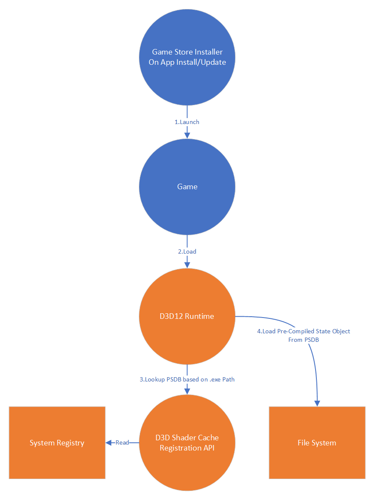

<a id="runtime-cache-discovery"></a>

# Runtime cache discovery and compatibility selection

<!-- d3d12-review-legend:begin -->

> [!NOTE]
> **Draft provenance annotations.**
> Underlining marks pending replacement wording or authored list items. Warning boxes
> mark authored, mixed or reopened passages awaiting editorial review.
> Editorial adoption does not establish factual or hardware verification. Exact approved factual
> corrections do not trigger a marker. Unmarked text elsewhere, declarations
> and structural Markdown are not assertions of approval.
> [Annotation scope and approvals](../../spec-maintenance/d3d12/prose-annotations.md).

<!-- d3d12-review-legend:end -->

<!-- d3d12-review-alert:begin:cache-discovery:subject:0 -->

> [!WARNING]
> **Authored synthesis - human review pending.**
>
> Runtime cache discovery uses the D3D Shader Cache Registration (D3DSCR) API to associate the current application and adapter with a registered precompiled shader database (PSDB). Registration of a path, opening a recognized database, compatibility of its metadata and finding a compiled value are distinct conditions. A compatible open is not a cache hit.

<!-- d3d12-review-alert:end:cache-discovery:subject:0 -->

<a id="runtime-workflow"></a>

## Runtime workflow

<ins><!-- d3d12-review-inline:begin:cache-discovery:workflow:0 --><!-- d3d12-review-inline:end:cache-discovery:workflow:0 --></ins>

<ins><!-- d3d12-review-inline:begin:cache-discovery:workflow:1 -->This diagram demonstrates the interaction between the D3D12 runtime and D3DSCR API during game execution time for automatic discovery. The game can still benefit from pre-compiled shaders if an SODB can be collected via playthrough. A typical process in this scenario is as follows:<!-- d3d12-review-inline:end:cache-discovery:workflow:1 --></ins>

1. The game installer launches the game (after first running through the install/update workflow if applicable).
2. The game runs, loads the D3D12 runtime and proceeds to create Pipeline State Objects (PSOs) or State Objects (SOs).
3. <ins><!-- d3d12-review-inline:begin:cache-discovery:workflow:2 -->The D3D12 runtime will interact with the D3DSCR API to enumerate installed SODBs and PSDBs for the current process. The process executable path will be used as a key for D3DSCR.<!-- d3d12-review-inline:end:cache-discovery:workflow:2 --></ins>
4. The D3D12 runtime will check for a matching pre-compiled shader in the PSDB to avoid runtime compilation.

<!-- d3d12-review-alert:begin:cache-discovery:figure-boundary:0 -->

> [!WARNING]
> **Authored synthesis - human review pending.**
>
> The complete figure provides workflow context. Discovery and compatibility precede the compiled-value lookup illustrated by its final step; neither a catalog entry nor a compatible open establishes that lookup's result.

<!-- d3d12-review-alert:end:cache-discovery:figure-boundary:0 -->

<a id="effective-identity"></a>

## Effective application identity and configuration

The Direct3D runtime and drivers currently match metadata about the process that has loaded their respective dlls, such as executable name, parent directory, etc. to determine which application is running.  The Direct3D runtime does this to determine default adapter preference in systems with multiple GPUs and disable features that cause compatibility issues with games.  Drivers use this information to enable targeted optimizations and fixes.  However, offline compilers are not run <ins><!-- d3d12-review-inline:begin:cache-discovery:identity-handoff:0 -->in the application's process<!-- d3d12-review-inline:end:cache-discovery:identity-handoff:0 --></ins> to determine this information.  To maintain this capability in an offline compiled world, game store services are expected to supply this information when submitting titles and their SODBs for compilation, and also supply this same information when registering applications.

When compiling offline, the metadata passed to the store is shared with the compiler.  <ins><!-- d3d12-review-inline:begin:cache-discovery:identity-handoff:1 -->When a title is run, the Direct3D runtime acquires this information<!-- d3d12-review-inline:end:cache-discovery:identity-handoff:1 --></ins> from the <ins><!-- d3d12-review-inline:begin:cache-discovery:identity-handoff:1 -->[Shader Cache Registration API](shader-cache-registration.md#shader-cache-registration)<!-- d3d12-review-inline:end:cache-discovery:identity-handoff:1 --></ins> and shares it with the driver.

<!-- d3d12-review-alert:begin:cache-discovery:configuration:0 -->

> [!WARNING]
> **Authored synthesis - human review pending.**
>
> The [global or factory identity configuration](state-object-databases-and-identity.md#id3d12applicationidentity-setapplicationidentity) supplies the description for subsequent device initialization in that configuration's scope. [Factory snapshots](devices-and-capabilities.md#independent-devices), [InitializeFromGlobalState](devices-and-capabilities.md#id3d12devicefactory-initializefromglobalstate) and [ApplyToGlobalState](devices-and-capabilities.md#id3d12devicefactory-applytoglobalstate) govern copying that configuration; a factory identity is not a second process-global override. Resetting the configured identity removes that explicit source for subsequent initialization.

<!-- d3d12-review-alert:end:cache-discovery:configuration:0 -->

<!-- d3d12-review-alert:begin:cache-discovery:identity-precedence:0 -->

> [!WARNING]
> **Authored synthesis - human review pending.**
>
> During initial effective-identity resolution, the runtime uses the explicitly configured application description, otherwise a successfully read description from the current process's application registration, otherwise the current executable's filename when available. Obtaining the registration factory, explorer and registered application, and reading its initial description, are best-effort for this resolution: acquisition failure, missing registration or a failed initial `GetDesc` can leave no usable registered description and allow the filename fallback. The full process executable path is the registration lookup key even when the configured or registered identifying filename differs from the host executable. The stable identifying filename is metadata, not a replacement catalog path. The version-4 configuration `AppId` is not the executable-path registration key.

<!-- d3d12-review-alert:end:cache-discovery:identity-precedence:0 -->

<!-- d3d12-review-alert:begin:cache-discovery:registration-stages:0 -->

> [!WARNING]
> **Authored synthesis - human review pending.**
>
> Later device cache initialization independently obtains a registered application for cache discovery and eligibility. An explicit configured identity still wins effective-identity resolution, but does not promise that this later registration query is skipped. If a registered application is acquired at this later stage, reading its description is required and a failing `GetDesc` can propagate. Initial identity resolution and later cache initialization use separate catalog queries, not one atomic catalog snapshot; an earlier filename fallback does not convert the later required read into another best-effort read.

<!-- d3d12-review-alert:end:cache-discovery:registration-stages:0 -->

<!-- d3d12-review-alert:begin:cache-discovery:identity-profile:0 -->

> [!WARNING]
> **Authored synthesis - human review pending.**
>
> The driver uses application metadata as input to its profile and application-detection rules. Supplying an application description or `AppId` does not require the driver to abandon its other detection inputs. [Application-specific driver state](../D3D12ApplicationIdentity.md#tooling-interactions-with-application-specific-driver-state) remains the capture/replay mechanism for restoring the driver's applied settings, rather than a guarantee that a runtime description alone reproduces every heuristic.

<!-- d3d12-review-alert:end:cache-discovery:identity-profile:0 -->

<!-- d3d12-review-alert:begin:cache-discovery:reuse:0 -->

> [!WARNING]
> **Authored synthesis - human review pending.**
>
> These initialization rules do not imply fresh discovery on every call to [D3D12CreateDevice](devices-and-capabilities.md#d3d12createdevice) or [factory CreateDevice](devices-and-capabilities.md#id3d12devicefactory-createdevice). The [singleton and independent-device compatibility rules](devices-and-capabilities.md#device-compatibility) can return an existing device. Returning that device does not reinitialize its effective identity or reopen its registered PSDB. Changes to a factory or global identity do not replace the configuration already used by an existing device.

<!-- d3d12-review-alert:end:cache-discovery:reuse:0 -->

<a id="default-discovery"></a>

## Registered application and default-component discovery

<!-- d3d12-review-alert:begin:cache-discovery:catalog-steps:0 -->

> [!WARNING]
> **Authored synthesis - human review pending.**
>
> Automatic discovery uses the following catalog operations:

<!-- d3d12-review-alert:end:cache-discovery:catalog-steps:0 -->

1. <ins><!-- d3d12-review-inline:begin:cache-discovery:catalog-steps:1 -->The runtime obtains a registration explorer with no explicitly supplied device or adapter context and looks up the current process's full executable path with [GetApplicationFromExePath](shader-cache-registration.md#id3dshadercacheexplorer-getapplicationfromexepath). This internal use of [CreateExplorer](shader-cache-registration.md#id3dshadercacheinstallerfactory-createexplorer) does not change the context chosen by other callers.<!-- d3d12-review-inline:end:cache-discovery:catalog-steps:1 --></ins>
2. <ins><!-- d3d12-review-inline:begin:cache-discovery:catalog-steps:1 -->For an application found in the catalog, [GetDesc](shader-cache-registration.md#id3dshadercacheapplication-getdesc) supplies its registered identity metadata. [GetComponentCount](shader-cache-registration.md#id3dshadercacheapplication-getcomponentcount), [GetComponent](shader-cache-registration.md#id3dshadercacheapplication-getcomponent) and [GetComponentName](shader-cache-registration.md#id3dshadercachecomponent-getcomponentname) locate the component whose name is exactly `default`.<!-- d3d12-review-inline:end:cache-discovery:catalog-steps:1 --></ins>
3. <ins><!-- d3d12-review-inline:begin:cache-discovery:catalog-steps:1 -->[GetPrecompiledCachePath](shader-cache-registration.md#id3dshadercachecomponent-getprecompiledcachepath) supplies that component's path for the current adapter family. The runtime attempts to open this path only when the adapter/runtime supports PSDB consumption. The [device shader-cache ABI query](devices-and-capabilities.md#d3d12_feature_data_shadercache_abi_support) supplies the adapter's compatibility information.<!-- d3d12-review-inline:end:cache-discovery:catalog-steps:1 --></ins>

<ins><!-- d3d12-review-inline:begin:cache-discovery:default-name:0 -->There is a special component name, "default" (case-sensitive) that should be used when the application is not explicitly expecting to find a component by a different name. This string is the one that D3D12 will use during device initialization to find a PSDB that's used to accelerate `CreatePipelineState` and `CreateStateObject` without explicit steering to an alternate PSDB by the application.<!-- d3d12-review-inline:end:cache-discovery:default-name:0 --></ins>

<!-- d3d12-review-alert:begin:cache-discovery:multiplicity:0 -->

> [!WARNING]
> **Authored synthesis - human review pending.**
>
> An application can register multiple components, and a component can register PSDB paths for multiple adapter families. [GetPrecompiledShaderDatabaseCount](shader-cache-registration.md#id3dshadercachecomponent-getprecompiledshaderdatabasecount) and [GetPrecompiledShaderDatabases](shader-cache-registration.md#id3dshadercachecomponent-getprecompiledshaderdatabases) enumerate those family/path records; this is not a list of competing ABI/profile versions for one family. Automatic default discovery selects the one registered path for the current family in `default`, not the newest database found by scanning components or the filesystem. [GetStateObjectDatabasePath](shader-cache-registration.md#id3dshadercachecomponent-getstateobjectdatabasepath) returns the component's SODB input path, not another PSDB candidate.

<!-- d3d12-review-alert:end:cache-discovery:multiplicity:0 -->

<a id="compatibility"></a>

## Recognized databases and compatibility

<!-- d3d12-review-alert:begin:cache-discovery:eligibility:0 -->

> [!WARNING]
> **Authored synthesis - human review pending.**
>
> A registered path is only a candidate. The file must be readable as a recognized PSDB, contain the required identity metadata and satisfy the application and target compatibility checks. A missing file, unsupported format or incompatible metadata does not become usable merely because its path is registered. Database-format recognition is separate from ABI/profile matching; no numeric PSDB format version is defined by this compatibility predicate.

<!-- d3d12-review-alert:end:cache-discovery:eligibility:0 -->

<ins><!-- d3d12-review-inline:begin:cache-discovery:target-predicate:0 -->`D3D_SHADER_CACHE_COMPILER_PROPERTIES` are<!-- d3d12-review-inline:end:cache-discovery:target-predicate:0 --></ins> used to determine compatibility with the compiler parameters used to produce a PSDB:

```cpp
// A PSDB for a title is usable by an adapter if the adapter family matches, the psdb abi version is between
// the supported min/max Abi version inclusive, and the top 32 bits of the application profile version matches.
// Incompatible psdbs are not usable by the target adapter driver, and are rejected by the runtime.
bool IsPsdbCompatible(
    const std::wstring& psdbAdapterFamily,
    UINT64 psdbAbiVersion,
    UINT64 psdbApplicationProfileVersion,
    const D3D_SHADER_CACHE_COMPILER_PROPERTIES& compilerProperties)
{
    return psdbAdapterFamily == compilerProperties.szAdapterFamily
        && psdbAbiVersion >= compilerProperties.MinimumABISupportVersion
        && psdbAbiVersion <= compilerProperties.MaximumABISupportVersion
        && HIDWORD(psdbApplicationProfileVersion) == HIDWORD(compilerProperties.ApplicationProfileVersion.Version);
}
```

<!-- d3d12-review-alert:begin:cache-discovery:application-guard:0 -->

> [!WARNING]
> **Authored synthesis - human review pending.**
>
> Application eligibility additionally checks the PSDB's stored application name against the resolved application name or the registered application name, using a case-insensitive comparison. For this read-only consumption, the application-profile comparison uses the high 32 bits as shown above; a change confined to the low 32 bits does not by itself reject the PSDB. Missing identity metadata cannot establish compatibility. Exact application-version, engine-version and executable-filename equality are not additional direct comparisons in this eligibility check, although those fields can influence the driver's selected application profile.

<!-- d3d12-review-alert:end:cache-discovery:application-guard:0 -->

<!-- d3d12-review-alert:begin:cache-discovery:version-roles:0 -->

> [!WARNING]
> **Authored synthesis - human review pending.**
>
> Family matching in the target predicate is exact string equality, not case folding or a match by adapter model, vendor, LUID or substring. The driver's minimum and maximum ABI bounds are inclusive. A compiler's [enumerated ABI set](offline-compilation.md#id3d12compilerfactory-enumerateadapterfamilyabiversions) can be sparse: producing a compatible PSDB requires choosing an enumerated compiler ABI inside the driver's interval, not assuming the compiler supports every integer in that interval. The compiler target's [zero-means-latest convention](offline-compilation.md#d3d12_compiler_target) is not a runtime compatibility wildcard for a stored ABI.

<!-- d3d12-review-alert:end:cache-discovery:version-roles:0 -->

<a id="failure-and-lifetime"></a>

## Absence, failures, controls and retained state

<!-- d3d12-review-alert:begin:cache-discovery:normal-absence:0 -->

> [!WARNING]
> **Authored synthesis - human review pending.**
>
> No application registration, no component named `default`, or no path registered for the current family can leave the device without a default PSDB. The runtime's component search skips unsuccessful component acquisitions and name queries; this does not change the [catalog methods' own error results](shader-cache-registration.md#id3dshadercacheapplication-getcomponent). It does not select an arbitrary other component as a fallback.

<!-- d3d12-review-alert:end:cache-discovery:normal-absence:0 -->

<!-- d3d12-review-alert:begin:cache-discovery:open-policy:0 -->

> [!WARNING]
> **Authored synthesis - human review pending.**
>
> The automatic default PSDB open is read-only. It must not create an empty replacement for a missing registered file, clear registered content or restamp missing or incompatible identity metadata to make the database usable. A failing `HRESULT` from an attempted implicit open, including an unreadable or unrecognized file or incompatible identity metadata, leaves no opened default PSDB and is recorded diagnostically; that unsuccessful open does not by itself fail device initialization. This is not a guarantee that every discovery failure is silently ignored or that every cache error has the same result.

<!-- d3d12-review-alert:end:cache-discovery:open-policy:0 -->

<!-- d3d12-review-alert:begin:cache-discovery:discovery-errors:0 -->

> [!WARNING]
> **Authored synthesis - human review pending.**
>
> The [initial best-effort identity fallback](#effective-identity) is distinct from the later required work in device cache initialization. Failures obtaining required driver ABI information, or reading the description of a registered application acquired at that later stage, can propagate instead of falling back to a filename. Allocation failures outside the unsuccessful-open result handling can also fail initialization with `E_OUTOFMEMORY`. A successful device-creation result is therefore neither proof that a registered PSDB opened nor a promise that catalog, metadata and allocation errors are all nonfatal. Diagnostics do not convert normal absence into a cache hit or establish successful compiled-value lookup.

<!-- d3d12-review-alert:end:cache-discovery:discovery-errors:0 -->

<!-- d3d12-review-alert:begin:cache-discovery:lifetime:0 -->

> [!WARNING]
> **Authored synthesis - human review pending.**
>
> Configuration values and identity strings are captured for initialization; they do not borrow the caller's identity buffers. Catalog-returned strings retain their [registration-object lifetime](shader-cache-registration.md#id3dshadercachecomponent-getprecompiledcachepath); the runtime copies the selected path and retains its opened default session for the device's lifetime. Updating registration does not itself replace an already-open default session. Returning an existing device is not a refresh operation. No live rescan, transactional snapshot across catalog operations, or immutable snapshot of all file contents is guaranteed here. Driver updates can change compatibility information used by a later initialization; they do not rewrite the identity and compatibility data already captured by an existing device.

<!-- d3d12-review-alert:end:cache-discovery:lifetime:0 -->

<!-- d3d12-review-alert:begin:cache-discovery:controls-and-legacy:0 -->

> [!WARNING]
> **Authored synthesis - human review pending.**
>
> The [application-cache and runtime-control contracts](shader-delivery-and-caching.md#id3d12device9-shadercachecontrol), including [control scope and failure ordering](shader-delivery-and-caching.md#cache-control-scope), remain distinct from registering or replacing a PSDB path. Those controls do not select a different registered component or promise rediscovery of an existing device's default PSDB. [Supported legacy pipeline libraries](shader-delivery-and-caching.md#pipeline-libraries) and [cached PSO blobs](shader-delivery-and-caching.md#cached-pso-blobs) retain their own compatibility rules; the PSDB family/ABI/profile predicate does not replace them.

<!-- d3d12-review-alert:end:cache-discovery:controls-and-legacy:0 -->

<!-- d3d12-review-alert:begin:cache-discovery:availability:0 -->

> [!WARNING]
> **Authored synthesis - human review pending.**
>
> Registration API availability, successful device creation and support for PSDB consumption are separate conditions. The adapter's [shader-cache ABI query](devices-and-capabilities.md#d3d12_feature_data_shadercache_abi_support) must succeed before its family/range/profile outputs can establish compatibility. SDK distribution alone does not establish universal operating-system, runtime, adapter or driver support.

<!-- d3d12-review-alert:end:cache-discovery:availability:0 -->

<a id="compiled-value-lookup"></a>

## Compiled-value lookup during ordinary creation

<!-- d3d12-review-alert:begin:cache-discovery:lookup-key-context:0 -->

> [!WARNING]
> **Authored synthesis - human review pending.**
>
> The offline producer stores [vendor-keyed compiled values](compiler-invocation-and-cache-output.md#output-storage). Ordinary object creation consumes those values through the runtime shader-cache callbacks.

<!-- d3d12-review-alert:end:cache-discovery:lookup-key-context:0 -->

<ins><!-- d3d12-review-inline:begin:cache-discovery:lookup-ordinary-description:0 -->For ordinary PSO or SO creation,<!-- d3d12-review-inline:end:cache-discovery:lookup-ordinary-description:0 --></ins> the driver receives the full <ins><!-- d3d12-review-inline:begin:cache-discovery:lookup-ordinary-description:0 -->object description,<!-- d3d12-review-inline:end:cache-discovery:lookup-ordinary-description:0 --></ins> and derives the same keys for looking up all values via shader cache callbacks.

<!-- d3d12-review-alert:begin:cache-discovery:lookup-contributors:0 -->

> [!WARNING]
> **Authored synthesis - human review pending.**
>
> This path contributes to [CreateGraphicsPipelineState](pipeline-state.md#id3d12device-creategraphicspipelinestate), [CreateComputePipelineState](pipeline-state.md#id3d12device-createcomputepipelinestate), [CreatePipelineState](pipeline-state.md#id3d12device2-createpipelinestate), [CreateStateObject](state-objects.md#createstateobject) and [AddToStateObject](state-objects.md#addtostateobject). Their descriptions, validation, capabilities and creation results remain defined at those owners. The driver-derived compiled-value key is not the application's SODB object key or compiler value-group key; [output storage](compiler-invocation-and-cache-output.md#output-storage) defines how the producer associates those separate domains. One object can require several values, and a value can be shared by several objects.

<!-- d3d12-review-alert:end:cache-discovery:lookup-contributors:0 -->

<!-- d3d12-review-alert:begin:cache-discovery:lookup-routing:0 -->

> [!WARNING]
> **Authored synthesis - human review pending.**
>
> For ordinary creation's typed runtime lookup, the precompiled slot is the device's [opened registered PSDB](#default-discovery) and the dynamic slot is the device's default writable cache for the driver. `D3D12DDI_SHADER_CACHE_GET_VALUE_FLAG_STORED_VALUES_ONLY` excludes the precompiled slot. Otherwise the callback searches the precompiled slot before the dynamic slot, advancing only after `DXGI_ERROR_NOT_FOUND` or `D3DDDIERR_NOTAVAILABLE`. Only requested value kinds participate in value retrieval: an entry containing only an unrequested kind is a miss and allows the next eligible cache to be searched. Disabled sessions report unavailability. A buffer, allocation or other error is not a miss that automatically permits searching the next slot. This is callback routing, not precedence over a driver's internal cache, legacy cached PSO input or pipeline-library reuse.

<!-- d3d12-review-alert:end:cache-discovery:lookup-routing:0 -->

<!-- d3d12-review-alert:begin:cache-discovery:lookup-store:0 -->

> [!WARNING]
> **Authored synthesis - human review pending.**
>
> For ordinary creation, the typed store callback writes to the device's default writable cache for the driver, not the registered read-only PSDB. `pObjectCode` is required; `pCompilerMetadata` is optional. A metadata-only store is invalid. Each supplied value descriptor must identify a non-null buffer containing a nonempty value. The key must identify a nonempty byte sequence, and key and value byte counts must not exceed `UINT_MAX` even though the DDI uses `SIZE_T`. With otherwise valid arguments and no selected session, get and store return `D3DDDIERR_NOTAVAILABLE`. Store can report unavailable storage before validating its inputs; these input constraints do not establish that an invalid-argument result takes precedence over unavailability. A store is not a guarantee of later residency or a replacement for the [cache controls](shader-delivery-and-caching.md#cache-control-scope).

<!-- d3d12-review-alert:end:cache-discovery:lookup-store:0 -->

<!-- d3d12-review-alert:begin:cache-discovery:lookup-outcome:0 -->

> [!WARNING]
> **Authored synthesis - human review pending.**
>
> A value lookup is not an object-creation result. A PSDB miss can still be satisfied by a local cache, and a partial hit can supply one shader while other required values are absent. If the driver never calls the runtime cache callbacks, the runtime cannot infer a PSDB hit or miss from successful creation alone. A successful lookup does not bypass creation validation or guarantee that every value needed by the driver is available. Callback failures are returned to the driver; they are not a new application-visible cache-mismatch result. The ordinary creation result depends on the remaining creation work and the driver's result, not solely on the cache result.

<!-- d3d12-review-alert:end:cache-discovery:lookup-outcome:0 -->

<a id="runtime-shader-cache-ddi"></a>

### Runtime shader-cache DDI reference

<!-- d3d12-review-alert:begin:cache-discovery:lookup-ddi-intro:0 -->

> [!WARNING]
> **Authored synthesis - human review pending.**
>
> Runtime shader-cache callbacks run from driver to runtime. They use `D3D12DDI_FEATURE_0021_SHADERCACHING` and `D3D12DDI_TABLE_TYPE_0021_SHADERCACHE_CALLBACKS`.

<!-- d3d12-review-alert:end:cache-discovery:lookup-ddi-intro:0 -->

<!-- d3d12-review-alert:begin:cache-discovery:lookup-ddi-intro:1 -->

> [!WARNING]
> **Authored synthesis - human review pending.**
>
> The current interface uses `D3D12DDI_FEATURE_VERSION_SHADERCACHE_0118_0` (3), `D3D12DDI_SHADERCACHE_CALLBACKS_0118` and `D3D12DDI_SHADERCACHE_FUNCS_0118`. The callback table contains get/store/unused-value notification; get and store retain their `_CB_0114` signatures. The driver function table contains the runtime-to-driver `pfnShaderCacheGetCaps`. The optional allocation function remains the nested `pCallbackFunc` argument to get, not a separate current driver-table slot.

<!-- d3d12-review-alert:end:cache-discovery:lookup-ddi-intro:1 -->

```cpp
typedef struct D3D12DDI_HANDLE_AND_TYPE
{
    VOID* Handle;
    D3D12DDI_HANDLETYPE Type;
} D3D12DDI_HANDLE_AND_TYPE;
```

```cpp
typedef struct D3D12DDI_SHADER_CACHE_VALUE
{
    _Field_size_bytes_opt_(ValueSize) void* pValue;
    SIZE_T ValueSize;
} D3D12DDI_SHADER_CACHE_VALUE;

typedef VOID* (APIENTRY *PFND3D12DDI_SHADERCACHEALLOCATIONFUNC) (
    SIZE_T SizeInBytes,
    _Inout_opt_ VOID* pContext);
```

```cpp
typedef HRESULT (APIENTRY CALLBACK *PFND3D12DDI_SHADERCACHEGETVALUE_CB_0114)(
    D3D12DDI_HRTDEVICE hRTDevice,
    D3D12DDI_HANDLE_AND_TYPE hRTObject,
    _In_reads_bytes_(KeyLen) const void* pKey,
    SIZE_T KeyLen,
    D3D12DDI_SHADER_CACHE_GET_VALUE_FLAGS Flags,
    _Inout_opt_ D3D12DDI_SHADER_CACHE_VALUE* pObjectCode,
    _Inout_opt_ D3D12DDI_SHADER_CACHE_VALUE* pCompilerMetadata,
    _In_opt_ PFND3D12DDI_SHADERCACHEALLOCATIONFUNC pCallbackFunc,
    _Inout_opt_ void* pContext);

typedef HRESULT(APIENTRY CALLBACK *PFND3D12DDI_SHADERCACHESTOREVALUE_CB_0114)(
    D3D12DDI_HRTDEVICE hRTDevice,
    D3D12DDI_HANDLE_AND_TYPE hRTObject,
    _In_reads_bytes_(KeyLen) const void* pKey,
    SIZE_T KeyLen,
    _In_ CONST D3D12DDI_SHADER_CACHE_VALUE* pObjectCode,
    _In_opt_ CONST D3D12DDI_SHADER_CACHE_VALUE* pCompilerMetadata);
```

<!-- d3d12-review-alert:begin:cache-discovery:lookup-parameters:0 -->

> [!WARNING]
> **Authored synthesis - human review pending.**
>
> `hRTDevice` identifies the runtime device. A non-null `hRTObject.Handle` for get identifies a PSO (`D3D12DDI_HT_PIPELINE_STATE`) or SO (`D3D12DDI_HT_0054_STATE_OBJECT`) through `hRTObject.Type`; other non-null get-object types return `E_INVALIDARG`. A null get-object handle uses device defaults. These are runtime object handles, not per-invocation compiler cache-session handles. `pKey` and `KeyLen` describe the driver's compiled-value key bytes. The driver supplies valid input storage for the synchronous callback; no database-owned value pointer is handed back.

<!-- d3d12-review-alert:end:cache-discovery:lookup-parameters:0 -->

<!-- d3d12-review-alert:begin:cache-discovery:lookup-buffers:0 -->

> [!WARNING]
> **Authored synthesis - human review pending.**
>
> `pObjectCode` and `pCompilerMetadata` are independently optional get outputs; each supplied output requests that value kind. With both absent, get performs the legacy untyped lookup without returning value bytes, not a typed any-kind existence query. In the registered read-only PSDB, this probes for object-code presence: an entry containing only compiler metadata is a miss and allows the next eligible cache to be searched. This null-output probe does not request all typed kinds. For each supplied output, `ValueSize` is the input capacity in bytes and the output stored size; a missing requested type has output size zero. When retrieving values, at least one requested kind must be found for a hit. Finding only an unrequested kind does not satisfy the lookup. A hit on any requested kind does not require all requested kinds to exist and does not assemble missing types from the next cache after a successful first-cache result. A nonzero capacity requires a valid `pValue` buffer. If a found value fits, the runtime copies it into that buffer. With zero capacity and no allocation callback, get reports the required size without copying bytes. With nonzero insufficient capacity, it reports `DXGI_ERROR_MORE_DATA` and the required size; it can still process the other requested type.

<!-- d3d12-review-alert:end:cache-discovery:lookup-buffers:0 -->

<!-- d3d12-review-alert:begin:cache-discovery:lookup-allocation:0 -->

> [!WARNING]
> **Authored synthesis - human review pending.**
>
> With zero capacity and `pCallbackFunc` supplied, the runtime calls that allocator synchronously with the found value's byte size and `pContext`, copies the value into the returned storage, and returns its pointer in `pValue`. A null allocation result produces `E_OUTOFMEMORY`; other outputs can already have been processed. The driver owns the supplied or allocator-returned storage and its deallocation; these callbacks do not expose a runtime value-release operation. A failure is not an allocation rollback: the driver must account for allocations already returned by its allocator. Input key/store buffers and allocator context must remain valid for the callback's use through return. Store consumes its key/value bytes synchronously rather than borrowing those input buffers after return. This copy protocol is distinct from the device's retained default-session lifetime and does not promise an atomic snapshot across separate probes, fetches or value keys.

<!-- d3d12-review-alert:end:cache-discovery:lookup-allocation:0 -->

<!-- d3d12-review-alert:begin:cache-discovery:lookup-results:0 -->

> [!WARNING]
> **Authored synthesis - human review pending.**
>
> The typed get path returns `S_OK` for a successful lookup/probe, `DXGI_ERROR_NOT_FOUND` for absence, `DXGI_ERROR_MORE_DATA` for insufficient nonzero capacity, `E_OUTOFMEMORY` for allocation failure and `E_INVALIDARG` for invalid arguments. Recognized cache-full, corruption and hash-collision errors can also propagate; other underlying session failures are mapped to `D3DDDIERR_NOTAVAILABLE`. Store can return `DXGI_ERROR_ALREADY_EXISTS`, `DXGI_ERROR_CACHE_FULL` or `E_OUTOFMEMORY`, as well as invalid-argument and unavailable results. These distinctions matter to the [next-cache search rule](#compiled-value-lookup); they do not define a universal application-creation fallback policy.

<!-- d3d12-review-alert:end:cache-discovery:lookup-results:0 -->

<!-- d3d12-review-alert:begin:cache-discovery:lookup-flags:0 -->

> [!WARNING]
> **Authored synthesis - human review pending.**
>
> `D3D12DDI_SHADER_CACHE_GET_VALUE_FLAG_NONE` is zero; `D3D12DDI_SHADER_CACHE_GET_VALUE_FLAG_STORED_VALUES_ONLY` is `0x1`. Version 3 additionally defines `D3D12DDI_SHADER_CACHE_GET_VALUE_FLAG_0118_PSDB_MISS_EXPECTED` (`0x2`) for lookup accounting; it does not itself change the selected cache slots. Unrecognized get flags return `E_INVALIDARG`. Cache statistics do not change the returned value's ownership or prove completion of an object from a partial value hit.

<!-- d3d12-review-alert:end:cache-discovery:lookup-flags:0 -->

<!-- d3d12-review-alert:begin:cache-discovery:lookup-legacy:0 -->

> [!WARNING]
> **Authored synthesis - human review pending.**
>
> [Cached PSO blobs](shader-delivery-and-caching.md#cached-pso-blobs) and [pipeline libraries](shader-delivery-and-caching.md#pipeline-libraries) retain their separate compatibility and loading behavior; a direct reuse path need not perform these cache callbacks.

<!-- d3d12-review-alert:end:cache-discovery:lookup-legacy:0 -->

<a id="runtime-cache-current-roles"></a>

#### Current layouts and role associations

```cpp
typedef union D3D12DDI_VERSION_NUMBER
{
    UINT64 Version;
    UINT16 VersionParts[4];
} D3D12DDI_VERSION_NUMBER;

typedef enum D3D12DDICAPS_TYPE_SHADERCACHE
{
    D3D12DDICAPS_TYPE_SHADERCACHE_ABI_SUPPORT   = 0,
} D3D12DDICAPS_TYPE_SHADERCACHE;

typedef struct D3D12DDIARG_SHADERCACHE_GETCAPS
{
    D3D12DDICAPS_TYPE_SHADERCACHE Type;
    VOID* pInfo;
    VOID* pData;
    UINT DataSize;
} D3D12DDIARG_SHADERCACHE_GETCAPS;

typedef HRESULT (APIENTRY *PFND3D12DDI_SHADERCACHE_GETCAPS)(
    D3D12DDI_HDEVICE hDrvDevice,
    _In_ CONST D3D12DDIARG_SHADERCACHE_GETCAPS* pArgs
    );

typedef enum D3D12DDI_SHADER_CACHE_UNUSED_VALUE_FLAGS
{
    D3D12DDI_SHADER_CACHE_UNUSED_VALUE_FLAG_NONE                           = 0x00000000,

} D3D12DDI_SHADER_CACHE_UNUSED_VALUE_FLAGS;

typedef struct D3D12DDI_SHADERCACHE_ABI_SUPPORT_DATA_0118
{
    WCHAR szAdapterFamily[128];
    UINT64 MinimumABISupportVersion;
    UINT64 MaximumABISupportVersion;
    D3D12DDI_VERSION_NUMBER CompilerVersion;
    D3D12DDI_VERSION_NUMBER ApplicationProfileVersion;
} D3D12DDI_SHADERCACHE_ABI_SUPPORT_DATA_0118;

typedef HRESULT(APIENTRY CALLBACK *PFND3D12DDI_SHADERCACHEUNUSEDVALUE_CB)(
    D3D12DDI_HRTDEVICE hRTDevice,
    D3D12DDI_HANDLE_AND_TYPE hRTObject,
    _In_reads_bytes_(KeySize) const void* pKey,
    SIZE_T KeySize,
    D3D12DDI_SHADER_CACHE_UNUSED_VALUE_FLAGS Flags
    );

typedef struct D3D12DDI_SHADERCACHE_CALLBACKS_0118
{
    PFND3D12DDI_SHADERCACHEGETVALUE_CB_0114   pfnShaderCacheGetValueCb;
    PFND3D12DDI_SHADERCACHESTOREVALUE_CB_0114 pfnShaderCacheStoreValueCb;
    PFND3D12DDI_SHADERCACHEUNUSEDVALUE_CB     pfnShaderCacheUnusedValueCb;
} D3D12DDI_SHADERCACHE_CALLBACKS_0118;

typedef struct D3D12DDI_SHADERCACHE_FUNCS_0118
{
    PFND3D12DDI_SHADERCACHE_GETCAPS             pfnShaderCacheGetCaps;
} D3D12DDI_SHADERCACHE_FUNCS_0118;
```

<!-- d3d12-review-alert:begin:cache-discovery:RC-role-map:0 -->

> [!WARNING]
> **Authored synthesis - human review pending.**
>
> The current callable roles have distinct directions and ownership:

<!-- d3d12-review-alert:end:cache-discovery:RC-role-map:0 -->

<!-- d3d12-review-alert:begin:cache-discovery:RC-role-map:1 -->

> [!WARNING]
> **Authored synthesis - human review pending.**
>
> | Current role | Direction | Contract |
> | --- | --- | --- |
> | `D3D12DDI_DEVICE_FUNCS_CORE_0119::pfnImplicitShaderCacheControl` | runtime-to-driver | [Responsibility](shader-delivery-and-caching.md#driver-implicit-cache-control) |
> | `D3D12DDI_SHADERCACHE_CALLBACKS_0118::pfnShaderCacheGetValueCb` | driver-to-runtime | [Responsibility](runtime-cache-discovery.md#runtime-shader-cache-ddi) |
> | `D3D12DDI_SHADERCACHE_CALLBACKS_0118::pfnShaderCacheStoreValueCb` | driver-to-runtime | [Responsibility](runtime-cache-discovery.md#compiled-value-lookup) |
> | `D3D12DDI_SHADERCACHE_CALLBACKS_0118::pfnShaderCacheUnusedValueCb` | driver-to-runtime | [Responsibility](runtime-cache-discovery.md#runtime-cache-unused-value) |
> | `D3D12DDI_SHADERCACHE_FUNCS_0118::pfnShaderCacheGetCaps` | runtime-to-driver | [Responsibility](runtime-cache-discovery.md#runtime-cache-driver-caps) |
> | `PFND3D12DDI_SHADERCACHEGETVALUE_CB_0114::pCallbackFunc` | runtime-to-driver | [Responsibility](runtime-cache-discovery.md#runtime-shader-cache-ddi) |

<!-- d3d12-review-alert:end:cache-discovery:RC-role-map:1 -->

<a id="runtime-cache-driver-caps"></a>

#### PFND3D12DDI_SHADERCACHE_GETCAPS

<!-- d3d12-review-alert:begin:cache-discovery:RC-driver-caps:0 -->

> [!WARNING]
> **Authored synthesis - human review pending.**
>
> For `D3D12DDICAPS_TYPE_SHADERCACHE_ABI_SUPPORT`, `pInfo` is null, `pData` addresses `D3D12DDI_SHADERCACHE_ABI_SUPPORT_DATA_0118`, and `DataSize` is its `sizeof`. The header and output storage are borrowed for the call.

<!-- d3d12-review-alert:end:cache-discovery:RC-driver-caps:0 -->

<!-- d3d12-review-alert:begin:cache-discovery:RC-driver-caps:1 -->

> [!WARNING]
> **Authored synthesis - human review pending.**
>
> On success, the driver fills the family, ABI, compiler and profile fields under the [reporting-consistency requirements](#preference-and-reporting).

<!-- d3d12-review-alert:end:cache-discovery:RC-driver-caps:1 -->

<!-- d3d12-review-alert:begin:cache-discovery:RC-driver-caps:2 -->

> [!WARNING]
> **Authored synthesis - human review pending.**
>
> The ABI query is mandatory once the current shader-caching interface is selected. Failure is reported as `DXGI_ERROR_DRIVER_INTERNAL_ERROR`, not a recoverable cache miss or unsupported-feature fallback. Existing device-failure handling still applies.

<!-- d3d12-review-alert:end:cache-discovery:RC-driver-caps:2 -->

<a id="runtime-cache-unused-value"></a>

#### PFND3D12DDI_SHADERCACHEUNUSEDVALUE_CB

<!-- d3d12-review-alert:begin:cache-discovery:RC-unused-value:0 -->

> [!WARNING]
> **Authored synthesis - human review pending.**
>
> `pfnShaderCacheUnusedValueCb` reports an unused compiled-value hit for a runtime object. The driver supplies `hRTDevice`, the runtime PSO/state-object context in `hRTObject`, its key pointer and `KeySize`, and `D3D12DDI_SHADER_CACHE_UNUSED_VALUE_FLAG_NONE` (zero). A null object handle leaves the notification unassociated with an individual object. The driver must supply valid runtime handles and input storage for the synchronous call; the key byte count must fit `UINT_MAX`. Unknown flag bits or a key byte count greater than `UINT_MAX` return `E_INVALIDARG`.

<!-- d3d12-review-alert:end:cache-discovery:RC-unused-value:0 -->

<!-- d3d12-review-alert:begin:cache-discovery:RC-unused-value:1 -->

> [!WARNING]
> **Authored synthesis - human review pending.**
>
> An accepted unused-value notification returns `S_OK` and updates accounting only. It does not look up or evict the cache entry.

<!-- d3d12-review-alert:end:cache-discovery:RC-unused-value:1 -->

<a id="delivery-selection-and-reporting"></a>

## Delivery selection and reporting reference

<a id="preference-and-reporting"></a>

### Selection recommendations and driver reporting

<!-- d3d12-review-alert:begin:cache-discovery:preference-scope:0 -->

> [!WARNING]
> **Authored synthesis - human review pending.**
>
> The following preference applies when an installer or service chooses among compatible outputs to register. It does not add a multi-candidate runtime arbitration algorithm to the default-component family/path lookup. Likewise, [application-preferred adapter target filtering](shader-cache-registration.md#target-discovery) is a catalog target-discovery contract, not runtime sorting of PSDB files.

<!-- d3d12-review-alert:end:cache-discovery:preference-scope:0 -->

Within the supported range of compatible version numbers, a larger ABI version should be preferred, followed by a larger application profile version.

<ins><!-- d3d12-review-inline:begin:cache-discovery:driver-versions:0 -->`D3D_SHADER_CACHE_COMPILER_PROPERTIES`<!-- d3d12-review-inline:end:cache-discovery:driver-versions:0 --></ins> also indicates the version information that the <ins><!-- d3d12-review-inline:begin:cache-discovery:driver-versions:0 -->driver's compiler<!-- d3d12-review-inline:end:cache-discovery:driver-versions:0 --></ins> uses if compiling at application runtime.  It compiles at MaximumABISupportVersion with the indicated CompilerVersion and ApplicationProfileVersion.

CompilerVersion is provided for informational purposes.  It indicates the version of the compiler itself, and may not rev when application profiles do.

<ins><!-- d3d12-review-inline:begin:cache-discovery:profile-reporting:0 -->The driver's `ApplicationProfileVersion`<!-- d3d12-review-inline:end:cache-discovery:profile-reporting:0 --></ins> is determined by inspecting the D3D12DDI_APPLICATION_DESC <ins><!-- d3d12-review-inline:begin:cache-discovery:profile-reporting:0 -->retrieved<!-- d3d12-review-inline:end:cache-discovery:profile-reporting:0 --></ins> from D3DDDI_QUERYADAPTERTYPE_APPLICATIONDESC.  When the desc is not available or does not match a profile, this value should be zero.  When D3DDDI_QUERYADAPTERTYPE_APPLICATIONSPECIFICDRIVERBLOB is used, the blob should allow returning <ins><!-- d3d12-review-inline:begin:cache-discovery:profile-reporting:0 -->a value<!-- d3d12-review-inline:end:cache-discovery:profile-reporting:0 --></ins> here that is consistent with when the blob was captured for replay scenarios.

<!-- d3d12-review-alert:begin:cache-discovery:reporting-owners:0 -->

> [!WARNING]
> **Authored synthesis - human review pending.**
>
> The API payload and its field widths remain defined by [D3D12_FEATURE_DATA_SHADERCACHE_ABI_SUPPORT](devices-and-capabilities.md#d3d12_feature_data_shadercache_abi_support). Its [driver/registered-compiler reporting requirements](../ShaderCompilerPlugin.md#struct-d3d12ddi_shadercache_abi_support_data) cover family support, maximum ABI support, compiler-version equality and profile agreement for the same family and application description. These reporting-consistency requirements are separate from stored-PSDB acceptance: the target predicate does not require compiler-version equality, and read-only consumption compares the stored and driver profile versions using their high 32 bits. The compiler-side [profile query](offline-compilation.md#id3d12compilerfactory-getapplicationprofileversion) and [published plugin ABI](compiler-plugin-foundation.md#descriptions) retain their distinct declarations.

<!-- d3d12-review-alert:end:cache-discovery:reporting-owners:0 -->

<a id="cache-update-flow"></a>

### Example cache update flow

Below is an example of how a client could check for updates to precompiled caches.   Besides checking cache/driver compatibility on the client, the driver ABI version range <ins><!-- d3d12-review-inline:begin:cache-discovery:update-flow:0 -->is used to check for compiler updates<!-- d3d12-review-inline:end:cache-discovery:update-flow:0 --></ins>:

- Client constructs a url to ask "what's the compiler version of latest cache for ABI version X and Adapter Family Y?" by constructing a URL.
- Server responds compiler version Z by just serving a cached file.
- Client checks "is my cache older than Z?"
- If so, client asks "give me cache version Z for Adapter Family Y" by constructing a URL.
- Server responds with a cached file.
- <ins><!-- d3d12-review-inline:begin:cache-discovery:update-flow:1 -->Client registers with the [Shader Cache Registration API](shader-cache-registration.md#installation-and-updates).<!-- d3d12-review-inline:end:cache-discovery:update-flow:1 --></ins>

<a id="device-state-object-statistics"></a>

## Device pipeline and state-object creation statistics

```cpp
typedef struct D3D12_CREATE_STATE_OBJECT_STATISTICS
    {
    UINT NumCreated;
    UINT NumPSDBCacheMissed;
    UINT NumTotalCacheMissed;
    UINT NumCacheUnknown;
    } 	D3D12_CREATE_STATE_OBJECT_STATISTICS;

typedef struct D3D12_STATE_OBJECT_STATISTICS
    {
    BOOL DefaultPSDBRegistered;
    D3D12_CREATE_STATE_OBJECT_STATISTICS PipelineStateObjectStatistics;
    D3D12_CREATE_STATE_OBJECT_STATISTICS StateObjectStatistics;
    } 	D3D12_STATE_OBJECT_STATISTICS;
```

**Members**

*NumCreated*

The total number of objects successfully created.

*NumPSDBCacheMissed*

The subset of objects that were successfully created, but the object was not found in a Precompile Shader Database (PSDB).  A PSDB miss may still be locally cached by driver from a previous creation. Note that a miss is still counted even if there was a partial lookup success, e.g. one shader in a PSO was found in the PSDB because it was compiled identically as part of another PSO.

*NumTotalCacheMissed*

The subset of objects that were successfully created, but the object was not found in any type of cache, either precompiled or cached by driver from a previous creation. Note that a miss is still counted even if there was a partial lookup success.

<ins><!-- d3d12-review-inline:begin:cache-discovery:AB-primary-statistics-fields:7 -->*NumCacheUnknown*<!-- d3d12-review-inline:end:cache-discovery:AB-primary-statistics-fields:7 --></ins>

<ins><!-- d3d12-review-inline:begin:cache-discovery:AB-primary-statistics-fields:8 -->The subset of objects successfully created where PSDB cache hit status is unknown, see remarks.<!-- d3d12-review-inline:end:cache-discovery:AB-primary-statistics-fields:8 --></ins>

**Remarks**

The number of PSDB cache hits in the PSDB can be determined by:

<ins><!-- d3d12-review-inline:begin:cache-discovery:AB-primary-statistics-fields:11 -->`NumPSDBCacheHits = NumCreated - NumPSDBCacheMissed - NumCacheUnknown;`<!-- d3d12-review-inline:end:cache-discovery:AB-primary-statistics-fields:11 --></ins>

The number of cache hits from any cache, including PSDB and local caches:

<ins><!-- d3d12-review-inline:begin:cache-discovery:AB-primary-statistics-fields:13 -->`NumConfirmedHitsInAnyCache = NumCreated - NumTotalCacheMissed - NumCacheUnknown;`<!-- d3d12-review-inline:end:cache-discovery:AB-primary-statistics-fields:13 --></ins>

CacheUnknown indicates that the driver did not try to lookup the created object in the D3D12 runtimes caches.  This is expected on driver versions that do not support Advanced Shader Delivery related DDI.  Those drivers have internal cache mechanisms.  CacheUnknown does not indicate that the object being created was cached or not.

<ins><!-- d3d12-review-inline:begin:cache-discovery:AB-primary-statistics-fields:15 -->When no default PSDB is registered, All creations are counted as NumPSDBCacheMissed or NumCacheUnknown depending on driver support.<!-- d3d12-review-inline:end:cache-discovery:AB-primary-statistics-fields:15 --></ins>

When DefaultPSDBRegistered is TRUE, a "default" component is registered for the application through the D3DShaderCacheRegistration API.  Additionally, the driver supports Advanced Shader Delivery, and the PSDB matches the adapter family and the supported ABI range of the driver.

<a id="api-id3d12devicestatistics-getstateobjectstatistics"></a>

### ID3D12DeviceStatistics::GetStateObjectStatistics

#### Declaration

```cpp
HRESULT GetStateObjectStatistics(
    D3D12_STATE_OBJECT_STATISTICS *pStatistics);
```

#### Behavior

<!-- d3d12-review-alert:begin:cache-discovery:AB-id3d12devicestatistics-getstateobjectstatistics-contract:0 -->

> [!WARNING]
> **Authored synthesis - human review pending.**
>
> Retrieves separate PSO and state-object creation/cache counters and whether
> a default PSDB is registered. Counters describe successfully created objects,
> not the number of GPU invocations or cache files on disk.
> NumCacheUnknown means the runtime did not observe the required cache lookup;
> it proves neither a cache hit nor a miss in an unobserved driver cache.
> Concurrent changes need not form a transactionally consistent cross-counter
> snapshot.

<!-- d3d12-review-alert:end:cache-discovery:AB-id3d12devicestatistics-getstateobjectstatistics-contract:0 -->

#### Parameters

<!-- d3d12-review-alert:begin:cache-discovery:AB-id3d12devicestatistics-getstateobjectstatistics-contract:2 -->

> [!WARNING]
> **Authored synthesis - human review pending.**
>
> `pStatistics` receives D3D12_STATE_OBJECT_STATISTICS, with DefaultPSDBRegistered and the two D3D12_CREATE_STATE_OBJECT_STATISTICS groups.

<!-- d3d12-review-alert:end:cache-discovery:AB-id3d12devicestatistics-getstateobjectstatistics-contract:2 -->

#### Return values

<!-- d3d12-review-alert:begin:cache-discovery:AB-id3d12devicestatistics-getstateobjectstatistics-contract:4 -->

> [!WARNING]
> **Authored synthesis - human review pending.**
>
> Returns `S_OK` on retrieval or the applicable failure. All four counters in each group are UINT values, not byte sizes or completion timelines.

<!-- d3d12-review-alert:end:cache-discovery:AB-id3d12devicestatistics-getstateobjectstatistics-contract:4 -->

#### Concurrent observations

Individual statistic counters are atomically updated, but each group of statistics is not synchronized with the API they represent.  For example, if calling ID3D12Device2::CreatePipelineState simultaneously with this API, you may retrieve statistics in between updating the PipelineStateObjectStatistics object creation counter and the miss counter.  If simultaneous statistics retrieval is required, it must be externally synchronized.
