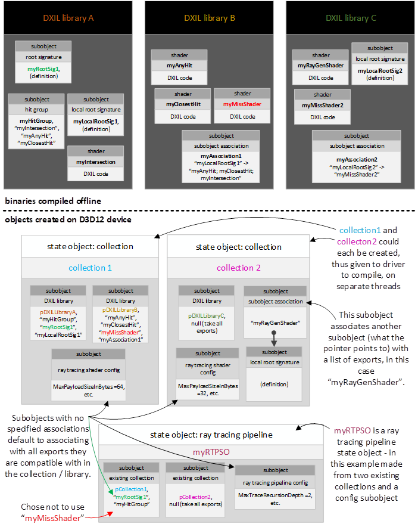

# State objects

<!-- d3d12-review-legend:begin -->

> [!NOTE]
> **Draft provenance annotations.**
> Underlining marks pending replacement wording or authored list items. Warning boxes
> mark authored, mixed or reopened passages awaiting editorial review.
> Editorial adoption does not establish factual or hardware verification. Exact approved factual
> corrections do not trigger a marker. Unmarked text elsewhere, declarations
> and structural Markdown are not assertions of approval.
> [Annotation scope and approvals](../../spec-maintenance/d3d12/prose-annotations.md).

<!-- d3d12-review-legend:end -->

<!-- d3d12-review-alert:begin:state-objects:N-ownership:0 -->

> [!WARNING]
> **Authored synthesis - human review pending.**
>
> State objects package shaders and configuration for driver processing. Collections provide reusable compilation units; executable state objects supply programs that can be selected for GPU work.

<!-- d3d12-review-alert:end:state-objects:N-ownership:0 -->

<!-- d3d12-review-alert:begin:state-objects:N-ownership:1 -->

> [!WARNING]
> **Authored synthesis - human review pending.**
>
> [Pipeline state](pipeline-state.md#apis) defines ordinary pipeline-state objects. [Binding](binding.md#local-signatures) defines local/global root-signature representation, argument layout, limits and sampler compatibility. The [pipeline-selection contract](command-list-state.md#pipeline-selection) defines the single logical selection, initial/reset state and bundle postconditions. The object and program rules below apply in addition to those canonical contracts.

<!-- d3d12-review-alert:end:state-objects:N-ownership:1 -->

<a id="object-model"></a>

## Compilation and object model

Applications must control when and where (on which threads) shader
compilation occurs given the high CPU cost, particularly with large
asset bases.

First there is the initial shader compile to DXIL binary, which can be
done offline by an application (before any hardware driver sees it). The
HLSL compiler supports DXIL libraries, allowing applications to easily
store large compiled codebases in single files if desired.

Given shaders in one or more DXIL libraries, they must be submitted to
drivers to compile on any given system where the shaders will run.
Applications must be able to choose which subset of any given DXIL
library a driver should compile at any given time; applications have the
freedom to choose how to distribute driver shader compilation across
threads, regardless of how groups of shaders happen to be packaged into
DXIL libraries.

A state object represents a variable amount of configuration state,
including shaders, that an application manages as a single unit and
which is given to a driver atomically to process (e.g. compile/optimize)
however it sees fit. A state object is created via
[CreateStateObject()](#createstateobject) on a D3D12 device.

State objects are built out of subobjects. A subobject has a
[type](#d3d12_state_subobject_type) and corresponding data. A couple of
examples of subobject types:
`D3D12_STATE_SUBOBJECT_TYPE_DXIL_LIBRARY` and
<ins><!-- d3d12-review-inline:begin:state-objects:C-subobjects:0 -->`D3D12_STATE_SUBOBJECT_TYPE_LOCAL_ROOT_SIGNATURE`<!-- d3d12-review-inline:end:state-objects:C-subobjects:0 --></ins>.

Another notable subobject type is
`D3D12_STATE_SUBOBJECT_TYPE_SUBOBJECT_TO_EXPORTS_ASSOCIATION`,
whose role is to associate another subobject with a list of DXIL
exports. This enables, for example, multiple local root signatures to be
present in a state object simultaneously, each associated with different
shader exports. See [Subobject association behavior](#subobject-association-behavior) for detailed discussion, and
see the relevant parts of the state object API here:
[D3D12_SUBOBJECT_TO_EXPORTS_ASSOCIATION](#d3d12_subobject_to_exports_association) and
[D3D12_DXIL_SUBOBJECT_TO_EXPORTS_ASSOCIATION](#d3d12_dxil_subobject_to_exports_association).

<ins><!-- d3d12-review-inline:begin:state-objects:C-subobjects:2 -->The subobject types used here are defined in<!-- d3d12-review-inline:end:state-objects:C-subobjects:2 --></ins>
[D3D12_STATE_SUBOBJECT_TYPE](#d3d12_state_subobject_type).

### Subobjects in DXIL libraries

DXIL libraries, compiled offline before state object creation, can also
define many of the same kinds of subobjects that can be directly defined
in state objects. The DXIL/HLSL versions of subobjects are defined
[here](#subobject-definitions).

The reason that subobjects can be defined either in DXIL libraries or in
state objects is to give the application the choice about how much state
authoring to do offline (DXIL libraries) vs at runtime (state objects).

Shaders are **not** considered a subobject, so while they are present in
DXIL libraries, they can't be directly passed into state objects.
Instead, the way to get shaders into a state object is to put the
containing DXIL library into the state object, as a DXIL library
subobject, including the requested shader entrypoint names to include.

<a id="program"></a>

### Programs

<ins><!-- d3d12-review-inline:begin:state-objects:C-program:0 -->A "program" encapsulates pipeline state, such as a VS+PS pipeline (along with other relevant state like rasterizer state), or a standalone compute shader.<!-- d3d12-review-inline:end:state-objects:C-program:0 --></ins>  The list of program types can be seen [here](#d3d12_program_type).

Raytracing introduced state objects as a way of defining a collection of code and other configuration data.  <ins><!-- d3d12-review-inline:begin:state-objects:C-program:1 -->This container format supports<!-- d3d12-review-inline:end:state-objects:C-program:1 --></ins> having multiple "programs" defined in a single object, such as multiple permutations of VS+PS graphics pipelines defined in one state object.  <ins><!-- d3d12-review-inline:begin:state-objects:C-program:1 -->The exception<!-- d3d12-review-inline:end:state-objects:C-program:1 --></ins> is raytracing pipelines, which must be standalone, not mixed with other programs in one state object, for simplicity.  Each individual program is something that can be bound as a unit on the GPU for execution.

Existing ways of defining pipelines are still valid, to maintain code compatibility.

The term "program" is used rather than "pipeline" to step away from the connotation in a "pipeline" that there is a sequence of operations.  "Program" intends to convey a grouping of shaders and/or fixed function operations that are launched as logical grouping on the GPU.  In many cases this grouping is a sequence, like a pipeline.  But it can be a graph too, <ins><!-- d3d12-review-inline:begin:state-objects:C-program:3 -->as in a work graph.<!-- d3d12-review-inline:end:state-objects:C-program:3 --></ins>

<!-- d3d12-review-alert:begin:state-objects:N-identity:0 -->

> [!WARNING]
> **Authored synthesis - human review pending.**
>
> `ID3D12StateObject` derives from `ID3D12Pageable` and declares no additional methods. `ID3D12StateObjectProperties` derives from `IUnknown`; `ID3D12StateObjectProperties1` extends it with `GetProgramIdentifier`. These property interfaces are exposed by the state object, not independent creation APIs.

<!-- d3d12-review-alert:end:state-objects:N-identity:0 -->

<!-- d3d12-review-alert:begin:state-objects:N-identity:1 -->

> [!WARNING]
> **Authored synthesis - human review pending.**
>
> The application must keep the state object alive for recorded and in-flight GPU work that uses it, following [execution lifetime](execution.md#lifetime). State objects are not direct application-residency targets; [residency](resources.md#residency) distinguishes runtime-managed object storage from application resources referenced by GPU addresses. Creation-description storage and driver-visible description lifetime are specified under [driver lifetime](#driver-lifetime).

<!-- d3d12-review-alert:end:state-objects:N-identity:1 -->

<a id="state-object-types"></a>

## State-object types

<a id="d3d12_state_object_desc"></a>

### D3D12_STATE_OBJECT_DESC

```cpp
typedef struct D3D12_STATE_OBJECT_DESC
{
    D3D12_STATE_OBJECT_TYPE Type;
    UINT NumSubobjects;
    const D3D12_STATE_SUBOBJECT* pSubobjects;
} D3D12_STATE_OBJECT_DESC;
```

<!-- d3d12-review-alert:begin:state-objects:T-state_object_desc:1 -->

> [!WARNING]
> **Mixed source and authored adaptation - human review pending.**
>
> Member                               | Definition
> ------                               | ----------
> `D3D12_STATE_OBJECT_TYPE Type`       | See [D3D12_STATE_OBJECT_TYPE](#d3d12_state_object_type).
> `UINT NumSubobjects`                 | Size of pSubobjects array.
> `const D3D12_STATE_SUBOBJECT* pSubobjects` | Array of subobject definitions. See [D3D12_STATE_SUBOBJECT](#d3d12_state_subobject).

<!-- d3d12-review-alert:end:state-objects:T-state_object_desc:1 -->

<a id="d3d12_state_object_type"></a>

### D3D12_STATE_OBJECT_TYPE

```cpp
typedef enum D3D12_STATE_OBJECT_TYPE
{
    D3D12_STATE_OBJECT_TYPE_COLLECTION = 0,
    D3D12_STATE_OBJECT_TYPE_RAYTRACING_PIPELINE = 3,
    D3D12_STATE_OBJECT_TYPE_EXECUTABLE = 4
} D3D12_STATE_OBJECT_TYPE;
```

<!-- d3d12-review-alert:begin:state-objects:T-state_object_type:1 -->

> [!WARNING]
> **Mixed source and authored adaptation - human review pending.**
>
> Value                               | Definition
> ---------                           | ----------
> `D3D12_STATE_OBJECT_TYPE_COLLECTION` | Collection state object.  This can hold individual shaders but not generic program or work graph definitions.
> `D3D12_STATE_OBJECT_TYPE_RAYTRACING_PIPELINE` | Standalone raytracing pipeline. Raytracing pipelines can only be defined here, and not in `EXECUTABLE` state objects below.
> `D3D12_STATE_OBJECT_TYPE_EXECUTABLE` | State object that holds one or more [programs](#program).  This could hold zero or more work graphs, as well as zero or more compute, graphics and mesh shading programs.  Raytracing pipelines are not supported here (though using `RayQuery` in non-raytracing shader stages is fine).

<!-- d3d12-review-alert:end:state-objects:T-state_object_type:1 -->

<a id="d3d12_state_subobject"></a>

### D3D12_STATE_SUBOBJECT

```cpp
typedef struct D3D12_STATE_SUBOBJECT
{
    D3D12_STATE_SUBOBJECT_TYPE Type;
    const void* pDesc;
} D3D12_STATE_SUBOBJECT;
```

Subobject within a state object description.

Parameter                           | Definition
---------                           | ----------
`D3D12_STATE_SUBOBJECT_TYPE Type`   | See [D3D12_STATE_SUBOBJECT_TYPE](#d3d12_state_subobject_type).
`const void* pDesc`                 | Pointer to state object description of the specified type.

<a id="d3d12_state_subobject_type"></a>

### D3D12_STATE_SUBOBJECT_TYPE

<!-- d3d12-review-alert:begin:state-objects:D121-stored-state-object-inputs:0 -->

> [!WARNING]
> **Authored synthesis - human review pending.**
>
> The [database input and dependency restoration contract](state-object-databases-and-identity.md#storage-only-forms) defines recorded descriptions, serialized root-signature forms, existing-collection keys and growth-parent keys. `D3D12_STATE_SUBOBJECT_TYPE_EXISTING_COLLECTION_BY_KEY` is a database input form, not permission to pass that storage-only subobject to device `CreateStateObject`. Actual creation, linking, associations and growth remain subject to this chapter.

<!-- d3d12-review-alert:end:state-objects:D121-stored-state-object-inputs:0 -->

<!-- d3d12-review-alert:begin:state-objects:D131-compiler-state-object-inputs:0 -->

> [!WARNING]
> **Authored synthesis - human review pending.**
>
> Offline compilation uses [D3D12_COMPILER_EXISTING_COLLECTION_DESC](compiler-invocation-and-cache-output.md#d3d12_compiler_existing_collection_desc) with `D3D12_STATE_SUBOBJECT_TYPE_COMPILER_EXISTING_COLLECTION`, rather than a device collection or database key. [Compiler inputs and ownership](compiler-invocation-and-cache-output.md#input-ownership), [CompileStateObject](compiler-invocation-and-cache-output.md#id3d12compiler-compilestateobject) and [CompileAddToStateObject](compiler-invocation-and-cache-output.md#id3d12compiler-compileaddtostateobject) define target validation, collection/parent provenance and compiler-specific lifetimes. This is not permission to pass a compiler collection to device creation.

<!-- d3d12-review-alert:end:state-objects:D131-compiler-state-object-inputs:0 -->

```cpp
typedef enum D3D12_STATE_SUBOBJECT_TYPE
{
    D3D12_STATE_SUBOBJECT_TYPE_STATE_OBJECT_CONFIG = 0, // D3D12_STATE_OBJECT_CONFIG
    D3D12_STATE_SUBOBJECT_TYPE_GLOBAL_ROOT_SIGNATURE = 1, // D3D12_GLOBAL_ROOT_SIGNATURE
    D3D12_STATE_SUBOBJECT_TYPE_LOCAL_ROOT_SIGNATURE = 2, // D3D12_LOCAL_ROOT_SIGNATURE
    D3D12_STATE_SUBOBJECT_TYPE_NODE_MASK = 3, // D3D12_NODE_MASK
    // 4 unused
    D3D12_STATE_SUBOBJECT_TYPE_DXIL_LIBRARY = 5, // D3D12_DXIL_LIBRARY_DESC
    D3D12_STATE_SUBOBJECT_TYPE_EXISTING_COLLECTION = 6, // D3D12_EXISTING_COLLECTION_DESC
    D3D12_STATE_SUBOBJECT_TYPE_SUBOBJECT_TO_EXPORTS_ASSOCIATION = 7, // D3D12_SUBOBJECT_TO_EXPORTS_ASSOCIATION
    D3D12_STATE_SUBOBJECT_TYPE_DXIL_SUBOBJECT_TO_EXPORTS_ASSOCIATION = 8, // D3D12_DXIL_SUBOBJECT_TO_EXPORTS_ASSOCIATION
    D3D12_STATE_SUBOBJECT_TYPE_RAYTRACING_SHADER_CONFIG = 9, // D3D12_RAYTRACING_SHADER_CONFIG
    D3D12_STATE_SUBOBJECT_TYPE_RAYTRACING_PIPELINE_CONFIG = 10,  // D3D12_RAYTRACING_PIPELINE_CONFIG
    D3D12_STATE_SUBOBJECT_TYPE_HIT_GROUP = 11,  // D3D12_HIT_GROUP_DESC
    D3D12_STATE_SUBOBJECT_TYPE_RAYTRACING_PIPELINE_CONFIG1 = 12,  // D3D12_RAYTRACING_PIPELINE_CONFIG1
    D3D12_STATE_SUBOBJECT_TYPE_WORK_GRAPH = 13, // D3D12_WORK_GRAPH_DESC
    D3D12_STATE_SUBOBJECT_TYPE_STREAM_OUTPUT = 14,  // D3D12_STREAM_OUTPUT_DESC
    D3D12_STATE_SUBOBJECT_TYPE_BLEND = 15,  // D3D12_BLEND_DESC
    D3D12_STATE_SUBOBJECT_TYPE_SAMPLE_MASK = 16,  // UINT
    D3D12_STATE_SUBOBJECT_TYPE_RASTERIZER = 17,  // D3D12_RASTERIZER_DESC2
    D3D12_STATE_SUBOBJECT_TYPE_DEPTH_STENCIL = 18,  // D3D12_DEPTH_STENCIL_DESC
    D3D12_STATE_SUBOBJECT_TYPE_INPUT_LAYOUT = 19,  // D3D12_INPUT_LAYOUT_DESC
    D3D12_STATE_SUBOBJECT_TYPE_IB_STRIP_CUT_VALUE = 20,  // D3D12_INDEX_BUFFER_STRIP_CUT_VALUE
    D3D12_STATE_SUBOBJECT_TYPE_PRIMITIVE_TOPOLOGY = 21,  // D3D12_PRIMITIVE_TOPOLOGY_TYPE
    D3D12_STATE_SUBOBJECT_TYPE_RENDER_TARGET_FORMATS = 22,  // D3D12_RT_FORMAT_ARRAY
    D3D12_STATE_SUBOBJECT_TYPE_DEPTH_STENCIL_FORMAT = 23,  // DXGI_FORMAT
    D3D12_STATE_SUBOBJECT_TYPE_SAMPLE_DESC = 24,  // DXGI_SAMPLE_DESC
    // 25 is unused
    D3D12_STATE_SUBOBJECT_TYPE_FLAGS = 26,  // D3D12_PIPELINE_STATE_FLAGS
    D3D12_STATE_SUBOBJECT_TYPE_DEPTH_STENCIL1 = 27, // D3D12_DEPTH_STENCIL_DESC1
    D3D12_STATE_SUBOBJECT_TYPE_VIEW_INSTANCING = 28, // D3D12_VIEW_INSTANCING_DESC
    D3D12_STATE_SUBOBJECT_TYPE_GENERIC_PROGRAM = 29, // D3D12_GENERIC_PROGRAM_DESC
    D3D12_STATE_SUBOBJECT_TYPE_DEPTH_STENCIL2 = 30, // D3D12_DEPTH_STENCIL_DESC2
} D3D12_STATE_SUBOBJECT_TYPE;
```

<ins><!-- d3d12-review-inline:begin:state-objects:T-state_subobject_type:1 -->Subobject payloads:<!-- d3d12-review-inline:end:state-objects:T-state_subobject_type:1 --></ins>

<!-- d3d12-review-alert:begin:state-objects:T-state_subobject_type:2 -->

> [!WARNING]
> **Mixed source and authored adaptation - human review pending.**
>
> Value                           | Definition
> ---------                       | ----------
> `D3D12_STATE_SUBOBJECT_TYPE_STATE_OBJECT_CONFIG` | State object config subobject. See [D3D12_STATE_OBJECT_CONFIG](#d3d12_state_object_config).
> `D3D12_STATE_SUBOBJECT_TYPE_WORK_GRAPH` | Work graph definition subobject. See [D3D12_WORK_GRAPH_DESC](#d3d12_work_graph_desc).
> `D3D12_STATE_SUBOBJECT_TYPE_GENERIC_PROGRAM` | Generic program definition subobject. See [D3D12_GENERIC_PROGRAM_DESC](#d3d12_generic_program_desc).

<!-- d3d12-review-alert:end:state-objects:T-state_subobject_type:2 -->

<ins><!-- d3d12-review-inline:begin:state-objects:T-state_subobject_type:3 -->To use any of the subobjects below, directly list them in a generic program description, as opposed to using subobject associations.  See [D3D12_GENERIC_PROGRAM_DESC](#d3d12_generic_program_desc), which also lists defaults for any of these subobjects that aren't specified.<!-- d3d12-review-inline:end:state-objects:T-state_subobject_type:3 --></ins>

<!-- d3d12-review-alert:begin:state-objects:T-state_subobject_type:4 -->

> [!WARNING]
> **Mixed source and authored adaptation - human review pending.**
>
> Value                           | Definition
> ---------                       | ----------
> `D3D12_STATE_SUBOBJECT_TYPE_STREAM_OUTPUT` | Stream output definition subobject that can be used by a [generic program](#d3d12_generic_program_desc).  The contents are the pre-existing API struct: `D3D12_STREAM_OUTPUT_DESC`.  [Defaults if missing](#missing-stream_output).
> `D3D12_STATE_SUBOBJECT_TYPE_BLEND` | Blend description subobject that can be used by a [generic program](#d3d12_generic_program_desc).  The contents are the pre-existing API struct: `D3D12_BLEND_DESC`. [Defaults if missing](#missing-blend).
> `D3D12_STATE_SUBOBJECT_TYPE_SAMPLE_MASK` |  Sample mask subobject that can be used by a [generic program](#d3d12_generic_program_desc).  The contents are a `UINT`. [Defaults if missing](#missing-sample_mask).
> `D3D12_STATE_SUBOBJECT_TYPE_RASTERIZER` | Rasterizer description subobject that can be used by a [generic program](#d3d12_generic_program_desc).  The contents are the pre-existing API struct: `D3D12_RASTERIZER_DESC2`. [Defaults if missing](#missing-rasterizer).
> `D3D12_STATE_SUBOBJECT_TYPE_INPUT_LAYOUT` | Input layout description subobject that can be used by a [generic program](#d3d12_generic_program_desc).  The contents are the pre-existing API struct: `D3D12_INPUT_LAYOUT_DESC`. [Defaults if missing](#missing-input_layout).
> `D3D12_STATE_SUBOBJECT_TYPE_IB_STRIP_CUT_VALUE` | Index buffer strip cut value description subobject that can be used by a [generic program](#d3d12_generic_program_desc).  The contents are the pre-existing API struct: `D3D12_INDEX_BUFFER_STRIP_CUT_VALUE`. [Defaults if missing](#missing-index_buffer_strip_cut_value).
> `D3D12_STATE_SUBOBJECT_TYPE_PRIMITIVE_TOPOLOGY` | Primitive topology description subobject that can be used by a [generic program](#d3d12_generic_program_desc).  The contents are the pre-existing API struct: `D3D12_PRIMITIVE_TOPOLOGY_TYPE`. [Defaults if missing](#missing-primitive_topology).
> `D3D12_STATE_SUBOBJECT_TYPE_RENDER_TARGET_FORMATS` | RenderTarget formats description subobject that can be used by a [generic program](#d3d12_generic_program_desc).  The contents are the pre-existing API struct: `D3D12_RT_FORMAT_ARRAY`. [Defaults if missing](#missing-render_target_formats).
> `D3D12_STATE_SUBOBJECT_TYPE_DEPTH_STENCIL_FORMAT` | Depth Stencil format description subobject that can be used by a [generic program](#d3d12_generic_program_desc).  The contents are a `DXGI_FORMAT`. [Defaults if missing](#missing-depth_stencil_format).
> `D3D12_STATE_SUBOBJECT_TYPE_SAMPLE_DESC` | Sample description subobject that can be used by a [generic program](#d3d12_generic_program_desc).  The contents are the pre-existing API struct: `DXGI_SAMPLE_DESC`. [Defaults if missing](#missing-sample_desc).
> `D3D12_STATE_SUBOBJECT_TYPE_FLAGS` | Pipeline state flags subobject that can be used by a [generic program](#d3d12_generic_program_desc).  The contents are the pre-existing flags enum: `D3D12_PIPELINE_STATE_FLAGS`. [Defaults if missing](#missing-flags).
> `D3D12_STATE_SUBOBJECT_TYPE_VIEW_INSTANCING` | View Instancing description subobject that can be used by a [generic program](#d3d12_generic_program_desc).  The contents are the pre-existing API struct: `D3D12_VIEW_INSTANCING_DESC`. [Defaults if missing](#missing-view_instancing).
> `D3D12_STATE_SUBOBJECT_TYPE_DEPTH_STENCIL` | Depth Stencil description subobject that can be used by a [generic program](#d3d12_generic_program_desc).  The contents are the pre-existing API struct: `D3D12_DEPTH_STENCIL_DESC`. [Defaults if missing](#missing-depth_stencil-or-depth_stencil1-or-depth_stencil2).
> `D3D12_STATE_SUBOBJECT_TYPE_DEPTH_STENCIL1` | Depth Stencil (iteration 1) description subobject that can be used by a [generic program](#d3d12_generic_program_desc).  The contents are the pre-existing API struct: `D3D12_DEPTH_STENCIL_DESC1`. [Defaults if missing](#missing-depth_stencil-or-depth_stencil1-or-depth_stencil2).
> `D3D12_STATE_SUBOBJECT_TYPE_DEPTH_STENCIL2` | Depth Stencil (iteration 2) description subobject that can be used by a [generic program](#d3d12_generic_program_desc).  The contents are the pre-existing API struct: `D3D12_DEPTH_STENCIL_DESC2`. [Defaults if missing](#missing-depth_stencil-or-depth_stencil1-or-depth_stencil2).

<!-- d3d12-review-alert:end:state-objects:T-state_subobject_type:4 -->

<!-- d3d12-review-alert:begin:state-objects:N-payload-prerequisites:0 -->

> [!WARNING]
> **Authored synthesis - human review pending.**
>
> The raytracing subobject payloads are [shader configuration](#d3d12_raytracing_shader_config), [pipeline configuration](#d3d12_raytracing_pipeline_config), [pipeline configuration with flags](#d3d12_raytracing_pipeline_config1), and [hit groups](#d3d12_hit_group_desc). Global/local root signatures, node masks, libraries, collections and both association forms are defined below. Graphics payload structures retain their [pipeline-state definitions](pipeline-state.md#graphics-description), [rasterizer definitions](rasterization.md), [output-merger definitions](output-merger.md), [input-layout definitions](vertex-processing.md) and [stream-output definitions](geometry-shaders-and-stream-output.md).

<!-- d3d12-review-alert:end:state-objects:N-payload-prerequisites:0 -->

<a id="raytracing-pipeline-state-object"></a>

### Raytracing pipeline state object

<ins><!-- d3d12-review-inline:begin:state-objects:C-rtpso:0 -->One of the state object [types](#d3d12_state_object_type) is
`D3D12_STATE_OBJECT_TYPE_RAYTRACING_PIPELINE`, or
raytracing pipeline state object - RTPSO for short. An RTPSO
represents a full set of shaders that could be reachable by a
[DispatchRays](raytracing-pipelines.md#id3d12graphicscommandlist4dispatchrays) call, with all configuration options resolved,
such as local root signatures and other state.<!-- d3d12-review-inline:end:state-objects:C-rtpso:0 --></ins>

An RTPSO can be thought of as an *executable* state object.

The input to [SetPipelineState1()](#setpipelinestate1) is a state object,
where an RTPSO can be bound to the command list.

<a id="collection-state-object"></a>

## Collections

<ins><!-- d3d12-review-inline:begin:state-objects:C-collection:0 -->Another state object [type](#d3d12_state_object_type) is
`D3D12_STATE_OBJECT_TYPE_COLLECTION`, or collection for short. A
collection can contain any amount of subobjects, without needing to define a complete executable program. Not all dependencies the included subobjects have must be
resolved in the same collection. Even if dependencies are locally
defined, the set of subobjects doesn't have to be the complete set of
state that will eventually be used on the GPU. For instance, a
collection may not include all shaders needed to raytrace a scene,
though it could.<!-- d3d12-review-inline:end:state-objects:C-collection:0 --></ins>

The purpose of a collection is to allow an application to pass an
arbitrarily large or small collection of state to drivers to compile at
once (e.g. on a given thread).

<ins><!-- d3d12-review-inline:begin:state-objects:C-collection:2 -->If too little configuration information is provided in the subobjects in
a collection, the driver cannot compile anything,
and would be left with simply storing the subobjects.  This situation isn't allowed by
default: collection creation will fail.  The collection can opt out of needing all
dependencies to be resolvable, causing the driver to defer compilation, by setting the `D3D12_STATE_OBJECT_FLAG_ALLOW_LOCAL_DEPENDENCIES_ON_EXTERNAL_DEFINITIONS` flag in [D3D12_STATE_OBJECT_FLAGS](#d3d12_state_object_flags).<!-- d3d12-review-inline:end:state-objects:C-collection:2 --></ins>

A collection must meet the following requirements for the driver to be able to compile it immediately:
- library functions called by shaders must have code definitions
- resource bindings referenced by shaders must have local and/or global root signature subobjects defining the bindings
- raytracing shaders must have a [D3D12_RAYTRACING_SHADER_CONFIG](#d3d12_raytracing_shader_config) and a [D3D12_RAYTRACING_PIPELINE_CONFIG](#d3d12_raytracing_pipeline_config) subobject

The parts of the above list that involve subobject associations are discussed further at [subobject association requirements](#subobject-association-requirements).

For simplicity, collections can't be made out of other collections. Only
executable state objects (e.g. RTPSOs) can take existing collections as
a part of their definition.

<ins><!-- d3d12-review-inline:begin:state-objects:C-collection:6 -->[State object lifetimes as seen by driver](#driver-lifetime)<!-- d3d12-review-inline:end:state-objects:C-collection:6 --></ins> is a discussion useful for driver authors.

### Collections vs libraries

A collection is a bit like a library, but a different name is used to
distinguish it from DXIL Libraries.

DXIL Libraries are hardware agnostic. In contrast, a collection's
contents are given to a driver to process and can include a part of a
DXIL Library (by listing a subset of exports to use), multiple DXIL
Libraries, as well as other types of subobjects like root signatures.

An application can choose to have many tiny DXIL libraries each with a
single compileable raytracing shader. It can choose to create a separate
collection for each one across different threads on a CPU. Or it could
make one collection per thread, distributing the set of shaders evenly
across them. In either case, an RTPSO can then be constructed out of the
set of collections.

Alternatively, if CPU time compiling shaders in the driver before use
isn't a concern, an application can skip making collections and pass all
of its DXIL Libraries directly into the creation of an RTPSO. An extreme
case of this would be an application baking all of its shader assets
(and other necessary subobjects like root signatures) in a single DXIL
Library (e.g. one binary file), loading this into memory and passing it
directly into the creation of an RTPSO. The driver would have to compile
all of the shaders at once on one thread.

<a id="dxil-libraries-and-state-objects-example"></a>

### DXIL libraries and state objects example

<ins><!-- d3d12-review-inline:begin:state-objects:C-collections-figure:0 --><!-- d3d12-review-inline:end:state-objects:C-collections-figure:0 --></ins>

<a id="libraries"></a>

## Libraries, exports and imports

<a id="d3d12_dxil_library_desc"></a>

### D3D12_DXIL_LIBRARY_DESC

```cpp
typedef struct D3D12_DXIL_LIBRARY_DESC
{
    D3D12_SHADER_BYTECODE  DXILLibrary;
    UINT NumExports; // Optional, if 0 all exports in the library/collection will be surfaced
    const D3D12_EXPORT_DESC* pExports;
} D3D12_DXIL_LIBRARY_DESC;
```

<!-- d3d12-review-alert:begin:state-objects:T-dxil_library_desc:1 -->

> [!WARNING]
> **Mixed source and authored adaptation - human review pending.**
>
> Member                              | Definition
> ---------                           | ----------
> `D3D12_SHADER_BYTECODE DXILLibrary` | Shader to include in the state object. Supported shaders include vs\_, ps\_ ...etc must be compiled with target 6.0 or higher. Library shaders must have been compiled with library target 6.3 or higher. It is fine to specify the same shader multiple times either in the same state object / collection or across multiple, as long as the names exported each time don't conflict in a given state object.
> `UINT NumExports` | Size of pExports array. If 0, everything gets exported from the Shader. For non-library shaders the shader entrypoint is the only thing that can be exported.
> `const D3D12_EXPORT_DESC* pExports` | Optional exports array. See [D3D12_EXPORT_DESC](#d3d12_export_desc).

<!-- d3d12-review-alert:end:state-objects:T-dxil_library_desc:1 -->

<a id="d3d12_export_desc"></a>

### D3D12_EXPORT_DESC

```cpp
typedef struct D3D12_EXPORT_DESC
{
    LPCWSTR Name;
    LPCWSTR ExportToRename;
    D3D12_EXPORT_FLAGS Flags;
} D3D12_EXPORT_DESC;
```

<!-- d3d12-review-alert:begin:state-objects:T-export_desc:1 -->

> [!WARNING]
> **Mixed source and authored adaptation - human review pending.**
>
> Member                              | Definition
> ---------                           | ----------
> `LPCWSTR Name` | Name to be exported. If the name refers to a function that is overloaded, a mangled version of the name (function parameter information encoded in name string) can be provided to disambiguate which overload to use. The mangled name for a function can be retrieved from HLSL compiler reflection. If `ExportToRename` field is non-null, `Name` refers to the new name to use for it when exported. In this case `Name` must be an unmangled name, whereas `ExportToRename` can be either a mangled or unmangled name. A given internal name may be exported multiple times with different renames (and/or not renamed). Shader entrypoints (as opposed to non-entry library functions) always use unmangled names. Thus for generic programs only unmangled names apply. For [generic programs](#generic-programs): As a convenience, when there is only one export available in the library, `Name` can be set to "\*" to refer to that one export without having to know its name. If the lib has multiple exports, specifying "\*" for `Name` is invalid. If doing a rename, this "\*" option applies to the `ExportToRename` field instead, as the Name field becomes the new name. For non-lib shaders compiled with older compilers (older than version 1.8), the shader name isn't visible to the runtime, so a rename must be done with the "*" option. Doing so would then work fine with both old and new compilers equivalently.
> `LPCWSTR ExportToRename` | If non-null, this is the name of an export to use but then rename when exported. Described further above.
> `D3D12_EXPORT_FLAGS Flags` | Flags to apply to the export.

<!-- d3d12-review-alert:end:state-objects:T-export_desc:1 -->

Note for driver authors:
In the DDI version of this struct, drivers are always given a non-null `Name`, even if at the API the NULL option was specified. In particular when it is non-lib shader bytecode, which by definition only has one entrypoint in it, the driver must always use the `Name` specified at the DDI to refer to the entrypoint, regardless of what the name in the bytecode is, and `ExportToRename` can be ignored.

<a id="d3d12_export_flags"></a>

### D3D12_EXPORT_FLAGS

```cpp
typedef enum D3D12_EXPORT_FLAGS
{
    D3D12_EXPORT_FLAG_NONE = 0x0,
} D3D12_EXPORT_FLAGS;
```

No export flags are currently defined.

<a id="d3d12_existing_collection_desc"></a>

### D3D12_EXISTING_COLLECTION_DESC

```cpp
typedef struct D3D12_EXISTING_COLLECTION_DESC
{
    ID3D12StateObject* pExistingCollection;
    UINT NumExports; // Optional, if 0 all exports in the library/collection will be surfaced
    const D3D12_EXPORT_DESC* pExports;
} D3D12_EXISTING_COLLECTION_DESC;
```

<!-- d3d12-review-alert:begin:state-objects:T-existing_collection_desc:1 -->

> [!WARNING]
> **Mixed source and authored adaptation - human review pending.**
>
> Member                              | Definition
> ---------                           | ----------
> `ID3D12StateObject* pExistingCollection` | [Collection](#collection-state-object) to include in state object. Enclosing state object holds a reference on the existing collection.
> `UINT NumExports` | Size of pExports array. If 0, all of the collection's exports get exported.
> `const D3D12_EXPORT_DESC* pExports` | Optional exports array. See [D3D12_EXPORT_DESC](#d3d12_export_desc).

<!-- d3d12-review-alert:end:state-objects:T-existing_collection_desc:1 -->

<a id="subobject-association-behavior"></a>

## Subobject associations

The introduction to <ins><!-- d3d12-review-inline:begin:state-objects:C-associations:0 -->[Subobjects](#object-model)<!-- d3d12-review-inline:end:state-objects:C-associations:0 --></ins> called out a specific type
of subobject that associates another subobject with a set of shader
exports.

This section describes how subobjects (like root signatures) get
associated with shaders in DXIL libraries and state objects. This
includes the way default associations (intended for convenience) and
explicit association work. Also covered is how DXIL subobject
associations can be overridden when an app includes a DXIL library in a
state object.

---

### Default associations

Default associations serve as a convenience for the common case where a
given subobject (like a root signature) will be used with many shaders.

---

#### Terminology

For the subsequent discussion consider the following **scopes** of
visibility where a set of shaders can be found:

- a given DXIL library

- a collection state object, which may get shaders from one or more
  DXIL libraries

- an executable state object (e.g. RTPSO), which may get shaders from
  one or more collections and/or DXIL libraries

A given scope can **contain** other inner scopes, or outer scopes can
**enclose** it.

---

#### Declaring a default association

<ins><!-- d3d12-review-inline:begin:state-objects:C-associations:12 -->There are two ways to declare<!-- d3d12-review-inline:end:state-objects:C-associations:12 --></ins> a default association for a subobject to a
set of shaders:

1. <ins><!-- d3d12-review-inline:begin:state-objects:C-associations:13 -->Declare a subobject in a given scope with no explicit associations<!-- d3d12-review-inline:end:state-objects:C-associations:13 --></ins>
   in that scope that reference it, subject to the
   [default-candidate resolution](#default-resolution) rules.  If this subobject is involved in
   an association defined in any *other* scope including enclosing or
   contained scopes, it doesn't affect that locally this subobject is a candidate
   for a default association.

2. Define an association with an empty export list.  The subobject
   specified may or may not be in the current scope.  The subobject
   specified can also be unresolved (not defined in current, containing
   or enclosed scopes), unless the state object being defined is
   executable, e.g. RTPSO.

---

#### Behavior of a default association

In a default association a subobject is associated with all candidate
exports in the current and contained scopes, but not to enclosing
scopes.  Candidates to be associated are exports for which the
association would make sense, and that don't have an explicit
association with another subobject of the same type already.  There is
one exception, where default association can **override** an existing
association on an export, described later.

---

### Explicit associations

Explicit associations associate a given subobject to a specific nonempty
list of exports.

The subobject being associated (e.g. root signature) and/or the listed
exports can be in any scope in the object.

In addition, neither the subobject being associated or the listed
exports have to even be visible yet (may be unresolved references),
unless the state object is executable, e.g. RTPSO.

---

### Multiple associations of a subobject

A given subobject can be referenced in multiple association definitions,
explicit and/or default. This way any given association definition
doesn't need to be all-knowing (does not need to be aware of all
shaders a subobject may be relevant to).

The use of multiple association declarations also enables, for instance,
broadcasting a default association for a given subobject to be broadcast
into multiple scopes. Each association declaration (in a different
scope) this case would use an empty export (making it a default
association) but reference the same subobject.

---

### Conflicting subobject associations

If there are multiple <ins><!-- d3d12-review-inline:begin:state-objects:C-associations:28 -->explicit subobject associations<!-- d3d12-review-inline:end:state-objects:C-associations:28 --></ins> (with different
subobject definitions) that map to a given shader export, this is a
conflict. If a conflict is discovered during DXIL library creation,
library creation will fail. Otherwise if a conflict is discovered during
state object creation, that fails.

The determination of conflicts doesn't care what scope(s) hold the
associations, subobjects being associated or shader export within a
given state object (or single scope DXIL library). This is because by
definition, explicit associations can reach anywhere in a state object
(or DXIL library).

There is one exception where a conflict doesn't cause a failure and
instead there is a precedence order that causes an override:

---

#### Exception: overriding DXIL library associations

Subobject associations (default or explicit) declared directly in state
objects that target an export in a directly included DXIL library cause
any other association to that export that was defined in any DXIL
library (same or other library) to no longer apply to that export. And
as a result, the subobject association declared directly in the state
object "wins" and overrides the DXIL based association. This includes
associations defined at state object scope via either
[D3D12_SUBOBJECT_TO_EXPORTS_ASSOCIATION](#d3d12_subobject_to_exports_association) (association at state object
scope for a subobject also defined at state object scope) or
[D3D12_DXIL_SUBOBJECT_TO_EXPORTS_ASSOCIATION](#d3d12_dxil_subobject_to_exports_association) (association at state
object <ins><!-- d3d12-review-inline:begin:state-objects:C-associations:33 -->scope for a subobject defined<!-- d3d12-review-inline:end:state-objects:C-associations:33 --></ins> in a DXIL library).

Associations declared in state objects do not override any existing
associations in contained collections (including DXIL libraries the
contained collections may have).

The subobject being associated can be unresolved unless the state object
is RTPSO (executable).

> The reason overriding is only defined for DXIL libraries directly passed into a given state object's creation is the following. Drivers never have to worry about compiling code that came from a DXIL library during state object creation only to have to recompile later because multiple subobject overrides happened. e.g. creating a collection that overrides associations in a DXIL library then creating an RTPSO that includes the collection and tries to override an association again is invalid (the second association becomes conflicting and state object creation fails).
>
> The value in supporting overriding of subobject associations is to give programmatic code (i.e. performing state object creation) one chance to override what is in a static DXIL library, without having to patch the DXIL library itself.

---

### Subobject associations for hit groups

<ins><!-- d3d12-review-inline:begin:state-objects:C-associations:39 -->[Hit groups](raytracing-pipelines.md#hit-groups) reference a set of component shaders, such as
a closest hit shader, any hit shader, and/or intersection shader.
Subobject associations (like associating a local root signature to a
shader) can be made directly to the individual component shaders used by
a hit group and/or directly to the hit group. Making the association to
the hit group can be convenient, as it applies to all the component
shaders (so they don't need individual associations). If both a hit
group has an association and its component shaders have associations,
they must match. If a hit group doesn't have a particular subobject
association, the associations for all component shaders must match. So
different component shaders can't use different local root signatures,
for instance.<!-- d3d12-review-inline:end:state-objects:C-associations:39 --></ins>

---

### Runtime resolves associations for driver

The runtime resolves what subobject associations ended up at any given
export, accounting for defaults, overriding etc. and tells the driver
the result <ins><!-- d3d12-review-inline:begin:state-objects:C-associations:42 -->during state object creation.<!-- d3d12-review-inline:end:state-objects:C-associations:42 --></ins> This ensures consistency
across implementations.

<a id="default-resolution"></a>

### Default-candidate and library resolution

<!-- d3d12-review-alert:begin:state-objects:N-D081-resolution:0 -->

> [!WARNING]
> **Authored synthesis - human review pending.**
>
> For each associatable subobject type in a scope, an explicit association with an empty export list takes precedence over implicit default candidates. Otherwise, an implicit default exists only when the unassociated candidates have one unique definition; identical duplicate definitions count as one. Multiple distinct candidate definitions supply no implicit default. That condition does not intrinsically fail creation, but a required association that remains missing can still cause creation to fail.

<!-- d3d12-review-alert:end:state-objects:N-D081-resolution:0 -->

<!-- d3d12-review-alert:begin:state-objects:N-D081-resolution:1 -->

> [!WARNING]
> **Authored synthesis - human review pending.**
>
> Apply state-object associations and the rules for overriding associations in directly included DXIL libraries first. If an export remains unassociated for a relevant type, resolve applicable explicit library associations targeting it: their definitions must agree, and conflicting definitions cause creation to fail. If there are no such explicit library associations, use the default of the export's originating DXIL library. Do not search unrelated peer libraries for a default. This does not permit overriding an existing association in a contained collection.

<!-- d3d12-review-alert:end:state-objects:N-D081-resolution:1 -->

<a id="subobject-association-requirements"></a>

### Subobject association requirements

<!-- d3d12-review-alert:begin:state-objects:N-association-applicability:0 -->

> [!WARNING]
> **Authored synthesis - human review pending.**
>
> The raytracing shader-configuration and pipeline-configuration rows apply to raytracing state objects. Work-graph node shaders and generic-program shaders use the applicable root-signature, node-mask and state-object-configuration rules; they do not acquire raytracing payload or recursion configuration merely by being contained in a state object.

<!-- d3d12-review-alert:end:state-objects:N-association-applicability:0 -->

This table describes requirements for each subobject type that supports
being associated with shader exports.

The "Match rule" column describes whether a subobject association is
required or optional for any given shader and whether the definition of
the subobject must match that of other shaders.

The "Match scope" column describes what set of shader code the matching
requirement applies to.

| Subobject type                                                  | Match rule                                   | Match scope                                                                                                                                                          |
| --------------------------------------------------------------- | -------------------------------------------- | -------------------------------------------------------------------------------------------------------------------------------------------------------------------- |
| [Raytracing shader config](#d3d12_raytracing_shader_config)     | Required & matching for all exports          | Full state object. More discussion at [D3D12_RAYTRACING_SHADER_CONFIG](#d3d12_raytracing_shader_config).                                                          |
| [Raytracing pipeline config](#d3d12_raytracing_pipeline_config1) | Required & matching for all exports          | Full state object. More discussion at [D3D12_RAYTRACING_PIPELINE_CONFIG](#d3d12_raytracing_pipeline_config), [D3D12_RAYTRACING_PIPELINE_CONFIG1](#d3d12_raytracing_pipeline_config1).                                                      |
| [Global root signature](#d3d12_global_root_signature)           | Optional, if present must match shader entry | Call graph reachable from shader entry. More discussion at [D3D12_GLOBAL_ROOT_SIGNATURE](#d3d12_global_root_signature).                                           |
| [Local root signature](#d3d12_local_root_signature)            | Optional, if present must match shader entry | Call graph reachable from shader entry (not including calls through shader tables). More discussion at [D3D12_LOCAL_ROOT_SIGNATURE](#d3d12_local_root_signature). |
| [Node mask](#d3d12_node_mask)                                  | Optional, if present match for all exports   | Full state object. More discussion at [D3D12_NODE_MASK](#d3d12_node_mask).                                                                                        |
| [State object config](#d3d12_state_object_config)               | Optional, if present match for all exports   | Local state object only, doesn't need to match contained state objects. More discussion at [D3D12_STATE_OBJECT_CONFIG](#d3d12_state_object_config). |

<a id="association-descriptors"></a>

## Association descriptors

<a id="d3d12_subobject_to_exports_association"></a>

### D3D12_SUBOBJECT_TO_EXPORTS_ASSOCIATION

```cpp
typedef struct D3D12_SUBOBJECT_TO_EXPORTS_ASSOCIATION
{
    const D3D12_STATE_SUBOBJECT* pSubobjectToAssociate;
    UINT NumExports;
    LPCWSTR* pExports;
} D3D12_SUBOBJECT_TO_EXPORTS_ASSOCIATION;
```

Associates a subobject defined directly in a state object with shader
exports. Depending on the choice of flags in the optional
[D3D12_STATE_OBJECT_CONFIG](#d3d12_state_object_config) subobject for
opting in to cross linkage, the exports being associated don't
necessarily have to be present in the current state object (or one that
has been seen yet) -- to be resolved later, e.g. on RTPSO creation. See
[Subobject association behavior](#subobject-association-behavior) for detail.

<!-- d3d12-review-alert:begin:state-objects:T-subobject_to_exports_association:2 -->

> [!WARNING]
> **Mixed source and authored adaptation - human review pending.**
>
> Member                              | Definition
> ---------                           | ----------
> `const D3D12_STATE_SUBOBJECT* pSubobjectToAssociate` | Pointer to subobject in current state object to define an association to.
> `UINT NumExports` | <p>Size of export array. If 0, this is being explicitly defined as a default association. See [Subobject association behavior](#subobject-association-behavior).</p><p>Another way to define a default association is to omit this subobject association for that subobject completely.</p>
> `LPCWSTR* pExports` |Exports to associate subobject with.

<!-- d3d12-review-alert:end:state-objects:T-subobject_to_exports_association:2 -->

<a id="d3d12_dxil_subobject_to_exports_association"></a>

### D3D12_DXIL_SUBOBJECT_TO_EXPORTS_ASSOCIATION

```cpp
typedef struct D3D12_DXIL_SUBOBJECT_TO_EXPORTS_ASSOCIATION
{
    LPCWSTR SubobjectToAssociate;
    UINT NumExports;
    LPCWSTR* pExports;
} D3D12_DXIL_SUBOBJECT_TO_EXPORTS_ASSOCIATION;
```

Associates a subobject defined in a DXIL library (not necessarily one
that has been seen yet) with shader exports. See [Subobject association behavior](#subobject-association-behavior) for details.

<!-- d3d12-review-alert:begin:state-objects:T-dxil_subobject_to_exports_association:2 -->

> [!WARNING]
> **Mixed source and authored adaptation - human review pending.**
>
> Member                              | Definition
> ---------                           | ----------
> `LPCWSTR SubobjectToAssociate` | Name of subobject defined in a DXIL library.
> `UINT NumExports` | <p>Size of export array. If 0, this is being explicitly defined as a default association. See [Subobject association behavior](#subobject-association-behavior).</p><p>Another way to define a default association is to omit this subobject association for that subobject completely.</p>
> `LPCWSTR* pExports` | Exports to associate subobject with.

<!-- d3d12-review-alert:end:state-objects:T-dxil_subobject_to_exports_association:2 -->

<a id="configuration"></a>

## Configuration and root-signature relationships

<a id="d3d12_state_object_config"></a>

### D3D12_STATE_OBJECT_CONFIG

```cpp
typedef struct D3D12_STATE_OBJECT_CONFIG
{
    D3D12_STATE_OBJECT_FLAGS Flags;
} D3D12_STATE_OBJECT_CONFIG;
```

This is a subobject type that can be [associated](#subobject-association-behavior) with shader exports. A summary of the rules about which subobject types can/must be associated
with various shaders in a state object is [here](#subobject-association-requirements).

This subobject defines general properties of a state object. The
presence of this subobject in a state object is **optional**. If
present, all exports defined by that state object description must be associated with the
same subobject (or one with a matching definition). This consistency
requirement does not apply across existing collections that are included
in a larger state object, with the exception of the presence of the `D3D12_STATE_OBJECT_FLAG_ALLOW_STATE_OBJECT_ADDITIONS` flag, detailed below.

Member                              | Definition
---------                           | ----------
`D3D12_STATE_OBJECT_FLAGS Flags`    | See [D3D12_STATE_OBJECT_FLAGS](#d3d12_state_object_flags).

<a id="d3d12_state_object_flags"></a>

### D3D12_STATE_OBJECT_FLAGS

```cpp
typedef enum D3D12_STATE_OBJECT_FLAGS
{
    D3D12_STATE_OBJECT_FLAG_NONE = 0x0,
    D3D12_STATE_OBJECT_FLAG_ALLOW_LOCAL_DEPENDENCIES_ON_EXTERNAL_DEFINITIONS = 0x1,
    D3D12_STATE_OBJECT_FLAG_ALLOW_EXTERNAL_DEPENDENCIES_ON_LOCAL_DEFINITIONS = 0x2,
    D3D12_STATE_OBJECT_FLAG_ALLOW_STATE_OBJECT_ADDITIONS = 0x4,
} D3D12_STATE_OBJECT_FLAGS;
```

<!-- d3d12-review-alert:begin:state-objects:T-state_object_flags:1 -->

> [!WARNING]
> **Mixed source and authored adaptation - human review pending.**
>
> Value                               | Definition
> ---------                           | ----------
> `D3D12_STATE_OBJECT_FLAG_ALLOW_LOCAL_DEPENDENCIES_ON_EXTERNAL_DEFINITIONS` | <p>This applies to state objects of type collection only, ignored otherwise.</p><p>The exports from this collection are allowed to have unresolved references (dependencies) that would have to be resolved (defined) when the collection is included in a containing state object (e.g. RTPSO). This includes depending on externally defined subobject associations to associate an external subobject (e.g. root signature) to a local export.</p><p>In the absence of this flag (**default**), all exports in this collection must have their dependencies fully locally resolved, including any necessary subobject associations being defined locally. Advanced implementations/drivers will have enough information to compile the code in the collection and not need to keep around any uncompiled code (unless the `D3D12_STATE_OBJECT_FLAG_ALLOW_EXTERNAL_DEPENDENCIES_ON_LOCAL_DEFINITIONS` flag is set). So that when the collection is used in a containing state object (e.g. RTPSO), minimal work needs to be done by the driver, ideally a "cheap" link at most.</p><p>For raytracing pipeline additions, even with this flag there is never visibility of code across separate state object definitions that are combined incrementally via the [AddToStateObject()](#addtostateobject) API.</p>
> `D3D12_STATE_OBJECT_FLAG_ALLOW_EXTERNAL_DEPENDENCIES_ON_LOCAL_DEFINITIONS` | <p>This applies to state objects of type collection only, ignored otherwise.</p><p>If a collection is included in another state object (e.g. RTPSO), allow shaders / functions in the rest of the containing state object to depend on (e.g. call) exports from this collection.</p><p> In the absence of this flag (default), exports from this collection cannot be directly referenced by other parts of containing state objects (e.g. RTPSO). This can reduce memory footprint for the collection slightly since drivers don't need to keep uncompiled code in the collection on the off chance that it may get called by some external function that would then compile all the code together. That said, if not all necessary subobject associations have been locally defined for code in this collection, the driver may not be able to compile shader code yet and may still need to keep uncompiled code around.</p><p>A subobject association defined externally that associates an external subobject to a local export does not count as an external dependency on a local definition, so the presence or absence of this flag does not affect whether the association is allowed or not. On the other hand if the current collection defines a subobject association for a locally defined subobject to an external export (e.g. shader), that counts as an external dependency on a local definition, so this flag must be set.</p><p>Also, regardless of the presence or absence of this flag, shader entrypoints (such as hit groups or miss shaders) in the collection are visible as entrypoints to a containing state object (e.g. RTPSO) if exported by it. In the case of an RTPSO, the exported entrypoints can be used in shader tables for raytracing.</p><p>For raytracing pipeline additions, even with this flag there is never visibility of code across separate state object definitions that are combined incrementally via the [AddToStateObject()](#addtostateobject) API.</p>
> `D3D12_STATE_OBJECT_FLAG_ALLOW_STATE_OBJECT_ADDITIONS` |  <p>The presence of this flag in an executable state object, e.g. raytracing pipeline, allows the state object to be passed into [AddToStateObject()](#addtostateobject) calls, either as the original state object, or the portion being added.</p><p>The presence of this flag in a collection state object means the collection can be imported by executable state objects (e.g. raytracing pipelines) regardless of whether they have also set this flag.  The absence of this flag in a collection state object means the collection can only be imported by executable state objects that also do not set this flag.</p>

<!-- d3d12-review-alert:end:state-objects:T-state_object_flags:1 -->

<a id="d3d12_global_root_signature"></a>

### D3D12_GLOBAL_ROOT_SIGNATURE

```cpp
typedef struct D3D12_GLOBAL_ROOT_SIGNATURE
{
    ID3D12RootSignature* pGlobalRootSignature;
} D3D12_GLOBAL_ROOT_SIGNATURE;
```

This is a subobject type that can be [associated](#subobject-association-behavior) with shader exports. A
summary of the rules about which subobject types can/must be associated
with various shaders in a state object is [here](#subobject-association-requirements).

<ins><!-- d3d12-review-inline:begin:state-objects:T-global_root_signature:2 -->This subobject defines a global root signature that will be used with
associated shaders. The presence of this subobject in a state object is
**optional**. The combination of global and/or local root signatures
associated with any given shader function must define all resource
bindings declared by the shader. The [root-signature representation and
compatibility requirements](binding.md#local-signatures) apply.<!-- d3d12-review-inline:end:state-objects:T-global_root_signature:2 --></ins>

If any given function in a call graph is associated with a particular
global root signature, any other functions in the graph must either be
associated with the same global root signature or none, and the shader
entry (the root of the call graph) must be associated with the global
root signature.

<ins><!-- d3d12-review-inline:begin:state-objects:T-global_root_signature:4 -->Different shaders can use different global root signatures (or none)
within a state object, however any shaders referenced during a
particular [DispatchRays()](raytracing-pipelines.md#id3d12graphicscommandlist4dispatchrays) operation from a
CommandList must have specified the same global root signature as what
has been set on the CommandList as the compute root signature. So it is
valid to define a single large state object with multiple global root
signatures associated with different subsets of the shaders -- apps are
not forced to split their state object just because some shaders use
different global root signatures.<!-- d3d12-review-inline:end:state-objects:T-global_root_signature:4 --></ins>

Member                              | Definition
---------                           | ----------
`ID3D12RootSignature* pGlobalRootSignature` | Root signature that will function as a global root signature. State object holds a reference.

<a id="d3d12_local_root_signature"></a>

### D3D12_LOCAL_ROOT_SIGNATURE

```cpp
typedef struct D3D12_LOCAL_ROOT_SIGNATURE
{
    ID3D12RootSignature* pLocalRootSignature;
} D3D12_LOCAL_ROOT_SIGNATURE;
```

This is a subobject type that can be [associated](#subobject-association-behavior) with shader exports. A
summary of the rules about which subobject types can/must be associated
with various shaders in a state object is [here](#subobject-association-requirements).

<ins><!-- d3d12-review-inline:begin:state-objects:T-local_root_signature:2 -->This subobject defines a local root signature that will be used with
associated shaders. The presence of this subobject in a state object is
**optional**. The combination of global and/or local root signatures
associated with any given shader function must define all resource
bindings declared by the shader. The [root-signature representation and
compatibility requirements](binding.md#local-signatures) apply.<!-- d3d12-review-inline:end:state-objects:T-local_root_signature:2 --></ins>

If any given function in a call graph (not counting calls across shader
tables) is associated with a particular local root signature, any other
functions in the graph must either be associated with the same local
root signature or none, and the shader entry (the root of the call
graph) must be associated with the local root signature.

<ins><!-- d3d12-review-inline:begin:state-objects:T-local_root_signature:4 -->This corresponds to the fact that the set of code reachable from a given
shader entry gets invoked from a shader identifier in a [shader record](raytracing-pipelines.md#shader-record), where a single set of local root arguments apply. Of course different shaders can use
different local root signatures (or none), as their shader identifiers
will be in different shader records.<!-- d3d12-review-inline:end:state-objects:T-local_root_signature:4 --></ins>

Member                              | Definition
---------                           | ----------
`ID3D12RootSignature* pLocalRootSignature` | Root signature that will function as a local root signature. State object holds a reference.

<a id="d3d12_node_mask"></a>

### D3D12_NODE_MASK

```cpp
typedef struct D3D12_NODE_MASK
{
    UINT NodeMask;
} D3D12_NODE_MASK;
```

This is a subobject type that can be [associated](#subobject-association-behavior) with shader exports. A
summary of the rules about which subobject types can/must be associated
with various shaders in a state object is [here](#subobject-association-requirements).

The node mask subobject identifies which GPU nodes the state object
applies to. It is optional; in its absence the state object applies to
all available nodes. If a node mask subobject has been associated with
any part of a state object, a node mask association must be made to all
exports in a state object (including imported collections) and all node
mask subobjects that are referenced must have matching content.

<a id="root-binding"></a>

### Root binding

<!-- d3d12-review-alert:begin:state-objects:N-root-owner:0 -->

> [!WARNING]
> **Authored synthesis - human review pending.**
>
> The representation, flags, maximum local argument footprint, register nonoverlap, and cross-local/global static-sampler agreement and aggregate limit are defined in [Binding: local signatures](binding.md#local-signatures). The association/default/link rules above determine which signatures apply to each export. They do not replace those binding requirements.

<!-- d3d12-review-alert:end:state-objects:N-root-owner:0 -->

<a id="raytracing-payloads"></a>

## Raytracing object payloads

<a id="d3d12_hit_group_desc"></a>

### D3D12_HIT_GROUP_DESC

```cpp
typedef struct D3D12_HIT_GROUP_DESC
{
    LPCWSTR HitGroupExport;
    D3D12_HIT_GROUP_TYPE Type;
    LPCWSTR AnyHitShaderImport;
    LPCWSTR ClosestHitShaderImport;
    LPCWSTR IntersectionShaderImport;
} D3D12_HIT_GROUP_DESC;
```

<!-- d3d12-review-alert:begin:state-objects:T-hit_group_desc:1 -->

> [!WARNING]
> **Mixed source and authored adaptation - human review pending.**
>
> Member                              | Definition
> ---------                           | ----------
> `LPCWSTR HitGroupExport` | Name to give to hit group.
> `D3D12_HIT_GROUP_TYPE Type` | See [D3D12_HIT_GROUP_TYPE](#d3d12_hit_group_type).
> `LPCWSTR AnyHitShaderImport` | Optional name of anyhit shader. Can be used with all hit group types.
> `LPCWSTR ClosestHitShaderImport` | Optional name of closesthit shader. Can be used with all hit group types.
> `LPCWSTR IntersectionShaderImport` | Optional name of intersection shader. Can only be used with hit groups of type procedural primitive.

<!-- d3d12-review-alert:end:state-objects:T-hit_group_desc:1 -->

<a id="d3d12_hit_group_type"></a>

### D3D12_HIT_GROUP_TYPE

```cpp
typedef enum D3D12_HIT_GROUP_TYPE
{
    D3D12_HIT_GROUP_TYPE_TRIANGLES = 0x0,
    D3D12_HIT_GROUP_TYPE_PROCEDURAL_PRIMITIVE = 0x1,
} D3D12_HIT_GROUP_TYPE;
```

Specify the type of hit group. For triangles, the hit group can't
contain an intersection shader. For procedural primitives, the hit group
must contain an intersection shader.

<a id="d3d12_raytracing_shader_config"></a>

### D3D12_RAYTRACING_SHADER_CONFIG

```cpp
typedef struct D3D12_RAYTRACING_SHADER_CONFIG
{
    UINT    MaxPayloadSizeInBytes;
    UINT    MaxAttributeSizeInBytes;
} D3D12_RAYTRACING_SHADER_CONFIG;
```

This is a subobject type that can be [associated](#subobject-association-behavior) with shader exports. A
summary of the rules about which subobject types can/must be associated
with various shaders in a state object is [here](#subobject-association-requirements).

A raytracing pipeline needs one raytracing shader configuration. If
multiple shader configurations are present (such as one in each
[collection](#collection-state-object) to enable independent driver compilation for each one) they
must all match when combined into a raytracing pipeline.

<!-- d3d12-review-alert:begin:state-objects:T-raytracing_shader_config:3 -->

> [!WARNING]
> **Mixed source and authored adaptation - human review pending.**
>
> Member                              | Definition
> ---------                           | ----------
> `UINT MaxPayloadSizeInBytes` | The maximum storage for scalars (counted as 4 bytes each) in ray payloads in raytracing pipelines that contain this program.  Callable shader payloads are not part of this limit.  This field is ignored for payloads that use [payload access qualifiers](raytracing-pipelines.md#payload-access-qualifiers).
> `UINT MaxAttributeSizeInBytes` | The maximum storage in bytes for scalars (counted as 4 bytes each) that can be used for attributes in pipelines that contain this shader. The value cannot exceed [D3D12_RAYTRACING_MAX_ATTRIBUTE_SIZE_IN_BYTES](raytracing-pipelines.md#constants).

<!-- d3d12-review-alert:end:state-objects:T-raytracing_shader_config:3 -->

<a id="d3d12_raytracing_pipeline_config"></a>

### D3D12_RAYTRACING_PIPELINE_CONFIG

```cpp
typedef struct D3D12_RAYTRACING_PIPELINE_CONFIG
{
    UINT    MaxTraceRecursionDepth;
} D3D12_RAYTRACING_PIPELINE_CONFIG;
```

This is a subobject type that can be [associated](#subobject-association-behavior) with shader exports. A
summary of the rules about which subobject types can/must be associated
with various shaders in a state object is [here](#subobject-association-requirements).

A raytracing pipeline needs one raytracing pipeline configuration. If
<ins><!-- d3d12-review-inline:begin:state-objects:T-raytracing_pipeline_config:2 -->multiple pipeline configurations<!-- d3d12-review-inline:end:state-objects:T-raytracing_pipeline_config:2 --></ins> are present (such as one in each
[collection](#collection-state-object) to enable independent driver compilation for each one) they
must all match when combined into a raytracing pipeline.

<!-- d3d12-review-alert:begin:state-objects:T-raytracing_pipeline_config:3 -->

> [!WARNING]
> **Mixed source and authored adaptation - human review pending.**
>
> Member                              | Definition
> ---------                           | ----------
> `UINT MaxTraceRecursionDepth` | Limit on ray recursion for the raytracing pipeline. See [Ray recursion limit](raytracing-pipelines.md#ray-recursion-limit).

<!-- d3d12-review-alert:end:state-objects:T-raytracing_pipeline_config:3 -->

<a id="d3d12_raytracing_pipeline_config1"></a>

### D3D12_RAYTRACING_PIPELINE_CONFIG1

```cpp
typedef struct D3D12_RAYTRACING_PIPELINE_CONFIG1
{
    UINT                            MaxTraceRecursionDepth;
    D3D12_RAYTRACING_PIPELINE_FLAGS Flags;
} D3D12_RAYTRACING_PIPELINE_CONFIG1;
```

This adds a Flags field relative to its predecessor, [D3D12_RAYTRACING_PIPELINE_CONFIG](#d3d12_raytracing_pipeline_config).  `D3D12_RAYTRACING_PIPELINE_CONFIG1` requires <ins><!-- d3d12-review-inline:begin:state-objects:T-raytracing_pipeline_config1:1 -->[Tier 1.1](../Raytracing.md#d3d12_raytracing_tier)<!-- d3d12-review-inline:end:state-objects:T-raytracing_pipeline_config1:1 --></ins> raytracing support.

This is a subobject type that can be [associated](#subobject-association-behavior) with shader exports. A
summary of the rules about which subobject types can/must be associated
with various shaders in a state object is [here](#subobject-association-requirements).

A raytracing pipeline needs one raytracing pipeline configuration. If
<ins><!-- d3d12-review-inline:begin:state-objects:T-raytracing_pipeline_config1:3 -->multiple pipeline configurations<!-- d3d12-review-inline:end:state-objects:T-raytracing_pipeline_config1:3 --></ins> are present (such as one in each
[collection](#collection-state-object) to enable independent driver compilation for each one) they
must all match when combined into a raytracing pipeline.

<!-- d3d12-review-alert:begin:state-objects:T-raytracing_pipeline_config1:4 -->

> [!WARNING]
> **Mixed source and authored adaptation - human review pending.**
>
> Member                              | Definition
> ---------                           | ----------
> `UINT MaxTraceRecursionDepth` | Limit on ray recursion for the raytracing pipeline. See [Ray recursion limit](raytracing-pipelines.md#ray-recursion-limit).
> `D3D12_RAYTRACING_PIPELINE_FLAGS Flags` | See [D3D12_RAYTRACING_PIPELINE_FLAGS](#d3d12_raytracing_pipeline_flags).

<!-- d3d12-review-alert:end:state-objects:T-raytracing_pipeline_config1:4 -->

<a id="d3d12_raytracing_pipeline_flags"></a>

### D3D12_RAYTRACING_PIPELINE_FLAGS

```cpp
typedef enum D3D12_RAYTRACING_PIPELINE_FLAGS
{
    D3D12_RAYTRACING_PIPELINE_FLAG_NONE = 0x0,
    D3D12_RAYTRACING_PIPELINE_FLAG_SKIP_TRIANGLES = 0x100,
    D3D12_RAYTRACING_PIPELINE_FLAG_SKIP_PROCEDURAL_PRIMITIVES = 0x200,
    D3D12_RAYTRACING_PIPELINE_FLAG_ALLOW_OPACITY_MICROMAPS = 0x400,
} D3D12_RAYTRACING_PIPELINE_FLAGS;
```

Flags member of [D3D12_RAYTRACING_PIPELINE_CONFIG1](#d3d12_raytracing_pipeline_config1).

<ins><!-- d3d12-review-inline:begin:state-objects:T-raytracing_pipeline_flags:2 -->The complete skip/opacity flag meanings, valid combinations and traversal effects are defined in [Pipeline flag traversal behavior](ray-traversal.md#pipeline-flag-traversal-behavior). The declaration and configuration/association requirements remain defined here.<!-- d3d12-review-inline:end:state-objects:T-raytracing_pipeline_flags:2 --></ins>

<a id="configuration-bounds"></a>

### Configuration bounds

<ins><!-- d3d12-review-inline:begin:state-objects:C-recursion-bound:0 -->Raytracing pipeline state objects must [declare](#d3d12_raytracing_pipeline_config) a maximum ray recursion
depth (in the range [\[0..31\]](raytracing-pipelines.md#constants)).<!-- d3d12-review-inline:end:state-objects:C-recursion-bound:0 --></ins>

```cpp
const UINT D3D12_RAYTRACING_MAX_ATTRIBUTE_SIZE_IN_BYTES = 32;
```

```cpp
const UINT D3D12_RAYTRACING_MAX_DECLARABLE_TRACE_RECURSION_DEPTH = 31;
```

```cpp
const UINT D3D12_SHADER_IDENTIFIER_SIZE_IN_BYTES = 32;
```

<a id="subobject-definitions"></a>

## DXIL subobject definitions

<a id="dxil-hit-group"></a>

### Hit group

A `TriangleHitGroup` is a hit group with zero or one anyhit shaders and
zero or one closesthit shaders listed in this order by name (string).

Use an empty string to omit a shader type.

Example:

```cpp
TriangleHitGroup my_group_name =
{
  "anyhit_main",
  "" // no closesthit
};
```

A `ProceduralPrimitiveHitGroup` is a hit group with zero or one
anyhit, zero or one closesthit and one intersection shader,
listed in this order by name (string).

Use an empty string to omit a shader type.

Example:

```cpp
ProceduralPrimitiveHitGroup my_procedural_group_name =
{
  "anyhit_main",
  "closesthit_main",
  "intersection_main",
};
```

<a id="dxil-root-signature"></a>

### Root signature

<ins><!-- d3d12-review-inline:begin:state-objects:DXIL-root-signature:0 -->A named root signature that can be used globally in a raytracing pipeline
or associated with shaders by name. The root signature is global for all
shaders in a [DispatchRays](raytracing-pipelines.md#id3d12graphicscommandlist4dispatchrays) call.<!-- d3d12-review-inline:end:state-objects:DXIL-root-signature:0 --></ins>

```cpp
GlobalRootSignature my_rs_name =
{
    "root signature definition"
};
```

<a id="dxil-local-root-signature"></a>

### Local root signature

A named local root signature that can be associated with shaders. A
local root signature defines the structure of additional root arguments
read from the shader record in the shader table.

```cpp
LocalRootSignature my_local_rs_name =
{
    "local root signature definition"
};
```

<a id="dxil-subobject-to-entrypoint-association"></a>

### Subobject to entrypoint association

An association between one subobject, such as a local root signature and
a list of shader entry points. The subobject is referenced by name in a
string, and the list of entry points is supplied as a
semicolon-separated list of function names in a string.

```cpp
SubobjectToEntrypointAssociation my_association_name =
{
    "subobject_name",
    "function1;function2;function3"
};
```

<a id="dxil-raytracing-shader-config"></a>

### Raytracing shader config

<ins><!-- d3d12-review-inline:begin:state-objects:DXIL-raytracing-shader-config:0 -->Defines the maximum sizes in bytes for the [ray payload](raytracing-pipelines.md#ray-payload-structure) and [intersection attributes](raytracing-pipelines.md#intersection-attributes-structure).
See the API equivalent: [D3D12_RAYTRACING_SHADER_CONFIG](#d3d12_raytracing_shader_config).<!-- d3d12-review-inline:end:state-objects:DXIL-raytracing-shader-config:0 --></ins>

```cpp
RaytracingShaderConfig shader_config_name =
{
    maxPayloadSizeInBytes,
    maxAttributeSizeInBytes
};
```

<a id="dxil-raytracing-pipeline-config"></a>

### Raytracing pipeline config

<ins><!-- d3d12-review-inline:begin:state-objects:DXIL-raytracing-pipeline-config:0 -->Defines the maximum [TraceRay()](raytracing-pipelines.md#traceray) recursion depth. See the API
equivalent: [D3D12_RAYTRACING_PIPELINE_CONFIG](#d3d12_raytracing_pipeline_config).<!-- d3d12-review-inline:end:state-objects:DXIL-raytracing-pipeline-config:0 --></ins>

```cpp
RaytracingPipelineConfig config_name =
{
    maxTraceRecursionDepth
};
```

<a id="dxil-raytracing-pipeline-config1"></a>

### Raytracing pipeline config1

<ins><!-- d3d12-review-inline:begin:state-objects:DXIL-raytracing-pipeline-config1:0 -->Defines the maximum [TraceRay()](raytracing-pipelines.md#traceray) recursion depth as well as raytracing pipeline flags. See the API
equivalent: [D3D12_RAYTRACING_PIPELINE_CONFIG1](#d3d12_raytracing_pipeline_config1).<!-- d3d12-review-inline:end:state-objects:DXIL-raytracing-pipeline-config1:0 --></ins>

```cpp
RaytracingPipelineConfig1 config_name =
{
    maxTraceRecursionDepth,
    RAYTRACING_PIPELINE_CONFIG_FLAG_*
};
```

The available flags (`RAYTRACING_PIPELINE_CONFIG_FLAG_*`) are defined at: <ins><!-- d3d12-review-inline:begin:state-objects:DXIL-raytracing-pipeline-config1:2 -->[Raytracing pipeline flags](../Raytracing.md#raytracing-pipeline-flags)<!-- d3d12-review-inline:end:state-objects:DXIL-raytracing-pipeline-config1:2 --></ins>.

This subobject is only available on devices with <ins><!-- d3d12-review-inline:begin:state-objects:DXIL-raytracing-pipeline-config1:3 -->[Tier 1.1](../Raytracing.md#d3d12_raytracing_tier)<!-- d3d12-review-inline:end:state-objects:DXIL-raytracing-pipeline-config1:3 --></ins> raytracing support.

<a id="work-graphs"></a>

## Work-graph construction

<!-- d3d12-review-alert:begin:state-objects:N-graph-construction:0 -->

> [!WARNING]
> **Authored synthesis - human review pending.**
>
> A work graph is a named program in an executable state object. Its nodes reference exported node shaders. The graph description determines entrypoints, explicit overrides and deterministic automatic node population. Shader scheduling, node input/output record operations and `DispatchGraph` execution are defined in the [work-graph execution specification](work-graphs.md#nodes-and-invocation); the construction definitions here select and validate the program consumed by those operations.

<!-- d3d12-review-alert:end:state-objects:N-graph-construction:0 -->

<a id="node-id"></a>

### Node identity

<ins><!-- d3d12-review-inline:begin:state-objects:C-node-id:0 -->A Node ID is in the form: `{string name, array index}`.  The array index part means all nodes are technically in a [node array](work-graphs.md#node-array-constraints), where the name of the array is the string name portion of the Node ID. Standalone nodes that have a unique string name just happen to be in an array of size 1.<!-- d3d12-review-inline:end:state-objects:C-node-id:0 --></ins>

<ins><!-- d3d12-review-inline:begin:state-objects:C-node-id:1 -->In terms of HLSL [shader function attributes](work-graphs.md#shader-function-attributes), a node ID can be explicitly defined via `[NodeID("name",arrayIndex)]`, or just `[NodeID("name")]`, which implies array index 0.<!-- d3d12-review-inline:end:state-objects:C-node-id:1 --></ins>

In the absence of these attributes for explicitly indicating node IDs, node ID defaults to whatever name is in context (with array index 0) for convenience.

<ins><!-- d3d12-review-inline:begin:state-objects:C-node-id:3 -->For instance if a [node shader definition](work-graphs.md#shader-function-attributes) doesn't specify a `[NodeID()]` attribute, the node ID defaults to `{shader name in HLSL, 0}` in the compiled shader. The NodeID and shader name are separate entities in the shader.  From the runtime point of view, it doesn't know whether the NodeID was specified explicitly or was a default assignment.  The significance is if the shader export is renamed when importing into a state object, the NodeID doesn't also get renamed. To rename NodeIDs at state object creation, use node overrides such as [D3D12_COMMON_COMPUTE_NODE_OVERRIDES](#d3d12_common_compute_node_overrides) at the API.<!-- d3d12-review-inline:end:state-objects:C-node-id:3 --></ins>

<ins><!-- d3d12-review-inline:begin:state-objects:C-node-id:4 -->If a [node output declaration](work-graphs.md#node-output-declaration) doesn't specify a `[NodeID()]` attribute the node ID defaults to `{localVariableName for the output node, 0}`.<!-- d3d12-review-inline:end:state-objects:C-node-id:4 --></ins>

Given a variable declared in a shader that represents an array of output nodes, say `myOutputArray` having a  Node ID `{name,arrayIndex}`, the `arrayIndex` part of the ID serves as the *base* for array indexing.  So the shader body can index the node array via `myOutputArray[i]`, which resolves to Node ID `{name,arrayIndex+i}`.

Some APIs refer to NodeIDs as well (such as methods for overriding the IDs specified in shaders): see [D3D12_NODE_ID](#d3d12_node_id).

Various constraints on the construction of node arrays are described in [Node array constraints](work-graphs.md#node-array-constraints).

<a id="local-root-table-indices"></a>

### Local root argument table indices

<!-- d3d12-review-alert:begin:state-objects:C-root-table-indices:0 -->

> [!WARNING]
> **Mixed source and authored adaptation - human review pending.**
>
> | Attribute | Required | Description |
> |---|---|---|
> `[NodeLocalRootArgumentsTableIndex(index)]` | N | `uint index` indicates the record index into the local root arguments table [bound](#d3d12_set_work_graph_desc) when the work graph is used.  In the absence of this attribute, or it is set to `-1`, and a node's shader has a local root signature associated with it, the index defaults to an unused value 0,1,2.. (skipping over any entries that have been used by explicit `[NodeLocalRootArgumentsTableIndex(index)]` values).  Default indices are assigned in the order the node is added to the work graph - see the discussion of the order of graph node population in [D3D12_WORK_GRAPH_DESC](#d3d12_work_graph_desc).  This index can be overridden when constructing a work graph as part of the [definition of a node](#d3d12_node).  Multiple nodes can only point to the same location in the local root arguments table if they use the same local root signature.

<!-- d3d12-review-alert:end:state-objects:C-root-table-indices:0 -->

<a id="d3d12_node_id"></a>

### D3D12_NODE_ID

```cpp
typedef struct D3D12_NODE_ID
{
    LPCWSTR Name;
    UINT    ArrayIndex;
} D3D12_NODE_ID;
```

Member                           | Definition
---------                        | ----------
`Name` | String portion of node name.
`ArrayIndex` | Array index portion of node name.

<a id="d3d12_work_graph_desc"></a>

### D3D12_WORK_GRAPH_DESC

```cpp
typedef struct D3D12_WORK_GRAPH_DESC
{
    LPCWSTR                ProgramName;
    D3D12_WORK_GRAPH_FLAGS Flags;
    UINT                   NumEntrypoints;
    const D3D12_NODE_ID* pEntrypoints;
    UINT    NumExplicitlyDefinedNodes;
    const D3D12_NODE* pExplicitlyDefinedNodes;
} D3D12_WORK_GRAPH_DESC;
```

<!-- d3d12-review-alert:begin:state-objects:T-work_graph_desc:1 -->

> [!WARNING]
> **Mixed source and authored adaptation - human review pending.**
>
> Parameter                           | Definition
> ---------                           | ----------
> `ProgramName`  | Name of the work graph in the state object.  This can be used in APIs that need to reference a work graph definition, like [GetProgramIdentifier()](#getprogramidentifier) and [GetWorkGraphIndex()](#getworkgraphindex).  There can be multiple work graphs in a single state object, so the latter returns a local index in the set of work graphs in the state object.  The index can then be passed into other methods describing that particular work graph, such as [GetWorkGraphMemoryRequirements()](#getworkgraphmemoryrequirements).
> Flags | See [D3D12_WORK_GRAPH_FLAGS](#d3d12_work_graph_flags).
> NumEntrypoints | Size of the `pEntrypoints` array.  If 0, that array is ignored and can be null.
> `pEntrypoints` | See discussion below.
> NumExplicitlyDefinedNodes | Size of the `pExplicitlyDefinedNodes` array.  If 0, that array is ignored and can be null.
> `pExplicitlyDefinedNodes` | See discussion below.

<!-- d3d12-review-alert:end:state-objects:T-work_graph_desc:1 -->

<ins><!-- d3d12-review-inline:begin:state-objects:T-work_graph_desc:2 -->The `pExplicitlyDefinedNodes`, `pEntrypoints` and the `D3D12_WORK_GRAPH_FLAG_INCLUDE_ALL_AVAILABLE_NODES` option in the `Flags` field provide three ways to specify the nodes in a graph.  Each can be used individually or any combination.  In terms of order of operations, the system populates the work graph first with any nodes in `pExplicitlyDefinedNodes`, then via `pEntrypoints`, and then via the flag `D3D12_WORK_GRAPH_FLAG_INCLUDE_ALL_AVAILABLE_NODES`.<!-- d3d12-review-inline:end:state-objects:T-work_graph_desc:2 --></ins>

<ins><!-- d3d12-review-inline:begin:state-objects:T-work_graph_desc:3 -->Any node IDs listed in `pEntrypoints` are obviously treated as program entrypoints, even if the shader doesn't specify it in the [shader function attributes](work-graphs.md#shader-function-attributes).  Additional nodes in the graph definition are auto-populated - automatically inferred by the runtime, traversing the declared node outputs starting at the entrypoints, recursively adding referenced child nodes in a depth first manner, traversing outputs for a given node in the order declared in the shader.  It is an error if an expected child node isn't present in the state object, unless the output being traversed is an array output from the parent node.  Array node outputs are allowed to not be fully populated in the graph.<!-- d3d12-review-inline:end:state-objects:T-work_graph_desc:3 --></ins>

The `D3D12_WORK_GRAPH_FLAG_INCLUDE_ALL_AVAILABLE_NODES` flag does similar graph auto-population, taking each node shader exported from DXIL libraries in the order they were exported, adding them to the graph and recursively adding their children (if not already in the graph).  Nodes added because of this flag that end up with no other node writing to them are taken to be graph entrypoints.

Nodes listed in `pExplicitlyDefinedNodes` allow for optionally overriding various parameters of nodes from what the original shader code specified, so it is more flexible but not as simple as using `pEntrypoints` above, or the `D3D12_WORK_GRAPH_FLAG_INCLUDE_ALL_AVAILABLE_NODES` flag.  If any of the nodes specified in `pExplicitlyDefinedNodes` do happen to be identified as entrypoints in the shader code or the API node overrides, additional referenced nodes are auto-populated into the graph the same as above.

One characteristic of nodes defined in `pExplicitlyDefinedNodes` is that these take precedence (override) over any node shaders in the state object that might have the same ID.  This is relevant when the runtime is looking for nodes to add to the graph as it auto-populates from entrypoints and is looking for a node with a particular ID.

Nodes can optionally be renamed from what their node ID is in HLSL when specified via `pExplicitlyDefinedNodes`.  This can be done multiple times on a given HLSL node ID if desired.  As mentioned above, if the runtime is auto-populating a graph definition from an entrypoint and it encounters an explicitly defined node via rename with the same node ID as one node defined in HLSL, the explicitly defined node gets used.

If the auto-population process encounters a node that is already in the graph, that's fine - there's simply no new node to add in that case.

<ins><!-- d3d12-review-inline:begin:state-objects:T-work_graph_desc:9 -->If a node is explicitly defined in the graph, not marked as an entrypoint, and isn't output to by any other node in the graph it is treated as an error.  Such a node needs to either be explicitly marked as an entrypoint (either in HLSL, via override, or putting in the `pEntrypoints` list), or not included in the graph at all.<!-- d3d12-review-inline:end:state-objects:T-work_graph_desc:9 --></ins>

<!-- d3d12-review-context:begin:state-objects:T-work_graph_desc:10 -->

> [!WARNING]
> **Mixed source and authored adaptation - human review pending.**

> Requiring entrypoints to be intentionally called out (as opposed to just assuming they are entrypoints if nothing else writes to them) reduces the likelihood of nodes being inserted in a graph unintentionally.  The exception is when the `D3D12_WORK_GRAPH_FLAG_INCLUDE_ALL_AVAILABLE_NODES` flag is specified (opt-in), the runtime simply includes all nodes that have been exported from DXIL libraries, connects them up, and those that aren't targeted by other nodes in the graph are assumed to be graph entrypoints.

<!-- d3d12-review-context:end:state-objects:T-work_graph_desc:10 -->

> It is somewhat redundant to have three different ways to specify graph contents. The `D3D12_WORK_GRAPH_FLAG_INCLUDE_ALL_AVAILABLE_NODES` and `pEntrypoints` options are basically there for convenience, likely to apply to majority of graph definitions on their own, particularly if nothing about the HLSL code needs to be overridden.

An empty work graph will succeed state object creation.  This is just a convenience, such as for procedural graph generation collapsing to an empty graph, possibly in a state object containing other graphs that are not empty, so the overall state object creation need not fail.  [GetProgramIdentifier](#getprogramidentifier) returns a zeroed out identifier for an empty work graph, and it is invalid to use it, such as via [SetProgram](#setprogram).

<a id="d3d12_work_graph_flags"></a>

### D3D12_WORK_GRAPH_FLAGS

```cpp
typedef enum D3D12_WORK_GRAPH_FLAGS
{
    D3D12_WORK_GRAPH_FLAG_NONE = 0x0,
    D3D12_WORK_GRAPH_FLAG_INCLUDE_ALL_AVAILABLE_NODES = 0x1,
} D3D12_WORK_GRAPH_FLAGS;
```

<ins><!-- d3d12-review-inline:begin:state-objects:T-work_graph_flags:1 -->Flags:<!-- d3d12-review-inline:end:state-objects:T-work_graph_flags:1 --></ins>

<!-- d3d12-review-alert:begin:state-objects:T-work_graph_flags:2 -->

> [!WARNING]
> **Mixed source and authored adaptation - human review pending.**
>
> Flag                           | Definition
> ---------                           | ----------
> `D3D12_WORK_GRAPH_FLAG_INCLUDE_ALL_AVAILABLE_NODES` | Assume any node that has been exported from a dxil library in the state object belongs in the work graph.  See the discussion in [D3D12_WORK_GRAPH_DESC](#d3d12_work_graph_desc) discussing the various options for populating a work graph.  This flag can be handy in particular for simple cases where the author of the state object knows all the nodes belong in one graph, in which case the work graph definition doesn't need to explicitly name the nodes or entrypoints; the runtime can just figure it out by including everything and noticing how the nodes all fit together.

<!-- d3d12-review-alert:end:state-objects:T-work_graph_flags:2 -->

<a id="d3d12_node"></a>

### D3D12_NODE

```cpp
typedef struct D3D12_NODE
{
    D3D12_NODE_TYPE NodeType;
    union
    {
        D3D12_SHADER_NODE Shader; // D3D12_NODE_TYPE_SHADER
    };
} D3D12_NODE;
```

<!-- d3d12-review-alert:begin:state-objects:T-node:1 -->

> [!WARNING]
> **Mixed source and authored adaptation - human review pending.**
>
> Member                           | Definition
> ---------                        | ----------
> `NodeType` | Type of node, and which entry in the union is used.  See [D3D12_NODE_TYPE](#d3d12_node_type).
> `Shader` | See [D3D12_SHADER_NODE](#d3d12_shader_node).

<!-- d3d12-review-alert:end:state-objects:T-node:1 -->

<a id="d3d12_node_type"></a>

### D3D12_NODE_TYPE

```cpp
typedef enum D3D12_NODE_TYPE
{
    D3D12_NODE_TYPE_SHADER = 0x0,
} D3D12_NODE_TYPE;
```

This enum is referenced by [D3D12_NODE](#d3d12_node).

<!-- d3d12-review-alert:begin:state-objects:T-node_type:2 -->

> [!WARNING]
> **Mixed source and authored adaptation - human review pending.**
>
> Value                           | Definition
> ---------                       | ----------
> `D3D12_NODE_TYPE_SHADER`       | Shader node.

<!-- d3d12-review-alert:end:state-objects:T-node_type:2 -->

<a id="d3d12_shader_node"></a>

### D3D12_SHADER_NODE

```cpp
typedef struct D3D12_SHADER_NODE
{
    LPCWSTR                   Shader;
    D3D12_NODE_OVERRIDES_TYPE OverridesType;
    union
    {
        const D3D12_BROADCASTING_LAUNCH_OVERRIDES* pBroadcastingLaunchOverrides;
        const D3D12_COALESCING_LAUNCH_OVERRIDES* pCoalescingLaunchOverrides;
        const D3D12_THREAD_LAUNCH_OVERRIDES* pThreadLaunchOverrides;
        const D3D12_COMMON_COMPUTE_NODE_OVERRIDES* pCommonComputeNodeOverrides;
    };
} D3D12_SHADER_NODE;
```

<!-- d3d12-review-alert:begin:state-objects:T-shader_node:1 -->

> [!WARNING]
> **Mixed source and authored adaptation - human review pending.**
>
> Member                           | Definition
> ---------                        | ----------
> `Shader` | Which exported shader to use for this node.  The specified shader must specify [shader target](work-graphs.md#shader-target) `[Shader("node")]`.  If the shader doesn't explicitly specify a Node ID, the ID for the node is {shader name in HLSL, array index 0}, unless the ID is overridden in the applicable `*_OVERRIDES` struct here.
> `OverridesType` | See [D3D12_NODE_OVERRIDES_TYPE](#d3d12_node_overrides_type).  Can be set to `D3D12_NODE_OVERRIDES_TYPE_NONE` if nothing is being overridden.  Otherwise, it must be set to either a value that matches the launch mode declared for the shader or `D3D12_NODE_OVERRIDES_TYPE_COMMON_COMPUTE`, and then the corresponding entry in the union is referenced.  The launch mode of a shader can't be changed. `D3D12_NODE_OVERRIDES_TYPE_COMMON_COMPUTE` is handy for doing overrides that aren't unique to a given launch mode, so the specific launch mode doesn't have to be known.
> `pBroadcastingLaunchOverrides` | Used when `OverridesType` is `D3D12_NODE_OVERRIDES_TYPE_BROADCASTING_LAUNCH`. See [D3D12_BROADCASTING_LAUNCH_OVERRIDES](#d3d12_broadcasting_launch_overrides).
> `pCoalescingLaunchOverrides` | Used when `OverridesType` is `D3D12_NODE_OVERRIDES_TYPE_COALESCING_LAUNCH`. See [D3D12_COALESCING_LAUNCH_OVERRIDES](#d3d12_coalescing_launch_overrides).
> `pThreadLaunchOverrides` | Used when `OverridesType` is `D3D12_NODE_OVERRIDES_TYPE_THREAD_LAUNCH`. See [D3D12_THREAD_LAUNCH_OVERRIDES](#d3d12_thread_launch_overrides).
> `pCommonComputeNodeOverrides` | Used when `OverridesType` is `D3D12_NODE_OVERRIDES_TYPE_COMMON_COMPUTE`. See [D3D12_COMMON_COMPUTE_NODE_OVERRIDES](#d3d12_common_compute_node_overrides).

<!-- d3d12-review-alert:end:state-objects:T-shader_node:1 -->

<a id="d3d12_node_overrides_type"></a>

### D3D12_NODE_OVERRIDES_TYPE

```cpp
typedef enum D3D12_NODE_OVERRIDES_TYPE
{
    D3D12_NODE_OVERRIDES_TYPE_NONE = 0,
    D3D12_NODE_OVERRIDES_TYPE_BROADCASTING_LAUNCH = 1,
    D3D12_NODE_OVERRIDES_TYPE_COALESCING_LAUNCH = 2,
    D3D12_NODE_OVERRIDES_TYPE_THREAD_LAUNCH = 3,
    D3D12_NODE_OVERRIDES_TYPE_COMMON_COMPUTE = 4,
} D3D12_NODE_OVERRIDES_TYPE;
```

This enum is referenced by [D3D12_SHADER_NODE](#d3d12_shader_node).

Value                           | Definition
---------                        | ----------
`D3D12_NODE_OVERRIDES_TYPE_NONE` | Use the shader as-is, no overrides.
`D3D12_NODE_OVERRIDES_TYPE_BROADCASTING_LAUNCH` | For a broadcasting launch node, use [D3D12_BROADCASTING_LAUNCH_OVERRIDES](#d3d12_broadcasting_launch_overrides) to define overrides from what was declared in the shader.
`D3D12_NODE_OVERRIDES_TYPE_COALESCING_LAUNCH` | For a coalescing launch node, use [D3D12_COALESCING_LAUNCH_OVERRIDES](#d3d12_coalescing_launch_overrides) to define overrides from what was declared in the shader.
`D3D12_NODE_OVERRIDES_TYPE_THREAD_LAUNCH` | For a thread launch node, use [D3D12_THREAD_LAUNCH_OVERRIDES](#d3d12_thread_launch_overrides) to define overrides from what was declared in the shader.
`D3D12_NODE_OVERRIDES_TYPE_COMMON_COMPUTE` | For overrides that apply to any launch mode, use [D3D12_COMMON_COMPUTE_NODE_OVERRIDES](#d3d12_common_compute_node_overrides) to define overrides from what was declared in the shader.  This is a convenience to allow overrides that aren't unique to a given launch mode, so the node's launch mode doesn't have to be known.

<a id="d3d12_broadcasting_launch_overrides"></a>

### D3D12_BROADCASTING_LAUNCH_OVERRIDES

<ins><!-- d3d12-review-inline:begin:state-objects:T-broadcasting_launch_overrides:0 -->Override shader attributes.  See [shader function attributes](work-graphs.md#shader-function-attributes) and [node output declaration](work-graphs.md#node-output-declaration) for the attributes that can be overridden.<!-- d3d12-review-inline:end:state-objects:T-broadcasting_launch_overrides:0 --></ins>

```cpp
typedef struct D3D12_BROADCASTING_LAUNCH_OVERRIDES
{
    const UINT* pLocalRootArgumentsTableIndex;
    const BOOL* pProgramEntry;
    const D3D12_NODE_ID* pNewName;
    const D3D12_NODE_ID* pShareInputOf;
    const UINT* pDispatchGrid;
    const UINT* pMaxDispatchGrid;
    UINT          NumOutputOverrides;
    const D3D12_NODE_OUTPUT_OVERRIDES* pOutputOverrides;
} D3D12_BROADCASTING_LAUNCH_OVERRIDES;
```

<!-- d3d12-review-alert:begin:state-objects:T-broadcasting_launch_overrides:2 -->

> [!WARNING]
> **Mixed source and authored adaptation - human review pending.**
>
> Member                           | Definition
> ---------                        | ----------
> `pLocalRootArgumentsTableIndex` | Overrides [shader function attribute](work-graphs.md#shader-function-attributes) `[NodeLocalRootArgumentsTableIndex()]` (or default table index discussed at the link if the attribute wasn't specified). `-1` means auto-assign (if the node has a local root signature associated with it) - equivalent to not declaring.  Set to `nullptr` if not overriding the shader definition / default.
> `pProgramEntry` | Overrides [shader function attribute](work-graphs.md#shader-function-attributes) `[NodeIsProgramEntry]` (or lack of it).  Invalid to set this to false if no other nodes output to this node.  Set to `nullptr` if not overriding the shader definition / default.
> `pNewName` | Assign a new name for the node instead of what the shader defined via [shader function attribute](work-graphs.md#shader-function-attributes) `[NodeID()]`, or in the absence of that attribute the default node ID {shader name in HLSL, array index 0}.  If not overriding the existing NodeID, specify `nullptr` for `pNewName`.
> `pShareInputOf` | Overrides [shader function attribute](work-graphs.md#shader-function-attributes) `[NodeShareInputOf()]` (or lack of it).  Set to `nullptr` if not overriding the shader definition / default.  Specify `nullptr` for `pShareInputOf->Name` to force not sharing input.  The NodeID specified here applies after any node renames.
> `pDispatchGrid` | Overrides [shader function attribute](work-graphs.md#shader-function-attributes) `[NodeDispatchGrid()]` (or lack of it). Set to `nullptr` if not overriding the shader definition or not applicable (e.g. dispatch grid is in shader record), in which case `[NodeMaxDispatchGrid()]` / `pMaxDispatchGrid` are relevant instead). The [work-graph grid configuration](compute.md#work-graph-grids) and [shared grid limits](compute.md#shared-grid-limits) govern these overrides, including expanded one-dimensional X values.
> `pMaxDispatchGrid` | Overrides [shader function attribute](work-graphs.md#shader-function-attributes) `[NodeMaxDispatchGrid()]` (or lack of it). Set to `nullptr` if not overriding the shader definition or not applicable (e.g. fixed dispatch grid, in which case `[NodeDispatchGrid()]` / `pDispatchGrid` are relevant instead). The [work-graph grid configuration](compute.md#work-graph-grids) and [shared grid limits](compute.md#shared-grid-limits) govern these overrides, including expanded one-dimensional X values.
> `NumOutputOverrides` | Size of array pointed to by `pOutputOverrides`.  Any number of the shader's declared output nodes can have output attributes overridden.  Set to 0 if not overriding any outputs (`pOutputOverrides` will be ignored).
> `pOutputOverrides` | If `NumOutputOverrides > 0`, points to an array of `NumOutputOverrides` [D3D12_NODE_OUTPUT_OVERRIDES](#d3d12_node_output_overrides) definitions.

<!-- d3d12-review-alert:end:state-objects:T-broadcasting_launch_overrides:2 -->

<!-- d3d12-review-alert:begin:state-objects:N-grid-attribute-distinction:0 -->

> [!WARNING]
> **Authored synthesis - human review pending.**
>
> Shader-authored `NodeDispatchGrid` and `NodeMaxDispatchGrid` attributes retain their compile-time bounds. State-object dispatch-grid and maximum-grid overrides use the distinct [work-graph override and execution-grid requirements](compute.md#work-graph-grids), together with the device's [shared grid limits](compute.md#shared-grid-limits).

<!-- d3d12-review-alert:end:state-objects:N-grid-attribute-distinction:0 -->

<a id="d3d12_coalescing_launch_overrides"></a>

### D3D12_COALESCING_LAUNCH_OVERRIDES

<ins><!-- d3d12-review-inline:begin:state-objects:T-coalescing_launch_overrides:0 -->Override shader attributes.  See [shader function attributes](work-graphs.md#shader-function-attributes) and [node output declaration](work-graphs.md#node-output-declaration) for the attributes that can be overridden.<!-- d3d12-review-inline:end:state-objects:T-coalescing_launch_overrides:0 --></ins>

```cpp
typedef struct D3D12_COALESCING_LAUNCH_OVERRIDES
{
    const UINT* pLocalRootArgumentsTableIndex;
    const BOOL* pProgramEntry;
    const D3D12_NODE_ID* pNewName;
    const D3D12_NODE_ID* pShareInputOf;
    UINT          NumOutputOverrides;
    const D3D12_NODE_OUTPUT_OVERRIDES* pOutputOverrides;
} D3D12_COALESCING_LAUNCH_OVERRIDES;
```

<!-- d3d12-review-alert:begin:state-objects:T-coalescing_launch_overrides:2 -->

> [!WARNING]
> **Mixed source and authored adaptation - human review pending.**
>
> Member                           | Definition
> ---------                        | ----------
> `pLocalRootArgumentsTableIndex` | Overrides [shader function attribute](work-graphs.md#shader-function-attributes) `[NodeLocalRootArgumentsTableIndex()]` (or default table index discussed at the link if the attribute wasn't specified). `-1` means auto-assign (if the node has a local root signature associated with it) - equivalent to not declaring.  Set to `nullptr` if not overriding the shader definition / default.
> `pProgramEntry` | Overrides [shader function attribute](work-graphs.md#shader-function-attributes) `[NodeIsProgramEntry]` (or lack of it).  Invalid to set this to false if no other nodes output to this node.  Set to `nullptr` if not overriding the shader definition / default.
> `pNewName` | Assign a new name for the node instead of what the shader defined via [shader function attribute](work-graphs.md#shader-function-attributes) `[NodeID()]`, or in the absence of that attribute the default node ID {shader name in HLSL, array index 0}.  If not overriding the existing NodeID, specify `nullptr` for `pNewName`.
> `pShareInputOf` | Overrides [shader function attribute](work-graphs.md#shader-function-attributes) `[NodeShareInputOf()]` (or lack of it).  Set to `nullptr` if not overriding the shader definition / default.  Specify `nullptr` for `pShareInputOf->Name` to force not sharing input.  The NodeID specified here applies after any node renames.
> `NumOutputOverrides` | Size of array pointed to by `pOutputOverrides`.  Any number of the shader's declared output nodes can have output attributes overridden.  Set to 0 if not overriding any outputs (`pOutputOverrides` will be ignored).
> `pOutputOverrides` | If `NumOutputOverrides > 0`, points to an array of `NumOutputOverrides` [D3D12_NODE_OUTPUT_OVERRIDES](#d3d12_node_output_overrides) definitions.

<!-- d3d12-review-alert:end:state-objects:T-coalescing_launch_overrides:2 -->

<a id="d3d12_thread_launch_overrides"></a>

### D3D12_THREAD_LAUNCH_OVERRIDES

<ins><!-- d3d12-review-inline:begin:state-objects:T-thread_launch_overrides:0 -->Override shader attributes.  See [shader function attributes](work-graphs.md#shader-function-attributes) and [node output declaration](work-graphs.md#node-output-declaration) for the attributes that can be overridden.<!-- d3d12-review-inline:end:state-objects:T-thread_launch_overrides:0 --></ins>

```cpp
typedef struct D3D12_THREAD_LAUNCH_OVERRIDES
{
    const UINT* pLocalRootArgumentsTableIndex;
    const BOOL* pProgramEntry;
    const D3D12_NODE_ID* pNewName;
    const D3D12_NODE_ID* pShareInputOf;
    UINT          NumOutputOverrides;
    const D3D12_NODE_OUTPUT_OVERRIDES* pOutputOverrides;
} D3D12_THREAD_LAUNCH_OVERRIDES;
```

<!-- d3d12-review-alert:begin:state-objects:T-thread_launch_overrides:2 -->

> [!WARNING]
> **Mixed source and authored adaptation - human review pending.**
>
> Member                           | Definition
> ---------                        | ----------
> `pLocalRootArgumentsTableIndex` | Overrides [shader function attribute](work-graphs.md#shader-function-attributes) `[NodeLocalRootArgumentsTableIndex()]` (or default table index discussed at the link if the attribute wasn't specified). `-1` means auto-assign (if the node has a local root signature associated with it) - equivalent to not declaring.  Set to `nullptr` if not overriding the shader definition / default.
> `pProgramEntry` | Overrides [shader function attribute](work-graphs.md#shader-function-attributes) `[NodeIsProgramEntry]` (or lack of it).  Invalid to set this to false if no other nodes output to this node.  Set to `nullptr` if not overriding the shader definition / default.
> `pNewName` | Assign a new name for the node instead of what the shader defined via [shader function attribute](work-graphs.md#shader-function-attributes) `[NodeID()]`, or in the absence of that attribute the default node ID {shader name in HLSL, array index 0}.  If not overriding the existing NodeID, specify `nullptr` for `pNewName`.
> `pShareInputOf` | Overrides [shader function attribute](work-graphs.md#shader-function-attributes) `[NodeShareInputOf()]` (or lack of it).  Set to `nullptr` if not overriding the shader definition / default.  Specify `nullptr` for `pShareInputOf->Name` to force not sharing input.  The NodeID specified here applies after any node renames.
> `NumOutputOverrides` | Size of array pointed to by `pOutputOverrides`.  Any number of the shader's declared output nodes can have output attributes overridden.  Set to 0 if not overriding any outputs (`pOutputOverrides` will be ignored).
> `pOutputOverrides` | If `NumOutputOverrides > 0`, points to an array of `NumOutputOverrides` [D3D12_NODE_OUTPUT_OVERRIDES](#d3d12_node_output_overrides) definitions.

<!-- d3d12-review-alert:end:state-objects:T-thread_launch_overrides:2 -->

<a id="d3d12_common_compute_node_overrides"></a>

### D3D12_COMMON_COMPUTE_NODE_OVERRIDES

<ins><!-- d3d12-review-inline:begin:state-objects:T-common_compute_node_overrides:0 -->Override shader attributes.  See [shader function attributes](work-graphs.md#shader-function-attributes) and [node output declaration](work-graphs.md#node-output-declaration) for the attributes that can be overridden.<!-- d3d12-review-inline:end:state-objects:T-common_compute_node_overrides:0 --></ins>

This option is a convenience for overriding properties that are common across all compute launch modes: thread launch, coalescing launch and broadcasting launch.

```cpp
typedef struct D3D12_COMMON_COMPUTE_NODE_OVERRIDES
{
    const UINT* pLocalRootArgumentsTableIndex;
    const BOOL* pProgramEntry;
    const D3D12_NODE_ID* pNewName;
    const D3D12_NODE_ID* pShareInputOf;
    UINT          NumOutputOverrides;
    const D3D12_NODE_OUTPUT_OVERRIDES* pOutputOverrides;
} D3D12_COMMON_COMPUTE_NODE_OVERRIDES;
```

<!-- d3d12-review-alert:begin:state-objects:T-common_compute_node_overrides:3 -->

> [!WARNING]
> **Mixed source and authored adaptation - human review pending.**
>
> Member                           | Definition
> ---------                        | ----------
> `pLocalRootArgumentsTableIndex` | Overrides [shader function attribute](work-graphs.md#shader-function-attributes) `[NodeLocalRootArgumentsTableIndex()]` (or default table index discussed at the link if the attribute wasn't specified). `-1` means auto-assign (if the node has a local root signature associated with it) - equivalent to not declaring.  Set to `nullptr` if not overriding the shader definition / default.
> `pProgramEntry` | Overrides [shader function attribute](work-graphs.md#shader-function-attributes) `[NodeIsProgramEntry]` (or lack of it).  Invalid to set this to false if no other nodes output to this node.  Set to `nullptr` if not overriding the shader definition / default.
> `pNewName` | Assign a new name for the node instead of what the shader defined via [shader function attribute](work-graphs.md#shader-function-attributes) `[NodeID()]`, or in the absence of that attribute the default node ID {shader name in HLSL, array index 0}.  If not overriding the existing NodeID, specify `nullptr` for `pNewName`.
> `pShareInputOf` | Overrides [shader function attribute](work-graphs.md#shader-function-attributes) `[NodeShareInputOf()]` (or lack of it).  Set to `nullptr` if not overriding the shader definition / default.  Specify `nullptr` for `pShareInputOf->Name` to force not sharing input.  The NodeID specified here applies after any node renames.
> `NumOutputOverrides` | Size of array pointed to by `pOutputOverrides`.  Any number of the shader's declared output nodes can have output attributes overridden.  Set to 0 if not overriding any outputs (`pOutputOverrides` will be ignored).
> `pOutputOverrides` | If `NumOutputOverrides > 0`, points to an array of `NumOutputOverrides` [D3D12_NODE_OUTPUT_OVERRIDES](#d3d12_node_output_overrides) definitions.

<!-- d3d12-review-alert:end:state-objects:T-common_compute_node_overrides:3 -->

<a id="d3d12_node_output_overrides"></a>

### D3D12_NODE_OUTPUT_OVERRIDES

```cpp
typedef struct D3D12_NODE_OUTPUT_OVERRIDES
{
    UINT                     OutputIndex;
    const D3D12_NODE_ID* pNewName;
    const BOOL* pAllowSparseNodes;
    const UINT* pMaxRecords;
    const UINT* pMaxRecordsSharedWithOutputIndex;
} D3D12_NODE_OUTPUT_OVERRIDES;
```

<!-- d3d12-review-alert:begin:state-objects:T-node_output_overrides:1 -->

> [!WARNING]
> **Mixed source and authored adaptation - human review pending.**
>
> Member                           | Definition
> ---------                        | ----------
> `OutputIndex` | Which output is being overridden.  This is a `0` based index based on the order output declarations appear in the shader.  Output arrays count as one output declaration - so referencing one of them here overrides the behavior of the output array as a whole.
> `pNewName` | New NodeID to override the one defined in the shader, either: [node output attribute](work-graphs.md#node-output-attributes) `[NodeID()]`, or if that attribute is not present, the default NodeID for the output: {HLSL variable name, array index 0}.  If `OutputIndex` refers to an output array, this is the new NodeID for that start of the array.  Set to `nullptr` if not overriding the name in the shader.
> `pAllowSparseNodes` | Overrides [node output attribute](work-graphs.md#node-output-attributes) `[AllowSparseNodes]` (or lack of it) in the shader.  If not specified here or in shader, defaults to `FALSE`, except `TRUE` if the shader uses `[UnboundedSparseNodes]`.  Can't be `FALSE` if the shader uses `[UnboundedSparseNodes]`. Set to `nullptr` if not overriding the shader.
> `pMaxRecords` | Overrides [node output attribute](work-graphs.md#node-output-attributes) `[MaxRecords()]` or `[MaxRecordsSharedWith()]`, whichever one is present in the shader.  In the case of the shader declaring `[MaxRecordsSharedWith()]`, using `pMaxRecords` to override makes the output budget no longer shared. At most one of `pMaxRecords` or `pMaxRecordsSharedWithOutputIndex` can be set.  Set to `nullptr` if not overriding the shader.
> `pMaxRecordsSharedWithOutputIndex` | Overrides [node output attribute](work-graphs.md#node-output-attributes) `[MaxRecordsSharedWith()]` or `[MaxRecords()]`, whichever one is present in the shader.  In the case of the shader declaring `[MaxRecords()]`, using `pMaxRecordsSharedWithOutputIndex` to override makes the output budget now shared. At most one of `pMaxRecords` or `pMaxRecordsSharedWithOutputIndex` can be set.  Set to `nullptr` if not overriding the shader.  If overriding, the index value identifies which shader output to share with, a 0-based index into the outputs in the order declared in the shader.

<!-- d3d12-review-alert:end:state-objects:T-node_output_overrides:1 -->

<a id="graph-validation"></a>

### Graph structural validation

<!-- d3d12-review-alert:begin:state-objects:N-graph-validation-owner:0 -->

> [!WARNING]
> **Authored synthesis - human review pending.**
>
> Graph construction validates the complete [node count and depth](work-graphs.md#node-count-limits), [output-record and shared-storage budgets](work-graphs.md#node-output-limits), [input-record limits](work-graphs.md#node-input-limits) and [node-array constraints](work-graphs.md#node-array-constraints) after applying node overrides. These record-dependent algorithms are defined in [Work-graph execution](work-graphs.md#graph-validation), following the launch, record and input-sharing definitions.

<!-- d3d12-review-alert:end:state-objects:N-graph-validation-owner:0 -->

<a id="generic-programs"></a>

## Generic programs

<ins><!-- d3d12-review-inline:begin:state-objects:C-generic-introduction:0 -->Generic programs introduce the need to configure graphics pipeline state. They introduce notion of graphics subobjects such as rasterizer and blend settings.<!-- d3d12-review-inline:end:state-objects:C-generic-introduction:0 --></ins>

An app can define a set of shaders to be active together by defining a program of type `GENERIC_PROGRAM` in a state object. This is constructed using the same state object infrastructure used for raytracing and work graph state objects, via the [CreateStateObject](#createstateobject) API.

<ins><!-- d3d12-review-inline:begin:state-objects:C-generic-introduction:2 -->Generic programs are available to any device that supports SM6.8 and support non-library shader targets SM6.0+.<!-- d3d12-review-inline:end:state-objects:C-generic-introduction:2 --></ins>

### Supported shader targets
Exports specified in generic programs support shader model 6.0+ targets vs\_, ps\_ ...etc, but not lib_*. Shaders can be added to a state object using a [DXIL library subobject](#d3d12_dxil_library_desc).

Shaders compiled with DXC version 1.8 or newer via these targets will appear as if they have a single export whose name is the entrypoint's name in HLSL as expected. Shaders compiled with older DXC work similarly, except the runtime can't find the shader's entrypoint name. To handle the missing entrypoint name the app must rename it and the name of the shader entrypoint in HLSL is ignored. The shader entrypoint name can be renamed when included in a DXIL library subobject, via [export desc](#d3d12_export_desc).

---

### Resource binding

For non-library shaders if a root signature is specified in the shader the runtime will create a root signature subobject and associate it with the shader entrypoint. The root signature in the shader will need to match the global root signature or any root signature associated with a shader in a generic program.

<ins><!-- d3d12-review-inline:begin:state-objects:C-generic-introduction:9 -->For library shaders a [subobject association](#subobject-association-behavior) can be specified in the shader including the name of a non-library shader entrypoint. The association will apply to non-library shader entrypoints for root signature subobject associations only.<!-- d3d12-review-inline:end:state-objects:C-generic-introduction:9 --></ins>

---

<a id="d3d12_generic_program_desc"></a>

### D3D12_GENERIC_PROGRAM_DESC

```cpp
typedef struct D3D12_GENERIC_PROGRAM_DESC
{
    LPCWSTR ProgramName;
    UINT NumExports;
    LPCWSTR* pExports;
    UINT    NumSubobjects;
    const D3D12_STATE_SUBOBJECT* const* ppSubobjects;
} D3D12_GENERIC_PROGRAM_DESC;
```

<!-- d3d12-review-alert:begin:state-objects:T-generic-program:1 -->

> [!WARNING]
> **Mixed source and authored adaptation - human review pending.**
>
> Parameter                           | Definition
> ---------                           | ----------
> `ProgramName` | Name of the generic program in the state object. This can be used in [GetProgramIdentifier()](#getprogramidentifier).
> NumExports | Size of the `pExports` array.  If 0, that array is ignored and can be null.
> `pExports` | Array of shader entrypoints to use in the program.  Collectively they must make sense to be used together.  A graphics program must contain either a vertex shader or a mesh shader, as well as any other desired shaders that can go with them. A compute program contains a compute shader.
> NumSubobjects | Size of the `ppSubobjects` array.  If 0, that array is ignored and can be null.
> `ppSubobjects` | Array of pointers to subobjects to include in the program.  This can be any of the [subobjects that can be listed in a generic program](#subobjects-that-can-be-listed-in-a-generic-program) that are needed.  For example `INPUT_LAYOUT`, `BLEND` etc.

<!-- d3d12-review-alert:end:state-objects:T-generic-program:1 -->

<a id="subobjects-that-can-be-listed-in-a-generic-program"></a>

### Subobjects that can be listed in a generic program

Below are the [subobject types](#d3d12_state_subobject_type) that can be listed in a generic program.  These don't use subobject associations (which associate subobjects with shader exports) since it is likely that individual generic programs in a state object will mix and match these state objects. Thus they are simply listed in the generic program definition.

- STREAM_OUTPUT
- BLEND
- SAMPLE_MASK
- RASTERIZER
- INPUT_LAYOUT
- INDEX_BUFFER_STRIP_CUT_VALUE
- PRIMITIVE_TOPOLOGY
- RENDER_TARGET_FORMATS
- DEPTH_STENCIL_FORMAT
- SAMPLE_DESC
- VIEW_INSTANCING
- FLAGS
- DEPTH_STENCIL
- DEPTH_STENCIL1
- DEPTH_STENCIL2

See [D3D12_STATE_SUBOBJECT_TYPE](#d3d12_state_subobject_type) for the definitions of these subobjects.  There are also [defaults for subobjects missing from a generic program](#defaults-for-subobjects-missing-from-a-generic-program).

<ins><!-- d3d12-review-inline:begin:state-objects:C-generic-subobjects:3 -->Subobjects not listed above, like **global root signatures** or **local root signatures**, are associated with shaders directly using subobject to export associations.  If any of these subobjects like local root signatures are associated with multiple shaders in a generic program, the subobjects must match for any shaders that use them.<!-- d3d12-review-inline:end:state-objects:C-generic-subobjects:3 --></ins>

<a id="defaults-for-subobjects-missing-from-a-generic-program"></a>

### Defaults for subobjects missing from a generic program

#### Missing STREAM_OUTPUT

When stream output is not present in a generic program it is disabled as if the following values:

```cpp
    *pSODeclaration = nullptr;
    NumEntries = 0;
    *pBufferStrides = nullptr;
    NumStrides = 0;
    RasterizedStream = 0;
```

#### Missing BLEND

BLEND default parameter values:

```cpp
    AlphaToCoverageEnable =	FALSE;
    IndependentBlendEnable = FALSE;
    RenderTarget[0].BlendEnable = FALSE;
    RenderTarget[0].LogicOpEnable =	FALSE;
    RenderTarget[0].SrcBlend = D3D12_BLEND_ONE;
    RenderTarget[0].DestBlend = D3D12_BLEND_ZERO;
    RenderTarget[0].BlendOp = D3D12_BLEND_OP_ADD;
    RenderTarget[0].SrcBlendAlpha = D3D12_BLEND_ONE;
    RenderTarget[0].DestBlendAlpha = D3D12_BLEND_ZERO;
    RenderTarget[0].BlendOpAlpha = D3D12_BLEND_OP_ADD;
    RenderTarget[0].LogicOp = D3D12_LOGIC_OP_NOOP;
    RenderTarget[0].RenderTargetWriteMask = D3D12_COLOR_WRITE_ENABLE_ALL;
```

#### Missing SAMPLE_MASK

The default value is `UINT_MAX`.

#### Missing RASTERIZER

Default parameter values:

```cpp
    FillMode = D3D12_FILL_MODE_SOLID;
    CullMode = D3D12_CULL_MODE_BACK;
    FrontCounterClockwise = FALSE;
    DepthBias = D3D12_DEFAULT_DEPTH_BIAS;
    DepthBiasClamp = D3D12_DEFAULT_DEPTH_BIAS_CLAMP;
    SlopeScaledDepthBias = D3D12_DEFAULT_SLOPE_SCALED_DEPTH_BIAS;
    DepthClipEnable = TRUE;
    LineRasterizationMode = D3D12_LINE_RASTERIZATION_MODE_ALIASED;
    ForcedSampleCount = 0;
    ConservativeRaster = D3D12_CONSERVATIVE_RASTERIZATION_MODE_OFF;
```

#### Missing INPUT_LAYOUT

The default is no input buffers, which might be used for:

- a pipeline without the Input Assembler
- <ins><!-- d3d12-review-inline:begin:state-objects:C-generic-defaults:13 -->a pipeline with the Input Assembler, and the shader uses ID system values to identify vertices and manually fetch data.<!-- d3d12-review-inline:end:state-objects:C-generic-defaults:13 --></ins>

```cpp
    *pInputElementDescs = nullptr;
    NumElements = 0;
```

#### Missing INDEX_BUFFER_STRIP_CUT_VALUE

The default value is `D3D12_INDEX_BUFFER_STRIP_CUT_VALUE_DISABLED`.

#### Missing PRIMITIVE_TOPOLOGY

For programs with a vertex shader, the default value is `D3D12_PRIMITIVE_TOPOLOGY_TYPE_UNDEFINED`. An unspecified primitive topology will fail state object creation.

<ins><!-- d3d12-review-inline:begin:state-objects:C-generic-defaults:18 -->For programs with a mesh shader, the mesh shader itself declares an output topology, so a primitive topology subobject isn't needed.  If a primitive topology subobject happens to be present, the runtime enforces that it matches what the mesh shader declared.<!-- d3d12-review-inline:end:state-objects:C-generic-defaults:18 --></ins>

#### Missing RENDER_TARGET_FORMATS

The default value used is no render target.

```cpp
    NumRenderTargets = 0;
```

#### Missing DEPTH_STENCIL_FORMAT

The default value is no depth stencil target.

#### Missing SAMPLE_DESC

SAMPLE_DESC default parameter values:

```cpp
    Count = 1;
    Quality = 0;
```

#### Missing VIEW_INSTANCING

 VIEW_INSTANCING default parameter values:

```cpp
    ViewInstanceCount = 0;
    pViewInstanceLocations = nullptr;
    Flags = D3D12_VIEW_INSTANCING_FLAG_NONE;
```

#### Missing FLAGS

 The default is `D3D12_PIPELINE_STATE_FLAG_NONE`.

#### Missing DEPTH_STENCIL or DEPTH_STENCIL1 or DEPTH_STENCIL2

DEPTH_STENCIL_DESC2 default parameter values:

```cpp
    DepthEnable = TRUE;
    DepthWriteMask = D3D12_DEPTH_WRITE_MASK_ALL;
    DepthFunc = D3D12_COMPARISON_FUNC_LESS;
    StencilEnable = FALSE;
    const D3D12_DEPTH_STENCILOP_DESC1 defaultStencilOp =
    { D3D12_STENCIL_OP_KEEP, D3D12_STENCIL_OP_KEEP, D3D12_STENCIL_OP_KEEP, D3D12_COMPARISON_FUNC_ALWAYS,
      D3D12_DEFAULT_STENCIL_READ_MASK, D3D12_DEFAULT_STENCIL_WRITE_MASK };
    FrontFace = defaultStencilOp;
    BackFace = defaultStencilOp;
    DepthBoundsTestEnable = FALSE;
```

<!-- d3d12-review-context:begin:state-objects:C-generic-defaults:35 -->

> [!WARNING]
> **Mixed source and authored adaptation - human review pending.**

> If there is no DEPTH_STENCIL_DESC*, DEPTH_STENCIL_DESC2 is used as the default. If DESC or DESC1 is specified, the runtime upconverts to DESC2 for the driver, with missing entries filled with their individual defaults.

<!-- d3d12-review-context:end:state-objects:C-generic-defaults:35 -->

<a id="creation"></a>

## Creation and incremental addition

<a id="createstateobject"></a>

### ID3D12Device5::CreateStateObject

#### Declaration

```cpp
HRESULT CreateStateObject(
    const D3D12_STATE_OBJECT_DESC* pDesc,
    REFIID riid,
    void** ppStateObject
);
```

#### Behavior

<!-- d3d12-review-alert:begin:state-objects:D148-id3d12device5-createstateobject:0 -->

> [!WARNING]
> **Authored synthesis - human review pending.**
>
> The driver can use [runtime compiled-value lookup](runtime-cache-discovery.md#compiled-value-lookup) while processing this ordinary creation description.

<!-- d3d12-review-alert:end:state-objects:D148-id3d12device5-createstateobject:0 -->

<ins><!-- d3d12-review-inline:begin:state-objects:B-CreateStateObject:0 -->See [Compilation and object model](#object-model) for an overview.<!-- d3d12-review-inline:end:state-objects:B-CreateStateObject:0 --></ins>

<!-- d3d12-review-alert:begin:state-objects:B-CreateStateObject:1 -->

> [!WARNING]
> **Mixed source and authored adaptation - human review pending.**
>
> Parameter                               | Definition
> ---------                               | ----------
> `const D3D12_STATE_OBJECT_DESC* pDesc`  | Description of state object to create. See [D3D12_STATE_OBJECT_DESC](#d3d12_state_object_desc). To help generate this see the `CD3D12_STATE_OBJECT_DESC` helper in class in d3dx12.h.
> `REFIID riid`                           | `__uuidof(ID3D12StateObject)`
> `void** ppStateObject`     | Returned state object.
> `Return: HRESULT`                       | `S_OK` for success. `E_INVALIDARG`, `E_OUTOFMEMORY` on failure. The debug layer provides detailed status information.

<!-- d3d12-review-alert:end:state-objects:B-CreateStateObject:1 -->

<a id="addtostateobject"></a>

### ID3D12Device7::AddToStateObject

#### Declaration

```cpp
HRESULT AddToStateObject(
    const D3D12_STATE_OBJECT_DESC* pAddition,
    ID3D12StateObject* pStateObjectToGrowFrom,
    REFIID riid,
    void** ppNewStateObject
);
```

#### Behavior

<!-- d3d12-review-alert:begin:state-objects:N-D082-addition-gate:0 -->

> [!WARNING]
> **Authored synthesis - human review pending.**
>
> `AddToStateObject` requires `D3D12_RAYTRACING_TIER_1_1` or higher for every call, including additions to generic-program and work-graph executable state objects. Calls below that tier fail with `E_INVALIDARG`. The requirements of the selected workload also apply.

<!-- d3d12-review-alert:end:state-objects:N-D082-addition-gate:0 -->

<!-- d3d12-review-alert:begin:state-objects:D148-id3d12device7-addtostateobject:0 -->

> [!WARNING]
> **Authored synthesis - human review pending.**
>
> The driver can use [runtime compiled-value lookup](runtime-cache-discovery.md#compiled-value-lookup) while processing this ordinary creation description.

<!-- d3d12-review-alert:end:state-objects:D148-id3d12device7-addtostateobject:0 -->

<ins><!-- d3d12-review-inline:begin:state-objects:B-AddToStateObject:0 -->The following rules apply to raytracing pipeline additions. [Executable work-graph and generic-program additions](#executable-additions) are specified separately below.<!-- d3d12-review-inline:end:state-objects:B-AddToStateObject:0 --></ins>

Incrementally add to an existing state object.  This incurs lower CPU overhead than creating a state object from scratch that is a superset of an existing one (e.g. adding a few more shaders).  The reasons for lower overhead are:

- <ins><!-- d3d12-review-inline:begin:state-objects:B-AddToStateObject:2 -->The D3D runtime doesn't have to re-validate the correctness of the existing state object.  It only needs to check that what is being added is valid and doesn't conflict with what is already in the state object.<!-- d3d12-review-inline:end:state-objects:B-AddToStateObject:2 --></ins>

- The driver ideally only needs to compile the shaders that have been added, and even that is avoided if what is being added happens to be an existing [collection](#collection-state-object).  In a clean driver implementation, there need only be a lightweight high level link step for the overall the state object.

> It wasn't deemed worth the effort or complexity to support incremental deletion, i.e. DeleteFromStateObject\(\).  If an app finds that state object memory footprint is such a problem that it needs to periodically trim by shrinking state objects, it has to create the desired smaller state objects from scratch.  In this case, if existing [collections](#collection-state-object) are used to piece together the smaller state object, at least driver overhead will be reduced, if not runtime overhead of parsing/validating the new state object as a whole.

<ins><!-- d3d12-review-inline:begin:state-objects:B-AddToStateObject:3 -->Since `AddToStateObject` returns a new state object, this enables the application to free the original object when it is no longer needed (and no longer referenced by in flight work).  A byproduct is that it is valid to create a branching lineage of state objects via `AddToStateObject`, even though the common case is likely only a single line of inheritance.  A given state object only exposes exports that it added plus what its parent exposed, and not what any siblings do.  Shader identifiers from a parent remain valid for its children, so do not need to be re-retrieved.<!-- d3d12-review-inline:end:state-objects:B-AddToStateObject:3 --></ins>

<ins><!-- d3d12-review-inline:begin:state-objects:B-AddToStateObject:4 -->[State object lifetimes as seen by driver](#driver-lifetime) is a discussion useful for driver authors.<!-- d3d12-review-inline:end:state-objects:B-AddToStateObject:4 --></ins>

<ins><!-- d3d12-review-inline:begin:state-objects:B-AddToStateObject:5 -->The runtime uses a shared mutex across all state objects within a family to enforce thread safety: The `AddToStateObject` API takes a writer lock on state objects within a family.  And APIs that retrieve shader export based information, [GetShaderIdentifier()](#getshaderidentifier) and [GetShaderStackSize()](raytracing-pipelines.md#id3d12stateobjectpropertiesgetshaderstacksize), take a shared reader lock on state objects in a family.<!-- d3d12-review-inline:end:state-objects:B-AddToStateObject:5 --></ins>

> A straightforward way to minimize any thread contention is to retrieve any needed shader identifiers etc. from a state object right after it is created (and remembering that any other state objects created from this one share identifiers so they need not be re-retrieved).  So that by the time `AddToStateObject` needs to be called, nothing will be at risk of blocking (unless `AddToStateObject` itself is called in parallel with related state objects for some reason).

<ins><!-- d3d12-review-inline:begin:state-objects:B-AddToStateObject:7 -->The new state object starts off with the same [pipeline stack size](raytracing-pipelines.md#pipeline-stack) setting as the previous. (The runtime doesn't try to enforce thread safety against the app calling [SetPipelineStackSize()](raytracing-pipelines.md#id3d12stateobjectpropertiessetpipelinestacksize) to change stack size on the existing state object while it is being used in an `AddToStateObject()` call.)  After `AddToStateObject()` returns a new state object, the app can call [GetShaderStackSize()](raytracing-pipelines.md#id3d12stateobjectpropertiesgetshaderstacksize) on newly added shaders to decide if the pipeline stack size for the new state object needs to be updated via [SetPipelineStackSize()](raytracing-pipelines.md#id3d12stateobjectpropertiessetpipelinestacksize).<!-- d3d12-review-inline:end:state-objects:B-AddToStateObject:7 --></ins>

There are some stipulations about how the additions to a state object must relate to what exists already in the state object (validated by the runtime):

- The state object description must be fully self-contained, e.g. not reference any contents of the existing state object.  Said another way, the description must be valid to have been sent to [CreateStateObject()](#createstateobject) on its own.

- Global subobjects definitions, such as [D3D12_RAYTRACING_PIPELINE_CONFIG](#d3d12_raytracing_pipeline_config), must be consistent with how they are defined in the existing state object (e.g. same MaxTraceRecursionDepth).

- The original state object and the portion being added must both opt-in to being used with AddToStateObject().  This is accomplished by specifying the flag `D3D12_STATE_OBJECT_FLAG_ALLOW_STATE_OBJECT_ADDITIONS` as part of the [flags](#d3d12_state_object_flags) member of [D3D12_STATE_OBJECT_CONFIG](#d3d12_state_object_config).  See [flags](#d3d12_state_object_flags) for more detail such as what `D3D12_STATE_OBJECT_FLAG_ALLOW_STATE_OBJECT_ADDITIONS` means for collection state objects.

- <ins><!-- d3d12-review-inline:begin:state-objects:B-AddToStateObject:9 -->Any exported shader entrypoints (i.e. that support [shader identifiers](raytracing-pipelines.md#shader-identifier)) must have unique names that do not conflict with exports from the existing state object.<!-- d3d12-review-inline:end:state-objects:B-AddToStateObject:9 --></ins>

- <ins><!-- d3d12-review-inline:begin:state-objects:B-AddToStateObject:9 -->Non shader entrypoints, such as library functions, are allowed to be defined over again (reusing a name with same or different code definition) relative to what already in the state object - necessary if they need to be visible locally.  The same is true for any of the various [subobjects](#object-model) that are defined.<!-- d3d12-review-inline:end:state-objects:B-AddToStateObject:9 --></ins>

> Disallowing cross-visibility between the existing state object and what is being added offers several benefits.  It simplifies the incremental compilation burden on the driver, e.g. it isn't forced to touch existing compiled code.  It avoids messy semantic issues like the presence of a new subobject affecting [default associations](#default-associations) that may have applied to the existing state object (if cross visibility were possible).  Finally it simplifies runtime validation code complexity.

Parameter                               | Definition
---------                               | ----------
`const D3D12_STATE_OBJECT_DESC* pAddition`  | Description of state object contents to add to existing state object. See [D3D12_STATE_OBJECT_DESC](#d3d12_state_object_desc). To help generate this see the `CD3D12_STATE_OBJECT_DESC` helper in class in d3dx12.h.
`ID3D12StateObject* pStateObjectToGrowFrom` | <p>Existing state object, which can be in use (e.g. active raytracing) during this operation.</p><p>The existing state object must **not** be of type [Collection](#collection-state-object) - it is deemed too complex to bother defining behavioral semantics for this.</p>
`REFIID riid`                           | `__uuidof(ID3D12StateObject)`
`void** ppNewStateObject` | <p>Returned state object.</p><p>Behavior is undefined if shader identifiers are retrieved for new shaders from this call and they are accessed via shader tables by any already existing or in flight command list that references some older state object.  Use of the new shaders added to the state object can only occur from commands (such as DispatchRays or ExecuteIndirect calls) recorded in a command list **after** the call to `AddToStateObject`.</p>
`Return: HRESULT`                       | `S_OK` for success. `E_INVALIDARG`, `E_OUTOFMEMORY` on failure. The debug layer provides detailed status information.

<a id="executable-additions"></a>

#### Executable work-graph and generic-program additions

<ins><!-- d3d12-review-inline:begin:state-objects:B-executable-additions:0 -->`AddToStateObject()` allows incrementally adding to an existing state object.  This incurs lower CPU overhead than creating a state object from scratch that is a superset of an existing one (e.g. adding a few more shaders).  See the raytracing addition rules above for the background and motivations.<!-- d3d12-review-inline:end:state-objects:B-executable-additions:0 --></ins>

<ins><!-- d3d12-review-inline:begin:state-objects:B-executable-additions:1 -->For executable state objects, `AddToStateObject()` allows adding nodes to any work graph that already exists in the state object, with constraints to ensure the system overhead of adding the nodes is minimal.  Entirely new work graphs can be introduced as well (perhaps constructed out of some shaders already in the state object as well as new ones).<!-- d3d12-review-inline:end:state-objects:B-executable-additions:1 --></ins>

<ins><!-- d3d12-review-inline:begin:state-objects:B-executable-additions:2 -->The point of growing a work graph is to allow efficient streaming of new nodes into a work graph, such as new shader permutations, "materials" and the like.<!-- d3d12-review-inline:end:state-objects:B-executable-additions:2 --></ins>

<ins><!-- d3d12-review-inline:begin:state-objects:B-executable-additions:3 -->Additions to work graphs are available with state objects of [type](#d3d12_state_object_type) `D3D12_STATE_OBJECT_TYPE_EXECUTABLE`.  See the raytracing addition rules above for `D3D12_STATE_OBJECT_TYPE_RAYTRACING_PIPELINE`.<!-- d3d12-review-inline:end:state-objects:B-executable-additions:3 --></ins>

First, here are a few general/overall properties for additions to state objects of type `D3D12_STATE_OBJECT_TYPE_EXECUTABLE`, organized by properties similar to `AddToStateObject()` for raytracing pipelines (DXR) vs different.  After that is a definition of what a valid addition to a `D3D12_STATE_OBJECT_TYPE_EXECUTABLE` looks like.

- Similarities to `AddToStateObject()` for DXR:
  - The original state object and the portion being added must both opt-in to being used with `AddToStateObject()`.  This is accomplished by specifying the flag `D3D12_STATE_OBJECT_FLAG_ALLOW_STATE_OBJECT_ADDITIONS` as part of the flags member of a `D3D12_STATE_OBJECT_CONFIG` subobject.
  - <ins><!-- d3d12-review-inline:begin:state-objects:B-executable-additions:5 -->Each state object version behaves logically as if it exposes the full contents of the latest version and all predecessors.  Apps can free any of the versions when they are finished being used, independent of others.  The runtime will keep shared internal data structures for versions alive (essentially representing the final version), while it will inform drivers when the app has freed earlier versions in case the driver can free up any resources tied to them.<!-- d3d12-review-inline:end:state-objects:B-executable-additions:5 --></ins>

- Differences with `AddToStateObject()` for DXR:
  - Additions to `EXECUTABLE` state objects can only be made to the most recent addition, for simplicity.  In other words additions to executables must be done in a linear sequence.  Whereas with DXR there could be forks in the version history.
  - <ins><!-- d3d12-review-inline:begin:state-objects:B-executable-additions:5 -->Additions made to a work graph mean that a new program identifier must be [retrieved](#getprogramidentifier) for it.  Similarly work graph backing store memory requirements must be [retrieved](#getworkgraphmemoryrequirements) for the updated work graph. To use the new work graph version, the new identifier must be [set](#setprogram) on the command list with backing memory that has been initialized at first use.  This backing store allocation and initialization is the one part of making an addition to a work graph whose CPU cost is proportional to the size of the overall work graph, as opposed to being proportional to the size of the addition.<!-- d3d12-review-inline:end:state-objects:B-executable-additions:5 --></ins>

Valid additions to state objects of type `D3D12_STATE_OBJECT_TYPE_EXECUTABLE`:

- New shaders, generic [programs](#program), work graphs, subobjects like root signatures that shaders may need or building blocks of generic programs like blend state.
- <ins><!-- d3d12-review-inline:begin:state-objects:B-executable-additions:7 -->New nodes of any [node type](work-graphs.md#nodes-and-invocation) added to a new or existing work graph in the state object<!-- d3d12-review-inline:end:state-objects:B-executable-additions:7 --></ins>
- New generic programs and nodes in work graphs can reference new and/or existing shaders and subobjects
  - <ins><!-- d3d12-review-inline:begin:state-objects:B-executable-additions:7 -->If a generic program defined in an addition needs to reference a subobject, the subobject must be specified locally in the addition. Shader entrypoints from earlier versions of the state object can be used in new nodes (referenced by export name).<!-- d3d12-review-inline:end:state-objects:B-executable-additions:7 --></ins>

Work graph specific rules:

- Adding nodes to an existing work graph in a state object is accomplished by passing a new work graph definition to `AddToStateObject`, whose name matches the existing one, with just the new nodes listed in it.  If the program name is unique in the state object, that means an entirely new work graph is being added (perhaps reusing some existing/new shaders), and later additions can be done to that as well.
- Ways additions can fit onto to an existing graph
  - <ins><!-- d3d12-review-inline:begin:state-objects:B-executable-additions:9 -->Filling holes in output node array ranges of the graph, where `[`[AllowSparseNodes](work-graphs.md#node-output-attributes)`]` or `[UnboundedSparseNodes]` is specified on the output array.<!-- d3d12-review-inline:end:state-objects:B-executable-additions:9 --></ins>
  - <ins><!-- d3d12-review-inline:begin:state-objects:B-executable-additions:9 -->Adding new entrypoint nodes.  The entrypoint index of existing nodes, as reported by [GetEntrypointIndex()](work-graphs.md#getentrypointindex), remain unchanged. New entrypoints will have entrypoint index values that continue past existing entrypoints.<!-- d3d12-review-inline:end:state-objects:B-executable-additions:9 --></ins>
  - Any of the above additions can be a graph of nodes in itself, like adding a subgraph to the overall graph.
  - <ins><!-- d3d12-review-inline:begin:state-objects:B-executable-additions:9 -->New nodes can output to existing nodes in the graph, as long as the graph addition doesn't cause the maximum depth from an entrypoint of any existing node to increase.<!-- d3d12-review-inline:end:state-objects:B-executable-additions:9 --></ins>
  - NodeIDs of new nodes must not exist in any previous version of the graph.
  - <ins><!-- d3d12-review-inline:begin:state-objects:B-executable-additions:9 -->The total graph with additions must fit within all existing rules about graph structure, such as described in [Node limits](#graph-validation)<!-- d3d12-review-inline:end:state-objects:B-executable-additions:9 --></ins>

- Invalid additions:
  - Adding nodes that share input of an existing node.  This is an arbitrary limitation for simplicity for implementations.  Input sharing can still be present in the work graph, including within nodes being added, but just cannot be the way that an addition attaches to an existing node in the graph.

<a id="state-object-caching"></a>

### Caching

Drivers are responsible for implementing caching of state objects using
existing services in D3D12 to improve performance when state objects (or
components in them) are reused across runs of an application.

<a id="properties"></a>

## Properties and program identity

<a id="getshaderidentifier"></a>

### ID3D12StateObjectProperties::GetShaderIdentifier

#### Declaration

```cpp
void* GetShaderIdentifier(LPCWSTR pExportName);
```

#### Behavior

<ins><!-- d3d12-review-inline:begin:state-objects:B-GetShaderIdentifier:0 -->Retrieve the unique identifier for a shader that can be used in
[Shader records](raytracing-pipelines.md#shader-record). This is only valid for [Ray generation shaders](raytracing-pipelines.md#ray-generation-shaders),
[Hit groups](raytracing-pipelines.md#hit-groups), [Miss shaders](raytracing-pipelines.md#miss-shaders) and [Callable shaders](raytracing-pipelines.md#callable-shaders). The state object
can be a collection or raytracing pipeline state object, and the shader
must not have any unresolved references or missing associations
to required subobjects (in other words be fully compileable by a driver),
otherwise nullptr is returned.<!-- d3d12-review-inline:end:state-objects:B-GetShaderIdentifier:0 --></ins>

<!-- d3d12-review-alert:begin:state-objects:B-GetShaderIdentifier:1 -->

> [!WARNING]
> **Mixed source and authored adaptation - human review pending.**
>
> Parameter                           | Definition
> ---------                           | ----------
> `LPCWSTR pExportName` | Entrypoint in the state object for which to retrieve an identifier.
> `Return value: void*` | <p>Returns a pointer to the shader identifier.</p><p>The pointer and data pointed to are valid as long as the state object it came from is valid. The size of the data returned is [D3D12_SHADER_IDENTIFIER_SIZE_IN_BYTES](raytracing-pipelines.md#constants). Applications should retain this result to avoid the cost of searching for it in the state object if it will need to be retrieved many times. The place the identifier actually gets used is in shader records within shader tables in GPU memory, which it is up to the app to populate.</p><p>If the shader isn't fully resolved in the state object, the return value is nullptr.</p>

<!-- d3d12-review-alert:end:state-objects:B-GetShaderIdentifier:1 -->

<!-- d3d12-review-alert:begin:state-objects:N-shader-id-size:0 -->

> [!WARNING]
> **Authored synthesis - human review pending.**
>
> `D3D12_SHADER_IDENTIFIER_SIZE_IN_BYTES` is 32. The identifier is opaque. Hit-group component shaders are represented by the hit-group identifier rather than separate shader-record entry identifiers.

<!-- d3d12-review-alert:end:state-objects:N-shader-id-size:0 -->

<a id="getprogramidentifier"></a>

### ID3D12StateObjectProperties1::GetProgramIdentifier

#### Declaration

```cpp
D3D12_PROGRAM_IDENTIFIER GetProgramIdentifier(LPCWSTR pProgramName);
```

#### Behavior

<ins><!-- d3d12-review-inline:begin:state-objects:B-GetProgramIdentifier:0 -->Identifies a [program](#program) for the purpose of setting it on a command list.  This allows for a given state object to contain multiple programs (including work graphs) - distinguished by their program name.  It also means that programs such as work graphs can be identified on the GPU, if need be, without trying to make, say, `ID3D12StateObject*` containers have meaning on a GPU.<!-- d3d12-review-inline:end:state-objects:B-GetProgramIdentifier:0 --></ins>

<ins><!-- d3d12-review-inline:begin:state-objects:B-GetProgramIdentifier:1 -->The returned identifier is valid only as long as the underlying state object is alive.<!-- d3d12-review-inline:end:state-objects:B-GetProgramIdentifier:1 --></ins>

If the program is a work graph with no nodes, the returned identifier is zeroed out and therefore invalid to use, such as via [SetProgram](#setprogram).

<!-- d3d12-review-alert:begin:state-objects:N-program-lookup-result:0 -->

> [!WARNING]
> **Authored synthesis - human review pending.**
>
> `pProgramName` identifies a program in an executable state object. If it does not identify a usable program, the returned identifier is zeroed. A zeroed identifier must not be used to select a program.

<!-- d3d12-review-alert:end:state-objects:N-program-lookup-result:0 -->

<a id="d3d12_program_identifier"></a>

### D3D12_PROGRAM_IDENTIFIER

```cpp
typedef struct D3D12_PROGRAM_IDENTIFIER
{
    UINT64 OpaqueData[4];
} D3D12_PROGRAM_IDENTIFIER;
```

<a id="raytracing-stack-properties"></a>

### Raytracing stack properties

<!-- d3d12-review-alert:begin:state-objects:N-stack-owner:0 -->

> [!WARNING]
> **Authored synthesis - human review pending.**
>
> Raytracing pipeline stack sizing is defined by [Pipeline stack](raytracing-pipelines.md#pipeline-stack). The complete property contracts for [GetShaderStackSize](raytracing-pipelines.md#id3d12stateobjectpropertiesgetshaderstacksize), [GetPipelineStackSize](raytracing-pipelines.md#id3d12stateobjectpropertiesgetpipelinestacksize) and [SetPipelineStackSize](raytracing-pipelines.md#id3d12stateobjectpropertiessetpipelinestacksize) are defined there with that model. The [incremental-addition rules](#addtostateobject) above specify stack-setting inheritance and thread-safety interactions with those properties.

<!-- d3d12-review-alert:end:state-objects:N-stack-owner:0 -->

<a id="graph-metadata"></a>

## Work-graph metadata and backing memory

<!-- d3d12-review-alert:begin:state-objects:N-graph-metadata-ownership:0 -->

> [!WARNING]
> **Authored synthesis - human review pending.**
>
> `ID3D12WorkGraphProperties` derives from `IUnknown` and is exposed by the state object. Node/entrypoint enumeration and record-layout reflection are specified in [the work-graph properties reference](work-graphs.md#reflection). The name/index, local-root-table index and backing-size methods below provide the construction-to-selection linkage.

<!-- d3d12-review-alert:end:state-objects:N-graph-metadata-ownership:0 -->

<ins><!-- d3d12-review-inline:begin:state-objects:N-stable-properties:0 -->The data returned by `ID3D12WorkGraphProperties` methods<!-- d3d12-review-inline:end:state-objects:N-stable-properties:0 --></ins> are stable given the same state object created <ins><!-- d3d12-review-inline:begin:state-objects:N-stable-properties:0 -->at different times<!-- d3d12-review-inline:end:state-objects:N-stable-properties:0 --></ins> or on different devices.  The exception is [GetWorkGraphMemoryRequirements](#getworkgraphmemoryrequirements), which is a query that is fielded by the driver, whose results can therefore vary.

<a id="getnumworkgraphs"></a>

### ID3D12WorkGraphProperties::GetNumWorkGraphs

#### Declaration

```cpp
UINT GetNumWorkGraphs();
```

#### Behavior

Returns the number of work graphs in the state object.

> It isn't strictly necessary to use this method, as an app might know from when it created the state object how many work graphs were specified.  Even so, this method could help verify that assumptions are correct.

<a id="getprogramname"></a>

### ID3D12WorkGraphProperties::GetProgramName

#### Declaration

```cpp
LPCWSTR GetProgramName(UINT WorkGraphIndex);
```

#### Behavior

Returns the program name for the work graph at index `WorkGraphIndex`, in the range `[0... NumWorkGraphs-1]`.  This is the name that was defined in the work graph definition, e.g. in [D3D12_WORK_GRAPH_DESC](#d3d12_work_graph_desc).

Returns `nullptr` if `WorkGraphIndex` is invalid.

This method is the inverse of [GetWorkGraphIndex](#getworkgraphindex).

This name can be used in [GetProgramIdentifier()](#getprogramidentifier) to retrieve the identifier for the program to be used with [SetProgram()](#setprogram).

> It isn't strictly necessary to use this method, as an app might know from when it created the graph what order work graphs were specified.  Even so, this method could help verify that assumptions are correct.

<a id="getworkgraphindex"></a>

### ID3D12WorkGraphProperties::GetWorkGraphIndex

#### Declaration

```cpp
UINT GetWorkGraphIndex(LPCWSTR pProgramName);
```

#### Behavior

Returns the index (`[0... NumWorkGraphs-1]`) for the specified work graph name.  This is the name that was defined in the work graph definition, e.g. in [D3D12_WORK_GRAPH_DESC](#d3d12_work_graph_desc).

Returns `-1` if `pProgramName` doesn't correspond to a work graph in the state object.

This method is the inverse of [GetProgramName](#getprogramname).

This index can be used in various methods of `ID3D12WorkGraphProperties` for obtaining information about a particular work graph.

> It isn't strictly necessary to use this method, as an app might know from when it created the graph what order work graphs were specified.  Even so, this method could help verify that assumptions are correct.

<a id="getnodelocalrootargumentstableindex"></a>

### ID3D12WorkGraphProperties::GetNodeLocalRootArgumentsTableIndex

#### Declaration

```cpp
UINT GetNodeLocalRootArgumentsTableIndex(UINT WorkGraphIndex, UINT NodeIndex);
```

#### Behavior

<ins><!-- d3d12-review-inline:begin:state-objects:B-GetNodeLocalRootArgumentsTableIndex:0 -->Returns the local root argument table index (0 based) of the node index `NodeIndex` (`[0... NumNodes-1]`) in the work graph at index `WorkGraphIndex` (`[0... NumWorkGraphs-1]`).<!-- d3d12-review-inline:end:state-objects:B-GetNodeLocalRootArgumentsTableIndex:0 --></ins>

Returns `-1` if `WorkGraphIndex` or `NodeIndex` are invalid or the specified node doesn't use local root arguments at all.

<!-- d3d12-review-context:begin:state-objects:B-GetNodeLocalRootArgumentsTableIndex:2 -->

> [!WARNING]
> **Mixed source and authored adaptation - human review pending.**

> It isn't strictly necessary to use this method, as an app might know how it assigned these indices to nodes, or how auto-assignment works if relied upon.  Even so, this method could help verify that assumptions are correct.  For the auto-assignment rules, see `[NodeLocalRootArgumentsTableIndex(index)]` under [Local root argument table indices](#local-root-table-indices).

<!-- d3d12-review-context:end:state-objects:B-GetNodeLocalRootArgumentsTableIndex:2 -->

<a id="getworkgraphmemoryrequirements"></a>

### ID3D12WorkGraphProperties::GetWorkGraphMemoryRequirements

#### Declaration

```cpp
void GetWorkGraphMemoryRequirements(
    UINT WorkGraphIndex,
    D3D12_WORK_GRAPH_MEMORY_REQUIREMENTS* pWorkGraphMemoryRequirements);
```

#### Behavior

See [Discovering backing memory size requirements](#discovering-backing-memory-size-requirements).

Fills out `pWorkGraphMemoryRequirements` (see [D3D12_WORK_GRAPH_MEMORY_REQUIREMENTS](#d3d12_work_graph_memory_requirements)) based on the work graph at index `WorkGraphIndex` (`[0... NumWorkGraphs-1]`).

Zeroes are valid return values if the system doesn't need any backing memory for the graph.  The application can pass `null` for the backing memory in [SetProgram()](#setprogram) in this case.

<ins><!-- d3d12-review-inline:begin:state-objects:B-GetWorkGraphMemoryRequirements:3 -->The output is also zeroed out if `WorkGraphIndex` is invalid (debug layer will report the error).<!-- d3d12-review-inline:end:state-objects:B-GetWorkGraphMemoryRequirements:3 --></ins>

See [Backing memory](#backing-memory).

<a id="d3d12_work_graph_memory_requirements"></a>

### D3D12_WORK_GRAPH_MEMORY_REQUIREMENTS

```cpp
typedef struct D3D12_WORK_GRAPH_MEMORY_REQUIREMENTS
{
    UINT64 MinSizeInBytes;
    UINT64 MaxSizeInBytes;
    UINT SizeGranularityInBytes;
} D3D12_WORK_GRAPH_MEMORY_REQUIREMENTS;
```

Member                           | Definition
---------                           | ----------
`MinSizeInBytes` | Minimum size the driver needs for backing memory.
`MaxSizeInBytes` | Maximum size the driver would be able to make use of for backing memory.
`SizeGranularityInBytes` | Sizes that the driver can use that are larger than `MinSizeInBytes` are larger by a multiple of `SizeGranularityInBytes`.  The application can provide sizes for backing memory that are larger than `MinSizeInBytes` + an integer multiple of `SizeGranularityInBytes`, or larger than `MaxSizeInBytes`, but it simply wastes memory as the driver won't touch memory beyond the size range and granularity specifications here.

The min can be reported as zero if the system doesn't need any backing memory for the graph.  If min is reported as zero, max might also be reported as zero unless the system can use backing store if the app wants but can also handle being given none.  When zero is reported as a valid size, the application can pass `null` for the backing memory in [SetProgram()](#setprogram).

Referenced by [GetWorkGraphMemoryRequirements](#getworkgraphmemoryrequirements).

<a id="backing-memory"></a>

### Backing memory

<ins><!-- d3d12-review-inline:begin:state-objects:C-backing:0 -->[Record backing storage](work-graphs.md#backing-memory) defines the node-input pool and independent graph-execution contexts. Allocation sizing and binding remain defined here.<!-- d3d12-review-inline:end:state-objects:C-backing:0 --></ins>

<ins><!-- d3d12-review-inline:begin:state-objects:C-backing:1 -->The [concurrent-queue restrictions on work-graph backing memory](synchronization.md#operation-specific-contracts) are defined by the synchronization contract.<!-- d3d12-review-inline:end:state-objects:C-backing:1 --></ins>

---

#### Discovering backing memory size requirements

The system looks at the work graph configuration and gives the app a range of backing memory sizes that will work for it.  This is communicated as a min, max and size granularity (meaning sizes larger than min are larger by a multiple of this value).  The minimum size the system reports will guarantee that work submitted to the work graph will complete.  The exception is misbehaved app, such as having an infinite loop in a shader or a shader violating its promises and trying to output more than it declared.  If an app can afford to allocate a backing store that is larger than the minimum, the work graph may be able to execute more efficiently.

See [GetWorkGraphMemoryRequirements()](#getworkgraphmemoryrequirements).

<a id="selection"></a>

## Program selection

<a id="setpipelinestate1"></a>

### ID3D12GraphicsCommandList4::SetPipelineState1

#### Declaration

```cpp
void SetPipelineState1(
    ID3D12StateObject* pStateObject);
```

#### Behavior

Set a state object on the command list. Can be called from graphics or
compute command lists and bundles.

<ins><!-- d3d12-review-inline:begin:state-objects:B-SetPipelineState1:1 -->This is an alternative to `SetPipelineState(ID3D12PipelineState*)`
which is only defined for graphics and compute shaders. The distinction between the calls is
each sets particular types of pipeline state only. `SetPipelineState1` is only for setting raytracing pipeline state.<!-- d3d12-review-inline:end:state-objects:B-SetPipelineState1:1 --></ins>

<!-- d3d12-review-alert:begin:state-objects:B-SetPipelineState1:2 -->

> [!WARNING]
> **Mixed source and authored adaptation - human review pending.**
>
> Parameter                           | Definition
> ---------                           | ----------
> `ID3D12StateObject* pStateObject` | State object. This can only be of [type](#d3d12_state_object_type): `D3D12_STATE_OBJECT_TYPE_RAYTRACING_PIPELINE`.

<!-- d3d12-review-alert:end:state-objects:B-SetPipelineState1:2 -->

#### Return values

<!-- d3d12-review-alert:begin:state-objects:N-set-pipeline-state1-return:0 -->

> [!WARNING]
> **Authored synthesis - human review pending.**
>
> None. This method returns `void`, not an `HRESULT`.

<!-- d3d12-review-alert:end:state-objects:N-set-pipeline-state1-return:0 -->

#### Recording constraints

<!-- d3d12-review-alert:begin:state-objects:N-set-pipeline-state1-contexts:0 -->

> [!WARNING]
> **Authored synthesis - human review pending.**
>
> `SetPipelineState1` records on `DIRECT` and `COMPUTE` command lists and `BUNDLE` recordings, not `COPY` lists. It must not be recorded in an open render pass; bundle contents also retain their parent's [render-pass restrictions](output-merger.md#render-pass-operation-surface). The [pipeline-selection and bundle postconditions](command-list-state.md#pipeline-selection) remain canonical at Command-list state.

<!-- d3d12-review-alert:end:state-objects:N-set-pipeline-state1-contexts:0 -->

<!-- d3d12-review-alert:begin:state-objects:N-set-pipeline-state1-contexts:1 -->

> [!WARNING]
> **Authored synthesis - human review pending.**
>
> Selection is not skipped by an active predicate; the [predication policy](counters-queries-and-predication.md#predication-operation-matrix) applies independently of later ray-dispatch work. Invalid recording follows the [recording-error/Close contract](execution.md#close), including the [pass-specific recording validation](output-merger.md#render-pass-operation-surface). A void return is not an immediate success result or a substitute for checking `Close`.

<!-- d3d12-review-alert:end:state-objects:N-set-pipeline-state1-contexts:1 -->

<!-- d3d12-review-alert:begin:state-objects:N-state-owner:0 -->

> [!WARNING]
> **Authored synthesis - human review pending.**
>
> The selected state object's kind and program determine how subsequent commands interpret state. The [single logical pipeline selection, initial/reset and bundle postconditions](command-list-state.md#pipeline-selection), [raytracing selection contribution](command-list-state.md#set-pipeline-state1), [program selection contribution](command-list-state.md#set-program), and [backing-memory initialization versus command-list reset](command-list-state.md#work-graph-memory) are canonical at Command-list state.

<!-- d3d12-review-alert:end:state-objects:N-state-owner:0 -->

<a id="setprogram"></a>

### ID3D12GraphicsCommandList10::SetProgram

#### Declaration

```cpp
void SetProgram(const D3D12_SET_PROGRAM_DESC* pDesc);
```

#### Behavior

Method for setting a [program](#program) on a command list.

Work graphs can only be set within command lists of type `DIRECT` or `COMPUTE`.  `BUNDLE` is not supported given that bundles are meant to be reused across command lists, and the [backing memory](#backing-memory) for work graphs can't be used for parallel graph invocations.

Parameter                           | Definition
---------                           | ----------
`pDesc` | See [D3D12_SET_PROGRAM_DESC](#d3d12_set_program_desc).

<ins><!-- d3d12-review-inline:begin:state-objects:N-record-copy:0 -->For `SetProgram`,<!-- d3d12-review-inline:end:state-objects:N-record-copy:0 --></ins> at command list recording the runtime makes a
deep copy of the parameters (not including data in GPU memory pointed to
via GPU virtual addresses). So the application's CPU memory for the
parameters is no longer referenced when the call returns. When the
commands actually execute on the GPU timeline any GPU memory identified
by GPU virtual addresses gets accessed, giving freedom for the
application to change that memory independent of command list recording
time.

#### Return values

<!-- d3d12-review-alert:begin:state-objects:N-set-program-return:0 -->

> [!WARNING]
> **Authored synthesis - human review pending.**
>
> None. This method returns `void`, not an `HRESULT`.

<!-- d3d12-review-alert:end:state-objects:N-set-program-return:0 -->

#### Recording constraints

<!-- d3d12-review-alert:begin:state-objects:N-set-program-contexts:0 -->

> [!WARNING]
> **Authored synthesis - human review pending.**
>
> Generic graphics and compute programs can be selected on `DIRECT`, `COMPUTE` and `BUNDLE` recordings, not `COPY` lists. Selection itself does not make a `COMPUTE` recording a graphics-work context: subsequent work still requires its own compatible program and recording type. Generic-program selection in a bundle retains the [pipeline-selection and immutable bundle compatibility rules](command-list-state.md#pipeline-selection). Work-graph selection is limited to `DIRECT` and `COMPUTE`, not `BUNDLE`.

<!-- d3d12-review-alert:end:state-objects:N-set-program-contexts:0 -->

<!-- d3d12-review-alert:begin:state-objects:N-set-program-contexts:1 -->

> [!WARNING]
> **Authored synthesis - human review pending.**
>
> Inside an open render pass, `SetProgram` has the [conditional, program-kind-specific recording admission](output-merger.md#render-pass-operation-surface) defined by Output merger; this is not blanket permission for every program or memory operation. Work-graph backing-memory initialization is GPU work, not a harmless state-only exception to the no-intervening-work rule between a suspending pass and its resuming pass. The pass access/dependency promises and the [initialization flag's synchronization requirements](#d3d12_set_work_graph_flags) remain applicable.

<!-- d3d12-review-alert:end:state-objects:N-set-program-contexts:1 -->

<!-- d3d12-review-alert:begin:state-objects:N-set-program-contexts:2 -->

> [!WARNING]
> **Authored synthesis - human review pending.**
>
> `SetProgram`, including optional backing-memory initialization, is [unpredicated](counters-queries-and-predication.md#predication-operation-matrix). Invalid recording follows the [recording-error/Close contract](execution.md#close) and applicable pass-specific validation; its void return does not report recording success. The [single-selection/reset/bundle contract](command-list-state.md#pipeline-selection) remains canonical at Command-list state.

<!-- d3d12-review-alert:end:state-objects:N-set-program-contexts:2 -->

<a id="d3d12_set_program_desc"></a>

### D3D12_SET_PROGRAM_DESC

```cpp
typedef struct D3D12_SET_PROGRAM_DESC
{
    D3D12_PROGRAM_TYPE Type;
    union
    {
        D3D12_SET_GENERIC_PIPELINE_DESC     GenericPipeline;
        D3D12_SET_WORK_GRAPH_DESC           WorkGraph;
    };
} D3D12_SET_PROGRAM_DESC;
```

<!-- d3d12-review-alert:begin:state-objects:T-set_program_desc:1 -->

> [!WARNING]
> **Mixed source and authored adaptation - human review pending.**
>
> Member                           | Definition
> ---------                           | ----------
> `Type` | Selects which program type to set, and thus which entry in the union to use. See [D3D12_PROGRAM_TYPE](#d3d12_program_type).
> `GenericPipeline` | See [D3D12_SET_GENERIC_PIPELINE_DESC](#d3d12_set_generic_pipeline_desc).
> `WorkGraph` | See [D3D12_SET_WORK_GRAPH_DESC](#d3d12_set_work_graph_desc).

<!-- d3d12-review-alert:end:state-objects:T-set_program_desc:1 -->

<a id="d3d12_program_type"></a>

### D3D12_PROGRAM_TYPE

```cpp
typedef enum D3D12_PROGRAM_TYPE
{
    D3D12_PROGRAM_TYPE_GENERIC_PIPELINE = 1,
    D3D12_PROGRAM_TYPE_WORK_GRAPH = 5,
} D3D12_PROGRAM_TYPE;
```

Referenced by [D3D12_SET_PROGRAM_DESC](#d3d12_set_program_desc).

<a id="d3d12_set_work_graph_desc"></a>

### D3D12_SET_WORK_GRAPH_DESC

```cpp
typedef struct D3D12_SET_WORK_GRAPH_DESC
{
    D3D12_PROGRAM_IDENTIFIER ProgramIdentifier;
    D3D12_SET_WORK_GRAPH_FLAGS Flags;
    D3D12_GPU_VIRTUAL_ADDRESS_RANGE BackingMemory;
    D3D12_GPU_VIRTUAL_ADDRESS_RANGE_AND_STRIDE NodeLocalRootArgumentsTable;
} D3D12_SET_WORK_GRAPH_DESC;
```

<!-- d3d12-review-alert:begin:state-objects:T-set_work_graph_desc:1 -->

> [!WARNING]
> **Mixed source and authored adaptation - human review pending.**
>
> Member                           | Definition
> ---------                           | ----------
> `ProgramIdentifier` | Which work graph to set.  See [D3D12_PROGRAM_IDENTIFIER](#d3d12_program_identifier) and [GetProgramIdentifier](#getprogramidentifier).
> `Flags` | See [D3D12_SET_WORK_GRAPH_FLAGS](#d3d12_set_work_graph_flags).
> `BackingMemory` | See [Backing memory](#backing-memory) and [GetWorkGraphMemoryRequirements()](#getworkgraphmemoryrequirements).  The memory must be accessible as a UAV (`D3D12_BARRIER_ACCESS_COMMON` or `D3D12_BARRIER_ACCESS_UNORDERED_ACCESS`, or with legacy resource state `D3D12_RESOURCE_STATE_COMMON` or `D3D12_RESOURCE_STATE_UNORDERED_ACCESS`).  The address must be `8` byte aligned.  Can be null if the driver reports zero as a valid size.
> `NodeLocalRootArgumentsTable` | Local root argument table location.  See [GetNodeLocalRootArgumentsTableIndex](#getnodelocalrootargumentstableindex) and the `[NodeLocalRootArgumentsTableIndex()]` [shader function attribute](work-graphs.md#shader-function-attributes). `NodeLocalRootArgumentsTable`, if non-null, the memory must be accessible as a shader resource (`D3D12_BARRIER_ACCESS_COMMON` or `D3D12_BARRIER_ACCESS_SHADER_RESOURCE`, or with legacy resource state `D3D12_RESOURCE_STATE_COMMON` or `D3D12_RESOURCE_STATE_NON_PIXEL_SHADER_RESOURCE`).  Nodes that use different local root signatures can't point to the same location in the table, otherwise behavior is undefined.  As such, stride can be `0` only if the work graph uses a single local root signature.  If the stride is nonzero, it must be at least as large as the largest local root signature argument footprint. So there is some unused memory between shader records when they are smaller than the stride.  The address and stride must both be aligned to the size of the largest member of any local root signature in the work graph, e.g. `8` bytes if there are any root descriptors.  Constants only impose 32bit alignment (even if they are vectors).

<!-- d3d12-review-alert:end:state-objects:T-set_work_graph_desc:1 -->

<a id="d3d12_set_work_graph_flags"></a>

### D3D12_SET_WORK_GRAPH_FLAGS

```cpp
typedef enum D3D12_SET_WORK_GRAPH_FLAGS
{
    D3D12_SET_WORK_GRAPH_FLAG_NONE       = 0x0,
    D3D12_SET_WORK_GRAPH_FLAG_INITIALIZE = 0x1,
} D3D12_SET_WORK_GRAPH_FLAGS;
```

<!-- d3d12-review-alert:begin:state-objects:T-set_work_graph_flags:1 -->

> [!WARNING]
> **Mixed source and authored adaptation - human review pending.**
>
> Flag                           | Definition
> ---------                           | ----------
> `D3D12_SET_WORK_GRAPH_FLAG_INITIALIZE` |<p>Ask system to prepare [backing memory](#backing-memory) for initial dispatch. When this flag is used, the app first needs to manually ensure any previous references to the backing memory are finished execution, via appropriate preceding Barrier() call if necessary, treating the backing memory initialization as if it is a compute shader doing UAV writes.</p><p>The first time a work graph is used with a particular backing memory allocation, the flag `D3D12_SET_WORK_GRAPH_FLAG_INITIALIZE` must be set so the system can prepare the opaque contents for use by graph execution.  This includes situations like reusing backing memory that is in an unknown state for whatever reason, such as if it was last used with a different work graph or for some other purpose.  This isn't needed if independent memory changes, like changes to the local root argument table or the contents of global root arguments.</p><p>If the app knows that the last time the backing memory was used was with the same work graph, it doesn't need to specify `D3D12_SET_WORK_GRAPH_FLAG_INITIALIZE` when setting the memory on the command list.  A command list barrier also isn't needed between subsequent graph invocations (work from each can overlap), unless the application specifically wants one graph invocation to finish before the next.</p>

<!-- d3d12-review-alert:end:state-objects:T-set_work_graph_flags:1 -->

<a id="d3d12_set_generic_pipeline_desc"></a>

### D3D12_SET_GENERIC_PIPELINE_DESC

```cpp
typedef struct D3D12_SET_GENERIC_PIPELINE_DESC
{
    D3D12_PROGRAM_IDENTIFIER ProgramIdentifier;
} D3D12_SET_GENERIC_PIPELINE_DESC;
```

Member                           | Definition
---------                           | ----------
`ProgramIdentifier` | Which generic program to set.  See [D3D12_PROGRAM_IDENTIFIER](#d3d12_program_identifier) and [GetProgramIdentifier](#getprogramidentifier).

<a id="availability"></a>

## Availability

<!-- d3d12-review-alert:begin:state-objects:N-availability:0 -->

> [!WARNING]
> **Authored synthesis - human review pending.**
>
> Raytracing pipeline state objects require device raytracing support. `D3D12_RAYTRACING_TIER_NOT_SUPPORTED` does not support creating raytracing-related objects; attempting to use raytracing command-list APIs has undefined behavior. Every `AddToStateObject` call requires raytracing tier 1.1, including generic-program and work-graph additions, in addition to the selected workload's own capabilities. `D3D12_RAYTRACING_PIPELINE_CONFIG1` also requires raytracing tier 1.1. Opacity-micromap pipeline support is part of the [opacity-micromap capability contract](devices-and-capabilities.md#raytracing-tiers).

<!-- d3d12-review-alert:end:state-objects:N-availability:0 -->

<!-- d3d12-review-alert:begin:state-objects:N-availability:1 -->

> [!WARNING]
> **Authored synthesis - human review pending.**
>
> Work-graph construction requires `D3D12_WORK_GRAPHS_TIER_1_0`, reported by `D3D12_FEATURE_DATA_D3D12_OPTIONS21::WorkGraphsTier`. If work graphs are unsupported, creating work-graph-related objects fails and using work-graph command-list APIs has undefined behavior. Node shaders use [shader target lib_6_8 or higher](work-graphs.md#shader-target).

<!-- d3d12-review-alert:end:state-objects:N-availability:1 -->

<!-- d3d12-review-alert:begin:state-objects:N-availability:2 -->

> [!WARNING]
> **Authored synthesis - human review pending.**
>
> Generic programs are available on devices supporting shader model 6.8; the individual non-library shaders use shader-model 6.0 or higher targets. Generic graphics programs retain the [shader-stage and fixed-function compatibility requirements](pipeline-state.md#compatibility) of their selected graphics pipeline. Device methods can be called by multiple threads simultaneously; the addition/property locking and stack-property exceptions above still apply.

<!-- d3d12-review-alert:end:state-objects:N-availability:2 -->

<a id="d3d12_work_graphs_tier"></a>

### D3D12_WORK_GRAPHS_TIER

```cpp
typedef enum D3D12_WORK_GRAPHS_TIER {
    D3D12_WORK_GRAPHS_TIER_NOT_SUPPORTED = 0,
    D3D12_WORK_GRAPHS_TIER_1_0 = 10,
} D3D12_WORK_GRAPHS_TIER;
```

<ins><!-- d3d12-review-inline:begin:state-objects:T-work_graphs_tier:1 -->Level of work graphs support on the device. Queried via
[CheckFeatureSupport()](state-objects.md#d3d12_work_graphs_tier).<!-- d3d12-review-inline:end:state-objects:T-work_graphs_tier:1 --></ins>

<!-- d3d12-review-alert:begin:state-objects:T-work_graphs_tier:2 -->

> [!WARNING]
> **Mixed source and authored adaptation - human review pending.**
>
> Value                               | Definition
> -----                               | ----------
> `D3D12_WORK_GRAPHS_TIER_NOT_SUPPORTED` | No support for work graphs on the device. Attempts to create any work graphs related object will fail and using work graphs related APIs on command lists results in undefined behavior.
> `D3D12_WORK_GRAPHS_TIER_1_0` | The device supports work graphs tier 1.0.  See [Discovering device support for work graphs](state-objects.md#availability).

<!-- d3d12-review-alert:end:state-objects:T-work_graphs_tier:2 -->

<a id="driver-contracts"></a>

## Driver contracts

Most [subobjects](#d3d12_state_subobject_type) mirror the API, with
exceptions listed here:

<ins><!-- d3d12-review-inline:begin:state-objects:D-subobjects:1 -->The runtime passes down any subobjects that have been defined directly in
DXIL libraries as plain subobjects in the DDI (the driver won't find the
subobjects in the DXIL library that it gets).<!-- d3d12-review-inline:end:state-objects:D-subobjects:1 --></ins>

The runtime also converts any subobject association definitions
including default associations into an explicit list of associations for
every exported function. So the driver <ins><!-- d3d12-review-inline:begin:state-objects:D-subobjects:2 -->doesn't have to try<!-- d3d12-review-inline:end:state-objects:D-subobjects:2 --></ins> to understand
any rules about which subobjects need to be associated with which
functions.

<a id="export-summaries"></a>

### Resolved export summaries and link validation

<a id="d3d12ddi_state_subobject_0054"></a>

#### D3D12DDI_STATE_SUBOBJECT_0054

```cpp
typedef struct D3D12DDI_STATE_SUBOBJECT_0054
{
    D3D12DDI_STATE_SUBOBJECT_TYPE Type;
    const void* pDesc;
} D3D12DDI_STATE_SUBOBJECT_0054;
```

<!-- d3d12-review-alert:begin:state-objects:D-D3D12DDI_STATE_SUBOBJECT_0054:1 -->

> [!WARNING]
> **Mixed source and authored adaptation - human review pending.**
>
> Parameter                           | Definition
> ---------                           | ----------
> `D3D12DDI_STATE_SUBOBJECT_TYPE Type` | Type of subobject. See [D3D12DDI_STATE_SUBOBJECT_TYPE](#d3d12ddi_state_subobject_type).
> `const void* pDesc` | <p>Pointer to subobject whose contents depend on Type. For instance if Type is `D3D12DDI_STATE_SUBOBJECT_TYPE_LOCAL_ROOT_SIGNATURE`, the pDesc points to `D3D12DDI_LOCAL_ROOT_SIGNATURE_0054`.</p><p>Any data within the subobjects including shader bytecode remains valid for the lifetime of the state object, as the memory is owned by the runtime, with no references to data the app passed in to CreateStateObject. So the app doesn't have to keep its creation data around and the driver doesn't need to make copies of any part of a state object definition.</p>

<!-- d3d12-review-alert:end:state-objects:D-D3D12DDI_STATE_SUBOBJECT_0054:1 -->

<a id="d3d12ddi_state_subobject_type_shader_export_summary"></a>

#### D3D12DDI_STATE_SUBOBJECT_TYPE_SHADER_EXPORT_SUMMARY

D3D12DDI_STATE_SUBOBJECT_TYPE_SHADER_EXPORT_SUMMARY is a DDI
subobject generated by the runtime during its state object validation
and creation process. This provides any information the runtime
determined, such as which subobjects have been associated with any given
export, including resolving any defaults.

See [Subobject association behavior](#subobject-association-behavior)
for a discussion about how subobject associations work at the API. At
the DDI, the driver simply sees the results of the association rules.

<a id="d3d12ddi_function_summary_0054"></a>

#### D3D12DDI_FUNCTION_SUMMARY_0054

```cpp
typedef struct D3D12DDI_FUNCTION_SUMMARY_0054
{
    UINT NumExportedFunctions;
    const D3D12DDI_FUNCTION_SUMMARY_NODE_0054* pSummaries;
    D3D12DDI_EXPORT_SUMMARY_FLAGS OverallFlags;
} D3D12DDI_FUNCTION_SUMMARY_0054;
```

Descriptions of all exported functions in a state object.

<!-- d3d12-review-alert:begin:state-objects:D-D3D12DDI_FUNCTION_SUMMARY_0054:2 -->

> [!WARNING]
> **Mixed source and authored adaptation - human review pending.**
>
> Parameter                           | Definition
> ---------                           | ----------
> `UINT NumExportedFunctions` | How many functions are exported by the current state object. Size of pSummaries array.
> `const D3D12DDI_FUNCTION_SUMMARY_NODE_0054* pSummaries` | Array of [D3D12DDI_FUNCTION_SUMMARY_NODE_0054](#d3d12ddi_function_summary_node_0054).
> `D3D12DDI_EXPORT_SUMMARY_FLAGS OverallFlags` | Properties of the state object overall. See [D3D12DDI_EXPORT_SUMMARY_FLAGS](#d3d12ddi_export_summary_flags). This is the aggregate of the flags for each individual export.  See Flags in [D3D12DDI_FUNCTION_SUMMARY_NODE_0054](#d3d12ddi_function_summary_node_0054).

<!-- d3d12-review-alert:end:state-objects:D-D3D12DDI_FUNCTION_SUMMARY_0054:2 -->

<a id="d3d12ddi_function_summary_node_0054"></a>

#### D3D12DDI_FUNCTION_SUMMARY_NODE_0054

```cpp
typedef struct D3D12DDI_FUNCTION_SUMMARY_NODE_0054
{
    LPCWSTR ExportNameUnmangled;
    LPCWSTR ExportNameMangled;
    UINT NumAssociatedSubobjects;
    const D3D12DDI_STATE_SUBOBJECT_0054*const* ppAssociatedSubobjects;
    D3D12DDI_EXPORT_SUMMARY_FLAGS Flags;
} D3D12DDI_FUNCTION_SUMMARY_NODE_0054;
```

For each shader export (not function export) in a state object being
created, this struct tells the driver which subobjects have been
associated with it, and some flags indicating status like unresolved
bindings remaining (which is valid for collection state objects).

<!-- d3d12-review-alert:begin:state-objects:D-D3D12DDI_FUNCTION_SUMMARY_NODE_0054:2 -->

> [!WARNING]
> **Mixed source and authored adaptation - human review pending.**
>
> Parameter                           | Definition
> ---------                           | ----------
> `LPCWSTR ExportNameUnmangled` | Unmangled name of the export.
> `LPCWSTR ExportNameMangled` | Mangled name of the export.
> `UINT NumAssociatedSubobjects` | Number of subobjects associated with the export. Size of ppAssociatedSubobjects array.
> `const D3D12DDI_STATE_SUBOBJECT_0054*const* ppAssociatedSubobjects` |  Array of pointers to subobjects, [D3D12DDI_STATE_SUBOBJECT_0054](#d3d12ddi_state_subobject_0054), that are associated with the current export.
> `D3D12DDI_EXPORT_SUMMARY_FLAGS Flags` | Status of the current export. See [D3D12DDI_EXPORT_SUMMARY_FLAGS](#d3d12ddi_export_summary_flags).

<!-- d3d12-review-alert:end:state-objects:D-D3D12DDI_FUNCTION_SUMMARY_NODE_0054:2 -->

<a id="d3d12ddi_export_summary_flags"></a>

#### D3D12DDI_EXPORT_SUMMARY_FLAGS

```cpp
typedef enum D3D12DDI_EXPORT_SUMMARY_FLAGS
{
    D3D12DDI_EXPORT_SUMMARY_FLAG_NONE = 0,
    D3D12DDI_EXPORT_SUMMARY_FLAG_UNRESOLVED_RESOURCE_BINDINGS = 0x1,
    D3D12DDI_EXPORT_SUMMARY_FLAG_UNRESOLVED_FUNCTIONS = 0x2,
    D3D12DDI_EXPORT_SUMMARY_FLAG_UNRESOLVED_ASSOCIATIONS = 0x4,
} D3D12DDI_EXPORT_SUMMARY_FLAGS;
```

Flags indicating properties the runtime has determined about a given
shader export (including the graph of functions it may call). Unresolved
resource bindings or unresolved functions can only appear for collection
state objects, since for executable state objects (e.g. RTPSOs), the
runtime ensures all dependencies are resolved.

Regardless of flags settings, it remains possible for the driver to find
code incompatibility while linking code across DXIL libraries that the
runtime missed, since the runtime isn't doing full linking. This is
likely to be rare. For instance, a shader in one DXIL library might call
a function where a parameter is a user defined type that has been
defined locally. The function being called may appear in a different
DXIL library with the same function signature but having the user
defined type defined differently there. Without doing full linking, the
runtime will miss this, in which case the driver would have to fail
state object creation.

<a id="driver-lifetime"></a>

### Driver lifetime

#### Collection lifetimes

Consider a state object (call it `S`) that references another state object such as an <ins><!-- d3d12-review-inline:begin:state-objects:D-lifetime:1 -->existing [collection](#collection-state-object)<!-- d3d12-review-inline:end:state-objects:D-lifetime:1 --></ins> (call it `E`).

In the runtime, `S` holds a reference on `E` so that even if the app destroys `E`, the driver won't see `E` destroyed until `S` gets destroyed.  This also means the DDI structures describing `E` when it was originally created stay alive as long as `E` is kept alive.  So in the driver both `E` and `S` can freely keep references into the data structures describing the contents of `E` without having to copy them.

#### AddToStateObject parent lifetimes

Consider a state object (call it `C`) that is a child of a parent state object (call it `P`), as a result of incremental addition via [AddToStateObject()](#addtostateobject).

In the runtime, `C` holds a reference on `P`'s creation description DDI structures only.  So in the driver both `C` and `P` can freely keep references to the data structures describing the contents of `P` without having to copy them.

However, in the runtime `C` does not hold a reference on the DDI object/handle for `P`.  So if the app destroys `P`, the driver is told to destroy `P`, even if `C` is still alive.  This means if the driver needs to keep any driver internal data related to `P` alive because `C` depends on it, it needs to do the appropriate reference tracking manually.  By letting the driver see the destroy of `P` even while its descendent `C` is alive, the driver has a chance to destroy any dependency-free data it might have related to `P`.

<!-- d3d12-review-context:begin:state-objects:D-lifetime:7 -->

> [!WARNING]
> **Mixed source and authored adaptation - human review pending.**

> In a typical [AddToStateObject()](#addtostateobject) scenario, an app might be making regular additions while discarding the (smaller) parents that are no longer needed.  The driver gets to observe that this is happening while still being able to rely on DDI data structures for all the parts of the incrementally grown state object staying alive.

<!-- d3d12-review-context:end:state-objects:D-lifetime:7 -->

<a id="published-ddi"></a>

### Published driver declarations

<!-- d3d12-review-alert:begin:state-objects:N-ddi-boundary:0 -->

> [!WARNING]
> **Authored synthesis - human review pending.**
>
> The runtime resolves DXIL subobjects and API associations before driver creation. The driver consumes resolved export summaries and performs the linking validation assigned to it below.

<!-- d3d12-review-alert:end:state-objects:N-ddi-boundary:0 -->

<a id="d3d12ddi_state_subobject_type"></a>

#### D3D12DDI_STATE_SUBOBJECT_TYPE

```cpp
typedef enum D3D12DDI_STATE_SUBOBJECT_TYPE
{
    D3D12DDI_STATE_SUBOBJECT_TYPE_STATE_OBJECT_CONFIG = 0, // D3D12DDI_STATE_OBJECT_CONFIG_0054
    D3D12DDI_STATE_SUBOBJECT_TYPE_GLOBAL_ROOT_SIGNATURE = 1, // D3D12DDI_GLOBAL_ROOT_SIGNATURE_0054
    D3D12DDI_STATE_SUBOBJECT_TYPE_LOCAL_ROOT_SIGNATURE = 2, // D3D12DDI_LOCAL_ROOT_SIGNATURE_0054
    D3D12DDI_STATE_SUBOBJECT_TYPE_NODE_MASK = 3, // D3D12DDI_NODE_MASK_0054
    // 4 unused
    D3D12DDI_STATE_SUBOBJECT_TYPE_DXIL_LIBRARY = 5, // D3D12DDI_DXIL_LIBRARY_DESC_0054
    D3D12DDI_STATE_SUBOBJECT_TYPE_EXISTING_COLLECTION = 6, // D3D12DDI_EXISTING_COLLECTION_DESC_0054
    // skip value from API not needed in DDI
    // skip value from API not needed in DDI
    D3D12DDI_STATE_SUBOBJECT_TYPE_RAYTRACING_SHADER_CONFIG = 9, // D3D12DDI_RAYTRACING_SHADER_CONFIG_0054
    D3D12DDI_STATE_SUBOBJECT_TYPE_RAYTRACING_PIPELINE_CONFIG = 10,  // D3D12DDI_RAYTRACING_PIPELINE_CONFIG_0054 for old drivers,
                                                                    // D3D12DDI_RAYTRACING_PIPELINE_CONFIG_0075 for new drivers
    D3D12DDI_STATE_SUBOBJECT_TYPE_HIT_GROUP = 11,  // D3D12DDI_HIT_GROUP_DESC_0054
    // skip RAYTRACING_PIPELINE_CONFIG1 from API not needed in DDI; see RAYTRACING_PIPELINE_CONFIG above for information about DDI struct revs
    D3D12DDI_STATE_SUBOBJECT_TYPE_WORK_GRAPH = 13, // D3D12DDI_WORK_GRAPH_DESC_0108
    D3D12DDI_STATE_SUBOBJECT_TYPE_STREAM_OUTPUT = 14, // D3D12DDI_STREAM_OUTPUT_DESC_0108
    D3D12DDI_STATE_SUBOBJECT_TYPE_BLEND = 15, // D3D12DDI_BLEND_DESC
    D3D12DDI_STATE_SUBOBJECT_TYPE_SAMPLE_MASK = 16, // D3D12DDI_SAMPLE_MASK_0084
    D3D12DDI_STATE_SUBOBJECT_TYPE_RASTERIZER = 17, // D3D12DDI_RASTERIZER_DESC_0102
    D3D12DDI_STATE_SUBOBJECT_TYPE_DEPTH_STENCIL = 18, // D3D12DDI_DEPTH_STENCIL_DESC_0095
    D3D12DDI_STATE_SUBOBJECT_TYPE_INPUT_LAYOUT = 19, // D3D12DDIARG_CREATEELEMENTLAYOUT
    D3D12DDI_STATE_SUBOBJECT_TYPE_IB_STRIP_CUT_VALUE = 20, // D3D12DDI_INDEX_BUFFER_STRIP_CUT_VALUE
    D3D12DDI_STATE_SUBOBJECT_TYPE_PRIMITIVE_TOPOLOGY = 21, // D3D12DDI_PRIMITIVE_TOPOLOGY_TYPE
    D3D12DDI_STATE_SUBOBJECT_TYPE_RENDER_TARGET_FORMATS = 22, // D3D12DDI_RT_FORMAT_ARRAY
    D3D12DDI_STATE_SUBOBJECT_TYPE_DEPTH_STENCIL_FORMAT = 23, // D3D12DDI_DEPTH_STENCIL_FORMAT_0084
    D3D12DDI_STATE_SUBOBJECT_TYPE_SAMPLE_DESC = 24, // DXGI_SAMPLE_DESC
    //25 is unused
    D3D12DDI_STATE_SUBOBJECT_TYPE_FLAGS = 26, // D3D12DDI_PIPELINE_STATE_FLAGS
    // 27 is unused
    D3D12DDI_STATE_SUBOBJECT_TYPE_VIEW_INSTANCING = 28, // D3D12DDI_VIEW_INSTANCING_DESC
    D3D12DDI_STATE_SUBOBJECT_TYPE_GENERIC_PROGRAM = 29, // D3D12DDI_GENERIC_PROGRAM_DESC_0108

    // DDI only objects
    D3D12DDI_STATE_SUBOBJECT_TYPE_SHADER_EXPORT_SUMMARY = 0x100000, // D3D12DDI_FUNCTION_SUMMARY_0054
} D3D12DDI_STATE_SUBOBJECT_TYPE;
```

<a id="d3d12ddi_state_object_flags"></a>

#### D3D12DDI_STATE_OBJECT_FLAGS

```cpp
typedef enum D3D12DDI_STATE_OBJECT_FLAGS
{
    D3D12DDI_STATE_OBJECT_FLAG_NONE = 0x0,
    D3D12DDI_STATE_OBJECT_FLAG_ALLOW_LOCAL_DEPENDENCIES_ON_EXTERNAL_DEFINITIONS = 0x1,
    D3D12DDI_STATE_OBJECT_FLAG_ALLOW_EXTERNAL_DEPENDENCIES_ON_LOCAL_DEFINITIONS = 0x2,
    D3D12DDI_STATE_OBJECT_FLAG_ALLOW_STATE_OBJECT_ADDITIONS = 0x4,
} D3D12DDI_STATE_OBJECT_FLAGS;
```

<a id="d3d12ddi_state_object_config_0054"></a>

#### D3D12DDI_STATE_OBJECT_CONFIG_0054

```cpp
typedef struct D3D12DDI_STATE_OBJECT_CONFIG_0054
{
    D3D12DDI_STATE_OBJECT_FLAGS Flags;
} D3D12DDI_STATE_OBJECT_CONFIG_0054;
```

<a id="d3d12ddi_export_flags"></a>

#### D3D12DDI_EXPORT_FLAGS

```cpp
typedef enum D3D12DDI_EXPORT_FLAGS
{
    D3D12DDI_EXPORT_FLAG_NONE = 0x0,
} D3D12DDI_EXPORT_FLAGS;
```

<a id="d3d12ddi_global_root_signature_0054"></a>

#### D3D12DDI_GLOBAL_ROOT_SIGNATURE_0054

```cpp
typedef struct D3D12DDI_GLOBAL_ROOT_SIGNATURE_0054
{
    D3D12DDI_HROOTSIGNATURE hGlobalRootSignature;
} D3D12DDI_GLOBAL_ROOT_SIGNATURE_0054;
```

<a id="d3d12ddi_local_root_signature_0054"></a>

#### D3D12DDI_LOCAL_ROOT_SIGNATURE_0054

```cpp
typedef struct D3D12DDI_LOCAL_ROOT_SIGNATURE_0054
{
    D3D12DDI_HROOTSIGNATURE hLocalRootSignature;
} D3D12DDI_LOCAL_ROOT_SIGNATURE_0054;
```

<a id="d3d12ddi_node_mask_0054"></a>

#### D3D12DDI_NODE_MASK_0054

```cpp
typedef struct D3D12DDI_NODE_MASK_0054
{
    UINT NodeMask;
} D3D12DDI_NODE_MASK_0054;
```

<a id="d3d12ddi_export_desc_0054"></a>

#### D3D12DDI_EXPORT_DESC_0054

```cpp
typedef struct D3D12DDI_EXPORT_DESC_0054
{
    LPCWSTR Name;
    LPCWSTR ExportToRename;
    D3D12DDI_EXPORT_FLAGS Flags;
} D3D12DDI_EXPORT_DESC_0054;
```

<a id="d3d12ddi_dxil_library_desc_0054"></a>

#### D3D12DDI_DXIL_LIBRARY_DESC_0054

```cpp
typedef struct D3D12DDI_DXIL_LIBRARY_DESC_0054
{
    CONST UINT*  pDXILLibrary;
    UINT NumExports; // Optional, if 0 all exports in the library/collection will be surfaced
    D3D12DDI_EXPORT_DESC_0054* pExports;
} D3D12DDI_DXIL_LIBRARY_DESC_0054;
```

<a id="d3d12ddi_existing_collection_desc_0054"></a>

#### D3D12DDI_EXISTING_COLLECTION_DESC_0054

```cpp
typedef struct D3D12DDI_EXISTING_COLLECTION_DESC_0054
{
    D3D12DDI_HSTATEOBJECT_0054 hExistingCollection;
    UINT NumExports; // Optional, if 0 all exports in the library/collection will be surfaced
    D3D12DDI_EXPORT_DESC_0054* pExports;
} D3D12DDI_EXISTING_COLLECTION_DESC_0054;
```

<a id="d3d12ddi_hit_group_type"></a>

#### D3D12DDI_HIT_GROUP_TYPE

```cpp
typedef enum D3D12DDI_HIT_GROUP_TYPE
{
    D3D12DDI_HIT_GROUP_TYPE_TRIANGLES = 0x0,
    D3D12DDI_HIT_GROUP_TYPE_PROCEDURAL_PRIMITIVE = 0x1,
} D3D12DDI_HIT_GROUP_TYPE;
```

<a id="d3d12ddi_hit_group_desc_0054"></a>

#### D3D12DDI_HIT_GROUP_DESC_0054

```cpp
typedef struct D3D12DDI_HIT_GROUP_DESC_0054
{
    LPCWSTR HitGroupExport;
    D3D12DDI_HIT_GROUP_TYPE Type;
    LPCWSTR AnyHitShaderImport;
    LPCWSTR ClosestHitShaderImport;
    LPCWSTR IntersectionShaderImport;
    D3D12DDI_EXPORT_SUMMARY_FLAGS SummaryFlags;
} D3D12DDI_HIT_GROUP_DESC_0054;
```

<a id="d3d12ddi_raytracing_shader_config_0054"></a>

#### D3D12DDI_RAYTRACING_SHADER_CONFIG_0054

```cpp
typedef struct D3D12DDI_RAYTRACING_SHADER_CONFIG_0054
{
    UINT    MaxPayloadSizeInBytes;
    UINT    MaxAttributeSizeInBytes;
} D3D12DDI_RAYTRACING_SHADER_CONFIG_0054;
```

<a id="d3d12ddi_raytracing_pipeline_config_0054"></a>

#### D3D12DDI_RAYTRACING_PIPELINE_CONFIG_0054

```cpp
typedef struct D3D12DDI_RAYTRACING_PIPELINE_CONFIG_0054
{
    UINT    MaxTraceRecursionDepth;
} D3D12DDI_RAYTRACING_PIPELINE_CONFIG_0054;
```

<a id="d3d12ddi_raytracing_pipeline_flags"></a>

#### D3D12DDI_RAYTRACING_PIPELINE_FLAGS

```cpp
typedef enum D3D12DDI_RAYTRACING_PIPELINE_FLAGS
{
    D3D12DDI_RAYTRACING_PIPELINE_FLAG_NONE                          = 0x0,
    D3D12DDI_RAYTRACING_PIPELINE_FLAG_SKIP_TRIANGLES                = 0x100,
    D3D12DDI_RAYTRACING_PIPELINE_FLAG_SKIP_PROCEDURAL_PRIMITIVES    = 0x200,
    D3D12DDI_RAYTRACING_PIPELINE_FLAG_ALLOW_OPACITY_MICROMAPS_0110  = 0x400,
} D3D12DDI_RAYTRACING_PIPELINE_FLAGS;
```

<a id="d3d12ddi_raytracing_pipeline_config_0075"></a>

#### D3D12DDI_RAYTRACING_PIPELINE_CONFIG_0075

```cpp
typedef struct D3D12DDI_RAYTRACING_PIPELINE_CONFIG_0075
{
    UINT                                MaxTraceRecursionDepth;
    D3D12DDI_RAYTRACING_PIPELINE_FLAGS  Flags;
} D3D12DDI_RAYTRACING_PIPELINE_CONFIG_0075;
```

<a id="d3d12ddi_state_object_type"></a>

#### D3D12DDI_STATE_OBJECT_TYPE

```cpp
typedef enum D3D12DDI_STATE_OBJECT_TYPE
{
    D3D12DDI_STATE_OBJECT_TYPE_COLLECTION = 0,
    D3D12DDI_STATE_OBJECT_TYPE_RAYTRACING_PIPELINE = 3,
    D3D12DDI_STATE_OBJECT_TYPE_EXECUTABLE = 4
} D3D12DDI_STATE_OBJECT_TYPE;
```

<a id="d3d12ddiarg_create_state_object_0054"></a>

#### D3D12DDIARG_CREATE_STATE_OBJECT_0054

```cpp
typedef struct D3D12DDIARG_CREATE_STATE_OBJECT_0054
{
    D3D12DDI_STATE_OBJECT_TYPE Type;
    UINT NumSubobjects;
    const D3D12DDI_STATE_SUBOBJECT_0054* pSubobjects;
} D3D12DDIARG_CREATE_STATE_OBJECT_0054;
```

<a id="pfnd3d12ddi_destroy_state_object_0054"></a>

#### PFND3D12DDI_DESTROY_STATE_OBJECT_0054

```cpp
typedef VOID ( APIENTRY* PFND3D12DDI_DESTROY_STATE_OBJECT_0054 ) ( D3D12DDI_HDEVICE, D3D12DDI_HSTATEOBJECT_0054 );
```

<a id="pfnd3d12ddi_create_state_object_0054"></a>

#### PFND3D12DDI_CREATE_STATE_OBJECT_0054

```cpp
typedef HRESULT ( APIENTRY* PFND3D12DDI_CREATE_STATE_OBJECT_0054 ) ( D3D12DDI_HDEVICE, CONST D3D12DDIARG_CREATE_STATE_OBJECT_0054*, D3D12DDI_HSTATEOBJECT_0054, D3D12DDI_HRTSTATEOBJECT_0054 );
```

<a id="pfnd3d12ddi_calc_private_state_object_size_0054"></a>

#### PFND3D12DDI_CALC_PRIVATE_STATE_OBJECT_SIZE_0054

```cpp
typedef SIZE_T ( APIENTRY* PFND3D12DDI_CALC_PRIVATE_STATE_OBJECT_SIZE_0054 )( D3D12DDI_HDEVICE, CONST D3D12DDIARG_CREATE_STATE_OBJECT_0054* );
```

<a id="pfnd3d12ddi_get_shader_identifier_0054"></a>

#### PFND3D12DDI_GET_SHADER_IDENTIFIER_0054

```cpp
typedef void* ( APIENTRY* PFND3D12DDI_GET_SHADER_IDENTIFIER_0054 )(
    D3D12DDI_HSTATEOBJECT_0054,
    LPCWSTR pExportName);
```

<a id="pfnd3d12ddi_get_shader_stack_size_0054"></a>

#### PFND3D12DDI_GET_SHADER_STACK_SIZE_0054

```cpp
typedef UINT ( APIENTRY* PFND3D12DDI_GET_SHADER_STACK_SIZE_0054 )(
    D3D12DDI_HSTATEOBJECT_0054,
    LPCWSTR pExportName);
```

<a id="pfnd3d12ddi_get_pipeline_stack_size_0054"></a>

#### PFND3D12DDI_GET_PIPELINE_STACK_SIZE_0054

```cpp
typedef UINT ( APIENTRY* PFND3D12DDI_GET_PIPELINE_STACK_SIZE_0054 )(
    D3D12DDI_HSTATEOBJECT_0054);
```

<a id="pfnd3d12ddi_set_pipeline_stack_size_0054"></a>

#### PFND3D12DDI_SET_PIPELINE_STACK_SIZE_0054

```cpp
typedef void ( APIENTRY* PFND3D12DDI_SET_PIPELINE_STACK_SIZE_0054 )(
    D3D12DDI_HSTATEOBJECT_0054,
    UINT);
```

<a id="pfnd3d12ddi_set_pipeline_state1_0054"></a>

#### PFND3D12DDI_SET_PIPELINE_STATE1_0054

```cpp
typedef VOID ( APIENTRY* PFND3D12DDI_SET_PIPELINE_STATE1_0054 )(
    D3D12DDI_HCOMMANDLIST, D3D12DDI_HSTATEOBJECT_0054 );
```

<a id="d3d12ddiarg_add_to_state_object_0072"></a>

#### D3D12DDIARG_ADD_TO_STATE_OBJECT_0072

```cpp
typedef struct D3D12DDIARG_ADD_TO_STATE_OBJECT_0072
{
    D3D12DDI_STATE_OBJECT_TYPE Type;
    UINT NumSubobjects;
    const D3D12DDI_STATE_SUBOBJECT_0054* pSubobjects;
    D3D12DDI_HSTATEOBJECT_0054 StateObjectToGrowFrom;
} D3D12DDIARG_ADD_TO_STATE_OBJECT_0072;
```

<a id="pfnd3d12ddi_add_to_state_object_0072"></a>

#### PFND3D12DDI_ADD_TO_STATE_OBJECT_0072

```cpp
typedef HRESULT ( APIENTRY* PFND3D12DDI_ADD_TO_STATE_OBJECT_0072 ) ( D3D12DDI_HDEVICE, CONST D3D12DDIARG_ADD_TO_STATE_OBJECT_0072*, D3D12DDI_HSTATEOBJECT_0054, D3D12DDI_HRTSTATEOBJECT_0054 );
```

<a id="pfnd3d12ddi_calc_private_add_to_state_object_size_0072"></a>

#### PFND3D12DDI_CALC_PRIVATE_ADD_TO_STATE_OBJECT_SIZE_0072

```cpp
typedef SIZE_T ( APIENTRY* PFND3D12DDI_CALC_PRIVATE_ADD_TO_STATE_OBJECT_SIZE_0072 )( D3D12DDI_HDEVICE, CONST D3D12DDIARG_ADD_TO_STATE_OBJECT_0072* );
```

<a id="d3d12ddi_node_id_0108"></a>

#### D3D12DDI_NODE_ID_0108

```cpp
typedef struct D3D12DDI_NODE_ID_0108
{
    LPCWSTR Name;
    UINT    ArrayIndex;
} D3D12DDI_NODE_ID_0108;
```

Member                           | Definition
---------                        | ----------
`Name`    | String part of Node ID
`ArrayIndex` | Array index part of Node ID (defaults to 0 if not specified in HLSL)

At the API see [D3D12_NODE_ID](#d3d12_node_id).

<a id="d3d12ddi_node_io_flags_0108"></a>

#### D3D12DDI_NODE_IO_FLAGS_0108

```cpp
typedef enum D3D12DDI_NODE_IO_FLAGS_0108 {
    D3D12DDI_NODE_IO_FLAG_INPUT = 0x1,
    D3D12DDI_NODE_IO_FLAG_OUTPUT = 0x2,
    D3D12DDI_NODE_IO_FLAG_READ_WRITE = 0x4,
    D3D12DDI_NODE_IO_FLAG_EMPTY_RECORD = 0x8,
    D3D12DDI_NODE_IO_FLAG_NODE_ARRAY = 0x10,

    D3D12DDI_NODE_IO_FLAG_THREAD_RECORD = 0x20,
    D3D12DDI_NODE_IO_FLAG_GROUP_RECORD = 0x40,
    D3D12DDI_NODE_IO_FLAG_DISPATCH_RECORD = 0x60,
    D3D12DDI_NODE_IO_FLAG_RECORD_GRANULARITY_MASK = 0x60,

    D3D12DDI_NODE_IO_FLAG_KIND_MASK = 0x7F,

    D3D12DDI_NODE_IO_FLAG_TRACK_RW_INPUT_SHARING = 0x100,

    D3D12DDI_NODE_IO_FLAG_NODE_FLAGS_MASK = 0x100,
    D3D12DDI_NODE_IO_FLAG_RECORD_FLAGS_MASK = 0x100
 } D3D12DDI_NODE_IO_FLAGS_0108;
```

<ins><!-- d3d12-review-inline:begin:state-objects:D-prose-D3D12DDI_NODE_IO_FLAGS_0108:0 -->These flags are a DDI copy of the flags in [NodeIOFlags and NodeIOKind encoding](../WorkGraphs.md#nodeioflags-and-nodeiokind-encoding) in DXIL metadata.<!-- d3d12-review-inline:end:state-objects:D-prose-D3D12DDI_NODE_IO_FLAGS_0108:0 --></ins>

<a id="d3d12ddi_node_io_kind_0108"></a>

#### D3D12DDI_NODE_IO_KIND_0108

```cpp
typedef enum D3D12DDI_NODE_IO_KIND_0108 {
    D3D12DDI_NODE_IO_KIND_INVALID =
            0,

    D3D12DDI_NODE_IO_KIND_EMPTY_INPUT_0108 =
            D3D12DDI_NODE_IO_FLAG_EMPTY_RECORD |
            D3D12DDI_NODE_IO_FLAG_INPUT,

    D3D12DDI_NODE_IO_KIND_NODE_OUTPUT_0108 =
            D3D12DDI_NODE_IO_FLAG_READ_WRITE |
            D3D12DDI_NODE_IO_FLAG_OUTPUT,

    D3D12DDI_NODE_IO_KIND_NODE_OUTPUT_ARRAY_0108 =
            D3D12DDI_NODE_IO_FLAG_READ_WRITE |
            D3D12DDI_NODE_IO_FLAG_OUTPUT |
            D3D12DDI_NODE_IO_FLAG_NODE_ARRAY,

    D3D12DDI_NODE_IO_KIND_EMPTY_OUTPUT_0108 =
            D3D12DDI_NODE_IO_FLAG_EMPTY_RECORD |
            D3D12DDI_NODE_IO_FLAG_OUTPUT,

    D3D12DDI_NODE_IO_KIND_EMPTY_OUTPUT_ARRAY_0108 =
            D3D12DDI_NODE_IO_FLAG_EMPTY_RECORD |
            D3D12DDI_NODE_IO_FLAG_OUTPUT |
            D3D12DDI_NODE_IO_FLAG_NODE_ARRAY,

    D3D12DDI_NODE_IO_KIND_DISPATCH_NODE_INPUT_RECORD_0108 =
            D3D12DDI_NODE_IO_FLAG_INPUT |
            D3D12DDI_NODE_IO_FLAG_DISPATCH_RECORD,

    D3D12DDI_NODE_IO_KIND_GROUP_NODE_INPUT_RECORDS_0108 =
            D3D12DDI_NODE_IO_FLAG_INPUT |
            D3D12DDI_NODE_IO_FLAG_GROUP_RECORD,

    D3D12DDI_NODE_IO_KIND_THREAD_NODE_INPUT_RECORD_0108 =
            D3D12DDI_NODE_IO_FLAG_INPUT |
            D3D12DDI_NODE_IO_FLAG_THREAD_RECORD,

    D3D12DDI_NODE_IO_KIND_READ_WRITE_DISPATCH_NODE_INPUT_RECORD_0108 =
            D3D12DDI_NODE_IO_FLAG_READ_WRITE |
            D3D12DDI_NODE_IO_FLAG_INPUT |
            D3D12DDI_NODE_IO_FLAG_DISPATCH_RECORD,

    D3D12DDI_NODE_IO_KIND_READ_WRITE_GROUP_NODE_INPUT_RECORDS_0108 =
            D3D12DDI_NODE_IO_FLAG_READ_WRITE |
            D3D12DDI_NODE_IO_FLAG_INPUT |
            D3D12DDI_NODE_IO_FLAG_GROUP_RECORD,

    D3D12DDI_NODE_IO_KIND_READ_WRITE_THREAD_NODE_INPUT_RECORD_0108 =
            D3D12DDI_NODE_IO_FLAG_READ_WRITE |
            D3D12DDI_NODE_IO_FLAG_INPUT |
            D3D12DDI_NODE_IO_FLAG_THREAD_RECORD,

    D3D12DDI_NODE_IO_KIND_GROUP_NODE_OUTPUT_RECORDS_0108 =
            D3D12DDI_NODE_IO_FLAG_READ_WRITE |
            D3D12DDI_NODE_IO_FLAG_OUTPUT |
            D3D12DDI_NODE_IO_FLAG_GROUP_RECORD,

    D3D12DDI_NODE_IO_KIND_THREAD_NODE_OUTPUT_RECORDS_0108 =
            D3D12DDI_NODE_IO_FLAG_READ_WRITE |
            D3D12DDI_NODE_IO_FLAG_OUTPUT |
            D3D12DDI_NODE_IO_FLAG_THREAD_RECORD,
} D3D12DDI_NODE_IO_KIND_0108;
```

<ins><!-- d3d12-review-inline:begin:state-objects:D-prose-D3D12DDI_NODE_IO_KIND_0108:0 -->In this enum, each entry is comprised of a set of [D3D12DDI_NODE_IO_FLAGS_0108](#d3d12ddi_node_io_flags_0108) flags, within `D3D12DDI_NODE_IO_FLAG_KIND_MASK`.  This is a DDI copy of the `NodeIOKind` portion of the [NodeIOFlags and NodeIOKind encoding](../WorkGraphs.md#nodeioflags-and-nodeiokind-encoding) in DXIL metadata.<!-- d3d12-review-inline:end:state-objects:D-prose-D3D12DDI_NODE_IO_KIND_0108:0 --></ins>

<a id="d3d12ddi_record_dispatch_grid_0108"></a>

#### D3D12DDI_RECORD_DISPATCH_GRID_0108

```cpp
typedef struct D3D12DDI_RECORD_DISPATCH_GRID_0108
{
    UINT16 ByteOffset;
    UINT8 NumComponents;
    BOOL b16BitsPerComponent;
} D3D12DDI_RECORD_DISPATCH_GRID_0108;
```

<ins><!-- d3d12-review-inline:begin:state-objects:D-prose-D3D12DDI_RECORD_DISPATCH_GRID_0108:0 -->This describes the [SV_DispatchGrid](work-graphs.md#sv_dispatchgrid) field in a record, if present.<!-- d3d12-review-inline:end:state-objects:D-prose-D3D12DDI_RECORD_DISPATCH_GRID_0108:0 --></ins>

<!-- d3d12-review-alert:begin:state-objects:D-prose-D3D12DDI_RECORD_DISPATCH_GRID_0108:1 -->

> [!WARNING]
> **Mixed source and authored adaptation - human review pending.**
>
> Member                           | Definition
> ---------                        | ----------
> `ByteOffset`    | Offset of [SV_DispatchGrid](work-graphs.md#sv_dispatchgrid) in record.
> `NumComponents` | Number of components in [SV_DispatchGrid](work-graphs.md#sv_dispatchgrid), `[1...3]`
> `b16BitsPerComponent` | If true, the components in [SV_DispatchGrid](work-graphs.md#sv_dispatchgrid) are `uint16`, else `uint32`.

<!-- d3d12-review-alert:end:state-objects:D-prose-D3D12DDI_RECORD_DISPATCH_GRID_0108:1 -->

<a id="d3d12ddi_node_list_entry_0108"></a>

#### D3D12DDI_NODE_LIST_ENTRY_0108

```cpp
typedef struct D3D12DDI_NODE_LIST_ENTRY_0108
{
    const D3D12DDI_NODE_0108* pNode;
    const D3D12DDI_NODE_LIST_ENTRY_0108* pNext;
} D3D12DDI_NODE_LIST_ENTRY_0108;
```

Member                           | Definition
---------                        | ----------
`pNode` | Pointer to [D3D12DDI_NODE_0108](#d3d12ddi_node_0108).
`pNext` | Next node in list.

<a id="d3d12ddi_node_output_0108"></a>

#### D3D12DDI_NODE_OUTPUT_0108

```cpp
typedef struct D3D12DDI_NODE_OUTPUT_0108
{
    D3D12DDI_NODE_ID_0108 FinalName;
    UINT OutputIndex;
    D3D12DDI_NODE_IO_KIND_0108 NodeIOKind;
    UINT NodeIOFlags;
    UINT RecordSizeInBytes;
    BOOL bAllowSparseNodes;
    const D3D12DDI_RECORD_DISPATCH_GRID_0108* pRecordDispatchGrid;
    const UINT* pMaxRecords;
    const UINT* pMaxRecordsSharedWithOutputIndex;
    UINT ArraySize;
    const D3D12DDI_NODE_LIST_ENTRY_0108* pOutputs;
} D3D12DDI_NODE_OUTPUT_0108;
```

<!-- d3d12-review-alert:begin:state-objects:D-prose-D3D12DDI_NODE_OUTPUT_0108:0 -->

> [!WARNING]
> **Mixed source and authored adaptation - human review pending.**
>
> Member                           | Definition
> ---------                        | ----------
> `FinalName` | Final name of the node being output to after any optional renames done at the API (from the point of view of the node doing output).  See [D3D12DDI_NODE_ID_0108](#d3d12ddi_node_id_0108).  If `ArraySize > 1`, this is the NodeID of beginning of the array of nodes being output to.
> `OutputIndex` | 0 based index of this output in the set of outputs for this node (node array output counts as one entry in this set).  This index matches the order the outputs are declared, and how they appear in the `pOutputs` arrays in [D3D12DDI_BROADCASTING_LAUNCH_NODE_PROPERTIES_0108](#d3d12ddi_broadcasting_launch_node_properties_0108), [D3D12DDI_COALESCING_LAUNCH_NODE_PROPERTIES_0108](#d3d12ddi_coalescing_launch_node_properties_0108) and [D3D12DDI_THREAD_LAUNCH_NODE_PROPERTIES_0108](#d3d12ddi_thread_launch_node_properties_0108).  As such, this value is redundant, but provided for clarity.  Other members of this struct, `D3D12DDI_NODE_OUTPUT_0108`, reference nodes using this indexing space.
> `NodeIOKind` | The class of output.  See the output enums in [D3D12DDI_NODE_IO_KIND_0108](#d3d12ddi_node_io_kind_0108). And see [Node output declaration](work-graphs.md#node-output-declaration).
> `NodeIOFlags` |  See the flags within `D3D12DDI_NODE_IO_FLAG_NODE_FLAGS_MASK` in [D3D12DDI_NODE_IO_FLAGS_0108](#d3d12ddi_node_io_flags_0108). And see [Node output declaration](work-graphs.md#node-output-declaration).
> `RecordSizeInBytes` | Size of the output record.  Can be 0 if `NodeIOKind` is [D3D12DDI_NODE_IO_KIND_EMPTY_OUTPUT_0108](#d3d12ddi_node_io_kind_0108).
> `bAllowSparseNodes` | Whether sparse nodes are allowed.  This comes from the `[`[AllowSparseNodes](work-graphs.md#node-output-attributes)`]` attribute on a node output, or can be overridden at the API, so the final status is indicated here.
> `pRecordDispatchGrid` | If `nullptr`, the output record doesn't contain [SV_DispatchGrid](work-graphs.md#sv_dispatchgrid).  Else, points to a description of how [SV_DispatchGrid](work-graphs.md#sv_dispatchgrid) appears in the output record.  See [D3D12DDI_RECORD_DISPATCH_GRID_0108](#d3d12ddi_record_dispatch_grid_0108).
> `pMaxRecords` |  Maximum number of output records that a thread group will output to this output node/array.  If the output record budget for this output is shared with another output, `pMaxRecords` is `nullptr` and `pMaxRecordsSharedWithOutputIndex` is specified instead.  If the shader declared `[MaxRecordsSharedWith()]`, it is valid to override it with `pMaxRecords`, which makes the output budget no longer shared.
> `pMaxRecordsSharedWithOutputIndex` | If this output shares its output record budget with another output, this points to the 0 based index of that output based on the order they are declared, and how they appear in the `pOutputs` arrays in [D3D12DDI_BROADCASTING_LAUNCH_NODE_PROPERTIES_0108](#d3d12ddi_broadcasting_launch_node_properties_0108), [D3D12DDI_COALESCING_LAUNCH_NODE_PROPERTIES_0108](#d3d12ddi_coalescing_launch_node_properties_0108) and [D3D12DDI_THREAD_LAUNCH_NODE_PROPERTIES_0108](#d3d12ddi_thread_launch_node_properties_0108).  The output that is pointed to will have `pMaxRecords` specified.  If the current output does not share its output record budget, `pMaxRecordsSharedWithOutputIndex` is `nullptr`. If the shader declared `[MaxRecords()]`, it is valid to override it with `pMaxRecordsSharedWithOutputIndex`, which makes the output budget now shared with another output.
> `ArraySize` | At least 1.  This is the number of nodes this output refers to, in an array starting with the NodeID specified in `FinalName`.  `0xffffffff` means unbounded node array size, which is only permitted when `bAllowSparseNodes` is true.
> `pOutputs` | List ([D3D12DDI_NODE_LIST_ENTRY_0108](#d3d12ddi_node_list_entry_0108)) of nodes ([D3D12DDI_NODE_0108](#d3d12ddi_node_0108)) that this node outputs to. `pOutputs` is `nullptr` if this node doesn't output to other nodes.  If `bAllowSparseNodes` is true, this list isn't necessarily as long as `ArraySize`.  Regardless of `bAllowSparseNodes` state, drivers shouldn't assume the list entries are in array index order.  The array index of a given output can be found in its node ID.  When [AddToStateObject()](#addtostateobject) adds outputs, additions will appear at the start of the list, which is another reason not to assume they are array index order.

<!-- d3d12-review-alert:end:state-objects:D-prose-D3D12DDI_NODE_OUTPUT_0108:0 -->

Referenced by [D3D12DDI_BROADCASTING_LAUNCH_NODE_PROPERTIES_0108](#d3d12ddi_broadcasting_launch_node_properties_0108), [D3D12DDI_COALESCING_LAUNCH_NODE_PROPERTIES_0108](#d3d12ddi_coalescing_launch_node_properties_0108) and [D3D12DDI_THREAD_LAUNCH_NODE_PROPERTIES_0108](#d3d12ddi_thread_launch_node_properties_0108)

<a id="d3d12ddi_broadcasting_launch_node_properties_0108"></a>

#### D3D12DDI_BROADCASTING_LAUNCH_NODE_PROPERTIES_0108

```cpp
typedef struct D3D12DDI_BROADCASTING_LAUNCH_NODE_PROPERTIES_0108
{
    D3D12DDI_NODE_ID_0108 FinalName;
    BOOL bProgramEntry;
    D3D12DDI_NODE_IO_KIND_0108 InputNodeIOKind;
    UINT InputNodeIOFlags;
    UINT InputRecordSizeInBytes;
    UINT GroupSharedUsageInBytes;
    UINT MaxRecursionDepth;
    const UINT* pLocalRootArgumentsTableIndex;
    const D3D12DDI_NODE_0108* pShareInputOfNode;
    const UINT* pDispatchGrid;
    const UINT* pMaxDispatchGrid;
    const D3D12DDI_RECORD_DISPATCH_GRID_0108* pRecordDispatchGrid;
    const D3D12DDI_NODE_LIST_ENTRY_0108* pInputNodes;
    const D3D12DDI_NODE_LIST_ENTRY_0108* pNodesSharingInputWithThisNode;
    UINT          NumOutputs;
    const D3D12DDI_NODE_OUTPUT_0108* pOutputs;
} D3D12DDI_BROADCASTING_LAUNCH_NODE_PROPERTIES_0108;
```

Any properties listed here take precedence over (override) what may have been declared in the shader for the node.  The driver must always use the properties listed here as the final property selections.  If a driver happens to care about whether something was overridden, it can compare any setting here against what the shader declared.

<!-- d3d12-review-alert:begin:state-objects:D-prose-D3D12DDI_BROADCASTING_LAUNCH_NODE_PROPERTIES_0108:1 -->

> [!WARNING]
> **Mixed source and authored adaptation - human review pending.**
>
> Member                           | Definition
> ---------                        | ----------
> `FinalName` | Final name of the node after any optional renames done at the API.  See [D3D12DDI_NODE_ID_0108](#d3d12ddi_node_id_0108).
> `bProgramEntry` | The current node is a program entry.  If so, this node will be listed in the `pEntrypoints` list in [D3D12DDI_WORK_GRAPH_DESC_0108](#d3d12ddi_work_graph_desc_0108).  As such this parameter is redundant, but it is present for clarity.  The shader may not have declared it is an entrypoint but the runtime may have determined it must be one, or at the API the choice may have been overridden in some way.  This will never be false for a node that is not targetted by any other nodes in the graph.
> `InputNodeIOKind` |  The class of input.  See the input enums in [D3D12DDI_NODE_IO_KIND_0108](#d3d12ddi_node_io_kind_0108).  And see [Node input declaration](work-graphs.md#node-input-declaration).
> `InputNodeIOFlags` |  See the flags within `D3D12DDI_NODE_IO_FLAG_NODE_FLAGS_MASK` in [D3D12DDI_NODE_IO_FLAGS_0108](#d3d12ddi_node_io_flags_0108).  For an input, the only flag that applies is `D3D12DDI_NODE_IO_FLAG_TRACK_RW_INPUT_SHARING`.  Also see [Node input declaration](work-graphs.md#node-input-declaration).
> `InputRecordSizeInBytes` | Size of the input record.  Can be 0 if `InputNodeIOKind` is [D3D12DDI_NODE_IO_KIND_EMPTY_INPUT_0108](#d3d12ddi_node_io_kind_0108).
> `GroupSharedUsageInBytes` | Size of group shared usage by the node.
> `MaxRecursionDepth` | Max recursion declared by shader (if at all). 0 means no recursion.
> `pLocalRootArgumentsTableIndex` | If a local root signature has been associated with the shader and/or the shader explicitly declared a local root argument table index it wants to use, the 0 based index is pointed to here.  The runtime may have auto-assigned a location.  If no local root signature has been associated with the shader, this will be `nullptr`.
> `pShareInputOfNode` |  `nullptr` if the node isn't sharing another node's input.  If this node is sharing its input from another node in the work graph, this points to it: [D3D12DDI_NODE_0108](#d3d12ddi_node_0108). If multiple nodes are in an input sharing set, all but the source node will point to the source node, and the source will instead set the `pNodesSharingInputWithThisNode` parameter to point to the others.
> `pDispatchGrid` | If the node has a fixed dispatch grid size, it is specified here as a 3 component value.  Otherwise this is `nullptr`
> `pMaxDispatchGrid` | If the node gets its dispatch grid size as part of its input record, the max dispatch grid size is specified here as a 3 component value.  Otherwise this is `nullptr`.
> `pRecordDispatchGrid` | If `nullptr`, the input record doesn't contain [SV_DispatchGrid](work-graphs.md#sv_dispatchgrid).  Else, points to a description of how [SV_DispatchGrid](work-graphs.md#sv_dispatchgrid) appears in the input record.  See [D3D12DDI_RECORD_DISPATCH_GRID_0108](#d3d12ddi_record_dispatch_grid_0108).
> `pInputNodes` | List ([D3D12DDI_NODE_LIST_ENTRY_0108](#d3d12ddi_node_list_entry_0108)) of nodes ([D3D12DDI_NODE_0108](#d3d12ddi_node_0108)) that target this node. `pInputNodes` is `nullptr` if no nodes target this node.
> `pNodesSharingInputWithThisNode` | List ([D3D12DDI_NODE_LIST_ENTRY_0108](#d3d12ddi_node_list_entry_0108)) of nodes ([D3D12DDI_NODE_0108](#d3d12ddi_node_0108)) that share input with this node. `pNodesSharingInputWithThisNode` is `nullptr` if no nodes share input with this node.
> `NumOutputs` | Number of nodes this node outputs to.
> `pOutputs` | Array of `NumOutputs` output definitions.  See [D3D12DDI_NODE_OUTPUT_0108](#d3d12ddi_node_output_0108). `pOutputs` is `nullptr` if this node does not output to other nodes.

<!-- d3d12-review-alert:end:state-objects:D-prose-D3D12DDI_BROADCASTING_LAUNCH_NODE_PROPERTIES_0108:1 -->

Referenced by [D3D12DDI_SHADER_NODE_0108](#d3d12ddi_shader_node_0108).

<a id="d3d12ddi_coalescing_launch_node_properties_0108"></a>

#### D3D12DDI_COALESCING_LAUNCH_NODE_PROPERTIES_0108

```cpp
typedef struct D3D12DDI_COALESCING_LAUNCH_NODE_PROPERTIES_0108
{
    D3D12DDI_NODE_ID_0108 FinalName;
    BOOL bProgramEntry;
    D3D12DDI_NODE_IO_KIND_0108 InputNodeIOKind;
    UINT InputNodeIOFlags;
    UINT InputRecordSizeInBytes;
    UINT InputMaxRecordArraySize;
    UINT GroupSharedUsageInBytes;
    UINT MaxRecursionDepth;
    const UINT* pLocalRootArgumentsTableIndex;
    const D3D12DDI_NODE_0108* pShareInputOfNode;
    const D3D12DDI_NODE_LIST_ENTRY_0108* pInputNodes;
    const D3D12DDI_NODE_LIST_ENTRY_0108* pNodesSharingInputWithThisNode;
    UINT          NumOutputs;
    const D3D12DDI_NODE_OUTPUT_0108* pOutputs;
} D3D12DDI_COALESCING_LAUNCH_NODE_PROPERTIES_0108;
```

Any properties listed here take precedence over (override) what may have been declared in the shader for the node.  The driver must always use the properties listed here as the final property selections.  If a driver happens to care about whether something was overridden, it can compare any setting here against what the shader declared.

<!-- d3d12-review-alert:begin:state-objects:D-prose-D3D12DDI_COALESCING_LAUNCH_NODE_PROPERTIES_0108:1 -->

> [!WARNING]
> **Mixed source and authored adaptation - human review pending.**
>
> Member                           | Definition
> ---------                        | ----------
> `FinalName` | Final name of the node after any optional renames done at the API.  See [D3D12DDI_NODE_ID_0108](#d3d12ddi_node_id_0108).
> `bProgramEntry` | The current node is a program entry.  If so, this node will be listed in the  `pEntrypoints` list in [D3D12DDI_WORK_GRAPH_DESC_0108](#d3d12ddi_work_graph_desc_0108).  As such this parameter is redundant, but it is present for clarity.  The shader may not have declared it is an entrypoint but the runtime may have determined it must be one, or at the API the choice may have been overridden in some way.  This will never be false for a node that is not targetted by any other nodes in the graph.
> `InputNodeIOKind` |  The class of input.  See the input enums in [D3D12DDI_NODE_IO_KIND_0108](#d3d12ddi_node_io_kind_0108).  And see [Node input declaration](work-graphs.md#node-input-declaration).
> `InputNodeIOFlags` |  See the flags within `D3D12DDI_NODE_IO_FLAG_NODE_FLAGS_MASK` in [D3D12DDI_NODE_IO_FLAGS_0108](#d3d12ddi_node_io_flags_0108).  For an input, the only flag that applies is `D3D12DDI_NODE_IO_FLAG_TRACK_RW_INPUT_SHARING`.  Also see [Node input declaration](work-graphs.md#node-input-declaration).
> `InputRecordSizeInBytes` | Size of the input record.  Can be 0 if `InputNodeIOKind` is [D3D12DDI_NODE_IO_KIND_EMPTY_INPUT_0108](#d3d12ddi_node_io_kind_0108).
> `InputMaxRecordArraySize` | Maximum number of input records the shader has declared that can be input to a launch of a thread group for this coalescing launch node.  See [Node input declaration](work-graphs.md#node-input-declaration).
> `GroupSharedUsageInBytes` | Size of group shared usage by the node.
> `MaxRecursionDepth` | Max recursion declared by shader (if at all). 0 means no recursion.
> `pLocalRootArgumentsTableIndex` | If a local root signature has been associated with the shader and/or the shader explicitly declared a local root argument table index it wants to use, the 0 based index is pointed to here.  The runtime may have auto-assigned a location.  If no local root signature has been associated with the shader, this will be `nullptr`.
> `pShareInputOfNode` |  `nullptr` if the node isn't sharing another node's input.  If this node is sharing its input from another node in the work graph, this points to it: [D3D12DDI_NODE_0108](#d3d12ddi_node_0108). If multiple nodes are in an input sharing set, all but the source node will point to the source node, and the source will instead set the `pNodesSharingInputWithThisNode` parameter to point to the others.
> `pInputNodes` | List ([D3D12DDI_NODE_LIST_ENTRY_0108](#d3d12ddi_node_list_entry_0108)) of nodes ([D3D12DDI_NODE_0108](#d3d12ddi_node_0108)) that target this node. `pInputNodes` is `nullptr` if no nodes target this node.
> `pNodesSharingInputWithThisNode` | List ([D3D12DDI_NODE_LIST_ENTRY_0108](#d3d12ddi_node_list_entry_0108)) of nodes ([D3D12DDI_NODE_0108](#d3d12ddi_node_0108)) that share input with this node. `pNodesSharingInputWithThisNode` is `nullptr` if no nodes share input with this node.
> `NumOutputs` | Number of nodes this node outputs to.
> `pOutputs` | Array of `NumOutputs` output definitions.  See [D3D12DDI_NODE_OUTPUT_0108](#d3d12ddi_node_output_0108). `pOutputs` is `nullptr` if this node does not output to other nodes.

<!-- d3d12-review-alert:end:state-objects:D-prose-D3D12DDI_COALESCING_LAUNCH_NODE_PROPERTIES_0108:1 -->

Referenced by [D3D12DDI_SHADER_NODE_0108](#d3d12ddi_shader_node_0108).

<a id="d3d12ddi_thread_launch_node_properties_0108"></a>

#### D3D12DDI_THREAD_LAUNCH_NODE_PROPERTIES_0108

```cpp
typedef struct D3D12DDI_THREAD_LAUNCH_NODE_PROPERTIES_0108
{
    D3D12DDI_NODE_ID_0108 FinalName;
    BOOL bProgramEntry;
    D3D12DDI_NODE_IO_KIND_0108 InputNodeIOKind;
    UINT InputNodeIOFlags;
    UINT InputRecordSizeInBytes;
    UINT GroupSharedUsageInBytes;
    UINT MaxRecursionDepth;
    const UINT* pLocalRootArgumentsTableIndex;
    const D3D12DDI_NODE_0108* pShareInputOfNode;
    const D3D12DDI_NODE_LIST_ENTRY_0108* pInputNodes;
    const D3D12DDI_NODE_LIST_ENTRY_0108* pNodesSharingInputWithThisNode;
    UINT          NumOutputs;
    const D3D12DDI_NODE_OUTPUT_0108* pOutputs;
} D3D12DDI_THREAD_LAUNCH_NODE_PROPERTIES_0108;
```

Any properties listed here take precedence over (override) what may have been declared in the shader for the node.  The driver must always use the properties listed here as the final property selections.  If a driver happens to care about whether something was overridden, it can compare any setting here against what the shader declared.

<!-- d3d12-review-alert:begin:state-objects:D-prose-D3D12DDI_THREAD_LAUNCH_NODE_PROPERTIES_0108:1 -->

> [!WARNING]
> **Mixed source and authored adaptation - human review pending.**
>
> Member                           | Definition
> ---------                        | ----------
> `FinalName` | Final name of the node after any optional renames done at the API.  See [D3D12DDI_NODE_ID_0108](#d3d12ddi_node_id_0108).
> `bProgramEntry` | The current node is a program entry.  If so, this node will be listed in the  `pEntrypoints` list in [D3D12DDI_WORK_GRAPH_DESC_0108](#d3d12ddi_work_graph_desc_0108).  As such this parameter is redundant, but it is present for clarity.  The shader may not have declared it is an entrypoint but the runtime may have determined it must be one, or at the API the choice may have been overridden in some way.  This will never be false for a node that is not targetted by any other nodes in the graph.
> `InputNodeIOKind` |  The class of input.  See the input enums in [D3D12DDI_NODE_IO_KIND_0108](#d3d12ddi_node_io_kind_0108).  And see [Node input declaration](work-graphs.md#node-input-declaration).
> `InputNodeIOFlags` |  See the flags within `D3D12DDI_NODE_IO_FLAG_NODE_FLAGS_MASK` in [D3D12DDI_NODE_IO_FLAGS_0108](#d3d12ddi_node_io_flags_0108).  For an input, the only flag that applies is `D3D12DDI_NODE_IO_FLAG_TRACK_RW_INPUT_SHARING`.  Also see [Node input declaration](work-graphs.md#node-input-declaration).
> `InputRecordSizeInBytes` | Size of the input record.  Can be 0 if `InputNodeIOKind` is [D3D12DDI_NODE_IO_KIND_EMPTY_INPUT_0108](#d3d12ddi_node_io_kind_0108).
> `GroupSharedUsageInBytes` | Size of group shared usage by the node.
> `MaxRecursionDepth` | Max recursion declared by shader (if at all). 0 means no recursion.
> `pLocalRootArgumentsTableIndex` | If a local root signature has been associated with the shader and/or the shader explicitly declared a local root argument table index it wants to use, the 0 based index is pointed to here.  The runtime may have auto-assigned a location.  If no local root signature has been associated with the shader, this will be `nullptr`.
> `pShareInputOfNode` |  `nullptr` if the node isn't sharing another node's input.  If this node is sharing its input from another node in the work graph, this points to it: [D3D12DDI_NODE_0108](#d3d12ddi_node_0108). If multiple nodes are in an input sharing set, all but the source node will point to the source node, and the source will instead set the `pNodesSharingInputWithThisNode` parameter to point to the others.
> `pInputNodes` | List ([D3D12DDI_NODE_LIST_ENTRY_0108](#d3d12ddi_node_list_entry_0108)) of nodes ([D3D12DDI_NODE_0108](#d3d12ddi_node_0108)) that target this node. `pInputNodes` is `nullptr` if no nodes target this node.
> `pNodesSharingInputWithThisNode` | List ([D3D12DDI_NODE_LIST_ENTRY_0108](#d3d12ddi_node_list_entry_0108)) of nodes ([D3D12DDI_NODE_0108](#d3d12ddi_node_0108)) that share input with this node. `pNodesSharingInputWithThisNode` is `nullptr` if no nodes share input with this node.
> `NumOutputs` | Number of nodes this node outputs to.
> `pOutputs` | Array of `NumOutputs` output definitions.  See [D3D12DDI_NODE_OUTPUT_0108](#d3d12ddi_node_output_0108). `pOutputs` is `nullptr` if this node does not output to other nodes.

<!-- d3d12-review-alert:end:state-objects:D-prose-D3D12DDI_THREAD_LAUNCH_NODE_PROPERTIES_0108:1 -->

Referenced by [D3D12DDI_SHADER_NODE_0108](#d3d12ddi_shader_node_0108).

<a id="d3d12ddi_node_properties_type_0108"></a>

#### D3D12DDI_NODE_PROPERTIES_TYPE_0108

```cpp
typedef enum D3D12DDI_NODE_PROPERTIES_TYPE_0108
{
    D3D12DDI_NODE_PROPERTIES_TYPE_BROADCASTING_LAUNCH_0108 = 1,
    D3D12DDI_NODE_PROPERTIES_TYPE_COALESCING_LAUNCH_0108 = 2,
    D3D12DDI_NODE_PROPERTIES_TYPE_THREAD_LAUNCH_0108 = 3
} D3D12DDI_NODE_PROPERTIES_TYPE_0108;
```

Referenced by [D3D12DDI_SHADER_NODE_0108](#d3d12ddi_shader_node_0108).

<a id="d3d12ddi_shader_node_0108"></a>

#### D3D12DDI_SHADER_NODE_0108

```cpp
typedef struct D3D12DDI_SHADER_NODE_0108
{
    LPCWSTR                            Shader;
    D3D12DDI_NODE_PROPERTIES_TYPE_0108 PropertiesType;
    union
    {
        const D3D12DDI_BROADCASTING_LAUNCH_NODE_PROPERTIES_0108* pBroadcastingLaunchNodeProperties;
        const D3D12DDI_COALESCING_LAUNCH_NODE_PROPERTIES_0108* pCoalescingLaunchNodeProperties;
        const D3D12DDI_THREAD_LAUNCH_NODE_PROPERTIES_0108* pThreadLaunchNodeProperties;
    };
} D3D12DDI_SHADER_NODE_0108;
```

Member                           | Definition
---------                        | ----------
`Shader` | Name of the shader for the node, after any renaming that may have been done when exporting shaders into a state object.
`PropertiesType` |  A selection of which entry in the union describes properties of the node.  Which of these entries is used is a result of the properties of the shader and cannot be changed.
`pBroadcastingLaunchNodeProperties` | See [D3D12DDI_BROADCASTING_LAUNCH_NODE_PROPERTIES_0108](#d3d12ddi_broadcasting_launch_node_properties_0108).
`pCoalescingLaunchNodeProperties` | See [D3D12DDI_COALESCING_LAUNCH_NODE_PROPERTIES_0108](#d3d12ddi_coalescing_launch_node_properties_0108).
`pThreadLaunchNodeProperties` | See [D3D12DDI_THREAD_LAUNCH_NODE_PROPERTIES_0108](#d3d12ddi_thread_launch_node_properties_0108).

Referenced by [D3D12DDI_NODE_0108](#d3d12ddi_node_0108).

<a id="d3d12ddi_node_type_0108"></a>

#### D3D12DDI_NODE_TYPE_0108

```cpp
typedef enum D3D12DDI_NODE_TYPE_0108
{
    D3D12DDI_NODE_TYPE_SHADER_0108 = 0x0,
} D3D12DDI_NODE_TYPE_0108;
```

Node type.

Referenced by [D3D12DDI_NODE_0108](#d3d12ddi_node_0108).

<a id="d3d12ddi_node_0108"></a>

#### D3D12DDI_NODE_0108

```cpp
typedef struct _D3D12DDI_NODE_0108
{
    UINT VersionAdded;
    D3D12DDI_NODE_TYPE_0108 NodeType;
    union
    {
        D3D12DDI_SHADER_NODE_0108 Shader; // D3D12DDI_NODE_TYPE_SHADER_0108
    };
} D3D12DDI_NODE_0108;
```

Pointers to this struct at the DDI (e.g. from other node descriptions) are stable, of particular importance across [AddToStateObject](#addtostateobject) additions.

<!-- d3d12-review-alert:begin:state-objects:D-prose-D3D12DDI_NODE_0108:1 -->

> [!WARNING]
> **Mixed source and authored adaptation - human review pending.**
>
> Member                           | Definition
> ---------                        | ----------
> `VersionAdded` | Version number the node was added to the state object, starting at `0` for the initial work graph.  Only becomes relevant when [AddToStateObject()](#addtostateobject) starts being used to add nodes to a work graph, in which case the version number distinguishes when the node was added.  The structure of a graph at any given version can be identified by considering any version less or equal to the relevant version number.
> `NodeType` | Type of node, and thus which entry in the union to use.  See [D3D12DDI_NODE_TYPE_0108](#d3d12ddi_node_type_0108).
> `Shader` | See [D3D12DDI_SHADER_NODE_0108](#d3d12ddi_shader_node_0108).

<!-- d3d12-review-alert:end:state-objects:D-prose-D3D12DDI_NODE_0108:1 -->

Referenced by [D3D12DDI_WORK_GRAPH_DESC_0108](#d3d12ddi_work_graph_desc_0108).

<a id="d3d12ddi_work_graph_flags_0108"></a>

#### D3D12DDI_WORK_GRAPH_FLAGS_0108

```cpp
typedef enum D3D12DDI_WORK_GRAPH_FLAGS_0108
{
    D3D12DDI_WORK_GRAPH_FLAG_NONE = 0x0,
    D3D12DDI_WORK_GRAPH_FLAG_ADD_TO_EXISTING_WORK_GRAPH = 0x1,
} D3D12DDI_WORK_GRAPH_FLAGS_0108;
```

<ins><!-- d3d12-review-inline:begin:state-objects:D-prose-D3D12DDI_WORK_GRAPH_FLAGS_0108:0 -->Flags:<!-- d3d12-review-inline:end:state-objects:D-prose-D3D12DDI_WORK_GRAPH_FLAGS_0108:0 --></ins>

<!-- d3d12-review-alert:begin:state-objects:D-prose-D3D12DDI_WORK_GRAPH_FLAGS_0108:1 -->

> [!WARNING]
> **Mixed source and authored adaptation - human review pending.**
>
> Flag                           | Definition
> ---------                           | ----------
> `D3D12DDI_WORK_GRAPH_FLAG_ADD_TO_EXISTING_WORK_GRAPH` | The work graph is being added to an existing one, so the `ProgramName` in [D3D12DDI_WORK_GRAPH_DESC_0108](#d3d12ddi_work_graph_desc_0108) will have been seen before.  It is possible for `AddToStateObject()` to be used without this flag, in which case an entirely new work graph is being added to the state object, such as making a new graph from some existing or new nodes in the state object. So this flag helps distinguish adding an entirely new work graph versus adding to an existing one.  The driver could also deduce this by checking to see if `ProgramName` already exists in the state object, but the flag saves the trouble.  Whether or not this flag is present, the work graph description will list the entire graph, with newly added nodes at the start of the list (reusing list entries for existing nodes).  Newly added node definitions include pointers for how they are connected to the rest of the graph (just like existing nodes), and existing nodes provided in previous state objects are updated in-place to link back to the new nodes they are connected to.  So there is one representation of all versions of the graph together, and the differences between versions can be seen by the version number in each node.   For the rules about valid additions, see [AddToStateObject()](#addtostateobject).

<!-- d3d12-review-alert:end:state-objects:D-prose-D3D12DDI_WORK_GRAPH_FLAGS_0108:1 -->

<a id="d3d12ddi_work_graph_desc_0108"></a>

#### D3D12DDI_WORK_GRAPH_DESC_0108

```cpp
typedef struct D3D12DDI_WORK_GRAPH_DESC_0108
{
    LPCWSTR ProgramName;
    UINT Version;
    D3D12DDI_WORK_GRAPH_FLAGS_0108 Flags;
    UINT NumNodes;
    const D3D12DDI_NODE_LIST_ENTRY_0108* pNodes;
    UINT NumEntrypoints;
    const D3D12DDI_NODE_LIST_ENTRY_0108* pEntrypoints;
} D3D12DDI_WORK_GRAPH_DESC_0108;
```

<!-- d3d12-review-alert:begin:state-objects:D-prose-D3D12DDI_WORK_GRAPH_DESC_0108:0 -->

> [!WARNING]
> **Mixed source and authored adaptation - human review pending.**
>
> Member                           | Definition
> ---------                        | ----------
> `ProgramName` | Name of work graph.  Unique in the given state object.
> `Version` | Which version of a work graph this is, starting at `0`. When [AddToStateObject](#addtostateobject) is being used, this increments for new versions.  Note that if a state object that has had a few additions in it to other parts of it (perhaps other work graphs) gets a newly created work graph added, `Version` will be `0` for the initial appearance of the new work graph, even though the state object itself has had a few iterations.  Similarly if additions are made to other parts of a state object but a particular work graph in it is left alone, its version doesn't change until the next time an addition is made to the work graph itself.  The `Version` value is the same numbering used in the `VersionAdded` field of [D3D12DDI_NODE_0108](#d3d12ddi_node_0108).
> `Flags` | See [D3D12DDI_WORK_GRAPH_FLAGS_0108](#d3d12ddi_work_graph_flags_0108).
> `NumNodes` | Number of nodes including already existing ones if an addition is happening.
> `pNodes` | List of pointers to node definitions. See [D3D12DDI_NODE_LIST_ENTRY_0108](#d3d12ddi_node_list_entry_0108) and [D3D12DDI_NODE_0108](#d3d12ddi_node_0108).  Even with the `D3D12DDI_WORK_GRAPH_FLAG_ADD_TO_EXISTING_WORK_GRAPH` flag, this is a list of all nodes in the graph.  New nodes appear at the start of the list.
> `NumEntrypoints` | Number of entrypoints including already existing ones if an addition is happening.
> `pEntrypoints` | List of pointers to entrypoints. See [D3D12DDI_NODE_LIST_ENTRY_0108](#d3d12ddi_node_list_entry_0108) and [D3D12DDI_NODE_0108](#d3d12ddi_node_0108). Even with the `D3D12DDI_WORK_GRAPH_FLAG_ADD_TO_EXISTING_WORK_GRAPH` flag, this is a list of all entrypoints.  New entrypoints appear at the start of the list and continue entrypoint index numbering after previous versions.  Suppose the initial version of a graph has two entrypoints.  This list would have two entries, and the driver must infer that they have entry point indices `[0]` and `[1]` respectively for record assignments from [DispatchGraph()](work-graphs.md#dispatchgraph).  If an addition happens, with 3 new entrypoints, the list for the new graph version would have 5 entries, with the new entries at that start of the list. The driver must infer the entrypoint indices of the 3 new entries at the start of the list (e.g the entries with the new `Version`), so the full list would be `[2]`, `[3]`, `[4]`, `[0]`, `[1]`.  Ideally these assignments would have been provided by the runtime in the DDI so the driver wouldn't have to figure this out, but this was missed and deemed not important enough to fix.

<!-- d3d12-review-alert:end:state-objects:D-prose-D3D12DDI_WORK_GRAPH_DESC_0108:0 -->

This is the definition of a state subobject of type `D3D12DDI_STATE_SUBOBJECT_TYPE_WORK_GRAPH` (see [D3D12DDI_STATE_SUBOBJECT_TYPE](#d3d12ddi_state_subobject_type)).

At the API this is [D3D12_WORK_GRAPH_DESC](#d3d12_work_graph_desc), however the DDI version is quite different.  The runtime provides conveniences at the API like being able to define a work graph just by listing entrypoints or even by asking for all available nodes to be used.  The runtime takes the API work graph definition, validates it, and gives the driver the final set of nodes in the graph, depicted in this `D3D12DDI_WORK_GRAPH_DESC_0108` struct.

<a id="d3d12ddi_program_identifier_0108"></a>

#### D3D12DDI_PROGRAM_IDENTIFIER_0108

```cpp
typedef struct D3D12DDI_PROGRAM_IDENTIFIER_0108
{
    UINT64 OpaqueData[4];
} D3D12DDI_PROGRAM_IDENTIFIER_0108;
```

Member                              | Definition
---------                           | ----------
`OpaqueData`                        | Device specific program identifier, global in process.

<ins><!-- d3d12-review-inline:begin:state-objects:D-prose-D3D12DDI_PROGRAM_IDENTIFIER_0108:1 -->Referenced in methods such as [PFND3D12DDI_GET_PROGRAM_IDENTIFIER_0108](#pfnd3d12ddi_get_program_identifier_0108) and [PFND3D12DDI_SET_PROGRAM_0108](#pfnd3d12ddi_set_program_0108).<!-- d3d12-review-inline:end:state-objects:D-prose-D3D12DDI_PROGRAM_IDENTIFIER_0108:1 --></ins>

At API see [D3D12_PROGRAM_IDENTIFIER](#d3d12_program_identifier).

<a id="d3d12ddi_work_graph_memory_requirements_0108"></a>

#### D3D12DDI_WORK_GRAPH_MEMORY_REQUIREMENTS_0108

```cpp
typedef struct D3D12DDI_WORK_GRAPH_MEMORY_REQUIREMENTS_0108
{
    UINT64 MinSizeInBytes;
    UINT64 MaxSizeInBytes;
    UINT SizeGranularityInBytes;
} D3D12DDI_WORK_GRAPH_MEMORY_REQUIREMENTS_0108;
```

<ins><!-- d3d12-review-inline:begin:state-objects:D-prose-D3D12DDI_WORK_GRAPH_MEMORY_REQUIREMENTS_0108:0 -->Referenced by [PFND3D12DDI_GET_WORK_GRAPH_MEMORY_REQUIREMENTS_0108](#pfnd3d12ddi_get_work_graph_memory_requirements_0108).<!-- d3d12-review-inline:end:state-objects:D-prose-D3D12DDI_WORK_GRAPH_MEMORY_REQUIREMENTS_0108:0 --></ins>

At API see [D3D12_WORK_GRAPH_MEMORY_REQUIREMENTS](#d3d12_work_graph_memory_requirements).

<a id="d3d12ddi_set_work_graph_flags_0108"></a>

#### D3D12DDI_SET_WORK_GRAPH_FLAGS_0108

```cpp
typedef enum D3D12DDI_SET_WORK_GRAPH_FLAGS_0108
{
    D3D12DDI_SET_WORK_GRAPH_FLAG_NONE_0108       = 0x0,
    D3D12DDI_SET_WORK_GRAPH_FLAG_INITIALIZE_0108 = 0x1,
} D3D12DDI_SET_WORK_GRAPH_FLAGS_0108;
```

Referenced by [D3D12DDI_SET_WORK_GRAPH_DESC_0108](#d3d12ddi_set_work_graph_desc_0108).

At API see [D3D12_SET_WORK_GRAPH_FLAGS](#d3d12_set_work_graph_flags).

<a id="d3d12ddi_set_work_graph_desc_0108"></a>

#### D3D12DDI_SET_WORK_GRAPH_DESC_0108

```cpp
typedef struct D3D12DDI_SET_WORK_GRAPH_DESC_0108
{
    D3D12DDI_PROGRAM_IDENTIFIER_0108 ProgramIdentifier;
    D3D12DDI_SET_WORK_GRAPH_FLAGS_0108 Flags;
    D3D12DDI_GPU_VIRTUAL_ADDRESS_RANGE BackingMemory;
    D3D12DDI_GPU_VIRTUAL_ADDRESS_RANGE_AND_STRIDE NodeLocalRootArgumentsTable;
} D3D12DDI_SET_WORK_GRAPH_DESC_0108;
```

Member                              | Definition
---------                           | ----------
`ProgramIdentifier`       | See [D3D12DDI_PROGRAM_IDENTIFIER_0108](#d3d12ddi_program_identifier_0108).
`Flags` | See [D3D12DDI_SET_WORK_GRAPH_FLAGS_0108](#d3d12ddi_set_work_graph_flags_0108).
`BackingMemory` | See [Backing memory](#backing-memory).  The address must be `8` byte aligned.
`NodeLocalRootArgumentsTable` | Location of local root arguments table.  See the members of [D3D12DDI_SHADER_NODE_0108](#d3d12ddi_shader_node_0108) in a work graph definition at the DDI indicating what the local root argument table index for a given node in a work graph is (if any).

At API see [D3D12_SET_WORK_GRAPH_DESC](#d3d12_set_work_graph_desc).

<a id="d3d12ddi_set_generic_pipeline_desc_0108"></a>

#### D3D12DDI_SET_GENERIC_PIPELINE_DESC_0108

```cpp
typedef struct D3D12DDI_SET_GENERIC_PIPELINE_DESC_0108
{
    D3D12DDI_PROGRAM_IDENTIFIER_0108 ProgramIdentifier;
} D3D12DDI_SET_GENERIC_PIPELINE_DESC_0108;
```

<a id="d3d12ddi_program_type_0108"></a>

#### D3D12DDI_PROGRAM_TYPE_0108

```cpp
typedef enum D3D12DDI_PROGRAM_TYPE_0108
{
    D3D12DDI_PROGRAM_TYPE_GENERIC_PIPELINE_0108 = 1,
    D3D12DDI_PROGRAM_TYPE_WORK_GRAPH_0108 = 5
} D3D12DDI_PROGRAM_TYPE_0108;
```

Referenced by [D3D12DDI_SET_PROGRAM_DESC_0108](#d3d12ddi_set_program_desc_0108).

At API see [D3D12_PROGRAM_TYPE](#d3d12_program_type).

<a id="d3d12ddi_set_program_desc_0108"></a>

#### D3D12DDI_SET_PROGRAM_DESC_0108

```cpp
typedef struct D3D12DDI_SET_PROGRAM_DESC_0108
{
    D3D12DDI_PROGRAM_TYPE_0108 Type;
    union
    {
        D3D12DDI_SET_GENERIC_PIPELINE_DESC_0108 GenericPipeline;
        D3D12DDI_SET_WORK_GRAPH_DESC_0108 WorkGraph;
    };
} D3D12DDI_SET_PROGRAM_DESC_0108;
```

<!-- d3d12-review-alert:begin:state-objects:D-prose-D3D12DDI_SET_PROGRAM_DESC_0108:0 -->

> [!WARNING]
> **Mixed source and authored adaptation - human review pending.**
>
> Member                              | Definition
> ---------                           | ----------
> `Type` | Type of program to set, and thus which union entry to use.  See [D3D12DDI_PROGRAM_TYPE_0108](#d3d12ddi_program_type_0108).
> `GenericPipeline` | See [D3D12DDI_SET_GENERIC_PIPELINE_DESC_0108](#d3d12ddi_set_generic_pipeline_desc_0108).
> `WorkGraph` | See [D3D12DDI_SET_WORK_GRAPH_DESC_0108](#d3d12ddi_set_work_graph_desc_0108).

<!-- d3d12-review-alert:end:state-objects:D-prose-D3D12DDI_SET_PROGRAM_DESC_0108:0 -->

Referenced by [PFND3D12DDI_SET_PROGRAM_0108](#pfnd3d12ddi_set_program_0108).

At API see [D3D12_SET_PROGRAM_DESC](#d3d12_set_program_desc).

<a id="d3d12ddi_generic_program_desc_0108"></a>

#### D3D12DDI_GENERIC_PROGRAM_DESC_0108

```cpp
typedef struct D3D12DDI_GENERIC_PROGRAM_DESC_0108
{
    LPCWSTR ProgramName;
    UINT NumExports;
    LPCWSTR* pExports;
    UINT    NumSubobjects;
    const D3D12DDI_STATE_SUBOBJECT_0054* const* pSubobjects;
} D3D12DDI_GENERIC_PROGRAM_DESC_0108;
```

<a id="pfnd3d12ddi_get_program_identifier_0108"></a>

#### PFND3D12DDI_GET_PROGRAM_IDENTIFIER_0108

```cpp
typedef D3D12DDI_PROGRAM_IDENTIFIER_0108 ( APIENTRY* PFND3D12DDI_GET_PROGRAM_IDENTIFIER_0108 )( D3D12DDI_HSTATEOBJECT_0054, LPCWSTR pProgramName );
```

Parameter                           | Definition
---------                           | ----------
`hStateObject` | State object DDI handle
`pProgramName` | Name of program, such as work graph, for which to retrieve program identifier.

Returns [D3D12DDI_PROGRAM_IDENTIFIER_0108](#d3d12ddi_program_identifier_0108).  Used in [PFND3D12DDI_SET_PROGRAM_0108](#pfnd3d12ddi_set_program_0108)

<a id="pfnd3d12ddi_get_work_graph_memory_requirements_0108"></a>

#### PFND3D12DDI_GET_WORK_GRAPH_MEMORY_REQUIREMENTS_0108

```cpp
typedef void ( APIENTRY* PFND3D12DDI_GET_WORK_GRAPH_MEMORY_REQUIREMENTS_0108 )( D3D12DDI_HSTATEOBJECT_0054, LPCWSTR pProgramName,
                                                                             D3D12DDI_WORK_GRAPH_MEMORY_REQUIREMENTS_0108* pRequirements );
```

Parameter                           | Definition
---------                           | ----------
`hStateObject` | State object DDI handle
`pProgramName` | Name of work graph for which to retrieve memory requirements.
`pRequirements` | Memory requirements filled in by driver.  See [D3D12DDI_WORK_GRAPH_MEMORY_REQUIREMENTS_0108](#d3d12ddi_work_graph_memory_requirements_0108).

At API see [GetWorkGraphMemoryRequirements](#getworkgraphmemoryrequirements).

<a id="pfnd3d12ddi_set_program_0108"></a>

#### PFND3D12DDI_SET_PROGRAM_0108

```cpp
typedef void ( APIENTRY* PFND3D12DDI_SET_PROGRAM_0108 )( D3D12DDI_HCOMMANDLIST, const D3D12DDI_SET_PROGRAM_DESC_0108* pDesc );
```

Parameter                           | Definition
---------                           | ----------
`hCommandList` | Command list DDI handle
`pDesc` | Program to set on command list.  See [D3D12DDI_SET_PROGRAM_DESC_0108](#d3d12ddi_set_program_desc_0108).

At API see [SetProgram](#setprogram).

<a id="driver-program-selection"></a>

### Current raytracing and program selection

<!-- d3d12-review-alert:begin:state-objects:PS-state-roles:0 -->

> [!WARNING]
> **Authored synthesis - human review pending.**
>
> The `_0114` selection DDIs participate in [runtime bypass](execution.md#work-command-handles).

<!-- d3d12-review-alert:end:state-objects:PS-state-roles:0 -->

<!-- d3d12-review-alert:begin:state-objects:PS-state-roles:1 -->

> [!WARNING]
> **Authored synthesis - human review pending.**
>
> | Current table member | Signature | API contract |
> |---|---|---|
> | `D3D12DDI_COMMAND_LIST_FUNCS_3D_0108::pfnSetPipelineState1` | `PFND3D12DDI_SET_PIPELINE_STATE1_0054` | [SetPipelineState1](#setpipelinestate1) |
> | `D3D12DDI_COMMAND_LIST_FUNCS_3D_0114::pfnSetPipelineState1` | `PFND3D12DDI_SET_PIPELINE_STATE1_0114` | [SetPipelineState1](#setpipelinestate1) |
> | `D3D12DDI_COMMAND_LIST_FUNCS_3D_0108::pfnSetProgram` | `PFND3D12DDI_SET_PROGRAM_0108` | [SetProgram](#setprogram) |
> | `D3D12DDI_COMMAND_LIST_FUNCS_3D_0114::pfnSetProgram` | `PFND3D12DDI_SET_PROGRAM_0114` | [SetProgram](#setprogram) |

<!-- d3d12-review-alert:end:state-objects:PS-state-roles:1 -->

```cpp
D3D10DDI_H( D3D12DDI_API_HSTATEOBJECT )

inline D3D12DDI_HSTATEOBJECT_0054 GetDriverStateObjectHandle(D3D12DDI_API_HSTATEOBJECT ApiHandle)
{
    D3D12DDI_RUNTIME_BYPASS_HEADER* pBypassHeader = (D3D12DDI_RUNTIME_BYPASS_HEADER*)ApiHandle.pDrvPrivate;
    D3D12DDI_HSTATEOBJECT_0054 hStateObject;

    hStateObject.pDrvPrivate = pBypassHeader->pDriverObject;
    return hStateObject;
}
```

```cpp
typedef VOID ( APIENTRY* PFND3D12DDI_SET_PIPELINE_STATE1_0114 )(D3D12DDI_API_HCOMMANDLIST, D3D12DDI_API_HSTATEOBJECT );

typedef VOID ( APIENTRY* PFND3D12DDI_SET_PROGRAM_0114 )(D3D12DDI_API_HCOMMANDLIST, _In_ const D3D12DDI_SET_PROGRAM_DESC_0108* pDesc );
```

<!-- d3d12-review-alert:begin:state-objects:PS-ray-object-values:0 -->

> [!WARNING]
> **Authored synthesis - human review pending.**
>
> `GetDriverStateObjectHandle` converts the API state-object header to the ordinary driver object. The helper requires a non-null handle.

<!-- d3d12-review-alert:end:state-objects:PS-ray-object-values:0 -->

<!-- d3d12-review-alert:begin:state-objects:PS-program-values:0 -->

> [!WARNING]
> **Authored synthesis - human review pending.**
>
> Both program-selection forms use `D3D12DDI_SET_PROGRAM_DESC_0108`. The program identifier is passed as an opaque four-word value, not an object-header handle.

<!-- d3d12-review-alert:end:state-objects:PS-program-values:0 -->

<!-- d3d12-review-alert:begin:state-objects:PS-program-values:1 -->

> [!WARNING]
> **Authored synthesis - human review pending.**
>
> The driver copies the selected CPU description values during SetProgram. Referenced backing-memory and local-root storage remain GPU inputs.

<!-- d3d12-review-alert:end:state-objects:PS-program-values:1 -->

<a id="ddi-tables"></a>

<a id="callback-table-membership"></a>

### DDI table membership

<!-- d3d12-review-alert:begin:state-objects:N-ddi-membership:0 -->

> [!WARNING]
> **Authored synthesis - human review pending.**
>
> | Published table | Member | DDI type |
> |---|---|---|
> | `D3D12DDI_DEVICE_FUNCS_CORE_0054` | `pfnCalcPrivateStateObjectSize` | `PFND3D12DDI_CALC_PRIVATE_STATE_OBJECT_SIZE_0054` |
> | `D3D12DDI_DEVICE_FUNCS_CORE_0054` | `pfnCreateStateObject` | `PFND3D12DDI_CREATE_STATE_OBJECT_0054` |
> | `D3D12DDI_DEVICE_FUNCS_CORE_0054` | `pfnDestroyStateObject` | `PFND3D12DDI_DESTROY_STATE_OBJECT_0054` |
> | `D3D12DDI_DEVICE_FUNCS_CORE_0054` | `pfnGetShaderIdentifier` | `PFND3D12DDI_GET_SHADER_IDENTIFIER_0054` |
> | `D3D12DDI_DEVICE_FUNCS_CORE_0054` | `pfnGetShaderStackSize` | `PFND3D12DDI_GET_SHADER_STACK_SIZE_0054` |
> | `D3D12DDI_DEVICE_FUNCS_CORE_0054` | `pfnGetPipelineStackSize` | `PFND3D12DDI_GET_PIPELINE_STACK_SIZE_0054` |
> | `D3D12DDI_DEVICE_FUNCS_CORE_0054` | `pfnSetPipelineStackSize` | `PFND3D12DDI_SET_PIPELINE_STACK_SIZE_0054` |
> | `D3D12DDI_COMMAND_LIST_FUNCS_3D_0054` | `pfnSetPipelineState1` | `PFND3D12DDI_SET_PIPELINE_STATE1_0054` |
> | `D3D12DDI_DEVICE_FUNCS_CORE_0072` | `pfnCalcPrivateStateObjectSize` | `PFND3D12DDI_CALC_PRIVATE_STATE_OBJECT_SIZE_0054` |
> | `D3D12DDI_DEVICE_FUNCS_CORE_0072` | `pfnCreateStateObject` | `PFND3D12DDI_CREATE_STATE_OBJECT_0054` |
> | `D3D12DDI_DEVICE_FUNCS_CORE_0072` | `pfnDestroyStateObject` | `PFND3D12DDI_DESTROY_STATE_OBJECT_0054` |
> | `D3D12DDI_DEVICE_FUNCS_CORE_0072` | `pfnGetShaderIdentifier` | `PFND3D12DDI_GET_SHADER_IDENTIFIER_0054` |
> | `D3D12DDI_DEVICE_FUNCS_CORE_0072` | `pfnGetShaderStackSize` | `PFND3D12DDI_GET_SHADER_STACK_SIZE_0054` |
> | `D3D12DDI_DEVICE_FUNCS_CORE_0072` | `pfnGetPipelineStackSize` | `PFND3D12DDI_GET_PIPELINE_STACK_SIZE_0054` |
> | `D3D12DDI_DEVICE_FUNCS_CORE_0072` | `pfnSetPipelineStackSize` | `PFND3D12DDI_SET_PIPELINE_STACK_SIZE_0054` |
> | `D3D12DDI_DEVICE_FUNCS_CORE_0072` | `pfnCalcPrivateAddToStateObjectSize` | `PFND3D12DDI_CALC_PRIVATE_ADD_TO_STATE_OBJECT_SIZE_0072` |
> | `D3D12DDI_DEVICE_FUNCS_CORE_0072` | `pfnAddToStateObject` | `PFND3D12DDI_ADD_TO_STATE_OBJECT_0072` |
> | `D3D12DDI_DEVICE_FUNCS_CORE_0108` | `pfnGetProgramIdentifier` | `PFND3D12DDI_GET_PROGRAM_IDENTIFIER_0108` |
> | `D3D12DDI_DEVICE_FUNCS_CORE_0108` | `pfnGetWorkGraphMemoryRequirements` | `PFND3D12DDI_GET_WORK_GRAPH_MEMORY_REQUIREMENTS_0108` |
> | `D3D12DDI_COMMAND_LIST_FUNCS_3D_0108` | `pfnSetPipelineState1` | `PFND3D12DDI_SET_PIPELINE_STATE1_0054` |
> | `D3D12DDI_COMMAND_LIST_FUNCS_3D_0108` | `pfnSetProgram` | `PFND3D12DDI_SET_PROGRAM_0108` |

<!-- d3d12-review-alert:end:state-objects:N-ddi-membership:0 -->

<!-- d3d12-review-alert:begin:state-objects:N-ddi-graph-linkage:0 -->

> [!WARNING]
> **Authored synthesis - human review pending.**
>
> Work-graph creation receives runtime-resolved node and entrypoint lists. `D3D12DDI_WORK_GRAPH_DESC_0108::Version` identifies the graph version for additions. Driver program-identifier and memory-requirement queries select a program by name, while the API metadata queries use a work-graph index.

<!-- d3d12-review-alert:end:state-objects:N-ddi-graph-linkage:0 -->

<a id="driver-current-state-object-services"></a>

### Current state-object lifecycle and property services

<!-- d3d12-review-alert:begin:state-objects:CS-state-lifecycle:0 -->

> [!WARNING]
> **Authored synthesis - human review pending.**
>
> Creation and addition construct driver objects in runtime-supplied private storage. The driver unwinds failed construction. Successfully created objects receive destruction, including when later runtime initialization fails. Destroy releases driver-owned state without freeing runtime-supplied storage.

<!-- d3d12-review-alert:end:state-objects:CS-state-lifecycle:0 -->

<!-- d3d12-review-alert:begin:state-objects:CS-state-lifecycle:1 -->

> [!WARNING]
> **Authored synthesis - human review pending.**
>
> The outer creation/addition argument is borrowed for the call. The [resolved subobject graph](#driver-contracts), including runtime-owned shader data, remains valid for the state object's lifetime.

<!-- d3d12-review-alert:end:state-objects:CS-state-lifecycle:1 -->

<!-- d3d12-review-alert:begin:state-objects:CS-state-lifecycle:2 -->

> [!WARNING]
> **Authored synthesis - human review pending.**
>
> A child retains the required parent creation descriptions, but not the parent's driver handle. The driver preserves any internal parent data needed by a surviving child. See [driver lifetime](#driver-lifetime).

<!-- d3d12-review-alert:end:state-objects:CS-state-lifecycle:2 -->

<!-- d3d12-review-alert:begin:state-objects:CS-state-properties:0 -->

> [!WARNING]
> **Authored synthesis - human review pending.**
>
> Stack-size DDIs use `UINT`, while the API uses `UINT64`. The invalid shader-stack result `0xffffffff` is widened while preserving the sentinel. Before calling the stack setter, the runtime rejects values at or above `0xffffffff`.

<!-- d3d12-review-alert:end:state-objects:CS-state-properties:0 -->

<!-- d3d12-review-alert:begin:state-objects:CS-state-properties:1 -->

> [!WARNING]
> **Authored synthesis - human review pending.**
>
> `GetWorkGraphMemoryRequirements` receives a program name after the runtime resolves the API work-graph index. The driver writes minimum/maximum byte sizes and size granularity into the supplied CPU output.

<!-- d3d12-review-alert:end:state-objects:CS-state-properties:1 -->

<a id="global-root-signature-retrieval"></a>

## Retrieving global root-signature associations

<a id="api-id3d12stateobjectproperties2-getglobalrootsignatureforprogram"></a>

### ID3D12StateObjectProperties2::GetGlobalRootSignatureForProgram

#### Declaration

```cpp
HRESULT GetGlobalRootSignatureForProgram(
    LPCWSTR pProgramName,
    REFIID riid,
    void** ppvRootSignature);
```

#### Behavior

<!-- d3d12-review-alert:begin:state-objects:AB-id3d12stateobjectproperties2-getglobalrootsignatureforprogram-contract:0 -->

> [!WARNING]
> **Authored synthesis - human review pending.**
>
> Retrieves the program's resolved global root-signature association in the queried state-object generation. An unknown program is invalid. It does not select root bindings or return a local root signature.

<!-- d3d12-review-alert:end:state-objects:AB-id3d12stateobjectproperties2-getglobalrootsignatureforprogram-contract:0 -->

#### Parameters

<!-- d3d12-review-alert:begin:state-objects:AB-id3d12stateobjectproperties2-getglobalrootsignatureforprogram-contract:2 -->

> [!WARNING]
> **Authored synthesis - human review pending.**
>
> `pProgramName` is required; `riid` selects the root interface and `ppvRootSignature` is required output storage.

<!-- d3d12-review-alert:end:state-objects:AB-id3d12stateobjectproperties2-getglobalrootsignatureforprogram-contract:2 -->

#### Return values

<!-- d3d12-review-alert:begin:state-objects:AB-id3d12stateobjectproperties2-getglobalrootsignatureforprogram-contract:4 -->

> [!WARNING]
> **Authored synthesis - human review pending.**
>
> Returns `E_INVALIDARG` for invalid input/name, `S_FALSE` with null output when no global root signature is associated, or the interface-query HRESULT with its owned reference.

<!-- d3d12-review-alert:end:state-objects:AB-id3d12stateobjectproperties2-getglobalrootsignatureforprogram-contract:4 -->

<a id="api-id3d12stateobjectproperties2-getglobalrootsignatureforshader"></a>

### ID3D12StateObjectProperties2::GetGlobalRootSignatureForShader

#### Declaration

```cpp
HRESULT GetGlobalRootSignatureForShader(
    LPCWSTR pExportName,
    REFIID riid,
    void** ppvRootSignature);
```

#### Behavior

<!-- d3d12-review-alert:begin:state-objects:AB-id3d12stateobjectproperties2-getglobalrootsignatureforshader-contract:0 -->

> [!WARNING]
> **Authored synthesis - human review pending.**
>
> Retrieves the shader export's resolved global root-signature association, including an export inherited through incremental addition. The name must resolve uniquely; use a mangled name to disambiguate when needed. It does not select root bindings or return a local root signature.

<!-- d3d12-review-alert:end:state-objects:AB-id3d12stateobjectproperties2-getglobalrootsignatureforshader-contract:0 -->

#### Parameters

<!-- d3d12-review-alert:begin:state-objects:AB-id3d12stateobjectproperties2-getglobalrootsignatureforshader-contract:2 -->

> [!WARNING]
> **Authored synthesis - human review pending.**
>
> `pExportName` is required; `riid` selects the root interface and `ppvRootSignature` is required output storage.

<!-- d3d12-review-alert:end:state-objects:AB-id3d12stateobjectproperties2-getglobalrootsignatureforshader-contract:2 -->

#### Return values

<!-- d3d12-review-alert:begin:state-objects:AB-id3d12stateobjectproperties2-getglobalrootsignatureforshader-contract:4 -->

> [!WARNING]
> **Authored synthesis - human review pending.**
>
> Returns `E_INVALIDARG` for invalid input/name, `S_FALSE` with null output when no global root signature is associated, or the interface-query HRESULT with its owned reference.

<!-- d3d12-review-alert:end:state-objects:AB-id3d12stateobjectproperties2-getglobalrootsignatureforshader-contract:4 -->
