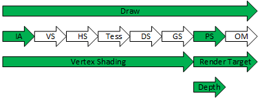

# Synchronization and barriers

| Model | Sections |
|---|---|
| Foundations | [Dependencies](#foundations), [submission and queues](#submission-scope) |
| Enhanced barriers | [Explicit model](#enhanced-barriers), [synchronization](#barrier-sync), [access](#barrier-access), [layouts](#barrier-layout), [commands](#enhanced-commands) |
| Legacy barriers | [States](#legacy-resource-states), [barrier types](#legacy-barrier-types), [promotion/decay](#legacy-promotion-and-decay), [commands](#legacy-commands) |
| Interoperation | [Model switching](#model-interoperation), [driver translation](#driver-translation) |

<a id="foundations"></a>

## Dependencies, visibility and layout

Graphics processors are designed to execute as much work in parallel as possible.  Any GPU work that depends on previous GPU work must be synchronized before accessing dependent data.

A resource dependency can require three separate operations:

1. Synchronize GPU work
2. Perform any necessary cache flush operations
3. Perform any necessary layout changes

The enhanced Barrier APIs give developers the ability to control each of these operations separately.

Synchronization orders dependent GPU work. Access transitions establish visibility for the specified resource uses; texture layout describes the representation needed for those uses. A synchronization scope, an access mask, and a layout are distinct: satisfying one does not by itself satisfy the others.

<a id="submission-scope"></a>

### Submission and queue scope

The [ExecuteCommandLists boundary](execution.md#submission-barriers) defines completion and flushing for successive submissions on the same queue. Barrier scopes within a command stream do not create an execution dependency on another queue. Cross-queue dependencies use the [queue fence contract](execution.md#fence-operations), together with compatible resource access/layout or legacy-state requirements.

<a id="enhanced-barriers"></a>

## Enhanced barriers

`D3D12_FEATURE_DATA_D3D12_OPTIONS12::EnhancedBarriersSupported` reports enhanced-barrier support. `Barrier` calls and resource creation using enhanced initial layouts require that support. The legacy `ResourceBarrier` contract remains supported independently of this optional capability.

```cpp
typedef struct D3D12_FEATURE_DATA_D3D12_OPTIONS12
{
    D3D12_TRI_STATE MSPrimitivesPipelineStatisticIncludesCulledPrimitives;
    BOOL EnhancedBarriersSupported;
    BOOL RelaxedFormatCastingSupported;
} D3D12_FEATURE_DATA_D3D12_OPTIONS12;
```

<a id="barrier-operations"></a>

### Barrier types

The [copy/clear/resolve/discard operation table](resource-operations.md#recording-and-access) identifies the access/layout and queue context used by each API. Its [enhanced self-copy cases](resource-operations.md#copy-self-and-alias), [in-place decompression](resource-operations.md#regional-resolve-support), and [discard initialization](resource-operations.md#discard-initialization) retain the specific synchronization conditions here; an API call is not a general implicit barrier.

Enhanced Barrier APIs provide three barrier types:

- Texture Barriers
- Buffer Barriers
- Global Barriers

#### Texture barriers

Texture Barriers control cache flush, memory layout and synchronization for texture subresources.  Texture Barriers must only be used with texture resources.  Texture barriers allow a selection of a single subresource, all subresources, or a coherent range of subresources (i.e. mip range and array range).  Texture barriers must provide a valid, non-NULL resource pointer.

#### Buffer barriers

Buffer Barriers control cache flush and synchronization for buffer resources.  Buffer Barriers must only be used with buffer resources.  Unlike textures, buffers have only a single subresource and do not have a transitionable layout.  Buffer barriers must provide a valid, non-NULL resource pointer.

`Offset` must be zero and `Size` must be either the buffer size in bytes or `UINT64_MAX`.  Note that enhanced barriers support concurrent read and write on buffers without the need for intervening barriers (see [Single-Queue Simultaneous Access](#simultaneous-access)).

The enhanced buffer barrier DDIs do not use `Offset` or `Size`.

#### Global barriers

Global barriers control cache flush and synchronization for all indicated resource access types in a single command queue.  Global Barriers have no effect on texture layout.

Since global barriers do not transition texture layout, global barriers may not be used in transitions that otherwise would require a layout change. For example, a global barrier cannot be used to transition a non-simultaneous-access texture from `D3D12_BARRIER_ACCESS_RENDER_TARGET` to `D3D12_BARRIER_ACCESS_SHADER_RESOURCE`, since that would also require a change from `D3D12_BARRIER_LAYOUT_RENDER_TARGET` to `D3D12_BARRIER_LAYOUT_SHADER_RESOURCE`.

<a id="barrier-sync"></a>

### Synchronization scopes

```cpp
typedef enum D3D12_BARRIER_SYNC
{
    D3D12_BARRIER_SYNC_NONE                                                     = 0x0,
    D3D12_BARRIER_SYNC_ALL                                                      = 0x1,
    D3D12_BARRIER_SYNC_DRAW                                                     = 0x2,
    D3D12_BARRIER_SYNC_INDEX_INPUT                                              = 0x4,
    D3D12_BARRIER_SYNC_VERTEX_SHADING                                           = 0x8,
    D3D12_BARRIER_SYNC_PIXEL_SHADING                                            = 0x10,
    D3D12_BARRIER_SYNC_DEPTH_STENCIL                                            = 0x20,
    D3D12_BARRIER_SYNC_RENDER_TARGET                                            = 0x40,
    D3D12_BARRIER_SYNC_COMPUTE_SHADING                                          = 0x80,
    D3D12_BARRIER_SYNC_RAYTRACING                                               = 0x100,
    D3D12_BARRIER_SYNC_COPY                                                     = 0x200,
    D3D12_BARRIER_SYNC_RESOLVE                                                  = 0x400,
    D3D12_BARRIER_SYNC_EXECUTE_INDIRECT                                         = 0x800,
    D3D12_BARRIER_SYNC_PREDICATION                                              = 0x800, // Aliased with SYNC_EXECUTE_INDIRECT
    D3D12_BARRIER_SYNC_ALL_SHADING                                              = 0x1000,
    D3D12_BARRIER_SYNC_NON_PIXEL_SHADING                                        = 0x2000,
    D3D12_BARRIER_SYNC_EMIT_RAYTRACING_ACCELERATION_STRUCTURE_POSTBUILD_INFO    = 0x4000,
    D3D12_BARRIER_SYNC_CLEAR_UNORDERED_ACCESS_VIEW                              = 0x8000,
    D3D12_BARRIER_SYNC_VIDEO_DECODE                                             = 0x100000,
    D3D12_BARRIER_SYNC_VIDEO_PROCESS                                            = 0x200000,
    D3D12_BARRIER_SYNC_VIDEO_ENCODE                                             = 0x400000,
    D3D12_BARRIER_SYNC_BUILD_RAYTRACING_ACCELERATION_STRUCTURE                  = 0x800000,
    D3D12_BARRIER_SYNC_COPY_RAYTRACING_ACCELERATION_STRUCTURE                   = 0x1000000,
    D3D12_BARRIER_SYNC_SPLIT                                                    = 0x80000000,
} D3D12_BARRIER_SYNC;
```

The enhanced Barrier APIs use explicit `SyncBefore` and `SyncAfter` values as bitfield masks that can describe one or more combined synchronization scopes.  A Barrier must wait for all preceding command `SyncBefore` scopes to complete before executing the barrier.  Similarly, a Barrier must block all subsequent `SyncAfter` scopes until the barrier completes.

For `D3D12_DESCRIPTOR_RANGE_FLAG_DATA_STATIC_WHILE_SET_AT_EXECUTE` and `D3D12_ROOT_DESCRIPTOR_FLAG_DATA_STATIC_WHILE_SET_AT_EXECUTE`, the required data must be finalized before the corresponding root binding executes on the GPU. Barriers providing that guarantee precede the relevant `SetGraphicsRoot*` or `SetComputeRoot*` command, with `SyncAfter` covering `D3D12_BARRIER_SYNC_DRAW` or `D3D12_BARRIER_SYNC_COMPUTE_SHADING`, respectively.

For ordinary non-fence barriers, `SyncBefore` value of `D3D12_BARRIER_SYNC_NONE` indicates NO PRECEDING work must complete before executing the barrier.  This MUST be paired with an `AccessBefore` value of `D3D12_BARRIER_ACCESS_NO_ACCESS`.  Additionally, no preceding barriers or accesses to the related subresource are permitted in the same `ExecuteCommandLists` scope. Likewise, a `SyncAfter` value of `D3D12_BARRIER_SYNC_NONE` indicates NO SUBSEQUENT work must wait for the barrier to complete, and MUST be paired with an `AccessAfter` value of `D3D12_BARRIER_ACCESS_NO_ACCESS`.  Additionally, no subsequent barriers or accesses to the related subresource are permitted in the same `ExecuteCommandLists` scope.

A [`SignalBarrier`](fence-barriers.md#signal-barrier) may use `SyncAfter = D3D12_BARRIER_SYNC_NONE` with any `AccessAfter` value to initiate a split barrier. A dependent [`WaitBarrier`](fence-barriers.md#wait-barrier) provides the necessary synchronization to allow subsequent access.

#### Aggregate scopes

Aggregate synchronization scopes supersede one or more other synchronization scopes, and can effectively be treated as though all of the superseded scope bits are set.  For example, the `D3D12_BARRIER_SYNC_DRAW` scope supersedes `D3D12_BARRIER_SYNC_INDEX_INPUT`, `D3D12_BARRIER_SYNC_VERTEX_SHADING`, `D3D12_BARRIER_SYNC_PIXEL_SHADING`, `D3D12_BARRIER_SYNC_DEPTH_STENCIL`, and `D3D12_BARRIER_SYNC_RENDER_TARGET` (see *Figure 2*).



*Figure 2*

The following tables list superseded synchronization scope bits for each aggregate synchronization scope bit.

| `D3D12_BARRIER_SYNC_ALL`                         |
|--------------------------------------------------|
| `D3D12_BARRIER_SYNC_DRAW`                        |
| `D3D12_BARRIER_SYNC_INDEX_INPUT`                 |
| `D3D12_BARRIER_SYNC_VERTEX_SHADING`              |
| `D3D12_BARRIER_SYNC_PIXEL_SHADING`               |
| `D3D12_BARRIER_SYNC_DEPTH_STENCIL`               |
| `D3D12_BARRIER_SYNC_RENDER_TARGET`               |
| `D3D12_BARRIER_SYNC_COMPUTE_SHADING`             |
| `D3D12_BARRIER_SYNC_RAYTRACING`                  |
| `D3D12_BARRIER_SYNC_COPY`                        |
| `D3D12_BARRIER_SYNC_RESOLVE`                     |
| `D3D12_BARRIER_SYNC_EXECUTE_INDIRECT`            |
| `D3D12_BARRIER_SYNC_PREDICATION`                 |
| `D3D12_BARRIER_SYNC_VIDEO_DECODE`                |
| `D3D12_BARRIER_SYNC_VIDEO_PROCESS`               |
| `D3D12_BARRIER_SYNC_VIDEO_ENCODE`                |
| `D3D12_BARRIER_SYNC_CLEAR_UNORDERED_ACCESS_VIEW` |
| `D3D12_BARRIER_SYNC_BUILD_RAYTRACING_ACCELERATION_STRUCTURE` |
| `D3D12_BARRIER_SYNC_COPY_RAYTRACING_ACCELERATION_STRUCTURE` |
| `D3D12_BARRIER_SYNC_EMIT_RAYTRACING_ACCELERATION_STRUCTURE_POSTBUILD_INFO` |

| `D3D12_BARRIER_SYNC_DRAW`           |
|-------------------------------------|
| `D3D12_BARRIER_SYNC_INDEX_INPUT`    |
| `D3D12_BARRIER_SYNC_VERTEX_SHADING` |
| `D3D12_BARRIER_SYNC_PIXEL_SHADING`  |
| `D3D12_BARRIER_SYNC_DEPTH_STENCIL`  |
| `D3D12_BARRIER_SYNC_RENDER_TARGET`  |

| `D3D12_BARRIER_SYNC_ALL_SHADING`     |
|--------------------------------------|
| `D3D12_BARRIER_SYNC_VERTEX_SHADING`  |
| `D3D12_BARRIER_SYNC_PIXEL_SHADING`   |
| `D3D12_BARRIER_SYNC_COMPUTE_SHADING` |
| `D3D12_BARRIER_SYNC_RAYTRACING` |

| `D3D12_BARRIER_SYNC_NON_PIXEL_SHADING` |
|----------------------------------------|
| `D3D12_BARRIER_SYNC_VERTEX_SHADING`    |
| `D3D12_BARRIER_SYNC_COMPUTE_SHADING`   |

#### Sequential barriers

Any barrier subsequent to another barrier on the same subresource in the same `ExecuteCommandLists` scope must use a `SyncBefore` value that fully-contains the preceding barrier `SyncAfter` scope bits.

To provide well-defined barrier ordering, sequential, adjacent barriers on the same subresource with no intervening commands behave as though all `SyncBefore` and `SyncAfter` bits are bitwise combined.

#### Scope meanings

##### D3D12_BARRIER_SYNC_ALL

A `SyncBefore` value of `D3D12_BARRIER_SYNC_ALL` indicates ALL PRECEDING work must complete before executing the barrier.  A `SyncAfter` value of `D3D12_BARRIER_SYNC_ALL` indicates ALL SUBSEQUENT work must wait for the barrier to complete.

##### D3D12_BARRIER_SYNC_DRAW

Synchronize against the following GPU workloads:

- `DrawInstanced`
- `DrawIndexedInstanced`
- `SetGraphicsRootDescriptorTable`
- `SetGraphicsRootShaderResourceView`
- `SetGraphicsRootUnorderedAccessView`
- `SetGraphicsRootConstantBufferView`

The `SetGraphicsRoot*` synchronization is required to support `D3D12_DESCRIPTOR_RANGE_FLAG_DATA_STATIC_WHILE_SET_AT_EXECUTE` descriptors.

This is an aggregate scope for all Draw pipeline stages. A `SyncBefore` value of `D3D12_BARRIER_SYNC_DRAW` indicates ALL PRECEDING Draw work must complete before executing the barrier.  A `SyncAfter` value of `D3D12_BARRIER_SYNC_DRAW` indicates ALL SUBSEQUENT Draw work must wait for the barrier to complete.

##### D3D12_BARRIER_SYNC_INDEX_INPUT

This scope synchronizes processing index buffer input.

##### D3D12_BARRIER_SYNC_VERTEX_SHADING

This scope synchronizes all vertex shading stages, including vertex, domain, hull, tessellation, geometry, amplification and mesh shading.

##### D3D12_BARRIER_SYNC_PIXEL_SHADING

This scope synchronizes pixel shader execution.

##### D3D12_BARRIER_SYNC_DEPTH_STENCIL

This scope synchronizes depth/stencil read/write operations. This includes DSV accesses during `Draw*` and `ClearDepthStencilView`.

##### D3D12_BARRIER_SYNC_RENDER_TARGET

This scope synchronizes render target read/write operations. This includes RTV writes during `Draw*` and `ClearRenderTargetView`.

##### D3D12_BARRIER_SYNC_COMPUTE_SHADING

This scope synchronizes the following GPU workloads:

- `Dispatch`
- `SetComputeRootDescriptorTable`
- `SetComputeRootShaderResourceView`
- `SetComputeRootUnorderedAccessView`
- `SetComputeRootConstantBufferView`

The `SetComputeRoot*` synchronization is required to support `D3D12_DESCRIPTOR_RANGE_FLAG_DATA_STATIC_WHILE_SET_AT_EXECUTE` descriptors.

##### D3D12_BARRIER_SYNC_RAYTRACING

This scope synchronizes raytracing execution.

##### D3D12_BARRIER_SYNC_COPY

This scope synchronizes Copy commands.

##### D3D12_BARRIER_SYNC_RESOLVE

This scope synchronizes Resolve commands.

##### D3D12_BARRIER_SYNC_EXECUTE_INDIRECT

This scope synchronizes ExecuteIndirect execution.

##### D3D12_BARRIER_SYNC_ALL_SHADING

This scope synchronizes ALL shader execution.

##### D3D12_BARRIER_SYNC_NON_PIXEL_SHADING

This scope synchronizes vertex and compute shading.  It exists for compatibility with legacy `ResourceBarrier` API.

##### D3D12_BARRIER_SYNC_VIDEO_DECODE

This scope synchronizes Video Decode execution.

##### D3D12_BARRIER_SYNC_VIDEO_PROCESS

This scope synchronizes Video Process execution.

##### D3D12_BARRIER_SYNC_VIDEO_ENCODE

This scope synchronizes Video Encode execution.

##### D3D12_BARRIER_SYNC_BUILD_RAYTRACING_ACCELERATION_STRUCTURE

This scope synchronizes `ID3D12GraphicsCommandList4::BuildRaytracingAccelerationStructure` work.

##### D3D12_BARRIER_SYNC_COPY_RAYTRACING_ACCELERATION_STRUCTURE

This scope synchronizes `ID3D12GraphicsCommandList4::CopyRaytracingAccelerationStructure` work.

##### D3D12_BARRIER_SYNC_CLEAR_UNORDERED_ACCESS_VIEW

This scope synchronizes `ID3D12GraphicsCommandList::ClearUnorderedAccessViewUint` and `ID3D12GraphicsCommandList::ClearUnorderedAccessViewFloat`.

##### D3D12_BARRIER_SYNC_PREDICATION

`D3D12_BARRIER_SYNC_PREDICATION` aliases `D3D12_BARRIER_SYNC_EXECUTE_INDIRECT`.

##### D3D12_BARRIER_SYNC_EMIT_RAYTRACING_ACCELERATION_STRUCTURE_POSTBUILD_INFO

This scope synchronizes raytracing acceleration-structure postbuild-info emission. Its access combinations are defined by [access/synchronization compatibility](#access-sync-compatibility).

#### Operation-specific contracts

Command list processing does not proceed further until all records in the `DispatchGraph()` call have been submitted.  The GPU may still be executing the submitted work (and even work submitted beforehand) as subsequent commands on the command list are processed.  If an app wants to force completion a UAV barrier must be used (effectively a wait-for-idle) or other more nuanced synchronization mechanism must be used if available.

It is invalid for command lists that reference the same work graph backing memory to be submitted to multiple device queues such that they might run in parallel.  Behavior is undefined in this case.

The work-graph completion and [backing-memory restrictions](state-objects.md#backing-memory) are additional operation contracts; merely submitting its input records does not prove execution completion. [Acceleration-structure writes/reads](../Raytracing.md#synchronizing-acceleration-structure-memory-writesreads) use the fixed-resource and UAV-equivalence rules below. Mesh/amplification shading belongs to the vertex-shading scope; listing ordinary draw entry points does not exclude the [mesh dispatch operation](amplification-and-mesh-shaders.md#dispatchmesh). These references concern D3D12 operation/memory contracts, not shader-language barrier instructions. [Graph dispatch inputs](work-graphs.md#dispatch-inputs) define GPU description and record reads; [record completion and UAV handoff](work-graphs.md#producer---consumer-dataflow-through-uavs) defines the separate published graph-specific shader contract.

[Motion estimation and vector resolution](video-motion-estimation.md#motion-model) read current/reference pictures with VIDEO_ENCODE_READ and write the resolved texture with VIDEO_ENCODE_WRITE on the legacy path; the enhanced encode barrier contracts define access/layout and queue compatibility. Opaque motion-vector heaps are not ID3D12Resource barrier targets. Estimator reuse across queues additionally obeys its [object-specific exclusion](video-motion-estimation.md#motion-driver-objects).

Video extension [resource parameters](video-extension-commands.md#extension-resources) declare reads/writes for the reported decode, process or encode family. The named access/layout and queue requirements remain common; command-specific aliasing, simultaneous access, CPU resource use and additional dependencies are not inferred from the generic parameter flags.

Encoding contributes [input/read and reconstruction/bitstream/metadata-write uses](video-encoding.md#encoding-recording), [GPU input-map resolve-before-encode dependencies](video-encoding-controls.md#family-texture-qpmap-dirtymap-motionvectors), [subregion fence signals with completed byte intervals](video-encoding-controls.md#source-s04-009), and [external downscale/mirrored-DPB dependencies](video-encoding-controls.md#family-lowerresolution-2pass). Early subregion availability is not whole-frame completion or availability of AV1 post-encode header values; no general memory model is inferred from these selected workload contracts.

<a id="barrier-access"></a>

### Access masks and visibility

```cpp
enum D3D12_BARRIER_ACCESS
{
    D3D12_BARRIER_ACCESS_COMMON                                     = 0,
    D3D12_BARRIER_ACCESS_VERTEX_BUFFER                              = 0x1,
    D3D12_BARRIER_ACCESS_CONSTANT_BUFFER                            = 0x2,
    D3D12_BARRIER_ACCESS_INDEX_BUFFER                               = 0x4,
    D3D12_BARRIER_ACCESS_RENDER_TARGET                              = 0x8,
    D3D12_BARRIER_ACCESS_UNORDERED_ACCESS                           = 0x10,
    D3D12_BARRIER_ACCESS_DEPTH_STENCIL_WRITE                        = 0x20,
    D3D12_BARRIER_ACCESS_DEPTH_STENCIL_READ                         = 0x40,
    D3D12_BARRIER_ACCESS_SHADER_RESOURCE                            = 0x80,
    D3D12_BARRIER_ACCESS_STREAM_OUTPUT                              = 0x100,
    D3D12_BARRIER_ACCESS_INDIRECT_ARGUMENT                          = 0x200,
    D3D12_BARRIER_ACCESS_PREDICATION                                = 0x200, // Aliased with ACCESS_INDIRECT_ARGUMENT
    D3D12_BARRIER_ACCESS_COPY_DEST                                  = 0x400,
    D3D12_BARRIER_ACCESS_COPY_SOURCE                                = 0x800,
    D3D12_BARRIER_ACCESS_RESOLVE_DEST                               = 0x1000,
    D3D12_BARRIER_ACCESS_RESOLVE_SOURCE                             = 0x2000,
    D3D12_BARRIER_ACCESS_RAYTRACING_ACCELERATION_STRUCTURE_READ     = 0x4000,
    D3D12_BARRIER_ACCESS_RAYTRACING_ACCELERATION_STRUCTURE_WRITE    = 0x8000,
    D3D12_BARRIER_ACCESS_SHADING_RATE_SOURCE                        = 0x10000,
    D3D12_BARRIER_ACCESS_VIDEO_DECODE_READ                          = 0x20000,
    D3D12_BARRIER_ACCESS_VIDEO_DECODE_WRITE                         = 0x40000,
    D3D12_BARRIER_ACCESS_VIDEO_PROCESS_READ                         = 0x80000,
    D3D12_BARRIER_ACCESS_VIDEO_PROCESS_WRITE                        = 0x100000,
    D3D12_BARRIER_ACCESS_VIDEO_ENCODE_READ                          = 0x200000,
    D3D12_BARRIER_ACCESS_VIDEO_ENCODE_WRITE                         = 0x400000,
    D3D12_BARRIER_ACCESS_GLOBAL                                     = 0x40000000,
    D3D12_BARRIER_ACCESS_NO_ACCESS                                  = 0x80000000
};
```

Since many GPU-write operations are cached, any Barrier from a write access to another write access or a read-only access may require a cache flush.  The enhanced Barrier APIs use access transitions to indicate that a subresource's memory needs to be made visible for a specific new access type.  Like the layout transitions, some access transitions may not be needed if it is known that the memory of the associated subresource is already accessible for the desired use.

Barrier `AccessBefore` and/or `AccessAfter` values may be a bitwise-or combination of `D3D12_BARRIER_ACCESS` bits when more than one access type applies before or after the barrier.

Access transitions for textures are expressed as part of the `D3D12_TEXTURE_BARRIER` structure data.  Access transitions for buffers are expressed using the `D3D12_BUFFER_BARRIER` structure.

Access transitions do not perform synchronization.  It is expected that synchronization between dependent accesses is handled using appropriate `SyncBefore` and `SyncAfter` values in the barrier.

An `AccessBefore` made visible to a specified `AccessAfter` DOES NOT guarantee that the resource memory is also visible for a *different* access type.  For example:

```c++
MyTexBarrier.AccessBefore=D3D12_BARRIER_ACCESS_UNORDERED_ACCESS;
MyTexBarrier.AccessAfter=D3D12_BARRIER_ACCESS_SHADER_RESOURCE|D3D12_BARRIER_ACCESS_COPY_SOURCE;
```

This access transition indicates that subsequent shader-resource and copy-source accesses depend on a preceding unordered-access-write. However, this may not actually flush the UAV cache if the hardware is capable of reading shader-resource and copy-source data directly from the UAV cache.

`D3D12_BARRIER_ACCESS_COMMON` is a special access type that indicates any layout-compatible access. Transitioning to `D3D12_BARRIER_ACCESS_COMMON` means that subresource data must be available for any layout-compatible access after a barrier. Since buffers have no layout, `D3D12_BARRIER_ACCESS_COMMON` simply means any buffer-compatible access.

Specifying `D3D12_BARRIER_ACCESS_COMMON` as `AccessBefore` in a barrier implies the set of all write-access types. Using `D3D12_BARRIER_ACCESS_COMMON` as `AccessBefore` is strongly discouraged since this could result in costly, unintended cache flushes. Instead, developers are encouraged to use only the most narrowly required write-access bits to properly constrain barrier overhead. A debug layer warning is issued when `AccessBefore` is set to `D3D12_BARRIER_ACCESS_COMMON`.

<a id="access-common"></a>

#### COMMON access

`D3D12_BARRIER_ACCESS_COMMON` is the default initial access for all resources in a given `ExecuteCommandLists` scope.  It supports any type of access compatible with current layout and resource properties, including no-more than one write access.  For buffers and textures using `D3D12_BARRIER_LAYOUT_COMMON`, `D3D12_BARRIER_ACCESS_COMMON` supports concurrent read and write accesses.

When used as `AccessAfter`, `D3D12_BARRIER_ACCESS_COMMON` may be used to return a resource back to common accessibility.  Note, this may force unnecessary cache flushes if used incorrectly.  When possible, `AccessAfter` should be limited to explicit access bits.

App developers should avoid using `D3D12_BARRIER_ACCESS_COMMON` as a barrier `AccessBefore` value. Any read-after-write or write-after-write hazards are best handled using explicit `AccessBefore` bits.

#### NO_ACCESS

A resource is either not accessed before/after the barrier in the same `ExecuteCommandLists` context, or the data is no longer needed. `D3D12_BARRIER_ACCESS_NO_ACCESS` may not be combined with other access bits.

Using `AccessBefore=D3D12_BARRIER_ACCESS_NO_ACCESS` with `SyncBefore=D3D12_BARRIER_SYNC_NONE` implies that a subresource was not accessed before the barrier in the current `ExecuteCommandLists` scope. Likewise, using `AccessAfter=D3D12_BARRIER_ACCESS_NO_ACCESS` with `SyncAfter=D3D12_BARRIER_SYNC_NONE` implies that a subresource is not accessed after the barrier in the same `ExecuteCommandLists` scope. This is useful for initiating a layout transition as the final act on a resource before the end of an `ExecuteCommandLists` scope.

Barriers used for aliased resource transitions can set `AccessBefore` or `AccessAfter` to `D3D12_BARRIER_ACCESS_NO_ACCESS` to indicate that aliased subresources do not share data across synchronization boundaries. This can help avoid unnecessary cache flushes and layout transitions.

This value is useful in aliasing barriers when subresource is not needed for a sufficiently long time that it makes sense to purge the subresource from any read cache.

`D3D12_BARRIER_ACCESS_GLOBAL` is defined by the [fence-barrier external-dependency contract](fence-barriers.md#global-access-legality); it is not valid in an ordinary `Barrier` call. `COMMON` is zero-valued general accessibility, whereas `NO_ACCESS` is an explicit no-access value and cannot be combined with other access bits.

#### Access meanings

##### D3D12_BARRIER_ACCESS_VERTEX_BUFFER

Indicates a buffer resource is accessible as a vertex buffer in the current execution queue. Vertex buffer accesses occur only in `D3D12_BARRIER_SYNC_VERTEX_SHADING` scope.

##### D3D12_BARRIER_ACCESS_CONSTANT_BUFFER

Indicates a buffer resource is accessible as a constant buffer in the current execution queue.

##### D3D12_BARRIER_ACCESS_INDEX_BUFFER

Indicates a buffer resource is accessible as an index buffer in the current execution queue. Index buffer accesses occur only in `D3D12_BARRIER_SYNC_INDEX_INPUT` scope.

##### D3D12_BARRIER_ACCESS_RENDER_TARGET

Indicates a resource is accessible as a render target.

##### D3D12_BARRIER_ACCESS_UNORDERED_ACCESS

Indicates a resource is accessible as an unordered access resource.

##### D3D12_BARRIER_ACCESS_DEPTH_STENCIL_WRITE

Indicates a resource is accessible as a writable depth/stencil resource.

##### D3D12_BARRIER_ACCESS_DEPTH_STENCIL_READ

Indicates a resource is accessible as a read-only depth/stencil resource.

##### D3D12_BARRIER_ACCESS_SHADER_RESOURCE

Indicates a resource is accessible as a shader resource.

##### D3D12_BARRIER_ACCESS_STREAM_OUTPUT

Indicates a buffer is accessible as a stream output target.

##### D3D12_BARRIER_ACCESS_INDIRECT_ARGUMENT

Indicates a buffer is accessible as an indirect argument buffer.

Indirect argument and count storage, producer writes and enhanced/legacy consumer access are connected by [argument initialization and synchronization](indirect-execution.md#argument-initialization). [ExecuteIndirect](indirect-execution.md#executeindirect) defines the record/count interpretation; it does not replace the dependency rules here.

##### D3D12_BARRIER_ACCESS_PREDICATION

Indicates a buffer is accessible as a predication buffer.

##### D3D12_BARRIER_ACCESS_COPY_DEST

Indicates a resource is accessible as a copy destination.

##### D3D12_BARRIER_ACCESS_COPY_SOURCE

Indicates a resource is accessible as a copy source.

##### D3D12_BARRIER_ACCESS_RESOLVE_DEST

Indicates a resource is accessible as a resolve destination.

##### D3D12_BARRIER_ACCESS_RESOLVE_SOURCE

Indicates a resource is accessible as a resolve source.

##### D3D12_BARRIER_ACCESS_RAYTRACING_ACCELERATION_STRUCTURE_READ

Indicates a resource is accessible for read as a raytracing acceleration structure.  The resource must be an acceleration-structure buffer as defined by the [creation contract](resources.md#versioned-creation).

##### D3D12_BARRIER_ACCESS_RAYTRACING_ACCELERATION_STRUCTURE_WRITE

Indicates a resource is accessible for write as a raytracing acceleration structure.  The resource must be an acceleration-structure buffer as defined by the [creation contract](resources.md#versioned-creation).

##### D3D12_BARRIER_ACCESS_SHADING_RATE_SOURCE

Indicates a resource is accessible as a shading rate source.

##### D3D12_BARRIER_ACCESS_VIDEO_DECODE_READ

Indicates a resource is accessible for read-only access in a video decode queue.

##### D3D12_BARRIER_ACCESS_VIDEO_DECODE_WRITE

Indicates a resource is accessible for write access in a video decode queue.

##### D3D12_BARRIER_ACCESS_VIDEO_PROCESS_READ

Indicates a resource is accessible for read-only access in a video process queue.

##### D3D12_BARRIER_ACCESS_VIDEO_PROCESS_WRITE

Indicates a resource is accessible for write access in a video process queue.

##### D3D12_BARRIER_ACCESS_VIDEO_ENCODE_READ

Indicates a resource is accessible for read-only access in a video encode queue.

##### D3D12_BARRIER_ACCESS_VIDEO_ENCODE_WRITE

Indicates a resource is accessible for write access in a video encode queue.

[AS recording and resource-use contracts](acceleration-structures.md#recording-contexts) connect build, copy and postbuild operations to the accesses and scopes here. [Program selection and backing initialization](state-objects.md#selection) retain their operation-specific resource requirements; they do not establish a new general memory model or replace the dependency rules here.

<a id="barrier-layout"></a>

### Texture layouts

```cpp
typedef enum D3D12_BARRIER_LAYOUT
{
    D3D12_BARRIER_LAYOUT_UNDEFINED = 0xffffffff,
    D3D12_BARRIER_LAYOUT_COMMON                                             = 0,
    D3D12_BARRIER_LAYOUT_PRESENT                                            = 0,
    D3D12_BARRIER_LAYOUT_GENERIC_READ                                       = 1,
    D3D12_BARRIER_LAYOUT_RENDER_TARGET                                      = 2,
    D3D12_BARRIER_LAYOUT_UNORDERED_ACCESS                                   = 3,
    D3D12_BARRIER_LAYOUT_DEPTH_STENCIL_WRITE                                = 4,
    D3D12_BARRIER_LAYOUT_DEPTH_STENCIL_READ                                 = 5,
    D3D12_BARRIER_LAYOUT_SHADER_RESOURCE                                    = 6,
    D3D12_BARRIER_LAYOUT_COPY_SOURCE                                        = 7,
    D3D12_BARRIER_LAYOUT_COPY_DEST                                          = 8,
    D3D12_BARRIER_LAYOUT_RESOLVE_SOURCE                                     = 9,
    D3D12_BARRIER_LAYOUT_RESOLVE_DEST                                       = 10,
    D3D12_BARRIER_LAYOUT_SHADING_RATE_SOURCE                                = 11,
    D3D12_BARRIER_LAYOUT_VIDEO_DECODE_READ                                  = 12,
    D3D12_BARRIER_LAYOUT_VIDEO_DECODE_WRITE                                 = 13,
    D3D12_BARRIER_LAYOUT_VIDEO_PROCESS_READ                                 = 14,
    D3D12_BARRIER_LAYOUT_VIDEO_PROCESS_WRITE                                = 15,
    D3D12_BARRIER_LAYOUT_VIDEO_ENCODE_READ                                  = 16,
    D3D12_BARRIER_LAYOUT_VIDEO_ENCODE_WRITE                                 = 17,
    D3D12_BARRIER_LAYOUT_DIRECT_QUEUE_COMMON                                = 18,
    D3D12_BARRIER_LAYOUT_DIRECT_QUEUE_GENERIC_READ                          = 19,
    D3D12_BARRIER_LAYOUT_DIRECT_QUEUE_UNORDERED_ACCESS                      = 20,
    D3D12_BARRIER_LAYOUT_DIRECT_QUEUE_SHADER_RESOURCE                       = 21,
    D3D12_BARRIER_LAYOUT_DIRECT_QUEUE_COPY_SOURCE                           = 22,
    D3D12_BARRIER_LAYOUT_DIRECT_QUEUE_COPY_DEST                             = 23,
    D3D12_BARRIER_LAYOUT_COMPUTE_QUEUE_COMMON                               = 24,
    D3D12_BARRIER_LAYOUT_COMPUTE_QUEUE_GENERIC_READ                         = 25,
    D3D12_BARRIER_LAYOUT_COMPUTE_QUEUE_UNORDERED_ACCESS                     = 26,
    D3D12_BARRIER_LAYOUT_COMPUTE_QUEUE_SHADER_RESOURCE                      = 27,
    D3D12_BARRIER_LAYOUT_COMPUTE_QUEUE_COPY_SOURCE                          = 28,
    D3D12_BARRIER_LAYOUT_COMPUTE_QUEUE_COPY_DEST                            = 29,
    D3D12_BARRIER_LAYOUT_DIRECT_QUEUE_GENERIC_READ_COMPUTE_QUEUE_ACCESSIBLE = 31,

} D3D12_BARRIER_LAYOUT;
```

Layouts apply to texture subresources; buffers have no transitionable texture layout. The allowed uses of each named layout are specified by [layout/access compatibility](#layout-access-compatibility). Relationships to legacy resource states are defined later under [model interoperation](#model-interoperation).

#### D3D12_BARRIER_LAYOUT_UNDEFINED

Provides support for subresource layout changes where the previous layout is irrelevant or undefined.  Typically, this is used for full-subresource Clear, Discard, and Copy commands.

A layout transition with BOTH `LayoutBefore` AND `LayoutAfter` set to `D3D12_BARRIER_LAYOUT_UNDEFINED` indicates a memory-access-only barrier.  Many write operations support more than one layout (e.g. Copy operations support `D3D12_BARRIER_LAYOUT_COMMON` or `D3D12_BARRIER_LAYOUT_COPY_DEST`). A memory-access-only barrier can be used to flush writes to a texture without inadvertently changing the texture layout.

A barrier with only `LayoutBefore` OR `LayoutAfter` set to `D3D12_BARRIER_LAYOUT_UNDEFINED` must set the corresponding `AccessBefore` or `AccessAfter` value to `D3D12_BARRIER_ACCESS_NO_ACCESS`. A texture with an undefined layout clearly does not have meaningful data and thus should not require preservation of data or cache flushes. Barriers used for aliasing can take advantage of this to let the GPU discard outstanding cache writes.

When both texture layouts are `UNDEFINED`, the barrier does not change the tracked layout. Otherwise an `UNDEFINED` side requires `NO_ACCESS` on that side. For an ordinary non-`NONE`, non-`SPLIT` scope, a texture's `NO_ACCESS` side uses `UNDEFINED` layout. These forms do not waive resource, queue or metadata-initialization requirements.

#### D3D12_BARRIER_LAYOUT_COMMON

Subresources with this layout are readable in any queue type without requiring a layout change.  They are also writable as a copy dest in any queue type.

Swap Chain presentation requires the back buffer is using `D3D12_BARRIER_LAYOUT_COMMON`.

#### D3D12_BARRIER_LAYOUT_PRESENT

Alias for `D3D12_BARRIER_LAYOUT_COMMON`.

#### D3D12_BARRIER_LAYOUT_GENERIC_READ

Provides support for compatible read-only access (e.g. `SHADER_RESOURCE`, `COPY_SOURCE`).  Should only be used for textures that require multiple, concurrent read accesses since this may not be as optimal as a more specific read layout.

#### D3D12_BARRIER_LAYOUT_DIRECT_QUEUE_COMMON

Supports common (barrier free) usage on direct queues only.  May be more optimal than the more general `D3D12_BARRIER_LAYOUT_COMMON`.  Can only be used in barriers on direct queues.

Note that this cannot be used for Present.  `D3D12_BARRIER_LAYOUT_COMMON` (a.k.a `D3D12_BARRIER_LAYOUT_PRESENT`) is still the required layout for Presentation.

#### D3D12_BARRIER_LAYOUT_DIRECT_QUEUE_GENERIC_READ

Same as `D3D12_BARRIER_LAYOUT_GENERIC_READ` except with optimizations specific for direct queues. Can only be used in barriers on direct queues.

In addition, `D3D12_BARRIER_LAYOUT_DIRECT_QUEUE_GENERIC_READ` includes support for read-only depth, shading-rate source, and resolve source accesses on direct queues.

#### D3D12_BARRIER_LAYOUT_DIRECT_QUEUE_UNORDERED_ACCESS

Same as `D3D12_BARRIER_LAYOUT_UNORDERED_ACCESS` except with optimizations specific for direct queues. Can only be used in barriers on direct queues.

#### D3D12_BARRIER_LAYOUT_DIRECT_QUEUE_SHADER_RESOURCE

Same as `D3D12_BARRIER_LAYOUT_SHADER_RESOURCE` except with optimizations specific for direct queues. Can only be used in barriers on direct queues.

#### D3D12_BARRIER_LAYOUT_DIRECT_QUEUE_COPY_SOURCE

Same as `D3D12_BARRIER_LAYOUT_COPY_SOURCE` except with optimizations specific for direct queues. Can only be used in barriers on direct queues.

#### D3D12_BARRIER_LAYOUT_DIRECT_QUEUE_COPY_DEST

Same as `D3D12_BARRIER_LAYOUT_COPY_DEST` except with optimizations specific for direct queues. Can only be used in barriers on direct queues. Can prevent costly, and unnecessary decompression on some layout transitions on resources with next access in a Direct queue.

#### D3D12_BARRIER_LAYOUT_COMPUTE_QUEUE_COMMON

Supports common (barrier free) usage on compute queues only. May be more optimal than the more general `D3D12_BARRIER_LAYOUT_COMMON`. Can only be used in barriers on compute queues.

#### D3D12_BARRIER_LAYOUT_COMPUTE_QUEUE_GENERIC_READ

Same as `D3D12_BARRIER_LAYOUT_GENERIC_READ` except with optimizations specific for compute queues. Can only be used in barriers on compute queues.

#### D3D12_BARRIER_LAYOUT_COMPUTE_QUEUE_UNORDERED_ACCESS

Same as `D3D12_BARRIER_LAYOUT_UNORDERED_ACCESS` except with optimizations specific for compute queues. Can only be used in barriers on compute queues.

#### D3D12_BARRIER_LAYOUT_COMPUTE_QUEUE_SHADER_RESOURCE

Same as `D3D12_BARRIER_LAYOUT_SHADER_RESOURCE` except with optimizations specific for compute queues. Can only be used in barriers on compute queues.

#### D3D12_BARRIER_LAYOUT_COMPUTE_QUEUE_COPY_SOURCE

Same as `D3D12_BARRIER_LAYOUT_COPY_SOURCE` except with optimizations specific for compute queues. Can only be used in barriers on compute queues.

#### D3D12_BARRIER_LAYOUT_COMPUTE_QUEUE_COPY_DEST

Same as `D3D12_BARRIER_LAYOUT_COPY_DEST` except with optimizations specific for compute queues. Can only be used in barriers on compute queues.

#### D3D12_BARRIER_LAYOUT_DIRECT_QUEUE_GENERIC_READ_COMPUTE_QUEUE_ACCESSIBLE

Usable in both direct and compute command lists. Supports generic read access in all queue types that support `D3D12_BARRIER_LAYOUT_GENERIC_READ`. Additionally, supports read-only depth stencil access in direct command lists.

Although compute queues may access resources using this layout, only direct queues can transition resources into or out of `D3D12_BARRIER_LAYOUT_DIRECT_QUEUE_GENERIC_READ_COMPUTE_QUEUE_ACCESSIBLE`.

<a id="layout-transitions"></a>

### Layout transitions

Texture subresources may use different layouts for various access methods.  For example, textures are often compressed when used as a render target or depth stencil and are often uncompressed for shader read or copy commands.  Texture Barriers use `LayoutBefore` and `LayoutAfter` `D3D12_BARRIER_LAYOUT` values to describe layout transitions.

Layout transitions are only needed for textures, therefore they are expressed only in the `D3D12_TEXTURE_BARRIER` data structure.

Both `LayoutBefore` and `LayoutAfter` must be compatible with the type of queue performing the Barrier.  For example, a compute queue cannot transition a subresource into or out of `D3D12_BARRIER_LAYOUT_RENDER_TARGET`.

To provide well-defined barrier ordering, the layout of a subresource after completing a sequence of barriers is the final `LayoutAfter` in the sequence.

<a id="barrier-free-access"></a>

### Common layouts and initial access

Since there must be no pending commands or cache flush operations between `ExecuteCommandLists` boundaries, buffers MAY be initially accessed in an `ExecuteCommandLists` scope without a Barrier.  Likewise, texture subresources may also be initially accessed without a barrier under the following conditions:

- The subresource layout is compatible with the access type
- Any necessary compression metadata has been initialized

Texture subresources in layout `D3D12_BARRIER_LAYOUT_COMMON` or one of the queue-specific common layouts (e.g. `D3D12_BARRIER_LAYOUT_DIRECT_QUEUE_COMMON`), with no potentially outstanding read or write operations, MAY be accessed in an `ExecuteCommandLists` command stream without a Barrier using any of the following access types:

- `D3D12_BARRIER_ACCESS_SHADER_RESOURCE`
- `D3D12_BARRIER_ACCESS_COPY_SOURCE`
- `D3D12_BARRIER_ACCESS_COPY_DEST`

Additionally, a buffer or texture using a queue-specific common layout can use `D3D12_BARRIER_ACCESS_UNORDERED_ACCESS` without a barrier.

Buffers and Simultaneous-Access Textures (Textures created with the `D3D12_RESOURCE_FLAG_ALLOW_SIMULTANEOUS_ACCESS` flag) MAY be initially accessed in an `ExecuteCommandLists` command stream without a Barrier using any of the following access types:

- `D3D12_BARRIER_ACCESS_VERTEX_BUFFER`
- `D3D12_BARRIER_ACCESS_CONSTANT_BUFFER`
- `D3D12_BARRIER_ACCESS_INDEX_BUFFER`
- `D3D12_BARRIER_ACCESS_RENDER_TARGET`
- `D3D12_BARRIER_ACCESS_UNORDERED_ACCESS`
- `D3D12_BARRIER_ACCESS_SHADER_RESOURCE`
- `D3D12_BARRIER_ACCESS_STREAM_OUTPUT`
- `D3D12_BARRIER_ACCESS_INDIRECT_ARGUMENT`
- `D3D12_BARRIER_ACCESS_COPY_DEST`
- `D3D12_BARRIER_ACCESS_COPY_SOURCE`
- `D3D12_BARRIER_ACCESS_RESOLVE_DEST`
- `D3D12_BARRIER_ACCESS_RESOLVE_SOURCE`
- `D3D12_BARRIER_ACCESS_PREDICATION`

Subsequent accesses MAY also be made without a barrier with no more than one write access type.  However, with the exception of `D3D12_BARRIER_ACCESS_RENDER_TARGET`, barriers MUST be used to flush sequential writes to the same resource.

<a id="simultaneous-access"></a>

### Simultaneous access

The GPU is allowed to reorder commands or execute them concurrently if there are no intervening barriers. Any subresources accessed by two or more commands in the same queue without an intervening barrier or completion of an `ExecuteCommandLists` scope are potentially being accessed simultaneously. Likewise, any subresources accessed by operations in two or more concurrently running command queues are being accessed simultaneously.

D3D12 provides a `D3D12_RESOURCE_FLAG_ALLOW_SIMULTANEOUS_ACCESS` flag to declare a resource as supporting concurrent read operations along with up to one write operation without the need for an intervening barrier.

Buffers (which are implicitly simultaneous-access) and simultaneous-access textures have an immutable layout, and therefore never require a layout transition. This means that barriers are only needed to mitigate read-after-write, write-after-read, and write-after-write hazards. If a write operation is independent of a set of read operations, then there are no hazards. Unfortunately, due to how many GPUs manage resource caches, concurrent write operations to seemingly non-overlapping regions of the same subresource may still result in data corruption without a barrier. Therefore, buffers and simultaneous-access textures may be accessed by any number of read operations and up to one write operation concurrently as long as the read regions do not intersect the write regions.

Note that accessing simultaneous-access textures is generally much slower than standard texture accesses. Also note that simultaneous-access textures have some important usage limitations. For more information on this, see [`D3D12_RESOURCE_FLAGS`](resources.md#resource-flags).

### Queue-specific layouts

Some of the layout names indicate a specific queue type. For example `D3D12_BARRIER_LAYOUT_COMPUTE_QUEUE_UNORDERED_ACCESS` or `D3D12_BARRIER_LAYOUT_DIRECT_QUEUE_COPY_SOURCE`. Such layouts are useful when sequential accesses to a given texture occur on the same queue or queue type. On some hardware, costly texture decompression can be avoided if accesses on both sides of a layout transition barrier happen on the same queue type. For instance, a texture transitioning from `D3D12_BARRIER_LAYOUT_RENDER_TARGET` to `D3D12_BARRIER_LAYOUT_DIRECT_QUEUE_SHADER_RESOURCE` can be significantly faster than a transition to `D3D12_BARRIER_LAYOUT_SHADER_RESOURCE`. This is because some hardware can access the render target compressed data in SRV operations on direct queues. However, a transition to `D3D12_BARRIER_LAYOUT_SHADER_RESOURCE` necessarily implies subsequent SRV access could potentially happen in a compute queue. As such, decompression is required if the hardware compute queues cannot read render target compression data.

It is common for applications to use a single direct queue for all GPU operations. In such cases, it is strongly recommended that developers always use `D3D12_BARRIER_LAYOUT_DIRECT_QUEUE_...` layouts when available. Likewise, any barrier on a texture that is only ever used in a single queue or queue type should use queue type specific layouts.

Queue type specific layouts may only be used within a compatible command queue. For example, a compute queue cannot transition a texture into or out-of `D3D12_BARRIER_LAYOUT_DIRECT_QUEUE_UNORDERED_ACCESS`.

### Self copy

With Enhanced Barriers, a subresource with a common layout can be used as both a source and destination in the same `CopyBufferRegion` or `CopyTextureRegion` call.  Copies between intersecting `source` and `dest` memory regions produce undefined results.  The Debug Layer MUST validate against this.

<a id="barrier-groups"></a>

### Barrier structures and groups

```cpp
typedef enum D3D12_BARRIER_TYPE
{
    D3D12_BARRIER_TYPE_GLOBAL,
    D3D12_BARRIER_TYPE_TEXTURE,
    D3D12_BARRIER_TYPE_BUFFER,
} D3D12_BARRIER_TYPE;
```

<a id="d3d12_barrier_subresource_range"></a>

#### D3D12_BARRIER_SUBRESOURCE_RANGE

```cpp
typedef struct D3D12_BARRIER_SUBRESOURCE_RANGE
{
    UINT IndexOrFirstMipLevel;
    UINT NumMipLevels;
    UINT FirstArraySlice;
    UINT NumArraySlices;
    UINT FirstPlane;
    UINT NumPlanes;
} D3D12_BARRIER_SUBRESOURCE_RANGE;
```

| Members                |                                                                                                                                                                       |
|------------------------|-----------------------------------------------------------------------------------------------------------------------------------------------------------------------|
| `IndexOrFirstMipLevel` | Subresource Index (If `NumMipLevels` is zero) or index of first mip level in the range. May be `0xffffffff` if used as subresource index to specify all subresources. |
| `NumMipLevels`         | Number of mip levels in the range, or zero to indicate `IndexOrFirstMipLevel` is a subresource index.                                                                 |
| `FirstArraySlice`      | Index of first array slice in the range. Ignored if `NumMipLevels` is zero.                                                                                           |
| `NumArraySlices`       | Number of array slices in the range. Ignored if `NumMipLevels` is zero.                                                                                               |
| `FirstPlane`           | First plane slice in the range.  Ignored if `NumMipLevels` is zero.                                                                                                   |
| `NumPlanes`            | Number of plane slices in the range.  Ignored if `NumMipLevels` is zero.                                                                                              |

A selected texture subresource index must exist, unless ALL_SUBRESOURCES is used. In range form, the selected mip, array and plane intervals must remain within the resource's corresponding dimensions; ignored fields in single-index form do not create extra ranges.

Resource access must be compatible with its creation properties: texture render-target, depth/stencil and UAV accesses require the corresponding usage flags; UAV buffers require unordered-access support; acceleration-structure accesses require the acceleration-structure buffer classification. Vertex/index/constant/stream-output/indirect accesses apply only to compatible buffer resources. These conditions are independent of choosing compatible masks.

<a id="d3d12_global_barrier"></a>

#### D3D12_GLOBAL_BARRIER

```cpp
typedef struct D3D12_GLOBAL_BARRIER
{
    D3D12_BARRIER_SYNC SyncBefore;
    D3D12_BARRIER_SYNC SyncAfter;
    D3D12_BARRIER_ACCESS AccessBefore;
    D3D12_BARRIER_ACCESS AccessAfter;
} D3D12_GLOBAL_BARRIER;
```

| Member         |                                                                                                                                                                                                              |
|----------------|--------------------------------------------------------------------------------------------------------------------------------------------------------------------------------------------------------------|
| `SyncBefore`   | Synchronization scope bits of all preceding GPU work that must be completed before executing the barrier. Can be a bitwise-or combination of multiple `D3D12_BARRIER_SYNC` bits.                             |
| `SyncAfter`    | Synchronization scope bits of all subsequent GPU work that must wait until the barrier execution is finished. Can be a bitwise-or combination of multiple `D3D12_BARRIER_SYNC` bits.                         |
| `AccessBefore` | Access bits corresponding with any relevant resource usage since the preceding barrier or the start of `ExecuteCommandLists` scope. Can be a bitwise-or combination of multiple `D3D12_BARRIER_ACCESS` bits. |
| `AccessAfter`  | Access bits corresponding with any relevant resource usage after the barrier completes. Can be a bitwise-or combination of multiple `D3D12_BARRIER_ACCESS` bits.                                             |

For an ordinary global `Barrier`, `AccessBefore = D3D12_BARRIER_ACCESS_COMMON` requires `AccessAfter = D3D12_BARRIER_ACCESS_COMMON`. Global barriers do not change texture layout. The fence-barrier before/after semantics are specified separately.

<a id="d3d12_texture_barrier_flags"></a>

#### D3D12_TEXTURE_BARRIER_FLAGS

```cpp
typedef enum D3D12_TEXTURE_BARRIER_FLAGS
{
    D3D12_TEXTURE_BARRIER_FLAG_NONE = 0x0,
    D3D12_TEXTURE_BARRIER_FLAG_DISCARD = 0x1,
} D3D12_TEXTURE_BARRIER_FLAGS;
```

##### D3D12_TEXTURE_BARRIER_FLAG_DISCARD

`D3D12_TEXTURE_BARRIER_FLAG_DISCARD` can only be used when `LayoutBefore` is `D3D12_BARRIER_LAYOUT_UNDEFINED`.  Typically, this is used to initialize compression metadata as part of a barrier that activates an aliased resource.

When `D3D12_TEXTURE_BARRIER_FLAG_DISCARD` is specified, `LayoutAfter` may be any valid layout appropriate for the resource and barrier command list type.  As such, applications can discard-initialize a subresource directly into the layout needed for subsequent access, without barrier layout restriction.

<a id="d3d12_texture_barrier"></a>

#### D3D12_TEXTURE_BARRIER

```cpp
typedef struct D3D12_TEXTURE_BARRIER
{
    D3D12_BARRIER_SYNC SyncBefore;
    D3D12_BARRIER_SYNC SyncAfter;
    D3D12_BARRIER_ACCESS AccessBefore;
    D3D12_BARRIER_ACCESS AccessAfter;
    D3D12_BARRIER_LAYOUT LayoutBefore;
    D3D12_BARRIER_LAYOUT LayoutAfter;
    ID3D12Resource *pResource;
    D3D12_BARRIER_SUBRESOURCE_RANGE Subresources;
    D3D12_TEXTURE_BARRIER_FLAGS Flags;
} D3D12_TEXTURE_BARRIER;
```

| Member         |                                                                                                                                                                                                 |
|----------------|-------------------------------------------------------------------------------------------------------------------------------------------------------------------------------------------------|
| `SyncBefore`   | Synchronization scope bits of all preceding GPU work that must be completed before executing the barrier. Can be a bitwise-or combination of multiple `D3D12_BARRIER_SYNC` bits.                |
| `SyncAfter`    | Synchronization scope bits of all subsequent GPU work that must wait until the barrier execution is finished. Can be a bitwise-or combination of multiple `D3D12_BARRIER_SYNC` bits.            |
| `AccessBefore` | Access bits corresponding with resource usage since the preceding barrier or the start of `ExecuteCommandLists` scope. Can be a bitwise-or combination of multiple `D3D12_BARRIER_ACCESS` bits. |
| `AccessAfter`  | Access bits corresponding with resource usage after the barrier completes. Can be a bitwise-or combination of multiple `D3D12_BARRIER_ACCESS` bits.                                             |
| `LayoutBefore` | Layout of texture preceding the barrier execution.                                                                                                                                              |
| `LayoutAfter`  | Layout of texture upon completion of barrier execution.                                                                                                                                         |
| `pResource`    | Pointer to the texture resource used by the barrier.                                                                                                                                         |
| `Subresources` | Range of texture subresources being barriered.                                                                                                                                                  |
| `Flags`        | Optional flags values.                                                                                                                                                                          |

<a id="d3d12_buffer_barrier"></a>

#### D3D12_BUFFER_BARRIER

```cpp
typedef struct D3D12_BUFFER_BARRIER
{
    D3D12_BARRIER_SYNC SyncBefore;
    D3D12_BARRIER_SYNC SyncAfter;
    D3D12_BARRIER_ACCESS AccessBefore;
    D3D12_BARRIER_ACCESS AccessAfter;
    ID3D12Resource *pResource;
    UINT64 Offset;
    UINT64 Size;
} D3D12_BUFFER_BARRIER;
```

| Member         |                                                                                                                                                                                                 |
|----------------|-------------------------------------------------------------------------------------------------------------------------------------------------------------------------------------------------|
| `SyncBefore`   | Synchronization scope bits of all preceding GPU work that must be completed before executing the barrier. Can be a bitwise-or combination of multiple `D3D12_BARRIER_SYNC` bits.                |
| `SyncAfter`    | Synchronization scope bits of all subsequent GPU work that must wait until the barrier execution is finished. Can be a bitwise-or combination of multiple `D3D12_BARRIER_SYNC` bits.            |
| `AccessBefore` | Access bits corresponding with resource usage since the preceding barrier or the start of `ExecuteCommandLists` scope. Can be a bitwise-or combination of multiple `D3D12_BARRIER_ACCESS` bits. |
| `AccessAfter`  | Access bits corresponding with resource usage after the barrier completes. Can be a bitwise-or combination of multiple `D3D12_BARRIER_ACCESS` bits.                                             |
| `pResource`    | Pointer to the buffer resource used by the barrier.                                                                                                                                         |
| `Offset`       | Offset value must be `0`.                                                                                                                                                                       |
| `Size`         | Size must either be `UINT64_MAX` or the size of the buffer in bytes.                                                                                                                            |

<a id="d3d12_barrier_group"></a>

#### D3D12_BARRIER_GROUP

```cpp
typedef struct D3D12_BARRIER_GROUP
{
    D3D12_BARRIER_TYPE Type;
    UINT32 NumBarriers;
    union
    {
        const D3D12_GLOBAL_BARRIER *pGlobalBarriers;
        const D3D12_TEXTURE_BARRIER *pTextureBarriers;
        const D3D12_BUFFER_BARRIER *pBufferBarriers;
    };
} D3D12_BARRIER_GROUP;
```

`Type` selects the corresponding pointer in the union, and `NumBarriers` is the number of barriers in that array. `NumBarrierGroups` counts the outer array passed to the commands. Global barriers express memory-access/synchronization scopes; buffer barriers add a buffer/range, and texture barriers add texture subresources and layout transitions.

Texture and buffer barriers require non-null resources of the corresponding type. For a nonzero barrier count, the selected group array must be valid. Zero group/barrier counts produce no barrier work and may generate a diagnostic; they are not by themselves an invalid-usage rejection. Graphics command lists support these operations on direct, compute and copy lists, not bundles. The corresponding video interfaces use their own queue-type constraints.

### Barrier ordering

Barriers are queued in forward order (API-call order, barrier-group-index, barrier-array-index).  Multiple barriers on the same subresource must function as though the barriers complete in queued order.

Queued Barriers with matching `SyncAfter` scopes that potentially write to the same memory must complete all writes in queued order.  This is necessary to avoid data races on barriers that support resource aliasing.  For example a barrier that 'deactivates' a resource must flush any caches before another barrier that 'activates' a different resource on the same memory, possible clearing metadata.

Barrier calls inside render passes must obey the [render-pass dependency restrictions](#render-pass-barriers). Those restrictions constrain dependencies on writes performed inside the pass, not just the choice between enhanced and legacy encodings.

<a id="enhanced-split-barriers"></a>

### Enhanced split barriers

A split barrier separates the beginning and completion of a resource transition between two points in the command stream, even across `ExecuteCommandLists` boundaries.  Drivers may complete the required layout transitions and cache flushes any time between the start and end of a split barrier.

Enhanced Barrier APIs allow SPLIT synchronization.  Split barriers are represented by a pair of barriers where the initial barrier uses a `D3D12_BARRIER_SYNC_SPLIT` `SyncAfter` value, and the final barrier uses a `D3D12_BARRIER_SYNC_SPLIT` `SyncBefore` value.

Split barrier pairs must use identical `LayoutBefore`, `LayoutAfter`, `AccessBefore`, and `AccessAfter` values for both the initial and final barriers. Split barrier pairs must have no unrelated intervening barriers on the pending subresources.

```c++
// BEGIN split from compute shader UAV to pixel shader SRV
splitBarrierBegin.SyncBefore = D3D12_BARRIER_SYNC_COMPUTE_SHADING;
splitBarrierBegin.SyncAfter = D3D12_BARRIER_SYNC_SPLIT;
splitBarrierBegin.AccessBefore = D3D12_BARRIER_ACCESS_UNORDERED_ACCESS;
splitBarrierBegin.AccessAfter = D3D12_BARRIER_ACCESS_SHADER_RESOURCE;
splitBarrierBegin.LayoutBefore = D3D12_BARRIER_LAYOUT_UNORDERED_ACCESS;
splitBarrierBegin.LayoutAfter = D3D12_BARRIER_LAYOUT_DIRECT_QUEUE_SHADER_RESOURCE;

// END split from compute shader UAV to pixel shader SRV
splitBarrierEnd.SyncBefore = D3D12_BARRIER_SYNC_SPLIT;
splitBarrierEnd.SyncAfter = D3D12_BARRIER_SYNC_PIXEL_SHADING;
splitBarrierEnd.AccessBefore = D3D12_BARRIER_ACCESS_UNORDERED_ACCESS;
splitBarrierEnd.AccessAfter = D3D12_BARRIER_ACCESS_SHADER_RESOURCE;
splitBarrierEnd.LayoutBefore = D3D12_BARRIER_LAYOUT_UNORDERED_ACCESS;
splitBarrierEnd.LayoutAfter = D3D12_BARRIER_LAYOUT_DIRECT_QUEUE_SHADER_RESOURCE;
```

Split barriers across `ExecuteCommandLists` boundaries are allowed.  In this case all `AccessBefore` and `AccessAfter` values are effectively ignored since the `ExecuteCommandLists` boundaries take care of any cache flushing.  Essentially, cross-`ExecuteCommandLists` split barriers are layout-only barriers.  Therefore, splitting a buffer barrier or a simultaneous-access texture barrier across `ExecuteCommandLists` boundaries serves no purpose.  An unmatched BEGIN or END split barrier on a buffer or simultaneous-access texture in a given `ExecuteCommandLists` scope is effectively unused and the Debug Layer produces a warning.

The two halves identify the same resource and subresources. No intervening GPU access or unrelated barrier may use a subresource with a pending split transition. Operations on other nonpending subresources remain subject to their own dependencies.

<a id="enhanced-aliasing"></a>

### Aliasing and metadata initialization

The reserved-resource [mapping operations](resources.md#update-tile-mappings) change page backing, not resource contents. [Shared-tile compatibility and mapping-local metadata](resources.md#tiled-data-compatibility) constrain data inheritance through those mappings; the initialization and aliasing requirements here remain applicable.

The submission-boundary cases below require ordered completion: successive calls on one queue provide that boundary; independent queues still require their explicit fence dependency. Merely using separate `ExecuteCommandLists` calls on different queues is not synchronization.

Enhanced Barrier APIs do not explicitly provide native Aliasing Barrier transitions at the API-level.  Instead, enhanced Barrier APIs support the necessary synchronization, layout transitions and memory access needed for safe reuse of aliased memory.

For each "before resource":

- If needed: Wait for all accesses to complete.
  - Not needed if the access occurred in a different `ExecuteCommandLists` scope.
- If needed: Flush writes.
- If needed: Transition to layout compatible with subsequent use of the resource memory.
  - This spec does not define compatible layouts between aliased resources.
- Barriers may set `AccessAfter` to `D3D12_BARRIER_ACCESS_NO_ACCESS` to indicate the subresource is being 'deactivated'
  - On some drivers, this may reduce cache burden.
  - The subresource is inaccessible until 'activated' using a barrier with `D3D12_BARRIER_ACCESS_NO_ACCESS` set in `AccessBefore`.

For each "after resource":

- If needed: Wait for all "before resource" accesses to complete.
- If needed: Specify desired layout.
  - Use `LayoutBefore` of `D3D12_BARRIER_LAYOUT_UNDEFINED` to avoid modifying memory as part of the barrier.
- If needed: Perform a full-subresource discard using `D3D12_TEXTURE_BARRIER_FLAG_DISCARD`.
  - Must not use this flag if any of the "before resource" barriers transition layout or flush memory writes.
- If needed: Set `AccessBefore` to `D3D12_BARRIER_ACCESS_NO_ACCESS` to 'activate' a subresource previously 'deactivated' in the same `ExecuteCommandLists` scope.

Note that each of these is tagged as 'If needed'.  There are aliasing scenarios where resource aliasing can be accomplished without any barriers at all.  For example: all "before" and "after" resources are buffers (thus no layout), and accesses to all "before" resources occurred in a separate `ExecuteCommandLists` scope than all "after" resources.

Since barriers on different subresources have no guaranteed order, care must be taken to avoid combining barriers that potentially modify the same memory. This includes Layout transitions and barriers using `D3D12_TEXTURE_BARRIER_FLAG_DISCARD`.

Possible but not expected to be common: If aliased memory write flushes were needed on any "before resources", then use a separate Discard/Clear/Copy to initialize "after resource" memory rather than using the `D3D12_TEXTURE_BARRIER_FLAG_DISCARD` flag.

Newly placed or aliased texture resources may have compression metadata that requires initialization before use. This also applies to reserved textures with newly updated tile mappings.

Enhanced Barriers support an option to Discard as part of a barrier.  Barrier layout transitions from `D3D12_BARRIER_LAYOUT_UNDEFINED` to any potentially-compressed layout (e.g. `D3D12_BARRIER_LAYOUT_RENDER_TARGET`, `D3D12_BARRIER_LAYOUT_DEPTH_STENCIL_WRITE`, `D3D12_BARRIER_LAYOUT_UNORDERED_ACCESS`) MUST initialize compression metadata when `D3D12_TEXTURE_BARRIER_FLAG_DISCARD` is present in the `D3D12_TEXTURE_BARRIER::Flags` member.

In addition to render target and depth/stencil resources, there are similar UAV texture compression optimizations supported by enhanced barriers.

<a id="heap-access"></a>

### Upload and readback access

Upload Heap resources are buffers and thus have no layout.  Upload Heap resources allow only the following access types:

- `D3D12_BARRIER_ACCESS_VERTEX_BUFFER`
- `D3D12_BARRIER_ACCESS_CONSTANT_BUFFER`
- `D3D12_BARRIER_ACCESS_INDEX_BUFFER`
- `D3D12_BARRIER_ACCESS_SHADER_RESOURCE`
- `D3D12_BARRIER_ACCESS_INDIRECT_ARGUMENT`
- `D3D12_BARRIER_ACCESS_COPY_SOURCE`
- `D3D12_BARRIER_ACCESS_RESOLVE_SOURCE` [^1]

[^1]: `D3D12_BARRIER_ACCESS_RESOLVE_SOURCE` is available only on devices that support Sampler Feedback.

Readback and Upload Heap resources are buffers, and thus have no layout.

Readback Heap resources can be written to either by Copy or Resolve operations (Resolve only supported on devices that also support Sampler Feedback).  As such, Readback Heap resources may require barriers to manage write-after-write hazards.

Readback Heap resources support the following accesses:

- `D3D12_BARRIER_ACCESS_COPY_DEST`
- `D3D12_BARRIER_ACCESS_RESOLVE_DEST` [^2]

[^2]: `D3D12_BARRIER_ACCESS_RESOLVE_DEST` MUST be available on hardware that supports Sampler Feedback.

`D3D12_HEAP_TYPE_GPU_UPLOAD` is distinct from `D3D12_HEAP_TYPE_UPLOAD`. It does not inherit the preceding blanket UPLOAD-only access list or a fixed GENERIC_READ state; its resource configuration and CPU-visibility constraints are defined in [Resources and memory](resources.md#gpu-upload).

<a id="queue-compatibility"></a>

### Queue compatibility

#### Queue/layout compatibility

Resource layouts must be compatible with the queue using them. The table does not override a layout's additional transition restrictions:

`D3D12_COMMAND_LIST_TYPE_DIRECT`

- `D3D12_BARRIER_LAYOUT_COMMON`
- `D3D12_BARRIER_LAYOUT_GENERIC_READ`
- `D3D12_BARRIER_LAYOUT_RENDER_TARGET`
- `D3D12_BARRIER_LAYOUT_UNORDERED_ACCESS`
- `D3D12_BARRIER_LAYOUT_DEPTH_STENCIL_WRITE`
- `D3D12_BARRIER_LAYOUT_DEPTH_STENCIL_READ`
- `D3D12_BARRIER_LAYOUT_SHADER_RESOURCE`
- `D3D12_BARRIER_LAYOUT_COPY_SOURCE`
- `D3D12_BARRIER_LAYOUT_COPY_DEST`
- `D3D12_BARRIER_LAYOUT_RESOLVE_SOURCE`
- `D3D12_BARRIER_LAYOUT_RESOLVE_DEST`
- `D3D12_BARRIER_LAYOUT_SHADING_RATE_SOURCE`
- `D3D12_BARRIER_LAYOUT_DIRECT_QUEUE_COMMON`
- `D3D12_BARRIER_LAYOUT_DIRECT_QUEUE_GENERIC_READ`
- `D3D12_BARRIER_LAYOUT_DIRECT_QUEUE_UNORDERED_ACCESS`
- `D3D12_BARRIER_LAYOUT_DIRECT_QUEUE_SHADER_RESOURCE`
- `D3D12_BARRIER_LAYOUT_DIRECT_QUEUE_COPY_SOURCE`
- `D3D12_BARRIER_LAYOUT_DIRECT_QUEUE_COPY_DEST`
- `D3D12_BARRIER_LAYOUT_DIRECT_QUEUE_GENERIC_READ_COMPUTE_QUEUE_ACCESSIBLE`

`D3D12_COMMAND_LIST_TYPE_COMPUTE`

- `D3D12_BARRIER_LAYOUT_COMMON`
- `D3D12_BARRIER_LAYOUT_GENERIC_READ`
- `D3D12_BARRIER_LAYOUT_UNORDERED_ACCESS`
- `D3D12_BARRIER_LAYOUT_SHADER_RESOURCE`
- `D3D12_BARRIER_LAYOUT_COPY_SOURCE`
- `D3D12_BARRIER_LAYOUT_COPY_DEST`
- `D3D12_BARRIER_LAYOUT_COMPUTE_QUEUE_COMMON`
- `D3D12_BARRIER_LAYOUT_COMPUTE_QUEUE_GENERIC_READ`
- `D3D12_BARRIER_LAYOUT_COMPUTE_QUEUE_UNORDERED_ACCESS`
- `D3D12_BARRIER_LAYOUT_COMPUTE_QUEUE_SHADER_RESOURCE`
- `D3D12_BARRIER_LAYOUT_COMPUTE_QUEUE_COPY_SOURCE`
- `D3D12_BARRIER_LAYOUT_COMPUTE_QUEUE_COPY_DEST`
- `D3D12_BARRIER_LAYOUT_DIRECT_QUEUE_GENERIC_READ_COMPUTE_QUEUE_ACCESSIBLE`

`D3D12_COMMAND_LIST_TYPE_COPY`

- `D3D12_BARRIER_LAYOUT_COMMON`

`D3D12_COMMAND_LIST_TYPE_VIDEO_DECODE`

- `D3D12_BARRIER_LAYOUT_COMMON`
- `D3D12_BARRIER_LAYOUT_VIDEO_DECODE_READ`
- `D3D12_BARRIER_LAYOUT_VIDEO_DECODE_WRITE`

`D3D12_COMMAND_LIST_TYPE_VIDEO_PROCESS`

- `D3D12_BARRIER_LAYOUT_COMMON`
- `D3D12_BARRIER_LAYOUT_VIDEO_PROCESS_READ`
- `D3D12_BARRIER_LAYOUT_VIDEO_PROCESS_WRITE`

`D3D12_COMMAND_LIST_TYPE_VIDEO_ENCODE`

- `D3D12_BARRIER_LAYOUT_COMMON`
- `D3D12_BARRIER_LAYOUT_VIDEO_ENCODE_READ`
- `D3D12_BARRIER_LAYOUT_VIDEO_ENCODE_WRITE`

Compute queues may use `D3D12_BARRIER_LAYOUT_DIRECT_QUEUE_GENERIC_READ_COMPUTE_QUEUE_ACCESSIBLE` without changing it (`LayoutBefore == LayoutAfter`). Only direct queues may transition a texture into or out of that layout. Compute-compatible access masks still apply.

#### Queue/access compatibility

Resource Accesses MUST be compatible with the type of Queue accessing the resource:

`D3D12_COMMAND_LIST_TYPE_DIRECT`

- `D3D12_BARRIER_ACCESS_VERTEX_BUFFER`
- `D3D12_BARRIER_ACCESS_CONSTANT_BUFFER`
- `D3D12_BARRIER_ACCESS_INDEX_BUFFER`
- `D3D12_BARRIER_ACCESS_RENDER_TARGET`
- `D3D12_BARRIER_ACCESS_UNORDERED_ACCESS`
- `D3D12_BARRIER_ACCESS_DEPTH_STENCIL_WRITE`
- `D3D12_BARRIER_ACCESS_DEPTH_STENCIL_READ`
- `D3D12_BARRIER_ACCESS_SHADER_RESOURCE`
- `D3D12_BARRIER_ACCESS_STREAM_OUTPUT`
- `D3D12_BARRIER_ACCESS_INDIRECT_ARGUMENT`
- `D3D12_BARRIER_ACCESS_COPY_DEST`
- `D3D12_BARRIER_ACCESS_COPY_SOURCE`
- `D3D12_BARRIER_ACCESS_RESOLVE_DEST`
- `D3D12_BARRIER_ACCESS_RESOLVE_SOURCE`
- `D3D12_BARRIER_ACCESS_RAYTRACING_ACCELERATION_STRUCTURE_READ`
- `D3D12_BARRIER_ACCESS_RAYTRACING_ACCELERATION_STRUCTURE_WRITE`
- `D3D12_BARRIER_ACCESS_SHADING_RATE_SOURCE`
- `D3D12_BARRIER_ACCESS_PREDICATION`

`D3D12_COMMAND_LIST_TYPE_COMPUTE`

- `D3D12_BARRIER_ACCESS_CONSTANT_BUFFER`
- `D3D12_BARRIER_ACCESS_UNORDERED_ACCESS`
- `D3D12_BARRIER_ACCESS_SHADER_RESOURCE`
- `D3D12_BARRIER_ACCESS_INDIRECT_ARGUMENT`
- `D3D12_BARRIER_ACCESS_COPY_DEST`
- `D3D12_BARRIER_ACCESS_COPY_SOURCE`
- `D3D12_BARRIER_ACCESS_RAYTRACING_ACCELERATION_STRUCTURE_READ`
- `D3D12_BARRIER_ACCESS_RAYTRACING_ACCELERATION_STRUCTURE_WRITE`
- `D3D12_BARRIER_ACCESS_PREDICATION`

`D3D12_COMMAND_LIST_TYPE_COPY`

- `D3D12_BARRIER_ACCESS_COPY_DEST`
- `D3D12_BARRIER_ACCESS_COPY_SOURCE`

`D3D12_COMMAND_LIST_TYPE_VIDEO_DECODE`

- `D3D12_BARRIER_ACCESS_VIDEO_DECODE_READ`
- `D3D12_BARRIER_ACCESS_VIDEO_DECODE_WRITE`
- `D3D12_BARRIER_ACCESS_COPY_DEST` for supported `WriteBufferImmediate`
- `D3D12_BARRIER_ACCESS_PREDICATION` for the corresponding `SetPredication` operation

`D3D12_COMMAND_LIST_TYPE_VIDEO_PROCESS`

- `D3D12_BARRIER_ACCESS_VIDEO_PROCESS_READ`
- `D3D12_BARRIER_ACCESS_VIDEO_PROCESS_WRITE`
- `D3D12_BARRIER_ACCESS_COPY_DEST` for supported `WriteBufferImmediate`
- `D3D12_BARRIER_ACCESS_PREDICATION` for the corresponding `SetPredication` operation

`D3D12_COMMAND_LIST_TYPE_VIDEO_ENCODE`

- `D3D12_BARRIER_ACCESS_VIDEO_ENCODE_READ`
- `D3D12_BARRIER_ACCESS_VIDEO_ENCODE_WRITE`
- `D3D12_BARRIER_ACCESS_COPY_DEST` for supported `WriteBufferImmediate`
- `D3D12_BARRIER_ACCESS_PREDICATION` for the corresponding `SetPredication` operation


#### Queue/synchronization compatibility

`D3D12_COMMAND_LIST_TYPE_DIRECT`

- `D3D12_BARRIER_SYNC_ALL`
- `D3D12_BARRIER_SYNC_DRAW`
- `D3D12_BARRIER_SYNC_INDEX_INPUT`
- `D3D12_BARRIER_SYNC_VERTEX_SHADING`
- `D3D12_BARRIER_SYNC_PIXEL_SHADING`
- `D3D12_BARRIER_SYNC_DEPTH_STENCIL`
- `D3D12_BARRIER_SYNC_RENDER_TARGET`
- `D3D12_BARRIER_SYNC_COMPUTE_SHADING`
- `D3D12_BARRIER_SYNC_RAYTRACING`
- `D3D12_BARRIER_SYNC_COPY`
- `D3D12_BARRIER_SYNC_RESOLVE`
- `D3D12_BARRIER_SYNC_EXECUTE_INDIRECT`
- `D3D12_BARRIER_SYNC_PREDICATION`
- `D3D12_BARRIER_SYNC_ALL_SHADING`
- `D3D12_BARRIER_SYNC_NON_PIXEL_SHADING`
- `D3D12_BARRIER_SYNC_BUILD_RAYTRACING_ACCELERATION_STRUCTURE`
- `D3D12_BARRIER_SYNC_COPY_RAYTRACING_ACCELERATION_STRUCTURE`
- `D3D12_BARRIER_SYNC_EMIT_RAYTRACING_ACCELERATION_STRUCTURE_POSTBUILD_INFO`
- `D3D12_BARRIER_SYNC_CLEAR_UNORDERED_ACCESS_VIEW`
- `D3D12_BARRIER_SYNC_SPLIT`

`D3D12_COMMAND_LIST_TYPE_COMPUTE`

- `D3D12_BARRIER_SYNC_ALL`
- `D3D12_BARRIER_SYNC_COMPUTE_SHADING`
- `D3D12_BARRIER_SYNC_RAYTRACING`
- `D3D12_BARRIER_SYNC_COPY`
- `D3D12_BARRIER_SYNC_EXECUTE_INDIRECT`
- `D3D12_BARRIER_SYNC_ALL_SHADING`
- `D3D12_BARRIER_SYNC_NON_PIXEL_SHADING`
- `D3D12_BARRIER_SYNC_BUILD_RAYTRACING_ACCELERATION_STRUCTURE`
- `D3D12_BARRIER_SYNC_COPY_RAYTRACING_ACCELERATION_STRUCTURE`
- `D3D12_BARRIER_SYNC_EMIT_RAYTRACING_ACCELERATION_STRUCTURE_POSTBUILD_INFO`
- `D3D12_BARRIER_SYNC_CLEAR_UNORDERED_ACCESS_VIEW`
- `D3D12_BARRIER_SYNC_SPLIT`

`D3D12_COMMAND_LIST_TYPE_COPY`

- `D3D12_BARRIER_SYNC_ALL`
- `D3D12_BARRIER_SYNC_COPY`
- `D3D12_BARRIER_SYNC_SPLIT`

`D3D12_COMMAND_LIST_TYPE_VIDEO_DECODE`

- `D3D12_BARRIER_SYNC_ALL`
- `D3D12_BARRIER_SYNC_VIDEO_DECODE`
- `D3D12_BARRIER_SYNC_SPLIT`
- `D3D12_BARRIER_SYNC_COPY` for supported `WriteBufferImmediate`
- `D3D12_BARRIER_SYNC_PREDICATION` for the corresponding `SetPredication` operation

`D3D12_COMMAND_LIST_TYPE_VIDEO_PROCESS`

- `D3D12_BARRIER_SYNC_ALL`
- `D3D12_BARRIER_SYNC_VIDEO_PROCESS`
- `D3D12_BARRIER_SYNC_SPLIT`
- `D3D12_BARRIER_SYNC_COPY` for supported `WriteBufferImmediate`
- `D3D12_BARRIER_SYNC_PREDICATION` for the corresponding `SetPredication` operation

`D3D12_COMMAND_LIST_TYPE_VIDEO_ENCODE`

- `D3D12_BARRIER_SYNC_ALL`
- `D3D12_BARRIER_SYNC_VIDEO_ENCODE`
- `D3D12_BARRIER_SYNC_SPLIT`
- `D3D12_BARRIER_SYNC_COPY` for supported `WriteBufferImmediate`
- `D3D12_BARRIER_SYNC_PREDICATION` for the corresponding `SetPredication` operation


Immediate writes can be optionally supported on video command queues. All other command queues must support WriteBufferImmediate. Immediate writes must be supported on both direct and bundle command lists.

For a video command-list type that supports `WriteBufferImmediate`, as reported by `D3D12_FEATURE_DATA_D3D12_OPTIONS3::WriteBufferImmediateSupportFlags`, its destination-buffer access uses `D3D12_BARRIER_ACCESS_COPY_DEST` and `D3D12_BARRIER_SYNC_COPY`. This does not enable general texture/buffer copy methods on a video command list. The corresponding video `SetPredication` method uses the predication access/scope; an alias bit does not enable `ExecuteIndirect` on a video list.

The full [immediate-write API, modes and recording contract](resource-operations.md#writebufferimmediate-contract) defines the common operation; these video access/scope rules do not broaden its per-list availability.

#### Copy queues

Texture subresources used on Copy queues use `D3D12_BARRIER_LAYOUT_COMMON`.

Copy queues do not support layout transition Barriers, thus any subresources accessed in a Copy queue remain in the common layout at completion of the Copy queue `ExecuteCommandLists` scope.

<a id="layout-access-compatibility"></a>

### Layout/access compatibility

The following tables describe the Access types compatible with a given layout:

| `D3D12_BARRIER_LAYOUT_UNDEFINED`                                                  |
|-----------------------------------------------------------------------------------|
| Any access bits (only when BOTH `LayoutBefore` AND `LayoutAfter` are `UNDEFINED`) |
| `D3D12_BARRIER_ACCESS_NO_ACCESS`                                                  |

| `D3D12_BARRIER_LAYOUT_COMMON`          |
|----------------------------------------|
| `D3D12_BARRIER_ACCESS_SHADER_RESOURCE` |
| `D3D12_BARRIER_ACCESS_COPY_DEST`       |
| `D3D12_BARRIER_ACCESS_COPY_SOURCE`     |

| `D3D12_BARRIER_LAYOUT_DIRECT_QUEUE_COMMON` |
|--------------------------------------------|
| `D3D12_BARRIER_ACCESS_COPY_SOURCE`         |
| `D3D12_BARRIER_ACCESS_COPY_DEST`           |
| `D3D12_BARRIER_ACCESS_SHADER_RESOURCE`     |
| `D3D12_BARRIER_ACCESS_UNORDERED_ACCESS`    |

| `D3D12_BARRIER_LAYOUT_COMPUTE_QUEUE_COMMON` |
|---------------------------------------------|
| `D3D12_BARRIER_ACCESS_COPY_SOURCE`          |
| `D3D12_BARRIER_ACCESS_COPY_DEST`            |
| `D3D12_BARRIER_ACCESS_SHADER_RESOURCE`      |
| `D3D12_BARRIER_ACCESS_UNORDERED_ACCESS`     |

| `D3D12_BARRIER_LAYOUT_GENERIC_READ`        |
|--------------------------------------------|
| `D3D12_BARRIER_ACCESS_SHADER_RESOURCE`     |
| `D3D12_BARRIER_ACCESS_COPY_SOURCE`         |

| `D3D12_BARRIER_LAYOUT_DIRECT_QUEUE_GENERIC_READ` |
|--------------------------------------------------|
| `D3D12_BARRIER_ACCESS_SHADER_RESOURCE`           |
| `D3D12_BARRIER_ACCESS_COPY_SOURCE`               |
| `D3D12_BARRIER_ACCESS_DEPTH_STENCIL_READ`        |
| `D3D12_BARRIER_ACCESS_SHADING_RATE_SOURCE`       |
| `D3D12_BARRIER_ACCESS_RESOLVE_SOURCE`            |

| `D3D12_BARRIER_LAYOUT_COMPUTE_QUEUE_GENERIC_READ` |
|---------------------------------------------------|
| `D3D12_BARRIER_ACCESS_SHADER_RESOURCE`            |
| `D3D12_BARRIER_ACCESS_COPY_SOURCE`                |

| `D3D12_BARRIER_LAYOUT_RENDER_TARGET` |
|--------------------------------------|
| `D3D12_BARRIER_ACCESS_RENDER_TARGET` |

| `D3D12_BARRIER_LAYOUT_UNORDERED_ACCESS` |
|-----------------------------------------|
| `D3D12_BARRIER_ACCESS_UNORDERED_ACCESS` |

| `D3D12_BARRIER_LAYOUT_DIRECT_QUEUE_UNORDERED_ACCESS` |
|------------------------------------------------------|
| `D3D12_BARRIER_ACCESS_UNORDERED_ACCESS`              |

| `D3D12_BARRIER_LAYOUT_COMPUTE_QUEUE_UNORDERED_ACCESS` |
|-------------------------------------------------------|
| `D3D12_BARRIER_ACCESS_UNORDERED_ACCESS`               |

| `D3D12_BARRIER_LAYOUT_DEPTH_STENCIL_WRITE` |
|--------------------------------------------|
| `D3D12_BARRIER_ACCESS_DEPTH_STENCIL_READ`  |
| `D3D12_BARRIER_ACCESS_DEPTH_STENCIL_WRITE` |

| `D3D12_BARRIER_LAYOUT_DEPTH_STENCIL_READ` |
|-------------------------------------------|
| `D3D12_BARRIER_ACCESS_DEPTH_STENCIL_READ` |

| `D3D12_BARRIER_LAYOUT_SHADER_RESOURCE` |
|----------------------------------------|
| `D3D12_BARRIER_ACCESS_SHADER_RESOURCE` |

| `D3D12_BARRIER_LAYOUT_DIRECT_QUEUE_SHADER_RESOURCE` |
|-----------------------------------------------------|
| `D3D12_BARRIER_ACCESS_SHADER_RESOURCE`              |

| `D3D12_BARRIER_LAYOUT_COMPUTE_QUEUE_SHADER_RESOURCE` |
|------------------------------------------------------|
| `D3D12_BARRIER_ACCESS_SHADER_RESOURCE`               |

| `D3D12_BARRIER_LAYOUT_COPY_SOURCE` |
|------------------------------------|
| `D3D12_BARRIER_ACCESS_COPY_SOURCE` |

| `D3D12_BARRIER_LAYOUT_DIRECT_QUEUE_COPY_SOURCE` |
|-------------------------------------------------|
| `D3D12_BARRIER_ACCESS_COPY_SOURCE`              |

| `D3D12_BARRIER_LAYOUT_COMPUTE_QUEUE_COPY_SOURCE` |
|--------------------------------------------------|
| `D3D12_BARRIER_ACCESS_COPY_SOURCE`               |

| `D3D12_BARRIER_LAYOUT_COPY_DEST` |
|----------------------------------|
| `D3D12_BARRIER_ACCESS_COPY_DEST` |

| `D3D12_BARRIER_LAYOUT_DIRECT_QUEUE_COPY_DEST` |
|-----------------------------------------------|
| `D3D12_BARRIER_ACCESS_COPY_DEST`              |

| `D3D12_BARRIER_LAYOUT_COMPUTE_QUEUE_COPY_DEST` |
|------------------------------------------------|
| `D3D12_BARRIER_ACCESS_COPY_DEST`               |

| `D3D12_BARRIER_LAYOUT_RESOLVE_SOURCE` |
|---------------------------------------|
| `D3D12_BARRIER_ACCESS_RESOLVE_SOURCE` |

| `D3D12_BARRIER_LAYOUT_RESOLVE_DEST` |
|-------------------------------------|
| `D3D12_BARRIER_ACCESS_RESOLVE_DEST` |

| `D3D12_BARRIER_LAYOUT_SHADING_RATE_SOURCE` |
|--------------------------------------------|
| `D3D12_BARRIER_ACCESS_SHADING_RATE_SOURCE` |

| `D3D12_BARRIER_LAYOUT_VIDEO_DECODE_READ` |
|------------------------------------------|
| `D3D12_BARRIER_ACCESS_VIDEO_DECODE_READ` |

| `D3D12_BARRIER_LAYOUT_VIDEO_DECODE_WRITE` |
|-------------------------------------------|
| `D3D12_BARRIER_ACCESS_VIDEO_DECODE_WRITE` |

| `D3D12_BARRIER_LAYOUT_VIDEO_PROCESS_READ` |
|-------------------------------------------|
| `D3D12_BARRIER_ACCESS_VIDEO_PROCESS_READ` |

| `D3D12_BARRIER_LAYOUT_VIDEO_PROCESS_WRITE` |
|--------------------------------------------|
| `D3D12_BARRIER_ACCESS_VIDEO_PROCESS_WRITE` |

| `D3D12_BARRIER_LAYOUT_VIDEO_ENCODE_READ` |
|------------------------------------------|
| `D3D12_BARRIER_ACCESS_VIDEO_ENCODE_READ` |

| `D3D12_BARRIER_LAYOUT_VIDEO_ENCODE_WRITE` |
|-------------------------------------------|
| `D3D12_BARRIER_ACCESS_VIDEO_ENCODE_WRITE` |

| `D3D12_BARRIER_LAYOUT_DIRECT_QUEUE_GENERIC_READ_COMPUTE_QUEUE_ACCESSIBLE` |
|------------------------------------------------------------------------------|
| `D3D12_BARRIER_ACCESS_SHADER_RESOURCE`                                       |
| `D3D12_BARRIER_ACCESS_COPY_SOURCE`                                           |
| `D3D12_BARRIER_ACCESS_DEPTH_STENCIL_READ`                                    |
| `D3D12_BARRIER_ACCESS_SHADING_RATE_SOURCE`                                   |
| `D3D12_BARRIER_ACCESS_RESOLVE_SOURCE`                                        |

<a id="access-sync-compatibility"></a>

### Access/synchronization compatibility

Some Access types require matching Sync.  For the following access bits, at least one of the listed sync bits must also be provided in a barrier.

| `D3D12_BARRIER_ACCESS_COMMON`                    |
|--------------------------------------------------|
| Any valid sync bits                              |

| `D3D12_BARRIER_ACCESS_VERTEX_BUFFER` |
|--------------------------------------|
| `D3D12_BARRIER_SYNC_ALL`             |
| `D3D12_BARRIER_SYNC_VERTEX_SHADING`  |
| `D3D12_BARRIER_SYNC_DRAW`            |
| `D3D12_BARRIER_SYNC_ALL_SHADING`     |

| `D3D12_BARRIER_ACCESS_CONSTANT_BUFFER` |
|----------------------------------------|
| `D3D12_BARRIER_SYNC_ALL`               |
| `D3D12_BARRIER_SYNC_VERTEX_SHADING`    |
| `D3D12_BARRIER_SYNC_PIXEL_SHADING`     |
| `D3D12_BARRIER_SYNC_COMPUTE_SHADING`   |
| `D3D12_BARRIER_SYNC_DRAW`              |
| `D3D12_BARRIER_SYNC_ALL_SHADING`       |

| `D3D12_BARRIER_ACCESS_INDEX_BUFFER` |
|-------------------------------------|
| `D3D12_BARRIER_SYNC_ALL`            |
| `D3D12_BARRIER_SYNC_INDEX_INPUT`    |
| `D3D12_BARRIER_SYNC_DRAW`           |

| `D3D12_BARRIER_ACCESS_RENDER_TARGET` |
|--------------------------------------|
| `D3D12_BARRIER_SYNC_ALL`             |
| `D3D12_BARRIER_SYNC_DRAW`            |
| `D3D12_BARRIER_SYNC_RENDER_TARGET`   |

| `D3D12_BARRIER_ACCESS_UNORDERED_ACCESS`                                    |
|----------------------------------------------------------------------------|
| `D3D12_BARRIER_SYNC_ALL`                                                   |
| `D3D12_BARRIER_SYNC_VERTEX_SHADING`                                        |
| `D3D12_BARRIER_SYNC_PIXEL_SHADING`                                         |
| `D3D12_BARRIER_SYNC_COMPUTE_SHADING`                                       |
| `D3D12_BARRIER_SYNC_VERTEX_SHADING`                                        |
| `D3D12_BARRIER_SYNC_DRAW`                                                  |
| `D3D12_BARRIER_SYNC_ALL_SHADING`                                           |
| `D3D12_BARRIER_SYNC_CLEAR_UNORDERED_ACCESS_VIEW`                           |
| `D3D12_BARRIER_SYNC_EMIT_RAYTRACING_ACCELERATION_STRUCTURE_POSTBUILD_INFO` |
| `D3D12_BARRIER_SYNC_RAYTRACING`                                            |
| `D3D12_BARRIER_SYNC_BUILD_RAYTRACING_ACCELERATION_STRUCTURE` |
| `D3D12_BARRIER_SYNC_COPY_RAYTRACING_ACCELERATION_STRUCTURE` |

| `D3D12_BARRIER_ACCESS_DEPTH_STENCIL_WRITE` |
|--------------------------------------------|
| `D3D12_BARRIER_SYNC_ALL`                   |
| `D3D12_BARRIER_SYNC_DRAW`                  |
| `D3D12_BARRIER_SYNC_DEPTH_STENCIL`         |

| `D3D12_BARRIER_ACCESS_DEPTH_STENCIL_READ` |
|-------------------------------------------|
| `D3D12_BARRIER_SYNC_ALL`                  |
| `D3D12_BARRIER_SYNC_DRAW`                 |
| `D3D12_BARRIER_SYNC_DEPTH_STENCIL`        |

| `D3D12_BARRIER_ACCESS_SHADER_RESOURCE`                       |
|--------------------------------------------------------------|
| `D3D12_BARRIER_SYNC_ALL`                                     |
| `D3D12_BARRIER_SYNC_VERTEX_SHADING`                          |
| `D3D12_BARRIER_SYNC_PIXEL_SHADING`                           |
| `D3D12_BARRIER_SYNC_COMPUTE_SHADING`                         |
| `D3D12_BARRIER_SYNC_DRAW`                                    |
| `D3D12_BARRIER_SYNC_ALL_SHADING`                             |
| `D3D12_BARRIER_SYNC_BUILD_RAYTRACING_ACCELERATION_STRUCTURE` |
| `D3D12_BARRIER_SYNC_RAYTRACING`                              |

| `D3D12_BARRIER_ACCESS_STREAM_OUTPUT` |
|--------------------------------------|
| `D3D12_BARRIER_SYNC_ALL`             |
| `D3D12_BARRIER_SYNC_VERTEX_SHADING`  |
| `D3D12_BARRIER_SYNC_DRAW`            |
| `D3D12_BARRIER_SYNC_ALL_SHADING`     |

| `D3D12_BARRIER_ACCESS_INDIRECT_ARGUMENT` |
|------------------------------------------|
| `D3D12_BARRIER_SYNC_ALL`                 |
| `D3D12_BARRIER_SYNC_EXECUTE_INDIRECT`    |

| `D3D12_BARRIER_ACCESS_PREDICATION` |
|------------------------------------|
| `D3D12_BARRIER_SYNC_ALL`           |
| `D3D12_BARRIER_SYNC_PREDICATION`   |

| `D3D12_BARRIER_ACCESS_COPY_DEST` |
|----------------------------------|
| `D3D12_BARRIER_SYNC_ALL`         |
| `D3D12_BARRIER_SYNC_COPY`        |

| `D3D12_BARRIER_ACCESS_COPY_SOURCE` |
|------------------------------------|
| `D3D12_BARRIER_SYNC_ALL`           |
| `D3D12_BARRIER_SYNC_COPY`          |

| `D3D12_BARRIER_ACCESS_RESOLVE_DEST` |
|-------------------------------------|
| `D3D12_BARRIER_SYNC_ALL`            |
| `D3D12_BARRIER_SYNC_RESOLVE`        |

| `D3D12_BARRIER_ACCESS_RESOLVE_SOURCE` |
|---------------------------------------|
| `D3D12_BARRIER_SYNC_ALL`              |
| `D3D12_BARRIER_SYNC_RESOLVE`          |

| `D3D12_BARRIER_ACCESS_RAYTRACING_ACCELERATION_STRUCTURE_READ`              |
|----------------------------------------------------------------------------|
| `D3D12_BARRIER_SYNC_ALL`                                                   |
| `D3D12_BARRIER_SYNC_COMPUTE_SHADING`                                       |
| `D3D12_BARRIER_SYNC_RAYTRACING`                                            |
| `D3D12_BARRIER_SYNC_ALL_SHADING`                                           |
| `D3D12_BARRIER_SYNC_BUILD_RAYTRACING_ACCELERATION_STRUCTURE`               |
| `D3D12_BARRIER_SYNC_COPY_RAYTRACING_ACCELERATION_STRUCTURE`                |
| `D3D12_BARRIER_SYNC_EMIT_RAYTRACING_ACCELERATION_STRUCTURE_POSTBUILD_INFO` |

| `D3D12_BARRIER_ACCESS_RAYTRACING_ACCELERATION_STRUCTURE_WRITE` |
|----------------------------------------------------------------|
| `D3D12_BARRIER_SYNC_ALL`                                       |
| `D3D12_BARRIER_SYNC_BUILD_RAYTRACING_ACCELERATION_STRUCTURE`   |
| `D3D12_BARRIER_SYNC_COPY_RAYTRACING_ACCELERATION_STRUCTURE`    |

| `D3D12_BARRIER_ACCESS_SHADING_RATE_SOURCE` |
|--------------------------------------------|
| `D3D12_BARRIER_SYNC_ALL`                   |
| `D3D12_BARRIER_SYNC_PIXEL_SHADING`         |
| `D3D12_BARRIER_SYNC_ALL_SHADING`           |

| `D3D12_BARRIER_ACCESS_VIDEO_DECODE_READ` |
|------------------------------------------|
| `D3D12_BARRIER_SYNC_ALL`                 |
| `D3D12_BARRIER_SYNC_VIDEO_DECODE`        |

| `D3D12_BARRIER_ACCESS_VIDEO_DECODE_WRITE` |
|-------------------------------------------|
| `D3D12_BARRIER_SYNC_ALL`                  |
| `D3D12_BARRIER_SYNC_VIDEO_DECODE`         |

| `D3D12_BARRIER_ACCESS_VIDEO_PROCESS_READ` |
|-------------------------------------------|
| `D3D12_BARRIER_SYNC_ALL`                  |
| `D3D12_BARRIER_SYNC_VIDEO_PROCESS`        |

| `D3D12_BARRIER_ACCESS_VIDEO_PROCESS_WRITE` |
|--------------------------------------------|
| `D3D12_BARRIER_SYNC_ALL`                   |
| `D3D12_BARRIER_SYNC_VIDEO_PROCESS`         |

| `D3D12_BARRIER_ACCESS_VIDEO_ENCODE_READ` |
|------------------------------------------|
| `D3D12_BARRIER_SYNC_ALL`                 |
| `D3D12_BARRIER_SYNC_VIDEO_ENCODE`        |

| `D3D12_BARRIER_ACCESS_VIDEO_ENCODE_WRITE` |
|-------------------------------------------|
| `D3D12_BARRIER_SYNC_ALL`                  |
| `D3D12_BARRIER_SYNC_VIDEO_ENCODE`         |

| `D3D12_BARRIER_ACCESS_NO_ACCESS` |
|----------------------------------|
| Any valid sync bits              |

Compatibility tables include aggregate scopes that contain a listed scope. An aggregate does not grant access types unsupported by the queue or resource. `D3D12_BARRIER_SYNC_SPLIT` is the standalone marker for a resource split pair, not an ordinary execution scope; classic split pairs do not use global barriers. [Fence barriers](fence-barriers.md) have their separate split-dependency contract.

<a id="enhanced-commands"></a>

### Enhanced barrier commands

<a id="enhanced-barrier"></a>

#### ID3D12GraphicsCommandList7::Barrier

##### Declaration

```cpp
void Barrier(
    UINT32 NumBarrierGroups,
    const D3D12_BARRIER_GROUP *pBarrierGroups);
```

##### Behavior

Adds a collection of barriers into a graphics command list recording.

##### Parameters

| Parameter          |                                                         |
|--------------------|---------------------------------------------------------|
| `NumBarrierGroups` | Number of barrier groups pointed to by `pBarrierGroups` |
| `pBarrierGroups`   | Pointer to an array of `D3D12_BARRIER_GROUP` objects    |

##### Requirements and results

The shared [enhanced-barrier support](#enhanced-barriers), [group/type rules](#barrier-groups), [queue compatibility](#queue-compatibility), and access/layout/synchronization constraints apply. The method returns no value; recording errors use the [command-list error contract](execution.md#lifecycle-driver).

<a id="decode-enhanced-barrier"></a>

#### ID3D12VideoDecodeCommandList3::Barrier

##### Declaration

```cpp
void Barrier(
    UINT32 NumBarrierGroups,
    const D3D12_BARRIER_GROUP *pBarrierGroups);
```

##### Behavior

Adds a collection of barriers into a video decode command list recording.

##### Parameters

| Parameter          |                                                         |
|--------------------|---------------------------------------------------------|
| `NumBarrierGroups` | Number of barrier groups pointed to by `pBarrierGroups` |
| `pBarrierGroups`   | Pointer to an array of `D3D12_BARRIER_GROUP` objects    |

##### Requirements and results

The shared [enhanced-barrier support](#enhanced-barriers), [group/type rules](#barrier-groups), [queue compatibility](#queue-compatibility), and access/layout/synchronization constraints apply. The method returns no value; recording errors use the [command-list error contract](execution.md#lifecycle-driver).

<a id="process-enhanced-barrier"></a>

#### ID3D12VideoProcessCommandList3::Barrier

##### Declaration

```cpp
void Barrier(
    UINT32 NumBarrierGroups,
    const D3D12_BARRIER_GROUP *pBarrierGroups);
```

##### Behavior

Adds a collection of barriers into a video process command list recording.

##### Parameters

| Parameter          |                                                         |
|--------------------|---------------------------------------------------------|
| `NumBarrierGroups` | Number of barrier groups pointed to by `pBarrierGroups` |
| `pBarrierGroups`   | Pointer to an array of `D3D12_BARRIER_GROUP` objects    |

##### Requirements and results

The shared [enhanced-barrier support](#enhanced-barriers), [group/type rules](#barrier-groups), [queue compatibility](#queue-compatibility), and access/layout/synchronization constraints apply. The method returns no value; recording errors use the [command-list error contract](execution.md#lifecycle-driver).

<a id="encode-enhanced-barrier"></a>

#### ID3D12VideoEncodeCommandList3::Barrier

##### Declaration

```cpp
void Barrier(
    UINT32 NumBarrierGroups,
    const D3D12_BARRIER_GROUP *pBarrierGroups);
```

##### Behavior

Adds a collection of barriers into a video encode command list recording.

##### Parameters

| Parameter          |                                                         |
|--------------------|---------------------------------------------------------|
| `NumBarrierGroups` | Number of barrier groups pointed to by `pBarrierGroups` |
| `pBarrierGroups`   | Pointer to an array of `D3D12_BARRIER_GROUP` objects    |

##### Requirements and results

The shared [enhanced-barrier support](#enhanced-barriers), [group/type rules](#barrier-groups), [queue compatibility](#queue-compatibility), and access/layout/synchronization constraints apply. The method returns no value; recording errors use the [command-list error contract](execution.md#lifecycle-driver).

<a id="legacy-barriers"></a>

## Legacy resource barriers

<a id="legacy-resource-states"></a>

### Legacy resource-state model

At any given time, a [subresource](resources.md#subresources) is in exactly one state, determined by the set of [`D3D12_RESOURCE_STATES`](#legacy-states) flags.

The resource state usage bits that are used to describe a resource state are divided into read-only and read/write states. The reference topic for the [`D3D12_RESOURCE_STATES`](#legacy-states) indicates the read/write access level for each bit in the enumeration.

At most, only one read/write bit can be set in a subresource's state. If a write bit is set, then no read-only bit may be set in that state. If no write bit is set, then any number of read bits may be set.

<a id="legacy-states"></a>

### D3D12_RESOURCE_STATES

```cpp
typedef enum D3D12_RESOURCE_STATES
{
    D3D12_RESOURCE_STATE_COMMON = 0,

    D3D12_RESOURCE_STATE_VERTEX_AND_CONSTANT_BUFFER = 0x00001,
    D3D12_RESOURCE_STATE_INDEX_BUFFER = 0x00002,
    D3D12_RESOURCE_STATE_RENDER_TARGET = 0x00004,
    D3D12_RESOURCE_STATE_UNORDERED_ACCESS = 0x00008,
    D3D12_RESOURCE_STATE_DEPTH_WRITE = 0x00010,
    D3D12_RESOURCE_STATE_DEPTH_READ = 0x00020,
    D3D12_RESOURCE_STATE_NON_PIXEL_SHADER_RESOURCE = 0x00040,
    D3D12_RESOURCE_STATE_PIXEL_SHADER_RESOURCE = 0x00080,
    D3D12_RESOURCE_STATE_STREAM_OUT = 0x00100,
    D3D12_RESOURCE_STATE_INDIRECT_ARGUMENT = 0x00200,
    D3D12_RESOURCE_STATE_COPY_DEST = 0x00400,
    D3D12_RESOURCE_STATE_COPY_SOURCE = 0x00800,
    D3D12_RESOURCE_STATE_RESOLVE_DEST = 0x01000,
    D3D12_RESOURCE_STATE_RESOLVE_SOURCE = 0x02000,
    D3D12_RESOURCE_STATE_RAYTRACING_ACCELERATION_STRUCTURE = 0x400000,
    D3D12_RESOURCE_STATE_SHADING_RATE_SOURCE = 0x1000000,

    D3D12_RESOURCE_STATE_RESERVED_INTERNAL_8000 = 0x8000,
    D3D12_RESOURCE_STATE_RESERVED_INTERNAL_4000 = 0x4000,
    D3D12_RESOURCE_STATE_RESERVED_INTERNAL_100000 = 0x100000,
    D3D12_RESOURCE_STATE_RESERVED_INTERNAL_40000000 = 0x40000000,
    D3D12_RESOURCE_STATE_RESERVED_INTERNAL_80000000 = 0x80000000,

    D3D12_RESOURCE_STATE_GENERIC_READ =
        /*D3D12_RESOURCE_STATE_VERTEX_AND_CONSTANT_BUFFER*/ 0x0001 |
        /*D3D12_RESOURCE_STATE_INDEX_BUFFER*/               0x0002 |
        /*D3D12_RESOURCE_STATE_NON_PIXEL_SHADER_RESOURCE*/  0x0040 |
        /*D3D12_RESOURCE_STATE_PIXEL_SHADER_RESOURCE*/      0x0080 |
        /*D3D12_RESOURCE_STATE_INDIRECT_ARGUMENT*/          0x0200 |
        /*D3D12_RESOURCE_STATE_COPY_SOURCE*/                0x0800,

    D3D12_RESOURCE_STATE_ALL_SHADER_RESOURCE =
        /*D3D12_RESOURCE_STATE_NON_PIXEL_SHADER_RESOURCE*/ 0x40 |
        /*D3D12_RESOURCE_STATE_PIXEL_SHADER_RESOURCE*/     0x80,

    D3D12_RESOURCE_STATE_PRESENT                = 0,
    D3D12_RESOURCE_STATE_PREDICATION            = /*D3D12_RESOURCE_STATE_INDIRECT_ARGUMENT*/ 0x0200,

    D3D12_RESOURCE_STATE_VIDEO_DECODE_READ          = 0x00010000,
    D3D12_RESOURCE_STATE_VIDEO_DECODE_WRITE         = 0x00020000,
    D3D12_RESOURCE_STATE_VIDEO_PROCESS_READ         = 0x00040000,
    D3D12_RESOURCE_STATE_VIDEO_PROCESS_WRITE        = 0x00080000,
    D3D12_RESOURCE_STATE_VIDEO_ENCODE_READ          = 0x00200000,
    D3D12_RESOURCE_STATE_VIDEO_ENCODE_WRITE         = 0x00800000,

} D3D12_RESOURCE_STATES;
```

#### D3D12_RESOURCE_STATE_COMMON

A resource must be in the COMMON state before being used on a COPY queue (when previously used on DIRECT/COMPUTE), and before being used on DIRECT/COMPUTE (when previously used on COPY). This restriction doesn't exist when accessing data between DIRECT and COMPUTE queues.

The COMMON state can be used for all usages on a Copy queue using the implicit state transitions.

Additionally, textures must be in the COMMON state for CPU access to be legal, assuming the texture was created in a CPU-visible heap in the first place.

#### D3D12_RESOURCE_STATE_VERTEX_AND_CONSTANT_BUFFER

A subresource must be in this state when it is accessed by the GPU as a vertex buffer or constant buffer. This is a read-only state.

#### D3D12_RESOURCE_STATE_INDEX_BUFFER

A subresource must be in this state when it is accessed by the 3D pipeline as an index buffer. This is a read-only state.

#### D3D12_RESOURCE_STATE_RENDER_TARGET

The resource is used as a render target. A subresource must be in this state when it is rendered to, or when it is cleared with [ID3D12GraphicsCommandList::ClearRenderTargetView](resource-operations.md#clearrendertargetview).

This is a write-only state. To read from a render target as a shader resource, the resource must be in either `D3D12_RESOURCE_STATE_NON_PIXEL_SHADER_RESOURCE` or `D3D12_RESOURCE_STATE_PIXEL_SHADER_RESOURCE`.

#### D3D12_RESOURCE_STATE_UNORDERED_ACCESS

The resource is used for unordered access. A subresource must be in this state when it is accessed by the GPU via an unordered access view. A subresource must also be in this state when it is cleared with [ID3D12GraphicsCommandList::ClearUnorderedAccessViewUint](resource-operations.md#clearunorderedaccessviewuint) or [ID3D12GraphicsCommandList::ClearUnorderedAccessViewFloat](resource-operations.md#clearunorderedaccessviewfloat). This is a read/write state.

#### D3D12_RESOURCE_STATE_DEPTH_WRITE

`D3D12_RESOURCE_STATE_DEPTH_WRITE` is a state that is mutually exclusive with other states. You should use it for [ID3D12GraphicsCommandList::ClearDepthStencilView](resource-operations.md#cleardepthstencilview) when the flags (see [`D3D12_CLEAR_FLAGS`](https://learn.microsoft.com/en-us/windows/win32/api/d3d12/ne-d3d12-d3d12_clear_flags)) indicate a given subresource should be cleared (otherwise the subresource state doesn't matter), or when using it in a writable depth stencil view (see [`D3D12_DSV_FLAGS`](https://learn.microsoft.com/en-us/windows/win32/api/d3d12/ne-d3d12-d3d12_dsv_flags)) when the PSO has depth write enabled (see [`D3D12_DEPTH_STENCIL_DESC`](https://learn.microsoft.com/en-us/windows/win32/api/d3d12/ns-d3d12-d3d12_depth_stencil_desc)).

#### D3D12_RESOURCE_STATE_DEPTH_READ

DEPTH\_READ is a state that can be combined with other states. It should be used when the subresource is in a read-only depth stencil view, or when depth write of [`D3D12_DEPTH_STENCIL_DESC`](https://learn.microsoft.com/en-us/windows/win32/api/d3d12/ns-d3d12-d3d12_depth_stencil_desc) is disabled. It can be combined with other read states (for example, `D3D12_RESOURCE_STATE_PIXEL_SHADER_RESOURCE`), such that the resource can be used for the depth or stencil test, and accessed by a shader within the same draw call. Using it when depth will be written by a draw call or clear command is invalid.

#### D3D12_RESOURCE_STATE_NON_PIXEL_SHADER_RESOURCE

The resource is used with a shader other than the pixel shader. A subresource must be in this state before being read by any stage (except for the pixel shader stage) via a shader resource view. You can still use the resource in a pixel shader with this flag as long as it also has the flag `D3D12_RESOURCE_STATE_PIXEL_SHADER_RESOURCE` set. This is a read-only state.

#### D3D12_RESOURCE_STATE_PIXEL_SHADER_RESOURCE

The resource is used with a pixel shader. A subresource must be in this state before being read by the pixel shader via a shader resource view. This is a read-only state.

#### D3D12_RESOURCE_STATE_STREAM_OUT

The resource is used with stream output. A subresource must be in this state when it is accessed by the 3D pipeline as a stream-out target. This is a write-only state.

#### D3D12_RESOURCE_STATE_INDIRECT_ARGUMENT

The resource is used as an indirect argument. Subresources must be in this state when they are used as the argument buffer passed to the indirect drawing method [ID3D12GraphicsCommandList::ExecuteIndirect](https://learn.microsoft.com/en-us/windows/win32/api/d3d12/nf-d3d12-id3d12graphicscommandlist-executeindirect). This is a read-only state.

#### D3D12_RESOURCE_STATE_COPY_DEST

The resource is used as the destination in a copy operation. Subresources must be in this state when they are used as the destination of copy operation, or a blt operation. This is a write-only state.

#### D3D12_RESOURCE_STATE_COPY_SOURCE

The resource is used as the source in a copy operation. Subresources must be in this state when they are used as the source of copy operation, or a blt operation. This is a read-only state.

#### D3D12_RESOURCE_STATE_RESOLVE_DEST

The resource is used as the destination in a resolve operation.

#### D3D12_RESOURCE_STATE_RESOLVE_SOURCE

The resource is used as the source in a resolve operation.

#### D3D12_RESOURCE_STATE_RAYTRACING_ACCELERATION_STRUCTURE

When a buffer is created with this as its initial state, it indicates that the resource is a raytracing acceleration structure, for use in [ID3D12GraphicsCommandList4::BuildRaytracingAccelerationStructure](https://learn.microsoft.com/en-us/windows/win32/api/d3d12/nf-d3d12-id3d12graphicscommandlist4-buildraytracingaccelerationstructure), [ID3D12GraphicsCommandList4::CopyRaytracingAccelerationStructure](https://learn.microsoft.com/en-us/windows/win32/api/d3d12/nf-d3d12-id3d12graphicscommandlist4-copyraytracingaccelerationstructure), or [ID3D12Device::CreateShaderResourceView](https://learn.microsoft.com/en-us/windows/win32/api/d3d12/nf-d3d12-id3d12device-createshaderresourceview) for the [`D3D12_SRV_DIMENSION_RAYTRACING_ACCELERATION_STRUCTURE`](https://learn.microsoft.com/en-us/windows/win32/api/d3d12/ne-d3d12-d3d12_srv_dimension) dimension.

A resource to be used for the `D3D12_RESOURCE_STATE_RAYTRACING_ACCELERATION_STRUCTURE` state must be created in that state, and then never transitioned out of it. Nor may a resource that was created not in that state be transitioned into it. For more info, see [Acceleration structure memory restrictions](https://microsoft.github.io/DirectX-Specs/d3d/Raytracing.html#acceleration-structure-memory-restrictions) in the DirectX raytracing (DXR) functional specification on GitHub.

#### D3D12_RESOURCE_STATE_SHADING_RATE_SOURCE

Starting with Windows 10, version 1903 (10.0; Build 18362), indicates that the resource is a screen-space shading-rate image for variable-rate shading (VRS). For more info, see [Variable-rate shading (VRS)](https://learn.microsoft.com/en-us/windows/win32/direct3d12/vrs).

#### D3D12_RESOURCE_STATE_GENERIC_READ

`D3D12_RESOURCE_STATE_GENERIC_READ` is a logically OR'd combination of other read-state bits. This is the required starting state for an upload heap. Your application should generally avoid transitioning to `D3D12_RESOURCE_STATE_GENERIC_READ` when possible, since that can result in premature cache flushes, or resource layout changes (for example, compress/decompress), causing unnecessary pipeline stalls. You should instead transition resources only to the actually-used states.

#### D3D12_RESOURCE_STATE_ALL_SHADER_RESOURCE

Equivalent to `D3D12_RESOURCE_STATE_NON_PIXEL_SHADER_RESOURCE | D3D12_RESOURCE_STATE_PIXEL_SHADER_RESOURCE`.

#### D3D12_RESOURCE_STATE_PRESENT

Synonymous with `D3D12_RESOURCE_STATE_COMMON`.

#### D3D12_RESOURCE_STATE_PREDICATION

The resource is used for [Predication](https://learn.microsoft.com/en-us/windows/win32/direct3d12/predication).

#### D3D12_RESOURCE_STATE_VIDEO_DECODE_READ

The resource is used as a source in a decode operation. Examples include reading the compressed bitstream and reading from decode references.

#### D3D12_RESOURCE_STATE_VIDEO_DECODE_WRITE

The resource is used as a destination in the decode operation. This state is used for decode output and histograms.

#### D3D12_RESOURCE_STATE_VIDEO_PROCESS_READ

The resource is used to read video data during video processing.

#### D3D12_RESOURCE_STATE_VIDEO_PROCESS_WRITE

The resource is used to write video data during video processing.

#### D3D12_RESOURCE_STATE_VIDEO_ENCODE_READ

The resource is used as the source in an encode operation. This state is used for the input and reference of motion estimation.

#### D3D12_RESOURCE_STATE_VIDEO_ENCODE_WRITE

This resource is used as the destination in an encode operation. This state is used for the destination texture of a resolve motion vector heap operation.

<a id="legacy-barrier-types"></a>

### Legacy barrier descriptions

#### D3D12_RESOURCE_BARRIER_TYPE

```cpp
typedef enum D3D12_RESOURCE_BARRIER_TYPE
{
    D3D12_RESOURCE_BARRIER_TYPE_TRANSITION,
    D3D12_RESOURCE_BARRIER_TYPE_ALIASING,
    D3D12_RESOURCE_BARRIER_TYPE_UAV,
} D3D12_RESOURCE_BARRIER_TYPE;
```

#### D3D12_RESOURCE_TRANSITION_BARRIER

```cpp
typedef struct D3D12_RESOURCE_TRANSITION_BARRIER
{
    ID3D12Resource* pResource;
    UINT Subresource;
    D3D12_RESOURCE_STATES StateBefore;
    D3D12_RESOURCE_STATES StateAfter;
} D3D12_RESOURCE_TRANSITION_BARRIER;
```

#### D3D12_RESOURCE_ALIASING_BARRIER

```cpp
typedef struct D3D12_RESOURCE_ALIASING_BARRIER
{
    ID3D12Resource* pResourceBefore;
    ID3D12Resource* pResourceAfter;
} D3D12_RESOURCE_ALIASING_BARRIER;
```

#### D3D12_RESOURCE_UAV_BARRIER

```cpp
typedef struct D3D12_RESOURCE_UAV_BARRIER
{
    ID3D12Resource* pResource;
} D3D12_RESOURCE_UAV_BARRIER;
```

#### D3D12_RESOURCE_BARRIER_FLAGS

```cpp
typedef enum D3D12_RESOURCE_BARRIER_FLAGS
{
    D3D12_RESOURCE_BARRIER_FLAG_NONE       = 0x0,
    D3D12_RESOURCE_BARRIER_FLAG_BEGIN_ONLY = 0x1,
    D3D12_RESOURCE_BARRIER_FLAG_END_ONLY   = 0x2,
} D3D12_RESOURCE_BARRIER_FLAGS;
```

#### D3D12_RESOURCE_BARRIER

```cpp
typedef struct D3D12_RESOURCE_BARRIER
{
    D3D12_RESOURCE_BARRIER_TYPE    Type;
    D3D12_RESOURCE_BARRIER_FLAGS    Flags;

    union
    {
        D3D12_RESOURCE_TRANSITION_BARRIER Transition;
        D3D12_RESOURCE_ALIASING_BARRIER   Aliasing;
        D3D12_RESOURCE_UAV_BARRIER        UAV;
    };
} D3D12_RESOURCE_BARRIER;
```

```cpp
const UINT D3D12_RESOURCE_BARRIER_ALL_SUBRESOURCES = 0xffffffff;
```

There are three types of resource barriers:

- **Transition barrier**. A transition barrier indicates that a set of subresources transition between different usages. A [`D3D12_RESOURCE_TRANSITION_BARRIER`](#legacy-barrier-types) structure is used to specify the subresource that is transitioning as well as the *before* and *after* states of the subresource.

    The debug layer checks that subresource transitions in a command list are consistent with previous transitions in the same command list. The debug layer further tracks subresource state to find other errors however this validation is conservative and not exhaustive.

    Note that you can use the `D3D12_RESOURCE_BARRIER_ALL_SUBRESOURCES` flag to specify that all subresources within a resource are being transitioned.
- **Aliasing barrier**. An aliasing barrier indicates a transition between usages of two different resources which have overlapping mappings into the same heap. This applies to both reserved and placed resources. A [`D3D12_RESOURCE_ALIASING_BARRIER`](#legacy-barrier-types) structure is used to specify both the *before* resource and the *after* resource.

    Note that one or both resources can be NULL, which indicates that any overlapping resource could cause aliasing. For more information about using tiled resources, see [Tiled resources](https://learn.microsoft.com/en-us/windows/win32/direct3d11/tiled-resources) and [Volume Tiled Resources](https://learn.microsoft.com/en-us/windows/win32/direct3d12/volume-tiled-resources).
- **Unordered access view (UAV) barrier**. A UAV barrier indicates that all read or write UAV accesses to a particular resource must complete before any future read or write UAV accesses to that same resource can begin. Except that it's not necessary for an app to put a UAV barrier between two draw or dispatch calls that only *read* from a UAV. Also, it's not necessary to put a UAV barrier between two draw or dispatch calls that write to the same UAV if the application knows that it is safe to execute the UAV access in any order. A [`D3D12_RESOURCE_UAV_BARRIER`](#legacy-barrier-types) structure is used to specify the UAV resource to which the barrier applies. The application can specify NULL for the barrier's UAV, which indicates that any UAV access could require the barrier.

When [**ResourceBarrier**](#legacy-resource-barrier) is called with an array of resource barrier descriptions, the API behaves as if it was called once for each element, in the order in which they were supplied.

`Type` selects the corresponding union member. Transition barriers require a non-null resource, a valid subresource or `D3D12_RESOURCE_BARRIER_ALL_SUBRESOURCES`, distinct before/after masks and legal resource/queue-compatible states. Transition flags are `NONE`, `BEGIN_ONLY` or `END_ONLY`; combining BEGIN_ONLY and END_ONLY is invalid. UAV and aliasing barriers use `NONE`.

A named UAV resource must support unordered access. UAV barriers require a queue that supports the relevant accesses; video command lists do not accept the UAV-barrier type. Either or both aliasing pointers may be null. Named committed resources are not aliasing-barrier targets; when both named placed resources have known backing heaps, their placements must share and overlap that heap. Reserved internal resource-state bits are not application state flags.

Direct and compute state usage must match their supported pipeline/operation types; copy-queue interchange follows the COMMON-state rules above. Video decode, processing and encoding states apply to their corresponding video queues and are not interchangeable with graphics states or another video queue's states. A method's presence does not permit an unsupported state or access.

<a id="legacy-promotion-and-decay"></a>

### Common-state promotion and decay

Resources can only be "promoted" out of `D3D12_RESOURCE_STATE_COMMON`. Similarly, resources will only "decay" to `D3D12_RESOURCE_STATE_COMMON`.

Promotion/decay and effective COMMON summaries apply to resources eligible for those rules. They do not transition a fixed legacy raytracing acceleration structure out of its required state, nor override the UPLOAD/READBACK heap usage restrictions. All access remains subject to resource, heap and queue compatibility and the required dependency/metadata handling.

<a id="legacy-common-state-promotion"></a>

#### Common-state promotion

All buffer resources as well as textures with the `D3D12_RESOURCE_FLAG_ALLOW_SIMULTANEOUS_ACCESS` flag set are implicitly promoted from `D3D12_RESOURCE_STATE_COMMON` to the relevant state on first GPU access, including `GENERIC_READ` to cover any read scenario. Any resource in the `COMMON` state can be accessed as though it were in a single state with 1 WRITE flag, or 1 or more READ flags.

Resources can be promoted from the `COMMON` state based on the following table:

| State flag | Buffers and Simultaneous-Access Textures | Non-Simultaneous-Access Textures |
| --- | --- | --- |
| `VERTEX_AND_CONSTANT_BUFFER` | Yes | No |
| `INDEX_BUFFER` | Yes | No |
| `RENDER_TARGET` | Yes | No |
| `UNORDERED_ACCESS` | Yes | No |
| `DEPTH_WRITE` | No\* | No |
| `DEPTH_READ` | No\* | No |
| `NON_PIXEL_SHADER_RESOURCE` | Yes | Yes |
| `PIXEL_SHADER_RESOURCE` | Yes | Yes |
| `STREAM_OUT` | Yes | No |
| `INDIRECT_ARGUMENT` | Yes | No |
| `COPY_DEST` | Yes | Yes |
| `COPY_SOURCE` | Yes | Yes |
| `RESOLVE_DEST` | Yes | No |
| `RESOLVE_SOURCE` | Yes | No |
| `PREDICATION` | Yes | No |

\*Depth-stencil resources must be non-simultaneous-access textures and thus can never be implicitly promoted.

When this access occurs the promotion acts like an implicit resource barrier. For subsequent accesses, resource barriers will be required to change the resource state if necessary. Note that promotion from one promoted read state into multiple read state is valid, but this is not the case for write states. For example, if a resource in the common state is promoted to `PIXEL_SHADER_RESOURCE` in a Draw call, it can still be promoted to `NON_PIXEL_SHADER_RESOURCE` | `PIXEL_SHADER_RESOURCE` in another Draw call. However, if it is used in a write operation, such as a copy destination, a resource state transition barrier from the combined promoted read states, here `NON_PIXEL_SHADER_RESOURCE` | `PIXEL_SHADER_RESOURCE`, to `COPY_DEST` is needed. Similarly, if promoted from `COMMON` to `COPY_DEST`, a barrier is still required to transition from `COPY_DEST` to `RENDER_TARGET`.

Note that common state promotion is "free" in that there is no need for the GPU to perform any synchronization waits. The promotion represents the fact that resources in the `COMMON` state should not require additional GPU work or driver tracking to support certain accesses.

<a id="legacy-state-decay"></a>

#### State decay to COMMON

The flip-side of common state promotion is decay back to `D3D12_RESOURCE_STATE_COMMON`. Resources that meet certain requirements are considered to be stateless and effectively return to the common state when the GPU finishes execution of an [`ExecuteCommandLists`](execution.md#execute-command-lists) operation. Decay does not occur between command lists executed together in the same `ExecuteCommandLists` call.

The following resources will decay when an [`ExecuteCommandLists`](execution.md#execute-command-lists) operation is completed on the GPU:

- Resources being accessed on a Copy queue, *or*
- Buffer resources on any queue type, *or*
- Texture resources on any queue type that have the `D3D12_RESOURCE_FLAG_ALLOW_SIMULTANEOUS_ACCESS` flag set, *or*
- Any resource implicitly promoted to a read-only state.

Like common state promotion, the decay is free in that no additional synchronization is needed. Combining common state promotion and decay can help to eliminate many unnecessary [`ResourceBarrier`](#legacy-resource-barrier) transitions. In some cases, this can provide significant performance improvements.

Buffers and Simultaneous-Access resources will decay to the common state regardless of whether they were explicitly transitioned using resource barriers or implicitly promoted.

#### Explicit transitions from COMMON

When recording explicit [**ResourceBarrier**](#legacy-resource-barrier) transitions on resources in the common state, it is correct to use either `D3D12_RESOURCE_STATE_COMMON` or any promotable state as the *BeforeState* value in the `D3D12_RESOURCE_TRANSITION_BARRIER` structure. This allows traditional state management that ignores automatic decay of buffers and simultaneous-access textures. This may not be desirable though, as avoiding transition **ResourceBarrier** calls with resources known to be in the common state can significantly improve performance. Resource barriers can be expensive. They are designed to force cache flushes, memory layout changes and other synchronization that may not be necessary for resources already in the common state. A command list that uses a resource barrier from a non-common state to another non-common state on a resource currently in the common state can introduce a lot of unneeded overhead.

<a id="legacy-split-barriers"></a>

### Legacy split barriers

A resource transition barrier with the `D3D12_RESOURCE_BARRIER_FLAG_BEGIN_ONLY` flag begins a split barrier and the transition barrier is said to be pending. While the barrier is pending the (sub)resource cannot be read or written by the GPU. The only legal transition barrier that can be applied to a (sub)resource with a pending barrier is one with the same *before* and *after* states and the `D3D12_RESOURCE_BARRIER_FLAG_END_ONLY` flag, which barrier completes the pending transition.

Split barriers provide hints to the GPU that a resource in state *A* will next be used in state *B* sometime later. This gives the GPU the option to optimize the transition workload, possibly reducing or eliminating execution stalls. Issuing the end-only barrier guarantees that all GPU transition work is finished before moving onto the next command.

Using split barriers can help to improve performance, especially in multi-engine scenarios or where resources are read/write transitioned sparsely throughout one or more command lists.

<a id="legacy-initial-state"></a>

### Initial state, presentation and discard

Initial-state constraints are defined by [resource creation](resources.md#creation-contracts). Legacy UPLOAD and READBACK creation/usage restrictions are not removed by the enhanced model's absence of buffer layouts.

Before a back buffer is presented, it must be in the `D3D12_RESOURCE_STATE_COMMON` state. Note, the resource state `D3D12_RESOURCE_STATE_PRESENT` is a synonym for `D3D12_RESOURCE_STATE_COMMON`, and they both have a value of 0. If [**IDXGISwapChain::Present**](https://learn.microsoft.com/en-us/windows/win32/api/dxgi/nf-dxgi-idxgiswapchain-present) (or [**IDXGISwapChain1::Present1**](https://learn.microsoft.com/en-us/windows/win32/api/dxgi1_2/nf-dxgi1_2-idxgiswapchain1-present1)) is called on a resource that is not currently in this state, a debug layer warning is emitted.

The subresources being discarded must be in the RENDER\_TARGET state, or DEPTH\_WRITE state, for render targets/depth-stencil resources respectively, when [**ID3D12GraphicsCommandList::DiscardResource**](resource-operations.md#discardresource) is called.

<a id="legacy-aliasing"></a>

### Legacy aliasing and data inheritance

Placed resources enable the most data inheritance for textures, even with undefined memory layouts and compression metadata. To mimic the capabilities that shared committed resources enable, the application may locate two textures with identical resource properties at the same offset in a shared heap. The entire resource description must be identical, including the optimized clear value and type of resource creation method (placed vs. reserved). But, both resources may have had different initial transition barrier states.

Per-tile inheritance is now possible; but the opportunities are much more limited due to an inability to inherit compression metadata.

To inherit data, both resources must be in a compatible resource transition barrier state:

1. For buffers, simultaneous access textures, and cross-adapter textures, the resource transition state is not important and they are all "compatible".
2. For reserved textures, the resource transition barrier state must be in the common state.
3. For per-tile inheritance through `64KB_UNDEFINED_SWIZZLE` or `64KB_STANDARD_SWIZZLE`, the resource transition barrier state for the tile must be in the common state.
4. For all other textures, where the resource descriptions match exactly, the resource transition barrier state must either
    1. Be in the common state
    2. Be equal when the state has the same GPU-write flag in them

When supporting standard swizzle, buffers and textures may be aliased to the same memory and inherit data between them. The application can manipulate texels from the buffer representation, because the standard swizzle pattern describes how texels are laid out in memory. In other words, the CPU-visible swizzle pattern must also be GPU-visible from buffers, as well.

For successive submissions on the same queue, the synchronization definition of `ExecuteCommandLists` is equivalent to an aliasing barrier. Therefore, applications may either insert an aliasing barrier between reusing physical memory, or ensure the two aliased usages of physical memory occurs in two separate calls to `ExecuteCommandLists`.

As an example, consider two placed resources as equivalent if the resources are at the same heap offset and have identical resource properties. Equivalent placed resources allow inheritance of the compression data when on a shared heap. Conversely, placed resource ***A*** is invalidated (and requires re-initialization) when a write occurs to a resource ***B*** that is *non-equivalent* and *overlaps* with ***A***. This example is valid, when **A** and **B** are textures with undefined layouts.

However, resources with more transparent layouts have more refined rules regarding initialization and invalidation.

1. Rather than requiring a full-resource clear or copy, each tile of a resource with `64KB_UNDEFINED_SWIZZLE` or `64KB_STANDARD_SWIZZLE` may be initialized individually using a single copy or clear operation that covers the tile.

2. Rather than experiencing an invalidation to the entire resource, resources with transparent layouts experience invalidations at 64KB tile granularities within their "resource data" regions. Transparent layouts include `64KB_UNDEFINED_SWIZZLE`, `64KB_STANDARD_SWIZZLE`, and `ROW_MAJOR`. Invalidations to a texture's metadata region, though, continue to invalidate the whole texture.

Example: An application can create a 2D render target texture array with 2 array slices, a single mip level, and the `64KB_UNDEFINED_SWIZZLE` layout. Assume the application understands each array slice occupies 100 64KB tiles. The application can forgo using array slice 0, and re-use that memory for either a ~6MB buffer, a ~6MB texture with undefined layout, etc. Going further, assume the application knew it no longer required the first tile of array slice 1. Then, the application could also locate a 64KB buffer there until rendering would again require the first tile of array slice 1. The application would have to do a full tile clear or copy in order to re-use the first tile with the texture array again.

<a id="render-pass-barriers"></a>

### Render-pass dependencies

Render-pass [attachment access declarations](output-merger.md#render-pass-access), [surface flow](output-merger.md#surface-flow-between-passes), [ending resolves](output-merger.md#render-pass-resolve) and [recording rules](output-merger.md#render-pass-recording) define the operations whose dependencies are synchronized here. A pass access declaration does not implicitly replace these barrier/layout requirements.

An application may not use a barrier to consume writes
that occurred within the same render pass. This disallows certain
barriers, for example from `RENDER_TARGET` to `SHADER_RESOURCE` on the
currently-bound render target (and the debug layer will error to that
effect). But, that same barrier on a render target that was written
*outside* the current Render Pass is completely valid, as the writes
should have all completed ahead of the Render Pass even starting.

So as a (crucial) optimization, given a conformant workload, the UMD is
free to assume that the application is not depending on any writes
within a Render Pass, and thus it is free to automatically move any
barriers encountered in a Render Pass to the beginning of the Render
Pass, where they can be coalesced (and not interfere with any
tiling/binning operations). This should be valid, as all writes should
have been finished by the time the Render Pass starts.

Example non-conformant legacy barriers:

- `RENDER_TARGET`/`DEPTH_WRITE` to *any read state* on currently-bound
    RTVs/DSVs

- Any aliasing barrier

- UAV barriers

Example conformant legacy barriers:

- `UNORDERED_ACCESS` to `INDIRECT_ARGUMENT` (the UMD can assume the UAV
    writes occurred before the Render Pass)

- `COPY_DEST` to `PIXEL_SHADER_RESOURCE` (the UMD can assume that the
    copy occurred before the Render Pass started).

<a id="legacy-commands"></a>

### Legacy barrier commands

<a id="legacy-resource-barrier"></a>

#### ID3D12GraphicsCommandList::ResourceBarrier

##### Declaration

```cpp
void ResourceBarrier(
    UINT NumBarriers,
    const D3D12_RESOURCE_BARRIER* pBarriers);
```

##### Behavior

Notifies the driver that it needs to synchronize multiple accesses to resources.

##### Parameters

**NumBarriers**

The number of submitted barrier descriptions.

**pBarriers**

Pointer to an array of barrier descriptions.

##### Requirements and results

The shared [legacy state/barrier rules](#legacy-barriers), resource/subresource validity, and command-list-type restrictions apply. The method returns no value; recording errors use the [command-list error contract](execution.md#lifecycle-driver).

<a id="decode-resource-barrier"></a>

#### ID3D12VideoDecodeCommandList::ResourceBarrier

##### Declaration

```cpp
void ResourceBarrier(
    UINT NumBarriers,
    const D3D12_RESOURCE_BARRIER* pBarriers);
```

##### Behavior

Notifies the driver that it needs to synchronize multiple accesses to resources.

##### Parameters

**NumBarriers**

The number of submitted barrier descriptions.

**pBarriers**

Pointer to an array of barrier descriptions.

##### Requirements and results

The shared [legacy state/barrier rules](#legacy-barriers), resource/subresource validity, and command-list-type restrictions apply. The method returns no value; recording errors use the [command-list error contract](execution.md#lifecycle-driver).

<a id="process-resource-barrier"></a>

#### ID3D12VideoProcessCommandList::ResourceBarrier

##### Declaration

```cpp
void ResourceBarrier(
    UINT NumBarriers,
    const D3D12_RESOURCE_BARRIER* pBarriers);
```

##### Behavior

Notifies the driver that it needs to synchronize multiple accesses to resources.

##### Parameters

**NumBarriers**

The number of submitted barrier descriptions.

**pBarriers**

Pointer to an array of barrier descriptions.

##### Requirements and results

The shared [legacy state/barrier rules](#legacy-barriers), resource/subresource validity, and command-list-type restrictions apply. The method returns no value; recording errors use the [command-list error contract](execution.md#lifecycle-driver).

<a id="encode-resource-barrier"></a>

#### ID3D12VideoEncodeCommandList::ResourceBarrier

##### Declaration

```cpp
void ResourceBarrier(
    UINT NumBarriers,
    const D3D12_RESOURCE_BARRIER* pBarriers);
```

##### Behavior

Notifies the driver that it needs to synchronize multiple accesses to resources.

##### Parameters

**NumBarriers**

The number of submitted barrier descriptions.

**pBarriers**

Pointer to an array of barrier descriptions.

##### Requirements and results

The shared [legacy state/barrier rules](#legacy-barriers), resource/subresource validity, and command-list-type restrictions apply. The method returns no value; recording errors use the [command-list error contract](execution.md#lifecycle-driver).

<a id="model-interoperation"></a>

## Interoperation and driver translation

Interop between enhanced Barrier APIs and legacy `D3D12_RESOURCE_STATES` is supported.  However, mixing legacy and enhanced barriers on the same subresource can introduce extra performance overhead, especially when combined in the same `ExecuteCommandLists` scope. Therefore, it is strongly recommended that applications avoid mixing barrier types on the same subresource as much as possible.

Buffers and texture subresources assigned any legacy state (either via state promotion or `ResourceBarrier`) other than `D3D12_RESOURCE_STATE_COMMON` must be transitioned to `D3D12_RESOURCE_STATE_COMMON` before being referenced using an enhanced Barrier. Conversely, texture subresources with an enhanced layout must be placed by barrier into `D3D12_BARRIER_LAYOUT_COMMON`, with all preceding accesses finished and flushed, before being referenced by a legacy `ResourceBarrier`. Although simultaneous-access texture subresources are already immutably in `D3D12_BARRIER_LAYOUT_COMMON`, any preceding accesses must still be finished and flushed using a barrier. Similarly, buffer resources that do not have an explicit legacy state must finish and flush all preceding accesses before using in a legacy barrier (effectively placing the buffer in `D3D12_RESOURCE_STATE_COMMON`). Note that at the start of any given `ExecuteCommandLists` scope, all buffer resources and simultaneous-access texture subresources are implicitly in `D3D12_RESOURCE_STATE_COMMON`.

The effective COMMON interpretation for no-layout resources does not permit transitions into or out of the fixed legacy acceleration-structure state and does not broaden heap/queue usage. [Fixed-state qualifications](#legacy-promotion-and-decay) continue to apply when changing models.

### Initial legacy state and enhanced layout

Legacy D3D12 resource creation APIs require an initial state.  For texture resources, this initial state implies an initial layout according to the table in [Equivalent `D3D12_BARRIER_LAYOUT` for each `D3D12_RESOURCE_STATES` bit](#driver-translation).

For enhanced-barrier interpretation, although legacy resource creation APIs specify an Initial State, buffers do not have a layout, and thus are treated as though they have an initial state of `D3D12_RESOURCE_STATE_COMMON`.  This includes Upload Heap and Readback Heap buffers, despite being documented as requiring `D3D12_RESOURCE_STATE_GENERIC_READ` and `D3D12_RESOURCE_STATE_COPY_DEST` respectively.  The exception to this is buffers intended to be used as raytracing acceleration structures.  The `D3D12_RESOURCE_STATE_RAYTRACING_ACCELERATION_STRUCTURE` state is a hint to the runtime, driver and PIX that the resource may only be used as a raytracing acceleration structure.

Swap Chain textures are initially created in `D3D12_BARRIER_LAYOUT_COMMON`. This matches the initial state for swap chains documented in https://learn.microsoft.com/en-us/windows/win32/direct3d12/using-resource-barriers-to-synchronize-resource-states-in-direct3d-12#initial-states-for-resources.

### Equivalent legacy UAV barriers

For ordinary shader-UAV use, UAV barriers are synchronization barriers between preceding and subsequent shader execution scopes, with possible UAV cache flush.  A UAV barrier can be achieved using enhanced Barrier APIs by setting `SyncBefore` to the scope where the preceding UAV access occurred, and a `SyncAfter` to the scope where the subsequent UAV access is to be made.  `AccessBefore` and `AccessAfter` must both be `D3D12_BARRIER_ACCESS_UNORDERED_ACCESS`.  For a texture, the before and after layouts remain unchanged and must support the UAV access; this includes compatible queue-specific UAV layouts or immutable COMMON for simultaneous-access textures.

UAV Barriers are used for both shader UAV accesses and raytracing acceleration structure accesses.  For a named buffer or NULL/global legacy UAV barrier in a graphics command list, the equivalent scopes and accesses are:

```c++
UAVBarrier.SyncBefore =
UAVBarrier.SyncAfter =
    D3D12_BARRIER_SYNC_ALL_SHADING |
    D3D12_BARRIER_SYNC_CLEAR_UNORDERED_ACCESS_VIEW |
    D3D12_BARRIER_SYNC_BUILD_RAYTRACING_ACCELERATION_STRUCTURE |
    D3D12_BARRIER_SYNC_COPY_RAYTRACING_ACCELERATION_STRUCTURE |
    D3D12_BARRIER_SYNC_EMIT_RAYTRACING_ACCELERATION_STRUCTURE_POSTBUILD_INFO;

UAVBarrier.AccessBefore =
UAVBarrier.AccessAfter =
    D3D12_BARRIER_ACCESS_UNORDERED_ACCESS |
    D3D12_BARRIER_ACCESS_RAYTRACING_ACCELERATION_STRUCTURE_WRITE |
    D3D12_BARRIER_ACCESS_RAYTRACING_ACCELERATION_STRUCTURE_READ;
```

Applications using Enhanced Barriers natively can leave out the acceleration structure bits if they are not needed.

Legacy Resource Barriers support `NULL` UAV barriers.  These are equivalent to enhanced Barrier global barriers.

A named texture's legacy UAV barrier instead uses `ALL_SHADING | CLEAR_UNORDERED_ACCESS_VIEW` synchronization with `D3D12_BARRIER_ACCESS_UNORDERED_ACCESS` on both sides and a compatible unchanged texture layout. The shortened scope names in this paragraph have prefix `D3D12_BARRIER_SYNC_`. Neither this equivalence nor the buffer/global example permits an otherwise illegal legacy state transition.

<a id="driver-translation"></a>

### Legacy-state translation tables

Layout enums starting with `D3D12_BARRIER_LAYOUT_LEGACY_` are internal-only and not exposed in public headers.  These exist only for internal translation of legacy `ResourceBarrier` APIs. See [Legacy layouts](#legacy-driver-layouts).

| State bit                                                | Layout                                         |
|----------------------------------------------------------|------------------------------------------------|
| `D3D12_RESOURCE_STATE_COMMON`                            | `D3D12_BARRIER_LAYOUT_COMMON`                  |
| `D3D12_RESOURCE_STATE_VERTEX_AND_CONSTANT_BUFFER`                     | N/A                                            |
| `D3D12_RESOURCE_STATE_INDEX_BUFFER`                      | N/A                                            |
| `D3D12_RESOURCE_STATE_RENDER_TARGET`                     | `D3D12_BARRIER_LAYOUT_RENDER_TARGET`           |
| `D3D12_RESOURCE_STATE_UNORDERED_ACCESS`                  | `D3D12_BARRIER_LAYOUT_UNORDERED_ACCESS`        |
| `D3D12_RESOURCE_STATE_DEPTH_WRITE`                       | `D3D12_BARRIER_LAYOUT_DEPTH_STENCIL_WRITE`     |
| `D3D12_RESOURCE_STATE_DEPTH_READ`                        | `D3D12_BARRIER_LAYOUT_DEPTH_STENCIL_READ`      |
| `D3D12_RESOURCE_STATE_NON_PIXEL_SHADER_RESOURCE`         | `D3D12_BARRIER_LAYOUT_LEGACY_SHADER_RESOURCE` |
| `D3D12_RESOURCE_STATE_PIXEL_SHADER_RESOURCE`             | `D3D12_BARRIER_LAYOUT_LEGACY_PIXEL_SHADER_RESOURCE` |
| `D3D12_RESOURCE_STATE_STREAM_OUT`                        | N/A                                            |
| `D3D12_RESOURCE_STATE_INDIRECT_ARGUMENT`                 | N/A                                            |
| `D3D12_RESOURCE_STATE_PREDICATION`                       | N/A                                            |
| `D3D12_RESOURCE_STATE_COPY_DEST`                         | `D3D12_BARRIER_LAYOUT_LEGACY_COPY_DEST`       |
| `D3D12_RESOURCE_STATE_COPY_SOURCE`                       | `D3D12_BARRIER_LAYOUT_LEGACY_COPY_SOURCE`     |
| `D3D12_RESOURCE_STATE_RESOLVE_DEST`                      | `D3D12_BARRIER_LAYOUT_RESOLVE_DEST`            |
| `D3D12_RESOURCE_STATE_RESOLVE_SOURCE`                    | `D3D12_BARRIER_LAYOUT_RESOLVE_SOURCE`          |
| `D3D12_RESOURCE_STATE_RAYTRACING_ACCELERATION_STRUCTURE` | N/A                                            |
| `D3D12_RESOURCE_STATE_SHADING_RATE_SOURCE`               | `D3D12_BARRIER_LAYOUT_SHADING_RATE_SOURCE`     |
| `D3D12_RESOURCE_STATE_VIDEO_DECODE_READ` | `D3D12_BARRIER_LAYOUT_VIDEO_DECODE_READ` |
| `D3D12_RESOURCE_STATE_VIDEO_DECODE_WRITE` | `D3D12_BARRIER_LAYOUT_VIDEO_DECODE_WRITE` |
| `D3D12_RESOURCE_STATE_VIDEO_PROCESS_READ` | `D3D12_BARRIER_LAYOUT_VIDEO_PROCESS_READ` |
| `D3D12_RESOURCE_STATE_VIDEO_PROCESS_WRITE` | `D3D12_BARRIER_LAYOUT_VIDEO_PROCESS_WRITE` |
| `D3D12_RESOURCE_STATE_VIDEO_ENCODE_READ` | `D3D12_BARRIER_LAYOUT_VIDEO_ENCODE_READ` |
| `D3D12_RESOURCE_STATE_VIDEO_ENCODE_WRITE` | `D3D12_BARRIER_LAYOUT_VIDEO_ENCODE_WRITE` |

| State bit                                                | Access bits                                                                 |
|----------------------------------------------------------|-----------------------------------------------------------------------------|
| `D3D12_RESOURCE_STATE_COMMON`                            | `D3D12_BARRIER_ACCESS_COMMON`                                               |
| `D3D12_RESOURCE_STATE_VERTEX_AND_CONSTANT_BUFFER` | `D3D12_BARRIER_ACCESS_VERTEX_BUFFER + D3D12_BARRIER_ACCESS_CONSTANT_BUFFER` |
| `D3D12_RESOURCE_STATE_INDEX_BUFFER`                      | `D3D12_BARRIER_ACCESS_INDEX_BUFFER`                                         |
| `D3D12_RESOURCE_STATE_RENDER_TARGET`                     | `D3D12_BARRIER_ACCESS_RENDER_TARGET`                                        |
| `D3D12_RESOURCE_STATE_UNORDERED_ACCESS`                  | `D3D12_BARRIER_ACCESS_UNORDERED_ACCESS`                                     |
| `D3D12_RESOURCE_STATE_DEPTH_WRITE`                       | `D3D12_BARRIER_ACCESS_DEPTH_STENCIL_WRITE`                                  |
| `D3D12_RESOURCE_STATE_DEPTH_READ`                        | `D3D12_BARRIER_ACCESS_DEPTH_STENCIL_READ`                                   |
| `D3D12_RESOURCE_STATE_NON_PIXEL_SHADER_RESOURCE`         | `D3D12_BARRIER_ACCESS_SHADER_RESOURCE`                                      |
| `D3D12_RESOURCE_STATE_PIXEL_SHADER_RESOURCE`             | `D3D12_BARRIER_ACCESS_SHADER_RESOURCE`                                      |
| `D3D12_RESOURCE_STATE_STREAM_OUT`                        | `D3D12_BARRIER_ACCESS_STREAM_OUTPUT`                                        |
| `D3D12_RESOURCE_STATE_INDIRECT_ARGUMENT`                 | `D3D12_BARRIER_ACCESS_INDIRECT_ARGUMENT`                                    |
| `D3D12_RESOURCE_STATE_PREDICATION`                       | `D3D12_BARRIER_ACCESS_PREDICATION`                                          |
| `D3D12_RESOURCE_STATE_COPY_DEST`                         | `D3D12_BARRIER_ACCESS_COPY_DEST`                                            |
| `D3D12_RESOURCE_STATE_COPY_SOURCE`                       | `D3D12_BARRIER_ACCESS_COPY_SOURCE`                                          |
| `D3D12_RESOURCE_STATE_RESOLVE_DEST`                      | `D3D12_BARRIER_ACCESS_RESOLVE_DEST`                                         |
| `D3D12_RESOURCE_STATE_RESOLVE_SOURCE`                    | `D3D12_BARRIER_ACCESS_RESOLVE_SOURCE`                                       |
| `D3D12_RESOURCE_STATE_RAYTRACING_ACCELERATION_STRUCTURE` | `D3D12_BARRIER_ACCESS_RAYTRACING_ACCELERATION_STRUCTURE_READ` + `D3D12_BARRIER_ACCESS_RAYTRACING_ACCELERATION_STRUCTURE_WRITE`                    |
| `D3D12_RESOURCE_STATE_SHADING_RATE_SOURCE`               | `D3D12_BARRIER_ACCESS_SHADING_RATE_SOURCE`                                  |
| `D3D12_RESOURCE_STATE_VIDEO_DECODE_READ` | `D3D12_BARRIER_ACCESS_VIDEO_DECODE_READ` |
| `D3D12_RESOURCE_STATE_VIDEO_DECODE_WRITE` | `D3D12_BARRIER_ACCESS_VIDEO_DECODE_WRITE` |
| `D3D12_RESOURCE_STATE_VIDEO_PROCESS_READ` | `D3D12_BARRIER_ACCESS_VIDEO_PROCESS_READ` |
| `D3D12_RESOURCE_STATE_VIDEO_PROCESS_WRITE` | `D3D12_BARRIER_ACCESS_VIDEO_PROCESS_WRITE` |
| `D3D12_RESOURCE_STATE_VIDEO_ENCODE_READ` | `D3D12_BARRIER_ACCESS_VIDEO_ENCODE_READ` |
| `D3D12_RESOURCE_STATE_VIDEO_ENCODE_WRITE` | `D3D12_BARRIER_ACCESS_VIDEO_ENCODE_WRITE` |

Non-simultaneous-access textures using a common layout can be accessed as `D3D12_BARRIER_ACCESS_COPY_DEST|D3D12_BARRIER_ACCESS_COPY_SOURCE|D3D12_BARRIER_ACCESS_SHADER_RESOURCE`.  Buffers and simultaneous-access textures remain subject to resource, heap, queue and hazard restrictions; their generic access does not include `D3D12_BARRIER_ACCESS_DEPTH_STENCIL_WRITE|D3D12_BARRIER_ACCESS_DEPTH_STENCIL_READ|D3D12_BARRIER_ACCESS_RAYTRACING_ACCELERATION_STRUCTURE_READ|D3D12_BARRIER_ACCESS_RAYTRACING_ACCELERATION_STRUCTURE_WRITE`.

In this table, state names have prefix `D3D12_RESOURCE_STATE_`, scope names have prefix `D3D12_BARRIER_SYNC_`, and `+` denotes bitwise OR. These are synchronization equivalents, not permission for otherwise invalid queue usage or transitions into/out of fixed RTAS state.

| Legacy state | Resource kind | Equivalent synchronization |
|---|---|---|
| `COMMON` | Compatible resource | `ALL` |
| `VERTEX_AND_CONSTANT_BUFFER` | Buffer | `ALL_SHADING` |
| `INDEX_BUFFER` | Buffer | `INDEX_INPUT` |
| `RENDER_TARGET` | Texture | `RENDER_TARGET` |
| `UNORDERED_ACCESS` | Texture | `ALL_SHADING + CLEAR_UNORDERED_ACCESS_VIEW` |
| `UNORDERED_ACCESS` | Buffer | `ALL_SHADING + CLEAR_UNORDERED_ACCESS_VIEW + BUILD_RAYTRACING_ACCELERATION_STRUCTURE + COPY_RAYTRACING_ACCELERATION_STRUCTURE + EMIT_RAYTRACING_ACCELERATION_STRUCTURE_POSTBUILD_INFO` |
| `DEPTH_WRITE` | Texture | `DEPTH_STENCIL` |
| `DEPTH_READ` | Texture | `DEPTH_STENCIL` |
| `NON_PIXEL_SHADER_RESOURCE` | Texture | `VERTEX_SHADING + COMPUTE_SHADING + RAYTRACING` |
| `NON_PIXEL_SHADER_RESOURCE` | Buffer | `VERTEX_SHADING + COMPUTE_SHADING + RAYTRACING + BUILD_RAYTRACING_ACCELERATION_STRUCTURE` |
| `PIXEL_SHADER_RESOURCE` | Compatible resource | `PIXEL_SHADING` |
| `STREAM_OUT` | Buffer | `VERTEX_SHADING` |
| `INDIRECT_ARGUMENT` | Buffer | `EXECUTE_INDIRECT` |
| `PREDICATION` | Buffer | `PREDICATION` |
| `COPY_DEST` | Compatible resource | `COPY` |
| `COPY_SOURCE` | Compatible resource | `COPY` |
| `RESOLVE_DEST` | Supported resolve resource | `RESOLVE` |
| `RESOLVE_SOURCE` | Supported resolve resource | `RESOLVE` |
| `RAYTRACING_ACCELERATION_STRUCTURE` | Acceleration-structure buffer | `ALL_SHADING + BUILD_RAYTRACING_ACCELERATION_STRUCTURE + COPY_RAYTRACING_ACCELERATION_STRUCTURE + EMIT_RAYTRACING_ACCELERATION_STRUCTURE_POSTBUILD_INFO` |
| `SHADING_RATE_SOURCE` | Texture | `PIXEL_SHADING` |
| `VIDEO_DECODE_READ` | Compatible video resource | `VIDEO_DECODE` |
| `VIDEO_DECODE_WRITE` | Compatible video resource | `VIDEO_DECODE` |
| `VIDEO_PROCESS_READ` | Compatible video resource | `VIDEO_PROCESS` |
| `VIDEO_PROCESS_WRITE` | Compatible video resource | `VIDEO_PROCESS` |
| `VIDEO_ENCODE_READ` | Compatible video resource | `VIDEO_ENCODE` |
| `VIDEO_ENCODE_WRITE` | Compatible video resource | `VIDEO_ENCODE` |

<a id="legacy-driver-layouts"></a>

### Driver legacy layouts

Legacy resource state rules allow textures in the state `D3D12_RESOURCE_STATE_COMMON` to be "promoted" to one of the following:

- `D3D12_RESOURCE_STATE_COPY_DEST`
- `D3D12_RESOURCE_STATE_COPY_SOURCE`
- `D3D12_RESOURCE_STATE_PIXEL_SHADER_RESOURCE`
- `D3D12_RESOURCE_STATE_NON_PIXEL_SHADER_RESOURCE`

This promotion can occur during a state transformation `ResourceBarrier`, where the `StateBefore` value is one of these states, but the actual subresource state is `D3D12_RESOURCE_STATE_COMMON`.  From an enhanced barriers perspective the `LayoutBefore` may be either `D3D12_BARRIER_LAYOUT_COMMON` or `D3D12_BARRIER_LAYOUT_<SOMETHING_SPECIFIC>`.  Therefore, a number of internal-only layouts are used to support legacy `ResourceBarrier` to enhanced `Barrier` calls by the D3D12 runtime:

- `D3D12_BARRIER_LAYOUT_LEGACY_COPY_DEST`
- `D3D12_BARRIER_LAYOUT_LEGACY_COPY_SOURCE`
- `D3D12_BARRIER_LAYOUT_LEGACY_PIXEL_SHADER_RESOURCE`
- `D3D12_BARRIER_LAYOUT_LEGACY_SHADER_RESOURCE`

It is the driver's responsibility to determine the actual memory layout of a resource using one of these legacy layouts.  This is not new behavior since drivers needed to do this for legacy barriers.  These layouts are not exposed in the public API and may not be used in enhanced `Barrier` API calls.  These internal layout values are invalid in application `Barrier` calls.

The `D3D12DDI_BARRIER_LAYOUT_LEGACY_DIRECT_QUEUE_GENERIC_READ_COMPUTE_QUEUE_ACCESSIBLE` is used when translating from a resource state that includes the `D3D12_RESOURCE_STATE_NON_PIXEL_SHADER_RESOURCE` bit along with any other read bits.

`D3D12_BARRIER_LAYOUT_DIRECT_QUEUE_GENERIC_READ_COMPUTE_QUEUE_ACCESSIBLE` is a public layout. Its legacy-prefixed DDI name is an alias of that value, not another application layout or a hidden alternative to the public value.

On drivers that support enhanced barriers, the D3D12 runtime internally translates all `ResourceBarrier` calls to equivalent Enhanced Barriers at the driver interface.  Legacy barrier DDIs are never invoked on a driver supporting enhanced barriers.

Drivers without enhanced-barrier support retain the [legacy `PFND3D12DDI_RESOURCEBARRIER_0022` callback](https://learn.microsoft.com/en-us/windows-hardware/drivers/ddi/d3d12umddi/nc-d3d12umddi-pfnd3d12ddi_resourcebarrier_0022). On enhanced-capable drivers, runtime translation uses the enhanced barrier interface. Application legacy support is not deprecated by replacing a driver's barrier encoding.

<a id="enhanced-driver"></a>

### Enhanced driver barrier payload

```cpp
typedef VOID ( APIENTRY* PFND3D12DDI_BARRIER_0094 )(
    D3D12DDI_HCOMMANDLIST hDrvCommandList,
    UINT32 NumBarriers,
    _In_reads_(NumBarriers) CONST D3D12DDIARG_BARRIER_0094 *pBarriers );
```

The [published `PFND3D12DDI_BARRIER_0094`](https://learn.microsoft.com/en-us/windows-hardware/drivers/ddi/d3d12umddi/nc-d3d12umddi-pfnd3d12ddi_barrier_0094) receives driver command-list and resource handles, not application interface pointers. The [payload](https://learn.microsoft.com/en-us/windows-hardware/drivers/ddi/d3d12umddi/ns-d3d12umddi-d3d12ddiarg_barrier_0094) distinguishes global, texture, buffer and internal ranged barriers. Ranged driver payloads do not expose arbitrary buffer subregion support in the application `Barrier` API.

#### D3D12DDI_BARRIER_TYPE

```cpp
typedef enum D3D12DDI_BARRIER_TYPE {
  D3D12DDI_BARRIER_TYPE_GLOBAL,
  D3D12DDI_BARRIER_TYPE_TEXTURE,
  D3D12DDI_BARRIER_TYPE_BUFFER,
  D3D12DDI_BARRIER_TYPE_RANGED
} D3D12DDI_BARRIER_TYPE;
```

#### D3D12DDI_BARRIER_SUBRESOURCE_RANGE_0088

```cpp
typedef struct D3D12DDI_BARRIER_SUBRESOURCE_RANGE_0088 {
  UINT32 IndexOrFirstMipLevel;
  UINT32 NumMipLevels;
  UINT32 FirstArraySlice;
  UINT32 NumArraySlices;
  UINT32 FirstPlane;
  UINT32 NumPlanes;
} D3D12DDI_BARRIER_SUBRESOURCE_RANGE_0088;
```

#### D3D12DDI_TEXTURE_BARRIER_FLAGS_0088

```cpp
typedef enum D3D12DDI_TEXTURE_BARRIER_FLAGS_0088 {
  D3D12DDI_TEXTURE_BARRIER_FLAG_NONE = 0x0,
  D3D12DDI_TEXTURE_BARRIER_FLAG_DISCARD = 0x1
} D3D12DDI_TEXTURE_BARRIER_FLAGS_0088;
```

#### D3D12DDI_GLOBAL_BARRIER_0088

```cpp
typedef struct D3D12DDI_GLOBAL_BARRIER_0088 {
  D3D12DDI_BARRIER_SYNC   SyncBefore;
  D3D12DDI_BARRIER_SYNC   SyncAfter;
  D3D12DDI_BARRIER_ACCESS AccessBefore;
  D3D12DDI_BARRIER_ACCESS AccessAfter;
} D3D12DDI_GLOBAL_BARRIER_0088;
```

#### D3D12DDI_TEXTURE_BARRIER_0088

```cpp
typedef struct D3D12DDI_TEXTURE_BARRIER_0088 {
  D3D12DDI_BARRIER_SYNC                   SyncBefore;
  D3D12DDI_BARRIER_SYNC                   SyncAfter;
  D3D12DDI_BARRIER_ACCESS                 AccessBefore;
  D3D12DDI_BARRIER_ACCESS                 AccessAfter;
  D3D12DDI_BARRIER_LAYOUT                 LayoutBefore;
  D3D12DDI_BARRIER_LAYOUT                 LayoutAfter;
  D3D12DDI_HRESOURCE                      hResource;
  D3D12DDI_BARRIER_SUBRESOURCE_RANGE_0088 Subresources;
  D3D12DDI_TEXTURE_BARRIER_FLAGS_0088     Flags;
} D3D12DDI_TEXTURE_BARRIER_0088;
```

#### D3D12DDI_BUFFER_BARRIER_0088

```cpp
typedef struct D3D12DDI_BUFFER_BARRIER_0088 {
  D3D12DDI_BARRIER_SYNC   SyncBefore;
  D3D12DDI_BARRIER_SYNC   SyncAfter;
  D3D12DDI_BARRIER_ACCESS AccessBefore;
  D3D12DDI_BARRIER_ACCESS AccessAfter;
  D3D12DDI_HRESOURCE      hResource;
} D3D12DDI_BUFFER_BARRIER_0088;
```

The [atomic buffer-copy contract](resource-operations.md#atomic-copy-driver)
uses these current ranged acquire/release payloads internally around its
primary-element copy. Its dependency resources are ordering inputs, not
additional copy source/destination pairs or an application range-barrier API.

#### D3D12DDI_RANGED_BARRIER_FLAGS_0094

```cpp
typedef enum D3D12DDI_RANGED_BARRIER_FLAGS_0094 {
  D3D12DDI_RANGED_BARRIER_FLAG_NONE_0094 = 0,
  D3D12DDI_RANGED_BARRIER_FLAG_ATOMIC_COPY_0094 = 0x1,
  D3D12DDI_RANGED_BARRIER_FLAG_ACQUIRE_0094 = 0x2,
  D3D12DDI_RANGED_BARRIER_FLAG_RELEASE_0094 = 0x4
} D3D12DDI_RANGED_BARRIER_FLAGS_0094;
```

#### D3D12DDI_RANGE

```cpp
typedef struct D3D12DDI_RANGE {
  UINT64 Begin;
  UINT64 End;
} D3D12DDI_RANGE;
```

#### D3D12DDI_RANGED_BARRIER_0094

```cpp
typedef struct D3D12DDI_RANGED_BARRIER_0094 {
  D3D12DDI_RANGED_BARRIER_FLAGS_0094 Flags;
  D3D12DDI_HRESOURCE                 hResource;
  UINT                               Subresource;
  D3D12DDI_RANGE                     Range;
} D3D12DDI_RANGED_BARRIER_0094;
```

#### D3D12DDIARG_BARRIER_0094

```cpp
typedef struct D3D12DDIARG_BARRIER_0094 {
  D3D12DDI_BARRIER_TYPE Type;
  union {
    D3D12DDI_GLOBAL_BARRIER_0088  GlobalBarrier;
    D3D12DDI_TEXTURE_BARRIER_0088 TextureBarrier;
    D3D12DDI_BUFFER_BARRIER_0088  BufferBarrier;
    D3D12DDI_RANGED_BARRIER_0094  RangedBarrier;
  };
} D3D12DDIARG_BARRIER_0094;
```

The global descriptor carries synchronization and access masks; the texture descriptor also carries driver layouts, a driver resource handle, a subresource range and texture flags. The buffer descriptor carries a driver resource handle but no application Offset/Size fields. `D3D12DDIARG_BARRIER_0094::Type` selects its union member. The ranged descriptor's `Subresource` is a scalar `UINT` index, not a `D3D12DDI_BARRIER_SUBRESOURCE_RANGE_0088` structure.

<a id="barrier-validation"></a>

### Validation and assertions

During command list recording, the initial layout, sync scope, and accessibility of a resource is indeterminate.  As such, the debug layer sets these to assumed values and reconciles these assumptions at the `ExecuteCommandLists` call-site phase.  Subsequent record-time validation builds on that initial assumption.

For barrier tracking, texture layout is the only transient property of resources that propagate from one `ExecuteCommandLists` call to the next.  When Synchronized Command Queue Execution is enabled, texture layout can be accurately resolved to enable validation of record-time layout assumptions.  This applies only to non-simultaneous-access texture resources.  Simultaneous-access textures use an opaque, immutable layout, and buffers have no layout.

Since layout can only be changed using the Barrier API, the debug layer only needs to keep track of Layout Barriers to track texture layout.  This is in contrast to Legacy Resource Barriers, which needed to account for resource state promotion and decay.

The debug layer validates the following during `Barrier` calls:

- Underlying device supports enhanced barriers.
- Not bundle command list.
- Zero counts may produce a diagnostic and do not by themselves represent invalid barrier work.
- Verify texture barrier `Subresources` match texture subresource bounds.
- Barrier type matches resource type.
- `LayoutBefore` and `AccessBefore` match known or assumed resource layout and access.
- `SyncBefore`, `AccessBefore` and `LayoutBefore` are compatible.
- `SyncAfter`, `AccessAfter` and `LayoutAfter` are compatible.
- End-split barriers match preceding Begin-split barriers.
- Buffer and simultaneous-access texture splits crossing submission boundaries are redundant for access/cache work and may produce diagnostics; they are not a new forbidden case.

<a id="debug-queue-assert-access"></a>

#### Queue access assertions

The full [ID3D12DebugCommandQueue1::AssertResourceAccess contract](diagnostics.md#id3d12debugcommandqueue1-assertresourceaccess) defines its declaration, parameters and results. The synchronization-specific validation expectations follow; this assertion is not a barrier that changes application resource access or layout.

Triggers a debug layer error if the given resource does not support the asserted access at the moment the `AssertResourceAccess` begins execution on the command queue GPU timeline.

Also tracks the resource as in-use by the command queue until the `AssertResourceAccess` has completed execution on the command queue GPU timeline. Attempts to evict or destroy an in-use resource produces a debug layer error.

Access validation currently considers only texture barrier layout (if `pResource` is a texture) and resource creation flags. Validation related to missing synchronization and/or cache flush is not implemented.

<a id="debug-queue-assert-layout"></a>

#### Queue layout assertions

The full [ID3D12DebugCommandQueue1::AssertTextureLayout contract](diagnostics.md#id3d12debugcommandqueue1-asserttexturelayout) defines its declaration, parameters and results. The synchronization-specific validation expectations follow; this assertion is not a barrier that changes application resource access or layout.

Triggers a debug layer error if the given texture resource layout does not match the asserted layout at the moment the `AssertTextureLayout` begins execution on the command queue GPU timeline.

Also tracks the resource as in-use by the command queue until the `AssertTextureLayout` has completed execution on the command queue GPU timeline. Attempts to evict or destroy an in-use resource produces a debug layer error.

Buffers have no layout, therefore `AssertTextureLayout` does nothing when `pResource` is a buffer resource.

<a id="debug-list-assert-access"></a>

#### Command-list access assertions

The full [ID3D12DebugCommandList3::AssertResourceAccess contract](diagnostics.md#id3d12debugcommandlist3-assertresourceaccess) defines its declaration, parameters and results. The synchronization-specific validation expectations follow; this assertion is not a barrier that changes application resource access or layout.

Triggers a debug layer error if the given resource does not support the asserted access at the assertion's recorded position in the command stream, reconciling an unknown initial assumption when necessary.

Also tracks the resource as in-use by the command queue until the command list recording has completed execution on the command queue GPU timeline. Attempts to evict or destroy an in-use resource produces a debug layer error.

Access validation currently considers only texture barrier layout (if `pResource` is a texture) and resource creation flags. Validation related to missing synchronization and/or cache flush is not implemented.

<a id="debug-list-assert-layout"></a>

#### Command-list layout assertions

The full [ID3D12DebugCommandList3::AssertTextureLayout contract](diagnostics.md#id3d12debugcommandlist3-asserttexturelayout) defines its declaration, parameters and results. The synchronization-specific validation expectations follow; this assertion is not a barrier that changes application resource access or layout.

Triggers a debug layer error if the given texture resource layout does not match the asserted layout at the assertion's recorded position in the command stream, reconciling an unknown initial assumption when necessary.

Also tracks the resource as in-use by the command queue until the command list recording has completed execution on the command queue GPU timeline. Attempts to evict or destroy an in-use resource produces a debug layer error.

Buffers have no layout, therefore `AssertTextureLayout` does nothing when `pResource` is a buffer resource.
