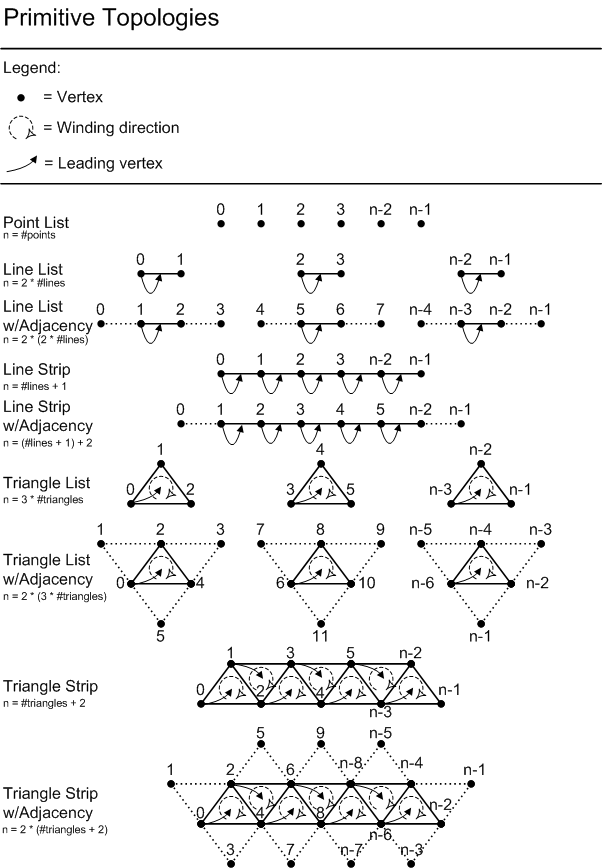
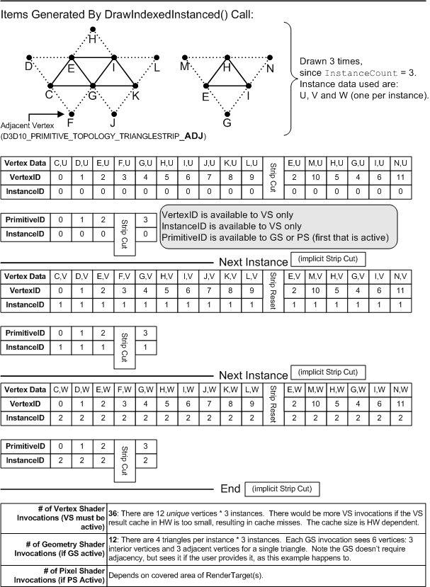

<a id="geometry"></a>

# Input assembly and vertex processing

The current vertex and input-layout driver object creation/sizing/destruction contracts
are defined with [pipeline component creation](pipeline-state.md#driver-shader-objects)
and its [exact slot associations](pipeline-state.md#driver-object-slots).
They do not add application shader/state object APIs or replace this stage's
execution, linkage, capability or resource-lifetime rules. The
[element-layout driver representation](pipeline-state.md#driver-element-layout)
resolves input semantics to shader registers.

<a id="input-assembly"></a>

## Input assembly

The Input Assembler (IA) introduces triangles, lines, points or Control Points (for Patches) into the graphics Pipeline, by pulling source geometry data out of 1D [Buffers](resources.md#buffer-description).

Vertex data can come from multiple Buffers, accessed in an "Array-of-Structures" fashion from each Buffer. The Buffers are each bound to an individual input slot and given a structure stride. The layout of data across all the Buffers is specified by an Input Declaration, in which each entry defines an "Element" with: an input slot, a structure offset, a data type, and a shader-input semantic (resolved to an input register for the Vertex Shader).

A given sequence of vertices is constructed out of data fetched from Buffers, in a traversal directed by a combination of fixed-function state and various Draw*() API/DDI calls. Various primitive topologies are available to make the sequence of vertex data represent a sequence of primitives. Example topologies are: point-list, line-list, triangle-list, triangle-strip, 8 control-point patch-list.

Vertex data can be produced in one of two ways. The first is "Non-Indexed" rendering, which is the sequential traversal of Buffer(s) containing vertex data, originating at a start offset at each Buffer binding. The second method for producing vertex data is "Indexed" rendering, which is sequential traversal of a single Buffer containing scalar integer indices, originating at a start offset into the Buffer. Each index indicates where to fetch data out of Buffer(s) containing vertex data. The index values are independent of the characteristics of the Buffers they are referring to; Buffers are described by a declaration as mentioned earlier. So the task accomplished by "Non-Indexed" and "Indexed" rendering, each in their own way, is producing addresses from which to fetch vertex data in memory, and subsequently assemble the results into vertices and primitives.

Instanced geometry rendering is enabled by allowing the sequential traversal, in either Non-indexed or Indexed rendering, to loop over a range within each Vertex Buffer (Non-Indexed case) or Index Buffer (Indexed case). Buffer-bindings can be identified "Instance Data" or "Vertex Data", indicating how to use the bound Buffer while performing instanced rendering. The address generated by "Non-Indexed" or "Indexed" rendering is used to fetch "Vertex Data", accounting also for looping when doing Instanced rendering. "Instance Data", on the other hand, is always sequentially traversed starting from a per-Buffer offset, at a frequency equal to one step per instance (e.g. one step forward after the number of vertices in an instance are traversed). The step rate for "Instance Data" can also be chosen to be a subharmonic of the instance frequency (i.e. one step forward every other instance, every third instance etc.).

In addition to producing vertex data from Buffers, the IA can auto-generate scalar counter values such as: [VertexID](#vertex-id), [PrimitiveID](#primitive-id) and [InstanceID](#instance-id), for input to shader stages in the graphics pipeline.

In "Indexed" rendering of strip topologies, such as triangle strips, a mechanism is provided for drawing multiple strips with a single Draw*() call (i.e. 'cut'ting strips).

A minimal use of the Input Assembler is to not have any input Buffers bound (vertex or index data). The Input Assembler can generate counters such as [VertexID](#vertex-id), [InstanceID](#instance-id) and [PrimitiveID](#primitive-id), which can identify vertices/primitives generated in the pipeline by DrawInstanced(), or DrawIndexedInstanced() (if at least an Index Buffer is bound). Thus Shaders can minimally drive all their processing based on the IDs if desired, including fetching appropriate data from Buffers or Textures.

The selected [graphics PSO](pipeline-state.md#graphics-description) contains the [input layout](pipeline-state.md#input-and-stream-output) and topology class. The command list supplies the vertex/index buffer views and detailed primitive topology. Input-layout use requires the root signature's `D3D12_ROOT_SIGNATURE_FLAG_ALLOW_INPUT_ASSEMBLER_INPUT_LAYOUT` permission. [Initial/reset and bundle state](command-list-state.md#buffer-bindings) and [primitive-topology initialization](command-list-state.md#base-graphics) remain the canonical state rules.

The PSO's [input-layout constraints](pipeline-state.md#input-layout-constraints) define same-slot classification/step-rate agreement and per-slot appended-element placement. These constraints give each `Slot[s]` in the traversal algorithms one classification and one step rate.

The states defining the Input Assembler's operation are described here. Draw*() commands recorded on a command list, described [below](#direct-draws), use the currently active IA state to define most of their behavior.

<a id="buffer-views"></a>

### Input elements and buffer views

Input-layout elements declare 1D Buffer structure layout. Structure fields are defined with format and offset, plus a shader-input semantic. Multiple elements (from one or more structures) can not feed a single register.

<a id="d3d12_vertex_buffer_view"></a>

#### D3D12_VERTEX_BUFFER_VIEW

```cpp
typedef struct D3D12_VERTEX_BUFFER_VIEW
{
    D3D12_GPU_VIRTUAL_ADDRESS BufferLocation;
    UINT SizeInBytes;
    UINT StrideInBytes;
} D3D12_VERTEX_BUFFER_VIEW;
```

`BufferLocation`

Specifies a D3D12\_GPU\_VIRTUAL\_ADDRESS that identifies the address of the buffer.

`SizeInBytes`

Specifies the size in bytes of the buffer.

`StrideInBytes`

Specifies the size in bytes of each vertex entry.

<a id="d3d12_index_buffer_view"></a>

#### D3D12_INDEX_BUFFER_VIEW

```cpp
typedef struct D3D12_INDEX_BUFFER_VIEW
{
    D3D12_GPU_VIRTUAL_ADDRESS BufferLocation;
    UINT SizeInBytes;
    DXGI_FORMAT Format;
} D3D12_INDEX_BUFFER_VIEW;
```

`BufferLocation`

The GPU virtual address of the index buffer. D3D12\_GPU\_VIRTUAL\_ADDRESS is a typedef'd synonym of UINT64.

`SizeInBytes`

The size in bytes of the index buffer.

`Format`

A [DXGI_FORMAT](https://learn.microsoft.com/en-us/windows/desktop/api/dxgiformat/ne-dxgiformat-dxgi_format)-typed value for the index-buffer format.

`BufferLocation` is the start GPU virtual address of the view; `SizeInBytes` specifies its accessible byte extent. Vertex/index views are supplied directly, not through descriptor-heap handles. The input-layout element format interprets vertex data; an index-buffer view supplies its own scalar index format. The ordinary index formats are `DXGI_FORMAT_R16_UINT` and `DXGI_FORMAT_R32_UINT`.

<a id="topology-enumeration"></a>

### Detailed primitive topology

```cpp
typedef enum D3D_PRIMITIVE_TOPOLOGY
{
    D3D_PRIMITIVE_TOPOLOGY_UNDEFINED = 0,
    D3D_PRIMITIVE_TOPOLOGY_POINTLIST = 1,
    D3D_PRIMITIVE_TOPOLOGY_LINELIST = 2,
    D3D_PRIMITIVE_TOPOLOGY_LINESTRIP = 3,
    D3D_PRIMITIVE_TOPOLOGY_TRIANGLELIST = 4,
    D3D_PRIMITIVE_TOPOLOGY_TRIANGLESTRIP = 5,
    D3D_PRIMITIVE_TOPOLOGY_LINELIST_ADJ = 10,
    D3D_PRIMITIVE_TOPOLOGY_LINESTRIP_ADJ = 11,
    D3D_PRIMITIVE_TOPOLOGY_TRIANGLELIST_ADJ = 12,
    D3D_PRIMITIVE_TOPOLOGY_TRIANGLESTRIP_ADJ = 13,
    D3D_PRIMITIVE_TOPOLOGY_1_CONTROL_POINT_PATCHLIST = 33,
    D3D_PRIMITIVE_TOPOLOGY_2_CONTROL_POINT_PATCHLIST = 34,
    D3D_PRIMITIVE_TOPOLOGY_3_CONTROL_POINT_PATCHLIST = 35,
    D3D_PRIMITIVE_TOPOLOGY_4_CONTROL_POINT_PATCHLIST = 36,
    D3D_PRIMITIVE_TOPOLOGY_5_CONTROL_POINT_PATCHLIST = 37,
    D3D_PRIMITIVE_TOPOLOGY_6_CONTROL_POINT_PATCHLIST = 38,
    D3D_PRIMITIVE_TOPOLOGY_7_CONTROL_POINT_PATCHLIST = 39,
    D3D_PRIMITIVE_TOPOLOGY_8_CONTROL_POINT_PATCHLIST = 40,
    D3D_PRIMITIVE_TOPOLOGY_9_CONTROL_POINT_PATCHLIST = 41,
    D3D_PRIMITIVE_TOPOLOGY_10_CONTROL_POINT_PATCHLIST = 42,
    D3D_PRIMITIVE_TOPOLOGY_11_CONTROL_POINT_PATCHLIST = 43,
    D3D_PRIMITIVE_TOPOLOGY_12_CONTROL_POINT_PATCHLIST = 44,
    D3D_PRIMITIVE_TOPOLOGY_13_CONTROL_POINT_PATCHLIST = 45,
    D3D_PRIMITIVE_TOPOLOGY_14_CONTROL_POINT_PATCHLIST = 46,
    D3D_PRIMITIVE_TOPOLOGY_15_CONTROL_POINT_PATCHLIST = 47,
    D3D_PRIMITIVE_TOPOLOGY_16_CONTROL_POINT_PATCHLIST = 48,
    D3D_PRIMITIVE_TOPOLOGY_17_CONTROL_POINT_PATCHLIST = 49,
    D3D_PRIMITIVE_TOPOLOGY_18_CONTROL_POINT_PATCHLIST = 50,
    D3D_PRIMITIVE_TOPOLOGY_19_CONTROL_POINT_PATCHLIST = 51,
    D3D_PRIMITIVE_TOPOLOGY_20_CONTROL_POINT_PATCHLIST = 52,
    D3D_PRIMITIVE_TOPOLOGY_21_CONTROL_POINT_PATCHLIST = 53,
    D3D_PRIMITIVE_TOPOLOGY_22_CONTROL_POINT_PATCHLIST = 54,
    D3D_PRIMITIVE_TOPOLOGY_23_CONTROL_POINT_PATCHLIST = 55,
    D3D_PRIMITIVE_TOPOLOGY_24_CONTROL_POINT_PATCHLIST = 56,
    D3D_PRIMITIVE_TOPOLOGY_25_CONTROL_POINT_PATCHLIST = 57,
    D3D_PRIMITIVE_TOPOLOGY_26_CONTROL_POINT_PATCHLIST = 58,
    D3D_PRIMITIVE_TOPOLOGY_27_CONTROL_POINT_PATCHLIST = 59,
    D3D_PRIMITIVE_TOPOLOGY_28_CONTROL_POINT_PATCHLIST = 60,
    D3D_PRIMITIVE_TOPOLOGY_29_CONTROL_POINT_PATCHLIST = 61,
    D3D_PRIMITIVE_TOPOLOGY_30_CONTROL_POINT_PATCHLIST = 62,
    D3D_PRIMITIVE_TOPOLOGY_31_CONTROL_POINT_PATCHLIST = 63,
    D3D_PRIMITIVE_TOPOLOGY_32_CONTROL_POINT_PATCHLIST = 64,
} D3D_PRIMITIVE_TOPOLOGY;
```

```cpp
typedef D3D_PRIMITIVE_TOPOLOGY D3D12_PRIMITIVE_TOPOLOGY;
```

<a id="input-binding-apis"></a>

## Input binding APIs

<a id="iasetprimitivetopology"></a>

### ID3D12GraphicsCommandList::IASetPrimitiveTopology

#### Declaration

```cpp
void IASetPrimitiveTopology(
    D3D12_PRIMITIVE_TOPOLOGY PrimitiveTopology
    );
```

#### Behavior

Bind information about the primitive type, and data order that describes input data for the input assembler stage.

#### Parameters

`[in] PrimitiveTopology`

The type of primitive and ordering of the primitive data (see [D3D_PRIMITIVE_TOPOLOGY](https://learn.microsoft.com/en-us/windows/desktop/api/d3dcommon/ne-d3dcommon-d3d_primitive_topology)).

#### Return values

None

#### Binding constraints

The selected topology must be compatible with the PSO's `PrimitiveTopologyType` and active shader stages. `D3D_PRIMITIVE_TOPOLOGY_UNDEFINED` is not a drawable topology. List/strip/adjacency selection is command-list state, not a change to the PSO's stored topology class.

<a id="iasetvertexbuffers"></a>

### ID3D12GraphicsCommandList::IASetVertexBuffers

#### Declaration

```cpp
void IASetVertexBuffers(
    UINT StartSlot,
    UINT NumViews,
    const D3D12_VERTEX_BUFFER_VIEW* pViews
    );
```

#### Behavior

Sets vertex buffer views in the input-assembler binding slots.

#### Parameters

`[in] StartSlot`

Index into the device's zero-based array to begin setting vertex buffers.

`[in] NumViews`

The number of views in the *pViews* array.

`[in, optional] pViews`

Specifies the vertex buffer views in an array of [D3D12_VERTEX_BUFFER_VIEW](https://learn.microsoft.com/en-us/windows/desktop/api/d3d12/ns-d3d12-d3d12_vertex_buffer_view) structures.

#### Return values

None

#### Binding constraints

`StartSlot` must be less than 32, and `NumViews` must not exceed `32 - StartSlot`. A null `pViews` clears that range; a valid zero count changes no slots. Slots outside the specified range are unchanged. A vertex stride of zero is permitted; the maximum is `D3D12_REQ_MULTI_ELEMENT_STRUCTURE_SIZE_IN_BYTES` (2048). A zero `BufferLocation` with nonzero `SizeInBytes` is invalid. The views carry addresses, sizes and strides; they do not bind or retain resource COM objects.

<a id="iasetindexbuffer"></a>

### ID3D12GraphicsCommandList::IASetIndexBuffer

#### Declaration

```cpp
void IASetIndexBuffer(
    const D3D12_INDEX_BUFFER_VIEW* pView
    );
```

#### Behavior

Sets the view for the index buffer.

Only one index buffer can be bound to the graphics pipeline at any one time.

#### Parameters

`[in, optional] pView`

The view specifies the index buffer's address, size, and [DXGI_FORMAT](https://learn.microsoft.com/en-us/windows/desktop/api/dxgiformat/ne-dxgiformat-dxgi_format), as a pointer to a [D3D12_INDEX_BUFFER_VIEW](https://learn.microsoft.com/en-us/windows/desktop/api/d3d12/ns-d3d12-d3d12_index_buffer_view) structure.

#### Return values

None

#### Binding constraints

A null `pView` unbinds the index buffer. The view's `BufferLocation` must be aligned to its index-element size. A zero `BufferLocation` with nonzero `SizeInBytes` is invalid.

<a id="iasetindexbufferstripcutvalue"></a>

### ID3D12GraphicsCommandList9::IASetIndexBufferStripCutValue

#### Declaration

```cpp
void IASetIndexBufferStripCutValue(
    D3D12_INDEX_BUFFER_STRIP_CUT_VALUE IBStripCutValue
    );
```

#### Behavior

Sets the current index-buffer strip-cut value. The [dynamic application-state contract](command-list-state.md#dynamic-application-state) defines `DynamicIndexBufferStripCutSupported`, the required pipeline creation flag, initial/reset and bundle values, and overwrite on PSO selection. This command does not change the PSO's stored description.

#### Parameters

`IBStripCutValue`

The [strip-cut selection](#strip-cuts) to establish.

#### Return values

None

<a id="direct-draws"></a>

## Direct draw APIs

These graphics input-binding and direct draw commands are supported on DIRECT and BUNDLE recordings, not COMPUTE or COPY recordings. Draws require a compatible graphics PSO, root signature and detailed topology. Bound resources must satisfy [recording/execution lifetime](execution.md#lifetime), [residency](resources.md#residency), and the applicable [legacy states](synchronization.md#legacy-resource-states) or [enhanced access rules](synchronization.md#barrier-access). Vertex and index reads have distinct access categories; binding a view does not perform a transition.

<a id="drawinstanced"></a>

### ID3D12GraphicsCommandList::DrawInstanced

#### Declaration

```cpp
void DrawInstanced(
    UINT VertexCountPerInstance,
    UINT InstanceCount,
    UINT StartVertexLocation,
    UINT StartInstanceLocation
    );
```

#### Behavior

Draws non-indexed, instanced primitives.

#### Parameters

| Parameter | Meaning |
| --- | --- |
| UINT VertexCountPerInstance | How many vertices to read sequentially from Buffer(s) marked as Vertex Data (same set repeated for each Instance). |
| UINT InstanceCount | How many Instances to render. |
| UINT StartVertexLocation | Which Vertex to start at in each Buffer marked as Vertex Data (for each Instance). |
| UINT StartInstanceLocation | Which Instance to start sequentially fetching from in each Buffer marked as Instance Data. |

#### Return values

None

#### Execution constraints

The draw uses the currently selected graphics state. A zero per-instance count or zero `InstanceCount` generates no primitives; it does not waive other recording-state requirements.

<a id="drawindexedinstanced"></a>

### ID3D12GraphicsCommandList::DrawIndexedInstanced

#### Declaration

```cpp
void DrawIndexedInstanced(
    UINT IndexCountPerInstance,
    UINT InstanceCount,
    UINT StartIndexLocation,
    INT BaseVertexLocation,
    UINT StartInstanceLocation
    );
```

#### Behavior

Draws indexed, instanced primitives.

#### Parameters

| Parameter | Meaning |
| --- | --- |
| UINT IndexCountPerInstance | How many indices to read sequentially from the Index Buffer (same set repeated for each Instance). |
| UINT InstanceCount | How many Instances to render. |
| UINT StartIndexLocation | Which Index to start at in the Index Buffer (for each Instance). |
| INT BaseVertexLocation | Which Vertex in each buffer marked as Vertex Data to consider as Index "0". Note that this value is signed. A negative BaseVertexLocation allows, for example, the first vertex to be referenced by an index value > 0. |
| UINT StartInstanceLocation | Which Instance to start sequentially fetching from in each Buffer marked as Instance Data. |

#### Return values

None

#### Execution constraints

The draw uses the currently selected graphics state. A zero per-instance count or zero `InstanceCount` generates no primitives; it does not waive other recording-state requirements.

The same draw-field meanings and traversal rules apply to the [non-indexed](indirect-execution.md#draw-arguments) and [indexed](indirect-execution.md#draw-indexed-arguments) indirect payloads. Command signatures, record layouts and argument/count-buffer execution have their canonical definition in [Indirect execution](indirect-execution.md#argument-records).

<a id="address-generation"></a>

## Address generation and instancing

The following pseudocode specifies vertex/index traversal; its abstract `Slot`, layout/register mapping and helper functions are not additional API structures. `Slot[s].StrideInBytes` is the bound vertex view's stride, and its layout is the PSO input layout resolved against the vertex-shader signature. Addresses in the algorithms are view-relative byte offsets; the fetch adds the view's 64-bit `BufferLocation` and applies its `SizeInBytes` bounds. The view's starting address incorporates any initial resource-relative buffer offset; that offset is not added a second time. `sizeof(IndexBuffer.Format)` means the index-element width in bytes, not the C++ enum's size.

<a id="nonindexed-addresses"></a>

### Non-indexed address generation

```cpp
UINT VertexBufferElementAddressInBytes[32][32]; // [D3D12_IA_VERTEX_INPUT_RESOURCE_SLOT_COUNT]
                                                // [D3D12_IA_VERTEX_INPUT_STRUCTURE_ELEMENT_COUNT]

UINT InstanceDataStepCounter[32]; // [D3D12_IA_VERTEX_INPUT_RESOURCE_SLOT_COUNT]

// Initialize starting Vertex Buffer addresses
for(each slot, s, with a VertexBuffer assigned)
{
    if(Slot[s].Class == D3D12_INPUT_CLASSIFICATION_PER_VERTEX_DATA)
    {
        for(each Element, e, in the Buffer's Input Layout)
        {
            VertexBufferElementAddressInBytes[s][e] =
                Slot[s].StrideInBytes*StartVertexLocation +
                Slot[s].pInputLayout->pElement[e].OffsetInBytes;
        } // Element loop
    }
    else // (Slot[s].Class == D3D12_INPUT_CLASSIFICATION_PER_INSTANCE_DATA)
    {
        for(each Element, e, in the Buffer's Input Layout)
        {
            VertexBufferElementAddressInBytes[s][e] =
                Slot[s].StrideInBytes*StartInstanceLocation +
                Slot[s].pInputLayout->pElement[e].OffsetInBytes;
        } // Element loop
        InstanceDataStepCounter[s] = Slot[s].InstanceDataStepRate;
    }
} // slot loop

// Now compute addresses and fetch data
// for all elements of each buffer for each vertex
// for each instance.

for(UINT InstanceID = 0;  InstanceID < InstanceCount; InstanceID++)
{
    for(UINT VertexID = 0;  VertexID < VertexCountPerInstance; VertexID++)
    {
        for(each slot, s, with a VertexBuffer assigned)
        {
            for(each Element, e, in the buffer's Input Layout)
            {
                // Fetch this vertex Element's data from Slot[s].pBuffer
                // at address VertexBufferElementAddressInBytes[s][e],
                // with type Slot[s].pInputLayout->pElement[e].Format,
                // and output to the Shader Register identified by Slot[s].pInputLayout->pElement[e].Register,
                // taking account the writemask declared in the shader.
                FetchDataFromMemory(VertexBufferElementAddressInBytes[s][e],s,e);

                if(Slot[s].Class == D3D12_INPUT_CLASSIFICATION_PER_VERTEX_DATA)
                {
                    // Increment the address for the next access
                    VertexBufferElementAddressInBytes[s][e] +=
                        Slot[s].StrideInBytes;
                }
            } // Element loop
        } // slot loop
    } // vertex loop

    // Patch Instance and Vertex Data addresses at the end of an instance.
    for(each slot, s, with a VertexBuffer assigned)
    {
        if(Slot[s].Class ==  D3D12_INPUT_CLASSIFICATION_PER_VERTEX_DATA)
        {
            for(each Element, e, in the buffer's structure declaration)
            {
                VertexBufferElementAddressInBytes[s][e] =
                    Slot[s]. StrideInBytes*StartVertexLocation +
                    Slot[s].pInputLayout->pElement[e].OffsetInBytes;
            } // Element loop
        }
        else //(Slot[s].Class == D3D12_INPUT_CLASSIFICATION_PER_INSTANCE_DATA)
        {
            if(1 == InstanceDataStepCounter[s])
            {
                for(each Element, e, in the buffer's structure declaration)
                {
                    VertexBufferElementAddressInBytes[s][e] +=
                        Slot[s].StrideInBytes;
                }
                InstanceDataStepCounter[s] = Slot[s].InstanceDataStepRate;
            }
            else if(1 < InstanceDataStepCounter[s])
            {
                InstanceDataStepCounter[s]--;
            }
        }
    } // slot loop

    RestartTopology(); // restart at the end of an instance
} //instance loop
```

<a id="indexed-addresses"></a>

### Indexed address generation

```cpp
UINT VertexBufferElementAddressInBytes[32][32]; // [D3D12_IA_VERTEX_INPUT_RESOURCE_SLOT_COUNT]
                                                // [D3D12_IA_VERTEX_INPUT_STRUCTURE_ELEMENT_COUNT]
UINT InstanceDataStepCounter[32]; // [D3D12_IA_VERTEX_INPUT_RESOURCE_SLOT_COUNT]

// Initialize starting Index Buffer address
UINT IndexBufferElementAddressInBytes = StartIndexLocation*sizeof(IndexBuffer.Format);

// Initialize starting Vertex Buffer addresses
// Relevant to Instance Data only, as this is traversed without indexing.
for(each slot, s, with a VertexBuffer assigned)
{
    if(Slot[s].Class == D3D12_INPUT_CLASSIFICATION_PER_INSTANCE_DATA)
    {
        for(each Element, e, in the Buffer's structure declaration)
        {
            VertexBufferElementAddressInBytes[s][e] =
                Slot[s].StrideInBytes*StartInstanceLocation +
                Slot[s].pInputLayout->pElement[e].OffsetInBytes;
        } // Element loop
        InstanceDataStepCounter[s] = Slot[s].InstanceDataStepRate;
    }
} // slot loop

// Now compute addresses and fetch data
// for all elements of each buffer for each vertex
// for each instance.

for(UINT InstanceID = 0; InstanceID < InstanceCount; InstanceID++)
{
    IndexBufferElementAddressInBytes = StartIndexLocation*sizeof(IndexBuffer.Format);
    for(UINT i = 0; i < IndexCountPerInstance; i++)
    {
        UINT IndexValue = FetchIndexFromIndexBuffer(IndexBufferElementAddressInBytes,IndexBuffer.Format);

        if(IsCutIndex(IndexValue))
        {
            RestartTopology();

            // Increment the index address
            IndexBufferElementAddressInBytes += sizeof(IndexBuffer.Format);

            // No vertex to fetch for this iteration...
            continue;
        }

        for(each slot, s,  with a VertexBuffer assigned)
        {
            UINT IndexedOffset;
            if(Slot[s].Class == D3D12_INPUT_CLASSIFICATION_PER_VERTEX_DATA)
            {
                IndexedOffset = Slot[s].StrideInBytes*(BaseVertexLocation + IndexValue);
            }
            for(each Element, e, in the buffer's structure declaration)
            {
                if(Slot[s].Class == D3D12_INPUT_CLASSIFICATION_PER_VERTEX_DATA)
                {
                    VertexBufferElementAddressInBytes[s][e] =
                        IndexedOffset +
                        Slot[s].pInputLayout->pElement[e].OffsetInBytes;
                }

                // Fetch this vertex Element's data from Slot[s].pBuffer
                // at address VertexBufferElementAddressInBytes[s][e],
                // with type Slot[s].pInputLayout->pElement[e].Format,
                // and output to the Shader Register identified by Slot[s].pInputLayout->pElement[e].Register,
                // taking account the writemask declared in the shader.
                FetchDataFromMemory(VertexBufferElementAddressInBytes[s][e],s,e);

            } // Element loop
        } // slot loop
        // Increment the index address
        IndexBufferElementAddressInBytes += sizeof(IndexBuffer.Format);
    } // index loop


    // Patch Instance Data addresses at the end of an instance.
    for(each slot, s, with a VertexBuffer assigned)
    {
        if(Slot[s].Class == D3D12_INPUT_CLASSIFICATION_PER_INSTANCE_DATA)
        {
            if(1 == InstanceDataStepCounter[s])
            {
                for(each Element, e, in the buffer's structure declaration)
                {
                    VertexBufferElementAddressInBytes[s][e] +=
                        Slot[s].StrideInBytes;
                }
                InstanceDataStepCounter[s] = Slot[s].InstanceDataStepRate;
            }
            else if(1 < InstanceDataStepCounter[s])
            {
                InstanceDataStepCounter[s]--;
            }
        }
    } // slot loop

    RestartTopology();  // restart at the end of an instance
} //instance loop
```

<a id="primitive-assembly"></a>

## Primitive assembly

<a id="primitive-topologies"></a>

### Primitive topologies

The diagram below defines the vertex ordering for all of the primitive topologies that the IA can produce. The enumeration of primitive topologies is [here](#topology-enumeration).

As an example, suppose the IA is asked to draw triangle lists with adjacency, and it is invoked with a vertex count of 36 by a DrawInstanced() call with one instance. From the diagram it should be apparent that a 36-vertex triangle list with adjacency will result in 6 completed primitives.

An interesting property of all the topologies with adjacency (except line strips) is that they contain exactly double the number of vertices as the equivalent topology without adjacency. Every other vertex represents an "adjacent" vertex.



<a id="patch-topologies"></a>

### Patch topologies

Not shown in the previous diagram (but part of the same list) are 32 additional topologies which represent 1...32 control point patches, respectively. These Patch topologies can be used with [Tessellation](tessellation.md#tessellation). Also, when Tessellation is [disabled](tessellation.md#tessellation-enablement) (meaning no Hull Shader and no Domain Shader bound), they can be fed to the Geometry Shader and/or Stream Output, allowing patch data to be saved to memory, and allowing non-traditional primitive types to be fed to the GS (such as simulating cubes using 8 control point patches to represent 8 vertices).

<a id="strip-cuts"></a>

### Strip cuts and restart

In Indexed rendering of strip topologies, the enabled cut index value selected by the PSO or dynamic strip-cut state means the strip defined up to the previous index is to be completed, and the next index is a new strip. This special "cut" value is not required to be used, in which case a DrawIndexed*() command will simply draw one strip. In IndexedInstanced rendering, there is an automatic "cut" after every instance. Regardless of Instanced rendering or not, it is optional whether to make the last index the cut value, or omit the value; both result in the same behavior, except that the IndexCountPerInstance parameter to DrawIndexedInstanced() is different by 1.

Even if the current Primitive Topology is not a strip, then the cut index value still takes effect, potentially resulting in an incomplete primitive (see next section). Thus, handling of the cut is kept orthogonal to primitive topology, even though it is not useful for some of them.

Note that providing a behavior for the cut value when used with a non-strip topology is a way of saying that the behavior is defined, allowing hardware to keep the cut behavior always enabled. In practice though, using cut for a list topology is obviously not a "feature" that it would ever make sense for an application to author to.

`D3D12_INDEX_BUFFER_STRIP_CUT_VALUE_DISABLED` disables index-value restart. The other selected values are 0xffff and 0xffffffff. `IsCutIndex` in the pseudocode tests the fetched index against the enabled cut value before adding `BaseVertexLocation`. Static `IBStripCutValue` belongs to the PSO; [dynamic strip-cut state](command-list-state.md#dynamic-state) defines capability, creation flag, bundle and PSO-reselection effects.

```cpp
typedef enum D3D12_INDEX_BUFFER_STRIP_CUT_VALUE
{
    D3D12_INDEX_BUFFER_STRIP_CUT_VALUE_DISABLED = 0,
    D3D12_INDEX_BUFFER_STRIP_CUT_VALUE_0xFFFF = 1,
    D3D12_INDEX_BUFFER_STRIP_CUT_VALUE_0xFFFFFFFF = 2
} D3D12_INDEX_BUFFER_STRIP_CUT_VALUE;
```

<a id="partial-primitives"></a>

### Partially completed primitives

Each Draw*() call starts a new Primitive Topology; there is no persistence of any topology produced by a previous DrawInstanced() call. Triangle strips don't continue across DrawInstanced() call boundaries.

If a Draw*() call produces incomplete primitives (not enough vertices), either at the end of the Draw*() call, or anywhere in the middle (possible with the "cut" index), any incomplete primitives are silently discarded. For example, suppose a Draw*() call is made with triangle list as the topology, and a vertex count of 5. This case would result in a single triangle, and the last 2 vertices being silently discarded. For another example showing handling of an incomplete primitive, see the diagram under the Geometry Shader Stage [here](geometry-shaders-and-stream-output.md#input-layout), depicting which primitives are instantiated given a triangle strip with adjacency that has a dangling vertex.

<a id="leading-vertex"></a>

### Leading vertex

For the purpose of assigning constant vertex attributes to primitives, there must be a way to map a vertex to a primitive. Let us identify the vertex in a primitive which supplies its per-primitive constant data as the "leading vertex". A primitive topology can have multiple leading vertices, one for each primitive in the topology. The leading vertex for an individual primitive in a topology is the first non-adjacent vertex in the primitive. For the triangle strip with adjacency above, the leading vertices are 0, 2, 4, 6, etc. For the line strip with adjacency, the leading vertices are 1, 2, 3 etc.

Note that adjacent primitives have no leading vertex. This means that there is no primitive data associated with adjacent primitives. With the strip topologies, a given interior primitive has some adjacent primitives which are also interior to the topology, and so actually can have primitive data. However, as far as the Geometry Shader is concerned (it sees a single primitive and its neighboring primitives in an invocation), only the single interior primitive defining the Geometry Shader invocation can have Primitive Data, and adjacent primitives, whether they are interior to the strip or adjacent primitives on the strip, never come with Primitive Data.

<a id="adjacency"></a>

### Adjacency

The only place in the Pipeline where adjacency information is visible to the application is in the Geometry Shader. Each invocation of the Geometry Shader sees a single primitive: a point, line, or triangle, and some of these might include adjacent vertices.

The inputs to the Geometry Shader are like a single primitive of any of the "list" primitive topologies (with or without adjacency) in the diagram above. When adjacency is available, the Geometry Shader will see the appropriate adjacent vertices along with the primitive's vertices. So for example if the Geometry Shader is invoked with a triangle including adjacency (the source could have been a strip with adjacency), this would mean that data for 6 vertices would be available as input in the Geometry Shader: 3 vertices for the triangle, and 3 for the adjacency.

The data layout for adjacent vertices is identical to the standard vertices they accompany. Note that adjacent vertices participate in [vertex processing](#vertex-invocation) just like other vertices, subject to the same result-cache reuse. Note that adjacent vertices are typically also surface vertices of some other primitive that will get drawn, so the Vertex Shader result cache can take advantage of this.

When the IA is instructed to produce a primitive topology with adjacency for its output, all adjacent vertices must be specified. There is no concept of handling edges with no adjacent primitive. The application must deal with this on their own, perhaps by providing a dummy vertex (possibly forming a degenerate triangle), or perhaps by flagging in one of the vertex attributes whether the vertex "exists" or not. The application's Geometry Shader code will have to detect this situation, if desired, and deal with it manually. Implied in this is that there must be no culling of degenerate primitives until rasterizer setup, so that the Geometry Shader is guaranteed to see all geometry.

Note that when Tessellation is enabled, topologies with adjacency cannot be used. The Tessellator operates a patch at a time without hardware knowledge about adjacency (although shader code is free to encode it on its own). The Tessellator's outputs are independent primitives, with no adjacency information.

<a id="generated-identifiers"></a>

## Generated identifiers

VertexID, PrimitiveID and InstanceID correspond to the HLSL system-value semantics `SV_VertexID`, `SV_PrimitiveID` and `SV_InstanceID`. The counter behavior below is independent of shader representation; the retained register and declaration descriptions are specific to DXBC.

<a id="vertex-id"></a>

### VertexID

VertexID is a 32-bit unsigned integer scalar counter value coming out of Draw*() calls identifying to Shaders each vertex. This value can be [declared](../archive/D3D11_3_FunctionalSpec.htm#inst_vDCL_SV) for input by the Vertex Shader only.

For DrawInstanced(), VertexID starts at 0, and it increments for every vertex. Across instances in DrawInstanced(), the count resets back to the start value. Should the 32-bit VertexID calculation overflow, it simply wraps.

For DrawIndexedInstanced(), VertexID represents the index value.

The mere presence of VertexID in a Vertex Shader's input declarations activates the feature (there is no other control outside the shader). If the application wishes to pass this data to later Pipeline stages, the application can do so by simply writing the value to a Shader output register like any other data.

For Primitive Topologies with adjacency, such as a triangle strip w/adjacency, the "adjacent" vertices have a VertexID associated with them just like the "non-adjacent" vertices do, all generated uniformly (i.e. without regards to which vertices are adjacent and which are not in the topology).

For more information, see the general discussion of System Generated Values [here](../archive/D3D11_3_FunctionalSpec.htm#SystemGeneratedValues), the reference for VertexID [here](../archive/D3D11_3_FunctionalSpec.htm#generatedvalue_VERTEX_ID), and the System Interpreted/Generated Value [input](../archive/D3D11_3_FunctionalSpec.htm#inst_vDCL_SV) declaration for Shaders.

<a id="primitive-id"></a>

### PrimitiveID

PrimitiveID is a 32-bit unsigned integer scalar counter value coming out of Draw*() calls identifying to Shaders each primitive. This value can be [declared](../archive/D3D11_3_FunctionalSpec.htm#inst_vDCL_SV) for input by either the Hull Shader, Domain Shader, Geometry Shader or Pixel Shader Stage. For the GS and PS, if the GS is active the hardware PrimitiveID goes there and shader computed PrimitiveIDs go to the PS.

PrimitiveID starts at 0 for the first primitive generated by a Draw*() call, and increments for each subsequent primitive. When Draw*Instanced() is used, the PrimitiveID resets to its starting value whenever a new instance begins in the set of instances produced by the call. Should the 32-bit PrimitiveID calculation overflow, it simply wraps.

The mere presence of PrimitiveID in a compatible Shader Stage's input declarations activates the feature (there is no other control outside the shader). In the DXBC Geometry Shader representation this is declared as the special register vPrim (to decouple the value from the other per-vertex inputs). If the application wishes to pass PrimitiveID to a later Pipeline stage, the application can do so by simply writing the value to a Shader output register like any other data. In DXBC, the Pixel Shader does not have a separate input for PrimitiveID; it just goes into a component of a normal input register, with the requirement that the interpolation mode on the entire input register (which may contain other data as well in other components) is chosen as "constant".

For [Primitive Topologies](#primitive-topologies) with adjacency, such as a triangle strip w/adjacency, the PrimitiveID is only maintained for the interior primitives in the topology (the non-adjacent primitives), just like the set of primitives in a triangle strip without adjacency. No point in the Pipeline has a way of asking for an auto-generated PrimitiveID for adjacent primitives.

For more information, see the general discussion of System Generated Values [here](../archive/D3D11_3_FunctionalSpec.htm#SystemGeneratedValues), the reference for PrimitiveID [here](../archive/D3D11_3_FunctionalSpec.htm#generatedvalue_PRIMITIVE_ID), and the System Interpreted/Generated Value [input](../archive/D3D11_3_FunctionalSpec.htm#inst_vDCL_SV) and [output](../archive/D3D11_3_FunctionalSpec.htm#inst_oDCL_SGV) declarations for Shaders.

For patch topologies, [tessellated PrimitiveID](tessellation.md#tessellated-primitive-id) defines identity across the generated points, lines and triangles.

<a id="instance-id"></a>

### InstanceID

InstanceID is a 32-bit unsigned integer scalar counter value coming out of Draw*() calls identifying to Shaders which instance is being drawn. This value can be [declared](../archive/D3D11_3_FunctionalSpec.htm#inst_vDCL_SV) for input by the Vertex Shader only.

InstanceID starts at 0 for the first instance of vertices generated by a Draw*() call. After each instance of vertices, the InstanceID increments by one. A draw with one instance therefore uses only InstanceID 0. Should the 32-bit InstanceID calculation overflow, it simply wraps.

The mere presence of InstanceID in the Vertex Shader's input declarations activates the feature (there is no other control outside the shader). If the application wishes to pass this data to later Pipeline stages, the application can do so by simply writing the value to a Shader output register like any other data.

For more information, see the general discussion of System Generated Values [here](../archive/D3D11_3_FunctionalSpec.htm#SystemGeneratedValues), the reference for InstanceID [here](../archive/D3D11_3_FunctionalSpec.htm#generatedvalue_INSTANCE_ID), and the System Interpreted/Generated Value [input](../archive/D3D11_3_FunctionalSpec.htm#inst_vDCL_SV) declaration for Shaders.

<a id="nonindexed-identifiers"></a>

### Non-indexed identifier generation

```cpp
// The following pseudocode for calculating IDs has been separated out from the
// address calculation pseudocode above, for clarity. In practice the
// algorithms would be merged, or possibly be implemented as part of the
// primitive assembly process.  Note that VertexID/PrimitiveID/InstanceID
// values are unrelated to address calculations for IA data fetching.
// Applications can apply the draw offsets separately to these IDs when
// using shader loads to reproduce the IA's fixed addressing calculations.

UINT VertsPerPrimitive = GetNumVertsBetweenPrimsInCurrentTopology();
    // e.g. VertsPerPrimitive = 3 for tri list
    //                        = 6 for tri list w/adj
    //                        = 1 for tri strip
    //                        = 2 for tri strip w/adj
    //                        = 2 for line list
    //                        = 4 for line list w/adj
    //                        = 1 for line strip
    //                        = 1 for line strip w/adj
    //                        = 1 for point list

UINT VertsPerCompletedPrimitive =
            GetNumVertsUntilFirstCompletedPrimitiveInCurrentTopology();
    // e.g. VertsPerCompletedPrimitive = 3 for tri list
    //                                 = 6 for tri list w/adj
    //                        =  3 for tri strip
    //                                 = 7 for tri strip w/adj, (not 6) since 1
    //                                        vert is not involved in the prim,
    //                                        when the strip has more than one
    //                                        primitive.
    //                                 = 2 for line list
    //                                 = 4 for line list w/adj
    //                                 = 2 for line strip
    //                                 = 4 for line strip w/adj
    //                                 = 1 for point list

for(UINT InstanceID = 0; InstanceID < InstanceCount; InstanceID++)
{
    UINT PrimitiveID = 0;
    UINT VertsUntilNextCompletePrimitive = VertsPerCompletedPrimitive;

    SetNextInstanceID(InstanceID); // subsequent vertices and primitives
                                   // will get this InstanceID

    for(UINT VertexID = 0; VertexID < VertexCountPerInstance; VertexID++)
    {
        VertsUntilNextCompletePrimitive--;
        if( VertsUntilNextCompletePrimitive == 0 )
        {
            SetNextPrimitiveID(PrimitiveID++);
            VertsUntilNextCompletePrimitive = VertsPerPrimitive;
        }
        SetNextVertexID(VertexID);
    } // vertex loop

    if( IsTriangleStripWithAdjacency() && (VertsUntilNextCompletePrimitive == 1))
    {
        // When traversing a triangle strip w/ adjacency, after the initial 7
        // vertices, every other vertex completes a primitive, EXCEPT when
        // the end of the strip is reached, where the last 2 consecutive
        // vertices each complete a primitive.
        SetNextPrimitiveID(PrimitiveID++); // in a tristrip w/adj
                                           // the last completed primitive has
                                           // not been counted yet.
    }
} // instance loop
```

<a id="indexed-identifiers"></a>

### Indexed identifier generation

```cpp
// The following pseudocode for calculating IDs has been separated out from the
// address calculation pseudocode above, for clarity. In practice the
// algorithms would be merged, or possibly be implemented as part of the
// primitive assembly process.  Note that VertexID/PrimitiveID/InstanceID
// values are unrelated to address calculations for IA data fetching.
// Applications can apply the draw offsets separately to these IDs when
// using shader loads to reproduce the IA's fixed addressing calculations.

UINT VertsPerPrimitive = GetNumVertsBetweenPrimsInCurrentTopology();
    // e.g. VertsPerPrimitive = 3 for tri list
    //                        = 6 for tri list w/adj
    //                        = 1 for tri strip
    //                        = 2 for tri strip w/adj
    //                        = 2 for line list
    //                        = 4 for line list w/adj
    //                        = 1 for line strip
    //                        = 1 for line strip w/adj
    //                        = 1 for point list

UINT VertsPerCompletedPrimitive =
            GetNumVertsUntilFirstCompletedPrimitiveInCurrentTopology();
    // e.g. VertsPerCompletedPrimitive = 3 for tri list
    //                                 = 6 for tri list w/adj
    //                                 = 3 for tri strip
    //                                 = 7 for tri strip w/adj, (not 6) since 1
    //                                        vert is not involved in the prim,
    //                                        when the strip has more than one
    //                                        primitive.
    //                                 = 2 for line list
    //                                 = 4 for line list w/adj
    //                                 = 2 for line strip
    //                                 = 4 for line strip w/adj
    //                                 = 1 for point list


for(UINT InstanceID = 0; InstanceID < InstanceCount; InstanceID++)
{
    UINT PrimitiveID = 0;
    UINT VertsUntilNextCompletePrimitive = VertsPerCompletedPrimitive;

    SetNextInstanceID(InstanceID); // subsequent vertices and primitives
                                   // will get this InstanceID
    for(UINT i = 0; i < IndexCountPerInstance; i++)
    {
        UINT IndexValue = FetchIndexFromIndexBuffer(); // detail hidden
        // IndexValue assignment above: Detail hidden, see full index fetch calculation in
        // DrawIndexedInstanced() pseudocode (which in practice this code would be merged with)

        if(IsCutIndex(IndexValue))
        {
            if( IsTriangleStripWithAdjacency() && (VertsUntilNextCompletePrimitive == 1))
            {
                // When traversing a triangle strip w/ adjacency, after the initial 7
                // vertices, every other vertex completes a primitive, EXCEPT when
                // the end of the strip is reached, where the last 2 consecutive
                // vertices each complete a primitive.
                SetNextPrimitiveID(PrimitiveID++); // in a tristrip w/adj
                                                   // the last completed primitive has
                                                   // not been counted yet.
            }
            VertsUntilNextCompletePrimitive = VertsPerCompletedPrimitive;
        }
        else
        {
            VertsUntilNextCompletePrimitive--;
            if( VertsUntilNextCompletePrimitive == 0 )
            {
                SetNextPrimitiveID(PrimitiveID++);
                VertsUntilNextCompletePrimitive = VertsPerPrimitive;
            }
            SetNextVertexID(IndexValue);
        }
    } // vertex loop

    if( IsTriangleStripWithAdjacency() && (VertsUntilNextCompletePrimitive == 1))
    {
        // When traversing a triangle strip w/ adjacency, after the initial 7
        // vertices, every other vertex completes a primitive, EXCEPT when
        // the end of the strip is reached, where the last 2 consecutive
        // vertices each complete a primitive.
        SetNextPrimitiveID(PrimitiveID++);  // in a tristrip w/adj
                                            // the last completed primitive has
                                            // not been counted yet.
    }
} // instance loop
```

<a id="fetching-rules"></a>

## Fetching rules

<a id="arithmetic"></a>

### Arithmetic precision

The Input Assembler performs 32-bit unsigned integer arithmetic, conforming to the IA addressing pseudocode shown in this spec. In other words, should any calculation overflow 32-bits, it would wrap - and should that result happen to fall back into a valid range for the scenario, so be it. Wherever input parameters are listed as signed integers (such as BaseVertexLocation in [DrawIndexedInstanced()](#drawindexedinstanced)) they are interpreted, unaltered, as unsigned 32-bit numbers, used in unsigned 32-bit addressing arithmetic, producing unsigned 32-bit results.

<a id="bounds"></a>

### Addressing bounds

Any calculated address that would fall out of bounds for a Buffer being accessed results in out-of-bounds behavior being invoked, where the return is 0 in all non-missing components of the format (defined in the Input Layout), and the default for missing components (see [Defaults for Missing Components](formats.md#missing-components)). This out-of-bounds behavior applies, for example, when an index refers to a vertex number that is outside of the bound vertex buffer.

The minimum extent for the bounds is any initial offset applied on the Buffer (so "negative" indexing isn't a feature).

<a id="draw-support"></a>

### Draw support requirements

| Resource | Minimum level of support required |
| --- | --- |
| DrawInstanced() Vertex Count (including instancing) | 2^32 |
| DrawIndexedInstanced() Vertex Count (including instancing) | 2^32 |

<a id="alignment"></a>

### Alignment

For input-assembler data, an offset for an Element is required, a stride for a structure (e.g. vertex) is required, or an initial offset for a Buffer is required. All of these types of values have the following alignment restrictions:

- The alignment of an Element in a structure in memory must be, in bytes, the nearest power of 2 greater or equal to the width of the Element's format, or 4, whichever is less.
Thus alignment is always at 1 byte, 2 bytes or 4 byte granularity. This alignment is measured from the starting address of the structure. The starting address of the structure must also maintain alignment of all its members.

- The magnitude of any initial offset into a 1D buffer, and/or the structure stride, must result in the Elements in the Buffer remaining
aligned as per the previous rule.

Example byte alignments for some of the [formats](formats.md#interpretation) which can be used in structures (e.g. vertex buffers) or as elements in index buffers:

- R8_UINT: 1

- R16_UINT: 2

- R32G32_FLOAT: 4

- R32G32B32A32_UINT: 4

- R11G11B10_FLOAT: 4

However, these alignment rules do not apply to Buffer offsets in shader-resource and unordered-access views. These Buffer offsets have more stringent requirements, detailed in the [buffer-view definitions](formats.md#buffer-srv).

There is also some similar discussion, focused on memory accesses common to [UAVs](../archive/D3D11_3_FunctionalSpec.htm#UAVs), SRVs and Thread Group Shared Memory in the [Memory Addressing and Alignment Issues](../archive/D3D11_3_FunctionalSpec.htm#MemoryAddressingAndAlignment) section.

Violations of required data alignment result in undefined behavior.

When `D3D12_FEATURE_DATA_D3D12_OPTIONS13.UnrestrictedVertexElementAlignmentSupported` is TRUE, D3D12 does not consider it an error to specify a *potentially* misaligned input layout on a pipeline state object; instead, it will validate in two steps:
1. At input layout creation, iff it is determined to be impossible to correctly align all elements of an input layout at any offset, pipeline state creation fails and the debug layer will report an error.
2. At draw, the debug layer will then validate that the address provided in the vertex buffer description is compatible with the input layout, i.e, will result in each element of the layout being aligned correctly.

<a id="reusing-inputs"></a>

### Reusing and overlapping inputs

It is perfectly legal to read any given memory Buffer in multiple places in the Pipeline, including the IA, simultaneously, even applying different interpretations to the data in the Buffer. A single Buffer can even be set as input at multiple slots at a single stage such as the IA.

For example, suppose an application has a Vertex Shader that requires 2 different sets of input texture coordinates. One scenario could be to use 2 different input Buffers to provide the different texture coordinates to be fetched by the IA (or both texture coordinates could be interleaved in one Buffer). But an alternate, equally valid scenario is to reuse the same source data to supply both texture coordinates to what the Vertex Shader expects as two different sets. This is simply a matter of binding the same input Buffer to two different input slots.

Another way to achieve the same effect of reusing a single set of data is to bind the source texture coordinate Buffer to a single slot and provide a data declaration where the definition of 2 different texture coordinates overlaps (same structure offset). Partial-overlapping of types in a data declaration is even permitted (even though it isn't interesting); the point is that D3D12 doesn't care or bother to check.

Similarly, the structure stride in a vertex-buffer view can be any non-negative value (up to a maximum of 2048 Bytes, and conforming to [alignment](#alignment) rules), without regards to whether it is large enough to support the fields defined for the structure. Again, the point is that D3D12 doesn't care or bother to check. Debug tools can be provided to optionally enforce well-ordered, logical data layouts, however the arithmetic that underlying hardware uses to actually address data simply blindly follows the intent shown by the pseudocode for address-calculations for the [Draw*()](#direct-draws) routines.

It is legal to have a single Buffer containing both vertex data and index data, and thus bind the Buffer at both a Vertex Buffer input slot and as an Index Buffer simultaneously. One might store indices at the beginning of the Buffer and the vertex data being referred to elsewhere in the same Buffer. D3D12 doesn't care.

As yet another, final (contrived) example, to drive the point home: Suppose a Vertex Buffer is set as input to the IA to provide data for vertices going to the Vertex Shader (as usual). Simultaneously, the same Vertex Buffer may be accessed directly by the Vertex Shader, if for some reason the Shader occasionally wanted to look at some of the input data for vertices other than itself.

<a id="shader-fetching"></a>

### Fetching in the IA or in shaders

The highly flexible and programmable nature of the D3D12 Pipeline leads to many situations where there are multiple ways to accomplish a single task. A particular example relevant to this section is that the fetching of vertex data performed by the IA can be identically performed by doing memory fetches from the Vertex Shader given the generated IDs, the applicable draw offsets, and the buffer/layout information. There are nice properties from this, such as the fact that even though the amount of data the IA can pre-fetch for a single vertex is limited in size, memory fetches from shaders can allow much more unbounded amounts of vertex data to be fetched if necessary. Memory fetches from shaders can also use much more complex addressing arithmetic than the common-case dedicated fixed-function arithmetic used by the IA.

No guarantees or requirements are made by D3D12, however, as to the performance characteristics of using alternative mechanisms to perform a task that can be performed by an explicit feature intended for that task in the Pipeline. As a general rule, whenever there is an explicit mechanism to perform a task in D3D12, IHVs and ISVs should assume that as much as possible, the dedicated functionality is the preferred route, at least when all of or most of the other parts of the graphics Pipeline are simultaneously active.

<a id="conversion"></a>

### Conversion and unbound inputs

When the Input Assembler reads Elements of data from Buffers, it gets converted to the appropriate 32-bit data type for the [Format](formats.md#interpretation) interpretation specified. The conversion uses the [Data Conversion](numeric-and-data-rules.md#numeric-3-2) rules. If the source data contains 32-bit per-component float, UINT or SINT data, it is read without modifying the bits at all (no conversion).

If a Vertex Buffer or Index Buffer is read by the Input Assembler, but the slot being read has no Buffer bound, the result of the read is 0 for all expected components. Even though there is format information available via the input layout, defaults are not applied to missing channels for this case.

<a id="worked-example"></a>

## Indexed-instancing example

The following example shows [DrawIndexedInstanced()](#drawindexedinstanced) being used to draw 3 instances of an indexed mesh.

The example does not attempt to draw anything particularly interesting, but it does show most of the functionality of the IA being used at once, in complete detail. Included is a depiction of the resulting workload for the rest of the Graphics Pipeline.

As input, one Vertex Buffer supplies Vertex Data, another Vertex Buffer supplies Instance Data, and there is an Index Buffer. The data layouts and configuration of all of these buffers is illustrated. [VertexID](#vertex-id), [PrimitiveID](#primitive-id) and [InstanceID](#instance-id) are all shown as well, assuming Shaders in the pipeline requested them. The [Primitive Topology](#primitive-topologies) being rendered is triangle strip with adjacency. The Index Buffer has a [Cut](#strip-cuts) in it, so multiple strips are produced (per instance).

The following setup table specifies the buffer views and input-layout state; the figure shows the resulting workload.

The API call and views for this example are:

```cpp
DrawIndexedInstanced(17, 3, 3, 2, 6);
```

| Input | View offset within its buffer | SizeInBytes | Stride | Layout |
| --- | --- | --- | --- | --- |
| Vertex slot 0 | 8 bytes | 392 | 28 bytes | R32G32B32A32_FLOAT at element offset 0; R32G32B32_FLOAT at offset 16; per-vertex |
| Vertex slot 1 | 0 bytes | 240 | 20 bytes | R8G8B8A8_UNORM at element offset 0; R32G32B32A32_FLOAT at offset 4; per-instance, step rate 1 |
| Index buffer | 2 bytes | 46 | 2-byte indices | R16_UINT |

The underlying buffers contain 400, 240 and 48 bytes, respectively; each view starts at its buffer's GPU address plus the listed offset. The four layout elements map to logical input registers 0, 1, 2 and 3 in the order listed. The complete index-buffer data is:

```text
9 5 8 0 0 1 2 3 4 5 6 7 8 9 0xffff 2 10 5 4 6 11 4 2 6
```

The detailed topology is `D3D_PRIMITIVE_TOPOLOGY_TRIANGLESTRIP_ADJ`, with cut value 0xffff. The 17 indices beginning at `StartIndexLocation` are:

```text
0 1 2 3 4 5 6 7 8 9 0xffff 2 10 5 4 6 11
```

The vertex data items A through N occupy the first buffer; the initial view offset and `BaseVertexLocation` make index 0 select C. The instance items O through Z occupy the second buffer; `StartInstanceLocation` selects U, V and W for the three instances.



The topology label in the historical artwork denotes `D3D_PRIMITIVE_TOPOLOGY_TRIANGLESTRIP_ADJ`. The figure shows the same index sequence for each instance, PrimitiveID continuing across the explicit cut and restarting for the next instance, and InstanceID values 0, 1 and 2 rather than the instance-data offsets 6, 7 and 8.

<a id="vertex-processing"></a>

## Vertex processing

The graphics PSO selects the vertex, hull and domain shaders. Their [creation/linkage constraints](pipeline-state.md#compatibility) and [root-signature/resource binding](binding.md#pipeline-compatibility) apply independently of the stage execution rules below. The input-assembler path uses the [fetching and generated identifiers](#address-generation) already defined in this chapter.

<a id="vertex-invocation"></a>

### Vertex Shader Invocation

For every vertex generated by the IA, Vertex Shader is invoked, provided that there is a miss on the hardware's Vertex Shader result cache. Adjacent vertices are treated equivalently to interior vertices in a topology, so the Vertex Shader is executed for all vertices.

<a id="geometry-interface-capacities"></a>

### Shared logical interface capacities

The following logical interface capacities apply independently of DXBC register naming or DXIL representation:

| Interface or storage | Capacity |
| --- | --- |
| Vertex input and output signatures | 32 vectors of four components: 128 logical scalar positions each |
| HS/DS control-point interface, per control point | 32 vectors of four components: 128 logical scalar positions |
| Aggregate HS control-point output / DS control-point input for a patch | 3968 scalars |
| HS patch-constant output / DS patch-constant input | 32 vectors of four components: 128 scalars, separate from control-point storage |

These are logical slot/storage budgets. The DXBC tables' 32-bit notation does not prohibit supported minimum-precision or native lower-precision component types, and narrower types do not by themselves double these capacities. The [view-dependent storage rules](#geometry-view-storage) also apply.

Tables explicitly labeled DXBC describe that register and declaration model; they do not prescribe a DXIL register encoding. Shared resource binding and its limits are defined by [Resource binding and root signatures](binding.md).

<a id="vertex-inputs"></a>

### Vertex Shader Inputs

The primary inputs to a Vertex Shader invocation are 32 32-bit*4-component registers (v#) comprising the elements of the input vertex (not all have to be used). ConstantBuffers (cb#) and textures (t#) provide random access input to Vertex Shaders.

<a id="vertex-outputs"></a>

### Vertex Shader Output

The output of a Vertex Shader is up to 32 32-bit*4 component registers (o#). The o# registers to be written by the Shader must be declared (i.e. "dcl_output o[3].xyz").

<a id="vertex-logical-interfaces"></a>

### DXBC vertex-stage interfaces

The following registers are available in the vs_5_0 model:

| Register Type | Count | r/w | Dimension | Indexable by r# | Defaults | Requires DCL |
| --- | --- | --- | --- | --- | --- | --- |
| 32-bit Input (v#) | 32 | r | 4 | y | none | y |
| 32-bit output Vertex Data Element (o#) | 32 | w | 4 | n/a | n/a | y |

<a id="geometry-view-instancing"></a>

## View instancing across geometry stages

The [PSO view-instancing declaration and capability gates](pipeline-state.md#view-instancing) and [command-list view mask](command-list-state.md#view-mask) apply. The following rules describe traditional graphics-stage dependencies, interstage storage and ordering, including tessellation; they do not impose a shader-invocation order merely because primitives retire in order.

<a id="geometry-view-id"></a>

### View identity

Graphics shaders in shader model 6.1+ can input unsigned 32-bit integer
system value SV_ViewID identifying the current view. These inputs don't
appear in shader input or output signatures for the purpose of shader
linkage, and shaders can't output them (as system values).

If a shader references SV_ViewID, that reference and its dependencies
logically/implicitly become instanced by ViewInstanceCount.

If the Pixel Shader inputs SV_ViewID, one of the input vertex data
scalars is reserved (taken away from the amount of data the application
can put in its vertices) to allow some implementations to pass the
SV_ViewID through vertex data. Applications don't need to bother
outputting SV_ViewID to the Pixel Shader from the upstream shader --
only the implementations that need to will do it when compiling the PSO.

<a id="geometry-view-ia"></a>

### Input-assembler interaction

With *draw* instancing, Input Assembler vertex fetches can be made to be
dependent on the current instance, but with *view* instancing the Input
Assembler doesn't perform any SV_ViewID dependent work -- that is left
for shader code. Said another way, view instancing doesn't interact with
the Input Assembler. If a naïve implementation of view instancing looped
entire draw calls, the IA work gets done per view. But in a smarter
implementation, IA work is only done once for all views.

<a id="geometry-view-storage"></a>

### View-dependent interface storage

Any shader output that is a function of SV_ViewID implicitly costs
ViewInstanceCount scalars (as opposed to just 1 without instancing)
towards the 128 scalar limit on vertex size between any two shader
stages. Not all implementations have this limit but it is enforced for
uniformity.

There is nothing the application has to indicate in its shader output
declaration about which attributes are view dependent. The HLSL compiler
does annotate, in the bytecode it generates, which outputs could have
been influenced by an SV_ViewID reference based on code flow.
Regardless of whether the actual computed values end up being view
varying or not, any output with a possible SV_ViewID dependency is
assumed to vary per view by implementations. This annotation is used
during PSO creation to enforce the vertex size cost function based on
the PSO's declared ViewInstanceCount.

<a id="geometry-view-validation"></a>

### Dependency propagation and validation

The HLSL compiler generates metadata in shader bytecode to assist with
validation of vertex size as a function of ViewInstanceCount at PSO
creation time. There are three components to the metadata:

(1) A bit for every scalar output of a shader indicating if it could be
    influenced by a reference to ViewID in that shader

(2) A bit vector that describes for every scalar output from a shader
    which inputs influence it

(3) Arrays in shader inputs or outputs have a bit indicating whether
    they are dynamically indexed

When a PSO is created with a pipeline of shaders, any data passing
between shader stages that depends on ViewID needs to be costed as
ViewInstanceCount scalars towards maximum data size between shader
stages. (1) above provides the most obvious indication of direct
dependency. (2) above allows a dependence on ViewID from an output from
one shader to be propagated through to the outputs of the next shader
and so on. Subsequent shaders may inherit a ViewID dependence from an
output of the previous stage.

(3) above helps with the following: Suppose interstage data contains
arrays and the producing shader stage computes some part of the array as
a function of ViewID. If either the producing shader stage or the
consuming stage use dynamic indexing to address the array, then for
costing purposes the entire array is considered to be dependent on
ViewID. On the other hand if both the producing shader stage and the
consuming stage only statically index the elements of the array, then
any ViewID dependence is costed only against the specific entries in the
array that are ViewID dependent. The reason dynamically indexed arrays
take a conservative approach to propagating ViewID dependency is to give
implementations an obvious solution to how to handle the dynamic
indexing -> just replicate the entire array knowing it will certainly
fit within interstage storage limits.

At PSO creation, the runtime uses (1) (2) and (3) to generate an updated
version of the view ID dependency bits (1) taking account all the
shaders in the PSO. This is what is validated against storage limits.
Drivers must do the same if they need to determine unambiguously what
might depend on ViewID.

<a id="geometry-view-flexibility"></a>

### Implementation flexibility

It is up to an implementation how much redundant shading work can be
saved by only instancing view dependent portions of code, while
executing non view dependent portions only once. On one extreme, a basic
implementation could loop draw calls at the top of the pipeline even
before draw instance looping, even if SV_ViewID is only referenced far
downstream shader such as in the Domain Shader. On another extreme, an
implementation might choose to (and be able to) instance as late as the
first shader stage that references SV_ViewID, and even then, possibly
only instancing the portions of the code that are dependent on view.

If a shader stage has external side effects, such as UAV accesses, this
can reveal implementation differences in terms of how different
implementations choose to implement instancing.

If a shader stage that is not last before the rasterizer computes outputs
based on SV_ViewID, downstream shaders are logically instanced such
that each logical downstream shader instance sees inputs that appear to
be for its single view instance. The downstream shaders can choose to
input SV_ViewID or not and either way they are effectively instanced
logically already due to the upstream SV_ViewID dependency. Despite the
logical instancing, in practice an advanced implementation might only
instance/loop over the SV_ViewID dependent work throughout all
downstream shader stages, minimizing redundant work for non-SV_ViewID
dependent code.

<a id="geometry-view-tier3"></a>

### Tier 3 replication point

At Tier 3, the implementation of view instancing always occurs at the first shader stage that references SV_ViewID (or rasterizer, whichever is earliest). This indicates that redundant non SV_ViewID dependent shader work across view instances is relatively minimal. Redundant shading is limited to just the first SV_ViewID dependent shader stage's code, if not avoided completely.

<a id="geometry-view-uav"></a>

### UAV accesses

It is fine for UAV accesses to have their address and/or the data
involved be dependent on SV_ViewID.

Depending on hardware tier, implementations may or may not treat the
result of a UAV read before the rasterizer as a quantity that is
dependent on SV_ViewID. This applies regardless if it may or may not be
obvious that somewhere earlier in a shader an SV_ViewID dependent value
was written to the same UAV address now being read. An implementation
that loops draws to implement view instancing will run all UAV memory
accesses per-view. But at Tier 3, implementations must assume the
results of UAV reads before the rasterizer are not SV_ViewID dependent.

Mesh shading adds [ViewID-dependent output and groupshared limits](amplification-and-mesh-shaders.md#sv_viewid), [aligned output-space accounting](amplification-and-mesh-shaders.md#mesh-shader-output-size-limits), [per-view primitive culling](amplification-and-mesh-shaders.md#sv_cullprimitive), [rasterization ordering](amplification-and-mesh-shaders.md#rasterization-order) and [MSPrimitives view counting](counters-queries-and-predication.md#msprimitives-and-view-instancing). For mesh-stage dependency analysis, a global-memory read at a ViewID-dependent address is dependent; the preceding ordinary-geometry UAV-result assumption does not override that mesh-specific rule. AS does not receive ViewID.

<a id="geometry-view-tessellation"></a>

### Tessellation-factor selection

When View Instancing is used with Tessellation, an application may want
the same tessellation factor selections to apply to all views so that
topology is consistent across views (such as for stereo rendering --
matching triangles to allow for stereo fusion). This can be accomplished
by computing tessellation factors without referencing SV_ViewID, such
as basing the calculations on view 0 for instance (therefore shared for
all views). Then only using SV_ViewID for other patch related
calculations as needed, even if it may result in some redundant work
between the fixed/shared view 0 based calculations mentioned and
SV_ViewID based calculation when SV_ViewID is 0.

<a id="geometry-view-ordering"></a>

### Work ordering

The implementation may perform view instancing anywhere earlier than the
first dependency on SV_ViewID in the shaders provided by an
application, including before or after draw instancing, with the
possibility of varying levels of redundancy in shader invocations
to get the requested job done. That all said, there are some properties
about primitive ordering that must hold:

Suppose a draw is submitted that contains multiple primitives, possibly
with draw instancing, but without considering any view instancing yet.
Consider any two of those primitives, *p*, and *p'*, where *p'* > *p*
in the draw workload.

Without view instancing, recall that it is guaranteed that *p* and any
primitives descended/expanded from it (such as from tessellation) are
guaranteed to be retired by the rasterizer / output merger before *p'*
and its descendants retire. The order of shader invocations in this
workload earlier than the rasterizer is not strictly defined, and may
include redundant shader invocations depending on the implementation.

Now consider adding view instancing. Consider any two of the views in a
workload, having SV_ViewIDs *v*, and *v'*, where *v'* > *v*. Factoring
in the draw described above, consider also primitives *p* and *p'* (sent
to each view instance now), where *p' > p*.

With view instancing, primitive p for view v is guaranteed to be
processed at the rasterizer before primitive p' for view v. However
primitive p for view v' is not guaranteed to be processed before p' for
view v.

In other words, an implementation may complete the entire draw instance
for a given view instance before moving to the next view instance. Or it
may go through a subset of primitives (or parts of a given primitive in
the case of tessellation) for each view instance before advancing to the
next subset of primitives (or part of a given primitive in the case of
tessellation) for each view instance. Regardless, when looking at a
particular view, all primitives are retired by the rasterizer in order.

<a id="geometry-view-overlap"></a>

### Overlapping viewports and scissors

If multiple view instances go to overlapping viewport/scissor regions on
the same render-target array index, rendering results in the overlapping
area are undefined given the flexibility implementations have in
progressing through work over separate views.

<a id="setviewinstancemask"></a>

### ID3D12GraphicsCommandList1::SetViewInstanceMask

#### Declaration

```cpp
void SetViewInstanceMask(UINT Mask);
```

#### Behavior

Set a mask controlling which view instances are enabled for subsequent
draws. If bit *i* starting from the LSB is set, view instance *i* is
enabled. This enables coarsely culling draws from particular views that
an application knows will not be covered.

The mask is honored only by PSOs that enable view instancing and set
`D3D12_VIEW_INSTANCING_FLAG_ENABLE_VIEW_INSTANCE_MASKING`. It does not change
the PSO's view-instance declaration. Initial/reset values and the distinct
bundle input/output behavior follow the
[canonical view-mask state](command-list-state.md#view-mask).

#### Parameters

`Mask` supplies the view-enable bits, numbered from the least-significant bit.

#### Return values

This method does not return a value.

<a id="driver"></a>

## Driver responsibilities

The runtime resolves API input-layout semantics against the vertex shader's signature when constructing pipeline state. The address-generation model above describes the driver/hardware interpretation, not a second application layout API. Drivers implement bound view extents, strides, input-element formats/classification, detailed topology, instancing and selected cut state consistently with the draw parameters. Command-list state and resource access remain subject to the negotiated DDI and the canonical lifetime/synchronization rules.

The `D3D12DDI_COMMAND_LIST_FUNCS_3D_0108` table contains these driver entry points:

```cpp
PFND3D12DDI_DRAWINSTANCED                                              pfnDrawInstanced;
PFND3D12DDI_DRAWINDEXEDINSTANCED                                       pfnDrawIndexedInstanced;
PFND3D12DDI_IA_SETTOPOLOGY_0003                                        pfnIaSetTopology;
PFND3D12DDI_IA_SET_INDEX_BUFFER                                        pfnIASetIndexBuffer;
PFND3D12DDI_IA_SET_VERTEX_BUFFERS_0003                                 pfnIASetVertexBuffers;
PFND3D12DDI_SET_INDEX_BUFFER_STRIP_CUT_VALUE_0099                      pfnIASetIndexBufferStripCutValue;
```

Driver support for unrestricted vertex element alignment (potentially unaligned input element layouts) is reported via `UnrestrictedVertexElementAlignmentSupported` in `D3D12DDI_OPTIONS_DATA_0091` when `GetCaps` is called with `D3D12DDICAPS_TYPE_OPTIONS_0091`; available starting with DDI version `e_DDI_12_8_0091`.

<a id="driver-state"></a>

### Input binding and view-mask DDIs

```cpp
typedef struct D3D12DDI_INDEX_BUFFER_VIEW
{
    D3D12DDI_GPU_VIRTUAL_ADDRESS BufferLocation;
    UINT SizeInBytes;
    DXGI_FORMAT Format;
} D3D12DDI_INDEX_BUFFER_VIEW;

typedef struct D3D12DDI_VERTEX_BUFFER_VIEW
{
    D3D12DDI_GPU_VIRTUAL_ADDRESS BufferLocation;
    UINT SizeInBytes;
    UINT StrideInBytes;
} D3D12DDI_VERTEX_BUFFER_VIEW;

typedef enum D3D12DDI_INDEX_BUFFER_STRIP_CUT_VALUE
{
    D3D12DDI_INDEX_BUFFER_STRIP_CUT_VALUE_DISABLED = 0,
    D3D12DDI_INDEX_BUFFER_STRIP_CUT_VALUE_0xFFFF = 1,
    D3D12DDI_INDEX_BUFFER_STRIP_CUT_VALUE_0xFFFFFFFF = 2
} D3D12DDI_INDEX_BUFFER_STRIP_CUT_VALUE;
```

```cpp
typedef VOID ( APIENTRY* PFND3D12DDI_IA_SETTOPOLOGY_0003 )(
    D3D12DDI_HCOMMANDLIST, D3D12DDI_PRIMITIVE_TOPOLOGY );

typedef VOID ( APIENTRY* PFND3D12DDI_IA_SET_INDEX_BUFFER )(
    D3D12DDI_HCOMMANDLIST,
    _In_opt_ CONST D3D12DDI_INDEX_BUFFER_VIEW* pDesc);

typedef VOID ( APIENTRY* PFND3D12DDI_IA_SET_VERTEX_BUFFERS_0003 )(
    D3D12DDI_HCOMMANDLIST,
    _In_ UINT StartSlot,
    _In_ UINT NumViews,
    _In_reads_opt_(NumViews) CONST D3D12DDI_VERTEX_BUFFER_VIEW * pViews );

typedef VOID(APIENTRY* PFND3D12DDI_SET_INDEX_BUFFER_STRIP_CUT_VALUE_0099)(
    D3D12DDI_HCOMMANDLIST, D3D12DDI_INDEX_BUFFER_STRIP_CUT_VALUE IBStripCutValue);

typedef VOID ( APIENTRY* PFND3D12DDI_SETVIEWINSTANCEMASK_0033 )( D3D12DDI_HCOMMANDLIST, UINT Mask );
```

| Driver entry | Canonical API contract |
|---|---|
| `PFND3D12DDI_IA_SETTOPOLOGY_0003` | [IASetPrimitiveTopology](#iasetprimitivetopology): the driver topology enum represents the selected detailed topology after runtime conversion, not the PSO's coarser topology class |
| `PFND3D12DDI_IA_SET_INDEX_BUFFER` | [IASetIndexBuffer](#iasetindexbuffer): optional driver buffer view with GPU address, byte extent and index format |
| `PFND3D12DDI_IA_SET_VERTEX_BUFFERS_0003` | [IASetVertexBuffers](#iasetvertexbuffers): replace or clear the specified slot range using driver GPU-address/byte-size/stride views |
| `PFND3D12DDI_SET_INDEX_BUFFER_STRIP_CUT_VALUE_0099` | [IASetIndexBufferStripCutValue](#iasetindexbufferstripcutvalue): dynamic cut selection, with the API's capability and PSO permission requirements |
| `PFND3D12DDI_SETVIEWINSTANCEMASK_0033` | [SetViewInstanceMask](#setviewinstancemask): view-enable bits and the canonical PSO/default/bundle contract |

These runtime-to-driver DDIs receive `D3D12DDI_HCOMMANDLIST`, not an
application command-list interface pointer. The driver consumes the logical
view values during the call; it cannot depend on the caller's view structures
remaining valid afterward. Buffer views carry GPU virtual addresses rather
than descriptor-heap handles or retained resource COM objects. Resource
[execution lifetime](execution.md#lifetime), residency and access requirements
are not changed by binding a view.

`pDesc` is optional: null unbinds the index buffer. A null vertex-view array
clears the selected slot range; a zero view count changes no slots. The
corresponding API entries define valid formats, alignment, byte/stride bounds
and slots outside the updated range. Runtime argument conversion preserves
those logical contracts, not identity between API and driver enum types.
Dynamic strip-cut changes and PSO reselection follow the
[canonical dynamic-state rules](command-list-state.md#dynamic-state).

Call-time capture is distinct from initial state and bundle inheritance.
The [canonical graphics-state rules](command-list-state.md#base-graphics)
and each linked API's recording-context requirements remain applicable.
Driver-reported recording failures use the shared
[recording-error/deferred-Close contract](execution.md#lifecycle-driver-errors);
`VOID` alone does not establish allowed error codes or removal of validation.

<a id="driver-input-forms"></a>

#### Current input-binding representations

The four input-binding entries below use ordinary `D3D12DDI_HCOMMANDLIST`
handles in `D3D12DDI_COMMAND_LIST_FUNCS_3D_0108`. Their counterparts in
`D3D12DDI_COMMAND_LIST_FUNCS_3D_0114` instead receive
`D3D12DDI_API_HCOMMANDLIST`. The latter identifies the application-side
header, not ordinary driver-private storage; use the
[published command-list header/conversion contract](execution.md#work-command-handles).
These are conditional alternative table representations, not a universal
availability or performance guarantee. Handle adaptation transfers no COM
ownership and does not change the logical binding operation.

| Member in each table | Ordinary type | API-handle type | Canonical API contract |
|---|---|---|---|
| `pfnIaSetTopology` | `PFND3D12DDI_IA_SETTOPOLOGY_0003` | `PFND3D12DDI_IA_SETTOPOLOGY_0114` | [IASetPrimitiveTopology](#iasetprimitivetopology) |
| `pfnIASetIndexBuffer` | `PFND3D12DDI_IA_SET_INDEX_BUFFER` | `PFND3D12DDI_IA_SET_INDEX_BUFFER_0114` | [IASetIndexBuffer](#iasetindexbuffer) |
| `pfnIASetVertexBuffers` | `PFND3D12DDI_IA_SET_VERTEX_BUFFERS_0003` | `PFND3D12DDI_IA_SET_VERTEX_BUFFERS_0114` | [IASetVertexBuffers](#iasetvertexbuffers) |
| `pfnIASetIndexBufferStripCutValue` | `PFND3D12DDI_SET_INDEX_BUFFER_STRIP_CUT_VALUE_0099` | `PFND3D12DDI_SET_INDEX_BUFFER_STRIP_CUT_VALUE_0114` | [IASetIndexBufferStripCutValue](#iasetindexbufferstripcutvalue) |

```cpp
typedef VOID ( APIENTRY* PFND3D12DDI_IA_SETTOPOLOGY_0114 )(D3D12DDI_API_HCOMMANDLIST, D3D12DDI_PRIMITIVE_TOPOLOGY );
typedef VOID ( APIENTRY* PFND3D12DDI_IA_SET_INDEX_BUFFER_0114 )(D3D12DDI_API_HCOMMANDLIST, _In_ CONST D3D12DDI_INDEX_BUFFER_VIEW* pDesc);
typedef VOID ( APIENTRY* PFND3D12DDI_IA_SET_VERTEX_BUFFERS_0114 )(D3D12DDI_API_HCOMMANDLIST, _In_ UINT StartSlot, _In_ UINT NumViews, _In_reads_opt_(NumViews) CONST D3D12DDI_VERTEX_BUFFER_VIEW * pViews );
typedef VOID ( APIENTRY* PFND3D12DDI_SET_INDEX_BUFFER_STRIP_CUT_VALUE_0114)(D3D12DDI_API_HCOMMANDLIST, D3D12DDI_INDEX_BUFFER_STRIP_CUT_VALUE IBStripCutValue);
```

Both topology entries select the detailed primitive topology, not the PSO's
coarser `PrimitiveTopologyType`. For the values admitted by the
[API topology enumeration](#topology-enumeration), the corresponding named
driver values below have the same numeric values. The named conversion
preserves point/list/strip/adjacency or patch-control-point selection; it
does not convert a topology into a PSO class or admit arbitrary enum values.
`UNDEFINED` represents undefined state, not a drawable topology.

```cpp
typedef enum D3D12DDI_PRIMITIVE_TOPOLOGY
{
    D3D12DDI_PRIMITIVE_TOPOLOGY_UNDEFINED = 0,
    D3D12DDI_PRIMITIVE_TOPOLOGY_POINTLIST = 1,
    D3D12DDI_PRIMITIVE_TOPOLOGY_LINELIST = 2,
    D3D12DDI_PRIMITIVE_TOPOLOGY_LINESTRIP = 3,
    D3D12DDI_PRIMITIVE_TOPOLOGY_TRIANGLELIST = 4,
    D3D12DDI_PRIMITIVE_TOPOLOGY_TRIANGLESTRIP = 5,
    D3D12DDI_PRIMITIVE_TOPOLOGY_LINELIST_ADJ = 10,
    D3D12DDI_PRIMITIVE_TOPOLOGY_LINESTRIP_ADJ = 11,
    D3D12DDI_PRIMITIVE_TOPOLOGY_TRIANGLELIST_ADJ = 12,
    D3D12DDI_PRIMITIVE_TOPOLOGY_TRIANGLESTRIP_ADJ = 13,
    D3D12DDI_PRIMITIVE_TOPOLOGY_1_CONTROL_POINT_PATCHLIST = 33,
    D3D12DDI_PRIMITIVE_TOPOLOGY_2_CONTROL_POINT_PATCHLIST = 34,
    D3D12DDI_PRIMITIVE_TOPOLOGY_3_CONTROL_POINT_PATCHLIST = 35,
    D3D12DDI_PRIMITIVE_TOPOLOGY_4_CONTROL_POINT_PATCHLIST = 36,
    D3D12DDI_PRIMITIVE_TOPOLOGY_5_CONTROL_POINT_PATCHLIST = 37,
    D3D12DDI_PRIMITIVE_TOPOLOGY_6_CONTROL_POINT_PATCHLIST = 38,
    D3D12DDI_PRIMITIVE_TOPOLOGY_7_CONTROL_POINT_PATCHLIST = 39,
    D3D12DDI_PRIMITIVE_TOPOLOGY_8_CONTROL_POINT_PATCHLIST = 40,
    D3D12DDI_PRIMITIVE_TOPOLOGY_9_CONTROL_POINT_PATCHLIST = 41,
    D3D12DDI_PRIMITIVE_TOPOLOGY_10_CONTROL_POINT_PATCHLIST = 42,
    D3D12DDI_PRIMITIVE_TOPOLOGY_11_CONTROL_POINT_PATCHLIST = 43,
    D3D12DDI_PRIMITIVE_TOPOLOGY_12_CONTROL_POINT_PATCHLIST = 44,
    D3D12DDI_PRIMITIVE_TOPOLOGY_13_CONTROL_POINT_PATCHLIST = 45,
    D3D12DDI_PRIMITIVE_TOPOLOGY_14_CONTROL_POINT_PATCHLIST = 46,
    D3D12DDI_PRIMITIVE_TOPOLOGY_15_CONTROL_POINT_PATCHLIST = 47,
    D3D12DDI_PRIMITIVE_TOPOLOGY_16_CONTROL_POINT_PATCHLIST = 48,
    D3D12DDI_PRIMITIVE_TOPOLOGY_17_CONTROL_POINT_PATCHLIST = 49,
    D3D12DDI_PRIMITIVE_TOPOLOGY_18_CONTROL_POINT_PATCHLIST = 50,
    D3D12DDI_PRIMITIVE_TOPOLOGY_19_CONTROL_POINT_PATCHLIST = 51,
    D3D12DDI_PRIMITIVE_TOPOLOGY_20_CONTROL_POINT_PATCHLIST = 52,
    D3D12DDI_PRIMITIVE_TOPOLOGY_21_CONTROL_POINT_PATCHLIST = 53,
    D3D12DDI_PRIMITIVE_TOPOLOGY_22_CONTROL_POINT_PATCHLIST = 54,
    D3D12DDI_PRIMITIVE_TOPOLOGY_23_CONTROL_POINT_PATCHLIST = 55,
    D3D12DDI_PRIMITIVE_TOPOLOGY_24_CONTROL_POINT_PATCHLIST = 56,
    D3D12DDI_PRIMITIVE_TOPOLOGY_25_CONTROL_POINT_PATCHLIST = 57,
    D3D12DDI_PRIMITIVE_TOPOLOGY_26_CONTROL_POINT_PATCHLIST = 58,
    D3D12DDI_PRIMITIVE_TOPOLOGY_27_CONTROL_POINT_PATCHLIST = 59,
    D3D12DDI_PRIMITIVE_TOPOLOGY_28_CONTROL_POINT_PATCHLIST = 60,
    D3D12DDI_PRIMITIVE_TOPOLOGY_29_CONTROL_POINT_PATCHLIST = 61,
    D3D12DDI_PRIMITIVE_TOPOLOGY_30_CONTROL_POINT_PATCHLIST = 62,
    D3D12DDI_PRIMITIVE_TOPOLOGY_31_CONTROL_POINT_PATCHLIST = 63,
    D3D12DDI_PRIMITIVE_TOPOLOGY_32_CONTROL_POINT_PATCHLIST = 64,
} D3D12DDI_PRIMITIVE_TOPOLOGY;
```

For either representation, null `pDesc` unbinds the single index buffer.
For vertex buffers, `StartSlot` and `NumViews` identify the slot range;
they are not byte offsets/counts. Null `pViews` clears that range, a valid
zero count changes no slots, and slots outside it are unchanged. The
[index-view](#iasetindexbuffer) and [vertex-range](#iasetvertexbuffers)
contracts retain their format, address alignment, byte extent, stride and
range validity requirements.

The view structures are CPU input records containing GPU virtual addresses,
not descriptor-heap handles or retained resource COM objects. The driver
captures their logical values during the call; it cannot retain the caller's
`pDesc`/`pViews` storage as a later source of those values. This call-borrowed
storage is distinct from the referenced buffers' execution lifetime.
Binding neither keeps resource data alive nor establishes residency or
resource-access synchronization; the [graphics input lifetime/access contract](#direct-draws)
continues to apply.

`IBStripCutValue` is an enum selector: `DISABLED`, `0xFFFF` and `0xFFFFFFFF`
have driver enum values 0, 1 and 2, respectively. Passing the literal index
sentinel `0xffff` or `0xffffffff` is not a substitute for its enum selector.
The [strip-cut operation](#strip-cuts), device/PSO permission requirements,
initial/reset values, bundle effects and overwrite on PSO selection remain
defined by the [dynamic application and driver state](command-list-state.md#dynamic-state).
Selecting a dynamic value does not modify the PSO's stored description or
exempt a later PSO selection from restoring its described cut state.

All four operations retain their DIRECT/BUNDLE recording restrictions and
the [canonical topology](command-list-state.md#base-graphics) and
[buffer inheritance](command-list-state.md#buffer-bindings) rules.
The `VOID` result introduces no recoverable creation `HRESULT`; failures
reported while recording follow the
[recording-error/deferred-Close contract](execution.md#lifecycle-driver-errors).
Handle or view adaptation is not proof of argument validation or clamping.

<a id="driver-view-mask-forms"></a>

#### Current view-mask representations

The selected entries use ordinary `D3D12DDI_HCOMMANDLIST` handles in
`D3D12DDI_COMMAND_LIST_FUNCS_3D_0108` and `D3D12DDI_API_HCOMMANDLIST` in
`D3D12DDI_COMMAND_LIST_FUNCS_3D_0114`. The latter identifies the application-side
header, not ordinary driver-private storage; follow the
[command-list header and conversion contract](execution.md#work-command-handles).
These are conditional alternative table representations, not universal
availability or a transfer of COM ownership.

| Member in each table | Ordinary type | API-handle type | API contract |
|---|---|---|---|
| `pfnSetViewInstanceMask` | `PFND3D12DDI_SETVIEWINSTANCEMASK_0033` | `PFND3D12DDI_SETVIEWINSTANCEMASK_0114` | [SetViewInstanceMask](#setviewinstancemask) |

```cpp
typedef VOID ( APIENTRY* PFND3D12DDI_SETVIEWINSTANCEMASK_0114 )( D3D12DDI_API_HCOMMANDLIST, UINT Mask );
```

Both forms use the 32-bit `Mask` value: bit `i` from the least-significant
bit enables view instance `i`. They do not replace the PSO's view-instance
declaration or enable masking on a PSO that did not opt in. Zero disables
all views when the mask is honored. The complete
[SetViewInstanceMask](#setviewinstancemask) support and PSO-flag contract
remains applicable.

The [canonical view-mask state](command-list-state.md#view-mask) starts at
zero and is not inherited into a bundle; a bundle's changes do affect the
parent on return. Do not substitute ordinary input-binding inheritance or
infer that `ClearState` restores this mask. DIRECT/BUNDLE and
[render-pass context](command-list-state.md#render-pass) requirements remain.
These `VOID` recording entries use the
[shared error/deferred-Close contract](execution.md#lifecycle-driver-errors);
the handle change neither proves validation nor GPU completion.

<a id="driver-draw"></a>

### Direct draw DDIs

```cpp
typedef VOID ( APIENTRY* PFND3D12DDI_DRAWINSTANCED )(
    D3D12DDI_HCOMMANDLIST, UINT, UINT, UINT, UINT );

typedef VOID ( APIENTRY* PFND3D12DDI_DRAWINDEXEDINSTANCED )(
    D3D12DDI_HCOMMANDLIST, UINT, UINT, UINT, INT, UINT );
```

| Driver entry | Canonical API contract and ordered fields |
|---|---|
| `PFND3D12DDI_DRAWINSTANCED` | [DrawInstanced](#drawinstanced): VertexCountPerInstance, InstanceCount, StartVertexLocation, StartInstanceLocation |
| `PFND3D12DDI_DRAWINDEXEDINSTANCED` | [DrawIndexedInstanced](#drawindexedinstanced): IndexCountPerInstance, InstanceCount, StartIndexLocation, signed BaseVertexLocation, StartInstanceLocation |

The first parameter identifies the ordinary driver command list, not an
application interface pointer. The remaining fields retain the named API's
logical meanings and order; `BaseVertexLocation` remains signed. The UMD
records work using the current graphics state and the
[address-generation rules](#address-generation), not a new vertex/index
buffer description supplied with the draw.

The linked API contracts define zero-work, valid recording contexts and
pipeline/root/resource requirements. Eligible GPU work follows
[predication's operation matrix](counters-queries-and-predication.md#predication-operation-matrix);
predication does not suppress required CPU recording/validation behavior.
Driver-reported recording failures follow the shared
[callback/deferred-Close contract](execution.md#lifecycle-driver-errors).
These `VOID` calls neither report GPU completion nor promise one physical
hardware command for each API invocation.

```cpp
typedef VOID ( APIENTRY* PFND3D12DDI_DRAWINSTANCED_0114 )(D3D12DDI_API_HCOMMANDLIST, UINT, UINT, UINT, UINT );
typedef VOID ( APIENTRY* PFND3D12DDI_DRAWINDEXEDINSTANCED_0114 )(D3D12DDI_API_HCOMMANDLIST, UINT, UINT, UINT, INT, UINT );
```

The `_0114` entries are the API-handle forms of the [two ordinary draw contracts](#driver-draw). Their first argument uses the [published API command-list handle representation](execution.md#work-command-handles); their remaining arguments are unchanged: non-indexed counts/starts in API order, and indexed counts/start index, signed `BaseVertexLocation`, then start instance.

Both current representations record the same logical draw using the existing pipeline, addressing, zero-work, context, predicate, lifetime and [recording-error](execution.md#lifecycle-driver-errors) contracts. The handle change is not a new vertex/index description or a guarantee of prior validation, execution or GPU completion.
