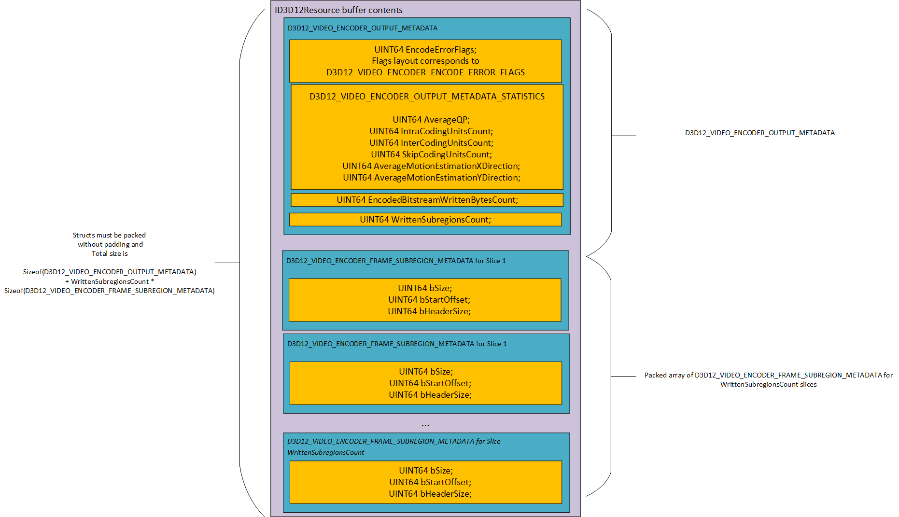
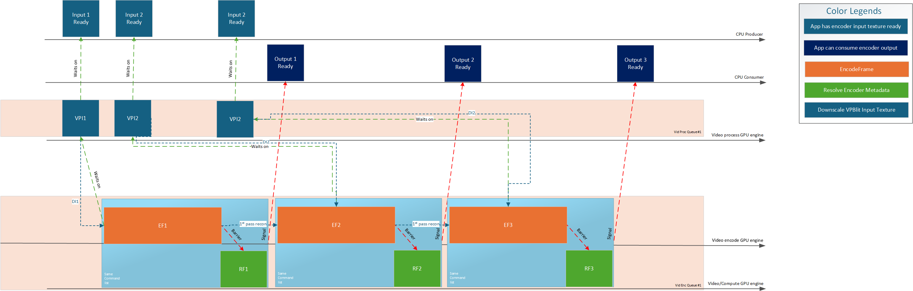
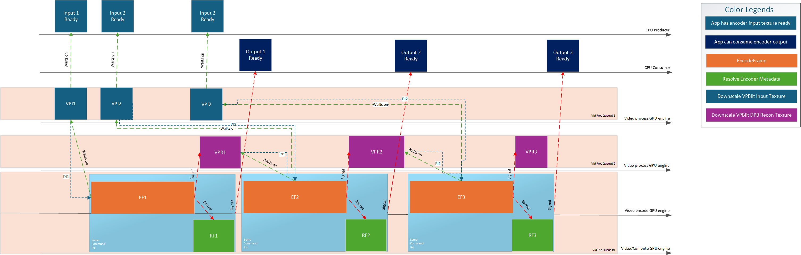
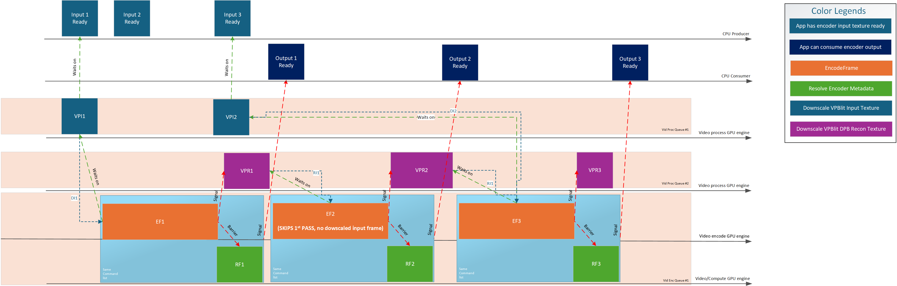
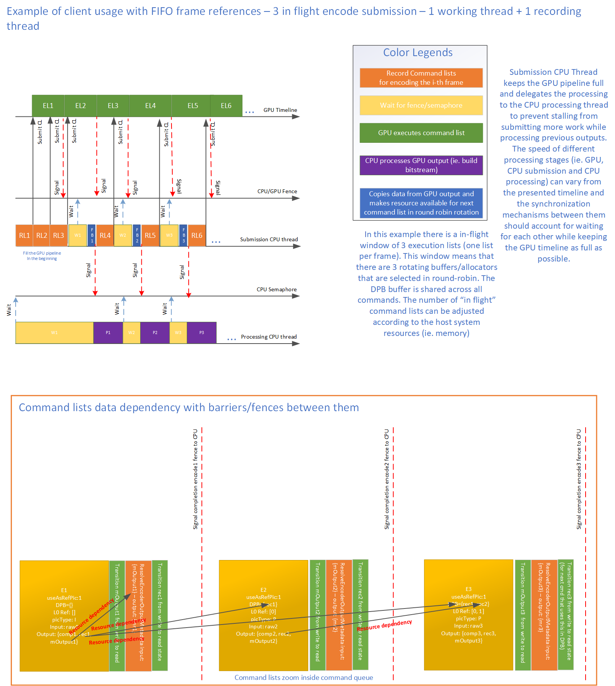

# Video encoding capabilities and controls

<!-- d3d12-review-legend:begin -->

> [!NOTE]
> **Draft provenance annotations.**
> Underlining marks pending replacement wording or authored list items. Warning boxes
> mark authored, mixed or reopened passages awaiting editorial review.
> Editorial adoption does not establish factual or hardware verification. Exact approved factual
> corrections do not trigger a marker. Unmarked text elsewhere, declarations
> and structural Markdown are not assertions of approval.
> [Annotation scope and approvals](../../spec-maintenance/d3d12/prose-annotations.md).

<!-- d3d12-review-legend:end -->

<!-- d3d12-review-alert:begin:video-encoding-controls:entry:0 -->

> [!WARNING]
> **Authored synthesis - human review pending.**
>
> **Qualified draft.** This supporting reference defines encoding capability
> tuples, rate control, picture/sequence inputs and optional statistics,
> notification, input map and two-pass contracts. [Video encoding](video-encoding.md)
> owns the conceptual route, object/recording lifetimes and declaring API entries.
> Shared released declarations belong to the [type reference](video-encoding-types.md);
> codec-specific syntax and qualifications belong to the [codec contract](video-encoding-codecs.md).

<!-- d3d12-review-alert:end:video-encoding-controls:entry:0 -->

## Encoding query selectors

<!-- d3d12-review-alert:begin:video-encoding-controls:query-selectors:0 -->

> [!WARNING]
> **Authored synthesis - human review pending.**
>
> | Selector | Value | Fixed payload |
> |---|---|---|
> | `D3D12_FEATURE_VIDEO_ENCODER_CODEC` | 33 | [`D3D12_FEATURE_DATA_VIDEO_ENCODER_CODEC`](video-encoding-types.md#d3d12-feature-data-video-encoder-codec) |
> | `D3D12_FEATURE_VIDEO_ENCODER_PROFILE_LEVEL` | 34 | [`D3D12_FEATURE_DATA_VIDEO_ENCODER_PROFILE_LEVEL`](video-encoding-types.md#d3d12-feature-data-video-encoder-profile-level) |
> | `D3D12_FEATURE_VIDEO_ENCODER_OUTPUT_RESOLUTION_RATIOS_COUNT` | 35 | [`D3D12_FEATURE_DATA_VIDEO_ENCODER_OUTPUT_RESOLUTION_RATIOS_COUNT`](video-encoding-types.md#d3d12-feature-data-video-encoder-output-resolution-ratios-count) |
> | `D3D12_FEATURE_VIDEO_ENCODER_OUTPUT_RESOLUTION` | 36 | [`D3D12_FEATURE_DATA_VIDEO_ENCODER_OUTPUT_RESOLUTION`](video-encoding-types.md#d3d12-feature-data-video-encoder-output-resolution) |
> | `D3D12_FEATURE_VIDEO_ENCODER_INPUT_FORMAT` | 37 | [`D3D12_FEATURE_DATA_VIDEO_ENCODER_INPUT_FORMAT`](video-encoding-types.md#d3d12-feature-data-video-encoder-input-format) |
> | `D3D12_FEATURE_VIDEO_ENCODER_RATE_CONTROL_MODE` | 38 | [`D3D12_FEATURE_DATA_VIDEO_ENCODER_RATE_CONTROL_MODE`](video-encoding-types.md#d3d12-feature-data-video-encoder-rate-control-mode) |
> | `D3D12_FEATURE_VIDEO_ENCODER_INTRA_REFRESH_MODE` | 39 | [`D3D12_FEATURE_DATA_VIDEO_ENCODER_INTRA_REFRESH_MODE`](video-encoding-types.md#d3d12-feature-data-video-encoder-intra-refresh-mode) |
> | `D3D12_FEATURE_VIDEO_ENCODER_FRAME_SUBREGION_LAYOUT_MODE` | 40 | [`D3D12_FEATURE_DATA_VIDEO_ENCODER_FRAME_SUBREGION_LAYOUT_MODE`](video-encoding-types.md#d3d12-feature-data-video-encoder-frame-subregion-layout-mode) |
> | `D3D12_FEATURE_VIDEO_ENCODER_HEAP_SIZE` | 41 | [`D3D12_FEATURE_DATA_VIDEO_ENCODER_HEAP_SIZE`](video-encoding-types.md#d3d12-feature-data-video-encoder-heap-size) |
> | `D3D12_FEATURE_VIDEO_ENCODER_CODEC_CONFIGURATION_SUPPORT` | 42 | [`D3D12_FEATURE_DATA_VIDEO_ENCODER_CODEC_CONFIGURATION_SUPPORT`](video-encoding-types.md#d3d12-feature-data-video-encoder-codec-configuration-support) |
> | `D3D12_FEATURE_VIDEO_ENCODER_SUPPORT` | 43 | [`D3D12_FEATURE_DATA_VIDEO_ENCODER_SUPPORT`](video-encoding-types.md#d3d12-feature-data-video-encoder-support) |
> | `D3D12_FEATURE_VIDEO_ENCODER_CODEC_PICTURE_CONTROL_SUPPORT` | 44 | [`D3D12_FEATURE_DATA_VIDEO_ENCODER_CODEC_PICTURE_CONTROL_SUPPORT`](video-encoding-types.md#d3d12-feature-data-video-encoder-codec-picture-control-support) |
> | `D3D12_FEATURE_VIDEO_ENCODER_RESOURCE_REQUIREMENTS` | 45 | [`D3D12_FEATURE_DATA_VIDEO_ENCODER_RESOURCE_REQUIREMENTS`](video-encoding-types.md#d3d12-feature-data-video-encoder-resource-requirements) |
> | `D3D12_FEATURE_VIDEO_ENCODER_FRAME_SUBREGION_LAYOUT_CONFIG` | 46 | [`D3D12_FEATURE_DATA_VIDEO_ENCODER_FRAME_SUBREGION_LAYOUT_CONFIG`](video-encoding-types.md#d3d12-feature-data-video-encoder-frame-subregion-layout-config) |
> | `D3D12_FEATURE_VIDEO_ENCODER_SUPPORT1` | 47 | [`D3D12_FEATURE_DATA_VIDEO_ENCODER_SUPPORT1`](video-encoding-types.md#d3d12-feature-data-video-encoder-support1) |
> | `D3D12_FEATURE_VIDEO_ENCODER_RESOURCE_REQUIREMENTS1` | 48 | [`D3D12_FEATURE_DATA_VIDEO_ENCODER_RESOURCE_REQUIREMENTS1`](video-encoding-types.md#d3d12-feature-data-video-encoder-resource-requirements1) |
> | `D3D12_FEATURE_VIDEO_ENCODER_RESOLVE_INPUT_PARAM_LAYOUT` | 49 | [`D3D12_FEATURE_DATA_VIDEO_ENCODER_RESOLVE_INPUT_PARAM_LAYOUT`](video-encoding-types.md#d3d12-feature-data-video-encoder-resolve-input-param-layout) |
> | `D3D12_FEATURE_VIDEO_ENCODER_QPMAP_INPUT` | 50 | [`D3D12_FEATURE_DATA_VIDEO_ENCODER_QPMAP_INPUT`](video-encoding-types.md#d3d12-feature-data-video-encoder-qpmap-input) |
> | `D3D12_FEATURE_VIDEO_ENCODER_DIRTY_REGIONS` | 51 | [`D3D12_FEATURE_DATA_VIDEO_ENCODER_DIRTY_REGIONS`](video-encoding-types.md#d3d12-feature-data-video-encoder-dirty-regions) |
> | `D3D12_FEATURE_VIDEO_ENCODER_MOTION_SEARCH` | 52 | [`D3D12_FEATURE_DATA_VIDEO_ENCODER_MOTION_SEARCH`](video-encoding-types.md#d3d12-feature-data-video-encoder-motion-search) |
> | `D3D12_FEATURE_VIDEO_ENCODER_SUPPORT2` | 55 | [`D3D12_FEATURE_DATA_VIDEO_ENCODER_SUPPORT2`](video-encoding-types.md#d3d12-feature-data-video-encoder-support2) |
> | `D3D12_FEATURE_VIDEO_ENCODER_HEAP_SIZE1` | 56 | [`D3D12_FEATURE_DATA_VIDEO_ENCODER_HEAP_SIZE1`](video-encoding-types.md#d3d12-feature-data-video-encoder-heap-size1) |
> | `D3D12_FEATURE_VIDEO_ENCODER_RATE_CONTROL_FRAME_ANALYSIS` | 57 | [`D3D12_FEATURE_DATA_VIDEO_ENCODER_RATE_CONTROL_FRAME_ANALYSIS`](video-encoding-types.md#d3d12-feature-data-video-encoder-rate-control-frame-analysis) |

<!-- d3d12-review-alert:end:video-encoding-controls:query-selectors:0 -->

<!-- d3d12-review-alert:begin:video-encoding-controls:query-selectors:1 -->

> [!WARNING]
> **Authored synthesis - human review pending.**
>
> `FeatureSupportDataSize` is the selected fixed payload's `sizeof`. Pointed-to arrays and codec payloads have their separate sizes/counts. They are not included by increasing that fixed size.

<!-- d3d12-review-alert:end:video-encoding-controls:query-selectors:1 -->

<!-- d3d12-review-alert:begin:video-encoding-controls:codec-qualification-route:0 -->

> [!WARNING]
> **Authored synthesis - human review pending.**
>
> Detailed H.264/HEVC header, POC, temporal reference and numeric qualifications belong to the [codec contract](video-encoding-codecs.md#family-h264-hevc). They do not change the fixed capability payload protocol described here.

<!-- d3d12-review-alert:end:video-encoding-controls:codec-qualification-route:0 -->

## Capabilities and per-resolution limits

### D3D12_VIDEO_ENCODER_CODEC

<ins><!-- d3d12-review-inline:begin:video-encoding-controls:S01-015:0 -->Released declaration: [`D3D12_VIDEO_ENCODER_CODEC`](video-encoding-types.md#d3d12-video-encoder-codec).<!-- d3d12-review-inline:end:video-encoding-controls:S01-015:0 --></ins>

List of possible codecs.

### D3D12_FEATURE_DATA_VIDEO_ENCODER_CODEC

<ins><!-- d3d12-review-inline:begin:video-encoding-controls:S01-016:0 -->Released declaration: [`D3D12_FEATURE_DATA_VIDEO_ENCODER_CODEC`](video-encoding-types.md#d3d12-feature-data-video-encoder-codec).<!-- d3d12-review-inline:end:video-encoding-controls:S01-016:0 --></ins>

**Members**

*NodeIndex*

Input parameter, in multi-adapter operation, this indicates which physical adapter of the device this operation applies to.

*Codec*

Input parameter, desired codec to check support for.

*IsSupported*

Output parameter, indicates if given value for feature is supported.

### D3D12_VIDEO_ENCODER_PROFILE_H264

<ins><!-- d3d12-review-inline:begin:video-encoding-controls:S01-017:0 -->Released declaration: [`D3D12_VIDEO_ENCODER_PROFILE_H264`](video-encoding-types.md#d3d12-video-encoder-profile-h264).<!-- d3d12-review-inline:end:video-encoding-controls:S01-017:0 --></ins>

List of possible H264 profiles.

### D3D12_VIDEO_ENCODER_PROFILE_HEVC

<ins><!-- d3d12-review-inline:begin:video-encoding-controls:S01-018:0 -->Released declaration: [`D3D12_VIDEO_ENCODER_PROFILE_HEVC`](video-encoding-types.md#d3d12-video-encoder-profile-hevc).<!-- d3d12-review-inline:end:video-encoding-controls:S01-018:0 --></ins>

List of possible HEVC profiles.

### D3D12_VIDEO_ENCODER_PROFILE_DESC

<ins><!-- d3d12-review-inline:begin:video-encoding-controls:S01-019:0 -->Released declaration: [`D3D12_VIDEO_ENCODER_PROFILE_DESC`](video-encoding-types.md#d3d12-video-encoder-profile-desc).<!-- d3d12-review-inline:end:video-encoding-controls:S01-019:0 --></ins>

Generic structure for codec profiles.

### D3D12_VIDEO_ENCODER_LEVELS_H264

<ins><!-- d3d12-review-inline:begin:video-encoding-controls:S01-020:0 -->Released declaration: [`D3D12_VIDEO_ENCODER_LEVELS_H264`](video-encoding-types.md#d3d12-video-encoder-levels-h264).<!-- d3d12-review-inline:end:video-encoding-controls:S01-020:0 --></ins>

List of possible H264 levels.

### D3D12_VIDEO_ENCODER_TIER_HEVC

<ins><!-- d3d12-review-inline:begin:video-encoding-controls:S01-021:0 -->Released declaration: [`D3D12_VIDEO_ENCODER_TIER_HEVC`](video-encoding-types.md#d3d12-video-encoder-tier-hevc).<!-- d3d12-review-inline:end:video-encoding-controls:S01-021:0 --></ins>

**Constants**

List of possible HEVC tiers.

### D3D12_VIDEO_ENCODER_LEVELS_HEVC

<ins><!-- d3d12-review-inline:begin:video-encoding-controls:S01-022:0 -->Released declaration: [`D3D12_VIDEO_ENCODER_LEVELS_HEVC`](video-encoding-types.md#d3d12-video-encoder-levels-hevc).<!-- d3d12-review-inline:end:video-encoding-controls:S01-022:0 --></ins>

**Constants**

List of possible HEVC levels.

### D3D12_VIDEO_ENCODER_LEVEL_TIER_CONSTRAINTS_HEVC

<ins><!-- d3d12-review-inline:begin:video-encoding-controls:S01-023:0 -->Released declaration: [`D3D12_VIDEO_ENCODER_LEVEL_TIER_CONSTRAINTS_HEVC`](video-encoding-types.md#d3d12-video-encoder-level-tier-constraints-hevc).<!-- d3d12-review-inline:end:video-encoding-controls:S01-023:0 --></ins>

Groups a level and a tier for HEVC level setting configuration.

**Members**

*Level*

The HEVC associated level.

*Tier*

The HEVC associated tier.

### D3D12_VIDEO_ENCODER_LEVEL_SETTING

<ins><!-- d3d12-review-inline:begin:video-encoding-controls:S01-024:0 -->Released declaration: [`D3D12_VIDEO_ENCODER_LEVEL_SETTING`](video-encoding-types.md#d3d12-video-encoder-level-setting).<!-- d3d12-review-inline:end:video-encoding-controls:S01-024:0 --></ins>

Encapsulates a generic level related setting definition.

### D3D12_FEATURE_DATA_VIDEO_ENCODER_PROFILE_LEVEL

<ins><!-- d3d12-review-inline:begin:video-encoding-controls:S01-025:0 -->Released declaration: [`D3D12_FEATURE_DATA_VIDEO_ENCODER_PROFILE_LEVEL`](video-encoding-types.md#d3d12-feature-data-video-encoder-profile-level).<!-- d3d12-review-inline:end:video-encoding-controls:S01-025:0 --></ins>

**Members**

*NodeIndex*

Input parameter, in multi-adapter operation, this indicates which physical adapter of the device this operation applies to.

*Codec*

Input parameter, desired codec to check support for.

*Profile*

Input parameter, desired profile to check support for.

*IsSupported*

Output parameter, indicates if given value for feature is supported.

*MinSupportedLevel*

Output parameter, minimum supported level for the selected codec and profile if supported.

*MaxSupportedLevel*

Output parameter, maximum supported level for the selected codec and profile if supported.

### D3D12_VIDEO_ENCODER_PICTURE_RESOLUTION_RATIO_DESC

<ins><!-- d3d12-review-inline:begin:video-encoding-controls:S01-026:0 -->Released declaration: [`D3D12_VIDEO_ENCODER_PICTURE_RESOLUTION_RATIO_DESC`](video-encoding-types.md#d3d12-video-encoder-picture-resolution-ratio-desc).<!-- d3d12-review-inline:end:video-encoding-controls:S01-026:0 --></ins>

Defines a resolution ratio as an irreducible fraction.

**Members**

*WidthRatio*

Indicates the resolution ratio numerator.

*HeightRatio*

Indicates the resolution ratio denominator.

### D3D12_FEATURE_DATA_VIDEO_ENCODER_OUTPUT_RESOLUTION_RATIOS_COUNT

<ins><!-- d3d12-review-inline:begin:video-encoding-controls:S01-027:0 -->Released declaration: [`D3D12_FEATURE_DATA_VIDEO_ENCODER_OUTPUT_RESOLUTION_RATIOS_COUNT`](video-encoding-types.md#d3d12-feature-data-video-encoder-output-resolution-ratios-count).<!-- d3d12-review-inline:end:video-encoding-controls:S01-027:0 --></ins>

<ins><!-- d3d12-review-inline:begin:video-encoding-controls:S01-027:1 -->Structure returning the number of supported resolution ratios for the selected codec.<!-- d3d12-review-inline:end:video-encoding-controls:S01-027:1 --></ins>

**Members**

*NodeIndex*

Input parameter, in multi-adapter operation, this indicates which physical adapter of the device this operation applies to.

*Codec*

Input parameter, desired codec to check support for.

*ResolutionRatiosCount*

Indicates the number of resolution ratios supported for this configuration.

### D3D12_VIDEO_ENCODER_PICTURE_RESOLUTION_DESC

<ins><!-- d3d12-review-inline:begin:video-encoding-controls:S01-028:0 -->Released declaration: [`D3D12_VIDEO_ENCODER_PICTURE_RESOLUTION_DESC`](video-encoding-types.md#d3d12-video-encoder-picture-resolution-desc).
Defines a resolution.<!-- d3d12-review-inline:end:video-encoding-controls:S01-028:0 --></ins>

**Members**

*Width*

Indicates the resolution width in pixels.

*Height*

Indicates the resolution height in pixels.

### D3D12_FEATURE_DATA_VIDEO_ENCODER_OUTPUT_RESOLUTION

<ins><!-- d3d12-review-inline:begin:video-encoding-controls:S01-029:0 -->Released declaration: [`D3D12_FEATURE_DATA_VIDEO_ENCODER_OUTPUT_RESOLUTION`](video-encoding-types.md#d3d12-feature-data-video-encoder-output-resolution).<!-- d3d12-review-inline:end:video-encoding-controls:S01-029:0 --></ins>

<ins><!-- d3d12-review-inline:begin:video-encoding-controls:S01-029:1 -->Structure returning supported resolution bounds, dimension multiples and resolution ratios for the selected codec.<!-- d3d12-review-inline:end:video-encoding-controls:S01-029:1 --></ins>

**Members**

*NodeIndex*

Input parameter, in multi-adapter operation, this indicates which physical adapter of the device this operation applies to.

*Codec*

Input parameter, desired codec to check support for.

*ResolutionRatiosCount*

Input parameter, indicates the number of resolution ratios to retrieve. Must match D3D12_FEATURE_DATA_VIDEO_ENCODER_OUTPUT_RESOLUTION_RATIOS_COUNT.ResolutionRatiosCount.

*IsSupported*

Output parameter, indicates if there's support for the current query inputs.

*MinResolutionSupported*

Output parameter, minimum resolution supported.

*MaxResolutionSupported*

Output parameter, maximum resolution supported.

*ResolutionWidthMultipleRequirement*

Output parameter, resolution X component must be divisible by this value.

*ResolutionHeightMultipleRequirement*

Output parameter, resolution Y component must be divisible by this value.

*pResolutionRatios*

Output parameter, list of supported resolution ratios as irreducible fractions.

The host allocates the memory for this array based on the resolution count query and passes it in the query struct.

### D3D12_FEATURE_DATA_VIDEO_ENCODER_INPUT_FORMAT

<ins><!-- d3d12-review-inline:begin:video-encoding-controls:S01-030:0 -->Released declaration: [`D3D12_FEATURE_DATA_VIDEO_ENCODER_INPUT_FORMAT`](video-encoding-types.md#d3d12-feature-data-video-encoder-input-format).<!-- d3d12-review-inline:end:video-encoding-controls:S01-030:0 --></ins>

**Remarks**

<ins><!-- d3d12-review-inline:begin:video-encoding-controls:S01-030:2 -->The legacy 4:2:0 path supports 8- and 10-bit samples using `DXGI_FORMAT_NV12` and `DXGI_FORMAT_P010`. Higher-profile HEVC and AV1 formats retain their [codec-specific capability gates](video-encoding-codecs.md).<!-- d3d12-review-inline:end:video-encoding-controls:S01-030:2 --></ins>

**Members**

*NodeIndex*

Input parameter, in multi-adapter operation, this indicates which physical adapter of the device this operation applies to.

*Codec*

Input parameter, desired codec to check support for.

*Profile*

Input parameter, desired profile to check support for.

*Format*

Input parameter, desired format setting to check support for.

**Note:** This format definition includes the subsampling and bit-depth modes settings for the video encoding session.

**Note:** The host is expected to handle the input subsampling/color conversion stages of video encoding.

*IsSupported*

Output parameter, indicates if given value for feature is supported.

### D3D12_VIDEO_ENCODER_RATE_CONTROL_MODE

<ins><!-- d3d12-review-inline:begin:video-encoding-controls:S01-031:0 -->Released declaration: [`D3D12_VIDEO_ENCODER_RATE_CONTROL_MODE`](video-encoding-types.md#d3d12-video-encoder-rate-control-mode).<!-- d3d12-review-inline:end:video-encoding-controls:S01-031:0 --></ins>

List of possible rate control modes.

**Constants**

*D3D12_VIDEO_ENCODER_RATE_CONTROL_MODE_ABSOLUTE_QP_MAP*

<ins><!-- d3d12-review-inline:begin:video-encoding-controls:S01-031:4 -->Indicates no rate control budgeting. Each EncodeFrame call will interpret the QP values in the codec-specific picture control `pRateControlQPMap` as a map of absolute QP values.<!-- d3d12-review-inline:end:video-encoding-controls:S01-031:4 --></ins>

*D3D12_VIDEO_ENCODER_RATE_CONTROL_MODE_CQP*

Indicates constant quantization parameter rate control mode.

*D3D12_VIDEO_ENCODER_RATE_CONTROL_MODE_CBR*

Indicates constant bit rate rate control mode.

*D3D12_VIDEO_ENCODER_RATE_CONTROL_MODE_VBR*

Indicates variable bit rate control mode.

*D3D12_VIDEO_ENCODER_RATE_CONTROL_MODE_QVBR*

Indicates constant quality target rate variable rate control mode.

### D3D12_FEATURE_DATA_VIDEO_ENCODER_RATE_CONTROL_MODE

<ins><!-- d3d12-review-inline:begin:video-encoding-controls:S01-032:0 -->Released declaration: [`D3D12_FEATURE_DATA_VIDEO_ENCODER_RATE_CONTROL_MODE`](video-encoding-types.md#d3d12-feature-data-video-encoder-rate-control-mode).<!-- d3d12-review-inline:end:video-encoding-controls:S01-032:0 --></ins>

**Members**

*NodeIndex*

Input parameter, in multi-adapter operation, this indicates which physical adapter of the device this operation applies to.

*Codec*

Input parameter, desired codec to check support for.

*RateControlMode*

Input parameter, desired rate control to check support for.

*IsSupported*

Output parameter, indicates if given value for feature is supported.

### D3D12_VIDEO_ENCODER_INTRA_REFRESH_MODE

<ins><!-- d3d12-review-inline:begin:video-encoding-controls:S01-033:0 -->Released declaration: [`D3D12_VIDEO_ENCODER_INTRA_REFRESH_MODE`](video-encoding-types.md#d3d12-video-encoder-intra-refresh-mode).<!-- d3d12-review-inline:end:video-encoding-controls:S01-033:0 --></ins>

List of possible intra refresh modes.

**Constants**

*D3D12_VIDEO_ENCODER_INTRA_REFRESH_MODE_NONE*

Encoder does not use intra refresh.

*D3D12_VIDEO_ENCODER_INTRA_REFRESH_MODE_ROW_BASED*

Encoder uses row-based intra refresh mode.

### D3D12_FEATURE_DATA_VIDEO_ENCODER_INTRA_REFRESH_MODE

<ins><!-- d3d12-review-inline:begin:video-encoding-controls:S01-034:0 -->Released declaration: [`D3D12_FEATURE_DATA_VIDEO_ENCODER_INTRA_REFRESH_MODE`](video-encoding-types.md#d3d12-feature-data-video-encoder-intra-refresh-mode).<!-- d3d12-review-inline:end:video-encoding-controls:S01-034:0 --></ins>

**Members**

*NodeIndex*

Input parameter, in multi-adapter operation, this indicates which physical adapter of the device this operation applies to.

*Codec*

Input parameter, desired codec to check support for.

*Profile*

Input parameter, desired profile to check support for.

*Level*

Input parameter, desired level to check support for.

*IntraRefreshMode*

Input parameter, desired intra refresh to check support for.

*IsSupported*

Output parameter, indicates if given value for feature is supported.

### D3D12_VIDEO_ENCODER_FRAME_SUBREGION_LAYOUT_MODE

<ins><!-- d3d12-review-inline:begin:video-encoding-controls:S01-035:0 -->Released declaration: [`D3D12_VIDEO_ENCODER_FRAME_SUBREGION_LAYOUT_MODE`](video-encoding-types.md#d3d12-video-encoder-frame-subregion-layout-mode).<!-- d3d12-review-inline:end:video-encoding-controls:S01-035:0 --></ins>

List of possible frame subregion encoding modes.

**Constants**

*D3D12_VIDEO_ENCODER_FRAME_SUBREGION_LAYOUT_MODE_FULL_FRAME*

Full frame output support.

*D3D12_VIDEO_ENCODER_FRAME_SUBREGION_LAYOUT_MODE_BYTES_PER_SUBREGION*

Indicates support for frame subregions to be set as a number of bytes per subregion.

*D3D12_VIDEO_ENCODER_FRAME_SUBREGION_LAYOUT_MODE_SQUARE_UNITS_PER_SUBREGION_ROW_UNALIGNED*

Indicates support for frame subregions to be set as a number of squared blocks per subregion.
The number of squared blocks does not need to be multiple of a row size in squared blocks (eg. if the subregions don't need to be row aligned). When needing to set row aligned number of squared blocks per subregion, please use the D3D12_VIDEO_ENCODER_FRAME_SUBREGION_LAYOUT_MODE_UNIFORM_PARTITIONING_* modes.

*D3D12_VIDEO_ENCODER_FRAME_SUBREGION_LAYOUT_MODE_UNIFORM_PARTITIONING_ROWS_PER_SUBREGION*

Divides the frame into a number of slices determined by the number of rows per slice.
The size in pixels of the rows can be calculated using the current resolution and D3D12_FEATURE_DATA_VIDEO_ENCODER_RESOLUTION_SUPPORT_LIMITS.SubregionBlockPixelsSize for the current frame resolution.

*D3D12_VIDEO_ENCODER_FRAME_SUBREGION_LAYOUT_MODE_UNIFORM_PARTITIONING_SUBREGIONS_PER_FRAME*

Specifies number of slices to divide the frame into.

### D3D12_FEATURE_DATA_VIDEO_ENCODER_FRAME_SUBREGION_LAYOUT_MODE

<ins><!-- d3d12-review-inline:begin:video-encoding-controls:S01-036:0 -->Released declaration: [`D3D12_FEATURE_DATA_VIDEO_ENCODER_FRAME_SUBREGION_LAYOUT_MODE`](video-encoding-types.md#d3d12-feature-data-video-encoder-frame-subregion-layout-mode).<!-- d3d12-review-inline:end:video-encoding-controls:S01-036:0 --></ins>

**Members**

*NodeIndex*

Input parameter, in multi-adapter operation, this indicates which physical adapter of the device this operation applies to.

*Codec*

Input parameter, desired codec to check support for.

*Profile*

Input parameter, desired profile to check support for.

*Level*

Input parameter, desired level to check support for.

*SubregionMode*

Input parameter, desired subregion mode to check support for.

*IsSupported*

Output parameter, indicates if given value for feature is supported.

### D3D12_VIDEO_ENCODER_CODEC_CONFIGURATION_SUPPORT_H264_FLAGS

<ins><!-- d3d12-review-inline:begin:video-encoding-controls:S01-040:0 -->Released declaration: [`D3D12_VIDEO_ENCODER_CODEC_CONFIGURATION_SUPPORT_H264_FLAGS`](video-encoding-types.md#d3d12-video-encoder-codec-configuration-support-h264-flags).<!-- d3d12-review-inline:end:video-encoding-controls:S01-040:0 --></ins>

Reports HW capabilities for H264.

**Constants**

<ins><!-- d3d12-review-inline:begin:video-encoding-controls:S01-040:3 -->*D3D12_VIDEO_ENCODER_CODEC_CONFIGURATION_SUPPORT_H264_FLAG_CABAC_ENCODING_SUPPORT*<!-- d3d12-review-inline:end:video-encoding-controls:S01-040:3 --></ins>

Indicates if support is available for CABAC Encoding.

<ins><!-- d3d12-review-inline:begin:video-encoding-controls:S01-040:5 -->*D3D12_VIDEO_ENCODER_CODEC_CONFIGURATION_SUPPORT_H264_FLAG_INTRA_SLICE_CONSTRAINED_ENCODING_SUPPORT*<!-- d3d12-review-inline:end:video-encoding-controls:S01-040:5 --></ins>

Indicates if support is available for slice constrained encoding in which every slice in a frame is encoded independently from other slices in the same frame. This mode restricts the motion vector search range to the region box of the current slice (eg. can’t use motion vectors outside the slice boundary).

<ins><!-- d3d12-review-inline:begin:video-encoding-controls:S01-040:7 -->*D3D12_VIDEO_ENCODER_CODEC_CONFIGURATION_SUPPORT_H264_FLAG_BFRAME_LTR_COMBINED_SUPPORT*<!-- d3d12-review-inline:end:video-encoding-controls:S01-040:7 --></ins>

Indicates support for using B-frames and long term references at the same time.

<ins><!-- d3d12-review-inline:begin:video-encoding-controls:S01-040:9 -->*D3D12_VIDEO_ENCODER_CODEC_CONFIGURATION_SUPPORT_H264_FLAG_ADAPTIVE_8x8_TRANSFORM_ENCODING_SUPPORT*<!-- d3d12-review-inline:end:video-encoding-controls:S01-040:9 --></ins>

Indicates support for using adaptive 8x8 transforms when encoding.

<ins><!-- d3d12-review-inline:begin:video-encoding-controls:S01-040:11 -->*D3D12_VIDEO_ENCODER_CODEC_CONFIGURATION_SUPPORT_H264_FLAG_DIRECT_SPATIAL_ENCODING_SUPPORT*<!-- d3d12-review-inline:end:video-encoding-controls:S01-040:11 --></ins>

Indicates support for spatial direct mode.

<ins><!-- d3d12-review-inline:begin:video-encoding-controls:S01-040:13 -->*D3D12_VIDEO_ENCODER_CODEC_CONFIGURATION_SUPPORT_H264_FLAG_DIRECT_TEMPORAL_ENCODING_SUPPORT*<!-- d3d12-review-inline:end:video-encoding-controls:S01-040:13 --></ins>

Indicates support for temporal direct mode.

<ins><!-- d3d12-review-inline:begin:video-encoding-controls:S01-040:15 -->*D3D12_VIDEO_ENCODER_CODEC_CONFIGURATION_SUPPORT_H264_FLAG_CONSTRAINED_INTRAPREDICTION_SUPPORT*<!-- d3d12-review-inline:end:video-encoding-controls:S01-040:15 --></ins>

Indicates if support is available for constrained intraprediction, that if activated will force the encoding of each intra-coded block with residual data only from other intra-coded blocks (eg. not from inter-coded blocks). This refers to constrained_intra_pred_flag in the PPS.

*D3D12_VIDEO_ENCODER_CODEC_CONFIGURATION_SUPPORT_H264_FLAG_NUM_REF_IDX_ACTIVE_OVERRIDE_FLAG_SLICE_SUPPORT*

If bit set, the driver supports writing `num_ref_idx_active_override_flag` and the related `num_ref_idx_l0_active_minus1` and `num_ref_idx_l1_active_minus1` in the slice header, overriding the active PPS values for these codec params.

### D3D12_VIDEO_ENCODER_CODEC_CONFIGURATION_H264_SLICES_DEBLOCKING_MODES

<ins><!-- d3d12-review-inline:begin:video-encoding-controls:S01-041:0 -->Released declaration: [`D3D12_VIDEO_ENCODER_CODEC_CONFIGURATION_H264_SLICES_DEBLOCKING_MODES`](video-encoding-types.md#d3d12-video-encoder-codec-configuration-h264-slices-deblocking-modes).<!-- d3d12-review-inline:end:video-encoding-controls:S01-041:0 --></ins>

Corresponds to _disable_deblocking_filter_idc_ syntax for H264 spec.

### D3D12_VIDEO_ENCODER_CODEC_CONFIGURATION_H264_SLICES_DEBLOCKING_MODE_FLAGS

<ins><!-- d3d12-review-inline:begin:video-encoding-controls:S01-042:0 -->Released declaration: [`D3D12_VIDEO_ENCODER_CODEC_CONFIGURATION_H264_SLICES_DEBLOCKING_MODE_FLAGS`](video-encoding-types.md#d3d12-video-encoder-codec-configuration-h264-slices-deblocking-mode-flags).<!-- d3d12-review-inline:end:video-encoding-controls:S01-042:0 --></ins>

Corresponds to D3D12_VIDEO_ENCODER_CODEC_CONFIGURATION_H264_SLICES_DEBLOCKING_MODES. Used to report support for each of them in the H264 codec support caps.

### D3D12_VIDEO_ENCODER_CODEC_CONFIGURATION_SUPPORT_H264

<ins><!-- d3d12-review-inline:begin:video-encoding-controls:S01-043:0 -->Released declaration: [`D3D12_VIDEO_ENCODER_CODEC_CONFIGURATION_SUPPORT_H264`](video-encoding-types.md#d3d12-video-encoder-codec-configuration-support-h264).<!-- d3d12-review-inline:end:video-encoding-controls:S01-043:0 --></ins>

**Members**

*SupportFlags*

Indicates which optional features are supported for the codec. The flags can be combined.

*DisableDeblockingFilterSupportedModes*

Indicates the allowed modes supported for _disable_deblocking_filter_idc_ syntax for H264 spec.

### D3D12_VIDEO_ENCODER_CODEC_CONFIGURATION_SUPPORT_HEVC_FLAGS

<ins><!-- d3d12-review-inline:begin:video-encoding-controls:S01-044:0 -->Released declaration: [`D3D12_VIDEO_ENCODER_CODEC_CONFIGURATION_SUPPORT_HEVC_FLAGS`](video-encoding-types.md#d3d12-video-encoder-codec-configuration-support-hevc-flags).
Reports HW capabilities for HEVC.<!-- d3d12-review-inline:end:video-encoding-controls:S01-044:0 --></ins>

**Constants**

*D3D12_VIDEO_ENCODER_CODEC_CONFIGURATION_SUPPORT_HEVC_FLAG_NONE*

None.

*D3D12_VIDEO_ENCODER_CODEC_CONFIGURATION_SUPPORT_HEVC_FLAG_BFRAME_LTR_COMBINED_SUPPORT*

If bit set, reports support for usage of B frames and long term references frames simultaneously.

*D3D12_VIDEO_ENCODER_CODEC_CONFIGURATION_SUPPORT_HEVC_FLAG_INTRA_SLICE_CONSTRAINED_ENCODING_SUPPORT*

If bit set, reports support for slice contrained encoding, in which every slice in a frame is encoded independently from other slices in the same frame. This mode restricts the motion vector search range to the region box of the current slice (eg. can’t use motion vectors outside the slice boundary).

*D3D12_VIDEO_ENCODER_CODEC_CONFIGURATION_SUPPORT_HEVC_FLAG_CONSTRAINED_INTRAPREDICTION_SUPPORT*

If bit set, reports support for constrained intraprediction, that if activated will force the encoding of each intra-coded block with residual data only from other intra-coded blocks (eg. not from inter-coded blocks). This refers to constrained_intra_pred_flag in the PPS.

*D3D12_VIDEO_ENCODER_CODEC_CONFIGURATION_SUPPORT_HEVC_FLAG_SAO_FILTER_SUPPORT*

If bit set, reports support for sample adaptive offset.

*D3D12_VIDEO_ENCODER_CODEC_CONFIGURATION_SUPPORT_HEVC_FLAG_ASYMETRIC_MOTION_PARTITION_SUPPORT*

If bit set, reports support for asymetric motion partition.

*D3D12_VIDEO_ENCODER_CODEC_CONFIGURATION_SUPPORT_HEVC_FLAG_ASYMETRIC_MOTION_PARTITION_REQUIRED*

If bit set, asymetric motion partition must be always enabled. If this flag is set, D3D12_VIDEO_ENCODER_CODEC_CONFIGURATION_SUPPORT_HEVC_FLAG_ASYMETRIC_MOTION_PARTITION_SUPPORT is expected to also be set.

*D3D12_VIDEO_ENCODER_CODEC_CONFIGURATION_SUPPORT_HEVC_FLAG_TRANSFORM_SKIP_SUPPORT*

If bit set, reports support for transform skip.

*D3D12_VIDEO_ENCODER_CODEC_CONFIGURATION_SUPPORT_HEVC_FLAG_DISABLING_LOOP_FILTER_ACROSS_SLICES_SUPPORT*

If bit set, reports support for disabling loop filter across slices.

*D3D12_VIDEO_ENCODER_CODEC_CONFIGURATION_SUPPORT_HEVC_FLAG_P_FRAMES_IMPLEMENTED_AS_LOW_DELAY_B_FRAMES*

<!-- d3d12-review-context:begin:video-encoding-controls:S01-044:21 -->

> [!WARNING]
> **Mixed source and authored adaptation - human review pending.**

If bit set, informs the user that when encoding frames with type D3D12_VIDEO_ENCODER_FRAME_TYPE_HEVC_P_FRAME, they will be written as low delay B-Frames in the compressed bitstream. If bit off, informs P frames will be written in the compressed bitstream.
 > Note: When operating under this mode, is the user responsibility to code the correct frame type in _AUD_NUT_ and other parts of the HEVC bitstream, taking into account that P frames will be treated as generalized B frames with only references to past frames in POC order.

<!-- d3d12-review-context:end:video-encoding-controls:S01-044:21 -->

*D3D12_VIDEO_ENCODER_CODEC_CONFIGURATION_SUPPORT_HEVC_FLAG_NUM_REF_IDX_ACTIVE_OVERRIDE_FLAG_SLICE_SUPPORT*

If bit set, the driver supports writing `num_ref_idx_active_override_flag` and the related `num_ref_idx_l0_active_minus1` and `num_ref_idx_l1_active_minus1` in the slice header, overriding the active PPS values for these codec params.

### D3D12_VIDEO_ENCODER_CODEC_CONFIGURATION_HEVC_CUSIZE

<ins><!-- d3d12-review-inline:begin:video-encoding-controls:S01-045:0 -->Released declaration: [`D3D12_VIDEO_ENCODER_CODEC_CONFIGURATION_HEVC_CUSIZE`](video-encoding-types.md#d3d12-video-encoder-codec-configuration-hevc-cusize).<!-- d3d12-review-inline:end:video-encoding-controls:S01-045:0 --></ins>

Indicates possible values for luma coding block sizes for HEVC. These values can then be used to express HEVC variables such as _MinCbSizeY_, _CtbLog2SizeY_.

*D3D12_VIDEO_ENCODER_CODEC_CONFIGURATION_HEVC_CUSIZE_8x8*

Indicates a luma coding block if pixel size 8.

*D3D12_VIDEO_ENCODER_CODEC_CONFIGURATION_HEVC_CUSIZE_16x16*

Indicates a luma coding block if pixel size 16.

*D3D12_VIDEO_ENCODER_CODEC_CONFIGURATION_HEVC_CUSIZE_32x32*

Indicates a luma coding block if pixel size 32.

*D3D12_VIDEO_ENCODER_CODEC_CONFIGURATION_HEVC_CUSIZE_64x64*

<ins><!-- d3d12-review-inline:begin:video-encoding-controls:S01-045:9 -->Indicates a luma coding block if pixel size 64.<!-- d3d12-review-inline:end:video-encoding-controls:S01-045:9 --></ins>

### D3D12_VIDEO_ENCODER_CODEC_CONFIGURATION_HEVC_TUSIZE

<ins><!-- d3d12-review-inline:begin:video-encoding-controls:S01-046:0 -->Released declaration: [`D3D12_VIDEO_ENCODER_CODEC_CONFIGURATION_HEVC_TUSIZE`](video-encoding-types.md#d3d12-video-encoder-codec-configuration-hevc-tusize).<!-- d3d12-review-inline:end:video-encoding-controls:S01-046:0 --></ins>

Indicates possible values for luma transform block sizes for HEVC. These values can then be used to express HEVC variables such as _MinTbLog2SizeY_, _MaxTbLog2SizeY_.

*D3D12_VIDEO_ENCODER_CODEC_CONFIGURATION_HEVC_TUSIZE_4x4*

Indicates a luma transform block if pixel size 4.

*D3D12_VIDEO_ENCODER_CODEC_CONFIGURATION_HEVC_TUSIZE_8x8*

Indicates a luma transform block if pixel size 8.

*D3D12_VIDEO_ENCODER_CODEC_CONFIGURATION_HEVC_TUSIZE_16x16*

Indicates a luma transform block if pixel size 16.

*D3D12_VIDEO_ENCODER_CODEC_CONFIGURATION_HEVC_TUSIZE_32x32*

Indicates a luma transform block if pixel size 32.

### D3D12_VIDEO_ENCODER_CODEC_CONFIGURATION_SUPPORT_HEVC

<ins><!-- d3d12-review-inline:begin:video-encoding-controls:S01-047:0 -->Released declaration: [`D3D12_VIDEO_ENCODER_CODEC_CONFIGURATION_SUPPORT_HEVC`](video-encoding-types.md#d3d12-video-encoder-codec-configuration-support-hevc).<!-- d3d12-review-inline:end:video-encoding-controls:S01-047:0 --></ins>

Used in D3D12_FEATURE_DATA_VIDEO_ENCODER_CODEC_CONFIGURATION_SUPPORT for HEVC. User sends the desired configuration inputs in this struct, the cap returns IsSupported=true when there's support for the configuration combination and `D3D12_VIDEO_ENCODER_CODEC_CONFIGURATION_SUPPORT_HEVC_FLAGS` with more detailed support information.

**Members**

*SupportFlags*

Output param. Indicates which optional features are supported for the codec. The flags can be combined.

*MinLumaCodingUnitSize*

Input param. Indicates the minimum luma coding block size requested. This value matches what the user will code in SPS.

*MaxLumaCodingUnitSize*

Input param. Indicates the max luma coding block size requested. This value matches what the user will code in SPS.

*MinLumaTransformUnitSize*

Input param. Indicates the minimum luma transform block size requested. This value matches the pixel size of what the user will code in SPS.log2_min_luma_transform_block_size_minus2.

*MaxLumaTransformUnitSize*

Input param. Indicates the max luma transform block size requested. This value has to be consistent with the pixel size the user will code in SPS.log2_diff_max_min_luma_transform_block_size.
The variable MaxTbLog2SizeY is set equal to log2_min_luma_transform_block_size_minus2 + 2 + log2_diff_max_min_luma_transform_block_size.

*max_transform_hierarchy_depth_inter*

Input param. Specifies the maximum hierarchy depth for transform units of coding units coded in inter prediction mode. The value of max_transform_hierarchy_depth_inter shall be in the range of 0 to CtbLog2SizeY − MinTbLog2SizeY, inclusive.

*max_transform_hierarchy_depth_intra*

Input param. Specifies the maximum hierarchy depth for transform units of coding units coded in intra prediction mode. The value of max_transform_hierarchy_depth_intra shall be in the range of 0 to CtbLog2SizeY − MinTbLog2SizeY, inclusive.

### D3D12_FEATURE_DATA_VIDEO_ENCODER_CODEC_CONFIGURATION_SUPPORT

<ins><!-- d3d12-review-inline:begin:video-encoding-controls:S01-049:0 -->Released declaration: [`D3D12_FEATURE_DATA_VIDEO_ENCODER_CODEC_CONFIGURATION_SUPPORT`](video-encoding-types.md#d3d12-feature-data-video-encoder-codec-configuration-support).<!-- d3d12-review-inline:end:video-encoding-controls:S01-049:0 --></ins>

**Members**

*NodeIndex*

Input parameter, in multi-adapter operation, this indicates which physical adapter of the device this operation applies to.

*Codec*

Input parameter, indicates the encode codec to be targeted in the support query.

*Profile*

Input parameter, desired profile to check support for.

*IsSupported*

Output parameter, indicates if supported for current input arguments.

*CodecSupportLimits*

Input/Output parameter, codec specific support configuration limits structure. For H264, output parameter returning the supported configuration. For HEVC, input parameter with the user desired/requested HEVC configuration.

### Reference picture limits for H.264 and legacy HEVC

<ins><!-- d3d12-review-inline:begin:video-encoding-controls:S01-051:0 -->Released declaration: [`D3D12_VIDEO_ENCODER_CODEC_PICTURE_CONTROL_SUPPORT_HEVC`](video-encoding-types.md#d3d12-video-encoder-codec-picture-control-support-hevc).<!-- d3d12-review-inline:end:video-encoding-controls:S01-051:0 --></ins>

**Members**

*MaxL0ReferencesForP*

MaxL0ReferencesForP corresponds to the maximum value allowed in the slice headers for (num_ref_idx_l0_active_minus1 +1) when encoding P frames – This is equivalent to the maximum size of an L0 for a P frame supported.

*MaxL0ReferencesForB*

MaxL0ReferencesForB corresponds to the maximum value allowed in the slice headers for (num_ref_idx_l0_active_minus1 +1) when encoding B frames – This is equivalent to the maximum size of an L0 for a B frame supported.

*MaxL1ReferencesForB*

MaxL1ReferencesForB corresponds to the maximum value allowed in the slice headers for (num_ref_idx_l1_active_minus1 +1) when encoding B frames – This is equivalent to the maximum size of an L1 for a B frame supported.

*MaxLongTermReferences*

Indicates maximum number of references used in a frame that can be marked as long term reference.

*MaxDPBCapacity*

MaxDPBCapacity should be the maximum number of unique pictures that can be used from the DPB the user manages (number of unique indices in L0 union L1) for a given EncodeFrame command on the underlying HW.

<ins><!-- d3d12-review-inline:begin:video-encoding-controls:S01-051:12 -->The corresponding [H.264 capability declaration](video-encoding-types.md#d3d12-video-encoder-codec-picture-control-support-h264) retains its own fields. These legacy L0/L1 limits describe H.264 and HEVC/HEVC1. For HEVC2, the named limits apply to the final active-list counts rather than complete temporary list lengths; see [HEVC2 reference limits](video-encoding-codecs.md#family-hevc-referencelistextension). AV1 uses its [eight-slot complete DPB contract](video-encoding-codecs.md#family-av1), not these legacy list structures.<!-- d3d12-review-inline:end:video-encoding-controls:S01-051:12 --></ins>

### D3D12_VIDEO_ENCODER_CODEC_PICTURE_CONTROL_SUPPORT

<ins><!-- d3d12-review-inline:begin:video-encoding-controls:S01-052:0 -->Released declaration: [`D3D12_VIDEO_ENCODER_CODEC_PICTURE_CONTROL_SUPPORT`](video-encoding-types.md#d3d12-video-encoder-codec-picture-control-support).<!-- d3d12-review-inline:end:video-encoding-controls:S01-052:0 --></ins>

Describes the support check structure for multiple codecs.

### D3D12_FEATURE_DATA_VIDEO_ENCODER_CODEC_PICTURE_CONTROL_SUPPORT

<ins><!-- d3d12-review-inline:begin:video-encoding-controls:S01-053:0 -->Released declaration: [`D3D12_FEATURE_DATA_VIDEO_ENCODER_CODEC_PICTURE_CONTROL_SUPPORT`](video-encoding-types.md#d3d12-feature-data-video-encoder-codec-picture-control-support).<!-- d3d12-review-inline:end:video-encoding-controls:S01-053:0 --></ins>

**Members**

*NodeIndex*

Input parameter, in multi-adapter operation, this indicates which physical adapter of the device this operation applies to.

*Codec*

Input parameter, indicates the encode codec to be targeted in the support query.

*Profile*

Input parameter, desired profile to check support for.

*IsSupported*

Output parameter, indicates if supported for current input arguments.

*PictureSupport*

Output parameter, contains for the indicated *Codec* input argument, the picture control limitations.

### D3D12_VIDEO_ENCODER_SUPPORT_FLAGS

<ins><!-- d3d12-review-inline:begin:video-encoding-controls:S01-054:0 -->Released declaration: [`D3D12_VIDEO_ENCODER_SUPPORT_FLAGS`](video-encoding-types.md#d3d12-video-encoder-support-flags).<!-- d3d12-review-inline:end:video-encoding-controls:S01-054:0 --></ins>

Reports the support for a given configuration. The first flag specifies if there is general support or not, the rest of the flags can be combined to convey further information.

**General support always expected**

<ins><!-- d3d12-review-inline:begin:video-encoding-controls:S01-054:3 -->**Allocation qualification:** the source's encoding-wide assertions that all buffers support both pools are withheld pending allocation contract reconciliation. [Memory pools](resources.md#memory-pools) owns pool meaning and architecture availability; L1 is not available on UMA. No universal encoding-specific allocation permission is established by these source assertions.<!-- d3d12-review-inline:end:video-encoding-controls:S01-054:3 --></ins>

**Constants**

*D3D12_VIDEO_ENCODER_SUPPORT_FLAG_GENERAL_SUPPORT_OK*

Indicates whether the given configuration is supported by the encoder in combination with the rest of the flags to convey certain limitations or no general support. D3D12 Debug layer can provide further information.

*D3D12_VIDEO_ENCODER_SUPPORT_FLAG_RATE_CONTROL_RECONFIGURATION_AVAILABLE*

Support for changing the rate control in the middle of the encoding session.

*D3D12_VIDEO_ENCODER_SUPPORT_FLAG_RESOLUTION_RECONFIGURATION_AVAILABLE*

Support for changing the resolution in the middle of the encoding session.

*D3D12_VIDEO_ENCODER_SUPPORT_FLAG_RATE_CONTROL_VBV_SIZE_CONFIG_AVAILABLE*

Enables configuring the VBV Initial fullness and capacity for rate control algorithms.

*D3D12_VIDEO_ENCODER_SUPPORT_FLAG_RATE_CONTROL_FRAME_ANALYSIS_AVAILABLE*

Indicates that support for rate control modes that involve frame analysis to optimize the bitrate usage at the cost of a slower performance.

*D3D12_VIDEO_ENCODER_SUPPORT_FLAG_RECONSTRUCTED_FRAMES_REQUIRE_TEXTURE_ARRAYS*

If enabled, textures referring reconstructed pictures can only be referenced as a texture array (as opposed to an array of separate texture 2D resources (each resource having array size of 1)).

When this is not required, there is more flexibility for the host and is important in scenarios where the resolution changes frequently such as in streaming video and the DPB needs to be flushed for an IDR frame, because a texture array can only be allocated and deallocated as an single unit, but separate texture 2D resources can be allocated and deallocated individually.

*D3D12_VIDEO_ENCODER_SUPPORT_FLAG_RATE_CONTROL_DELTA_QP_AVAILABLE*

If enabled, indicates support for Delta QP usage in rate control.

*D3D12_VIDEO_ENCODER_SUPPORT_FLAG_SUBREGION_LAYOUT_RECONFIGURATION_AVAILABLE*

If enabled, indicates support for dynamic subregion layout changes during an encoding session.

*D3D12_VIDEO_ENCODER_SUPPORT_FLAG_RATE_CONTROL_ADJUSTABLE_QP_RANGE_AVAILABLE*

If enabled, indicates support for adjustable QP range in rate control.

*D3D12_VIDEO_ENCODER_SUPPORT_FLAG_RATE_CONTROL_INITIAL_QP_AVAILABLE*

If enabled, indicates support for adjustable initial QP in rate control.

*D3D12_VIDEO_ENCODER_SUPPORT_FLAG_RATE_CONTROL_MAX_FRAME_SIZE_AVAILABLE*

Indicates support for setting a maximum cap in the bitrate algorithm per each encoded frame.

*D3D12_VIDEO_ENCODER_SUPPORT_FLAG_SEQUENCE_GOP_RECONFIGURATION_AVAILABLE*

If enabled, indicates support for dynamic GOP changes during an encode session.

*D3D12_VIDEO_ENCODER_SUPPORT_FLAG_MOTION_ESTIMATION_PRECISION_MODE_LIMIT_AVAILABLE*

If enabled allows user to limit the precision used for motion search on frame encode.

### D3D12_VIDEO_ENCODER_CODEC_CONFIGURATION_H264_DIRECT_MODES

<ins><!-- d3d12-review-inline:begin:video-encoding-controls:S01-055:0 -->Released declaration: [`D3D12_VIDEO_ENCODER_CODEC_CONFIGURATION_H264_DIRECT_MODES`](video-encoding-types.md#d3d12-video-encoder-codec-configuration-h264-direct-modes).<!-- d3d12-review-inline:end:video-encoding-controls:S01-055:0 --></ins>

**Members**

*D3D12_VIDEO_ENCODER_CODEC_CONFIGURATION_H264_DIRECT_MODES_DISABLED*

Disable direct modes.

*D3D12_VIDEO_ENCODER_CODEC_CONFIGURATION_H264_DIRECT_MODES_SPATIAL*

<ins><!-- d3d12-review-inline:begin:video-encoding-controls:S01-055:5 -->Enables Direct spatial mode. Please check for support in D3D12_VIDEO_ENCODER_CODEC_CONFIGURATION_SUPPORT_H264_FLAG_DIRECT_SPATIAL_ENCODING_SUPPORT.<!-- d3d12-review-inline:end:video-encoding-controls:S01-055:5 --></ins>

*D3D12_VIDEO_ENCODER_CODEC_CONFIGURATION_H264_DIRECT_MODES_TEMPORAL*

<ins><!-- d3d12-review-inline:begin:video-encoding-controls:S01-055:7 -->Enables Direct temporal mode. Please check for support in D3D12_VIDEO_ENCODER_CODEC_CONFIGURATION_SUPPORT_H264_FLAG_DIRECT_TEMPORAL_ENCODING_SUPPORT.<!-- d3d12-review-inline:end:video-encoding-controls:S01-055:7 --></ins>

### D3D12_VIDEO_ENCODER_CODEC_CONFIGURATION_H264_FLAGS

<ins><!-- d3d12-review-inline:begin:video-encoding-controls:S01-056:0 -->Released declaration: [`D3D12_VIDEO_ENCODER_CODEC_CONFIGURATION_H264_FLAGS`](video-encoding-types.md#d3d12-video-encoder-codec-configuration-h264-flags).<!-- d3d12-review-inline:end:video-encoding-controls:S01-056:0 --></ins>

<ins><!-- d3d12-review-inline:begin:video-encoding-controls:S01-056:1 -->The host sets this configuration flags based on the limits queried in the [capability contracts](video-encoding-controls.md#control-capabilities).<!-- d3d12-review-inline:end:video-encoding-controls:S01-056:1 --></ins>

**Constants**

*D3D12_VIDEO_ENCODER_CODEC_CONFIGURATION_H264_FLAG_NONE*

No Flags.

*D3D12_VIDEO_ENCODER_CODEC_CONFIGURATION_H264_FLAG_USE_CONSTRAINED_INTRAPREDICTION*

<ins><!-- d3d12-review-inline:begin:video-encoding-controls:S01-056:6 -->If activated will force the encoding of each intra-coded block with residual data only from other intra-coded blocks (eg. not from inter-coded blocks) in the frame. Please check for support in D3D12_VIDEO_ENCODER_CODEC_CONFIGURATION_SUPPORT_H264_FLAG_CONSTRAINED_INTRAPREDICTION_SUPPORT. This refers to constrained_intra_pred_flag in the PPS.<!-- d3d12-review-inline:end:video-encoding-controls:S01-056:6 --></ins>

*D3D12_VIDEO_ENCODER_CODEC_CONFIGURATION_H264_FLAG_USE_ADAPTIVE_8x8_TRANSFORM*

<ins><!-- d3d12-review-inline:begin:video-encoding-controls:S01-056:8 -->If activated, enables the usage of adaptive 8x8 transform. Please check for support in D3D12_VIDEO_ENCODER_CODEC_CONFIGURATION_SUPPORT_H264_FLAG_ADAPTIVE_8x8_TRANSFORM_ENCODING_SUPPORT.<!-- d3d12-review-inline:end:video-encoding-controls:S01-056:8 --></ins>

*D3D12_VIDEO_ENCODER_CODEC_CONFIGURATION_H264_FLAG_ENABLE_CABAC_ENCODING*

<ins><!-- d3d12-review-inline:begin:video-encoding-controls:S01-056:10 -->If set to 1 enables CABAC entropy coding. If turned off, will use CAVLC. Please check for support in D3D12_VIDEO_ENCODER_CODEC_CONFIGURATION_SUPPORT_H264_FLAG_CABAC_ENCODING_SUPPORT.<!-- d3d12-review-inline:end:video-encoding-controls:S01-056:10 --></ins>

*D3D12_VIDEO_ENCODER_CODEC_CONFIGURATION_H264_FLAG_ALLOW_REQUEST_INTRA_CONSTRAINED_SLICES*

If enabled, the user can request for each frame with a special flag in the picture control structure that the slices of such frame are coded independently from each other. This mode restricts the motion vector search range to the region box of the current slice (eg. can’t use motion vectors outside the slice boundary).

### D3D12_VIDEO_ENCODER_CODEC_CONFIGURATION_H264

<ins><!-- d3d12-review-inline:begin:video-encoding-controls:S01-057:0 -->Released declaration: [`D3D12_VIDEO_ENCODER_CODEC_CONFIGURATION_H264`](video-encoding-types.md#d3d12-video-encoder-codec-configuration-h264).<!-- d3d12-review-inline:end:video-encoding-controls:S01-057:0 --></ins>

**Members**

*ConfigurationFlags*

Defines the set of enabled features. Flags can be combined.

*DirectModeConfig*

Configuration regarding direct modes.

*DisableDeblockingFilterConfig*

Configuration related to _disable_deblocking_filter_idc_ syntax for H264 spec.

### D3D12_VIDEO_ENCODER_CODEC_CONFIGURATION_HEVC_FLAGS

<ins><!-- d3d12-review-inline:begin:video-encoding-controls:S01-058:0 -->Released declaration: [`D3D12_VIDEO_ENCODER_CODEC_CONFIGURATION_HEVC_FLAGS`](video-encoding-types.md#d3d12-video-encoder-codec-configuration-hevc-flags).
The host sets this configuration flags based on the limits queried in the [capability contracts](video-encoding-controls.md#control-capabilities).<!-- d3d12-review-inline:end:video-encoding-controls:S01-058:0 --></ins>

**Constants**

*D3D12_VIDEO_ENCODER_CODEC_CONFIGURATION_HEVC_FLAG_NONE*

No flags.

*D3D12_VIDEO_ENCODER_CODEC_CONFIGURATION_HEVC_FLAG_DISABLE_LOOP_FILTER_ACROSS_SLICES*

If set, disables the loop filtering across slices.

*D3D12_VIDEO_ENCODER_CODEC_CONFIGURATION_HEVC_FLAG_ALLOW_REQUEST_INTRA_CONSTRAINED_SLICES*

If set, allows the usage of the intra constrained slices flag in picture control. This mode restricts the motion vector search range to the region box of the current slice (eg. can’t use motion vectors outside the slice boundary).

*D3D12_VIDEO_ENCODER_CODEC_CONFIGURATION_HEVC_FLAG_ENABLE_SAO_FILTER*

If set, enables the sample adaptive offset filter.

*D3D12_VIDEO_ENCODER_CODEC_CONFIGURATION_HEVC_FLAG_ENABLE_LONG_TERM_REFERENCES*

If set, enables the usage of long term references in the picture reference management structures for HEVC.

*D3D12_VIDEO_ENCODER_CODEC_CONFIGURATION_HEVC_FLAG_USE_ASYMETRIC_MOTION_PARTITION*

If set, enables asymetric motion partitioning.

> Note: Please note that if D3D12_VIDEO_ENCODER_CODEC_CONFIGURATION_SUPPORT_HEVC_FLAG_ASYMETRIC_MOTION_PARTITION_REQUIRED was reported, this flag always has to be enabled.

*D3D12_VIDEO_ENCODER_CODEC_CONFIGURATION_HEVC_FLAG_ENABLE_TRANSFORM_SKIPPING*

If set, enables transform skipping.

*D3D12_VIDEO_ENCODER_CODEC_CONFIGURATION_HEVC_FLAG_USE_CONSTRAINED_INTRAPREDICTION*

If set, enables constrained intra prediction. This refers to constrained_intra_pred_flag in the PPS.

### D3D12_VIDEO_ENCODER_CODEC_CONFIGURATION_HEVC

<ins><!-- d3d12-review-inline:begin:video-encoding-controls:S01-059:0 -->Released declaration: [`D3D12_VIDEO_ENCODER_CODEC_CONFIGURATION_HEVC`](video-encoding-types.md#d3d12-video-encoder-codec-configuration-hevc).<!-- d3d12-review-inline:end:video-encoding-controls:S01-059:0 --></ins>

**Members**

*ConfigurationFlags*

Defines the set of enabled features. Flags can be combined.

*MinLumaCodingUnitSize*

Indicates the minimum luma coding block size to be used in the encoder. This value matches what the user will code in SPS.

*MaxLumaCodingUnitSize*

Indicates the max luma coding block size to be used in the encoder. This value matches what the user will code in SPS.

*MinLumaTransformUnitSize*

Indicates the minimum luma transform block size to be used in the encoder. This value matches the pixel size of what the user will code in SPS.log2_min_luma_transform_block_size_minus2.

*MaxLumaTransformUnitSize*

Indicates the max luma transform block size to be used in the encoder. This value has to be consistent with the pixel size the user will code in SPS.log2_diff_max_min_luma_transform_block_size.
The variable MaxTbLog2SizeY is set equal to log2_min_luma_transform_block_size_minus2 + 2 + log2_diff_max_min_luma_transform_block_size.

*max_transform_hierarchy_depth_inter*

Indicates for the associated encoder, the maximum hierarchy depth for transform units of coding units coded in inter prediction mode. The value of max_transform_hierarchy_depth_inter shall be in the range of 0 to CtbLog2SizeY − MinTbLog2SizeY, inclusive. The value indicated here must be consistent with the user coded SPS headers.

*max_transform_hierarchy_depth_intra*

Indicates for the associated encoder, the maximum hierarchy depth for transform units of coding units coded in intra prediction mode. The value of max_transform_hierarchy_depth_intra shall be in the range of 0 to CtbLog2SizeY − MinTbLog2SizeY, inclusive. The value indicated here must be consistent with the user coded SPS headers.

### D3D12_VIDEO_ENCODER_INTRA_REFRESH

<ins><!-- d3d12-review-inline:begin:video-encoding-controls:S01-061:0 -->Released declaration: [`D3D12_VIDEO_ENCODER_INTRA_REFRESH`](video-encoding-types.md#d3d12-video-encoder-intra-refresh).<!-- d3d12-review-inline:end:video-encoding-controls:S01-061:0 --></ins>

**Members**

<ins><!-- d3d12-review-inline:begin:video-encoding-controls:S01-061:2 -->*Mode*<!-- d3d12-review-inline:end:video-encoding-controls:S01-061:2 --></ins>

Input parameter, type of intra refresh to be used.

*IntraRefreshDuration*

Input parameter, duration in number of frames of the intra-refresh session. For D3D12_VIDEO_ENCODER_INTRA_REFRESH_MODE_ROW_BASED, this value and the frame height define the size of the I rows for the duration of the IR session.

**Remarks**

1. <ins><!-- d3d12-review-inline:begin:video-encoding-controls:S01-061:7 -->When triggering an intra-refresh session, the host informs the current frame number relative to the [0..IntraRefreshDuration) session by setting *IntraRefreshFrameIndex* in the picture control structures.<!-- d3d12-review-inline:end:video-encoding-controls:S01-061:7 --></ins>

### D3D12_VIDEO_ENCODER_MOTION_ESTIMATION_PRECISION_MODE

<ins><!-- d3d12-review-inline:begin:video-encoding-controls:S01-062:0 -->Released declaration: [`D3D12_VIDEO_ENCODER_MOTION_ESTIMATION_PRECISION_MODE`](video-encoding-types.md#d3d12-video-encoder-motion-estimation-precision-mode).<!-- d3d12-review-inline:end:video-encoding-controls:S01-062:0 --></ins>

List of possible motion estimation precision modes.

**Constants**

*D3D12_VIDEO_ENCODER_MOTION_ESTIMATION_PRECISION_MODE_MAXIMUM*

Indicates no limit in the precision for motion estimation vectors. *Allows the maximum precision supported by the driver*.

*D3D12_VIDEO_ENCODER_MOTION_ESTIMATION_PRECISION_MODE_FULL_PIXEL*

Indicates that the precision for motion estimation vectors has to be at most full pixel.

*D3D12_VIDEO_ENCODER_MOTION_ESTIMATION_PRECISION_MODE_HALF_PIXEL*

Indicates that the precision for motion estimation vectors has to be at most half pixel.

*D3D12_VIDEO_ENCODER_MOTION_ESTIMATION_PRECISION_MODE_QUARTER_PIXEL*

Indicates that the precision for motion estimation vectors has to be at most quarter pixel.

<ins><!-- d3d12-review-inline:begin:video-encoding-controls:S01-062:11 -->*D3D12_VIDEO_ENCODER_MOTION_ESTIMATION_PRECISION_MODE_EIGHTH_PIXEL*<!-- d3d12-review-inline:end:video-encoding-controls:S01-062:11 --></ins>

<ins><!-- d3d12-review-inline:begin:video-encoding-controls:S01-062:12 -->Requests a maximum motion estimation vector precision of one-eighth pixel through [D3D12_VIDEO_ENCODER_DESC.MaxMotionEstimationPrecision](#source-s01-083). The AV1 contribution adds this released enum member (value 4). As with other precision limits, selection is subject to the encoding configuration and `D3D12_VIDEO_ENCODER_SUPPORT_FLAG_MOTION_ESTIMATION_PRECISION_MODE_LIMIT_AVAILABLE`; declaration does not establish one-eighth-pixel support for every codec or tuple.<!-- d3d12-review-inline:end:video-encoding-controls:S01-062:12 --></ins>

### D3D12_FEATURE_DATA_VIDEO_ENCODER_RESOLUTION_SUPPORT_LIMITS

<ins><!-- d3d12-review-inline:begin:video-encoding-controls:S01-063:0 -->Released declaration: [`D3D12_FEATURE_DATA_VIDEO_ENCODER_RESOLUTION_SUPPORT_LIMITS`](video-encoding-types.md#d3d12-feature-data-video-encoder-resolution-support-limits).<!-- d3d12-review-inline:end:video-encoding-controls:S01-063:0 --></ins>

*Members*

*MaxSubregionsNumber*

Indicates for the associated resolution, the maximum number of subregions per frame supported by the encoder.
For the mode *D3D12_VIDEO_ENCODER_FRAME_SUBREGION_LAYOUT_MODE_BYTES_PER_SUBREGION* this value is expected to be an absolute maximum limit of subregions per frame to be coded.

*MaxIntraRefreshFrameDuration*

Indicates for the associated resolution, the maximum number that can be used in D3D12_VIDEO_ENCODER_INTRA_REFRESH.IntraRefreshDuration.

*SubregionBlockPixelsSize*

Indicates for the associated resolution, the size in pixels of the squared regions that will be used to partition the frame for the subregion layout (eg. slices) semantics. The resolution of the frame will be rounded up to be aligned to this value when it's partitioned in blocks.
The configuration of the subregion partitioning will use a number of squared subregions, that have their size in pixels according to the returned value in this argument.

<!-- d3d12-review-context:begin:video-encoding-controls:S01-063:8 -->

> [!WARNING]
> **Mixed source and authored adaptation - human review pending.**

> Note: For HEVC this indicates the resolution block alignment for the compressed bitstream. For example: If SubregionBlockPixelsSize = 32, then SPS.pic_width/height_in_luma_samples must be aligned to this value and SPS.conf_win_\*_offset/conformance_window_flag indicate the difference between this aligned resolution and the current frame resolution indicated by the input resource's Width and Height of the input video texture. SubregionBlockPixelsSize must be aligned to D3D12_VIDEO_ENCODER_CODEC_CONFIGURATION_SUPPORT_HEVC.MinLumaCodingUnitSize (minCUSize), so SPS.pic_width/height_in_luma_samples ends up aligned to minCUSize as required by the HEVC codec spec.

<!-- d3d12-review-context:end:video-encoding-controls:S01-063:8 -->

*QPMapRegionPixelsSize*

Indicates for the associated resolution, the size in pixels of the squared regions that will be affected by each of the values in the QP map buffer in absolute or delta QP modes. The resolution of the frame will be rounded up to be aligned to this value when it's partitioned in blocks for QP maps and the number of QP values in those maps will be the number of blocks of these indicated pixel size that comprise a full frame.

### D3D12_VIDEO_ENCODER_VALIDATION_FLAGS

<ins><!-- d3d12-review-inline:begin:video-encoding-controls:S01-064:0 -->Released declaration: [`D3D12_VIDEO_ENCODER_VALIDATION_FLAGS`](video-encoding-types.md#d3d12-video-encoder-validation-flags).<!-- d3d12-review-inline:end:video-encoding-controls:S01-064:0 --></ins>

Indicates which values passed to D3D12_FEATURE_DATA_VIDEO_ENCODER_SUPPORT were not supported.

### D3D12_VIDEO_ENCODER_SEQUENCE_GOP_STRUCTURE_H264

<ins><!-- d3d12-review-inline:begin:video-encoding-controls:S01-065:0 -->Released declaration: [`D3D12_VIDEO_ENCODER_SEQUENCE_GOP_STRUCTURE_H264`](video-encoding-types.md#d3d12-video-encoder-sequence-gop-structure-h264).<!-- d3d12-review-inline:end:video-encoding-controls:S01-065:0 --></ins>

**Members**

*GOPLength*

Indicates the distance between I-frames in the sequence, or the number of pictures on a GOP. If set to 0, only the first frame will be an I frame (infinite GOP).

*PPicturePeriod*

Indicates the period for P-frames to be inserted within the GOP. Note that if *GOPLength* is set to 0 for infinite GOP, this value must be greater than zero.

<!-- d3d12-review-context:begin:video-encoding-controls:S01-065:6 -->

> [!WARNING]
> **Mixed source and authored adaptation - human review pending.**

> Example usage; Let A=GOPLength; B=PPicturePeriod
> - A=0; B=1 => IPPPPPPPP...
> - A=0; B=2 => IBPBPBPBP...
> - A=0; B=3 => IBBPBBPBB...
> - A=1; B=0 => IIIIIIIII...
> - A=2; B=1 => IPIPIPIPI...
> - A=3; B=1 => IPPIPPIPP...
> - A=3; B=2 => IBPIBPIBP...
> - A=4; B=3 => IBBPIBBPIBBP...

<!-- d3d12-review-context:end:video-encoding-controls:S01-065:6 -->

*pic_order_cnt_type*

<ins><!-- d3d12-review-inline:begin:video-encoding-controls:S01-065:8 -->Specifies the picture order count type filter mode as defined in the H264 standard under *pic_order_cnt_type* in the sequence parameter set. **Source qualification:** this member's source permits 0 through 2, but the SPS table restricts the supported modes to 0 and 2. Support for mode 1 is not established here.<!-- d3d12-review-inline:end:video-encoding-controls:S01-065:8 --></ins>

*log2_max_frame_num_minus4*

Specifies the value of the variable MaxFrameNum that is used in frame_num related derivations as follows:

    MaxFrameNum = 2^(log2_max_frame_num_minus4 + 4)

The value of log2_max_frame_num_minus4 shall be in the range of 0 to 12, inclusive.

*log2_max_pic_order_cnt_lsb_minus4*

Specifies the value of the variable MaxPicOrderCntLsb that is used in the decoding process for picture order count as specified in clause 8.2.1 as follows:

    MaxPicOrderCntLsb = 2^ (log2_max_pic_order_cnt_lsb_minus4 + 4)

The value of log2_max_pic_order_cnt_lsb_minus4 shall be in the range of 0 to 12, inclusive.

### D3D12_VIDEO_ENCODER_SEQUENCE_GOP_STRUCTURE_HEVC

<ins><!-- d3d12-review-inline:begin:video-encoding-controls:S01-066:0 -->Released declaration: [`D3D12_VIDEO_ENCODER_SEQUENCE_GOP_STRUCTURE_HEVC`](video-encoding-types.md#d3d12-video-encoder-sequence-gop-structure-hevc).<!-- d3d12-review-inline:end:video-encoding-controls:S01-066:0 --></ins>

**Members**

*GOPLength*

Indicates the distance between I-frames in the sequence, or the number of pictures on a GOP. If set to 0, only the first frame will be an I frame (infinite GOP).

*PPicturePeriod*

Indicates the period for P-frames to be inserted within the GOP. Note that if *GOPLength* is set to 0 for infinite GOP, this value must be greater than zero.

<!-- d3d12-review-context:begin:video-encoding-controls:S01-066:6 -->

> [!WARNING]
> **Mixed source and authored adaptation - human review pending.**

> Example usage; Let A=GOPLength; B=PPicturePeriod
> - A=0; B=1 => IPPPPPPPP...
> - A=0; B=2 => IBPBPBPBP...
> - A=0; B=3 => IBBPBBPBB...
> - A=1; B=0 => IIIIIIIII...
> - A=2; B=1 => IPIPIPIPI...
> - A=3; B=1 => IPPIPPIPP...
> - A=3; B=2 => IBPIBPIBP...
> - A=4; B=3 => IBBPIBBPIBBP...

<!-- d3d12-review-context:end:video-encoding-controls:S01-066:6 -->

*log2_max_pic_order_cnt_lsb_minus4*

Specifies the value of the variable MaxPicOrderCntLsb that is used in the decoding process for picture order count as specified in clause 8.2.1 as follows:

    MaxPicOrderCntLsb = 2^ (log2_max_pic_order_cnt_lsb_minus4 + 4)

The value of log2_max_pic_order_cnt_lsb_minus4 shall be in the range of 0 to 12, inclusive.

### D3D12_FEATURE_DATA_VIDEO_ENCODER_SUPPORT

<ins><!-- d3d12-review-inline:begin:video-encoding-controls:S01-068:0 -->Released declaration: [`D3D12_FEATURE_DATA_VIDEO_ENCODER_SUPPORT`](video-encoding-types.md#d3d12-feature-data-video-encoder-support).<!-- d3d12-review-inline:end:video-encoding-controls:S01-068:0 --></ins>

Structure denoting support details for the input configurations passed.

**Remarks**

1. <ins><!-- d3d12-review-inline:begin:video-encoding-controls:S01-068:3 -->The support granted or rejected by this query indicates simultaneous support for all the features selected to be used in the same encoding session. There can be features that are supported individually when queried with individual query calls but not supported simultaneously.<!-- d3d12-review-inline:end:video-encoding-controls:S01-068:3 --></ins>

<ins><!-- d3d12-review-inline:begin:video-encoding-controls:S01-068:4 -->For example: There can be support for intra refresh when checking D3D12_FEATURE_DATA_VIDEO_ENCODER_INTRA_REFRESH_MODE and there can be support for B frames when checking D3D12_VIDEO_ENCODER_CODEC_PICTURE_CONTROL_SUPPORT_H*.MaxL1ReferencesForB > 0. But it can be the case that intra refresh and B frames are not supported simultaneously, so when querying D3D12_FEATURE_DATA_VIDEO_ENCODER_SUPPORT with CodecGopSequence containing B frames and IntraRefresh containing row based mode, D3D12_VIDEO_ENCODER_SUPPORT_FLAG_GENERAL_SUPPORT_OK will be set off.<!-- d3d12-review-inline:end:video-encoding-controls:S01-068:4 --></ins>

**Members**

*NodeIndex*

Input parameter, in multi-adapter operation, this indicates which physical adapter of the device this operation applies to.

*Codec*

Input parameter, indicates the encode codec to be used.

*InputFormat*

Input parameter, indicates the input format of the input frames

*CodecConfiguration*

Requested configuration for selected codec. Please pass according structure depending on the option set in *Codec*.

*CodecGopSequence*

Requested GOP configuration for selected codec. Please pass according structure depending on the option set in *Codec*.

*RateControl*

Input parameter, requested rate control configuration.

*IntraRefresh*

Input parameter, requested intra refresh mode.

*SubregionFrameEncoding*

Input parameter, indicates the requested subregion partitioning mode.

*ResolutionsListCount*

Input parameter, indicates the count of resolutions requested to be supported passed in pResolutionList.

*pResolutionList*

Input parameter, indicates the list of resolutions requested to be supported.

*MaxReferenceFramesInDPB*

Maximum number of previous reference frames to be used when calling EncodeFrame for inter-frames. This is used to calculate the suggested level.

*ValidationFlags*

Indicates more details if query returned D3D12_VIDEO_ENCODER_SUPPORT_FLAG_GENERAL_SUPPORT_OK off.

*SupportFlags*

Output parameter, contains the support details for the given configuration.

*SuggestedProfile*

This argument returns the matching profile for the requested configuration.

*SuggestedLevel*

<ins><!-- d3d12-review-inline:begin:video-encoding-controls:S01-068:35 -->This argument returns a single matching level for the requested configuration and resolution list.<!-- d3d12-review-inline:end:video-encoding-controls:S01-068:35 --></ins>

*pResolutionDependentSupport*

Indicates resolution dependent support limits.

### D3D12_FEATURE_DATA_VIDEO_ENCODER_RESOURCE_REQUIREMENTS

<ins><!-- d3d12-review-inline:begin:video-encoding-controls:S01-069:0 -->Released declaration: [`D3D12_FEATURE_DATA_VIDEO_ENCODER_RESOURCE_REQUIREMENTS`](video-encoding-types.md#d3d12-feature-data-video-encoder-resource-requirements).<!-- d3d12-review-inline:end:video-encoding-controls:S01-069:0 --></ins>

**Members**

*NodeIndex*

Input parameter, in multi-adapter operation, this indicates which physical adapter of the device this operation applies to.

*Codec*

Input parameter, indicates the encode codec to be targeted in the support query.

*Profile*

Input parameter, desired profile to check support for.

*InputFormat*

Input parameter, indicates the input format of the input textures.

*PictureTargetResolution*

Input parameter, indicates the encoder resolution to be used.

*IsSupported*

<ins><!-- d3d12-review-inline:begin:video-encoding-controls:S01-069:13 -->Output parameter, indicates whether the requested codec/profile/format/resolution tuple is supported.<!-- d3d12-review-inline:end:video-encoding-controls:S01-069:13 --></ins>

*CompressedBitstreamBufferAccessAlignment*

<ins><!-- d3d12-review-inline:begin:video-encoding-controls:S01-069:15 -->The alignment required in bytes for the resource to be passed in D3D12_VIDEO_ENCODER_COMPRESSED_BITSTREAM.pBuffer and D3D12_VIDEO_ENCODER_COMPRESSED_BITSTREAM.FrameStartOffset. If no alignment required, 1 should be reported to convey 1 byte (trivial) alignment.<!-- d3d12-review-inline:end:video-encoding-controls:S01-069:15 --></ins>

*EncoderMetadataBufferAccessAlignment*

<ins><!-- d3d12-review-inline:begin:video-encoding-controls:S01-069:17 -->The alignment required in bytes for the resource to be passed in D3D12_VIDEO_ENCODER_ENCODEFRAME_OUTPUT_ARGUMENTS.EncoderOutputMetadata. If no alignment required, 1 should be reported to convey 1 byte (trivial) alignment.<!-- d3d12-review-inline:end:video-encoding-controls:S01-069:17 --></ins>

*MaxEncoderOutputMetadataBufferSize*

Indicates the maximum size in bytes needed for the ID3D12Resource that will be allocated by the host and used as output in the *EncodeFrame* for output encoder metadata based on the input arguments.

---

## Rate control and spatial adaptive QP

<!-- d3d12-review-alert:begin:video-encoding-controls:rate-control-route:0 -->

> [!WARNING]
> **Authored synthesis - human review pending.**
>
> Rate control extension 1 is shared by H.264, HEVC and AV1. Legacy and
> extension-1 configuration payloads remain distinct. The enable flag, not the
> codec name, selects the payload version. The source tables below specify the
> selected pointer and `DataSize` for every mode. Spatial adaptive QP is
> orthogonal and requires its own reported support and per-frame enable flag.

<!-- d3d12-review-alert:end:video-encoding-controls:rate-control-route:0 -->

### D3D12_VIDEO_ENCODER_RATE_CONTROL_FLAGS

<ins><!-- d3d12-review-inline:begin:video-encoding-controls:S01-072:0 -->Released declaration: [`D3D12_VIDEO_ENCODER_RATE_CONTROL_FLAGS`](video-encoding-types.md#d3d12-video-encoder-rate-control-flags).<!-- d3d12-review-inline:end:video-encoding-controls:S01-072:0 --></ins>

**Constants**

*D3D12_VIDEO_ENCODER_RATE_CONTROL_FLAG_NONE*

No rate control flag.

*D3D12_VIDEO_ENCODER_RATE_CONTROL_FLAG_ENABLE_DELTA_QP*

<ins><!-- d3d12-review-inline:begin:video-encoding-controls:S01-072:5 -->If the selected rate control is D3D12_VIDEO_ENCODER_RATE_CONTROL_MODE_ABSOLUTE_QP_MAP, this flag has no effect since the QP values in the codec-specific picture control `pRateControlQPMap` are used as absolute QP values.<!-- d3d12-review-inline:end:video-encoding-controls:S01-072:5 --></ins>

<ins><!-- d3d12-review-inline:begin:video-encoding-controls:S01-072:6 -->For the other rate control modes, enables the usage of the codec-specific picture control `pRateControlQPMap` to be interpreted as a delta QP map to be used for the current frame encode operation. The values provided in the map are incremented/decremented on top of the QP values decided by the rate control algorithm or the baseline QP constant set in CQP mode.<!-- d3d12-review-inline:end:video-encoding-controls:S01-072:6 --></ins>

> **Note that using delta QP adjustment along with some active rate control modes may violate bitrate constraints as it's explicitly altering the QP values that were selected by rate control budgeting algorithm.**

*D3D12_VIDEO_ENCODER_RATE_CONTROL_FLAG_ENABLE_FRAME_ANALYSIS*

<ins><!-- d3d12-review-inline:begin:video-encoding-controls:S01-072:9 -->If available in D3D12_VIDEO_ENCODER_SUPPORT_FLAGS.D3D12_VIDEO_ENCODER_SUPPORT_FLAG_RATE_CONTROL_FRAME_ANALYSIS_AVAILABLE, enables the rate control algorithm to optimize bitrate usage by selecting QP values based on statistics collected by doing frame analysis on a first pass.<!-- d3d12-review-inline:end:video-encoding-controls:S01-072:9 --></ins>

*D3D12_VIDEO_ENCODER_RATE_CONTROL_FLAG_ENABLE_QP_RANGE*

<ins><!-- d3d12-review-inline:begin:video-encoding-controls:S01-072:11 -->If turned on with these rate control modes, will use the *MinQP/MaxQP* values as a range for the rate control algorithm.<!-- d3d12-review-inline:end:video-encoding-controls:S01-072:11 --></ins>

*D3D12_VIDEO_ENCODER_RATE_CONTROL_FLAG_ENABLE_INITIAL_QP*

If turned on with these rate control modes, will use the *InitialQP* values as a range for the rate control algorithm.

*D3D12_VIDEO_ENCODER_RATE_CONTROL_FLAG_ENABLE_MAX_FRAME_SIZE*

<ins><!-- d3d12-review-inline:begin:video-encoding-controls:S01-072:15 -->If turned on, the rate control algorithm will limit the maximum size per frame to the specified parameter in the rate control configuration.
Please check for support in D3D12_VIDEO_ENCODER_SUPPORT_FLAG_RATE_CONTROL_MAX_FRAME_SIZE_AVAILABLE.<!-- d3d12-review-inline:end:video-encoding-controls:S01-072:15 --></ins>

*D3D12_VIDEO_ENCODER_RATE_CONTROL_FLAG_ENABLE_VBV_SIZES*

If turned on, enabled the usage of VBVCapacity and InitialVBVFullness.

### D3D12_VIDEO_ENCODER_RATE_CONTROL

<ins><!-- d3d12-review-inline:begin:video-encoding-controls:S01-074:0 -->Released declaration: [`D3D12_VIDEO_ENCODER_RATE_CONTROL`](video-encoding-types.md#d3d12-video-encoder-rate-control).<!-- d3d12-review-inline:end:video-encoding-controls:S01-074:0 --></ins>

**Members**

*Mode*

Specifies the rate control mode.

*Flags*

Specifies flags for the rate control.

*ConfigParams*

Points to specific configuration structures based on the selection of *Mode*. Please note that for absolute QP matrix mode, the configuration arguments are provided per *EncodeFrame* basis.

If the selected rate control is D3D12_VIDEO_ENCODER_RATE_CONTROL_MODE_ABSOLUTE_QP_MAP, the QP values in *pRateControlQPMap* are used as absolute QP values.

<ins><!-- d3d12-review-inline:begin:video-encoding-controls:S01-074:9 -->For the other rate control modes, enables the usage of the codec-specific picture control `pRateControlQPMap` to be interpreted as a delta QP map to be used for the current frame encode operation. The values provided in the map are incremented/decremented on top of the QP values decided by the rate control algorithm or the baseline QP constant set in CQP mode.<!-- d3d12-review-inline:end:video-encoding-controls:S01-074:9 --></ins>

*TargetFrameRate*

Indicates the frame rate we are targeting for the encoded stream.

*This is a hint for the rate control budgeting algorithm*.

### D3D12_VIDEO_ENCODER_RATE_CONTROL_CQP

<ins><!-- d3d12-review-inline:begin:video-encoding-controls:S01-075:0 -->Released declaration: [`D3D12_VIDEO_ENCODER_RATE_CONTROL_CQP`](video-encoding-types.md#d3d12-video-encoder-rate-control-cqp).<!-- d3d12-review-inline:end:video-encoding-controls:S01-075:0 --></ins>

Rate control structure definition for constant quantization parameter mode.

**Members**

*ConstantQP_FullIntracodedFrame*

Quantization parameter that should be used for each fully intra-encoded frame.

*ConstantQP_InterPredictedFrame_PrevRefOnly*

Quantization parameter that should be used for each encoded frame that has inter-picture references to pictures (in display order) before the current one.

*ConstantQP_InterPredictedFrame_BiDirectionalRef*

Quantization parameter that should be used for each encoded frame that has inter-picture references to pictures (in display order) both from previous and next frames.

> For any codecs/configurations where the QP ranges can be negative, the ranges used by these `D3D12_VIDEO_ENCODER_RATE_CONTROL_CQP` parameters are shifted into a positive range. For example for HEVC `[0, 51]` range for 8 bit pixel depth is unchanged, however the range for 10 bits `[-12, 51]` (and similar for higher bit depths) is considered `[0, 63]`.

### D3D12_VIDEO_ENCODER_RATE_CONTROL_CBR

<ins><!-- d3d12-review-inline:begin:video-encoding-controls:S01-076:0 -->Released declaration: [`D3D12_VIDEO_ENCODER_RATE_CONTROL_CBR`](video-encoding-types.md#d3d12-video-encoder-rate-control-cbr).<!-- d3d12-review-inline:end:video-encoding-controls:S01-076:0 --></ins>

Rate control structure definition for constant bitrate mode.

**Members**

*InitialQP*

When D3D12_VIDEO_ENCODER_RATE_CONTROL_FLAG_ENABLE_INITIAL_QP enabled, allows Initial QP to be used by the rate control algorithm.

*MinQP*

When D3D12_VIDEO_ENCODER_RATE_CONTROL_FLAG_ENABLE_QP_RANGE enabled, limits QP range of the rate control algorithm.

*MaxQP*

When D3D12_VIDEO_ENCODER_RATE_CONTROL_FLAG_ENABLE_QP_RANGE enabled, limits QP range of the rate control algorithm.

*MaxFrameBitSize*

Maximum size **in bits** for each frame to be coded.
When D3D12_VIDEO_ENCODER_RATE_CONTROL_FLAG_ENABLE_MAX_FRAME_SIZE enabled, limits each frame maximum size in the rate control algorithm.

*TargetBitRate*

Specifies the constant bitrate to be used in bits/second.

*VBVCapacity*

If D3D12_VIDEO_ENCODER_SUPPORT_FLAG_RATE_CONTROL_VBV_SIZE_CONFIG_AVAILABLE enabled, specifies the capacity in bits of the Video Buffer Verifier to be used in the rate control algorithm.

*InitialVBVFullness*

If D3D12_VIDEO_ENCODER_SUPPORT_FLAG_RATE_CONTROL_VBV_SIZE_CONFIG_AVAILABLE enabled, specifies the initial fullness in bits of the Video Buffer Verifier to be used in the rate control algorithm.

### D3D12_VIDEO_ENCODER_RATE_CONTROL_VBR

<ins><!-- d3d12-review-inline:begin:video-encoding-controls:S01-077:0 -->Released declaration: [`D3D12_VIDEO_ENCODER_RATE_CONTROL_VBR`](video-encoding-types.md#d3d12-video-encoder-rate-control-vbr).<!-- d3d12-review-inline:end:video-encoding-controls:S01-077:0 --></ins>

Rate control structure definition for variable bitrate mode.

**Members**

*InitialQP*

When D3D12_VIDEO_ENCODER_RATE_CONTROL_FLAG_ENABLE_INITIAL_QP enabled, allows Initial QP to be used by the rate control algorithm.

*MinQP*

When D3D12_VIDEO_ENCODER_RATE_CONTROL_FLAG_ENABLE_QP_RANGE enabled, limits QP range of the rate control algorithm.

*MaxQP*

When D3D12_VIDEO_ENCODER_RATE_CONTROL_FLAG_ENABLE_QP_RANGE enabled, limits QP range of the rate control algorithm.

*MaxFrameBitSize*

Maximum size **in bits** for each frame to be coded.
When D3D12_VIDEO_ENCODER_RATE_CONTROL_FLAG_ENABLE_MAX_FRAME_SIZE enabled, limits each frame maximum size in the rate control algorithm.

*TargetAvgBitRate*

Average bitrate to be used in bits/second.

*PeakBitRate*

Indicates the maximum bit rate that can be reached in bits/second.

*VBVCapacity*

If D3D12_VIDEO_ENCODER_SUPPORT_FLAG_RATE_CONTROL_VBV_SIZE_CONFIG_AVAILABLE enabled, specifies the capacity in bits of the Video Buffer Verifier to be used in the rate control algorithm.

*InitialVBVFullness*

If D3D12_VIDEO_ENCODER_SUPPORT_FLAG_RATE_CONTROL_VBV_SIZE_CONFIG_AVAILABLE enabled, specifies the initial fullness in bits of the Video Buffer Verifier to be used in the rate control algorithm.

### D3D12_VIDEO_ENCODER_RATE_CONTROL_QVBR

<ins><!-- d3d12-review-inline:begin:video-encoding-controls:S01-078:0 -->Released declaration: [`D3D12_VIDEO_ENCODER_RATE_CONTROL_QVBR`](video-encoding-types.md#d3d12-video-encoder-rate-control-qvbr).<!-- d3d12-review-inline:end:video-encoding-controls:S01-078:0 --></ins>

Rate control structure definition for constant quality target with constrained bitrate.

**Members**

*InitialQP*

When D3D12_VIDEO_ENCODER_RATE_CONTROL_FLAG_ENABLE_INITIAL_QP enabled, allows Initial QP to be used by the rate control algorithm.

*MinQP*

When D3D12_VIDEO_ENCODER_RATE_CONTROL_FLAG_ENABLE_QP_RANGE enabled, limits QP range of the rate control algorithm.

*MaxQP*

When D3D12_VIDEO_ENCODER_RATE_CONTROL_FLAG_ENABLE_QP_RANGE enabled, limits QP range of the rate control algorithm.

*MaxFrameBitSize*

Maximum size **in bits** for each frame to be coded.
When D3D12_VIDEO_ENCODER_RATE_CONTROL_FLAG_ENABLE_MAX_FRAME_SIZE enabled, limits each frame maximum size in the rate control algorithm.

*PeakBitRate*

Indicates the maximum bit rate that can be reached in bits/second while using this rate control mode. In other words, it's the bitrate cap.

<ins><!-- d3d12-review-inline:begin:video-encoding-controls:S01-078:13 -->*TargetAvgBitRate*<!-- d3d12-review-inline:end:video-encoding-controls:S01-078:13 --></ins>

<ins><!-- d3d12-review-inline:begin:video-encoding-controls:S01-078:14 -->Average bitrate to be used in bits/second.<!-- d3d12-review-inline:end:video-encoding-controls:S01-078:14 --></ins>

*ConstantQualityTarget*

Indicates the quality level. The values are codec specific as each standard defines the range for this argument. (eg. h264/hevc 0-51, etc). The lower the value, the higher the quality.

### Rate control support flags

<ins><!-- d3d12-review-inline:begin:video-encoding-controls:S02-005:0 -->Released declaration: [`D3D12_VIDEO_ENCODER_SUPPORT_FLAGS`](video-encoding-types.md#d3d12-video-encoder-support-flags).<!-- d3d12-review-inline:end:video-encoding-controls:S02-005:0 --></ins>

*D3D12_VIDEO_ENCODER_SUPPORT_FLAG_RATE_CONTROL_EXTENSION1_SUPPORT*

When enabled, indicates the use of `D3D12_VIDEO_ENCODER_RATE_CONTROL_FLAG_ENABLE_EXTENSION1_SUPPORT` is available.

*D3D12_VIDEO_ENCODER_SUPPORT_FLAG_RATE_CONTROL_QUALITY_VS_SPEED_AVAILABLE*

Requires `D3D12_VIDEO_ENCODER_SUPPORT_FLAG_RATE_CONTROL_EXTENSION1_SUPPORT`. When enabled, indicates the use of `D3D12_VIDEO_ENCODER_RATE_CONTROL_FLAG_ENABLE_QUALITY_VS_SPEED` is available.

### Rate control flags

<ins><!-- d3d12-review-inline:begin:video-encoding-controls:S02-006:0 -->Released declaration: [`D3D12_VIDEO_ENCODER_RATE_CONTROL_FLAGS`](video-encoding-types.md#d3d12-video-encoder-rate-control-flags).<!-- d3d12-review-inline:end:video-encoding-controls:S02-006:0 --></ins>

*D3D12_VIDEO_ENCODER_RATE_CONTROL_FLAG_ENABLE_EXTENSION1_SUPPORT*

Requires `D3D12_VIDEO_ENCODER_SUPPORT_FLAG_RATE_CONTROL_EXTENSION1_SUPPORT`. Indicates when enabled that the extended rate control structures will be used in *D3D12_VIDEO_ENCODER_RATE_CONTROL_CONFIGURATION_PARAMS.pConfiguration_\* or legacy when disabled, as per table below.

*When DISABLED:*

| Rate control mode | D3D12_VIDEO_ENCODER_RATE_CONTROL_CONFIGURATION_PARAMS type | D3D12_VIDEO_ENCODER_RATE_CONTROL_CONFIGURATION_PARAMS DataSize |
|--------------|-------------|-------------|
| D3D12_VIDEO_ENCODER_RATE_CONTROL_MODE_ABSOLUTE_QP_MAP | NULL | 0 |
| D3D12_VIDEO_ENCODER_RATE_CONTROL_MODE_CQP | D3D12_VIDEO_ENCODER_RATE_CONTROL_CQP | sizeof(D3D12_VIDEO_ENCODER_RATE_CONTROL_CQP) |
| D3D12_VIDEO_ENCODER_RATE_CONTROL_MODE_CBR | D3D12_VIDEO_ENCODER_RATE_CONTROL_CBR | sizeof(D3D12_VIDEO_ENCODER_RATE_CONTROL_CBR) |
| D3D12_VIDEO_ENCODER_RATE_CONTROL_MODE_VBR | D3D12_VIDEO_ENCODER_RATE_CONTROL_VBR | sizeof(D3D12_VIDEO_ENCODER_RATE_CONTROL_VBR) |
| D3D12_VIDEO_ENCODER_RATE_CONTROL_MODE_QVBR | D3D12_VIDEO_ENCODER_RATE_CONTROL_QVBR | sizeof(D3D12_VIDEO_ENCODER_RATE_CONTROL_QVBR) |

*When ENABLED:*

| Rate control mode | D3D12_VIDEO_ENCODER_RATE_CONTROL_CONFIGURATION_PARAMS type | D3D12_VIDEO_ENCODER_RATE_CONTROL_CONFIGURATION_PARAMS DataSize |
|--------------|-------------|-------------|
| D3D12_VIDEO_ENCODER_RATE_CONTROL_MODE_ABSOLUTE_QP_MAP | D3D12_VIDEO_ENCODER_RATE_CONTROL_ABSOLUTE_QP_MAP | sizeof(D3D12_VIDEO_ENCODER_RATE_CONTROL_ABSOLUTE_QP_MAP) |
| D3D12_VIDEO_ENCODER_RATE_CONTROL_MODE_CQP | D3D12_VIDEO_ENCODER_RATE_CONTROL_CQP1 | sizeof(D3D12_VIDEO_ENCODER_RATE_CONTROL_CQP1) |
| D3D12_VIDEO_ENCODER_RATE_CONTROL_MODE_CBR | D3D12_VIDEO_ENCODER_RATE_CONTROL_CBR1 | sizeof(D3D12_VIDEO_ENCODER_RATE_CONTROL_CBR1) |
| D3D12_VIDEO_ENCODER_RATE_CONTROL_MODE_VBR | D3D12_VIDEO_ENCODER_RATE_CONTROL_VBR1 | sizeof(D3D12_VIDEO_ENCODER_RATE_CONTROL_VBR1) |
| D3D12_VIDEO_ENCODER_RATE_CONTROL_MODE_QVBR | D3D12_VIDEO_ENCODER_RATE_CONTROL_QVBR1 | sizeof(D3D12_VIDEO_ENCODER_RATE_CONTROL_QVBR1) |

*D3D12_VIDEO_ENCODER_RATE_CONTROL_FLAG_ENABLE_QUALITY_VS_SPEED*

Requires `D3D12_VIDEO_ENCODER_SUPPORT_FLAG_RATE_CONTROL_EXTENSION1_SUPPORT` and `D3D12_VIDEO_ENCODER_SUPPORT_FLAG_RATE_CONTROL_QUALITY_VS_SPEED_AVAILABLE`. When enabled, indicates the use of `QualityVsSpeed` in the rate control structure.

### Extension-1 rate control payloads

<ins><!-- d3d12-review-inline:begin:video-encoding-controls:S02-007:0 -->The extension-1 rate control structures follow. `QualityVsSpeed` is added to all modes and `VBVCapacity`, `InitialVBVFullness` are added to QVBR1 in addition.<!-- d3d12-review-inline:end:video-encoding-controls:S02-007:0 --></ins>

`QualityVsSpeed` must be in the range [0, D3D12_FEATURE_DATA_VIDEO_ENCODER_SUPPORT1.MaxQualityVsSpeed]. The lower the value, the fastest the encode operation, similar as defined [in the MF API](https://learn.microsoft.com/en-us/windows/win32/directshow/avenccommonqualityvsspeed-property).

The settings associated to each of the levels exposed by `QualityVsSpeed` must only refer to hardware/driver implementation optimizations and heuristics that **are not** related to specific codec configurations or encoding tools selection, which are already independently exposed in the D3D12 API to the user individually. Please note that other codec configurations and codec encoding tools exposed through this API may also affect quality and speed.

<ins><!-- d3d12-review-inline:begin:video-encoding-controls:S02-007:3 -->Released declaration: [`D3D12_VIDEO_ENCODER_RATE_CONTROL_CQP1`](video-encoding-types.md#d3d12-video-encoder-rate-control-cqp1).<!-- d3d12-review-inline:end:video-encoding-controls:S02-007:3 --></ins>

> For any codecs/configurations where the QP ranges can be negative, the ranges used by these `D3D12_VIDEO_ENCODER_RATE_CONTROL_CQP1` parameters are shifted into a positive range. For example for HEVC `[0, 51]` range for 8 bit pixel depth is unchanged, however the range for 10 bits `[-12, 51]` (and similar for higher bit depths) is considered `[0, 63]`.

<ins><!-- d3d12-review-inline:begin:video-encoding-controls:S02-007:5 -->Released declaration: [`D3D12_VIDEO_ENCODER_RATE_CONTROL_CBR1`](video-encoding-types.md#d3d12-video-encoder-rate-control-cbr1).<!-- d3d12-review-inline:end:video-encoding-controls:S02-007:5 --></ins>

<ins><!-- d3d12-review-inline:begin:video-encoding-controls:S02-007:6 -->Released declaration: [`D3D12_VIDEO_ENCODER_RATE_CONTROL_VBR1`](video-encoding-types.md#d3d12-video-encoder-rate-control-vbr1).<!-- d3d12-review-inline:end:video-encoding-controls:S02-007:6 --></ins>

<ins><!-- d3d12-review-inline:begin:video-encoding-controls:S02-007:7 -->Released declaration: [`D3D12_VIDEO_ENCODER_RATE_CONTROL_QVBR1`](video-encoding-types.md#d3d12-video-encoder-rate-control-qvbr1).<!-- d3d12-review-inline:end:video-encoding-controls:S02-007:7 --></ins>

<ins><!-- d3d12-review-inline:begin:video-encoding-controls:S02-007:8 -->Released declaration: [`D3D12_VIDEO_ENCODER_RATE_CONTROL_ABSOLUTE_QP_MAP`](video-encoding-types.md#d3d12-video-encoder-rate-control-absolute-qp-map).<!-- d3d12-review-inline:end:video-encoding-controls:S02-007:8 --></ins>

<ins><!-- d3d12-review-inline:begin:video-encoding-controls:S02-007:9 -->Released declaration: [`D3D12_VIDEO_ENCODER_RATE_CONTROL_CONFIGURATION_PARAMS`](video-encoding-types.md#d3d12-video-encoder-rate-control-configuration-params).<!-- d3d12-review-inline:end:video-encoding-controls:S02-007:9 --></ins>

### Spatial adaptive QP

#### Spatial feature analysis

**Overview**

<ins><!-- d3d12-review-inline:begin:video-encoding-controls:S10-000:1 -->Hardware encoders offer functionality in which the spatial features of the frames are analyzed and the QP values selected by the rate control algorithm are altered accordingly to improve perceptual visual quality. This feature applies to all DX12 rate control modes.<!-- d3d12-review-inline:end:video-encoding-controls:S10-000:1 --></ins>

### D3D12_VIDEO_ENCODER_SUPPORT_FLAGS

<ins><!-- d3d12-review-inline:begin:video-encoding-controls:S10-003:0 -->Released declaration: [`D3D12_VIDEO_ENCODER_SUPPORT_FLAGS`](video-encoding-types.md#d3d12-video-encoder-support-flags).<!-- d3d12-review-inline:end:video-encoding-controls:S10-003:0 --></ins>

**Remarks**

Driver reports optional support for `D3D12_VIDEO_ENCODER_SUPPORT_FLAG_RATE_CONTROL_SPATIAL_ADAPTIVE_QP_AVAILABLE` using the associated support cap inputs (e.g the `DXGI_FORMAT` of the encoding input texture, the rate control mode, etc).

### D3D12_VIDEO_ENCODER_RATE_CONTROL_FLAGS

<ins><!-- d3d12-review-inline:begin:video-encoding-controls:S10-004:0 -->Released declaration: [`D3D12_VIDEO_ENCODER_RATE_CONTROL_FLAGS`](video-encoding-types.md#d3d12-video-encoder-rate-control-flags).<!-- d3d12-review-inline:end:video-encoding-controls:S10-004:0 --></ins>

*D3D12_VIDEO_ENCODER_RATE_CONTROL_FLAG_ENABLE_SPATIAL_ADAPTIVE_QP*

This flag can be enabled when `D3D12_VIDEO_ENCODER_SUPPORT_FLAG_RATE_CONTROL_SPATIAL_ADAPTIVE_QP_AVAILABLE` is reported by the driver, to enable spatial adaptive QP on this frame.

## Immutable object parameters and reflection

### D3D12_VIDEO_ENCODER_HEAP_FLAGS

<ins><!-- d3d12-review-inline:begin:video-encoding-controls:S01-037:0 -->Released declaration: [`D3D12_VIDEO_ENCODER_HEAP_FLAGS`](video-encoding-types.md#d3d12-video-encoder-heap-flags).<!-- d3d12-review-inline:end:video-encoding-controls:S01-037:0 --></ins>

**Constants**

*D3D12_VIDEO_ENCODER_HEAP_FLAG_NONE*

No flags.

### D3D12_VIDEO_ENCODER_HEAP_DESC

<ins><!-- d3d12-review-inline:begin:video-encoding-controls:S01-038:0 -->Released declaration: [`D3D12_VIDEO_ENCODER_HEAP_DESC`](video-encoding-types.md#d3d12-video-encoder-heap-desc).<!-- d3d12-review-inline:end:video-encoding-controls:S01-038:0 --></ins>

**Members**

*NodeMask*

<ins><!-- d3d12-review-inline:begin:video-encoding-controls:S01-038:3 -->For single GPU operation, set this to zero. If there are multiple GPU nodes, set a bit to identify the node (the device's physical adapter) to which the encoder heap applies. Each bit in the mask corresponds to a single node. Only 1 bit may be set.<!-- d3d12-review-inline:end:video-encoding-controls:S01-038:3 --></ins>

*Flags*

Flags for encoder heap creation.

*EncodeCodec*

Indicates the codec of the associated encoder object.

*EncodeProfile*

Indicates the profile for the selected codec in the associated encoder object.

*EncodeLevel*

Indicates the level for the selected codec and profile in the associated encoder object.

*ResolutionsListCount*

Indicates the count of resolutions requested to be supported passed in pResolutionList.

*pResolutionList*

Indicates the list of resolutions requested to be supported.

**Remarks**

1. <ins><!-- d3d12-review-inline:begin:video-encoding-controls:S01-038:17 -->If support for resolution dynamic reconfiguration is not supported, only one resolution is passed denoting the target resolution desired.<!-- d3d12-review-inline:end:video-encoding-controls:S01-038:17 --></ins>

### D3D12_FEATURE_DATA_VIDEO_ENCODER_HEAP_SIZE

<ins><!-- d3d12-review-inline:begin:video-encoding-controls:S01-039:0 -->Released declaration: [`D3D12_FEATURE_DATA_VIDEO_ENCODER_HEAP_SIZE`](video-encoding-types.md#d3d12-feature-data-video-encoder-heap-size).<!-- d3d12-review-inline:end:video-encoding-controls:S01-039:0 --></ins>

**Members**

<ins><!-- d3d12-review-inline:begin:video-encoding-controls:S01-039:2 -->*HeapDesc*<!-- d3d12-review-inline:end:video-encoding-controls:S01-039:2 --></ins>

The creation properties for a video encoder heap. Driver should map these creation properties to size and assume the maximum resolution allowed for such heap.

<ins><!-- d3d12-review-inline:begin:video-encoding-controls:S01-039:4 -->*IsSupported*<!-- d3d12-review-inline:end:video-encoding-controls:S01-039:4 --></ins>

<ins><!-- d3d12-review-inline:begin:video-encoding-controls:S01-039:5 -->Output parameter, indicates whether the requested heap description is supported.<!-- d3d12-review-inline:end:video-encoding-controls:S01-039:5 --></ins>

*MemoryPoolL0Size*

<ins><!-- d3d12-review-inline:begin:video-encoding-controls:S01-039:7 -->Output parameter, the L0 size of the heap object. [Memory pools](resources.md#memory-pools) defines L0 as physical system memory.<!-- d3d12-review-inline:end:video-encoding-controls:S01-039:7 --></ins>

*MemoryPoolL1Size*

<ins><!-- d3d12-review-inline:begin:video-encoding-controls:S01-039:9 -->Output parameter, the L1 size of the heap object. [Memory pools](resources.md#memory-pools) defines L1 as physical video memory on discrete adapters; L1 is unavailable on UMA.<!-- d3d12-review-inline:end:video-encoding-controls:S01-039:9 --></ins>

### D3D12_VIDEO_ENCODER_FLAGS

<ins><!-- d3d12-review-inline:begin:video-encoding-controls:S01-082:0 -->Released declaration: [`D3D12_VIDEO_ENCODER_FLAGS`](video-encoding-types.md#d3d12-video-encoder-flags).<!-- d3d12-review-inline:end:video-encoding-controls:S01-082:0 --></ins>

**Constants**

*D3D12_VIDEO_ENCODER_FLAG_NONE*

No flags.

### D3D12_VIDEO_ENCODER_DESC

<ins><!-- d3d12-review-inline:begin:video-encoding-controls:S01-083:0 -->Released declaration: [`D3D12_VIDEO_ENCODER_DESC`](video-encoding-types.md#d3d12-video-encoder-desc).<!-- d3d12-review-inline:end:video-encoding-controls:S01-083:0 --></ins>

**Members**

*NodeMask*

<ins><!-- d3d12-review-inline:begin:video-encoding-controls:S01-083:3 -->For single GPU operation, set this to zero. If there are multiple GPU nodes, set a bit to identify the node (the device's physical adapter) to which the encoder applies. Each bit in the mask corresponds to a single node. Only 1 bit may be set.<!-- d3d12-review-inline:end:video-encoding-controls:S01-083:3 --></ins>

*Flags*

Flags for the encoder creation.

*EncodeCodec*

Indicates the desired encode codec.

*EncodeProfile*

Indicates the desired encode profile.

*InputFormat*

Indicates the format of the source stream.

*CodecConfiguration*

Configures the sequence level codec specific parameters.

*MaxMotionEstimationPrecision*

Indicates the maximum motion estimation vectors precision allowed.

## Picture inputs, DPB and sequence reconfiguration

### D3D12_VIDEO_ENCODE_REFERENCE_FRAMES

<ins><!-- d3d12-review-inline:begin:video-encoding-controls:S01-122:0 -->Released declaration: [`D3D12_VIDEO_ENCODE_REFERENCE_FRAMES`](video-encoding-types.md#d3d12-video-encode-reference-frames).<!-- d3d12-review-inline:end:video-encoding-controls:S01-122:0 --></ins>

Structure encapsulating the reconstructed reference images for the encoding operation.

**Members**

*NumTexture2Ds*

Number of textures in the array.

*ppTexture2Ds*

The array of textures.

<ins><!-- d3d12-review-inline:begin:video-encoding-controls:S01-122:7 -->*pSubresources*<!-- d3d12-review-inline:end:video-encoding-controls:S01-122:7 --></ins>

An array of subresource indices for the reference textures specified in ppTexture2Ds. NULL indicates that subresource 0 should be assumed for each resource.

With texture arrays within a single resource, the subresource indices point to the array index of the first resource plane. With an array of textures in individual resources, the subresource index is typically zero.

### D3D12_VIDEO_ENCODER_PICTURE_CONTROL_FLAGS

<ins><!-- d3d12-review-inline:begin:video-encoding-controls:S01-123:0 -->Released declaration: [`D3D12_VIDEO_ENCODER_PICTURE_CONTROL_FLAGS`](video-encoding-types.md#d3d12-video-encoder-picture-control-flags).<!-- d3d12-review-inline:end:video-encoding-controls:S01-123:0 --></ins>

Defines the set of flags for the picture control properties.

**Constants**

*D3D12_VIDEO_ENCODER_PICTURE_CONTROL_FLAG_NONE*

No flags.

*D3D12_VIDEO_ENCODER_PICTURE_CONTROL_FLAG_USED_AS_REFERENCE_PICTURE*

Value indicating if this frame will be used as a reference frame in future encode commands. Also indicates to output the reconstructed picture along with the bitstream for the host to place it in future calls in the reconstructed pictures reference list. Please note that there might be limitations for some frame types to be marked as references, please check support before setting this value.

> Note: If this flag is not set, _pReconstructedPicture_ can be nullptr on the EncodeFrame call.

### D3D12_VIDEO_ENCODER_PICTURE_CONTROL_DESC

<ins><!-- d3d12-review-inline:begin:video-encoding-controls:S01-124:0 -->Released declaration: [`D3D12_VIDEO_ENCODER_PICTURE_CONTROL_DESC`](video-encoding-types.md#d3d12-video-encoder-picture-control-desc).<!-- d3d12-review-inline:end:video-encoding-controls:S01-124:0 --></ins>

Parameters for the input of the encoding operation at a picture level.

**Members**

*IntraRefreshFrameIndex*

When requesting an intra-refresh wave for *IntraRefreshDuration* frames by activating *D3D12_VIDEO_ENCODER_SEQUENCE_CONTROL_FLAG_REQUEST_INTRA_REFRESH*. This indicates for the current picture the index of the frame in the intra-refresh wave, the value range is set by the host between [0..IntraRefreshDuration) to hint the status of the intra-refresh session to the driver.

*Flags*

Indicates the picture control descriptor flags.

*PictureControlCodecData*

Picture-control codec specific data.

Depending of the selected rate control mode the QP values are interpreted differently. Refer to the rate control section for more information.

*ReferenceFrames*

Contains the reconstructed pictures from the past encoding operations outputs.

**Remarks about frame management**

1. The host calls EncodeFrame in encode order based in the picture type periodic sequence configured in the codec GOP structure after doing the B-frame reordering by POC if needed.

2. Different codecs will use their own ways of indexing this structure and keeping their state metadata. Please refer to the codec picture parameters also passed in the EncodeFrame operation that contain such details.

3. D3D12_VIDEO_ENCODER_SUPPORT_FLAG_RECONSTRUCTED_FRAMES_REQUIRE_TEXTURE_ARRAYS specifies the requirement of texture arrays for ppTexture2Ds and pSubresources.

4. The output of the encode operation for a given frame must also return the reconstructed picture if marked as used as reference for future usage in next frames, the client passes the reconstructed pictures in future EncodeFrame commands.

5. <ins><!-- d3d12-review-inline:begin:video-encoding-controls:S01-124:13 -->**Source-only legacy H.264/HEVC temporal layer restriction:** For these legacy picture controls, if coding temporal layers, a picture can only use as references pictures on lower *TemporalLayerIndex* than its own. The temporal layer indices are specified in the picture control structure and in the reference picture descriptors.<!-- d3d12-review-inline:end:video-encoding-controls:S01-124:13 --></ins>

> **Legacy H.264/HEVC list interpretation:** The HW limitations for the number of reference pictures are expressed in terms of the maximum number of elements present in L0 (MaxL0ReferencesForP/MaxL0ReferencesForB) and L1 (MaxL1ReferencesForB) lists and limiting by MaxDPBCapacity the maximum number of unique indices in (L0 union L1) that map into pReferenceFramesReconPictureDescriptors.
There's no limitation to the number of DPB entries being passed in pReferenceFramesReconPictureDescriptors, but instead in the number of entries on that array being references by the L0 and L1 lists. This allows the user to track the state of a DPB in pReferenceFramesReconPictureDescriptors within the restrictions defined by the codec standard limitations and only use a subset restricted by the HW limitations when calling EncodeFrame. For example: In HEVC, the user could keep track of the latest 15 encoded pictures in pReferenceFramesReconPictureDescriptors but only use a subset of them that falls within the HW restrictions, by assigning a limited number of unique indices in the L0 and L1 lists.

 **Please note that a request for an IDR frame will act as a barrier between frame references and the DPB buffer and its state might need to be flushed accordingly by the host**.

<ins><!-- d3d12-review-inline:begin:video-encoding-controls:S01-124:14 -->HEVC2 uses [complete temporary lists and separate active counts](video-encoding-codecs.md#family-hevc-referencelistextension); AV1 uses its [eight-slot DPB and compact resource array](video-encoding-codecs.md#family-av1), not these legacy L0/L1 structures.<!-- d3d12-review-inline:end:video-encoding-controls:S01-124:14 --></ins>

### D3D12_VIDEO_ENCODER_SEQUENCE_CONTROL_FLAGS

<ins><!-- d3d12-review-inline:begin:video-encoding-controls:S01-125:0 -->Released declaration: [`D3D12_VIDEO_ENCODER_SEQUENCE_CONTROL_FLAGS`](video-encoding-types.md#d3d12-video-encoder-sequence-control-flags).<!-- d3d12-review-inline:end:video-encoding-controls:S01-125:0 --></ins>

Defines the set of flags for the sequence control properties.

**Constants**

*D3D12_VIDEO_ENCODER_SEQUENCE_CONTROL_FLAG_NONE*

No flags

*D3D12_VIDEO_ENCODER_SEQUENCE_CONTROL_FLAG_RESOLUTION_CHANGE*

Advises about a change in D3D12_VIDEO_ENCODER_SEQUENCE_CONTROL_DESC.PictureTargetResolution

*D3D12_VIDEO_ENCODER_SEQUENCE_CONTROL_FLAG_RATE_CONTROL_CHANGE*

Advises about a change in D3D12_VIDEO_ENCODER_SEQUENCE_CONTROL_DESC.RateControl

*D3D12_VIDEO_ENCODER_SEQUENCE_CONTROL_FLAG_SUBREGION_LAYOUT_CHANGE*

<ins><!-- d3d12-review-inline:begin:video-encoding-controls:S01-125:10 -->Advises about a change in D3D12_VIDEO_ENCODER_SEQUENCE_CONTROL_DESC.SelectedLayoutMode or D3D12_VIDEO_ENCODER_SEQUENCE_CONTROL_DESC.FrameSubregionsLayoutData<!-- d3d12-review-inline:end:video-encoding-controls:S01-125:10 --></ins>

*D3D12_VIDEO_ENCODER_SEQUENCE_CONTROL_FLAG_REQUEST_INTRA_REFRESH*

Starts an intra-refresh session starting at this frame using the configuration in D3D12_VIDEO_ENCODER_SEQUENCE_CONTROL_DESC.IntraRefreshConfig. The flag must be kept set for the entire duration of the IR session, disabling it on the non-IR frame.

*D3D12_VIDEO_ENCODER_SEQUENCE_CONTROL_FLAG_GOP_SEQUENCE_CHANGE*

<ins><!-- d3d12-review-inline:begin:video-encoding-controls:S01-125:14 -->Advises about a change in D3D12_VIDEO_ENCODER_SEQUENCE_CONTROL_DESC.CodecGopSequence.<!-- d3d12-review-inline:end:video-encoding-controls:S01-125:14 --></ins>

**Please note that depending on the codec, a request for reconfiguration might need to insert an IDR in the bitstream and new SPS headers**.

### D3D12_VIDEO_ENCODER_PICTURE_CONTROL_SUBREGIONS_LAYOUT_DATA_SLICES

<ins><!-- d3d12-review-inline:begin:video-encoding-controls:S01-126:0 -->Released declaration: [`D3D12_VIDEO_ENCODER_PICTURE_CONTROL_SUBREGIONS_LAYOUT_DATA_SLICES`](video-encoding-types.md#d3d12-video-encoder-picture-control-subregions-layout-data-slices).<!-- d3d12-review-inline:end:video-encoding-controls:S01-126:0 --></ins>

Defines subregions as slices for codecs that support this partitioning mode.

**Members**

*MaxBytesPerSlice*

To be used exclusively with D3D12_VIDEO_ENCODER_FRAME_SUBREGION_LAYOUT_MODE_BYTES_PER_SUBREGION. Specifies maximum number of bytes per slice to be used.

*NumberOfCodingUnitsPerSlice*

To be used exclusively with D3D12_VIDEO_ENCODER_FRAME_SUBREGION_LAYOUT_MODE_SQUARE_UNITS_PER_SUBREGION_ROW_UNALIGNED. Specifies number of squared blocks to be used per slice.
The size in pixels of the squared regions can be calculated using the current resolution and D3D12_FEATURE_DATA_VIDEO_ENCODER_RESOLUTION_SUPPORT_LIMITS.SubregionBlockPixelsSize for the current frame resolution.

*NumberOfRowsPerSlice*

To be used exclusively with D3D12_VIDEO_ENCODER_FRAME_SUBREGION_LAYOUT_MODE_UNIFORM_PARTITIONING_ROWS_PER_SUBREGION. Specifies number of squared blocks rows per slice for the frame to be divided into.
The size in pixels of the squared regions can be calculated using the current resolution and D3D12_FEATURE_DATA_VIDEO_ENCODER_RESOLUTION_SUPPORT_LIMITS.SubregionBlockPixelsSize for the current frame resolution.

*NumberOfSlicesPerFrame*

To be used exclusively with D3D12_VIDEO_ENCODER_FRAME_SUBREGION_LAYOUT_MODE_UNIFORM_PARTITIONING_SUBREGIONS_PER_FRAME. Specifies number of slices to divide the frame into.

**Remarks**

<ins><!-- d3d12-review-inline:begin:video-encoding-controls:S01-126:12 -->**Source-only boundary:** For modes that imply a fixed number of slices, the number of slices selected must be less than indicated by D3D12_FEATURE_DATA_VIDEO_ENCODER_RESOLUTION_SUPPORT_LIMITS.MaxSubregionsNumber and the selected resolution.<!-- d3d12-review-inline:end:video-encoding-controls:S01-126:12 --></ins>

### D3D12_VIDEO_ENCODER_SEQUENCE_CONTROL_DESC

<ins><!-- d3d12-review-inline:begin:video-encoding-controls:S01-128:0 -->Released declaration: [`D3D12_VIDEO_ENCODER_SEQUENCE_CONTROL_DESC`](video-encoding-types.md#d3d12-video-encoder-sequence-control-desc).<!-- d3d12-review-inline:end:video-encoding-controls:S01-128:0 --></ins>

Parameters for the input of the encoding operation at a sequence level.

**Members**

*Flags*

Indicates the sequence control descriptor flags for the current operation.

*IntraRefreshConfig*

Indicates the parameters for the intra-refresh mode that should be used when triggering intra-refresh sessions.

**Remarks about the use of intra-refresh**

1. <ins><!-- d3d12-review-inline:begin:video-encoding-controls:S01-128:8 -->The use of bidirectional reference frames (eg. B Frames) is mutually exclusive with intra-refresh. This should be validated making sure that the GOP structure doesn't contain B frames if intra refresh modes are active. When querying for D3D12_FEATURE_DATA_VIDEO_ENCODER_SUPPORT with IntraRefresh distinct than D3D12_VIDEO_ENCODER_INTRA_REFRESH_MODE_NONE, the CodecGopSequence set must not contain B frames, the cap will return no support otherwise.<!-- d3d12-review-inline:end:video-encoding-controls:S01-128:8 --></ins>

2. <ins><!-- d3d12-review-inline:begin:video-encoding-controls:S01-128:8 -->The usage of infinite intra-refresh is possible by requesting periodically a new wave of intra-refresh after each of them finishes.<!-- d3d12-review-inline:end:video-encoding-controls:S01-128:8 --></ins>

3. <ins><!-- d3d12-review-inline:begin:video-encoding-controls:S01-128:8 -->When starting an intra-refresh of N frames of duration, the hosts sets the corresponding picture control flag to start intra-refresh (kept enabled during the entire IR session) and controls the frame index between [0..N) also in the picture control structure (See IntraRefreshFrameIndex) to hint the driver about the progress about the intra refresh session.<!-- d3d12-review-inline:end:video-encoding-controls:S01-128:8 --></ins>

4. <ins><!-- d3d12-review-inline:begin:video-encoding-controls:S01-128:8 -->Expected behaviour when explicitly requesting an intra refresh wave with duration N frames:<!-- d3d12-review-inline:end:video-encoding-controls:S01-128:8 --></ins>

    1. If the request for intra-refresh happens at the beginning of a GOP, the intra refresh ocurrs for N frames and then a new GOP is started with an I frame.

    1. If the request for intra-refresh happens in the middle of a GOP, the group of pictures will be ended until the last EncodeFrame command submitted and restarted after the intra-refresh session with a new GOP starting with an I frame. For example, let's say the GOP is IPPPP...IPPPP..., if the intra-refresh start is requested at the "IPP" partial submission of the GOP, the last two P frames of that GOP will be ignored, the intra-refresh session will be issued for the N next frames and then a new key-frame that restarts the GOP structure is expected.

    1. For row based intra-refresh, the configured GOP structure will have to be reconfigured to Infinite IPPP...P... GOP (GOPLength = 0u and PPicturePeriod = 1u) for the duration of the intra refresh session. It can then be reconfigured again after the IR wave finished.

    1. For row based IR, the configured subregion partioning mode will be reconfigured to correspond with N uniform slices partitioning per frame for a duration of N EncodeFrame commands. This is particularly important for when the subregion partitioning is set to an incompatible mode with IR requirements, for example when the row of intra coded units in a slice will disrupt the limitation set to bytes per slice. The expectation for row bases intra refresh is that the resulting frame contains N slices, all P slices, except the current intra refresh row slice, which has to be an I slice.

*RateControl*

Rate control configuration.

**Remarks**

1. <ins><!-- d3d12-review-inline:begin:video-encoding-controls:S01-128:12 -->If rate control dynamic reconfiguration is allowed, by modifying this parameter, the rate control algorithm is restarted with the new configuration starting from the execution of the associated *EncodeFrame*. Otherwise this should be set at the beginning of the encoding session and not changed after.<!-- d3d12-review-inline:end:video-encoding-controls:S01-128:12 --></ins>

2. <ins><!-- d3d12-review-inline:begin:video-encoding-controls:S01-128:12 -->Please check support for rate control dynamic reconfiguration in D3D12_VIDEO_ENCODER_SUPPORT_FLAG_RATE_CONTROL_RECONFIGURATION_AVAILABLE.<!-- d3d12-review-inline:end:video-encoding-controls:S01-128:12 --></ins>

3. <ins><!-- d3d12-review-inline:begin:video-encoding-controls:S01-128:12 -->Frames with different `TemporalLayerIndex` can have different properties such as bitrates or QP constants, but cannot have different rate control **types** (e.g VBR/CBR/CQP). When beginning the encoding session, the first EncodeFrame called for each TemporalLayerIndex will contain the initial rate control configuration for that layer without any additional flags set. Any changes to any layer **after** the initial frame for it, must follow the same rules for RC reconfiguration (e.g use D3D12_VIDEO_ENCODER_SUPPORT_FLAG_RATE_CONTROL_RECONFIGURATION_AVAILABLE if supported by driver or re-create the ID3D12VideoEncoder object)<!-- d3d12-review-inline:end:video-encoding-controls:S01-128:12 --></ins>

*PictureTargetResolution*

Describes the resolution to use when encoding this frame.

**Remarks**

1. <ins><!-- d3d12-review-inline:begin:video-encoding-controls:S01-128:16 -->Please check support for resolution dynamic reconfiguration in D3D12_VIDEO_ENCODER_SUPPORT_FLAG_RESOLUTION_RECONFIGURATION_AVAILABLE. If no support is given for this, this indicates the target resolution of the full encoding session and must not be changed during the encoding session. Otherwise this indicates the resolution used for the associated *EncodeFrame* command.<!-- d3d12-review-inline:end:video-encoding-controls:S01-128:16 --></ins>

2. <ins><!-- d3d12-review-inline:begin:video-encoding-controls:S01-128:16 -->The target must be set based on the list of resolutions specified when creating the associated encoder heap for this operation.<!-- d3d12-review-inline:end:video-encoding-controls:S01-128:16 --></ins>

3. <ins><!-- d3d12-review-inline:begin:video-encoding-controls:S01-128:16 -->A change in resolution in the middle of the encoding session might require in some codecs a GOP to be reset with a potential force IDR/Key frame request, also resetting the DPB buffer/frame management algorithms.<!-- d3d12-review-inline:end:video-encoding-controls:S01-128:16 --></ins>

*SelectedLayoutMode*

<ins><!-- d3d12-review-inline:begin:video-encoding-controls:S01-128:18 -->Indicates which layout mode is being used and hence, which union members to use in *FrameSubregionsLayoutData*.<!-- d3d12-review-inline:end:video-encoding-controls:S01-128:18 --></ins>

**Remarks**

1. <ins><!-- d3d12-review-inline:begin:video-encoding-controls:S01-128:20 -->Please check support for subregion dynamic reconfiguration in D3D12_VIDEO_ENCODER_SUPPORT_FLAG_SUBREGION_LAYOUT_RECONFIGURATION_AVAILABLE. If no support is given for this, this indicates the target subregion mode of the full encoding session and must not be changed during the encoding session. Otherwise this indicates the subregion partitioning mode used for the associated *EncodeFrame* command.<!-- d3d12-review-inline:end:video-encoding-controls:S01-128:20 --></ins>

<ins><!-- d3d12-review-inline:begin:video-encoding-controls:S01-128:21 -->*FrameSubregionsLayoutData*<!-- d3d12-review-inline:end:video-encoding-controls:S01-128:21 --></ins>

<ins><!-- d3d12-review-inline:begin:video-encoding-controls:S01-128:22 -->Picture subregions layout codec-specific data. The released field is a value wrapper containing `DataSize` and codec-selected pointers; a whole-wrapper `NULL` is not a C++ argument. Modes without additional layout data do not supply a codec-specific layout payload.<!-- d3d12-review-inline:end:video-encoding-controls:S01-128:22 --></ins>

*CodecGopSequence*

Current GOP used in the Video Sequence, in display order. Calls to EncodeFrame must follow this GOP but in encode order after B-Frames reordering.

**Remarks**

1. <ins><!-- d3d12-review-inline:begin:video-encoding-controls:S01-128:26 -->Please check support for GOP dynamic reconfiguration in D3D12_VIDEO_ENCODER_SUPPORT_FLAG_SEQUENCE_GOP_RECONFIGURATION_AVAILABLE. If no support is given for this, this indicates the target GOP pattern (in display order) of the full encoding session and must not be changed during the encoding session. Otherwise this indicates the GOP pattern used starting at the associated *EncodeFrame* command.<!-- d3d12-review-inline:end:video-encoding-controls:S01-128:26 --></ins>

### D3D12_VIDEO_ENCODER_ENCODEFRAME_INPUT_ARGUMENTS

<ins><!-- d3d12-review-inline:begin:video-encoding-controls:S01-129:0 -->Released declaration: [`D3D12_VIDEO_ENCODER_ENCODEFRAME_INPUT_ARGUMENTS`](video-encoding-types.md#d3d12-video-encoder-encodeframe-input-arguments).<!-- d3d12-review-inline:end:video-encoding-controls:S01-129:0 --></ins>

Parameters for the input of the encoding operation.

**Members**

*SequenceControlDesc*

Sequence control parameter. Defines configuration for the video sequence.

*PictureControlDesc*

Picture control parameter. Defines configuration for the video picture.

*pInputFrame*

Frame to encode.

**Remarks**

1. <ins><!-- d3d12-review-inline:begin:video-encoding-controls:S01-129:10 -->The input frame passed to ID3D12VideoEncodeCommandList2::EncodeFrame is a D3D12 resource that can be consumed by other portions of the pipeline and must not have the D3D12_RESOURCE_FLAG_VIDEO_ENCODE_REFERENCE_ONLY flag.<!-- d3d12-review-inline:end:video-encoding-controls:S01-129:10 --></ins>

*InputFrameSubresource*

Subresource index for pInputFrame.

*CurrentFrameBitstreamMetadataSize*

Number of bytes added to the final bitstream between the end of the last EncodeFrame compressed bitstream output and the current call output. This is intended to capture the size of any headers or metadata messages added by the client to the final bitstream. This is intended to be used as a hint by the rate control algorithms to keep track of the full bitstream size.

## Bitstream and mandatory metadata

### D3D12_VIDEO_ENCODER_COMPRESSED_BITSTREAM

<ins><!-- d3d12-review-inline:begin:video-encoding-controls:S01-130:0 -->Released declaration: [`D3D12_VIDEO_ENCODER_COMPRESSED_BITSTREAM`](video-encoding-types.md#d3d12-video-encoder-compressed-bitstream).<!-- d3d12-review-inline:end:video-encoding-controls:S01-130:0 --></ins>

Structure encapsulating the compressed bitstream output for the encoding operation.

**Remarks about bitstream content**

1. <ins><!-- d3d12-review-inline:begin:video-encoding-controls:S01-130:3 -->The output bitstream is expected to contain the subregion headers, **but not the picture, sequence, video or other headers**. The responsibility to code those headers and generate the complete bitstream is delegated to the host.<!-- d3d12-review-inline:end:video-encoding-controls:S01-130:3 --></ins>

2. In subregion frame partitioning, all subregions for a given frame encoding operation output must be placed in top/down, left/right order and must be contiguous.

**Members**

*pBuffer*

Pointer to the compressed bitstream buffer. Please note that the resource buffer size is not the available size for this encoding operation (FrameStartOffset needs to be taken into account against this size).

*Available size for current frame output in this buffer = BufferSize(pBuffer) - FrameStartOffset*

*FrameStartOffset*

The offset into the compressed bitstream where the encoder may start adding the current frame output.

### D3D12_VIDEO_ENCODER_RECONSTRUCTED_PICTURE

<ins><!-- d3d12-review-inline:begin:video-encoding-controls:S01-131:0 -->Released declaration: [`D3D12_VIDEO_ENCODER_RECONSTRUCTED_PICTURE`](video-encoding-types.md#d3d12-video-encoder-reconstructed-picture).<!-- d3d12-review-inline:end:video-encoding-controls:S01-131:0 --></ins>

Structure encapsulating the reconstructed picture generated from the input frame passed to the encode operation.

**Members**

*pReconstructedPicture*

Reconstructed picture generated from the input frame.

*ReconstructedPictureSubresource*

Subresource index for pReconstructedPicture.

### D3D12_VIDEO_ENCODER_FRAME_SUBREGION_METADATA

<ins><!-- d3d12-review-inline:begin:video-encoding-controls:S01-132:0 -->Released declaration: [`D3D12_VIDEO_ENCODER_FRAME_SUBREGION_METADATA`](video-encoding-types.md#d3d12-video-encoder-frame-subregion-metadata).<!-- d3d12-review-inline:end:video-encoding-controls:S01-132:0 --></ins>

**Members**

*bSize*

Output parameter containing the sizes in bytes of each subregion. Subregions sizes must include both the subregion initial padding, the subregion header and the subregion payload.

*bStartOffset*

Output parameter containing the padding size in bytes that needs to be skipped at the beginning of every subregion, this padding size is included in the size reported above.

Let pFrameSubregionsSizes be an array of bSize and pFrameSubregionsStartOffsets of bStartOffset for each slice.

With this information, along with *pFrameSubregionsSizes*, the user can extract individual subregions from the output bitstream buffer by calculating i-th subregion start offset as *pBuffer + FrameStartOffset + sum j = (0, (i-1)){ pFrameSubregionsSizes[j] } + pFrameSubregionsStartOffsets[i]* and reading (pFrameSubregionsSizes[i] - pFrameSubregionsStartOffsets[i]) bytes.

*bHeaderSize*

Output parameter containing the **sizes in bits** of each subregion header.

With this information, in addition to extracting the full subregion from the bitstream like explained above, the user can extract the subregions payload/headers directly without needing to parse the full subregion bitstream.

### D3D12_VIDEO_ENCODER_ENCODE_ERROR_FLAGS

<ins><!-- d3d12-review-inline:begin:video-encoding-controls:S01-133:0 -->Released declaration: [`D3D12_VIDEO_ENCODER_ENCODE_ERROR_FLAGS`](video-encoding-types.md#d3d12-video-encoder-encode-error-flags).<!-- d3d12-review-inline:end:video-encoding-controls:S01-133:0 --></ins>

Indicates errors during the associated EncodeFrame command execution.

### D3D12_VIDEO_ENCODER_OUTPUT_METADATA_STATISTICS

<ins><!-- d3d12-review-inline:begin:video-encoding-controls:S01-134:0 -->Released declaration: [`D3D12_VIDEO_ENCODER_OUTPUT_METADATA_STATISTICS`](video-encoding-types.md#d3d12-video-encoder-output-metadata-statistics).<!-- d3d12-review-inline:end:video-encoding-controls:S01-134:0 --></ins>

**Members**

*AverageQP*

Output parameter, indicating the average QP value used for encoding this frame.

*IntraCodingUnitsCount*

Output parameter, indicating the number of intra-coded coding units used in this frame.

*InterCodingUnitsCount*

Output parameter, indicating the number of inter-coded coding units used in this frame.

*SkipCodingUnitsCount*

Output parameter, indicating the number of skip coding units used in this frame.

*AverageMotionEstimationXDirection*

Output parameter, indicating the average motion vector shift in X direction.

*AverageMotionEstimationYDirection*

Output parameter, indicating the average motion vector shift in Y direction.

### D3D12_VIDEO_ENCODER_OUTPUT_METADATA

<ins><!-- d3d12-review-inline:begin:video-encoding-controls:S01-135:0 -->Released declaration: [`D3D12_VIDEO_ENCODER_OUTPUT_METADATA`](video-encoding-types.md#d3d12-video-encoder-output-metadata).
Parameters for the metadata of the output of the encoding operation.<!-- d3d12-review-inline:end:video-encoding-controls:S01-135:0 --></ins>

**Members**

*EncodeErrorFlags*

Indicates information about the encode execution status.

*EncodeStats*

Indicates statistics about the encode execution.

*EncodedBitstreamWrittenBytesCount*

Output parameter containing how many bytes it wrote into *D3D12_VIDEO_ENCODER_COMPRESSED_BITSTREAM.pBuffer + D3D12_VIDEO_ENCODER_COMPRESSED_BITSTREAM.FrameStartOffset*.

*WrittenSubregionsCount*

Output parameter containing the number of subregions used to encode the current frame.

<ins><!-- d3d12-review-inline:begin:video-encoding-controls:S01-135:10 -->This must be coherent with the settings specified in D3D12_VIDEO_ENCODER_SEQUENCE_CONTROL_DESC.FrameSubregionsLayoutData. In other words, if number of subregions was specified, this should match that value. If other mode was used, **this is how the driver reports the final number of subregions**. If the output is a full frame, then there is only 1 subregion.<!-- d3d12-review-inline:end:video-encoding-controls:S01-135:10 --></ins>

**Remarks**

<ins><!-- d3d12-review-inline:begin:video-encoding-controls:S01-135:12 -->D3D12_VIDEO_ENCODER_OUTPUT_METADATA and its child structures are all aligned to a 64 bit access boundary for use with SetPredication.<!-- d3d12-review-inline:end:video-encoding-controls:S01-135:12 --></ins>

### D3D12_VIDEO_ENCODER_ENCODE_OPERATION_METADATA_BUFFER

<ins><!-- d3d12-review-inline:begin:video-encoding-controls:S01-136:0 -->Released declaration: [`D3D12_VIDEO_ENCODER_ENCODE_OPERATION_METADATA_BUFFER`](video-encoding-types.md#d3d12-video-encoder-encode-operation-metadata-buffer).<!-- d3d12-review-inline:end:video-encoding-controls:S01-136:0 --></ins>

**Members**

*pBuffer*

Pointer to the metadata buffer.

*Offset*

The offset into the associated buffer.

### D3D12_VIDEO_ENCODER_RESOLVE_METADATA_INPUT_ARGUMENTS

<ins><!-- d3d12-review-inline:begin:video-encoding-controls:S01-137:0 -->Released declaration: [`D3D12_VIDEO_ENCODER_RESOLVE_METADATA_INPUT_ARGUMENTS`](video-encoding-types.md#d3d12-video-encoder-resolve-metadata-input-arguments).<!-- d3d12-review-inline:end:video-encoding-controls:S01-137:0 --></ins>

**Members**

*EncoderCodec*

Associated operation codec.

*EncoderProfile*

Associated operation profile.

*EncoderInputFormat*

Associated operation input format.

*EncodedPictureEffectiveResolution*

Associated frame encoded resolution.

*HWLayoutMetadata*

Associated opaque metadata buffer received from EncodeFrame.

### D3D12_VIDEO_ENCODER_RESOLVE_METADATA_OUTPUT_ARGUMENTS

<ins><!-- d3d12-review-inline:begin:video-encoding-controls:S01-138:0 -->Released declaration: [`D3D12_VIDEO_ENCODER_RESOLVE_METADATA_OUTPUT_ARGUMENTS`](video-encoding-types.md#d3d12-video-encoder-resolve-metadata-output-arguments).<!-- d3d12-review-inline:end:video-encoding-controls:S01-138:0 --></ins>

**Members**

*ResolvedLayoutMetadata*

The resolved metadata buffer. This buffer has to be read back from the user to CPU and casted to D3D12_VIDEO_ENCODER_OUTPUT_METADATA. The remaining data in the buffer, corresponds to D3D12_VIDEO_ENCODER_OUTPUT_METADATA.WrittenSubregionsCount _packed_ entries of type D3D12_VIDEO_ENCODER_FRAME_SUBREGION_METADATA.

### D3D12_VIDEO_ENCODER_ENCODEFRAME_OUTPUT_ARGUMENTS

<ins><!-- d3d12-review-inline:begin:video-encoding-controls:S01-139:0 -->Released declaration: [`D3D12_VIDEO_ENCODER_ENCODEFRAME_OUTPUT_ARGUMENTS`](video-encoding-types.md#d3d12-video-encoder-encodeframe-output-arguments).<!-- d3d12-review-inline:end:video-encoding-controls:S01-139:0 --></ins>

Parameters for the output of the encoding operation.

**Members**

*Bitstream*

Bitstream for the result of the encoding operation.

*ReconstructedPicture*

<ins><!-- d3d12-review-inline:begin:video-encoding-controls:S01-139:6 -->Reconstructed picture generated from the input frame. This resource is only needed if the encoded picture is marked to be used as a reference picture in the corresponding picture control structure for this encode operation, `ReconstructedPicture.pReconstructedPicture` can be `NULL` otherwise; the value wrapper itself is not a pointer.<!-- d3d12-review-inline:end:video-encoding-controls:S01-139:6 --></ins>

*EncoderOutputMetadata*

<ins><!-- d3d12-review-inline:begin:video-encoding-controls:S01-139:8 -->Metadata returned by the encoder regarding the output in HW specific layout. This data needs to be resolved into a readable format using *ID3D12VideoEncodeCommandList2::ResolveEncoderOutputMetadata*.<!-- d3d12-review-inline:end:video-encoding-controls:S01-139:8 --></ins>

**Remarks about output resources**

1. <ins><!-- d3d12-review-inline:begin:video-encoding-controls:S01-139:10 -->Please check for alignment requirements for the output resources used for the encoding operation.<!-- d3d12-review-inline:end:video-encoding-controls:S01-139:10 --></ins>

### Frame-recording requirements

<ins><!-- d3d12-review-inline:begin:video-encoding-controls:S01-141:0 -->Declaring API: [`ID3D12VideoEncodeCommandList2::EncodeFrame`](video-encoding.md#id3d12videoencodecommandlist2--encodeframe).<!-- d3d12-review-inline:end:video-encoding-controls:S01-141:0 --></ins>

Encodes a bitstream.

**Parameters**

*pEncoder*

Video encoder to be used for this operation.

*pHeap*

Video encoder heap to be used for this operation.

**Remarks**

1. The encoder heap object allocation must not be released before any in-flight GPU commands that references it finishes execution.

2. Please note that the reconfigurations in recorded commands input arguments done within allowed bounds (eg. different target resolutions in allowed lists of resolutions) can co-exist in-flight with the same encoder heap instance (providing the target resolution is supported by the given encoder heap).

3. <ins><!-- d3d12-review-inline:begin:video-encoding-controls:S01-141:8 -->Only one execution flow at a time uses the same encoder or encoder heap instances. All commands against this objects must be recorded and submitted in a serialized order (eg. from a single CPU thread or synchronizing multiple threads in such way that the commands are recorded in a serialized order).<!-- d3d12-review-inline:end:video-encoding-controls:S01-141:8 --></ins>

4. The video encoder and video encoder heap may only be used to record commands from multiple command lists, but may only be associated with one command list at a time. The application is responsible for synchronizing single accesses to the video encoder and video encoder heap at a time. The application must also record video encoding commands against the video encoder and video encoder heaps in the order that they are executed on the GPU.

*pInputArguments*

Input arguments for the encode operation.

*pOutputArguments*

Output arguments for the encode operation.

### Metadata resolution requirements

<ins><!-- d3d12-review-inline:begin:video-encoding-controls:S01-142:0 -->Declaring API: [`ID3D12VideoEncodeCommandList2::ResolveEncoderOutputMetadata`](video-encoding.md#id3d12videoencodecommandlist2--resolveencoderoutputmetadata).<!-- d3d12-review-inline:end:video-encoding-controls:S01-142:0 --></ins>

Resolves the output metadata to a readable format.

**Remarks**

1. <ins><!-- d3d12-review-inline:begin:video-encoding-controls:S01-142:3 -->The user can interpret the contents of the resolved output buffer as a memory blob that contains D3D12_VIDEO_ENCODER_OUTPUT_METADATA structure and the metadata array contents. The variable-length subregion records are positioned contiguously immediately after the fixed metadata structure; the released metadata structure contains no pointers.<!-- d3d12-review-inline:end:video-encoding-controls:S01-142:3 --></ins>

2. Please see diagram below depicting an example contiguous allocation with the array contents in the resolved ID3DResource.

### Resolved metadata memory layout for ID3D12Resource example

<ins><!-- d3d12-review-inline:begin:video-encoding-controls:S01-143:0 -->Please refer to [D3D12_Video_Encoding_Stats_Metadata](video-encoding-controls.md#family-stats-metadata) for additional resolved metadata layout data.<!-- d3d12-review-inline:end:video-encoding-controls:S01-143:0 --></ins>

<ins><!-- d3d12-review-inline:begin:video-encoding-controls:S01-143:1 --><!-- d3d12-review-inline:end:video-encoding-controls:S01-143:1 --></ins>

**Parameters**

*pInputArguments*

Opaque output metadata results from *EncodeFrame*.

*pOutputArguments*

Output structure to place the readable metadata.

## Readable reconstruction

<!-- d3d12-review-alert:begin:video-encoding-controls:readable-route:0 -->

> [!WARNING]
> **Authored synthesis - human review pending.**
>
> Reporting readable support must
> not remove reference-only support or hide a driver-side layout conversion.
> All format, dimension, DPB, state and lifetime constraints still apply.

<!-- d3d12-review-alert:end:video-encoding-controls:readable-route:0 -->

### D3D12_VIDEO_ENCODER_SUPPORT_FLAGS

<ins><!-- d3d12-review-inline:begin:video-encoding-controls:S05-003:0 -->Released declaration: [`D3D12_VIDEO_ENCODER_SUPPORT_FLAGS`](video-encoding-types.md#d3d12-video-encoder-support-flags).<!-- d3d12-review-inline:end:video-encoding-controls:S05-003:0 --></ins>

**Remarks**

Driver reports optional support for `D3D12_VIDEO_ENCODER_SUPPORT_FLAG_READABLE_RECONSTRUCTED_PICTURE_LAYOUT_AVAILABLE` using the associated support cap inputs (e.g the `DXGI_FORMAT` of the encoding input texture).

- When the driver does **NOT** report this flag, `D3D12_RESOURCE_FLAG_VIDEO_ENCODE_REFERENCE_ONLY` is still mandatory as usual.

- <ins><!-- d3d12-review-inline:begin:video-encoding-controls:S05-003:3 -->When the driver DOES report this flag, the reconstructed picture output in `D3D12_VIDEO_ENCODER_ENCODEFRAME_OUTPUT_ARGUMENTS.ReconstructedPicture` and the pictures in the DPB in `D3D12_VIDEO_ENCODE_REFERENCE_FRAMES.ppTexture2Ds` can be just regular textures without `D3D12_RESOURCE_FLAG_VIDEO_ENCODE_REFERENCE_ONLY`. All other codec/operation-specific format and dimension restrictions still apply. Readable layout does not add or relax them; the [AV1 switch/spatial-scaling cases](video-encoding-codecs.md#source-s02-054) retain their supported reference resolution relationships.<!-- d3d12-review-inline:end:video-encoding-controls:S05-003:3 --></ins>

Please note that even when the driver reports `D3D12_VIDEO_ENCODER_SUPPORT_FLAG_READABLE_RECONSTRUCTED_PICTURE_LAYOUT_AVAILABLE`, the usage of reconstructed pictures with `D3D12_RESOURCE_FLAG_VIDEO_ENCODE_REFERENCE_ONLY` must be still supported along with also readable textures.

Drivers must only report `D3D12_VIDEO_ENCODER_SUPPORT_FLAG_READABLE_RECONSTRUCTED_PICTURE_LAYOUT_AVAILABLE` when the reconstructed pictures are in a readable layout, and **must not perform any conversions (e.g using shaders) within the driver that would mean a performance hit** respect using resources with `D3D12_RESOURCE_FLAG_VIDEO_ENCODE_REFERENCE_ONLY`. The intent of this feature is to allow users consume the reconstructed pictures where hardware/drivers allow it without any performance hit.

## Optional statistics

<!-- d3d12-review-alert:begin:video-encoding-controls:qualification-Stats_Metadata:0 -->

> [!WARNING]
> **Authored synthesis - human review pending.**
>
> **Statistics qualification.** Collection, signed QP representation,
> component counts and per-block texture meanings below are source-only hardware
> requirements. No unprovided PSNR aggregation, rounding, saturation or precision
> algorithm is inferred. The resolved portable records are separate from the
> opaque encoder output. Their storage requirements must not be interchanged.
> Where the source says a configuration is zeroed/NULL, the released value
> wrapper is zero-initialized with a null payload pointer. It is not itself a
> pointer-valued parameter.

<!-- d3d12-review-alert:end:video-encoding-controls:qualification-Stats_Metadata:0 -->

### D3D12_VIDEO_ENCODER_OPTIONAL_METADATA_ENABLE_FLAGS

<ins><!-- d3d12-review-inline:begin:video-encoding-controls:S06-003:0 -->Released declaration: [`D3D12_VIDEO_ENCODER_OPTIONAL_METADATA_ENABLE_FLAGS`](video-encoding-types.md#d3d12-video-encoder-optional-metadata-enable-flags).<!-- d3d12-review-inline:end:video-encoding-controls:S06-003:0 --></ins>

<ins><!-- d3d12-review-inline:begin:video-encoding-controls:S06-003:1 -->Indicates which optional metadata features are enabled.<!-- d3d12-review-inline:end:video-encoding-controls:S06-003:1 --></ins>

*D3D12_VIDEO_ENCODER_OPTIONAL_METADATA_ENABLE_FLAG_NONE*

Indicates that no additional optional metadata is present. Please note that all previously existing metadata/stats that were not optional are still mandatory for app back-compat.

*D3D12_VIDEO_ENCODER_OPTIONAL_METADATA_ENABLE_FLAG_QP_MAP*

Indicates that QPMap output in metadata is enabled. The reported QP values by the driver must be the final QP values used to encode each block (e.g including any QP delta map added on top of the QP value calculated by the driver/hardware rate control algorithm).

The user must check `D3D12_VIDEO_ENCODER_SUPPORT_FLAG_PER_BLOCK_QP_MAP_METADATA_AVAILABLE` first before using this flag. When user sets `D3D12_VIDEO_ENCODER_OPTIONAL_METADATA_ENABLE_FLAG_QP_MAP`, the driver will write the QP value used per each block of the encoded frame along with the rest of the metadata. If the flag is not set by the user, the driver can avoid calculating this metadata during the frame encoding, and the metadata won't contain it, even when supported by the driver. This is done to avoid performance hits of collecting this information unless required by the customer.

*D3D12_VIDEO_ENCODER_OPTIONAL_METADATA_ENABLE_FLAG_SATD_MAP*

Indicates that SATD output in metadata is enabled. The reported SATD values by the driver must be before quantization and for each block.

The user must check `D3D12_VIDEO_ENCODER_SUPPORT_FLAG_PER_BLOCK_SATD_MAP_METADATA_AVAILABLE` first before using this flag. When user sets `D3D12_VIDEO_ENCODER_OPTIONAL_METADATA_ENABLE_FLAG_SATD_MAP`, the driver will write the SATD value used per each block of the encoded frame along with the rest of the metadata. If the flag is not set by the user, the driver can avoid calculating this metadata during the frame encoding, and the metadata won't contain it, even when supported by the driver. This is done to avoid performance hits of collecting this information unless required by the customer.

*D3D12_VIDEO_ENCODER_OPTIONAL_METADATA_ENABLE_FLAG_RC_BIT_ALLOCATION_MAP*

Indicates that per block rate control bit allocation output in metadata is enabled.

The user must check `D3D12_VIDEO_ENCODER_SUPPORT_FLAG_PER_BLOCK_RC_BIT_ALLOCATION_MAP_METADATA_AVAILABLE` first before using this flag. When user sets `D3D12_VIDEO_ENCODER_OPTIONAL_METADATA_ENABLE_FLAG_RC_BIT_ALLOCATION_MAP`, the driver will write the number of allocated bits used for each block of the encoded frame along with the rest of the metadata. If the flag is not set by the user, the driver can avoid calculating this metadata during the frame encoding, and the metadata won't contain it, even when supported by the driver. This is done to avoid performance hits of collecting this information unless required by the customer.

*D3D12_VIDEO_ENCODER_OPTIONAL_METADATA_ENABLE_FLAG_FRAME_PSNR*

Indicates that frame PSNR output stats are enabled.

The user must check `D3D12_VIDEO_ENCODER_SUPPORT_FLAG_FRAME_PSNR_METADATA_AVAILABLE` first before using this flag. When user sets `D3D12_VIDEO_ENCODER_OPTIONAL_METADATA_ENABLE_FLAG_FRAME_PSNR`, the driver will write the PSNR of Y (and optionally U and V in that order) components along with the rest of the metadata. If the flag is not set by the user, the driver can avoid calculating this metadata during the frame encoding, and the metadata won't contain it, even when supported by the driver. This is done to avoid performance hits of collecting this information unless required by the customer.

*D3D12_VIDEO_ENCODER_OPTIONAL_METADATA_ENABLE_FLAG_SUBREGIONS_PSNR*

Indicates that subregions PSNR output stats are enabled.

The user must check `D3D12_VIDEO_ENCODER_SUPPORT_FLAG_SUBREGIONS_PSNR_METADATA_AVAILABLE` first before using this flag. When user sets `D3D12_VIDEO_ENCODER_OPTIONAL_METADATA_ENABLE_FLAG_SUBREGIONS_PSNR`, the driver will write the PSNR of Y (and optionally U and V in that order) components along with the rest of the metadata, for each frame subregion. If the flag is not set by the user, the driver can avoid calculating this metadata during the frame encoding, and the metadata won't contain it, even when supported by the driver. This is done to avoid performance hits of collecting this information unless required by the customer.

### D3D12_FEATURE_DATA_VIDEO_ENCODER_RESOURCE_REQUIREMENTS1

Associated to `D3D12_FEATURE_VIDEO_ENCODER_RESOURCE_REQUIREMENTS1`.

<ins><!-- d3d12-review-inline:begin:video-encoding-controls:S06-005:1 -->Released declaration: [`D3D12_FEATURE_DATA_VIDEO_ENCODER_RESOURCE_REQUIREMENTS1`](video-encoding-types.md#d3d12-feature-data-video-encoder-resource-requirements1).<!-- d3d12-review-inline:end:video-encoding-controls:S06-005:1 --></ins>

<ins><!-- d3d12-review-inline:begin:video-encoding-controls:S06-005:2 -->The driver uses the optional-metadata selection to determine the output requirements (e.g The `MaxEncoderOutputMetadataBufferSize` may vary if different `OptionalMetadata` flags are enabled or disabled).<!-- d3d12-review-inline:end:video-encoding-controls:S06-005:2 --></ins>

**Remarks**

-	When `OptionalMetadata == D3D12_VIDEO_ENCODER_OPTIONAL_METADATA_ENABLE_FLAG_NONE`, the `D3D12_FEATURE_DATA_VIDEO_ENCODER_RESOURCE_REQUIREMENTS1` cap must behave and report exactly the same outputs (that are present in both structs) as the legacy cap `D3D12_FEATURE_DATA_VIDEO_ENCODER_RESOURCE_REQUIREMENTS`, to maintain backward compatibility.
-	When `OptionalMetadata != D3D12_VIDEO_ENCODER_OPTIONAL_METADATA_ENABLE_FLAG_NONE`
    - Reported `D3D12_FEATURE_DATA_VIDEO_ENCODER_RESOURCE_REQUIREMENTS1.MaxEncoderOutputMetadataBufferSize` must include all the selected `D3D12_VIDEO_ENCODER_OPTIONAL_METADATA_ENABLE_FLAGS` that `EncodeFrame1` will write into the opaque layout output metadata buffer.
    - Reported `D3D12_FEATURE_DATA_VIDEO_ENCODER_RESOURCE_REQUIREMENTS1.EncoderMetadataBufferAccessAlignment` must take into account all the selected `D3D12_VIDEO_ENCODER_OPTIONAL_METADATA_ENABLE_FLAGS` that `EncodeFrame1` will write into the opaque layout output metadata buffer, and the driver can report here a different alignment requirement than the legacy cap `D3D12_FEATURE_DATA_VIDEO_ENCODER_RESOURCE_REQUIREMENTS` in case one of the optional selected metadatas requires so.
    - Reported `D3D12_FEATURE_DATA_VIDEO_ENCODER_RESOURCE_REQUIREMENTS1.CompressedBitstreamBufferAccessAlignment` must be unchanged respect to the legacy cap `D3D12_FEATURE_DATA_VIDEO_ENCODER_RESOURCE_REQUIREMENTS` (since stats flow in different buffers and doesn't affect output compressed bitstream).
    - The `D3D12_FEATURE_DATA_VIDEO_ENCODER_RESOURCE_REQUIREMENTS1.*Dimensions` and other outputs of non-selected `D3D12_VIDEO_ENCODER_OPTIONAL_METADATA_ENABLE_FLAGS` must be reported as zero.

<ins><!-- d3d12-review-inline:begin:video-encoding-controls:S06-005:5 -->**Parameters**<!-- d3d12-review-inline:end:video-encoding-controls:S06-005:5 --></ins>

*OptionalMetadata*

Indicates the driver which additional optional metadata is requested.

*CodecConfiguration*

_Optional_ input parameter. When required for any of the selected metadatas in `OptionalMetadata` bit mask, user passes the codec configuration that will be used in the encoding session when requesting the optional metadata. Otherwise, is passed as `zeroed/NULL`.

| `OptionalMetadata`    | `CodecConfiguration` |
| -------- | ------- |
| `D3D12_VIDEO_ENCODER_OPTIONAL_METADATA_ENABLE_FLAG_NONE` | **Null/Zeroed** |
| `D3D12_VIDEO_ENCODER_OPTIONAL_METADATA_ENABLE_FLAG_QP_MAP` | Required |
| `D3D12_VIDEO_ENCODER_OPTIONAL_METADATA_ENABLE_FLAG_SATD_MAP` | Required |
| `D3D12_VIDEO_ENCODER_OPTIONAL_METADATA_ENABLE_FLAG_RC_BIT_ALLOCATION_MAP` | Required |
| `D3D12_VIDEO_ENCODER_OPTIONAL_METADATA_ENABLE_FLAG_FRAME_PSNR` | Required |
| `D3D12_VIDEO_ENCODER_OPTIONAL_METADATA_ENABLE_FLAG_SUBREGIONS_PSNR` | Required |

*EncoderOutputMetadataQPMapTextureDimensions*

Output parameter. When `D3D12_VIDEO_ENCODER_OPTIONAL_METADATA_ENABLE_FLAG_QP_MAP` is set, indicates the texture dimensions required for `D3D12_VIDEO_ENCODER_RESOLVE_METADATA_OUTPUT_ARGUMENTS1.pOutputQPMap`. The block size can be derived dividing the components of `PictureTargetResolution` by the components of `EncoderOutputMetadataQPMapTextureDimensions`.

*EncoderOutputMetadataSATDMapTextureDimensions*

Output parameter. When `D3D12_VIDEO_ENCODER_OPTIONAL_METADATA_ENABLE_FLAG_SATD_MAP` is set, indicates the texture dimensions required for `D3D12_VIDEO_ENCODER_RESOLVE_METADATA_OUTPUT_ARGUMENTS1.pOutputSATDMap`. The block size can be derived dividing the components of `PictureTargetResolution` by the components of `EncoderOutputMetadataSATDMapTextureDimensions`.

*EncoderOutputMetadataBitAllocationMapTextureDimensions*

Output parameter. When `D3D12_VIDEO_ENCODER_OPTIONAL_METADATA_ENABLE_FLAG_RC_BIT_ALLOCATION_MAP` is set, indicates the texture dimensions required for `D3D12_VIDEO_ENCODER_RESOLVE_METADATA_OUTPUT_ARGUMENTS1.pOutputBitAllocationMap`. The block size can be derived dividing the components of `PictureTargetResolution` by the components of `EncoderOutputMetadataBitAllocationMapTextureDimensions`.

*EncoderOutputMetadataFramePSNRComponentsNumber*

Output parameter. When `D3D12_VIDEO_ENCODER_OPTIONAL_METADATA_ENABLE_FLAG_FRAME_PSNR` is set, indicates the number of components (Y, U and V in that order) that will be written in `D3D12_VIDEO_ENCODER_RESOLVE_METADATA_OUTPUT_ARGUMENTS1.ResolvedFramePSNRData` interpreted as `D3D12_VIDEO_ENCODER_RESOLVE_METADATA_OUTPUT_PSNR_RESOLVED_LAYOUT`.

*EncoderOutputMetadataSubregionsPSNRComponentsNumber*

Output parameter. When `D3D12_VIDEO_ENCODER_OPTIONAL_METADATA_ENABLE_FLAG_SUBREGIONS_PSNR` is set, indicates the number of components (Y, U and V in that order) that will be written in `D3D12_VIDEO_ENCODER_RESOLVE_METADATA_OUTPUT_ARGUMENTS1.ResolvedSubregionsPSNRData` when interpreted as `D3D12_VIDEO_ENCODER_RESOLVE_METADATA_OUTPUT_PSNR_RESOLVED_LAYOUT` per each subregion.

*EncoderOutputMetadataSubregionsPSNRResolvedMetadataBufferSize*

Output parameter. When `D3D12_VIDEO_ENCODER_OPTIONAL_METADATA_ENABLE_FLAG_SUBREGIONS_PSNR` is set, indicates the `Width` size of the buffer the app needs to pass in `D3D12_VIDEO_ENCODER_RESOLVE_METADATA_OUTPUT_ARGUMENTS1.ResolvedSubregionsPSNRData`. This can be estimated by the driver as a max size based on the max number of subregions for `D3D12_FEATURE_DATA_VIDEO_ENCODER_RESOURCE_REQUIREMENTS1.Codec` and other inputs.

### D3D12_VIDEO_ENCODER_SUPPORT_FLAGS

<ins><!-- d3d12-review-inline:begin:video-encoding-controls:S06-006:0 -->Released declaration: [`D3D12_VIDEO_ENCODER_SUPPORT_FLAGS`](video-encoding-types.md#d3d12-video-encoder-support-flags).<!-- d3d12-review-inline:end:video-encoding-controls:S06-006:0 --></ins>

**Remarks**

Driver reports optional support for `D3D12_VIDEO_ENCODER_SUPPORT_FLAG_*_METADATA_AVAILABLE` using the associated support cap input parameters to determine support.

### D3D12_VIDEO_ENCODER_ENCODEFRAME_INPUT_ARGUMENTS1

<ins><!-- d3d12-review-inline:begin:video-encoding-controls:S06-007:0 -->Released declaration: [`D3D12_VIDEO_ENCODER_ENCODEFRAME_INPUT_ARGUMENTS1`](video-encoding-types.md#d3d12-video-encoder-encodeframe-input-arguments1).<!-- d3d12-review-inline:end:video-encoding-controls:S06-007:0 --></ins>

<ins><!-- d3d12-review-inline:begin:video-encoding-controls:S06-007:1 -->Extension of `D3D12_VIDEO_ENCODER_ENCODEFRAME_INPUT_ARGUMENTS` with an additional input parameter `OptionalMetadata`.<!-- d3d12-review-inline:end:video-encoding-controls:S06-007:1 --></ins>

*OptionalMetadata*

Input parameter. Indicates the driver which optional metadata (if any) needs to be enabled when encoding this frame.

### D3D12_VIDEO_ENCODER_RESOLVE_METADATA_INPUT_ARGUMENTS1

<ins><!-- d3d12-review-inline:begin:video-encoding-controls:S06-011:0 -->Released declaration: [`D3D12_VIDEO_ENCODER_RESOLVE_METADATA_INPUT_ARGUMENTS1`](video-encoding-types.md#d3d12-video-encoder-resolve-metadata-input-arguments1).<!-- d3d12-review-inline:end:video-encoding-controls:S06-011:0 --></ins>

<ins><!-- d3d12-review-inline:begin:video-encoding-controls:S06-011:1 -->Extension of `D3D12_VIDEO_ENCODER_RESOLVE_METADATA_INPUT_ARGUMENTS` with an additional input parameter `OptionalMetadata`.<!-- d3d12-review-inline:end:video-encoding-controls:S06-011:1 --></ins>

*OptionalMetadata*

Input parameter. Indicates the driver which optional metadata (if any) was enabled when encoding this frame and needs layout resolving.

*CodecConfiguration*

_Optional_ input parameter. When required for any of the selected metadatas in `OptionalMetadata` bit mask, user passes the codec configuration that used in the associated `EncodeFrame1` that wrote the `HWLayoutMetadata` input. Otherwise, is passed as `zeroed/NULL`.

| `OptionalMetadata`    | `CodecConfiguration` |
| -------- | ------- |
| `D3D12_VIDEO_ENCODER_OPTIONAL_METADATA_ENABLE_FLAG_NONE` | **Null/Zeroed** |
| `D3D12_VIDEO_ENCODER_OPTIONAL_METADATA_ENABLE_FLAG_QP_MAP` | Required |
| `D3D12_VIDEO_ENCODER_OPTIONAL_METADATA_ENABLE_FLAG_SATD_MAP` | Required |
| `D3D12_VIDEO_ENCODER_OPTIONAL_METADATA_ENABLE_FLAG_RC_BIT_ALLOCATION_MAP` | Required |
| `D3D12_VIDEO_ENCODER_OPTIONAL_METADATA_ENABLE_FLAG_FRAME_PSNR` | Required |
| `D3D12_VIDEO_ENCODER_OPTIONAL_METADATA_ENABLE_FLAG_SUBREGIONS_PSNR` | Required |

### D3D12_VIDEO_ENCODER_RESOLVE_METADATA_OUTPUT_ARGUMENTS1

<ins><!-- d3d12-review-inline:begin:video-encoding-controls:S06-013:0 -->Released declaration: [`D3D12_VIDEO_ENCODER_RESOLVE_METADATA_OUTPUT_ARGUMENTS1`](video-encoding-types.md#d3d12-video-encoder-resolve-metadata-output-arguments1).<!-- d3d12-review-inline:end:video-encoding-controls:S06-013:0 --></ins>

*ResolvedLayoutMetadata*

Corresponds to mandatory metadata associated with `D3D12_VIDEO_ENCODER_OPTIONAL_METADATA_ENABLE_FLAG_NONE`. Resolved layouts are unchanged.

*pOutputQPMap*

Corresponds to the metadata associated with `D3D12_VIDEO_ENCODER_OPTIONAL_METADATA_ENABLE_FLAG_QP_MAP`. Can be `NULL` if `D3D12_VIDEO_ENCODER_OPTIONAL_METADATA_ENABLE_FLAG_QP_MAP` is not set.

When present, must be a texture with format `DXGI_FORMAT_R8_SINT` for H264, HEVC or `DXGI_FORMAT_R8_UINT` for AV1. The dimensions must correspond with the value returned by the driver in `D3D12_FEATURE_DATA_VIDEO_ENCODER_RESOURCE_REQUIREMENTS1.EncoderOutputMetadataQPMapTextureDimensions`.

<!-- d3d12-review-context:begin:video-encoding-controls:S06-013:6 -->

> [!WARNING]
> **Mixed source and authored adaptation - human review pending.**

> For any codecs/configurations where the QP ranges can be negative, the ranges used by `pOutputQPMap` are kept in that native signed range. For example for HEVC `[0, 51]` range for 8 bit pixel depth, the range for 10 bits `[-12, 51]`, and similar for higher bit depths are all considered as-is from the contract.

<!-- d3d12-review-context:end:video-encoding-controls:S06-013:6 -->

*pOutputSATDMap*

Corresponds to the metadata associated with `D3D12_VIDEO_ENCODER_OPTIONAL_METADATA_ENABLE_FLAG_SATD_MAP`. Can be `NULL` if `D3D12_VIDEO_ENCODER_OPTIONAL_METADATA_ENABLE_FLAG_SATD_MAP` is not set.

When present, must be a texture with format `DXGI_FORMAT_R32_UINT`. The dimensions must correspond with the value returned by the driver in `D3D12_FEATURE_DATA_VIDEO_ENCODER_RESOURCE_REQUIREMENTS1.EncoderOutputMetadataSATDMapTextureDimensions`.

*pOutputBitAllocationMap*

Corresponds to the metadata associated with `D3D12_VIDEO_ENCODER_OPTIONAL_METADATA_ENABLE_FLAG_RC_BIT_ALLOCATION_MAP`. Can be `NULL` if `D3D12_VIDEO_ENCODER_OPTIONAL_METADATA_ENABLE_FLAG_RC_BIT_ALLOCATION_MAP` is not set.

When present, must be a texture with format `DXGI_FORMAT_R32_UINT`. The dimensions must correspond with the value returned by the driver in `D3D12_FEATURE_DATA_VIDEO_ENCODER_RESOURCE_REQUIREMENTS1.EncoderOutputMetadataBitAllocationMapTextureDimensions`.

*ResolvedFramePSNRData*

Corresponds to the metadata associated with `D3D12_VIDEO_ENCODER_OPTIONAL_METADATA_ENABLE_FLAG_FRAME_PSNR`. The associated `ID3D12Resource` can be `NULL` if `D3D12_VIDEO_ENCODER_OPTIONAL_METADATA_ENABLE_FLAG_FRAME_PSNR` is not set.

When present, must be a `D3D12_RESOURCE_DIMENSION_BUFFER`. The `Width` must be `sizeof(D3D12_VIDEO_ENCODER_RESOLVE_METADATA_OUTPUT_PSNR_RESOLVED_LAYOUT)`.

The contents of the resolved buffer, must be interpreted as `D3D12_VIDEO_ENCODER_RESOLVE_METADATA_OUTPUT_PSNR_RESOLVED_LAYOUT`. The available components in the struct are given by `EncoderOutputMetadataFramePSNRComponentsNumber` indicating the presence of Y, U and V components, in that order. The unsupported components in the struct will be written as zero by driver.

*ResolvedSubregionsPSNRData*

Corresponds to the metadata associated with `D3D12_VIDEO_ENCODER_OPTIONAL_METADATA_ENABLE_FLAG_SUBREGIONS_PSNR`. The associated `ID3D12Resource` can be `NULL` if `D3D12_VIDEO_ENCODER_OPTIONAL_METADATA_ENABLE_FLAG_SUBREGIONS_PSNR` is not set.

When present, must be a `D3D12_RESOURCE_DIMENSION_BUFFER`. The `Width` must correspond with the value returned by the driver in `D3D12_FEATURE_DATA_VIDEO_ENCODER_RESOURCE_REQUIREMENTS1.EncoderOutputMetadataSubregionsPSNRResolvedMetadataBufferSize`.

The contents of the resolved buffer, must be interpreted as a packed array of `WrittenSubregionsCount` elements of type `D3D12_VIDEO_ENCODER_RESOLVE_METADATA_OUTPUT_PSNR_RESOLVED_LAYOUT`. The available components in the struct are given by `EncoderOutputMetadataSubregionsPSNRComponentsNumber` indicating the presence of Y, U and V components, in that order. The unsupported components in the struct will be written as zero by driver.

## Subregion completion and output buffers

<!-- d3d12-review-alert:begin:video-encoding-controls:qualification-SubregionNotification:0 -->

> [!WARNING]
> **Authored synthesis - human review pending.**
>
> **Subregion notification qualification.** The published per-interval
> availability and fence signaling obligations are retained. The bounded runtime
> support path corroborates the gating on 64-bit fence atomics, the applicable
> DDI and kernel support. It does not demonstrate hardware cache flush correctness.
> The final public support flag spellings place `AVAILABLE` at the end.
> All six subregion arrays have `ExpectedSubregionCount` entries. The published
> DDI uses arrays of handles for sizes and offsets, not one handle for each entire
> array. The early per-subregion signal is not whole-frame completion or availability
> of AV1 post-encode header values.

<!-- d3d12-review-alert:end:video-encoding-controls:qualification-SubregionNotification:0 -->

### Whole-frame recording and early availability

<ins><!-- d3d12-review-inline:begin:video-encoding-controls:S04-001:0 -->One `EncodeFrame1` command records the whole frame. The driver can write slice/tile data and report its byte sizes/offsets to the supplied feedback resources before whole-frame completion and output metadata resolution.<!-- d3d12-review-inline:end:video-encoding-controls:S04-001:0 --></ins>

> Due to a bug in dxgkernel for mid-buffer signaling of fences on software engine/nodes, this feature requires Windows 11 24H2 or newer which has the fix.

### D3D12_VIDEO_ENCODER_SUPPORT_FLAGS

<ins><!-- d3d12-review-inline:begin:video-encoding-controls:S04-003:0 -->Released declaration: [`D3D12_VIDEO_ENCODER_SUPPORT_FLAGS`](video-encoding-types.md#d3d12-video-encoder-support-flags).<!-- d3d12-review-inline:end:video-encoding-controls:S04-003:0 --></ins>

**Remarks**

<ins><!-- d3d12-review-inline:begin:video-encoding-controls:S04-003:2 -->Driver reports `D3D12_VIDEO_ENCODER_SUPPORT_FLAG_SUBREGION_NOTIFICATION_*_AVAILABLE` to report hardware capabilities that would allow user to wait for interrupt notifications using fences.<!-- d3d12-review-inline:end:video-encoding-controls:S04-003:2 --></ins>

<ins><!-- d3d12-review-inline:begin:video-encoding-controls:S04-003:3 -->Please note that the runtime will require the published R8 core DDI build 111 ([`D3D12DDI_SUPPORTED_0111`](video-encoding.md#d3d12ddi-supported-0111)) or higher DDI version reported by the driver and also verify [`DXGK_VIDSCHCAPS.No64BitAtomics`](https://learn.microsoft.com/en-us/windows-hardware/drivers/ddi/d3dkmddi/ns-d3dkmddi-_dxgk_vidschcaps) is reported as `FALSE` by the driver in addition to `D3D12DDI_VIDEO_ENCODER_SUPPORT_FLAG_0104_SUBREGION_NOTIFICATION_*_AVAILABLE` to be reported by the driver, before reporting `D3D12_VIDEO_ENCODER_SUPPORT_FLAG_SUBREGION_NOTIFICATION_*_AVAILABLE`. This is a synchronization requirement for the [`FenceValueGPUVirtualAddress`](https://learn.microsoft.com/en-us/windows-hardware/drivers/ddi/d3dukmdt/ns-d3dukmdt-_d3dddi_synchronizationobjectinfo2) of the fences, to point to an underlying 64 bit fence value and the GPU to be able to atomically signal/update it.<!-- d3d12-review-inline:end:video-encoding-controls:S04-003:3 --></ins>

### D3D12_VIDEO_ENCODER_HEAP_FLAGS

<ins><!-- d3d12-review-inline:begin:video-encoding-controls:S04-004:0 -->Released declaration: [`D3D12_VIDEO_ENCODER_HEAP_FLAGS`](video-encoding-types.md#d3d12-video-encoder-heap-flags).<!-- d3d12-review-inline:end:video-encoding-controls:S04-004:0 --></ins>

<ins><!-- d3d12-review-inline:begin:video-encoding-controls:S04-004:1 -->For apps to be able to use a given `D3D12_VIDEO_ENCODER_SUBREGION_COMPRESSED_BITSTREAM.BufferMode`, the associated `ID3D12VideoEncoderHeap1` passed to `EncodeFrame1` must have the associated encoder heap flag(s) set in its creation description. Passing these flags allows the driver to make tighter allocations based on the buffer use case (if any).<!-- d3d12-review-inline:end:video-encoding-controls:S04-004:1 --></ins>

Please note that the driver must report variations (if any) in memory usage when these flags are set in `D3D12_FEATURE_DATA_VIDEO_ENCODER_HEAP_SIZE`.

<ins><!-- d3d12-review-inline:begin:video-encoding-controls:S04-004:3 -->Before using these flags in `D3D12_VIDEO_ENCODER_HEAP_DESC` for usages such as `CreateVideoEncoderHeap` or `D3D12_FEATURE_DATA_VIDEO_ENCODER_HEAP_SIZE`, the app (and runtime will validate as well) must validate first the driver reported support for `D3D12_VIDEO_ENCODER_SUPPORT_FLAG_SUBREGION_NOTIFICATION_*_AVAILABLE` using the `ID3D12VideoDevice` object.<!-- d3d12-review-inline:end:video-encoding-controls:S04-004:3 --></ins>

### D3D12_VIDEO_ENCODER_COMPRESSED_BITSTREAM_NOTIFICATION_MODE

<ins><!-- d3d12-review-inline:begin:video-encoding-controls:S04-005:0 -->Released declaration: [`D3D12_VIDEO_ENCODER_COMPRESSED_BITSTREAM_NOTIFICATION_MODE`](video-encoding-types.md#d3d12-video-encoder-compressed-bitstream-notification-mode).<!-- d3d12-review-inline:end:video-encoding-controls:S04-005:0 --></ins>

<ins><!-- d3d12-review-inline:begin:video-encoding-controls:S04-005:1 -->After checking for feature support in `D3D12_VIDEO_ENCODER_SUPPORT_FLAGS`, user sets `D3D12_VIDEO_ENCODER_COMPRESSED_BITSTREAM_NOTIFICATION_MODE_SUBREGIONS` on an `EncodeFrame1` command to enable subregion notification, or uses `D3D12_VIDEO_ENCODER_COMPRESSED_BITSTREAM_NOTIFICATION_MODE_FULL_FRAME` for the already existing full frame encoding process as usual.<!-- d3d12-review-inline:end:video-encoding-controls:S04-005:1 --></ins>

### D3D12_VIDEO_ENCODER_SUBREGION_COMPRESSED_BITSTREAM_BUFFER_MODE

<ins><!-- d3d12-review-inline:begin:video-encoding-controls:S04-006:0 -->Released declaration: [`D3D12_VIDEO_ENCODER_SUBREGION_COMPRESSED_BITSTREAM_BUFFER_MODE`](video-encoding-types.md#d3d12-video-encoder-subregion-compressed-bitstream-buffer-mode).<!-- d3d12-review-inline:end:video-encoding-controls:S04-006:0 --></ins>

Indicates how will the output buffers be passed in `D3D12_VIDEO_ENCODER_SUBREGION_COMPRESSED_BITSTREAM` below.

*D3D12_VIDEO_ENCODER_SUBREGION_COMPRESSED_BITSTREAM_BUFFER_MODE_ARRAY_OF_BUFFERS*

<ins><!-- d3d12-review-inline:begin:video-encoding-controls:S04-006:3 -->Requires `D3D12_VIDEO_ENCODER_SUPPORT_FLAG_SUBREGION_NOTIFICATION_ARRAY_OF_BUFFERS_AVAILABLE` supported.<!-- d3d12-review-inline:end:video-encoding-controls:S04-006:3 --></ins>

*D3D12_VIDEO_ENCODER_SUBREGION_COMPRESSED_BITSTREAM_BUFFER_MODE_SINGLE_BUFFER*

<ins><!-- d3d12-review-inline:begin:video-encoding-controls:S04-006:5 -->Requires `D3D12_VIDEO_ENCODER_SUPPORT_FLAG_SUBREGION_NOTIFICATION_SINGLE_BUFFER_AVAILABLE` supported.<!-- d3d12-review-inline:end:video-encoding-controls:S04-006:5 --></ins>

### D3D12_VIDEO_ENCODER_SUBREGION_COMPRESSED_BITSTREAM

<ins><!-- d3d12-review-inline:begin:video-encoding-controls:S04-007:0 -->Released declaration: [`D3D12_VIDEO_ENCODER_SUBREGION_COMPRESSED_BITSTREAM`](video-encoding-types.md#d3d12-video-encoder-subregion-compressed-bitstream).<!-- d3d12-review-inline:end:video-encoding-controls:S04-007:0 --></ins>

*BufferMode*

Indicates how the output buffers passed in `ppSubregionBitstreams` must be interpreted and used.

### Buffer inputs and partitioning expectations

The table below specifies the expectations for the app input and the driver partitioning of the buffers. Please note that only one mode at a time is permitted (e.g no mixing modes for different i-th entries in `D3D12_VIDEO_ENCODER_SUBREGION_COMPRESSED_BITSTREAM`).

| Mode/Expectation | `D3D12_VIDEO_ENCODER_SUBREGION_COMPRESSED_BITSTREAM_BUFFER_MODE_SINGLE_BUFFER` | `D3D12_VIDEO_ENCODER_SUBREGION_COMPRESSED_BITSTREAM_BUFFER_MODE_ARRAY_OF_BUFFERS` |
| -------- | -------- | -------- |
| Inputs in `ppSubregionBitstreams` | **Same** `ID3D12Resource` buffer object for all i-th entries | **Different** `ID3D12Resource` buffer objects on each i-th entry |
| Driver buffer partitioning |  Driver must partition the buffer into `ExpectedSubregionCount` non-overlapped regions that fall into different cache lines for the hardware to be able to flush the writes of individual subregions at their byte interval boundaries independently and allow readback from another queue while the encode queue continues to write other non-overlapping byte intervals in the buffer. Any alignment/padding in this mode's partitioning is reported by the driver into the **absolute** byte offsets at `ppSubregionOffsets[i]` | No partitioning. Driver writes individual subregions at the beginning of each individual `ID3D12Resource` buffer object. Any additional padding required is reported by the driver at `ppSubregionOffsets[i]` |

### Memory availability expectations

For all `BufferMode` modes, at the moment the driver signals completion at `ppSubregionFences[i]`, all pending writes and cache flushes to output buffers **on the byte intervals specified below** must be completed by the driver to ensure the data is accessible.

<!-- d3d12-review-alert:begin:video-encoding-controls:S04-009:1 -->

> [!WARNING]
> **Mixed source and authored adaptation - human review pending.**
>
> | Output buffer | Byte interval |
> | -------- | -------- |
> | `ppSubregionOffsets[i]` | `[0, sizeof(UINT64)]` |
> | `ppSubregionSizes[i]` | `[0, sizeof(UINT64)]` |
> | `ppSubregionBitstreams[i]` | `[ppSubregionOffsets[i], ppSubregionOffsets[i] + ppSubregionSizes[i]]` |

<!-- d3d12-review-alert:end:video-encoding-controls:S04-009:1 -->

<ins><!-- d3d12-review-inline:begin:video-encoding-controls:S04-009:2 -->This allows the app to begin readbacks from different threads on copy queues waiting on `ppSubregionFences[i]`, while `ID3D12VideoEncodeCommandList4::EncodeFrame1` is still in execution. Once the fence wait is unblocked on the reader, the app will readback from `ppSubregionOffsets[i]` and `ppSubregionSizes[i]` respectively at the `[0, sizeof(UINT64)]` byte intervals to gather the `ReadbackOffset` and `ReadbackSize` values. Then it will kick-off a `CopyBufferRegion` operation from `ppSubregionBitstreams[i]` at the `[ReadbackOffset, ReadbackOffset + ReadbackSize]` byte interval to retrieve the subregion result.<!-- d3d12-review-inline:end:video-encoding-controls:S04-009:2 --></ins>

To avoid unnecessary performance penalties, the driver must issue pending writes and cache flushes to the smallest possible memory blocks that cover the subregion data being signaled as ready. For cache flushes these can be aligned to the cache line byte size.

*ExpectedSubregionCount*

Number of expected subregions passed by the app. The rest of the arrays referring to subregions in this struct will have this many entries.

**Note:** When the number of subregions is not known before execution (e.g max bytes per slice, etc), this can be the maximum number of subregions expected (also used to calculate the resolved metadata buffer size), and a fence signal on the completion of `EncodeFrame` (the entire frame) can be used to detect there won't be any more pending subregions.

*pSubregionBitstreamsBaseOffsets*

<ins><!-- d3d12-review-inline:begin:video-encoding-controls:S04-009:8 -->Array contains `ExpectedSubregionCount` UINT64 byte offsets passed by the app.<!-- d3d12-review-inline:end:video-encoding-controls:S04-009:8 --></ins>

This indicates to the driver a list of base offsets to where to begin writing at each `ppSubregionBitstreams[i]`.

The app must send values aligned to the value in `D3D12_FEATURE_DATA_VIDEO_ENCODER_RESOURCE_REQUIREMENTS.CompressedBitstreamBufferAccessAlignment` reported by the driver.

| Mode/Expectation | `D3D12_VIDEO_ENCODER_SUBREGION_COMPRESSED_BITSTREAM_BUFFER_MODE_SINGLE_BUFFER` | `D3D12_VIDEO_ENCODER_SUBREGION_COMPRESSED_BITSTREAM_BUFFER_MODE_ARRAY_OF_BUFFERS` |
| -------- | -------- | -------- |
| Outputs in `ppSubregionBitstreams[i]` | The driver starts writing the subregion at `pSubregionBitstreamsBaseOffsets[i]` plus the offset calculated by the driver managed partition for the i-th slice | The driver starts writing the i-th subregion at `pSubregionBitstreamsBaseOffsets[i]` |
| Outputs in `ppSubregionOffsets[i]` |  The driver adds `pSubregionBitstreamsBaseOffsets[i]` as part of the absolute offset reported for the i-th slice | The driver adds `pSubregionBitstreamsBaseOffsets[i]` as part of the absolute offset reported for the i-th slice |

*ppSubregionBitstreams*

Array contains `ExpectedSubregionCount` buffers.

Subregion bitstream output buffers passed by the app **for driver to write subregions into**.

*ppSubregionSizes*

Array contains `ExpectedSubregionCount` buffers passed by the app.

On each subregion completion, **driver writes** the byte size of the i-th packed subregion codec payload that the driver **finished writing** to `ppSubregionBitstreams[i]` in this feedback resource as an `UINT64`, without any additional offsets or padding baked into that size.

*ppSubregionOffsets*

Array contains `ExpectedSubregionCount` buffers passed by the app.

On each subregion completion, **driver writes the absolute byte offset** into `ppSubregionBitstreams[i]` in this feedback resource as an `UINT64`, where the i-th subregion first byte starts, including any padding/alignment requirements, plus the base offset input received at `pSubregionBitstreamsBaseOffsets[i]`.

Please note this is **not** an input parameter with offsets for the driver, but instead a parameter for the driver to report the offsets of the written subregions.

*ppSubregionFences*

Array contains `ExpectedSubregionCount` fences passed by the app **to be notified by the driver** when the associated `ppSubregionBitstreams[i]` i-th subregion is complete.

*pSubregionFenceValues*

<ins><!-- d3d12-review-inline:begin:video-encoding-controls:S04-009:25 -->Array contains `ExpectedSubregionCount` UINT64 values passed by the app. `pSubregionFenceValues[i]` is the expected value the driver must use to signal the `ppSubregionFences[i]`.<!-- d3d12-review-inline:end:video-encoding-controls:S04-009:25 --></ins>

### D3D12_VIDEO_ENCODER_COMPRESSED_BITSTREAM1

<ins><!-- d3d12-review-inline:begin:video-encoding-controls:S04-010:0 -->Released declaration: [`D3D12_VIDEO_ENCODER_COMPRESSED_BITSTREAM1`](video-encoding-types.md#d3d12-video-encoder-compressed-bitstream1).<!-- d3d12-review-inline:end:video-encoding-controls:S04-010:0 --></ins>

*NotificationMode*

Selects **one** among the available output modes.

*FrameOutputBuffer*

Full frame output bitstream.

Only used when `NotificationMode` is `D3D12_VIDEO_ENCODER_COMPRESSED_BITSTREAM_NOTIFICATION_MODE_FULL_FRAME`.

*SubregionOutputBuffers*

Subregion individual output bitstreams.

Only used when `NotificationMode` is `D3D12_VIDEO_ENCODER_COMPRESSED_BITSTREAM_NOTIFICATION_MODE_SUBREGIONS`.

### D3D12_VIDEO_ENCODER_ENCODEFRAME_OUTPUT_ARGUMENTS1

<ins><!-- d3d12-review-inline:begin:video-encoding-controls:S04-011:0 -->Released declaration: [`D3D12_VIDEO_ENCODER_ENCODEFRAME_OUTPUT_ARGUMENTS1`](video-encoding-types.md#d3d12-video-encoder-encodeframe-output-arguments1).<!-- d3d12-review-inline:end:video-encoding-controls:S04-011:0 --></ins>

*DDI associated structure*

<ins><!-- d3d12-review-inline:begin:video-encoding-controls:S04-011:2 -->Released declaration: [`D3D12DDI_VIDEO_ENCODER_SUBREGION_COMPRESSED_BITSTREAM_0102`](video-encoding.md#d3d12ddi-video-encoder-subregion-compressed-bitstream-0102).<!-- d3d12-review-inline:end:video-encoding-controls:S04-011:2 --></ins>

*Driver implementation notes:*

<ins><!-- d3d12-review-inline:begin:video-encoding-controls:S04-011:4 -->Driver fences used for subregion notifications follow the [canonical fence creation contract](execution.md#fence-creation-lifecycle). For monitored backing, `D3D12DDIARG_CREATE_FENCE_0116.MonitoredFenceArgs.FenceValue.BaseAddress` supplies the GPU value address. Other fence kinds use their corresponding canonical payloads and creation/open protocols.<!-- d3d12-review-inline:end:video-encoding-controls:S04-011:4 --></ins>

When receiving `D3D12DDI_HFENCE* hDrvSubregionFences` to notify each subregion completion, the driver already has the `FenceValueGPUVirtualAddress`, which is a read-write mapping of the fence value for the GPU. A driver can signal a new fence value by inserting a GPU write command for this address into a command buffer, and the DirectX graphics kernel will unblock waiters for this fence object value when receiving the interrupt [`DXGK_INTERRUPT_MONITORED_FENCE_SIGNALED`](https://learn.microsoft.com/en-us/windows-hardware/drivers/ddi/d3dkmddi/ne-d3dkmddi-_dxgk_interrupt_type).

Depending on the value of [`DXGK_VIDSCHCAPS.No64BitAtomics`](https://learn.microsoft.com/en-us/windows-hardware/drivers/ddi/d3dkmddi/ns-d3dkmddi-_dxgk_vidschcaps) cap, [`FenceValueGPUVirtualAddress`](https://learn.microsoft.com/en-us/windows-hardware/drivers/ddi/d3dukmdt/ns-d3dukmdt-_d3dddi_synchronizationobjectinfo2) points to either a 32 bit or a 64 bit underlying value. For using this feature, the driver **must** report `DXGK_VIDSCHCAPS.No64BitAtomics=FALSE` which indicates a GPU is capable of updating 64 bit values atomically as visible by the CPU.

### Feature Usage

<ins><!-- d3d12-review-inline:begin:video-encoding-controls:S04-014:0 -->The following example illustrates application use of subregion notification.<!-- d3d12-review-inline:end:video-encoding-controls:S04-014:0 --></ins>

### Bitstream notification mode selection

- <ins><!-- d3d12-review-inline:begin:video-encoding-controls:S04-015:0 -->When `D3D12_VIDEO_ENCODER_COMPRESSED_BITSTREAM_NOTIFICATION_MODE_FULL_FRAME` is selected, no changes to existing encoding/metadata consumption process are done by subregion notification and `D3D12_VIDEO_ENCODER_COMPRESSED_BITSTREAM1.FrameOutputBuffer` is used.<!-- d3d12-review-inline:end:video-encoding-controls:S04-015:0 --></ins>

- When `D3D12_VIDEO_ENCODER_COMPRESSED_BITSTREAM_NOTIFICATION_MODE_SUBREGIONS` is selected:

    -	`D3D12_VIDEO_ENCODER_OUTPUT_METADATA.WrittenSubregionsCount` must be zero. User can determine the final number of subregions from `D3D12_VIDEO_ENCODER_SUBREGION_COMPRESSED_BITSTREAM.ExpectedSubregionCount` (if known before execution) or by counting the number of non-zero `D3D12_VIDEO_ENCODER_SUBREGION_COMPRESSED_BITSTREAM.ppSubregionSizes[]` after a fence was signaled for `EncodeFrame` completion (e.g max bytes per slice).
    - The driver can write subregions out of order if it supports to do so. In any case, the user/app needs to wait on the fences without assuming any expected notification ordering. This allows drivers/hardware with multiple encode hardware engines to possibly work on different subregions and notifications in parallel.
    - The driver must **NOT** write to `D3D12_VIDEO_ENCODER_COMPRESSED_BITSTREAM1.FrameOutputBuffer`. `D3D12_VIDEO_ENCODER_OUTPUT_METADATA.EncodedBitstreamWrittenBytesCount` must be zero to reflect this.
    - Given `D3D12_VIDEO_ENCODER_OUTPUT_METADATA.WrittenSubregionsCount` is zero, there will **not** be any `D3D12_VIDEO_ENCODER_FRAME_SUBREGION_METADATA` elements present in the metadata resolved buffer.

- When any of the notification modes are selected:

    -	The frame stats in `D3D12_VIDEO_ENCODER_OUTPUT_METADATA` (eg. AverageQP, etc) and tile information/post encode values (e.g for AV1 codec) will be only available after full frame completion and reportable through `ResolveEncoderOutputMetadata` as usual. For AV1, user could begin consuming the compressed tile data but would need to wait until frame completion for the post encode values necessary to build the rest of the bitstream headers.

    - For AV1, `D3D12_VIDEO_ENCODER_AV1_PICTURE_CONTROL_SUBREGIONS_LAYOUT_DATA_TILES` and `D3D12_VIDEO_ENCODER_AV1_POST_ENCODE_VALUES` values are written as usual after `WrittenSubregionsCount` elements of type `D3D12_VIDEO_ENCODER_FRAME_SUBREGION_METADATA`. Note this also includes the case where `WrittenSubregionsCount` is zero in the `D3D12_VIDEO_ENCODER_COMPRESSED_BITSTREAM_NOTIFICATION_MODE_SUBREGIONS` mode.

### Subregion notification mode usage example

1. User fills in `D3D12_VIDEO_ENCODER_SUBREGION_COMPRESSED_BITSTREAM`
    - `BufferMode` selecting the mode of operation of `ppSubregionBitstreams`.
    - `ExpectedSubregionCount` to indicate the number or elements sent down in the rest of array parameters in this struct.
    - `ppSubregionBitstreams` with app allocated `ID3D12Resource` buffers as per `BufferMode`.
    - `ppSubregionSizes` and `ppSubregionOffsets` with `ExpectedSubregionCount` app-allocated **zeroed** buffers.
    - `ppSubregionFences/pSubregionFenceValues` with the expected fences and values to wait on.
2. User sets `D3D12_VIDEO_ENCODER_COMPRESSED_BITSTREAM_NOTIFICATION_MODE_SUBREGIONS`, records `EncodeFrame1` and calls `ExecuteCommandLists` to kick-off the full frame encoding execution in the GPU.
3. User launches one new threads per subregion, waiting on `ppSubregionFences[i]`, without assuming any subregion completion ordering from the CPU timeline in parallel to the GPU `EncodeFrame` execution.
    - On each slice reader thread:
        - When `ppSubregionFences[i]` is signaled by the driver with the `pSubregionFenceValues[i]` value, the subregion output memory is flushed and accessible, user acknowledges this notification and begins a new operation (**in parallel, without waiting for `EncodeFrame` to finish for the whole frame**) to:
        - Read `ppSubregionOffsets[i]` and `ppSubregionSizes[i]` with the reported values from the driver.
        - Read the `[ppSubregionOffsets[i], ppSubregionOffsets[i]+ppSubregionSizes[i]]` region from `ppSubregionBitstreams[i]`.
5. A signal to a fence after `EncodeFrame` (whole frame) is completed in the command queue can be used by the user to detect no more subregions are pending (useful in modes like bytes per slice where exact subregion number is not known before execution).

## CPU/GPU input maps and layout resolution

<!-- d3d12-review-alert:begin:video-encoding-controls:qualification-Texture_QPMap_DirtyMap_MotionVectors:0 -->

> [!WARNING]
> **Authored synthesis - human review pending.**
>
> **Input map qualification.** The per-pixel and per-block requirements
> below preserve the published contract. The limited-distance motion search
> percentage rule does not specify a zero-vector denominator, tie-breaking or
> rounding rule; none is invented here. Resolving a map establishes its
> hardware-specific representation, not an implicit barrier, queue wait or
> permission to reuse its backing storage before its consumer completes.
> The final picture control union is version 1 and selects HEVC2 for HEVC.

<!-- d3d12-review-alert:end:video-encoding-controls:qualification-Texture_QPMap_DirtyMap_MotionVectors:0 -->

### CPU and GPU input protocols

<ins><!-- d3d12-review-inline:begin:video-encoding-controls:S07-002:0 -->These protocols describe the version-1 picture control additions. They do not add a QPMAP_INPUT query requirement to the supported original CPU QP map path.<!-- d3d12-review-inline:end:video-encoding-controls:S07-002:0 --></ins>

<ins><!-- d3d12-review-inline:begin:video-encoding-controls:S07-002:1 -->The CPU and GPU input protocols are:<!-- d3d12-review-inline:end:video-encoding-controls:S07-002:1 --></ins>

*From inputs in CPU buffers:*

1. Call `CheckFeatureSupport` for the desired `D3D12_FEATURE_VIDEO_ENCODER_*` feature indicating `D3D12_VIDEO_ENCODER_INPUT_MAP_SOURCE_CPU_BUFFER`.
2. <ins><!-- d3d12-review-inline:begin:video-encoding-controls:S07-002:3 -->Use the CPU inputs in `D3D12_VIDEO_ENCODER_PICTURE_CONTROL_DESC1` for the desired feature. Please note QP Matrix uses the existing `pRateControlQPMap` CPU buffer in the picture parameters.<!-- d3d12-review-inline:end:video-encoding-controls:S07-002:3 --></ins>

*From inputs in GPU textures:*

1. Call `CheckFeatureSupport` for the desired `D3D12_FEATURE_VIDEO_ENCODER_*` feature.
2. Call `CheckFeatureSupport` for `D3D12_FEATURE_VIDEO_ENCODER_RESOLVE_INPUT_PARAM_LAYOUT` with `D3D12_VIDEO_ENCODER_INPUT_MAP_TYPE` indicating the desired feature and allocate an `ID3D12Resource` buffer of size `D3D12_FEATURE_DATA_VIDEO_ENCODER_RESOLVE_INPUT_PARAM_LAYOUT.MaxResolvedBufferAllocationSize` to be used as the output of `ResolveInputParamLayout`.
3. <ins><!-- d3d12-review-inline:begin:video-encoding-controls:S07-002:5 -->Record an `ResolveInputParamLayout`, indicating the `D3D12_VIDEO_ENCODER_INPUT_MAP_TYPE` and filling its `D3D12_VIDEO_ENCODER_INPUT_MAP_DATA` with the input map textures. In the case of submitting all commands in the same command lists, `ResolveInputParamLayout` must be recorded before `EncodeFrame1`. If executing `ResolveInputParamLayout` from another queue, its execution must be finished before any `EncodeFrame1` operation consumes the opaque buffer written by `ResolveInputParamLayout` and must be synchronized appropriately (e.g using fences between queues).<!-- d3d12-review-inline:end:video-encoding-controls:S07-002:5 --></ins>
4. <ins><!-- d3d12-review-inline:begin:video-encoding-controls:S07-002:5 -->Record an `EncodeFrame1` command and pass in the output buffer from `ResolveInputParamLayout` in the GPU inputs in `D3D12_VIDEO_ENCODER_PICTURE_CONTROL_DESC1` for the desired feature.<!-- d3d12-review-inline:end:video-encoding-controls:S07-002:5 --></ins>

The following sections are ordered in the intended order of usage explained above.

### D3D12_VIDEO_ENCODER_FRAME_SUBREGION_LAYOUT_MODE

<ins><!-- d3d12-review-inline:begin:video-encoding-controls:S07-004:0 -->Released declaration: [`D3D12_VIDEO_ENCODER_FRAME_SUBREGION_LAYOUT_MODE`](video-encoding-types.md#d3d12-video-encoder-frame-subregion-layout-mode).<!-- d3d12-review-inline:end:video-encoding-controls:S07-004:0 --></ins>

**Constants**

*D3D12_VIDEO_ENCODER_FRAME_SUBREGION_LAYOUT_MODE_AUTO*

<ins><!-- d3d12-review-inline:begin:video-encoding-controls:S07-004:3 -->When this mode is used, the layout wrapper does not supply a codec-specific layout payload. The driver owns the partitioning; a whole-wrapper `NULL` is not a C++ value.<!-- d3d12-review-inline:end:video-encoding-controls:S07-004:3 --></ins>

The driver decides the subregion partitioning and communicates to the user in post-encode metadata. The subregion count can be between 1 and up to the driver reported `D3D12_FEATURE_DATA_VIDEO_ENCODER_RESOLUTION_SUPPORT_LIMITS.MaxSubregionsNumber`.
The driver reports the actual subregion count after encode execution in `D3D12_VIDEO_ENCODER_OUTPUT_METADATA.WrittenSubregionsCount`. For AV1 additionally, the driver reports the tile layout in `D3D12_VIDEO_ENCODER_AV1_PICTURE_CONTROL_SUBREGIONS_LAYOUT_DATA_TILES`.

In case the driver needs to take ownership of the subregion partitioning when used in combination with dirty regions or motion vector features, this mode can be used and the driver should report so in the query caps below for each of these features.

### D3D12_VIDEO_ENCODER_INPUT_MAP_SOURCE

<ins><!-- d3d12-review-inline:begin:video-encoding-controls:S07-007:0 -->Released declaration: [`D3D12_VIDEO_ENCODER_INPUT_MAP_SOURCE`](video-encoding-types.md#d3d12-video-encoder-input-map-source).<!-- d3d12-review-inline:end:video-encoding-controls:S07-007:0 --></ins>

*D3D12_VIDEO_ENCODER_INPUT_MAP_SOURCE_CPU_BUFFER*

Indicates the input is a CPU structure/buffer.

*D3D12_VIDEO_ENCODER_INPUT_MAP_SOURCE_GPU_TEXTURE*

Indicates the input is a `ID3D12Resource` texture.

### D3D12_FEATURE_DATA_VIDEO_ENCODER_QPMAP_INPUT

<ins><!-- d3d12-review-inline:begin:video-encoding-controls:S07-008:0 -->Released declaration: [`D3D12_FEATURE_DATA_VIDEO_ENCODER_QPMAP_INPUT`](video-encoding-types.md#d3d12-feature-data-video-encoder-qpmap-input).<!-- d3d12-review-inline:end:video-encoding-controls:S07-008:0 --></ins>

*NodeIndex*

Input parameter, in multi-adapter operation, this indicates which physical adapter of the device this operation applies to.

*SessionInfo*

Input parameter, contains information pertaining to the encoding session.

*MapSource*

Input parameter, indicates to the driver which source does the user intends to use (e.g GPU/CPU input).

*IsSupported*

Output parameter, indicates if given value for feature is supported. When using `D3D12_VIDEO_ENCODER_INPUT_MAP_SOURCE_CPU_BUFFER`, the driver must be consistent in the reporting of `D3D12_VIDEO_ENCODER_SUPPORT_FLAG_RATE_CONTROL_DELTA_QP_AVAILABLE` (existing flag for CPU buffer delta qp in per-codec picture params) in existing caps like `D3D12_FEATURE_DATA_VIDEO_ENCODER_SUPPORT` and `D3D12_FEATURE_DATA_VIDEO_ENCODER_SUPPORT1`. Please see `D3D12_FEATURE_DATA_VIDEO_ENCODER_SUPPORT2` section for more information as well.

*MapSourcePreferenceRanking*

Output parameter, indicates the driver preference (allowed output range [0..1]) for the input `MapSource` passed in. This is a hint to indicate the app in case of supporting multiple `MapSource` types, which ones may incur in bigger resolve/conversion performance hit so apps having the option to provide multiple sources can make an informed decision. In cases were there is no difference between `MapSource` inputs, driver can report both preference rankings as zero. The lowest the value reported, the best performance for this `MapSource` input type.

*BlockSize*

Output parameter, indicates the pixel size of the blocks. Note that when input is `D3D12_VIDEO_ENCODER_INPUT_MAP_SOURCE_CPU_BUFFER`, this must match with the driver reported `D3D12_FEATURE_DATA_VIDEO_ENCODER_RESOLUTION_SUPPORT_LIMITS.QPMapRegionPixelsSize` value in existing caps like `D3D12_FEATURE_DATA_VIDEO_ENCODER_SUPPORT` and `D3D12_FEATURE_DATA_VIDEO_ENCODER_SUPPORT1`. Please see `D3D12_FEATURE_DATA_VIDEO_ENCODER_SUPPORT2` section for more information as well.

### D3D12_VIDEO_ENCODER_DIRTY_REGIONS_MAP_VALUES_MODE

<ins><!-- d3d12-review-inline:begin:video-encoding-controls:S07-009:0 -->Released declaration: [`D3D12_VIDEO_ENCODER_DIRTY_REGIONS_MAP_VALUES_MODE`](video-encoding-types.md#d3d12-video-encoder-dirty-regions-map-values-mode).<!-- d3d12-review-inline:end:video-encoding-controls:S07-009:0 --></ins>

*D3D12_VIDEO_ENCODER_DIRTY_REGIONS_MAP_VALUES_MODE_DIRTY*

Indicates if the pixel is different with value non-zero or identical with value zero.

When applied to `D3D12_VIDEO_ENCODER_DIRTY_RECT_INFO`, indicates the group of pixels inside the rect have this meaning.

*D3D12_VIDEO_ENCODER_DIRTY_REGIONS_MAP_VALUES_MODE_SKIP*

Indicates if the pixel is different with value zero or identical with value non-zero.

When applied to `D3D12_VIDEO_ENCODER_DIRTY_RECT_INFO`, indicates the group of pixels inside the rect have this meaning.

### D3D12_VIDEO_ENCODER_DIRTY_REGIONS_SUPPORT_FLAGS

<ins><!-- d3d12-review-inline:begin:video-encoding-controls:S07-010:0 -->Released declaration: [`D3D12_VIDEO_ENCODER_DIRTY_REGIONS_SUPPORT_FLAGS`](video-encoding-types.md#d3d12-video-encoder-dirty-regions-support-flags).<!-- d3d12-review-inline:end:video-encoding-controls:S07-010:0 --></ins>

*D3D12_VIDEO_ENCODER_DIRTY_REGIONS_SUPPORT_FLAG_NONE*

Indicates no support.

*D3D12_VIDEO_ENCODER_DIRTY_REGIONS_SUPPORT_FLAG_REPEAT_FRAME*

Indicates the driver supports setting `FullFrameIdentical = TRUE` (in `D3D12_VIDEO_ENCODER_DIRTY_RECT_INFO` or `D3D12_VIDEO_ENCODER_INPUT_MAP_DATA_DIRTY_REGIONS`)

<ins><!-- d3d12-review-inline:begin:video-encoding-controls:S07-010:5 -->Note that for AV1, identical frames can be coded using `show_existing_frame` in `uncompressed_header` of `frame_header_obu`, which is coded by the app in D3D12 and hence no driver/hardware involvement is required.<!-- d3d12-review-inline:end:video-encoding-controls:S07-010:5 --></ins>

<ins><!-- d3d12-review-inline:begin:video-encoding-controls:S07-010:6 -->If the user were not to use this syntax, for consistency, drivers reporting D3D12_VIDEO_ENCODER_DIRTY_REGIONS_SUPPORT_FLAG_REPEAT_FRAME supported for AV1 must assume that when encoding frames with FullFrameIdentical = TRUE, all blocks in the frame can be considered `skip` respect to the indicated DPB reference.<!-- d3d12-review-inline:end:video-encoding-controls:S07-010:6 --></ins>

*D3D12_VIDEO_ENCODER_DIRTY_REGIONS_SUPPORT_FLAG_DIRTY_REGIONS*

Indicates the driver supports setting `FullFrameIdentical = FALSE` (in `D3D12_VIDEO_ENCODER_DIRTY_RECT_INFO` or `D3D12_VIDEO_ENCODER_INPUT_MAP_DATA_DIRTY_REGIONS`)

*D3D12_VIDEO_ENCODER_DIRTY_REGIONS_SUPPORT_FLAG_DIRTY_REGIONS_REQUIRE_FULL_ROW*

Indicates that when the driver supports `D3D12_VIDEO_ENCODER_DIRTY_REGIONS_SUPPORT_FLAG_DIRTY_REGIONS`, the regions (either in CPU buffer rects or GPU texture map) passed by the app must be full rows.

### D3D12_FEATURE_DATA_VIDEO_ENCODER_DIRTY_REGIONS

<ins><!-- d3d12-review-inline:begin:video-encoding-controls:S07-011:0 -->Released declaration: [`D3D12_FEATURE_DATA_VIDEO_ENCODER_DIRTY_REGIONS`](video-encoding-types.md#d3d12-feature-data-video-encoder-dirty-regions).<!-- d3d12-review-inline:end:video-encoding-controls:S07-011:0 --></ins>

*NodeIndex*

Input parameter, in multi-adapter operation, this indicates which physical adapter of the device this operation applies to.

*SessionInfo*

Input parameter, contains information pertaining to the encoding session.

*MapSource*

Input parameter, indicates to the driver which source does the user intends to use (e.g GPU/CPU input).

*MapValuesType*

Input parameter, desired dirty region map type to check support for.

*SupportFlags*

Output parameter, indicates if given input params for feature are supported. Flags can be combined.

*MapSourcePreferenceRanking*

Output parameter, indicates the driver preference (allowed output range [0..1]) for the input `MapSource` passed in. This is a hint to indicate the app in case of supporting multiple `MapSource` types, which ones may incur in bigger resolve/conversion performance hit so apps having the option to provide multiple sources can make an informed decision. In cases were there is no difference between `MapSource` inputs, driver can report both preference rankings as zero. The lowest the value reported, the best performance for this `MapSource` input type.

### D3D12_VIDEO_ENCODER_FRAME_MOTION_SEARCH_MODE

<ins><!-- d3d12-review-inline:begin:video-encoding-controls:S07-012:0 -->Released declaration: [`D3D12_VIDEO_ENCODER_FRAME_MOTION_SEARCH_MODE`](video-encoding-types.md#d3d12-video-encoder-frame-motion-search-mode).<!-- d3d12-review-inline:end:video-encoding-controls:S07-012:0 --></ins>

*D3D12_VIDEO_ENCODER_FRAME_MOTION_SEARCH_MODE_FULL_SEARCH*

The driver will perform the full motion search. When `D3D12_VIDEO_ENCODER_INPUT_MAP_DATA_MOTION_VECTORS.NumHintsPerPixel > 0`, the motion vectors are just hints for the driver.

Requires `D3D12_VIDEO_ENCODER_FRAME_MOTION_SEARCH_MODE_FULL_SEARCH` supported in `D3D12_FEATURE_DATA_VIDEO_ENCODER_MOTION_SEARCH`.

*D3D12_VIDEO_ENCODER_FRAME_MOTION_SEARCH_MODE_START_HINT*

The driver will take the motion vectors input per pixel, convert them to the codec specific block partition, and use the input motion vectors as starting points in the motion search algorithm. Driver is allowed to perform additional motion search to fine-tune and optimize based on the input motion vector hints.

Requires `D3D12_VIDEO_ENCODER_FRAME_MOTION_SEARCH_MODE_START_HINT` supported in `D3D12_FEATURE_DATA_VIDEO_ENCODER_MOTION_SEARCH`.

*D3D12_VIDEO_ENCODER_FRAME_MOTION_SEARCH_MODE_START_HINT_LIMITED_DISTANCE*

The driver will take the motion vectors input per pixel, convert them to the codec specific block partition, and use the input motion vectors as starting points in the motion search algorithm. Driver is allowed to perform **limited** motion search to fine-tune and optimize based on the input motion vector hints, but the resulting new motion vectors from this additional search must not deviate more than `SearchDeviationLimit` **percent** in terms of euclidean vector distance, from the motion input vector.

When considering multiple input vectors from *the same reference picture*, located in a `[(x, y), (w, z)]` pixel box region in `ppMotionVectorMaps[i]` that will produce a single vector for a single motion search block, the driver must use the input vectors average directions and the newly calculated fine-tuned motion vectors (in this same pixel box region) average directions to enforce the distance limit.

When blocks will have multiple vectors (e.g from more than one reference frame), motion vectors from different reference frames are taken into account separately when averaging to enforce the distance limit.

Requires `D3D12_VIDEO_ENCODER_FRAME_MOTION_SEARCH_MODE_START_HINT_LIMITED_DISTANCE` supported in `D3D12_FEATURE_DATA_VIDEO_ENCODER_MOTION_SEARCH`.

### D3D12_VIDEO_ENCODER_FRAME_INPUT_MOTION_UNIT_PRECISION

<ins><!-- d3d12-review-inline:begin:video-encoding-controls:S07-013:0 -->Released declaration: [`D3D12_VIDEO_ENCODER_FRAME_INPUT_MOTION_UNIT_PRECISION`](video-encoding-types.md#d3d12-video-encoder-frame-input-motion-unit-precision).<!-- d3d12-review-inline:end:video-encoding-controls:S07-013:0 --></ins>

Defines the numerical unit used in input motion vector/rect values. For example `D3D12_VIDEO_ENCODER_FRAME_INPUT_MOTION_UNIT_PRECISION_FULL_PIXEL` indicates that a vector `(-2, 3)` must be taken as a -2 pixel shift in X axis and an 3 pixel shift in Y axis. Similarly for the same motion vector, for `D3D12_VIDEO_ENCODER_FRAME_INPUT_MOTION_UNIT_PRECISION_HALF_PIXEL` it indicates a -1 shift in X axis, and a 1.5 pixel shift in axis Y, and so on.

### D3D12_VIDEO_ENCODER_FRAME_INPUT_MOTION_UNIT_PRECISION_SUPPORT_FLAGS

<ins><!-- d3d12-review-inline:begin:video-encoding-controls:S07-014:0 -->Released declaration: [`D3D12_VIDEO_ENCODER_FRAME_INPUT_MOTION_UNIT_PRECISION_SUPPORT_FLAGS`](video-encoding-types.md#d3d12-video-encoder-frame-input-motion-unit-precision-support-flags).<!-- d3d12-review-inline:end:video-encoding-controls:S07-014:0 --></ins>

Used for reporting support of different precision modes.

### D3D12_VIDEO_ENCODER_MOTION_SEARCH_SUPPORT_FLAGS

<ins><!-- d3d12-review-inline:begin:video-encoding-controls:S07-015:0 -->Released declaration: [`D3D12_VIDEO_ENCODER_MOTION_SEARCH_SUPPORT_FLAGS`](video-encoding-types.md#d3d12-video-encoder-motion-search-support-flags).<!-- d3d12-review-inline:end:video-encoding-controls:S07-015:0 --></ins>

*D3D12_VIDEO_ENCODER_MOTION_SEARCH_SUPPORT_FLAG_NONE*

Indicates no support for the given input parameters.

*D3D12_VIDEO_ENCODER_MOTION_SEARCH_SUPPORT_FLAG_SUPPORTED*

Indicates support for the given input parameters.

*D3D12_VIDEO_ENCODER_MOTION_SEARCH_SUPPORT_FLAG_MULTIPLE_HINTS*

When `D3D12_FEATURE_DATA_VIDEO_ENCODER_MOTION_SEARCH.MapSource == D3D12_VIDEO_ENCODER_INPUT_MAP_SOURCE_CPU_BUFFER`, indicates that `D3D12_VIDEO_ENCODER_MOVEREGION_INFO.pMoveRegions` can contain overlapping rects.

When `D3D12_FEATURE_DATA_VIDEO_ENCODER_MOTION_SEARCH.MapSource == D3D12_VIDEO_ENCODER_INPUT_MAP_SOURCE_GPU_TEXTURE`, indicates that `D3D12_VIDEO_ENCODER_INPUT_MAP_DATA_MOTION_VECTORS.NumHintsPerPixel` can be `> 1` and driver will report the upper limit in `D3D12_FEATURE_DATA_VIDEO_ENCODER_MOTION_SEARCH.MaxMotionHints` accordingly.

*D3D12_VIDEO_ENCODER_MOTION_SEARCH_SUPPORT_FLAG_GPU_TEXTURE_MULTIPLE_REFERENCES*

<ins><!-- d3d12-review-inline:begin:video-encoding-controls:S07-015:9 -->Indicates that each GPU motion map can have motion vectors that point to different DPB indices. In other words, when supported, the `(!= 255)` values in the `D3D12_VIDEO_ENCODER_INPUT_MAP_DATA_MOTION_VECTORS.ppMotionVectorMapsMetadata[i]` texture can point to different reference indices in the DPB. If this flag is not supported, all the motion vectors in `D3D12_VIDEO_ENCODER_INPUT_MAP_DATA_MOTION_VECTORS.ppMotionVectorMaps[i]` must correspond to the same DPB index, meaning that there must be only one unique non-255 DPB index value in `D3D12_VIDEO_ENCODER_INPUT_MAP_DATA_MOTION_VECTORS.ppMotionVectorMapsMetadata[i]`, where `i` is in the range `[0, NumHintsPerPixel)`.<!-- d3d12-review-inline:end:video-encoding-controls:S07-015:9 --></ins>

### D3D12_FEATURE_DATA_VIDEO_ENCODER_MOTION_SEARCH

<ins><!-- d3d12-review-inline:begin:video-encoding-controls:S07-016:0 -->Released declaration: [`D3D12_FEATURE_DATA_VIDEO_ENCODER_MOTION_SEARCH`](video-encoding-types.md#d3d12-feature-data-video-encoder-motion-search).<!-- d3d12-review-inline:end:video-encoding-controls:S07-016:0 --></ins>

*NodeIndex*

Input parameter, in multi-adapter operation, this indicates which physical adapter of the device this operation applies to.

*SessionInfo*

Input parameter, contains information pertaining to the encoding session.

*MapSource*

Input parameter, indicates to the driver which source does the user intends to use (e.g GPU/CPU input).

*MotionSearchMode*

Input parameter, desired motion search mode to check support for.

*BidirectionalRefFrameEnabled*

Input parameter, indicates if the user will use the feature when calling `EncodeFrame1` for bidirectional reference frames (e.g B frames for H264). If false, indicates the user will only use the feature when calling `EncodeFrame1` for single direction reference frames (e.g P frames for H264).

*Note:* When encoding sessions use picture type patterns with both single direction and bidirectional reference frames (e.g GOPs with both P and B in H264), and the driver only reports support for one frame type in this support query, the user can still make use of the feature, only enabling the feature in `EncodeFrame1` when encoding the supported frame types.

<ins><!-- d3d12-review-inline:begin:video-encoding-controls:S07-016:12 -->*SupportFlags*<!-- d3d12-review-inline:end:video-encoding-controls:S07-016:12 --></ins>

<ins><!-- d3d12-review-inline:begin:video-encoding-controls:S07-016:13 -->Output flags indicating support for the given inputs, including `D3D12_VIDEO_ENCODER_MOTION_SEARCH_SUPPORT_FLAG_SUPPORTED`.<!-- d3d12-review-inline:end:video-encoding-controls:S07-016:13 --></ins>

*MaxMotionHints*

Output parameter. Indicates the maximum value supported by the driver for `D3D12_VIDEO_ENCODER_INPUT_MAP_DATA_MOTION_VECTORS.NumHintsPerPixel` on `D3D12_VIDEO_ENCODER_INPUT_MAP_SOURCE_GPU_TEXTURE` mode or `D3D12_VIDEO_ENCODER_MOVEREGION_INFO.NumMoveRegions` on `D3D12_VIDEO_ENCODER_INPUT_MAP_SOURCE_CPU_BUFFER` mode.

For `D3D12_VIDEO_ENCODER_INPUT_MAP_SOURCE_CPU_BUFFER`, the driver must support `MaxMotionHints` of at least the number of blocks in the frame for the given resolution. This requirement is so that at least one motion vector per block can be specified to be consistent with [MFSampleExtension_FeatureMap ](https://learn.microsoft.com/en-us/windows/win32/medfound/mfsampleextension-featuremap) and [MACROBLOCK_DATA](https://learn.microsoft.com/en-us/windows/win32/api/mfapi/ns-mfapi-macroblock_data).

*MinDeviation*

Output parameter. For `D3D12_VIDEO_ENCODER_FRAME_MOTION_SEARCH_MODE_START_HINT_LIMITED_DISTANCE` indicates the minimum value supported by the driver for `D3D12_VIDEO_ENCODER_FRAME_MOTION_SEARCH_MODE_CONFIG.SearchDeviationLimit`.

*MaxDeviation*

Output parameter. For `D3D12_VIDEO_ENCODER_FRAME_MOTION_SEARCH_MODE_START_HINT_LIMITED_DISTANCE` indicates the maximum value supported by the driver for `D3D12_VIDEO_ENCODER_FRAME_MOTION_SEARCH_MODE_CONFIG.SearchDeviationLimit`.

*MapSourcePreferenceRanking*

Output parameter, indicates the driver preference (allowed output range [0..1]) for the input `MapSource` passed in. This is a hint to indicate the app in case of supporting multiple `MapSource` types, which ones may incur in bigger resolve/conversion performance hit so apps having the option to provide multiple sources can make an informed decision. In cases were there is no difference between `MapSource` inputs, driver can report both preference rankings as zero. The lowest the value reported, the best performance for this `MapSource` input type.

*MotionUnitPrecisionSupport*

Output parameter. Driver reports flag combination of supported precision modes for input vectors/rects.

### D3D12_FEATURE_DATA_VIDEO_ENCODER_RESOLVE_INPUT_PARAM_LAYOUT

Driver reports support for `ID3D12VideoEncodeCommandList4::ResolveInputParamLayout`.

<ins><!-- d3d12-review-inline:begin:video-encoding-controls:S07-018:1 -->Released declaration: [`D3D12_FEATURE_DATA_VIDEO_ENCODER_RESOLVE_INPUT_PARAM_LAYOUT`](video-encoding-types.md#d3d12-feature-data-video-encoder-resolve-input-param-layout).<!-- d3d12-review-inline:end:video-encoding-controls:S07-018:1 --></ins>

*MaxResolvedBufferAllocationSize*

Output parameter, indicates the size of the allocation the user must make for the output opaque buffer result of the `ResolveInputParamLayout` operation.

### D3D12_VIDEO_ENCODER_VALIDATION_FLAGS

<ins><!-- d3d12-review-inline:begin:video-encoding-controls:S07-019:0 -->`D3D12_FEATURE_DATA_VIDEO_ENCODER_SUPPORT2.ValidationFlags` reports unsupported combinations of the versioned query inputs, using the [released validation flags](video-encoding-types.md#d3d12-video-encoder-validation-flags).<!-- d3d12-review-inline:end:video-encoding-controls:S07-019:0 --></ins>

### D3D12_VIDEO_ENCODER_QPMAP_CONFIGURATION

Defines the configuration for QPMap as input for `D3D12_FEATURE_DATA_VIDEO_ENCODER_SUPPORT2`.

<ins><!-- d3d12-review-inline:begin:video-encoding-controls:S07-020:1 -->Released declaration: [`D3D12_VIDEO_ENCODER_QPMAP_CONFIGURATION`](video-encoding-types.md#d3d12-video-encoder-qpmap-configuration).<!-- d3d12-review-inline:end:video-encoding-controls:S07-020:1 --></ins>

### D3D12_FEATURE_DATA_VIDEO_ENCODER_RESOLUTION_SUPPORT_QPMAP

Defines the reported support for QPMap as output for `D3D12_FEATURE_DATA_VIDEO_ENCODER_RESOLUTION_SUPPORT_LIMITS1`.

<ins><!-- d3d12-review-inline:begin:video-encoding-controls:S07-021:1 -->Released declaration: [`D3D12_FEATURE_DATA_VIDEO_ENCODER_RESOLUTION_SUPPORT_QPMAP`](video-encoding-types.md#d3d12-feature-data-video-encoder-resolution-support-qpmap).<!-- d3d12-review-inline:end:video-encoding-controls:S07-021:1 --></ins>

### D3D12_VIDEO_ENCODER_DIRTY_REGIONS_CONFIGURATION

Defines the configuration for dirty regions as input for `D3D12_FEATURE_DATA_VIDEO_ENCODER_SUPPORT2`.

<ins><!-- d3d12-review-inline:begin:video-encoding-controls:S07-022:1 -->Released declaration: [`D3D12_VIDEO_ENCODER_DIRTY_REGIONS_CONFIGURATION`](video-encoding-types.md#d3d12-video-encoder-dirty-regions-configuration).<!-- d3d12-review-inline:end:video-encoding-controls:S07-022:1 --></ins>

### D3D12_FEATURE_DATA_VIDEO_ENCODER_RESOLUTION_SUPPORT_DIRTY_REGIONS

Defines the reported support for dirty regions as output for `D3D12_FEATURE_DATA_VIDEO_ENCODER_RESOLUTION_SUPPORT_LIMITS1`.

<ins><!-- d3d12-review-inline:begin:video-encoding-controls:S07-023:1 -->Released declaration: [`D3D12_FEATURE_DATA_VIDEO_ENCODER_RESOLUTION_SUPPORT_DIRTY_REGIONS`](video-encoding-types.md#d3d12-feature-data-video-encoder-resolution-support-dirty-regions).<!-- d3d12-review-inline:end:video-encoding-controls:S07-023:1 --></ins>

### D3D12_VIDEO_ENCODER_MOTION_SEARCH_CONFIGURATION

Defines the configuration for motion search as input for `D3D12_FEATURE_DATA_VIDEO_ENCODER_SUPPORT2`.

<ins><!-- d3d12-review-inline:begin:video-encoding-controls:S07-024:1 -->Released declaration: [`D3D12_VIDEO_ENCODER_MOTION_SEARCH_CONFIGURATION`](video-encoding-types.md#d3d12-video-encoder-motion-search-configuration).<!-- d3d12-review-inline:end:video-encoding-controls:S07-024:1 --></ins>

### D3D12_FEATURE_DATA_VIDEO_ENCODER_RESOLUTION_SUPPORT_MOTION_SEARCH

Defines the reported support for motion search as output for `D3D12_FEATURE_DATA_VIDEO_ENCODER_RESOLUTION_SUPPORT_LIMITS1`.

<ins><!-- d3d12-review-inline:begin:video-encoding-controls:S07-025:1 -->Released declaration: [`D3D12_FEATURE_DATA_VIDEO_ENCODER_RESOLUTION_SUPPORT_MOTION_SEARCH`](video-encoding-types.md#d3d12-feature-data-video-encoder-resolution-support-motion-search).<!-- d3d12-review-inline:end:video-encoding-controls:S07-025:1 --></ins>

### D3D12_FEATURE_DATA_VIDEO_ENCODER_RESOLUTION_SUPPORT_LIMITS1

<ins><!-- d3d12-review-inline:begin:video-encoding-controls:S07-026:0 -->The driver reports these support structures per resolution through `D3D12_FEATURE_DATA_VIDEO_ENCODER_SUPPORT2`.<!-- d3d12-review-inline:end:video-encoding-controls:S07-026:0 --></ins>

<ins><!-- d3d12-review-inline:begin:video-encoding-controls:S07-026:1 -->Released declaration: [`D3D12_FEATURE_DATA_VIDEO_ENCODER_RESOLUTION_SUPPORT_LIMITS1`](video-encoding-types.md#d3d12-feature-data-video-encoder-resolution-support-limits1).<!-- d3d12-review-inline:end:video-encoding-controls:S07-026:1 --></ins>

<ins><!-- d3d12-review-inline:begin:video-encoding-controls:S07-026:2 -->**Members**<!-- d3d12-review-inline:end:video-encoding-controls:S07-026:2 --></ins>

*QPMap*

Output parameter. See remarks of `D3D12_FEATURE_DATA_VIDEO_ENCODER_SUPPORT2` for more info.

*DirtyRegions*

Output parameter. Only reported when `D3D12_FEATURE_DATA_VIDEO_ENCODER_SUPPORT2.DirtyRegions.Enabled == TRUE` and driver supports it. Zeroed memory otherwise.

*MotionSearch*

Output parameter. Only reported when `D3D12_FEATURE_DATA_VIDEO_ENCODER_SUPPORT2.MotionSearch.Enabled == TRUE` and driver supports it. Zeroed memory otherwise.

### D3D12_FEATURE_DATA_VIDEO_ENCODER_SUPPORT2

<ins><!-- d3d12-review-inline:begin:video-encoding-controls:S07-027:0 -->Extends `D3D12_FEATURE_DATA_VIDEO_ENCODER_SUPPORT1`, for the driver to be able to report support details when enabling the QPMap, Dirty regions and/or motion search hints features of this contract in combination with the rest of the encode features. As usual, if the driver does not support a given combination with the selected features, must report `D3D12_VIDEO_ENCODER_SUPPORT_FLAG_NONE` and specify in `D3D12_VIDEO_ENCODER_VALIDATION_FLAGS` the conflicting features.<!-- d3d12-review-inline:end:video-encoding-controls:S07-027:0 --></ins>

<ins><!-- d3d12-review-inline:begin:video-encoding-controls:S07-027:1 -->This query must behave exactly as `D3D12_FEATURE_VIDEO_ENCODER_SUPPORT1` semantics when the additional input features are not enabled.<!-- d3d12-review-inline:end:video-encoding-controls:S07-027:1 --></ins>

<ins><!-- d3d12-review-inline:begin:video-encoding-controls:S07-027:2 -->Released declaration: [`D3D12_FEATURE_DATA_VIDEO_ENCODER_SUPPORT2`](video-encoding-types.md#d3d12-feature-data-video-encoder-support2).<!-- d3d12-review-inline:end:video-encoding-controls:S07-027:2 --></ins>

**Remarks**

- Backward compatibility with `D3D12_VIDEO_ENCODER_SUPPORT_FLAG_RATE_CONTROL_DELTA_QP_AVAILABLE`/`D3D12_FEATURE_DATA_VIDEO_ENCODER_RESOLUTION_SUPPORT_LIMITS1.QPMapRegionPixelsSize`:
    - For `D3D12_FEATURE_DATA_VIDEO_ENCODER_SUPPORT2` to behave like previous caps, when `D3D12_VIDEO_ENCODER_QPMAP_CONFIGURATION.MapSource == D3D12_VIDEO_ENCODER_INPUT_MAP_SOURCE_CPU_BUFFER`, the support flag and per resolution value must be reported (if supported) disregarding the input value of `D3D12_VIDEO_ENCODER_QPMAP_CONFIGURATION.Enabled`.
    - For `D3D12_VIDEO_ENCODER_QPMAP_CONFIGURATION.MapSource == D3D12_VIDEO_ENCODER_INPUT_MAP_SOURCE_GPU_TEXTURE`, driver reports `D3D12_VIDEO_ENCODER_SUPPORT_FLAG_RATE_CONTROL_DELTA_QP_AVAILABLE` when supported from GPU source, and `D3D12_FEATURE_DATA_VIDEO_ENCODER_RESOLUTION_SUPPORT_LIMITS1.QPMapRegionPixelsSize` indicates `D3D12_FEATURE_DATA_VIDEO_ENCODER_QPMAP_INPUT.BlockSize` only when `D3D12_VIDEO_ENCODER_QPMAP_CONFIGURATION.Enabled == TRUE`.

<ins><!-- d3d12-review-inline:begin:video-encoding-controls:S07-027:5 -->**Members**<!-- d3d12-review-inline:end:video-encoding-controls:S07-027:5 --></ins>

*pResolutionDependentSupport*

<ins><!-- d3d12-review-inline:begin:video-encoding-controls:S07-027:7 -->Output parameter. Driver fills this in for each resolution passed in `pResolutionList`. New output params in `D3D12_FEATURE_DATA_VIDEO_ENCODER_RESOLUTION_SUPPORT_LIMITS1` for QPMap, dirty regions, motion search depend on the additional inputs to `D3D12_FEATURE_DATA_VIDEO_ENCODER_SUPPORT2`.<!-- d3d12-review-inline:end:video-encoding-controls:S07-027:7 --></ins>

*QPMap*

Input parameter. Intended configuration to be used for QPMap.

*DirtyRegions*

Input parameter. Intended configuration to be used for dirty regions.

*MotionSearch*

Input parameter. Intended configuration to be used for motion search.

### Input parameter layout conversions API

<ins><!-- d3d12-review-inline:begin:video-encoding-controls:S07-028:0 -->In order for the GPU to accept the `ID3D12Resource` **texture** input parameters  added in this contract in `ID3D12VideoEncodeCommandList4::EncodeFrame1`, certain memory layout conversions may need to happen before the hardware can understand the inputs, and `ID3D12VideoEncodeCommandList4::ResolveInputParamLayout` performs this conversion.<!-- d3d12-review-inline:end:video-encoding-controls:S07-028:0 --></ins>

### Input layout resolution requirements

<ins><!-- d3d12-review-inline:begin:video-encoding-controls:S07-029:0 -->Declaring API: [`ID3D12VideoEncodeCommandList4::ResolveInputParamLayout`](video-encoding.md#id3d12videoencodecommandlist4--resolveinputparamlayout).<!-- d3d12-review-inline:end:video-encoding-controls:S07-029:0 --></ins>

**Remarks**

<ins><!-- d3d12-review-inline:begin:video-encoding-controls:S07-029:2 -->Converts from the hardware agnostic input layouts of the maps defined in this contract, into the hardware specific opaque layouts.<!-- d3d12-review-inline:end:video-encoding-controls:S07-029:2 --></ins>

Input resources must be in `D3D12_RESOURCE_STATE_VIDEO_ENCODE_READ` and output resources in `D3D12_RESOURCE_STATE_VIDEO_ENCODE_WRITE` before executing this command.

### D3D12_VIDEO_ENCODER_RESOLVE_INPUT_PARAM_LAYOUT_INPUT_ARGUMENTS

<ins><!-- d3d12-review-inline:begin:video-encoding-controls:S07-030:0 -->Released declaration: [`D3D12_VIDEO_ENCODER_RESOLVE_INPUT_PARAM_LAYOUT_INPUT_ARGUMENTS`](video-encoding-types.md#d3d12-video-encoder-resolve-input-param-layout-input-arguments).<!-- d3d12-review-inline:end:video-encoding-controls:S07-030:0 --></ins>

*SessionInfo*

Contains information pertaining to the encoding session.

*InputData*

Contains the input data along with the input type being resolved.

<ins><!-- d3d12-review-inline:begin:video-encoding-controls:S07-030:5 -->Released declaration: [`D3D12_VIDEO_ENCODER_RESOLVE_INPUT_PARAM_LAYOUT_OUTPUT_ARGUMENTS`](video-encoding-types.md#d3d12-video-encoder-resolve-input-param-layout-output-arguments).<!-- d3d12-review-inline:end:video-encoding-controls:S07-030:5 --></ins>

*pOpaqueLayoutBuffer*

Contains the resolved output to hardware specific layout. This allocation is owned by the app and must be allocated according to the value reported in` D3D12_FEATURE_DATA_VIDEO_ENCODER_RESOLVE_INPUT_PARAM_LAYOUT.MaxResolvedBufferAllocationSize` for the input argument being resolved.

### D3D12_VIDEO_ENCODER_INPUT_MAP_DATA_QUANTIZATION_MATRIX

<ins><!-- d3d12-review-inline:begin:video-encoding-controls:S07-032:0 -->Released declaration: [`D3D12_VIDEO_ENCODER_INPUT_MAP_DATA_QUANTIZATION_MATRIX`](video-encoding-types.md#d3d12-video-encoder-input-map-data-quantization-matrix).<!-- d3d12-review-inline:end:video-encoding-controls:S07-032:0 --></ins>

**Remarks**

*pQuantizationMap*

A texture with format `DXGI_FORMAT_R8_SINT` for H264, HEVC or `DXGI_FORMAT_R16_SINT` for AV1. The dimensions must correspond with the driver supported QP Map region block size `D3D12_FEATURE_DATA_VIDEO_ENCODER_QPMAP_INPUT.BlockSize` and the current frame's resolution, and each (x, y) position on this texture corresponds to the QP value used on that block.

- <ins><!-- d3d12-review-inline:begin:video-encoding-controls:S07-032:4 -->QPMap Width: `(align(FrameResolution.Width, BlockSize) / BlockSize)`<!-- d3d12-review-inline:end:video-encoding-controls:S07-032:4 --></ins>
- QPMap Height: `(align(FrameResolution.Height, BlockSize) / BlockSize)`

> For any codecs/configurations where the QP ranges can be negative, the ranges used by `pQuantizationMap` as an absolute map (e.g CQP base zero) are kept in that native signed range. For example for HEVC `[0, 51]` range for 8 bit pixel depth, the range for 10 bits `[-12, 51]`, and similar for higher bit depths are all considered as-is from the contract.

### D3D12_VIDEO_ENCODER_INPUT_MAP_DATA_DIRTY_REGIONS

<ins><!-- d3d12-review-inline:begin:video-encoding-controls:S07-033:0 -->Released declaration: [`D3D12_VIDEO_ENCODER_INPUT_MAP_DATA_DIRTY_REGIONS`](video-encoding-types.md#d3d12-video-encoder-input-map-data-dirty-regions).<!-- d3d12-review-inline:end:video-encoding-controls:S07-033:0 --></ins>

*FullFrameIdentical*

Indicates that the current frame is a repeat frame from the frame referenced by `SourceDPBFrameReference`. When this parameter is `TRUE`, `pDirtyRegionsMap` must be `NULL` and the driver will interpret it as a dirty regions map being present and an all-zero matrix in mode `D3D12_VIDEO_ENCODER_DIRTY_REGIONS_MAP_VALUES_MODE_DIRTY`.

<ins><!-- d3d12-review-inline:begin:video-encoding-controls:S07-033:3 -->Note that for AV1, identical frames can be coded using `show_existing_frame` in `uncompressed_header` of `frame_header_obu`, which is coded by the app in D3D12 and hence no driver/hardware involvement is required.<!-- d3d12-review-inline:end:video-encoding-controls:S07-033:3 --></ins>

*MapValuesType*

Indicates the semantic of the values of `pDirtyRegionsMap`.

*pDirtyRegionsMap*

Indicates the positions and dimensions of the dirty region. The texture must have the same dimension as the input texture to be encoded, and have format `DXGI_FORMAT_R8_UINT`. Each (x, y) position indicates if the pixel at that position is different or identical to a pixel in the same (x, y) position located in previous frame in the DPB used as reference, indicated by `SourceDPBFrameReference`.

*SourceDPBFrameReference*

Indicates which previous frame (currently in the DPB and used as reference by the current frame) is this dirty region referring to.

The hardware can encode skip regions (e.g skip blocks, skip slices) on the areas the current frame didn't change respect to this previous frame, and focus only on the dirty areas.

<ins><!-- d3d12-review-inline:begin:video-encoding-controls:S07-033:11 -->This is an index into the picture parameters' DPB descriptor.<!-- d3d12-review-inline:end:video-encoding-controls:S07-033:11 --></ins>

- For AV1 indexes into `D3D12_VIDEO_ENCODER_AV1_PICTURE_CONTROL_CODEC_DATA.ReferenceFramesReconPictureDescriptors[]`
- For H264 indexes into `D3D12_VIDEO_ENCODER_PICTURE_CONTROL_CODEC_DATA_H264.pReferenceFramesReconPictureDescriptors[]`
- <ins><!-- d3d12-review-inline:begin:video-encoding-controls:S07-033:12 -->For HEVC indexes into  `D3D12_VIDEO_ENCODER_PICTURE_CONTROL_CODEC_DATA_HEVC2.pReferenceFramesReconPictureDescriptors[]`.<!-- d3d12-review-inline:end:video-encoding-controls:S07-033:12 --></ins>

### D3D12_VIDEO_ENCODER_FRAME_MOTION_SEARCH_MODE_CONFIG

<ins><!-- d3d12-review-inline:begin:video-encoding-controls:S07-034:0 -->Released declaration: [`D3D12_VIDEO_ENCODER_FRAME_MOTION_SEARCH_MODE_CONFIG`](video-encoding-types.md#d3d12-video-encoder-frame-motion-search-mode-config).<!-- d3d12-review-inline:end:video-encoding-controls:S07-034:0 --></ins>

*MotionSearchMode*

Specifies the motion search mode in which the driver will use the motion vector hints.
- If `NumHintsPerPixel == 0`, `MotionSearchMode` must be `D3D12_VIDEO_ENCODER_FRAME_MOTION_SEARCH_MODE_FULL_SEARCH`. In this case no hints are passed to the driver, thus no need to call `ResolveInputParamLayout` nor pass a non-null buffer in `D3D12_VIDEO_ENCODER_FRAME_MOTION_VECTORS.pOpaqueLayoutBuffer`.
- If `NumHintsPerPixel > 0`, `MotionSearchMode` may specify motion search configuration on how to use the motion vector hints.

*SearchDeviationLimit*

To be used with `D3D12_VIDEO_ENCODER_FRAME_MOTION_SEARCH_MODE_START_HINT_LIMITED_DISTANCE`.

### D3D12_VIDEO_ENCODER_INPUT_MAP_DATA_MOTION_VECTORS

<ins><!-- d3d12-review-inline:begin:video-encoding-controls:S07-035:0 -->Released declaration: [`D3D12_VIDEO_ENCODER_INPUT_MAP_DATA_MOTION_VECTORS`](video-encoding-types.md#d3d12-video-encoder-input-map-data-motion-vectors).<!-- d3d12-review-inline:end:video-encoding-controls:S07-035:0 --></ins>

*MotionSearchModeConfiguration*

Specifies more details about how the motion input vectors will be used.

*NumHintsPerPixel*

Number of motion vector hint maps. Each map provides an additional motion vector hint for each (x, y) pixel position.

*ppMotionVectorMaps*

Each 2D texture in `ppMotionVectorMaps[i]` represents the i-th motion vector hint for each (x, y) pixel position, where `i` is in the range `[0, NumHintsPerPixel)`.

The dimension must match with the input texture frame. Each component of this 2D texture is an `DXGI_FORMAT_R16G16_SINT` element where `R16` holds the horizontal component and `G16` holds the vertical component of the motion vector.

*pMotionVectorMapsSubresources*

Subresources indices for when `ppMotionVectorMaps` is a texture array, `NULL` otherwise.

*ppMotionVectorMapsMetadata*

<ins><!-- d3d12-review-inline:begin:video-encoding-controls:S07-035:11 -->Each 2D texture in `ppMotionVectorMapsMetadata[i]` represents the metadata for the i-th motion vector hint for each (x, y) pixel position, where `i` is in the range `[0, NumHintsPerPixel)`.<!-- d3d12-review-inline:end:video-encoding-controls:S07-035:11 --></ins>

The dimension must match with the input texture frame. Each component of this 2D texture is an `DXGI_FORMAT_R8_UINT` element where `R8` holds the reference frame index in the DPB from which this motion vector **points from**. A value of `255` indicates the current motion vector must be ignored from the driver. Other value indicates current motion vector may be used by driver.

- <ins><!-- d3d12-review-inline:begin:video-encoding-controls:S07-035:13 -->Semantics for AV1:<!-- d3d12-review-inline:end:video-encoding-controls:S07-035:13 --></ins>
    - `R8` indexes into `D3D12_VIDEO_ENCODER_AV1_PICTURE_CONTROL_CODEC_DATA.ReferenceFramesReconPictureDescriptors[]`.

- Semantics for H264:
    - `R8` indexes into `D3D12_VIDEO_ENCODER_PICTURE_CONTROL_CODEC_DATA_H264.pReferenceFramesReconPictureDescriptors[]`.

- Semantics for HEVC:
    - `R8` indexes into  `D3D12_VIDEO_ENCODER_PICTURE_CONTROL_CODEC_DATA_HEVC2.pReferenceFramesReconPictureDescriptors[]`..

> Check the support flag `D3D12_VIDEO_ENCODER_MOTION_SEARCH_SUPPORT_FLAG_GPU_TEXTURE_MULTIPLE_REFERENCES` for more details about this parameter.

*pMotionVectorMapsMetadataSubresources*

Subresources indices for when `ppMotionVectorMapsMetadata` is a texture array, `NULL` otherwise.

*MotionUnitPrecision*

Defines the numerical unit used in the motion vector values.

*PictureControlConfiguration*

Provides more information to the driver about picture control associated with the frame that will be encoded with this motion info, such as reference lists, reordering, etc depending on the codec.

**Remarks**

For example, if `MotionUnitPrecision` is `D3D12_VIDEO_ENCODER_FRAME_INPUT_MOTION_UNIT_PRECISION_FULL_PIXEL`, a motion vector in position `(x, y)` of a `ppMotionVectorMaps[0]` texture having a `R16G16` value of `(-3, 6)` and with associated `(x, y)` metadata in `ppMotionVectorMapsMetadata[0]` having a `R8` value of `1`, indicates this is a motion vector starting from the `(x - 3, y + 6)` pixel position of the DPB descriptors entry number `1`, pointing into the pixel position `(x, y)` of the current frame.

To clarify also, all positions (x, y) where ppMotionVectorMapsMetadata[0] has an `R8` value `255` indicates that there is no motion vector hint for the driver in that position.

### D3D12_VIDEO_ENCODER_PICTURE_CONTROL_FLAGS

<ins><!-- d3d12-review-inline:begin:video-encoding-controls:S07-038:0 -->Released declaration: [`D3D12_VIDEO_ENCODER_PICTURE_CONTROL_FLAGS`](video-encoding-types.md#d3d12-video-encoder-picture-control-flags).<!-- d3d12-review-inline:end:video-encoding-controls:S07-038:0 --></ins>

*D3D12_VIDEO_ENCODER_PICTURE_CONTROL_FLAG_ENABLE_QUANTIZATION_MATRIX_INPUT*

User must enable this flag when using the `D3D12_VIDEO_ENCODER_QUANTIZATION_OPAQUE_MAP QuantizationTextureMap` parameter. App must also enable `D3D12_VIDEO_ENCODER_RATE_CONTROL_FLAG_ENABLE_DELTA_QP` for any kind (CPU/GPU) of delta QP Map, also setting `D3D12_VIDEO_ENCODER_PICTURE_CONTROL_FLAG_ENABLE_QUANTIZATION_MATRIX_INPUT` indicates this is a GPU map instead of the usual CPU matrix.

*D3D12_VIDEO_ENCODER_PICTURE_CONTROL_FLAG_ENABLE_DIRTY_REGIONS_INPUT*

User must enable this flag when using the `D3D12_VIDEO_ENCODER_DIRTY_REGIONS DirtyRects` parameter.

<ins><!-- d3d12-review-inline:begin:video-encoding-controls:S07-038:5 -->For apps to use `D3D12_VIDEO_ENCODER_PICTURE_CONTROL_FLAG_ENABLE_DIRTY_REGIONS_INPUT`, the associated `ID3D12VideoEncoderHeap1` passed to `EncodeFrame1` must have `D3D12_VIDEO_ENCODER_HEAP_FLAG_ALLOW_DIRTY_REGIONS` set in its creation description.<!-- d3d12-review-inline:end:video-encoding-controls:S07-038:5 --></ins>

Please note that the driver must report variations (if any) in memory usage when these flags are set in `D3D12_FEATURE_DATA_VIDEO_ENCODER_HEAP_SIZE`.

*D3D12_VIDEO_ENCODER_PICTURE_CONTROL_FLAG_ENABLE_MOTION_VECTORS_INPUT*

User must enable this flag when using the `D3D12_VIDEO_ENCODER_FRAME_MOTION_VECTORS MotionVectors` parameter.

### D3D12_VIDEO_ENCODER_QUANTIZATION_OPAQUE_MAP

<ins><!-- d3d12-review-inline:begin:video-encoding-controls:S07-039:0 -->Released declaration: [`D3D12_VIDEO_ENCODER_QUANTIZATION_OPAQUE_MAP`](video-encoding-types.md#d3d12-video-encoder-quantization-opaque-map).<!-- d3d12-review-inline:end:video-encoding-controls:S07-039:0 --></ins>

**Remarks**

User must check support for `D3D12_FEATURE_VIDEO_ENCODER_QPMAP_INPUT` before using this feature.

*pOpaqueQuantizationMap*

Contains a quantization map for the current frame. To be used in the same cases as the previously existing parameters `D3D12_VIDEO_ENCODER_PICTURE_CONTROL_CODEC_DATA_H264.pRateControlQPMap`, `D3D12_VIDEO_ENCODER_PICTURE_CONTROL_CODEC_DATA_HEVC.pRateControlQPMap` or `D3D12_VIDEO_ENCODER_AV1_PICTURE_CONTROL_CODEC_DATA.pRateControlQPMap`.

<ins><!-- d3d12-review-inline:begin:video-encoding-controls:S07-039:5 -->When this parameter is `not NULL` it supersedes the previously existing CPU buffers `pRateControlQPMap` picture control structure parameters and the driver will consider `pOpaqueQuantizationMap` as the Quantization map to use over the CPU buffer. Otherwise, `pRateControlQPMap` CPU parameters may still be used as previously.<!-- d3d12-review-inline:end:video-encoding-controls:S07-039:5 --></ins>

When present, must be first resolved into this opaque layout using `ID3D12VideoEncodeCommandList4::ResolveInputParamLayout`.

### D3D12_VIDEO_ENCODER_DIRTY_RECT_INFO

<ins><!-- d3d12-review-inline:begin:video-encoding-controls:S07-040:0 -->Released declaration: [`D3D12_VIDEO_ENCODER_DIRTY_RECT_INFO`](video-encoding-types.md#d3d12-video-encoder-dirty-rect-info).<!-- d3d12-review-inline:end:video-encoding-controls:S07-040:0 --></ins>

*FullFrameIdentical*

Indicates that the current frame is a repeat frame from the frame referenced by `SourceDPBFrameReference`. When this parameter is `TRUE`, `pDirtyRects` must be `NULL` and the driver will interpret it as a dirty regions map being present and an all-zero matrix in mode `D3D12_VIDEO_ENCODER_DIRTY_REGIONS_MAP_VALUES_MODE_DIRTY`.

<ins><!-- d3d12-review-inline:begin:video-encoding-controls:S07-040:3 -->Note that for AV1, identical frames can be coded using `show_existing_frame` in `uncompressed_header` of `frame_header_obu`, which is coded by the app in D3D12 and hence no driver/hardware involvement is required.<!-- d3d12-review-inline:end:video-encoding-controls:S07-040:3 --></ins>

*MapValuesType*

Indicates the semantic of the values of `pDirtyRects`.

*pDirtyRects*

Each rect indicates the pixels at those position are different or identical to the pixels in the same positions located in previous frame in the DPB used as reference, indicated by `SourceDPBFrameReference`.

*SourceDPBFrameReference*

Indicates which previous frame (currently in the DPB and used as reference by the current frame) is this dirty region referring to.

The hardware can encode skip regions (e.g skip blocks, skip slices) on the areas the current frame didn't change respect to this previous frame, and focus only on the dirty areas.

<ins><!-- d3d12-review-inline:begin:video-encoding-controls:S07-040:11 -->This is an index into the picture parameters' DPB descriptor.<!-- d3d12-review-inline:end:video-encoding-controls:S07-040:11 --></ins>

- For AV1 indexes into `D3D12_VIDEO_ENCODER_AV1_PICTURE_CONTROL_CODEC_DATA.ReferenceFramesReconPictureDescriptors[]`
- For H264 indexes into `D3D12_VIDEO_ENCODER_PICTURE_CONTROL_CODEC_DATA_H264.pReferenceFramesReconPictureDescriptors[]`
- <ins><!-- d3d12-review-inline:begin:video-encoding-controls:S07-040:12 -->For HEVC indexes into  `D3D12_VIDEO_ENCODER_PICTURE_CONTROL_CODEC_DATA_HEVC2.pReferenceFramesReconPictureDescriptors[]`.<!-- d3d12-review-inline:end:video-encoding-controls:S07-040:12 --></ins>

### D3D12_VIDEO_ENCODER_DIRTY_REGIONS

<ins><!-- d3d12-review-inline:begin:video-encoding-controls:S07-041:0 -->Released declaration: [`D3D12_VIDEO_ENCODER_DIRTY_REGIONS`](video-encoding-types.md#d3d12-video-encoder-dirty-regions).<!-- d3d12-review-inline:end:video-encoding-controls:S07-041:0 --></ins>

**Remarks**

User must check support for `D3D12_FEATURE_VIDEO_ENCODER_DIRTY_REGIONS` before using this feature.

*MapSource*

Indicates which source uses for the feature.

*pOpaqueLayoutBuffer*

Use with `D3D12_VIDEO_ENCODER_INPUT_MAP_SOURCE_GPU_TEXTURE`.

Contains the resolved output to hardware specific layout. This allocation is owned by the app and must be allocated according to the value reported in` D3D12_FEATURE_DATA_VIDEO_ENCODER_RESOLVE_INPUT_PARAM_LAYOUT.MaxResolvedBufferAllocationSize` for the input argument being resolved.

*pCPUBuffer*

Use with `D3D12_VIDEO_ENCODER_INPUT_MAP_SOURCE_CPU_BUFFER`.

### D3D12_VIDEO_ENCODER_MOVEREGION_INFO_FLAGS

<ins><!-- d3d12-review-inline:begin:video-encoding-controls:S07-043:0 -->Released declaration: [`D3D12_VIDEO_ENCODER_MOVEREGION_INFO_FLAGS`](video-encoding-types.md#d3d12-video-encoder-moveregion-info-flags).<!-- d3d12-review-inline:end:video-encoding-controls:S07-043:0 --></ins>

*D3D12_VIDEO_ENCODER_MOVEREGION_INFO_FLAG_MULTIPLE_HINTS*

Indicates that `D3D12_VIDEO_ENCODER_MOVEREGION_INFO.pMoveRegions` contains overlapped rects, producing multiple hints for the positions where the overlap occurs. Check support with `D3D12_VIDEO_ENCODER_MOTION_SEARCH_SUPPORT_FLAG_MULTIPLE_HINTS` before using this flag.

### D3D12_VIDEO_ENCODER_MOVEREGION_INFO

<ins><!-- d3d12-review-inline:begin:video-encoding-controls:S07-044:0 -->Released declaration: [`D3D12_VIDEO_ENCODER_MOVEREGION_INFO`](video-encoding-types.md#d3d12-video-encoder-moveregion-info).<!-- d3d12-review-inline:end:video-encoding-controls:S07-044:0 --></ins>

*MotionSearchModeConfiguration*

Specifies more details about how the motion input vectors will be used.

*NumMoveRegions*

Number of elements in `pMoveRegions`.

*pMoveRegions*

Move regions, that specify all the pixels inside them move in the same direction. For each pixel inside one of the move rects, a motion vector can be inferred, all these vectors will point to the same direction the "move rect" points to.

*SourceDPBFrameReference*

Indicates which previous frame (currently in the DPB and used as reference by the current frame) is this move region referring to.

<ins><!-- d3d12-review-inline:begin:video-encoding-controls:S07-044:9 -->This is an index into the picture parameters' DPB descriptor.<!-- d3d12-review-inline:end:video-encoding-controls:S07-044:9 --></ins>

- For AV1 indexes into `D3D12_VIDEO_ENCODER_AV1_PICTURE_CONTROL_CODEC_DATA.ReferenceFramesReconPictureDescriptors[]`
- For H264 indexes into `D3D12_VIDEO_ENCODER_PICTURE_CONTROL_CODEC_DATA_H264.pReferenceFramesReconPictureDescriptors[]`
- <ins><!-- d3d12-review-inline:begin:video-encoding-controls:S07-044:10 -->For HEVC indexes into  `D3D12_VIDEO_ENCODER_PICTURE_CONTROL_CODEC_DATA_HEVC2.pReferenceFramesReconPictureDescriptors[]`.<!-- d3d12-review-inline:end:video-encoding-controls:S07-044:10 --></ins>

*MotionUnitPrecision*

Defines the numerical unit used in the `D3D12_VIDEO_ENCODER_MOVE_RECT` values.

### D3D12_VIDEO_ENCODER_FRAME_MOTION_VECTORS

<ins><!-- d3d12-review-inline:begin:video-encoding-controls:S07-045:0 -->Released declaration: [`D3D12_VIDEO_ENCODER_FRAME_MOTION_VECTORS`](video-encoding-types.md#d3d12-video-encoder-frame-motion-vectors).<!-- d3d12-review-inline:end:video-encoding-controls:S07-045:0 --></ins>

User must check support for `D3D12_FEATURE_DATA_VIDEO_ENCODER_MOTION_SEARCH` before using this feature.

*MapSource*

Indicates which source uses for the feature.

*pOpaqueLayoutBuffer*

Use with `D3D12_VIDEO_ENCODER_INPUT_MAP_SOURCE_GPU_TEXTURE`.

Contains the resolved output to hardware specific layout. This allocation is owned by the app and must be allocated according to the value reported in` D3D12_FEATURE_DATA_VIDEO_ENCODER_RESOLVE_INPUT_PARAM_LAYOUT.MaxResolvedBufferAllocationSize` for the input argument being resolved.

*pCPUBuffer*

Use with `D3D12_VIDEO_ENCODER_INPUT_MAP_SOURCE_CPU_BUFFER`.

## Full- and lower-resolution frame analysis

<!-- d3d12-review-alert:begin:video-encoding-controls:qualification-LowerResolution_2Pass:0 -->

> [!WARNING]
> **Authored synthesis - human review pending.**
>
> **Two-pass qualification.** The downscale, mirrored-DPB and optional-output
> requirements below remain published hardware obligations, not measured quality
> or performance guarantees. There is no implicit scaling in `EncodeFrame1`.
> Allocation padding is distinct from the exactly divided active image area.
> The final declaration takes `ID3D12VideoEncoderHeap1*`. The older full-resolution
> `EncodeFrame` path still takes `ID3D12VideoEncoderHeap*`. Changing a heap's
> downscale factor means creating a different heap, not mutating the old object.
> In reconstruction requirements and examples, NULL or an allocation refers to
> the nested `pReconstructedPicture` field, not setting an entire
> `D3D12_VIDEO_ENCODER_RECONSTRUCTED_PICTURE` value wrapper to NULL.

<!-- d3d12-review-alert:end:video-encoding-controls:qualification-LowerResolution_2Pass:0 -->

### Explicit downscaling responsibility

<ins><!-- d3d12-review-inline:begin:video-encoding-controls:S08-001:0 -->Neither the driver nor the D3D12 Encode API will perform any implicit downscaling. If using two pass with smaller dimensions than full resolution, the app must perform the downscaling separately (for example using D3D12 Video Processing API), and then passing the downscaled texture to the D3D12 Video Encode API.<!-- d3d12-review-inline:end:video-encoding-controls:S08-001:0 --></ins>

### Creation APIs

For using lower resolution two pass feature, the app must create a heap of type `ID3D12VideoEncoderHeap1`. For the legacy full resolution two pass, using `ID3D12VideoEncoderHeap` is enough as usual.

### D3D12_VIDEO_ENCODER_HEAP_FLAGS

<ins><!-- d3d12-review-inline:begin:video-encoding-controls:S08-004:0 -->Released declaration: [`D3D12_VIDEO_ENCODER_HEAP_FLAGS`](video-encoding-types.md#d3d12-video-encoder-heap-flags).<!-- d3d12-review-inline:end:video-encoding-controls:S08-004:0 --></ins>

*D3D12_VIDEO_ENCODER_HEAP_FLAG_ALLOW_RATE_CONTROL_FRAME_ANALYSIS*

Indicates to the driver that two pass will be used with the associated `ID3D12VideoEncoderHeap1`.

> The driver uses this flag to know that it must allocate and initialize (if any) the internal state required for storing two pass context in this object.

### D3D12_VIDEO_ENCODER_HEAP_DESC1

<ins><!-- d3d12-review-inline:begin:video-encoding-controls:S08-005:0 -->Released declaration: [`D3D12_VIDEO_ENCODER_HEAP_DESC1`](video-encoding-types.md#d3d12-video-encoder-heap-desc1).<!-- d3d12-review-inline:end:video-encoding-controls:S08-005:0 --></ins>

*Pow2DownscaleFactor*

When `D3D12_VIDEO_ENCODER_HEAP_FLAG_ALLOW_RATE_CONTROL_FRAME_ANALYSIS` set, indicates to the driver the downscaling factor for the 1st pass.

> Please note that `D3D12_VIDEO_ENCODER_SUPPORT_FLAG_RESOLUTION_RECONFIGURATION_AVAILABLE` is supported, `Pow2DownscaleFactor` applies **to all possible resolutions that can be dynamically switched between/used with this ID3D12VideoEncoderHeap1, listed in** `D3D12_VIDEO_ENCODER_HEAP_DESC1.pResolutionList`. When dynamically switching between resolutions in `pResolutionList`, the 1st pass lower resolution is also adjusted accordingly.
The driver can reject supporting `D3D12_VIDEO_ENCODER_SUPPORT_FLAG_RESOLUTION_RECONFIGURATION_AVAILABLE` specifically when `D3D12_FEATURE_DATA_VIDEO_ENCODER_SUPPORT2.FrameAnalysis.Enabled = TRUE`.

### Heap downscale-factor reflection

<ins><!-- d3d12-review-inline:begin:video-encoding-controls:S08-006:0 -->Declaring API: [`ID3D12VideoEncoderHeap1::GetPow2DownscaleFactor`](video-encoding.md#id3d12videoencoderheap1--getpow2downscalefactor).<!-- d3d12-review-inline:end:video-encoding-controls:S08-006:0 --></ins>

*GetPow2DownscaleFactor*

When the `ID3D12VideoEncoderHeap1` object was created with `D3D12_VIDEO_ENCODER_HEAP_FLAG_ALLOW_RATE_CONTROL_FRAME_ANALYSIS` indicates the value of `Pow2DownscaleFactor` used at creation. Zero otherwise.

### D3D12_FEATURE_DATA_VIDEO_ENCODER_HEAP_SIZE1

<ins><!-- d3d12-review-inline:begin:video-encoding-controls:S08-010:0 -->Released declaration: [`D3D12_FEATURE_DATA_VIDEO_ENCODER_HEAP_SIZE1`](video-encoding-types.md#d3d12-feature-data-video-encoder-heap-size1).<!-- d3d12-review-inline:end:video-encoding-controls:S08-010:0 --></ins>

Redefines `D3D12_FEATURE_DATA_VIDEO_ENCODER_HEAP_SIZE` by passing `D3D12_VIDEO_ENCODER_HEAP_DESC1` instead of `D3D12_VIDEO_ENCODER_HEAP_DESC`.

### D3D12_FEATURE_DATA_VIDEO_ENCODER_RESOLUTION_SUPPORT_FRAME_ANALYSIS

Defines the reported support for `FrameAnalysis` as output for `D3D12_FEATURE_DATA_VIDEO_ENCODER_RESOLUTION_SUPPORT_LIMITS1`.

<ins><!-- d3d12-review-inline:begin:video-encoding-controls:S08-012:1 -->Released declaration: [`D3D12_FEATURE_DATA_VIDEO_ENCODER_RESOLUTION_SUPPORT_FRAME_ANALYSIS`](video-encoding-types.md#d3d12-feature-data-video-encoder-resolution-support-frame-analysis).<!-- d3d12-review-inline:end:video-encoding-controls:S08-012:1 --></ins>

### D3D12_FEATURE_DATA_VIDEO_ENCODER_RESOLUTION_SUPPORT_LIMITS1

<ins><!-- d3d12-review-inline:begin:video-encoding-controls:S08-013:0 -->The driver reports these support structures per resolution through `D3D12_FEATURE_DATA_VIDEO_ENCODER_SUPPORT2`.<!-- d3d12-review-inline:end:video-encoding-controls:S08-013:0 --></ins>

<ins><!-- d3d12-review-inline:begin:video-encoding-controls:S08-013:1 -->Released declaration: [`D3D12_FEATURE_DATA_VIDEO_ENCODER_RESOLUTION_SUPPORT_LIMITS1`](video-encoding-types.md#d3d12-feature-data-video-encoder-resolution-support-limits1).<!-- d3d12-review-inline:end:video-encoding-controls:S08-013:1 --></ins>

<ins><!-- d3d12-review-inline:begin:video-encoding-controls:S08-013:2 -->**Members**<!-- d3d12-review-inline:end:video-encoding-controls:S08-013:2 --></ins>

*FrameAnalysis*

Output parameter. Only reported when `D3D12_FEATURE_DATA_VIDEO_ENCODER_SUPPORT2.FrameAnalysis.Enabled == TRUE` and driver supports it. Zeroed memory otherwise.

### D3D12_FEATURE_DATA_VIDEO_ENCODER_SUPPORT2

<ins><!-- d3d12-review-inline:begin:video-encoding-controls:S08-016:0 -->The `FrameAnalysis` member of `D3D12_FEATURE_DATA_VIDEO_ENCODER_SUPPORT2` allows the driver to report support details when enabling the FrameAnalysis features of this contract in combination with the rest of the encode features. As usual, if the driver does not support a given combination with the selected features, must report `D3D12_VIDEO_ENCODER_SUPPORT_FLAG_NONE` and specify in `D3D12_VIDEO_ENCODER_VALIDATION_FLAGS` the conflicting features.<!-- d3d12-review-inline:end:video-encoding-controls:S08-016:0 --></ins>

<ins><!-- d3d12-review-inline:begin:video-encoding-controls:S08-016:1 -->This query must behave exactly as `D3D12_FEATURE_VIDEO_ENCODER_SUPPORT1` semantics when the additional input features are not enabled.<!-- d3d12-review-inline:end:video-encoding-controls:S08-016:1 --></ins>

<ins><!-- d3d12-review-inline:begin:video-encoding-controls:S08-016:2 -->Released declaration: [`D3D12_FEATURE_DATA_VIDEO_ENCODER_SUPPORT2`](video-encoding-types.md#d3d12-feature-data-video-encoder-support2).<!-- d3d12-review-inline:end:video-encoding-controls:S08-016:2 --></ins>

### D3D12_VIDEO_ENCODER_SUPPORT_FLAGS

<ins><!-- d3d12-review-inline:begin:video-encoding-controls:S08-017:0 -->Released declaration: [`D3D12_VIDEO_ENCODER_SUPPORT_FLAGS`](video-encoding-types.md#d3d12-video-encoder-support-flags).<!-- d3d12-review-inline:end:video-encoding-controls:S08-017:0 --></ins>

*D3D12_VIDEO_ENCODER_SUPPORT_FLAG_RATE_CONTROL_FRAME_ANALYSIS_AVAILABLE*

<ins><!-- d3d12-review-inline:begin:video-encoding-controls:S08-017:2 -->This flag indicates support on the legacy path for rate control modes that involve frame analysis to optimize the bitrate usage at the cost of a slower performance. This two pass is currently done at full resolution from the `D3D12_VIDEO_ENCODER_ENCODEFRAME_INPUT_ARGUMENTS.pInputFrame` texture. On legacy encoder support queries without the `FrameAnalysis` input parameter to them, the reporting of this flag will continue to indicate support for full-resolution two pass.<!-- d3d12-review-inline:end:video-encoding-controls:S08-017:2 --></ins>

When this flag is already reported by the driver, further support for performing two pass at lower resolutions can be queried in `D3D12_FEATURE_DATA_VIDEO_ENCODER_RATE_CONTROL_FRAME_ANALYSIS`.

### D3D12_FEATURE_DATA_VIDEO_ENCODER_RATE_CONTROL_FRAME_ANALYSIS

<ins><!-- d3d12-review-inline:begin:video-encoding-controls:S08-018:0 -->Released declaration: [`D3D12_FEATURE_DATA_VIDEO_ENCODER_RATE_CONTROL_FRAME_ANALYSIS`](video-encoding-types.md#d3d12-feature-data-video-encoder-rate-control-frame-analysis).<!-- d3d12-review-inline:end:video-encoding-controls:S08-018:0 --></ins>

*NodeIndex*

Input parameter, in multi-adapter operation, this indicates which physical adapter of the device this operation applies to.

*Codec*, *Profile*, *Level*, *InputFormat*, *InputResolution*, *CodecConfiguration*, *SubregionFrameEncoding*, *SubregionFrameEncodingData*, *QPMap*, *DirtyRegions*, *MotionSearch*

Input parameters to driver indicating context about other features being used in encode session where the frame analysis will be used.

*Pow2DownscaleFactor*

Input parameter. Indicates the downscaling ratio to be used for the two pass downscaled `ID3D12Resource` texture passed to the driver to perform two pass frame analysis on.

For simplicity and to keep certain format restrictions on planar formats like `DXGI_FORMAT_NV12`/`DXGI_FORMAT_P010` (e.g dimensions must be 2 aligned), etc we will require that `InputWidth`/`InputHeight` to always be exactly divisible by `2^Pow2DownscaleFactor`. The drivers must also enforce this by reporting no support in this cap where the division is not exact.

<ins><!-- d3d12-review-inline:begin:video-encoding-controls:S08-018:8 -->For example let `InputWidth`/`InputHeight` be the `D3D12_VIDEO_ENCODER_ENCODEFRAME_INPUT_ARGUMENTS1.pInputFrame` dimensions:<!-- d3d12-review-inline:end:video-encoding-controls:S08-018:8 --></ins>

| `Pow2DownscaleFactor` | `Two pass width` | `Two pass height` |
| -------- | -------- | -------- |
| `0` | `InputWidth` | `InputHeight` |
| `1` | `InputWidth / 2` | `InputHeight / 2` |
| `2` | `InputWidth / 4` | `InputHeight / 4` |
| `3` | `InputWidth / 8` | `InputHeight / 8` |
| `...` | `...` | `...` |
| `Pow2DownscaleFactor` | `InputWidth / (2^Pow2DownscaleFactor)` | `InputHeight / (2^Pow2DownscaleFactor)` |

*SupportFlags*

Output parameter. Indicates support for the given input parameters.

### D3D12_VIDEO_ENCODER_RATE_CONTROL_FRAME_ANALYSIS_SUPPORT_FLAGS

<ins><!-- d3d12-review-inline:begin:video-encoding-controls:S08-019:0 -->Released declaration: [`D3D12_VIDEO_ENCODER_RATE_CONTROL_FRAME_ANALYSIS_SUPPORT_FLAGS`](video-encoding-types.md#d3d12-video-encoder-rate-control-frame-analysis-support-flags).<!-- d3d12-review-inline:end:video-encoding-controls:S08-019:0 --></ins>

> Note: The 1st pass corresponds to the lower resolution and the 2nd pass corresponds to the full resolution.

> As the driver reports support for which individual frame types used in `EncodeFrame1` the app can set `D3D12_VIDEO_ENCODER_RATE_CONTROL_FLAG_ENABLE_FRAME_ANALYSIS`. When the frame type is not supported by the driver, the app must not enable it. In no-reconfiguration modes, this means the app will enable two-pass only _for all supported frame types_ (and unsupported types will always be disabled) during the encode session with that `ID3D12VideoEncoderHeap1`. For reconfiguration-allowed modes, this means the app will only be able to dynamically enable/disable the 1st pass on supported frame types (and unsupported types will always be disabled).

> Note: Changing `D3D12_VIDEO_ENCODER_RATE_CONTROL_FLAG_ENABLE_FRAME_ANALYSIS` between frames must not trigger the app to set `D3D12_VIDEO_ENCODER_SEQUENCE_CONTROL_FLAG_RATE_CONTROL_CHANGE` (or encoder recreation) if no other rate control change happened.

*D3D12_VIDEO_ENCODER_RATE_CONTROL_FRAME_ANALYSIS_SUPPORT_FLAG_NONE*

Indicates no support.

*D3D12_VIDEO_ENCODER_RATE_CONTROL_FRAME_ANALYSIS_SUPPORT_FLAG_INTRACODED_FRAME_SUPPORTED*

Indicates support for two pass frame analysis for intra coded frame types.

*D3D12_VIDEO_ENCODER_RATE_CONTROL_FRAME_ANALYSIS_SUPPORT_FLAG_UNIDIR_INTER_FRAME_SUPPORTED*

Indicates support for two pass frame analysis for inter coded unidirectional frame types.

*D3D12_VIDEO_ENCODER_RATE_CONTROL_FRAME_ANALYSIS_SUPPORT_FLAG_BIDIR_INTER_FRAME_SUPPORTED*

Indicates support for two pass frame analysis for inter coded bidirectional frame types.

> When `D3D12_VIDEO_ENCODER_SUPPORT_FLAG_RATE_CONTROL_FRAME_ANALYSIS_AVAILABLE` is supported, this flag must also be supported when querying `D3D12_FEATURE_VIDEO_ENCODER_RATE_CONTROL_FRAME_ANALYSIS` for `Pow2DownscaleFactor = 0`.

*D3D12_VIDEO_ENCODER_RATE_CONTROL_FRAME_ANALYSIS_SUPPORT_FLAG_EXTERNAL_DPB_DOWNSCALING*

Indicates support for the app to optionally skip the reconstructed picture output writing for the 1st pass and externally downscale the `D3D12_VIDEO_ENCODER_ENCODEFRAME_OUTPUT_ARGUMENTS.ReconstructedPicture` texture to generate the lower resolution corresponding DPB textures.
Using external downscaling may provide better quality at a higher performance cost, so apps can choose this as a trade-off.

> When skipping the 1st pass, `pDownscaledFrame` is not necessary and `NULL` can be passed.

> The external downscaling is explicitly kept separate from the `EncodeFrame` operation to give app more flexibility on how to perform the downscaling and how to synchronize it with the rest of the D3D12 workloads.
As at times, video processing and video encoding happen on different HW engines, keeping this separate avoids implicit scheduling delays by having two engines tied into a single D3D12 command.

<!-- d3d12-review-context:begin:video-encoding-controls:S08-019:17 -->

> [!WARNING]
> **Mixed source and authored adaptation - human review pending.**

> Please note that to support this flag, at least one of these two must also be supported: `D3D12_VIDEO_ENCODER_SUPPORT_FLAG_READABLE_RECONSTRUCTED_PICTURE_LAYOUT_AVAILABLE` for readable reconstructed pictures or `D3D12_VIDEO_SCALE_SUPPORT_FLAG_DPB_ENCODER_RESOURCES` to support VPBlit scaling of resources with `D3D12_RESOURCE_FLAG_VIDEO_ENCODE_REFERENCE_ONLY`.

<!-- d3d12-review-context:end:video-encoding-controls:S08-019:17 -->

**Remarks**

When this flag **IS NOT** supported:

 - Enabling `D3D12_VIDEO_ENCODER_RATE_CONTROL_FLAG_ENABLE_FRAME_ANALYSIS` **WITHOUT** `D3D12_VIDEO_ENCODER_PICTURE_CONTROL_FLAG_USED_AS_REFERENCE_PICTURE`
    -  Both `D3D12_VIDEO_ENCODER_ENCODEFRAME_OUTPUT_ARGUMENTS.ReconstructedPicture`and `D3D12_VIDEO_ENCODER_ENCODEFRAME_OUTPUT_ARGUMENTS1.FrameAnalysisReconstructedPicture` are set to `NULL` as there is no reconstructed picture output on neither pass.
 - Enabling `D3D12_VIDEO_ENCODER_RATE_CONTROL_FLAG_ENABLE_FRAME_ANALYSIS` **WITH** `D3D12_VIDEO_ENCODER_PICTURE_CONTROL_FLAG_USED_AS_REFERENCE_PICTURE`
    -  Both `D3D12_VIDEO_ENCODER_ENCODEFRAME_OUTPUT_ARGUMENTS.ReconstructedPicture`and `D3D12_VIDEO_ENCODER_ENCODEFRAME_OUTPUT_ARGUMENTS1.FrameAnalysisReconstructedPicture` must contain a valid allocation as there are reconstructed picture outputs on both passes.

When this flag **IS** supported:

 - Enabling `D3D12_VIDEO_ENCODER_RATE_CONTROL_FLAG_ENABLE_FRAME_ANALYSIS` **WITHOUT** `D3D12_VIDEO_ENCODER_PICTURE_CONTROL_FLAG_USED_AS_REFERENCE_PICTURE`
    -  Both `D3D12_VIDEO_ENCODER_ENCODEFRAME_OUTPUT_ARGUMENTS.ReconstructedPicture`and `D3D12_VIDEO_ENCODER_ENCODEFRAME_OUTPUT_ARGUMENTS1.FrameAnalysisReconstructedPicture` are set to `NULL` as there is no reconstructed picture output on either pass.
 - Enabling `D3D12_VIDEO_ENCODER_RATE_CONTROL_FLAG_ENABLE_FRAME_ANALYSIS` **WITH** `D3D12_VIDEO_ENCODER_PICTURE_CONTROL_FLAG_USED_AS_REFERENCE_PICTURE`
    - `D3D12_VIDEO_ENCODER_ENCODEFRAME_OUTPUT_ARGUMENTS.ReconstructedPicture` must contain a valid allocation as there is a reconstructed picture outputs on the 2nd pass.
    - The app can decide if `D3D12_VIDEO_ENCODER_ENCODEFRAME_OUTPUT_ARGUMENTS1.FrameAnalysisReconstructedPicture` contains an allocation or `NULL`.
        - In case of this being set to `NULL`, the driver will perform the two passes but not write (skip the reconstructed picture generation for) the 1st pass reconstructed picture output.
        - This is intended for the cases where the app will externally generate the 1st pass reconstructed picture by externally downscaling the 2nd pass `D3D12_VIDEO_ENCODER_ENCODEFRAME_OUTPUT_ARGUMENTS.ReconstructedPicture`.

*D3D12_VIDEO_ENCODER_RATE_CONTROL_FRAME_ANALYSIS_SUPPORT_FLAG_DYNAMIC_1ST_PASS_SKIP*

Indicates support for dynamically toggling `D3D12_VIDEO_ENCODER_RATE_CONTROL_FLAG_ENABLE_FRAME_ANALYSIS` on an encode session associated with an `ID3D12VideoEncoderHeap1` with two pass enabled.
Disabling `D3D12_VIDEO_ENCODER_RATE_CONTROL_FLAG_ENABLE_FRAME_ANALYSIS` will make the driver skip the 1st (lower resolution) pass for the associated `EncodeFrame1` command.

> Note: Changing `D3D12_VIDEO_ENCODER_RATE_CONTROL_FLAG_ENABLE_FRAME_ANALYSIS` between frames must not trigger the app to set `D3D12_VIDEO_ENCODER_SEQUENCE_CONTROL_FLAG_RATE_CONTROL_CHANGE` (or encoder recreation) if no other rate control change happened.

<!-- d3d12-review-context:begin:video-encoding-controls:S08-019:26 -->

> [!WARNING]
> **Mixed source and authored adaptation - human review pending.**

> Please note that if `D3D12_VIDEO_ENCODER_PICTURE_CONTROL_FLAG_USED_AS_REFERENCE_PICTURE` is set for a `EncodeFrame1` command that skips 1st pass, supporting
 `D3D12_VIDEO_ENCODER_RATE_CONTROL_FRAME_ANALYSIS_SUPPORT_FLAG_DYNAMIC_1ST_PASS_SKIP` requires the driver to also support `D3D12_VIDEO_ENCODER_RATE_CONTROL_FRAME_ANALYSIS_SUPPORT_FLAG_EXTERNAL_DPB_DOWNSCALING` (and `D3D12_VIDEO_SCALE_SUPPORT_FLAG_DPB_ENCODER_RESOURCES` if necessary for opaque reconstructed pictures) as the app must externally downscale the full resolution output reconstructed picture to keep the DPB mirrored between the two resolution streams.

<!-- d3d12-review-context:end:video-encoding-controls:S08-019:26 -->

*D3D12_VIDEO_ENCODER_RATE_CONTROL_FRAME_ANALYSIS_SUPPORT_FLAG_DYNAMIC_DOWNSCALE_FACTOR_CHANGE_KEY_FRAME*

Indicates support for changing the `Pow2DownscaleFactor` of the encode session associated `ID3D12VideoEncoderHeap1`. Such change requires the app to re-create the `ID3D12VideoEncoderHeap1` object using the new `Pow2DownscaleFactor` parameter and at the moment can only be done at KEY/IDR frames that clear the DPB.

> Note: When switching from lower resolution (`Pow2DownscaleFactor > 0`) to full resolution (`Pow2DownscaleFactor == 0`), the downscaled parameters that are sent for lower resolution (downscaled input frame, downscaled input reference pictures, downscaled output reconstructed picture) are no longer sent starting the key frame of full resolution, and the driver must use their full resolution associated parameters(since they will be the same objects as they're the same resolution). Conversely, when switching from full resolution (`Pow2DownscaleFactor == 0`) to lower resolution (`Pow2DownscaleFactor > 0`), the downscaled parameters that were not being sent for full resolution, must start being sent down starting from the key frame with the lower resolution two pass enabled.

### D3D12_VIDEO_ENCODER_RATE_CONTROL_FLAGS

<ins><!-- d3d12-review-inline:begin:video-encoding-controls:S08-022:0 -->Released declaration: [`D3D12_VIDEO_ENCODER_RATE_CONTROL_FLAGS`](video-encoding-types.md#d3d12-video-encoder-rate-control-flags).<!-- d3d12-review-inline:end:video-encoding-controls:S08-022:0 --></ins>

*D3D12_VIDEO_ENCODER_RATE_CONTROL_FLAG_ENABLE_FRAME_ANALYSIS*

<ins><!-- d3d12-review-inline:begin:video-encoding-controls:S08-022:2 -->On the legacy path, this flag enables the rate control algorithm to optimize bitrate usage by selecting QP values based on statistics collected by doing frame analysis on a 1st pass (at full resolution).<!-- d3d12-review-inline:end:video-encoding-controls:S08-022:2 --></ins>

When additional support reported in `D3D12_FEATURE_VIDEO_ENCODER_RATE_CONTROL_FRAME_ANALYSIS` the app can use `D3D12_VIDEO_ENCODER_RATE_CONTROL_FLAG_ENABLE_FRAME_ANALYSIS` in combination with `D3D12_VIDEO_ENCODER_HEAP_DESC1.Pow2DownscaleFactor` to determine the resolution of the 1st pass.

### D3D12_VIDEO_ENCODER_ENCODEFRAME_OUTPUT_ARGUMENTS1

<ins><!-- d3d12-review-inline:begin:video-encoding-controls:S08-023:0 -->Released declaration: [`D3D12_VIDEO_ENCODER_ENCODEFRAME_OUTPUT_ARGUMENTS1`](video-encoding-types.md#d3d12-video-encoder-encodeframe-output-arguments1).<!-- d3d12-review-inline:end:video-encoding-controls:S08-023:0 --></ins>

*FrameAnalysisReconstructedPicture*

When non `NULL` parameter passed (See `D3D12_VIDEO_ENCODER_RATE_CONTROL_FRAME_ANALYSIS_SUPPORT_FLAG_EXTERNAL_DPB_DOWNSCALING`), the driver writes the 1st pass (if enabled for this frame) reconstructed picture output in this passed allocation.

> Please note that the hardware **must not** generate this lower resolution reconstructed picture with implicit additional downscaling HW kick-offs (e.g VPBlit engine) from the full resolution reconstructed picture, but just output the 1st pass output reconstructed picture as-is.

### D3D12_VIDEO_ENCODER_FRAME_ANALYSIS

<ins><!-- d3d12-review-inline:begin:video-encoding-controls:S08-024:0 -->Released declaration: [`D3D12_VIDEO_ENCODER_FRAME_ANALYSIS`](video-encoding-types.md#d3d12-video-encoder-frame-analysis).<!-- d3d12-review-inline:end:video-encoding-controls:S08-024:0 --></ins>

**Parameters**

*pDownscaledFrame*

Downscaled input texture to perform two pass frame analysis. Downscaling factor indicated by `D3D12_VIDEO_ENCODER_HEAP_DESC1.Pow2DownscaleFactor`.

*Subresource*

Subresource index for `pDownscaledFrame`.

*DownscaledReferences*

Downscaled reference frame textures to perform two pass frame analysis. Downscaling factor indicated by `D3D12_VIDEO_ENCODER_HEAP_DESC1.Pow2DownscaleFactor`.

> Please note the DPB snapshot and reference lists must be always mirrored for the parallel streams (full and downscaled resolution passes). `D3D12_VIDEO_ENCODER_FRAME_ANALYSIS.DownscaledReferences` and `D3D12_VIDEO_ENCODER_PICTURE_CONTROL_DESC1.ReferenceFrames` must always have entries mirroring the same frames in the DPB, just in different resolutions.

### D3D12_VIDEO_ENCODER_PICTURE_CONTROL_DESC1

<ins><!-- d3d12-review-inline:begin:video-encoding-controls:S08-025:0 -->Released declaration: [`D3D12_VIDEO_ENCODER_PICTURE_CONTROL_DESC1`](video-encoding-types.md#d3d12-video-encoder-picture-control-desc1).<!-- d3d12-review-inline:end:video-encoding-controls:S08-025:0 --></ins>

<ins><!-- d3d12-review-inline:begin:video-encoding-controls:S08-025:1 -->`D3D12_VIDEO_ENCODER_PICTURE_CONTROL_DESC1.FrameAnalysis` selects the frame analysis inputs for the version-1 picture control path.<!-- d3d12-review-inline:end:video-encoding-controls:S08-025:1 --></ins>

### Frame-recording requirements

<ins><!-- d3d12-review-inline:begin:video-encoding-controls:S08-027:0 -->Declaring API: [`ID3D12VideoEncodeCommandList4::EncodeFrame1`](video-encoding.md#id3d12videoencodecommandlist4--encodeframe1).<!-- d3d12-review-inline:end:video-encoding-controls:S08-027:0 --></ins>

**Remarks**

- As for D3D12 full resolution two pass, the D3D12 caller will execute { `EncodeFrame1` + `ResolveEncoderOutputMetadata` } only once per frame (passing both the full resolution + downscaled textures), then the driver can perform multiple **encode** HW kick offs per pass if necessary, from a single `pfnEncodeFrame` DDI call.

- The following textures must have the same dimensions:
    - The lower resolution input frame
    - The **optional** (See `D3D12_VIDEO_ENCODER_RATE_CONTROL_FRAME_ANALYSIS_SUPPORT_FLAG_EXTERNAL_DPB_DOWNSCALING`) output lower resolution output reconstructed picture
    - The lower resolution reference pictures
- If the full resolution DPB allocations require `D3D12_RESOURCE_FLAG_VIDEO_ENCODE_REFERENCE_ONLY`, the same applies to any lower resolution DPB allocations.
- <ins><!-- d3d12-review-inline:begin:video-encoding-controls:S08-027:2 -->`D3D12_VIDEO_ENCODER_ENCODEFRAME_INPUT_ARGUMENTS1.pInputFrame` dimensions must be exactly divisible by `2^D3D12_VIDEO_ENCODER_HEAP_DESC1.Pow2DownscaleFactor`.<!-- d3d12-review-inline:end:video-encoding-controls:S08-027:2 --></ins>
- As `D3D12_FEATURE_DATA_VIDEO_ENCODER_OUTPUT_RESOLUTION.ResolutionWidthMultipleRequirement/ResolutionHeightMultipleRequirement` defines the allocation alignment requirements for `D3D12_VIDEO_ENCODER_ENCODEFRAME_INPUT_ARGUMENTS.pInputFrame`, these restrictions also apply to the downscaled stream allocations (e.g input frame, DPB reconstructed pictures, etc).
    - For example: If `D3D12_FEATURE_DATA_VIDEO_ENCODER_OUTPUT_RESOLUTION` requires `16` alignment for width and height and the _original_ input frame is 1280x720 (already satisfies `D3D12_FEATURE_DATA_VIDEO_ENCODER_OUTPUT_RESOLUTION` 16 alignment) and trying to do `Pow2DownscaleFactor=2`, then the dimensions for the downscaled textures must be Width = align(1280/4, 16) = align(320, 16) = 320 (already 16 aligned) and Height = align(720/4, 16) = align(180, 16) = 192 (padding until 16 aligned).
    - The "padding" pixels resulting of the bigger allocation in the edges of the resource are ignored by app and driver, the actual region of interest will be exactly `Pow2DownscaleFactor=2` of (1280x720) = (320x180). In other words, the downscaling operation must place the downscaled image in the (0,0) to (320,180) pixels region, ignoring the additional pixels on the right and bottom edges.

### Diagram: Feature usage with 1st pass output textures (no external reconstructed picture downscaling)

This diagram explains at a high level a possible way an app could use D3D12 Video Processing API and D3D12 Video Encode API to drive and [synchronize the different engines](execution.md#completion).

> In this example there is no external downscaling of reconstructed pictures, the app uses D3D12_VIDEO_ENCODER_ENCODEFRAME_OUTPUT_ARGUMENTS1.FrameAnalysisReconstructedPicture driver output of the current frame to place in the DPB for future frames.

Please note:

0. <ins><!-- d3d12-review-inline:begin:video-encoding-controls:S08-028:3 -->[_Initialization_] Create `ID3D12VideoEncoderHeap1` indicating `Pow2DownscaleFactor` and `D3D12_VIDEO_ENCODER_HEAP_FLAG_ALLOW_RATE_CONTROL_FRAME_ANALYSIS`.<!-- d3d12-review-inline:end:video-encoding-controls:S08-028:3 --></ins>
1. [Frame 1] Once the app has a new `ID3D12Resource` input frame ready for encoding with two pass, it can signal (using CPU-GPU or GPU-GPU `ID3D12Fence`) a `Video Process Queue #1` to begin the downscaling operation.
2. [Frame 1] Once the downscaling operation from (1) finishes, it can signal (GPU to GPU) for the `EFn` command to begin.
3. [Frame 1] Once `RFn` is ready, the app is notified that that frame is completed (including slice/tile data + frame stats).
    - Note that [D3D12_Video_Encoding_SubregionNotification](video-encoding-controls.md#family-subregionnotification) can be used to get slices/tiles earlier in the `CPU Consumer` timeline.
4. [Future frames] Once the next input frame is available, same process as for `Frame 1` explained above happens. The app will be able to track a parallel DPB array of textures / texture array of downsampled reconstructed pictured that mirrors the full resolution DPB to pass to the subsequent `EFn` calls. The downscaled DPB textures are tracked/evicted along their full resolution DPB texture counterpart.
    - `Input Ready N` is assumed to have no dependencies with previous encode outputs (e.g stats) in this diagram, with the frames flowing in from another pipeline upstream. Any additional delays in `Input Ready N` would also delay the begining of the `VPIn` command (and the subsequent delay of the tasks depending on it).

<ins><!-- d3d12-review-inline:begin:video-encoding-controls:S08-028:4 --><!-- d3d12-review-inline:end:video-encoding-controls:S08-028:4 --></ins>

### Video Processing API

<ins><!-- d3d12-review-inline:begin:video-encoding-controls:S08-029:0 -->The following processing rules support external downscaling of DPB reconstructed pictures for supporting `D3D12_VIDEO_ENCODER_RATE_CONTROL_FRAME_ANALYSIS_SUPPORT_FLAG_EXTERNAL_DPB_DOWNSCALING` when driver requires `D3D12_RESOURCE_FLAG_VIDEO_ENCODE_REFERENCE_ONLY`.<!-- d3d12-review-inline:end:video-encoding-controls:S08-029:0 --></ins>

### D3D12_VIDEO_SCALE_SUPPORT_FLAGS

<ins><!-- d3d12-review-inline:begin:video-encoding-controls:S08-031:0 -->The canonical [`D3D12_VIDEO_SCALE_SUPPORT_FLAGS`](video-decode.md#d3d12-video-scale-support-flags) declaration assigns `D3D12_VIDEO_SCALE_SUPPORT_FLAG_DPB_ENCODER_RESOURCES` the value `0x4`.<!-- d3d12-review-inline:end:video-encoding-controls:S08-031:0 --></ins>

<ins><!-- d3d12-review-inline:begin:video-encoding-controls:S08-031:1 -->*D3D12_VIDEO_SCALE_SUPPORT_FLAG_DPB_ENCODER_RESOURCES*<!-- d3d12-review-inline:end:video-encoding-controls:S08-031:1 --></ins>

Indicates support for scaling resources with `D3D12_RESOURCE_FLAG_VIDEO_ENCODE_REFERENCE_ONLY`. If the DPB resources don't have this restriction, the downscaling can be performed as it was any `ID3D12Resource` (e.g with shaders, CPU, usual video processing APIs etc).

### Feature usage

**Remarks**

<ins><!-- d3d12-review-inline:begin:video-encoding-controls:S08-032:1 -->The following rules apply to `ID3D12VideoProcessCommandList::ProcessFrames` for this feature:<!-- d3d12-review-inline:end:video-encoding-controls:S08-032:1 --></ins>

- <ins><!-- d3d12-review-inline:begin:video-encoding-controls:S08-032:2 -->`D3D12_VIDEO_SCALE_SUPPORT_FLAG_DPB_ENCODER_RESOURCES` needs to be reported for the command arguments passed to `ProcessFrames`.<!-- d3d12-review-inline:end:video-encoding-controls:S08-032:2 --></ins>
- Only 1 input stream with `D3D12_RESOURCE_FLAG_VIDEO_ENCODE_REFERENCE_ONLY` passed to `ProcessFrames` (e.g no blending)
- The `ID3D12Resource` objects for input/output streams must have the same `D3D12_RESOURCE_DESC` properties:
    - `Dimension`
    - `MipLevels`
    - `Format`
    - Both must have `D3D12_RESOURCE_FLAG_VIDEO_ENCODE_REFERENCE_ONLY` in `Flags`
- `D3D12_VIDEO_PROCESS_OUTPUT_STREAM_ARGUMENTS.TargetRectangle` must cover the entire `D3D12_VIDEO_PROCESS_OUTPUT_STREAM` texture dimensions. (e.g no additional transforms)
- Restrictions to other transforms in `D3D12_VIDEO_PROCESS_INPUT_STREAM_ARGUMENTS`:
    - `D3D12_VIDEO_PROCESS_TRANSFORM` must contain `D3D12_VIDEO_PROCESS_ORIENTATION_DEFAULT`
    - `SourceRectangle` must cover the entire input texture. The canonical [transform contract](video-processing.md#d3d12-video-process-transform) defines source coordinates relative to the input surface and `DestinationRectangle` coordinates relative to the output surface.
    - **Local source conflict:** the encoding source also says `DestinationRectangle` must cover the input dimensions. That destination-extent requirement is withheld because it conflicts with output-relative placement and meaningful downscaling. This does not substitute a new special-path requirement that the destination cover the full output texture; the permitted destination extent for reference-only DPB scaling needs specialist reconciliation. The separate full-output `TargetRectangle` requirement above and all other restrictions in this list remain.
    - `D3D12_VIDEO_PROCESS_INPUT_STREAM_FLAGS`, `D3D12_VIDEO_PROCESS_INPUT_STREAM_RATE` are ignored by the driver.
    - `FilterLevels` is ignored (since `D3D12_VIDEO_PROCESS_FILTER_FLAGS` are restricted in `ID3D12VideoProcessor` objects to use this feature)
    - `D3D12_VIDEO_PROCESS_ALPHA_BLENDING.Enabled` must be `FALSE`.

- Restrictions to the `ID3D12VideoProcessor` used in `ID3D12VideoProcessCommandList::ProcessFrames` for this feature (viewed from `CreateVideoProcessor` params):
    - `D3D12_VIDEO_PROCESS_OUTPUT_STREAM_DESC.AlphaFillMode` must be `D3D12_VIDEO_PROCESS_ALPHA_FILL_MODE_OPAQUE`
    - `D3D12_VIDEO_PROCESS_INPUT_STREAM_DESC.EnableOrientation` must be `FALSE`.
    - `D3D12_VIDEO_PROCESS_INPUT_STREAM_DESC.FilterFlags` must be `D3D12_VIDEO_PROCESS_FILTER_FLAG_NONE`.
    - `D3D12_VIDEO_PROCESS_INPUT_STREAM_DESC.DeinterlaceMode` must be `D3D12_VIDEO_PROCESS_DEINTERLACE_FLAG_NONE`.
    - `D3D12_VIDEO_PROCESS_INPUT_STREAM_DESC.EnableAlphaBlending` must be `FALSE`.
    - `D3D12_VIDEO_PROCESS_INPUT_STREAM_DESC.LumaKey.Enabled` must be `FALSE`.
    - `D3D12_VIDEO_PROCESS_INPUT_STREAM_DESC.EnableAutoProcessing` must be `FALSE`.

- For drivers requiring texture array DPB allocations, `ID3D12VideoProcessCommandList::ProcessFrames` will allow the input/output streams to be downscaled from `{RegularSizeDPBTexArray + RegularSizeSubres}` into `{DownscaledDPBTexArray + DownscaledSubres}` in `D3D12_VIDEO_PROCESS_INPUT_STREAM` and `D3D12_VIDEO_PROCESS_OUTPUT_STREAM` arguments respectively.

### Diagram: Feature usage with externally downscaled reconstructed picture textures

This diagram explains at a high level a possible way an app could use D3D12 Video Processing API and D3D12 Video Encode API to drive and [synchronize the different engines](execution.md#completion).

> In this example, the app DOES NOT use `D3D12_VIDEO_ENCODER_ENCODEFRAME_OUTPUT_ARGUMENTS1.FrameAnalysisReconstructedPicture`, and can always pass NULL on this param. The app instead performs external downscaling of the full resolution driver output `D3D12_VIDEO_ENCODER_ENCODEFRAME_OUTPUT_ARGUMENTS1.ReconstructedPicture` and uses the result to track the lower resolution DPB mirrored with the full resolution DPB.

Please note:

0. <ins><!-- d3d12-review-inline:begin:video-encoding-controls:S08-033:3 -->[_CheckFeatureSupport_] Make sure the driver supports `D3D12_VIDEO_ENCODER_RATE_CONTROL_FRAME_ANALYSIS_SUPPORT_FLAG_EXTERNAL_DPB_DOWNSCALING` and one of the following:<!-- d3d12-review-inline:end:video-encoding-controls:S08-033:3 --></ins>
    - `D3D12_VIDEO_ENCODER_SUPPORT_FLAG_READABLE_RECONSTRUCTED_PICTURE_LAYOUT_AVAILABLE` for external downscaling of readable reconstructed pictures
    - `D3D12_VIDEO_SCALE_SUPPORT_FLAG_DPB_ENCODER_RESOURCES` for external VPBlit scaling for resources with `D3D12_RESOURCE_FLAG_VIDEO_ENCODE_REFERENCE_ONLY`.
0. [_Initialization_] Create `ID3D12VideoEncoderHeap1` indicating `Pow2DownscaleFactor` and `D3D12_VIDEO_ENCODER_HEAP_FLAG_ALLOW_RATE_CONTROL_FRAME_ANALYSIS`.
1. [Frame 1] Once the app has a new `ID3D12Resource` input frame ready for encoding with two pass, it can signal (using CPU-GPU or GPU-GPU `ID3D12Fence`) a `Video Process Queue #1` to begin the downscaling operation.
2. [Frame 1] Once the downscaling operation from (1) finishes, it can signal (GPU to GPU) for the `EFn` command to begin.
3. [Frame 1] Once the `EFn` command is finished, a GPU-GPU signal triggers `VPRn` to downscale the output reconstructed picture output from `EFn`.
4. [Frame 1] Once `RFn` is ready, the app is notified that that frame is completed (including slice/tile data + frame stats).
    - Note that [D3D12_Video_Encoding_SubregionNotification](video-encoding-controls.md#family-subregionnotification) can be used to get slices/tiles earlier in the `CPU Consumer` timeline.
5. [Future frames] Once the next input frame is available, same process as for `Frame 1` explained above happens, but there is an additional dependency to `EFn`, the downscaled reference picture from the previous frame (if used as reference and placed in the full resolution DPB). As a result, there's an additional waiting dependency on `EFn` with `VPR n-1`. The app will be able to track a parallel DPB array of textures / texture array of downsampled reconstructed pictured that mirrors the full resolution DPB to pass to the subsequent `EFn` calls. The downscaled DPB textures are tracked/evicted along their full resolution DPB texture counterpart.
    - Please note that `VPR2` takes longer to execute than `VPR1` in the diagram to show how such delays would add latency between `EFn` executions.
    - Similarly, `Input Ready N` is assumed to have no dependencies with previous encode outputs (e.g stats) in this diagram, with the frames flowing in from another pipeline upstream. Any additional delays in `Input Ready N` would also delay the begining of the `VPIn` command (and the subsequent delay of the tasks depending on it).

<ins><!-- d3d12-review-inline:begin:video-encoding-controls:S08-033:4 --><!-- d3d12-review-inline:end:video-encoding-controls:S08-033:4 --></ins>

### Diagram: Feature usage with externally downscaled reconstructed picture textures and dynamic 1st pass skipping

This diagram explains at a high level a possible way an app could use D3D12 Video Processing API and D3D12 Video Encode API to drive and [synchronize the different engines](execution.md#completion).

> In this example, the app DOES NOT use `D3D12_VIDEO_ENCODER_ENCODEFRAME_OUTPUT_ARGUMENTS1.FrameAnalysisReconstructedPicture`, and can always pass NULL on this param. The app instead performs external downscaling of the full resolution driver output `D3D12_VIDEO_ENCODER_ENCODEFRAME_OUTPUT_ARGUMENTS1.ReconstructedPicture` and uses the result to track the lower resolution DPB mirrored with the full resolution DPB.

Please note:

0. <ins><!-- d3d12-review-inline:begin:video-encoding-controls:S08-034:3 -->[_CheckFeatureSupport_] Make sure the driver supports `D3D12_VIDEO_ENCODER_RATE_CONTROL_FRAME_ANALYSIS_SUPPORT_FLAG_EXTERNAL_DPB_DOWNSCALING`, `D3D12_VIDEO_ENCODER_RATE_CONTROL_FRAME_ANALYSIS_SUPPORT_FLAG_DYNAMIC_1ST_PASS_SKIP` and one of the following:<!-- d3d12-review-inline:end:video-encoding-controls:S08-034:3 --></ins>
    - `D3D12_VIDEO_ENCODER_SUPPORT_FLAG_READABLE_RECONSTRUCTED_PICTURE_LAYOUT_AVAILABLE` for external downscaling of readable reconstructed pictures
    - `D3D12_VIDEO_SCALE_SUPPORT_FLAG_DPB_ENCODER_RESOURCES` for external VPBlit scaling for resources with `D3D12_RESOURCE_FLAG_VIDEO_ENCODE_REFERENCE_ONLY`.
0. [_Initialization_] Create `ID3D12VideoEncoderHeap1` indicating `Pow2DownscaleFactor` and `D3D12_VIDEO_ENCODER_HEAP_FLAG_ALLOW_RATE_CONTROL_FRAME_ANALYSIS`.
1. [Frame 1] Once the app has a new `ID3D12Resource` input frame ready for encoding with two pass, it can signal (using CPU-GPU or GPU-GPU `ID3D12Fence`) a `Video Process Queue #1` to begin the downscaling operation.
2. [Frame 1] Once the downscaling operation from (1) finishes, it can signal (GPU to GPU) for the `EFn` command to begin.
3. [Frame 1] Once the `EFn` command is finished, a GPU-GPU signal triggers `VPRn` to downscale the output reconstructed picture output from `EFn`.
4. [Frame 1] Once `RFn` is ready, the app is notified that that frame is completed (including slice/tile data + frame stats).
    - Note that [D3D12_Video_Encoding_SubregionNotification](video-encoding-controls.md#family-subregionnotification) can be used to get slices/tiles earlier in the `CPU Consumer` timeline.
5. [Frame 2] Once the next input frame is available, the app can disable `D3D12_VIDEO_ENCODER_RATE_CONTROL_FLAG_ENABLE_FRAME_ANALYSIS` to skip the 1st pass encode on this frame.
    - For this frame, we don't need the `pDownscaledFrame` downscaled input as 1st pass is skipped.
    - For future frames, the app must externally downscale the full resolution (2nd pass) output reconstructed picture to provide the lower resolution DPB.
6. [Future frames] Once the next input frame is available, same process as for `Frame 1` explained above happens, but there is an additional dependency to `EFn`, the downscaled reference picture from the previous frame (if used as reference and placed in the full resolution DPB). As a result, there's an additional waiting dependency on `EFn` with `VPR n-1`. The app will be able to track a parallel DPB array of textures / texture array of downsampled reconstructed pictured that mirrors the full resolution DPB to pass to the subsequent `EFn` calls. The downscaled DPB textures are tracked/evicted along their full resolution DPB texture counterpart.
    - Please note that `VPR2` takes longer to execute than `VPR1` in the diagram to show how such delays would add latency between `EFn` executions.
    - Similarly, `Input Ready N` is assumed to have no dependencies with previous encode outputs (e.g stats) in this diagram, with the frames flowing in from another pipeline upstream. Any additional delays in `Input Ready N` would also delay the begining of the `VPIn` command (and the subsequent delay of the tasks depending on it).

<ins><!-- d3d12-review-inline:begin:video-encoding-controls:S08-034:4 --><!-- d3d12-review-inline:end:video-encoding-controls:S08-034:4 --></ins>

## Queries, annotations and host usage example

### SetPredication

There must be support for using the Video Encode Command List function _SetPredication_ in between encode operations defined in this API.

> Please note that D3D12_VIDEO_ENCODER_OUTPUT_METADATA, D3D12_VIDEO_ENCODER_OUTPUT_METADATA_STATISTICS and D3D12_VIDEO_ENCODER_FRAME_SUBREGION_METADATA are all defined with 64 bits members and therefore their accesses are all 64 bit aligned to be compatible with the use of SetPredication.

### SetMarker

There must be support for using the Video Encode Command List function _SetMarker_ for while using the encode operations defined in this API.

### Support for capturing and storing GPU Timestamps

There must be support for capturing and storing GPU timestamps using D3D12_QUERY_HEAP_TYPE_TIMESTAMP for the encode operations defined in this API.

### High level host usage flow example for the D3D12 API.

A host might follow the steps outlined below to use the low level D3D12 API in a basic encoding session.

1. <ins><!-- d3d12-review-inline:begin:video-encoding-controls:S01-157:1 -->Host queries supported codecs, profiles, maximum level, available codec features, etc. Host queries input color format support, subsampling and bit depth modes support, HW specific requirements such as memory alignment constraints, support cap flags and limits for reconstructed picture memory allocations, maximum subregions number, etc.<!-- d3d12-review-inline:end:video-encoding-controls:S01-157:1 --></ins>

2. Host selects desired configuration based on (1) and queries *Encoder_Support_Flags* to check if selected configuration is supported and to read back potential additional constraints such as texture array memory layout limitations and reconstructed picture layout format limitations, optional feature flags such as dynamic resolution/rate control changes, etc

3. Host fills in the required descriptor structures and uses the creation API to generate the *Encoder* and *EncoderHeap* instances.

4. *Preparation for encoding loop;* Host prepares the D3D12 required components such as fences, command lists, command allocators and corresponding D3D12 initialization code, also creates the associated codec picture control structures, etc.

4. *Preparation for encoding loop;* Host has input frame resources ready, allocates resources for DPB buffer and compressed output resources according to the encoder flags, alignment requirements and maximum size constraints. *Depending on available resources on physical system, the user will select a size for the in-flight sliding window of commands to fill the GPU work pipeline. This resources are instanciated/prepared at this stage.*

4. <ins><!-- d3d12-review-inline:begin:video-encoding-controls:S01-157:1 -->*Preparation for encoding loop;* Host prepares command submission order according to the GOP configured (taking into account B frame reordering) and fills in the picture control, reference picture control structures according to the resources allocated in previous step. At this point, the user might also pass the codec specific syntax associated to the current picture header, if any.<!-- d3d12-review-inline:end:video-encoding-controls:S01-157:1 --></ins>

5. *Video encoding loop;* Please see diagram below that depicts *an example* of how a sequence of execution might look like as a particular example.
    * Optional step in the encoding loop: Host might be able to reconfigure some aspects of the encoding session such as resolution/subregions layout/rate control/gop pattern in the command recording. User needs to take into account the codec restrictions such as an IDR frame requirement and hence the picture management buffers flushing on resolution change, etc.

<ins><!-- d3d12-review-inline:begin:video-encoding-controls:S01-157:2 --><!-- d3d12-review-inline:end:video-encoding-controls:S01-157:2 --></ins>

6. Finish up the final compressed bitstream output with the remaining codec headers (eg. PPS).

7. Flush and release all the D3D12 and system resources used for the encoding session.
