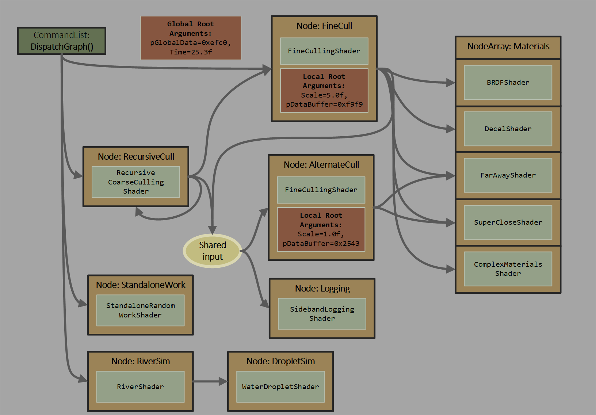
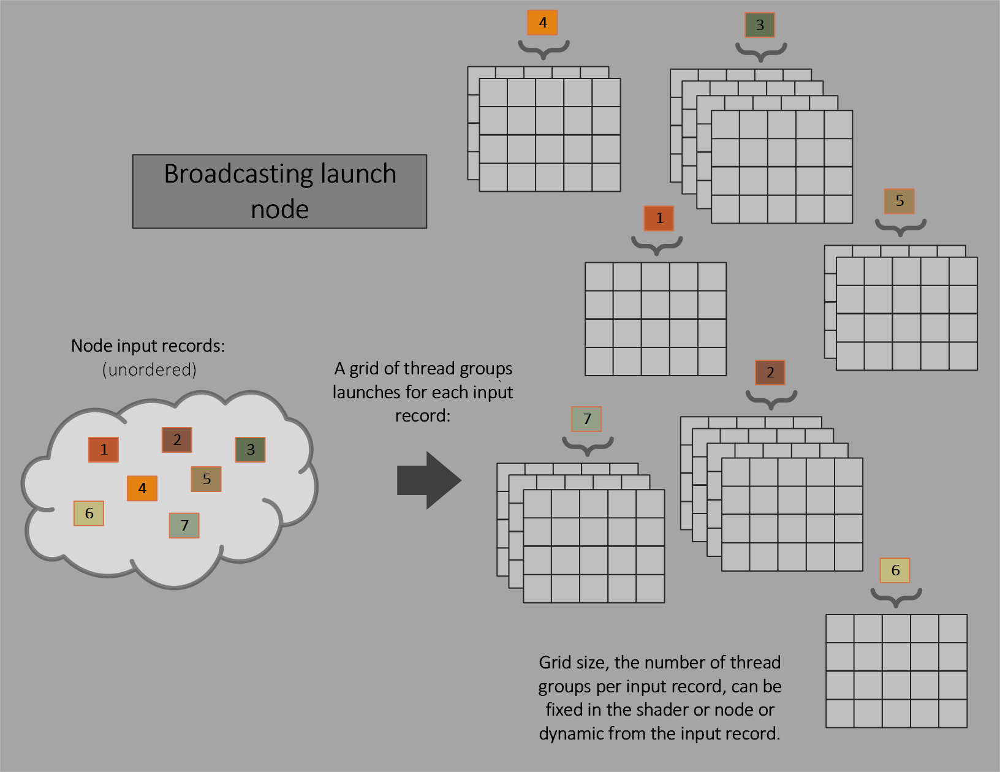
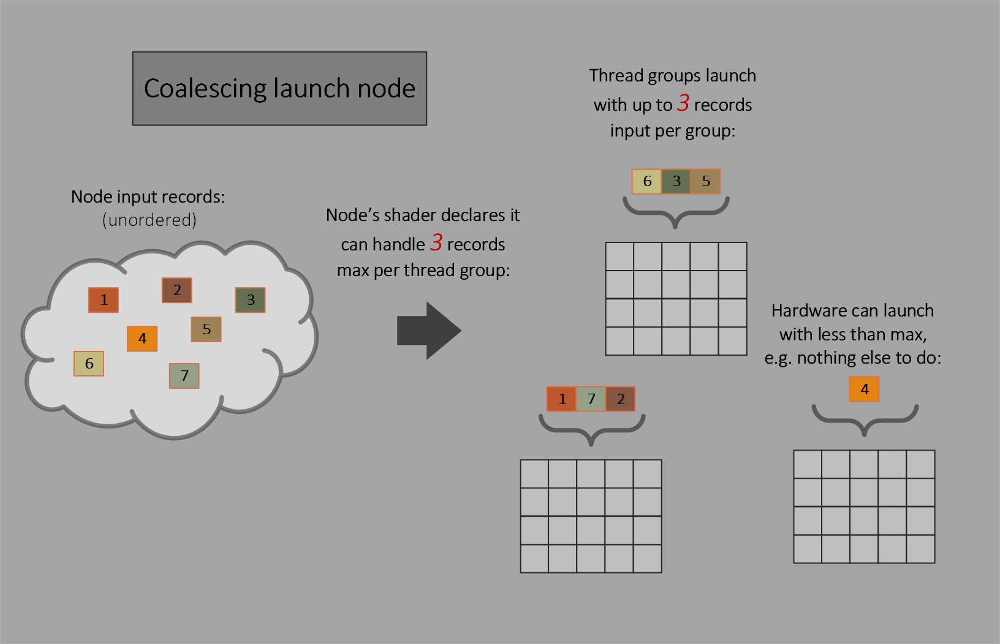
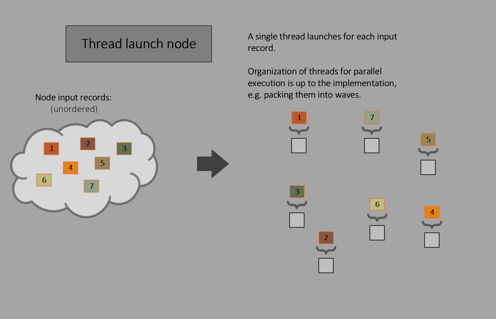
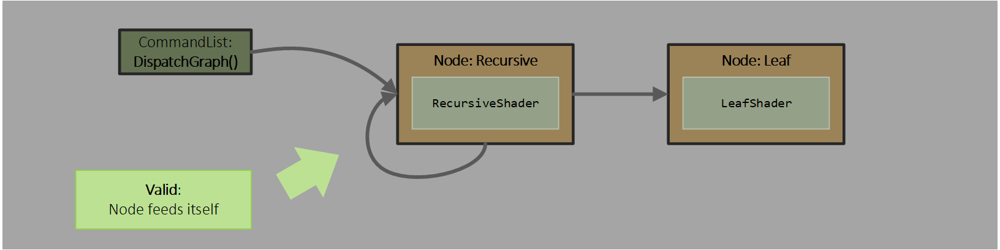
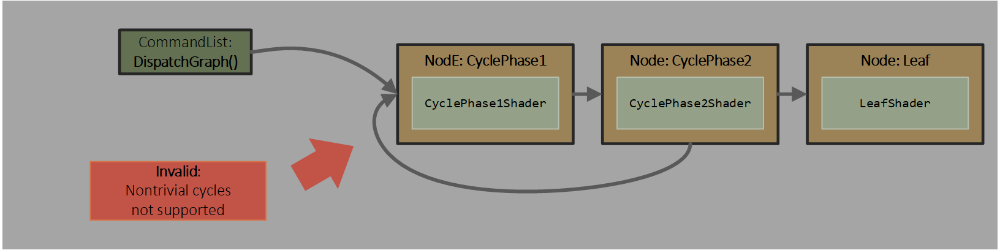
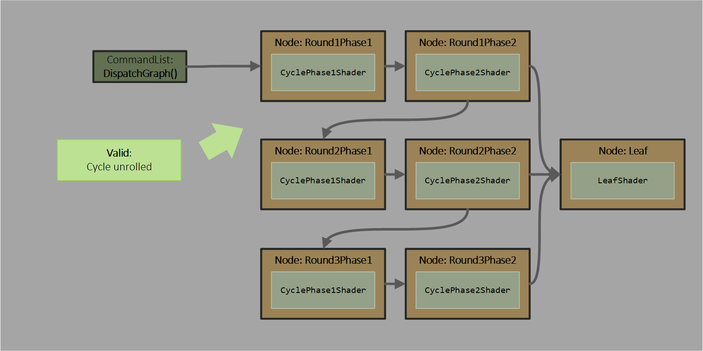

# Work-graph execution

<!-- d3d12-review-legend:begin -->

> [!NOTE]
> **Draft provenance annotations.**
> Underlining marks pending replacement wording or authored list items. Warning boxes
> mark authored, mixed or reopened passages awaiting editorial review.
> Editorial adoption does not establish factual or hardware verification. Exact approved factual
> corrections do not trigger a marker. Unmarked text elsewhere, declarations
> and structural Markdown are not assertions of approval.
> [Annotation scope and approvals](../../spec-maintenance/d3d12/prose-annotations.md).

<!-- d3d12-review-legend:end -->

<!-- d3d12-review-alert:begin:work-graphs:N-scope:0 -->

> [!WARNING]
> **Authored synthesis - human review pending.**
>
> Work graphs are a system for GPU based work creation in D3D12.

<!-- d3d12-review-alert:end:work-graphs:N-scope:0 -->

<!-- d3d12-review-alert:begin:work-graphs:N-scope:1 -->

> [!WARNING]
> **Authored synthesis - human review pending.**
>
> This chapter defines compute-node execution, records, dispatch inputs and node/entrypoint reflection for `D3D12_WORK_GRAPHS_TIER_1_0`. Node shaders use Shader Model 6.8 or later. Device support is reported by `WorkGraphsTier` in `D3D12_FEATURE_DATA_D3D12_OPTIONS21`; the [capability contract](state-objects.md#d3d12_work_graphs_tier) defines the supported values.

<!-- d3d12-review-alert:end:work-graphs:N-scope:1 -->

<!-- d3d12-review-alert:begin:work-graphs:N-scope:2 -->

> [!WARNING]
> **Authored synthesis - human review pending.**
>
> [State objects](state-objects.md#work-graphs) defines graph construction, node IDs and population order, shader-export renaming and node overrides. [Program selection](state-objects.md#setprogram) defines the work graph bound for execution and its local-root table and backing-memory binding. [Work-graph initialization](state-objects.md#d3d12_set_work_graph_flags) defines `D3D12_SET_WORK_GRAPH_FLAG_INITIALIZE`; command-list reset is not backing-memory initialization.

<!-- d3d12-review-alert:end:work-graphs:N-scope:2 -->

<!-- d3d12-review-alert:begin:work-graphs:N-scope:3 -->

> [!WARNING]
> **Authored synthesis - human review pending.**
>
> [Common shader internals](common-shader-internals.md) defines shared wave/lane and program/storage concepts. [Compute](compute.md#thread-groups) defines compute thread groups and their system-generated identifiers; [work-graph grids](compute.md#work-graph-grids) defines configured versus actual grid limits, the shader-attribute versus state-object-override distinction, expanded one-dimensional grids and the independent total-group limit. [Binding](binding.md#local-signatures) owns root/descriptor representation. [Resource lifetime](resources.md) and [synchronization](synchronization.md#operation-specific-contracts) retain their common contracts.

<!-- d3d12-review-alert:end:work-graphs:N-scope:3 -->

<a id="nodes-and-invocation"></a>

## Nodes and invocation

<a id="overview"></a>

### Overview

The app can define a set of nodes.  <ins><!-- d3d12-review-inline:begin:work-graphs:C-overview:2 -->At each compute node there is a fixed shader.<!-- d3d12-review-inline:end:work-graphs:C-overview:2 --></ins>  Command lists can send records to nodes, initiating work: groups of shader invocations.  Nodes can also send records to other nodes, generating more work.

Multiple nodes can use the same shader, specialized in some way.  Multiple nodes can share input, meaning multiple different shaders can be launched for a given input.  Multiple nodes can write to the same destination node.

Independent of node input/outputs, shaders can directly access memory via SRVs, UAVs etc.

<ins><!-- d3d12-review-inline:begin:work-graphs:C-overview:5 -->The following graph illustrates node connectivity:<!-- d3d12-review-inline:end:work-graphs:C-overview:5 --></ins>


Shaders can run when (a) input is available, and (b) if not a leaf node, sufficient output storage is reserved by the system.  This is for the system to worry about for the most part - the system will find a way to schedule all generated work.  That said, the app has some influence on how much backing storage the system can use in order to make progress.

Cycles in the flow of execution are not allowed, except that a node can target itself.  In other words, a node cannot output to an ancestor node.  Work is guaranteed to complete, barring app-error.

When a producing shader outputs to a consumer, the execution of the consumer may happen later, independent of the progress of the producing shader.  Deadlock may occur if a producing shader's completion is dependent on the execution of a consumer shader.  There is no return from the consumer to the producer.

Nodes can be set up with different semantics in terms of how shaders are invoked relative to inputs.

<a id="feeding-nodes"></a>

### Feeding nodes

The system manages input data arriving at a node to generate a set of shader launches.

<ins><!-- d3d12-review-inline:begin:work-graphs:C-feeding:3 -->How node inputs are queued is opaque / owned by the driver.  There is flexibility for how backing storage for node inputs is handled, discussed in [backing storage](#backing-memory).<!-- d3d12-review-inline:end:work-graphs:C-feeding:3 --></ins>

The sequence that records get consumed / dequed at a node is unordered / unpredictable.  This provides maximum flexibility for implementations.

Independent of this unordered dequeueing, the order that records are enqueued is also unordered.  Input order is unpredictable simply because input can arrive from multiple GPU sources/threads running concurrently.

Input records at a node are of a fixed size - the size of the input struct declared in the node's shader.

The backing physical memory footprint a system needs to execute a graph (to handle the possibility spilling out of caches for instance) is owned by the application - see [backing memory](#backing-memory).  To simplify implementations, there are [node output limits](#node-output-limits), and [node input limits](#node-input-limits).

Input record size can be 0 - discussed under [record struct](#record-struct).  This simply means the node input is purely of a logical capacity.  An app might want to manage data storage between nodes manually (e.g. in UAVs).

<a id="broadcasting-launch-nodes"></a>

### Broadcasting launch nodes

The equivalent of compute `Dispatch()` is generated when input is present - one grid of thread groups launched per input.  Work is invoked a thread group at a time as the system reserves output space (if needed) for each thread group.



The dispatch grid size can either be part of the input record or be fixed for the node.

The thread group is fixed in the shader.

All thread groups that are launched share the same set of input parameters.  The exception is the usual system ID values which identify individual threads within the group/grid.

For wave packing see [Thread visibility in wave operations](#thread-visibility-in-wave-operations).

<a id="coalescing-launch-nodes"></a>

### Coalescing launch nodes

Here, multiple inputs are collectively visible to each thread group that is launched.

Coalescing launch nodes can be useful if the shader can use shader memory or cooperation between threads in the group to process multiple inputs together (even though the number of inputs available may vary).  If such cooperation is not required (beyond opportunistically using wave ops across threads in a wave), [thread launch nodes](#thread-launch-nodes), described later, may be more appropriate to use.  Coalescing launch nodes can also be useful in scenarios where [thread launch nodes](#thread-launch-nodes) would have made more sense but the tight output data limits on that node type are too restrictive.



The thread group size is fixed in the shader.

Dispatch grid size doesn't apply, as instead the system simply launches individual thread groups at a time.

> Since there is no dispatch grid size, that means there is no notion of amplification in this type of work launch.

The shader [declares](#node-input-declaration) as part of its input the maximum number of input records that a thread group can input.  If the shader declares 512 as the input record maximum, the system is allowed to invoke a thread group when it has anywhere from 1 to 512 input records available.

Of course the system will attempt to fill each thread group with the maximum declared input records, but it is allowed to invoke with fewer records as it sees fit.  An example might be that no other node is ready to launch new work and the GPU has free processing resources, so it might decide that it is better to do something than nothing.  There may simply be an odd amount of final work left to drain when ancestors in the graph of nodes are finished.

Launched thread groups can see the full set of input available as an array.  The shader can discover how many inputs there are and is responsible for distributing work items across threads in the thread group.  If threads don't have any work to do, they can simply exit immediately.

Any time a shader declares it expects some number greater than 1 as the maximum number of input records that it can handle in a thread group, it must call the input record's [Count()](#input-record-count-method) method to discover how many records its thread group actually got.

The number of records sent to any given thread group launch is implementation-defined, and not necessarily repeatable on a given implementation.  This is true independent of the method that produces the input -- i.e. whether it comes from another node or from DispatchGraph.  And it is true regardless size of input records, including 0 size records in particular.

For wave packing see [Thread visibility in wave operations](#thread-visibility-in-wave-operations).

<a id="thread-launch-nodes"></a>

### Thread launch nodes

Thread launch nodes invoke one thread for each input.

Thread launch nodes are conceptually a subset of [coalescing launch nodes](#coalescing-launch-nodes).   They use a thread group size of (1,1,1), so the thread group size need not be declared, and limit the number of input records per thread group launch to 1.

While a coalescing launch node can express what a thread launch node can do, it is worth calling out the single thread case with a dedicated type.  In terms of implementation, thread launch nodes can pack work fundamentally differently than coalescing or broadcasting launch nodes: thread launch nodes allow multiple threads from different launches to be packed into a wave (see [Thread visibility in wave operations](#thread-visibility-in-wave-operations)).  By contrast if a coalescing launch node declared a thread group size of 1, other thread group launches wouldn't be able to be packed with it (at least they cannot appear to be, and in reality they likely will not be packed).



For wave packing see [Thread visibility in wave operations](#thread-visibility-in-wave-operations).

<a id="shader-invocation-at-a-node"></a>

### Shader invocation at a node

A node can run a shader when the shader's declared requirements are met:

- input is present
- the system can reserve space for the shader's worst case output to destination nodes (if any)

If the shader at a node is configured to produce a grid of compute thread groups as part of one logical invocation, the system can execute individual thread groups as their output capacity is reserved, as opposed to waiting for output capacity for the entire set of thread groups atomically.

Implementations cannot perform redundant invocations of the requested set of thread groups / dispatch grid of a node's shader based on a given input if there could be any side effects (such as via UAV accessses and node outputs) that vary over redundant invocations.   Certainly the inputs to a node can only produce the one set of output records that the node's shader invocations are intended to produce.

<a id="hlsl"></a>

## Shader and record declarations

<a id="shader-target"></a>

### Shader target

Shaders at nodes are currently only compute shaders authored in a library, target lib_6_8 or above. The attribute `[Shader("node")]` on a shader function indicates it can be used in a work graph. A given function entry may only have one `Shader` attribute denoting its type, however shader entry functions are callable as ordinary functions, which enables code reuse between shader stages.

The attribute name `"Shader"` is case insensitive.  The string must be lowercase.

<a id="shader-function-attributes"></a>

### Shader function attributes

These attributes can be used on shader functions used at nodes.  Any attributes that can be used on standard compute shaders are also available for nodes, not listed below.

Attribute names are case insensitive.  Strings are case sensitive.

DXIL definition [here](../WorkGraphs.md#dxil-shader-function-attributes).

<!-- d3d12-review-alert:begin:work-graphs:H-function-attributes:5 -->

> [!WARNING]
> **Mixed source and authored adaptation - human review pending.**
>
> attribute                     | required | description
> ------------------------------|:--------:|------------
> `[NodeLaunch("mode")]`    | N  |  `"mode"` can be `"broadcasting"`, `"coalescing"` or `"thread"`.  Default if `NodeLaunch` attribute is not present is `"broadcasting"`.
> `[NodeIsProgramEntry]`      | N | Node can receive input records from outside the graph - e.g. from a commmand list.  Any node in a graph that has an input that isn't targetted by other node(s) must either specify this attribute, or it must be separately indicated when constructing the work graph.  Nodes interior to a graph can optionally set this attribute to indicate that not only are they fed from the graph they are also fed from outside.  A graph can have multiple entrypoints.  This can be overridden/selected when constructing a work graph as part of the [definition of a node](state-objects.md#d3d12_node).
> `[NodeID("nodeName")]` or `[NodeID("nodeName",arrayIndex)]` | N | Name for the node.  In the absence of this attribute, the shader function name is the node name.  There is also an optional uint `arrayIndex` parameter, meaning the shader is actually at slot `nodeName[arrayIndex]` in an array of nodes with the collective ID `nodeName`.  The absence of `arrayIndex` means `arrayIndex` is `0`, which is also the case if `NodeID` isn't specified at all (using the shader function name). This can be overridden via the `Rename` option when constructing a work graph as part of the [definition of a node](state-objects.md#d3d12_node).  All nodes are implicitly part of an array of nodes with the given node name string, albeit typically this array happens to be of size 1 (when the app is simply using the node in a non-arrayed way).  If array indexing isn't needed, the second component can be any value, typically 0 but whatever the choice, the index is still considered as part of the identity of the node.  Gaps in a given node array are allowed.  Behavior is undefined if a shader outputs to an empty array index (via dynamic indexing the output node array in the shader). See [Node array constraints](#node-array-constraints).
> `[NodeLocalRootArgumentsTableIndex(index)]` | N | `uint index` indicates the record index into the local root arguments table [bound](state-objects.md#d3d12_set_work_graph_desc) when the work graph is used.  In the absence of this attribute, or it is set to `-1`, and a node's shader has a local root signature associated with it, the index defaults to an unused value 0,1,2.. (skipping over any entries that have been used by explicit `[NodeLocalRootArgumentsTableIndex(index)]` values).  Default indices are assigned in the order the node is added to the work graph - see the discussion of the order of graph node population in [D3D12_WORK_GRAPH_DESC](state-objects.md#d3d12_work_graph_desc).  This index can be overridden when constructing a work graph as part of the [definition of a node](state-objects.md#d3d12_node).  Multiple nodes can only point to the same location in the local root arguments table if they use the same local root signature.
> `[NumThreads(x,y,z)]`|Y (except N for thread launch node)| Thread group size.  This is part of standard compute shaders.
> `[NodeShareInputOf("nodeName")]` or `[NodeShareInputOf("nodeName",arrayIndex)]` | N | Share the input of the specified NodeID with this node.  See [sharing input records across nodes](#sharing-input-records-across-nodes).  If N nodes share an input, N-1 of the nodes must point to the remaining node as the one they are all sharing the input of.  This sharing definition can also be overridden (assigning/changing/disabling the sharing target) when constructing a work graph as part of the [definition of a node](state-objects.md#d3d12_node), such as if the node to share with needs to be renamed.
> `[NodeDispatchGrid(x,y,z)]`|N (`BroadcastingLaunch` must have this or `NodeMaxDispatchGrid`)|Define the number of thread groups to launch for a `BroadcastingLaunch` node. In its absence, the [node definition](state-objects.md#d3d12_node) must declare it, or it must appear as [SV_DispatchGrid](#sv_dispatchgrid) in the input record - dynamic dispatch grid size.  If the declaration appears in both the shader and the node definition, the definition in the node overrides. This attribute cannot be used if the launch mode is not `BroadcastingLaunch`.  The shader-authored and state-object-override limits are defined in [work-graph grids](compute.md#work-graph-grids).
> `[NodeMaxDispatchGrid(x,y,z)]`|N (`BroadcastingLaunch` must have this or `NodeDispatchGrid`)| Declares the maximum dispatch grid size when the input record includes [SV_DispatchGrid](#sv_dispatchgrid) - dynamic dispatch grid size.  This attribute cannot be specified if the dispatch grid size is not dynamic or if the launch mode is not `BroadcastingLaunch`. If the declaration appears in both the shader and the node definition, the definition in the node overrides.   The shader-authored and state-object-override limits are defined in [work-graph grids](compute.md#work-graph-grids).
> `[NodeMaxRecursionDepth(count)]`|N|`uint count` indicates the maximum depth of recursion of the current node.  This attribute is required when the shader is used in such a way that the NodeID for one of its outputs is the same ID as the node itself.  If no output node name matches the current node name, including via renaming of output NodeID or shader's NodeID, recursion is not actually happening, and this MaxRecursion declaration doesn't apply.  Setting this to 0 is the equivalent of not specifying this attribute - no recursion.  To help shader code know where it is in recursion, there are a couple of options: [Node output IsValid() method](#node-output-isvalid-method) and [GetRemainingRecursionLevels()](#getremainingrecursionlevels).

<!-- d3d12-review-alert:end:work-graphs:H-function-attributes:5 -->


<a id="node-shader-parameters"></a>

### Node shader parameters

Node shaders support three categories of parameters:

- an optional [Node input declaration](#node-input-declaration)
- zero or more [Node output declarations](#node-output-declaration)
- <ins><!-- d3d12-review-inline:begin:work-graphs:H-system-values:3 -->zero or more [Node Shader system values](#node-shader-system-values) depending on launch mode<!-- d3d12-review-inline:end:work-graphs:H-system-values:3 --></ins>

#### Node Shader system values

A subset of compute shader system value inputs are supported on node shaders, depending on launch mode.  These have the same types and meanings in node shaders as they do for compute shaders.

For [Thread launch](#thread-launch-nodes), no compute shader system values are supported.
For [Coalescing launch](#coalescing-launch-nodes), `SV_GroupThreadID` and `SV_GroupIndex` are supported.
For [Broadcasting launch](#broadcasting-launch-nodes), all compute shader system values are supported.

Here's a table of the supported compute shader system value inputs:

|system value semantic         | supported launch modes | description |
|------------------------------|:---------:|-------------|
| `SV_GroupThreadID` | [Broadcasting](#broadcasting-launch-nodes), [Coalescing](#coalescing-launch-nodes) | Thread ID within group |
| `SV_GroupIndex` | [Broadcasting](#broadcasting-launch-nodes), [Coalescing](#coalescing-launch-nodes) | Flattened thread index within group |
| `SV_GroupID` | [Broadcasting](#broadcasting-launch-nodes) | Group ID within dispatch |
| `SV_DispatchThreadID` | [Broadcasting](#broadcasting-launch-nodes) | Thread ID within dispatch |

<a id="record-struct"></a>

### Record struct

Inputs or outputs to a node can be any generic nonempty HLSL struct:

```hlsl
struct MyStruct
{
    float4 foo;
    // etc..
};
```

Empty records can be used as well, in which case there is no struct - see `EmptyNodeInput` in [Node input declaration](#node-input-declaration) and `EmptyNodeOutput` in [Node output declaration](#node-output-declaration).

#### Record Attributes

Record structs can optionally use attributes.  There is currently only one:

##### NodeTrackRWInputSharing

If the node might call [FinishedCrossGroupSharing](#finishedcrossgroupsharing) it must specify `[NodeTrackRWInputSharing]` on the record struct type used in the `RWDispatchNodeInputRecord` `recordType` template argument.  Some implementations need to allocate 4 bytes extra in the record <ins><!-- d3d12-review-inline:begin:work-graphs:H-record:8 -->(upstream in the producer)<!-- d3d12-review-inline:end:work-graphs:H-record:8 --></ins> to support this.  The upstream producer node must also use the `[NodeTrackRWInputSharing]` attribute on the record struct type used for the node output.  The easiest way to do this is to use the same structure declaration with the attribute for both the producer and consumer nodes.

A struct using `[NodeTrackRWInputSharing]` is not allowed in the template argument for <ins><!-- d3d12-review-inline:begin:work-graphs:H-record:9 -->any node-input-record object other than<!-- d3d12-review-inline:end:work-graphs:H-record:9 --></ins> `RWDispatchNodeInputRecord`.

Outside of the template argument for node and record object types, this attribute has no effect elsewhere in HLSL.

```hlsl
struct [NodeTrackRWInputSharing] MySharedRecord
{
    float4 foo;
    // etc..
};
```

Additionally, this attribute must be on the struct used <ins><!-- d3d12-review-inline:begin:work-graphs:H-record:12 -->directly in the type<!-- d3d12-review-inline:end:work-graphs:H-record:12 --></ins>.  For instance, if the attribute is on a struct from which your record struct is derived, it has no effect.

```hlsl
struct [NodeTrackRWInputSharing] MySharedRecord
{
  //...
};

// MyUnsharedRecord will not have [NodeTrackRWInputSharing] applied
// because the attribute is not inherited from MySharedRecord.
struct MyUnsharedRecord : MySharedRecord
{
    float4 foo;
    // etc..
};
```

#### Record system values

Record structs can optionally include system values.  There is currently only one:

##### SV_DispatchGrid

`uint/uint2/uint3/uint16_t/uint16_t2/uint16_t3 SV_DispatchGrid`

`SV_DispatchGrid` can optionally appear anywhere in a record.

If the record arrives at a [broadcasting launch node](#broadcasting-launch-nodes) that doesn't declare a fixed dispatch grid size via `[NodeDispatchGrid(x,y,z)]`, `SV_DispatchGrid` becomes the dynamic grid size used to launch at the node.

For other launch modes, or broadcasting launch that specify `[NodeDispatchGrid(x,y,z)]`, the `SV_DispatchGrid` semantic in an input record has no meaning and the field acts as vanilla input data to the node.  These modes aren't strictly mutually exclusive to allow some flexibility, such as for nodes that are [sharing input](#sharing-input-records-across-nodes) to be able to have different properties if desired, where some may actually use the dynamic dispatch grid, and others may not; it is always fine for `SV_DispatchGrid` to be present, and it only has special meaning depending on context.

If the type is `uint` or `uint16_t`, this defines the `x` component of the dispatch grid, and the `y`, `z` components are 1.

If the type is `uint2` or `uint16_t2`, this defines the `x` and `y` components of the dispatch grid, and the `z` component is 1.

If this type is <ins><!-- d3d12-review-inline:begin:work-graphs:H-record:23 -->`uint3`<!-- d3d12-review-inline:end:work-graphs:H-record:23 --></ins> or `uint16_t3`, this defines the `x` `y` and `z` components of the dispatch grid.

The `x` `y` and `z` values used to launch at a node cannot exceed the `NodeMaxDispatchGrid` values [declared in the shader](#shader-function-attributes) or [declared for the node](state-objects.md#d3d12_shader_node), otherwise behavior is undefined.

<!-- d3d12-review-alert:begin:work-graphs:N-record-type-validation:0 -->

> [!WARNING]
> **Authored synthesis - human review pending.**
>
> A typed node record requires a complete, nonempty structure, not a scalar or resource object used as the template argument. Scalar, vector and matrix data can be members; vector members are limited to four components. Members are recursively checked through arrays, nested structures and base structures. Resource/object members are not node-record data. The struct attribute `NodeTrackRWInputSharing` is not inherited from a base structure; its direct placement and the compatible object types are specified above.

<!-- d3d12-review-alert:end:work-graphs:N-record-type-validation:0 -->

<a id="objects"></a>

### Objects

#### Input Record objects

| Object | Template Arguments | Methods | Description |
|---|---|---|---|
| [`DispatchNodeInputRecord`](#node-input-declaration) | `recordType` | [Get](#single-record-access) | read-only input to [Broadcasting launch](#broadcasting-launch-nodes) node |
| [`RWDispatchNodeInputRecord`](#node-input-declaration) | `recordType` | [Get](#single-record-access)<br>[FinishedCrossGroupSharing](#finishedcrossgroupsharing) | shared read/write input to [Broadcasting launch](#broadcasting-launch-nodes) node |
| [`GroupNodeInputRecords`](#node-input-declaration) | `recordType` | [Get](#array-records-access)<br>[`operator[]`](#array-records-access)<br>[Count](#input-record-count-method) | read-only input to [Coalescing launch](#coalescing-launch-nodes) node<br>use with `[MaxRecords(maxCount)]` on [Coalescing launch](#coalescing-launch-nodes) to specify a count greater than 1 |
| [`RWGroupNodeInputRecords`](#node-input-declaration) | `recordType` | [Get](#array-records-access)<br>[`operator[]`](#array-records-access)<br>[Count](#input-record-count-method) | shared read/write input to [Coalescing launch](#coalescing-launch-nodes) node<br>use with `[MaxRecords(maxCount)]` on [Coalescing launch](#coalescing-launch-nodes) to specify a count greater than 1 |
| [`ThreadNodeInputRecord`](#node-input-declaration) | `recordType` | [Get](#single-record-access) | read-only input to [Thread launch](#thread-launch-nodes) node |
| [`RWThreadNodeInputRecord`](#node-input-declaration) | `recordType` | [Get](#single-record-access) | read/write input to [Thread launch](#thread-launch-nodes) node |
| [`EmptyNodeInput`](#node-input-declaration) | | [Count](#input-record-count-method) | empty input<br>use with `[MaxRecords(maxCount)]` on [Coalescing launch](#coalescing-launch-nodes) to specify a count greater than 1 |

#### Output Node Objects

<!-- d3d12-review-alert:begin:work-graphs:H-objects:5 -->

> [!WARNING]
> **Mixed source and authored adaptation - human review pending.**
>
> | Object | Template Arguments | Methods | Description |
> |---|---|---|---|
> | [NodeOutput](#node-output-declaration) | `recordType` | [GetThreadNodeOutputRecords](#getthreadnodeoutputrecords)<br>[GetGroupNodeOutputRecords](#getgroupnodeoutputrecords)<br>[IsValid](#node-output-isvalid-method) | Defines an output and record type for spawning nodes |
> | [NodeOutputArray](#node-output-declaration) | `recordType` | [`operator[]`](#node-output-array-indexing) | Defines an array of node outputs |
> | [EmptyNodeOutput](#node-output-declaration) | | [`{Group\|Thread}IncrementOutputCount`](#incrementoutputcount)<br>[IsValid](#node-output-isvalid-method) | Defines an empty output for spawning nodes with no record data |
> | [EmptyNodeOutputArray](#node-output-declaration) | | [`operator[]`](#node-output-array-indexing) | Defines an array of empty node outputs |

<!-- d3d12-review-alert:end:work-graphs:H-objects:5 -->

#### Output Record Objects

<!-- d3d12-review-alert:begin:work-graphs:H-objects:7 -->

> [!WARNING]
> **Mixed source and authored adaptation - human review pending.**
>
> | Object | Template Arguments | Methods | Description |
> |---|---|---|---|
> | [ThreadNodeOutputRecords](#getthreadnodeoutputrecords) | `recordType` | [Get](#array-records-access)<br>[`operator[]`](#array-records-access)<br>[OutputComplete](#outputcomplete) | set of zero or more records for each thread |
> | [GroupNodeOutputRecords](#getgroupnodeoutputrecords) | `recordType` | [Get](#array-records-access)<br>[`operator[]`](#array-records-access)<br>[OutputComplete](#outputcomplete) | set of zero or more records with shared access across the thread group |

<!-- d3d12-review-alert:end:work-graphs:H-objects:7 -->

<a id="node-input-declaration"></a>

### Node input declaration

Node input can be in one of the following forms.  See [Node input](#node-input) for examples.  This is in addition to standard compute shader inputs like various thread ID system values.

Options for [Broadcasting launch](#broadcasting-launch-nodes):

- `DispatchNodeInputRecord<`*recordType*`>` *nameInShader*
  - read only node input
- `RWDispatchNodeInputRecord<`*recordType*`>` *nameInShader*
  - RW variant indicates launched shaders have shared read/write access to the input record, as if it is UAV memory.
- `globallycoherent RWDispatchNodeInputRecord<`*recordType*`>` *nameInShader*
  - Same as previous except loads/stores to the record will be used for cross group communication.  See [Producer - consumer dataflow through UAVs](#producer---consumer-dataflow-through-uavs).  The `globallycoherent` is optional, see the discussion of `NODE_INPUT_MEMORY` in [Barrier()](#barrier).
- *nothing*
  - <ins><!-- d3d12-review-inline:begin:work-graphs:H-input:4 -->no input record declaration simply launches one dispatch grid of thread groups for every empty input record sent to the node.  The dispatch grid size must be declared at the shader or node.   The shader is left to manually access its resource bindings for any necessary context information.  Nodes that output to this type of node use `EmptyNodeOutput` which lets a counter of empty records be incremented.<!-- d3d12-review-inline:end:work-graphs:H-input:4 --></ins>

Options for [Coalescing launch](#coalescing-launch-nodes):

- `[MaxRecords(`*maxCount*`)]` `GroupNodeInputRecords<`*recordType*`>` *nameInShader*
  - thread groups will be launched with 1..maxCount input records
- `[MaxRecords(`*maxCount*`)]` `RWGroupNodeInputRecords<`*recordType*`>` *nameInShader*
  - RW variant indicates launched shaders have shared read/write access to the input records, as if it is UAV memory.
- `[MaxRecords(`*maxCount*`)]` `EmptyNodeInput` *nameInShader*
  - thread groups will be launched with 1...maxCount empty inputs.  The shader is left to manually access its resource bindings for any necessary context information.  Nodes that output to this type of node use `EmptyNodeOutput` which lets a counter of empty records be incremented.
- *nothing*
  - no input record declaration simply launches one thread group for every empty input record sent to it - equivalent to `[MaxRecords(1)] EmptyNodeInput`.  The shader is left to manually access its resource bindings for any necessary context information.  Nodes that output to this type of node use `EmptyNodeOutput` which lets a counter of empty records be incremented.

Options for [Thread launch](#thread-launch-nodes):

- `ThreadNodeInputRecord<`*recordType*`>` *nameInShader*
  - read only node input
- `RWThreadNodeInputRecord<`*recordType*`>` *nameInShader*
  - RW variant indicates launched thread has read/write access to the input record.  Since this is thread launch, access is not shared with anything outside the thread, so it's equivalent to having a local mutable record.
- *nothing*
  - a thread launch node with no input record declaration simply gets one thread group launched for every empty input record sent to it, with thread group size (1,1,1) by the definition of a thread launch node.  The shader is left to manually access its resource bindings for any necessary context information.  Nodes that output to this type of node declare `EmptyNodeOutput`, enabling an counter to be incremented. Nodes that output to this type of node use `EmptyNodeOutput` which lets a counter of empty records be incremented.

Notes about all of the above objects:
- They behave as objects holding a handle value.  Assignment and function parameter passing with matching object types will copy handle values, rather than copying contents of records.   See [Node and record object semantics in shaders](#node-and-record-object-semantics-in-shaders) for implications.
- `{RW}{Dispatch|Thread}NodeInputRecord` objects have a `Get()` method which returns a reference to the template argument type for member access and for assignment or copying record contents into and out of function calls when the contained record type is used instead of a matching object type.
- `{RW}GroupNodeInputRecords` objects have an `operator[]` defined that retrieves a reference to the record at the provided array index.  This reference is used for member access or copying in/out of functions or for assignments using the record type.  For convenience, a `Get(int index=0)` is also defined with a default index of `0`, so that the first record can be accessed in the same way as objects that only hold a single record.
- All of the above objects can be passed as parameters into internal linkage function calls.  Internal linkage refers to static functions defined within the same module that are not `export` functions.
- If an `RWDispatchNodeInputRecord`'s record layout contains a [SV_DispatchGrid](#sv_dispatchgrid) field, shaders cannot write to that field, and the compiler attempts to enforce this.  Implementations may need to reference the data here actively while spawning invocations of the dynamically selected dispatch grid size.

#### Node input attributes

<!-- d3d12-review-alert:begin:work-graphs:H-input:10 -->

> [!WARNING]
> **Mixed source and authored adaptation - human review pending.**
>
> attribute                     | required | description
> ------------------------------|:--------:|------------
> `[MaxRecords(maxCount)]`    | N (for `{RW}GroupNodeInputRecords` or `EmptyNodeInput` only)  |  Maximum record or EmptyNodeInput count for coalescing-launch input.  Default is 1 if unspecified.
> `globallycoherent` | N (for `RWDispatchNodeInputRecord` only) | Stores and loads bypass fastest caches, so they can be used for cross group communication.  See [Producer - consumer dataflow through UAVs](#producer---consumer-dataflow-through-uavs).

<!-- d3d12-review-alert:end:work-graphs:H-input:10 -->

<a id="node-output-declaration"></a>

### Node output declaration

Node output can be in one of the following forms.  See [Node output](#node-output) for examples.  <ins><!-- d3d12-review-inline:begin:work-graphs:H-output:2 -->A shader declares 0 or more outputs.<!-- d3d12-review-inline:end:work-graphs:H-output:2 --></ins>

- *attribute-list* `NodeOutput<`*recordType*`>` *nameInShader*
- *attribute-list* `NodeOutputArray<`*recordType*`>` *nameInShader*

- *attribute-list* `EmptyNodeOutput` *nameInShader*
- *attribute-list* `EmptyNodeOutputArray` *nameInShader*

*attribute-list* is composed of [Node output attributes](#node-output-attributes).

Notes about all of the above objects:
- They behave as objects holding a handle value.  Assignment and function parameter passing with matching object types will copy handle values, rather than copying contents of records.  See [Node and record object semantics in shaders](#node-and-record-object-semantics-in-shaders) for implications.
- They can be passed as parameters into internal linkage function calls.  Internal linkage refers to static functions defined within the same module that are not `export` functions.
- `NodeOutputArray` and `EmptyNodeOutputArray` are objects representing a range of node outputs as an array, with a shared `MaxRecords` pool, and the array size specified in the `[NodeArraySize(count)]` attribute, or `[UnboundedSparseNodes]`.  They support indexing like an array with the [`operator[]`](#node-output-array-indexing), which returns the singular `NodeOutput` or `EmptyNodeOutput` objects.
- Since the array size is not part of the object type, you can pass `NodeOutputArray` and `EmptyNodeOutputArray` to functions without those functions needing to be specialized for different declared array sizes.

See [Examples of input and output use in shaders](#examples-of-input-and-output-use-in-shaders).

For more on arrays see [Node array constraints](#node-array-constraints).

#### Node output attributes

<!-- d3d12-review-alert:begin:work-graphs:H-output:9 -->

> [!WARNING]
> **Mixed source and authored adaptation - human review pending.**
>
> attribute                        |required|description
> ---------------------------------|:------:|-----------
> `[MaxRecords(count)]`      |Y (this or below attribute)|Given uint `count` declaration, the thread group can output `0...count` records to this output.  Exceeding this results in undefined behavior.  For `NodeOutputArray`, count applies across all the output nodes in the array (not count per node). This attribute can be overridden via the `NumOutputOverrides / pOutputOverrides` option when constructing a work graph as part of the [definition of a node](state-objects.md#d3d12_shader_node).  See [Node output limits](#node-output-limits).
> `[MaxRecordsSharedWith(nameInShader)]`|Y (this or above attribute)|The budget for output records for this output is shared with another previously declared output, identified by it's name in the shader.  That output must have a `[MaxRecords(count)]` attribute.  Any number of outputs can share a budget together, and they don't have to have the same record type (including size of the record type).  The system may choose to manage output space reservations for mixed size outputs in some conservative manner behind the scenes, invisible to the app.  Different sets of outputs can have separate budgets - the number of budgets is the number of `[MaxRecords(count)]` declarations, and other output declarations each share with any one of these. This attribute can be overridden via the `NumOutputOverrides / pOutputOverrides` option when constructing a work graph as part of the [definition of a node](state-objects.md#d3d12_shader_node).
> `[NodeID("nodeName")]` or `[NodeID("nodeName",baseArrayIndex)]`|N|Define the name of the output node.  In the absence of this attribute, the node name defaults to the same as the local variable name (*nameInshader* above).   The variant with the `uint baseArrayIndex` parameter defines a node name including array index (defaults to 0 in its absence).  It is a `base` index in the sense that for `NodeOutputArray<recordType>` which defines an array of nodes, baseArrayIndex defines where the local shaders view of the array starts in a node array that may be larger. This attribute can be overridden via the `NumOutputOverrides / pOutputOverrides` option when constructing a work graph as part of the [definition of a node](state-objects.md#d3d12_shader_node).  All nodes are implicitly part of an array of nodes with the given node name string, albeit typically this array happens to be of size 1 (when the app is simply using the node in a non-arrayed way).  If array indexing isn't needed, the second component can be any value, typically 0 but whatever the choice, the index is still considered as part of the identity of the node.  Gaps in a given node array are allowed.  Behavior is undefined if a shader outputs to an empty array index (via dynamic indexing the output node array in the shader).
> `[AllowSparseNodes]`|N|Allow a work graph to be created where there may not be a node present for this output.  Or if it is an output array, some of entries in the array may not have nodes present.  In the absence of this attribute, by default the output must point to a node in the work graph.  Or if it is an output array, the entire output range must have nodes in the work graph.  To help shader code know if an output node is present, there is the node output [IsValid()](#node-output-isvalid-method) method.  Also see [AddToStateObject](state-objects.md#addtostateobject) which allows adding new nodes to a work graph after it is initially created in the gaps within an `[AllowSparseNodes]` node array range.  Empty space between used array slots will likely incur proportionate storage overhead for implementations - something to be aware of, but may be perfectly fine overall.
> `[NodeArraySize(count)]` | Y (for `NodeOutputArray` or `EmptyNodeOutputArray`, unless `[UnboundedSparseNodes]` is specified) | Specifies the output array size for `NodeOutputArray` or `EmptyNodeOutputArray` objects.  `[NodeArraySize(0xffffffff)]` is equivalent to setting `[UnboundedSparseNodes]` and `[AllowSparseNodes]`.
> `[UnboundedSparseNodes]`|N|No limit to array size for `NodeOutputArray` or `EmptyNodeOutputArray` objects.  This is equivalent to setting `[NodeArraySize(0xffffffff)]`, and also implies `[AllowSparseNodes]`, so those don't need to be set.  Like `[AllowSparseNodes]`, allow a work graph to be created where not all entries in the array are present.  To help shader code know if an output node is present, there is the node output [IsValid()](#node-output-isvalid-method) method.  Unbounded can be useful if when a shader is being authored, the precise number of nodes it will output to isn't known.  In particular this can be useful with [AddToStateObject](state-objects.md#addtostateobject), adding new nodes on the fly after a graph is initially constructed, such as shader permutations.  Even though the array size is unbounded, the starting array index for the array is based on the `NodeID` for the output (just like bounded arrays).  There is still a limit on maximum array index actually used for any given node used in the graph, described in [Node count limits](#node-count-limits).  `UnboundedSparseNodes` should only be used when actually needed (as opposed to applying it blindly to every node output just in case), particularly if [AddToStateObject](state-objects.md#addtostateobject) has been opted-into with the `D3D12_STATE_OBJECT_FLAG_ALLOW_STATE_OBJECT_ADDITIONS` state object flag.  Here there can be minor additional overhead for some drivers to manage unbounded arrays, worth it if neeeded, but unnecessary to take on everywhere that relatively small fixed array sizes would suffice.

<!-- d3d12-review-alert:end:work-graphs:H-output:9 -->

<a id="node-output-array-indexing"></a>

### Node output array indexing

`NodeOutputArray` and `EmptyNodeOutputArray` must be indexed with `operator[]` to retrieve individual `NodeOutput` or `EmptyNodeOutput` objects, respectively.  All built-in functions and methods operate on the individual object types, not on the array object types.  <ins><!-- d3d12-review-inline:begin:work-graphs:H-indexing:2 -->For a `NodeOutputArray`, for example: `myNodeArray[i].IsValid()` or `myNodeArray[i].GetThreadNodeOutputRecords(count)`.<!-- d3d12-review-inline:end:work-graphs:H-indexing:2 --></ins>

<a id="record-access"></a>

### Record access

#### Single record access

Record objects that only hold a single record (`{RW}DispatchNodeInputRecord` and `{RW}ThreadNodeInputRecord`) have a `Get()` method to access the contained record.

Record access example:

- `myRecord.Get().field` - access `field` from the record

#### Array records access

<ins><!-- d3d12-review-inline:begin:work-graphs:H-access:7 -->Record objects that may hold more than one record (`{RW}GroupNodeInputRecords`, `ThreadNodeOutputRecords` and `GroupNodeOutputRecords`) have a `Get(int index=0)` method and an `operator[]` to access a contained record.  The `index` parameter for the `Get` method defaults to `0`, so it can be used the same way as for single-record access when only accessing the first record.<!-- d3d12-review-inline:end:work-graphs:H-access:7 --></ins>

Record access examples:

- `myRecords.Get().field` - access `field` from the first record
- `myRecords.Get(i).field` - access `field` from record at index `i`
- `myRecords[i].field` - access `field` from record at index `i`

#### Record access examples

See [Node input](#node-input) for more examples, as well as [Examples of input and output use in shaders](#examples-of-input-and-output-use-in-shaders).

<!-- d3d12-review-alert:begin:work-graphs:N-shader-signatures:0 -->

> [!WARNING]
> **Authored synthesis - human review pending.**
>
> `recordType` is the record structure declared by the shader. A read-only input returns a read-only reference; the `RW` input and allocated-output variants return writable references. `index` selects a record, not a node. For coalesced input it is bounded by `Count()`, and for allocated output it is bounded by the count requested for that thread or group.

<!-- d3d12-review-alert:end:work-graphs:N-shader-signatures:0 -->

<!-- d3d12-review-alert:begin:work-graphs:N-shader-signatures:1 -->

> [!WARNING]
> **Authored synthesis - human review pending.**
>
> | Object | Access operation | Result |
> |---|---|---|
> | `DispatchNodeInputRecord<recordType>`, `ThreadNodeInputRecord<recordType>` | `Get()` | Read-only reference to the input record |
> | `RWDispatchNodeInputRecord<recordType>`, `RWThreadNodeInputRecord<recordType>` | `Get()` | Writable reference to the input record |
> | `GroupNodeInputRecords<recordType>` | `Get(int index = 0)`, `[index]` | Read-only reference to the selected coalesced record |
> | `RWGroupNodeInputRecords<recordType>` | `Get(int index = 0)`, `[index]` | Writable reference to the selected coalesced record |
> | `ThreadNodeOutputRecords<recordType>` | `Get(int index = 0)`, `[index]` | Writable reference to a record allocated for this thread |
> | `GroupNodeOutputRecords<recordType>` | `Get(int index = 0)`, `[index]` | Writable reference to a record allocated for this group |
> | `NodeOutputArray<recordType>` | `[index]` | Selected `NodeOutput<recordType>` object |
> | `EmptyNodeOutputArray` | `[index]` | Selected `EmptyNodeOutput` object |
>
> ```hlsl
> recordType copy = inputRecord.Get();
> outputRecords.Get(i) = copy;
> outputRecords[i].field = value;
> NodeOutput<recordType> selectedOutput = outputNodes[nodeIndex];
> ```
>

<!-- d3d12-review-alert:end:work-graphs:N-shader-signatures:1 -->
<!-- d3d12-review-alert:begin:work-graphs:N-shader-signatures:2 -->

> [!WARNING]
> **Authored synthesis - human review pending.**
>
> These are shader object operations, not CPU COM methods. Record access requires a live object containing that record. Zero-count allocations do not provide an indexable record; null and stale objects are governed by [object semantics](#node-and-record-object-semantics-in-shaders).

<!-- d3d12-review-alert:end:work-graphs:N-shader-signatures:2 -->

<a id="input-lifetime"></a>

## Input lifetime, sharing and execution scopes

<a id="shaders-can-use-input-record-lifetime-for-scoped-scratch-storage"></a>

### Shaders can use input record lifetime for scoped scratch storage

The system keeps an input record alive for all invocations of a shader consuming that input from a node.  For a coalescing launch node this would be all the threads in a thread group.  For a broadcasting launch node, this would be all threads in all thread groups across the dispatch grid of thread groups.

<ins><!-- d3d12-review-inline:begin:work-graphs:C-scratch:3 -->Only when the system knows all invocations of these shaders have finished reading the input can its storage be released.  Basic ways the system could track inputs are finished with is tracking that all spawned shaders that use the input have completed execution, or implementing reference counting on the allocation.<!-- d3d12-review-inline:end:work-graphs:C-scratch:3 --></ins>

The application can take advantage of this input lifetime to use the input as scratch storage that it wants shared across the dispatched threads.  The scope is all threads in the dispatch grid if applicable, not just a given thread group.  Shaders are allowed read + write access (including atomics) to their input record.  If the shader writes to its input record, the guarantee is the system can't duplicate that record for any reason for different shader launches.

Memory synchronization for read+write input records is supported by the [`Barrier()`](#barrier) intrinsic. In particular there is an option to barrier on the record memory itself to ensure visibility of its data at the appropriate scope.

> Consider an example:  A node launches a shader with an input record that sets the dispatch group size to be big enough for a parallel bounding box calculation of a set of vertices.  The spawned thread groups may locally cooperate to compute local bounding boxes, but the results need to be merged across the entire set of dispatched thread groups.
>
> Certainly the app could be forced to allocate (or preallocate) some memory location to hold this scratch calculation.  More convenient, though, is to simply make the bounding box scratch storage a member of the input record.  Whoever creates the record initializes the box field appropriately.  Then each thread group can merge its local bounding box calculation into the scratch.  The last thread group to contribute knows the final bounding box result.  But who is last?

Write access to input records is accomplished by using `RW{Dispatch|Thread}NodeInputRecord` or `RWGroupNodeInputRecords` to declare the input (as opposed to `{Dispatch|Thread}NodeInputRecord` or `GroupNodeInputRecords`).

For broadcasting launch nodes, where multiple thread groups can be launched for a given input record, [FinishedCrossGroupSharing()](#finishedcrossgroupsharing) can be optionally called on node input.  The shader can make this call when a given thread group is finished reads and writes to it for the purpose of coordination across thread groups. Either every thread group has to call this uniformly within each thread group, or none of them can call it.  The system returns `false` for thread groups that are not the last to finish, and these thread groups are no longer allowed to read or write to the input.  The system returns `true` if the current thread group is the last to access the input.  This thread group can continue reading/writing to the input as much as it wants, likely to take some action on the final contents of the input.

```hlsl
    bool RWDispatchNodeInputRecord<recordType>::FinishedCrossGroupSharing();

    e.g.:

    struct [NodeTrackRWInputSharing] rec1
    {
        Box boundingBox;
        //...
    };

    [NodeLaunch("broadcasting")]
    [NumThreads(64, 1, 1)]
    [NodeDispatchGrid(4, 1, 1)]
    void myNode(
        globallycoherent RWDispatchNodeInputRecord<rec1> myInput,
        [MaxRecords(4)] NodeOutput<rec0> myOutput,
        uint threadInGroup : SV_GroupIndex)
    {
        ...
        // If the local thread group needs to finish work first,
        // a barrier with group sync must be used before calling
        // FinishedCrossGroupSharing().  e.g.:
        Barrier(NODE_INPUT_MEMORY, DEVICE_SCOPE|GROUP_SYNC);

        if(myInput.FinishedCrossGroupSharing())
        {
            // This thread group is the last to finish coordinating
            // with other thread groups, so it can take further action
            // on the contents of myInput

            GroupNodeOutputRecords<rec0> outputRec = myOutput.GetGroupNodeOutputRecords(1);
            if(threadInGroup == 0)
            {
                outputRec.Get().boundingBox = myInput.Get().boundingBox;
            }
            outputRec.OutputComplete();
        }
    }
```

> In the bounding box calculation example, the code that sees [FinishedCrossGroupSharing()](#finishedcrossgroupsharing) return `true` can do something like frustum culling on the box and/or copying the box into a record to be sent to some other node for further processing.

<ins><!-- d3d12-review-inline:begin:work-graphs:C-scratch:11 -->For coalescing or thread launch nodes, input records aren't shared across thread groups, instead a given input is only visible to a single thread group.  As such, [FinishedCrossGroupSharing()](#finishedcrossgroupsharing) doesn't apply here.  The utility in these nodes for `RWThreadNodeInputRecord` or `RWGroupNodeInputRecords` (the latter for coalescing launch with multiple inputs available) is simply allowing the shader to use the input records as scratch space if desired (e.g. when the input data is finished with or transforming the input data in place), instead of having to allocate additional local variables for such storage.<!-- d3d12-review-inline:end:work-graphs:C-scratch:11 --></ins>

Of course the app could figure this out on its own by using an atomic on a scratch variable in its input record too.  And in fact that might be worth doing for more complex situations, such as coordinating multiple stages of execution across all dispatched threads.  For the simple [FinishedCrossGroupSharing()](#finishedcrossgroupsharing) case though, the system might be able to do better, or it might just use an additional atomic counter behind the scenes - no worse than an app doing this manually.

Unfortunately [FinishedCrossGroupSharing()](#finishedcrossgroupsharing) can't be called in graph entrypoint nodes, reason discussed in the spec for the [FinishedCrossGroupSharing()](#finishedcrossgroupsharing) intrinsic.

If a node might call [FinishedCrossGroupSharing()](#finishedcrossgroupsharing) it must specify the `[`[NodeTrackRWInputSharing](#nodetrackrwinputsharing)`]` attribute on the [record struct](#record-struct).  Matching this, the upstream node that produces the input record must specify the `[`[NodeTrackRWInputSharing](#nodetrackrwinputsharing)`]` on the corresponding [record struct](#record-struct) as well.  The easiest way to do this is to use the same structure declaration with the attribute for both the producer and consumer nodes.

<a id="sharing-input-records-across-nodes"></a>

### Sharing input records across nodes

Multiple nodes can share the same input.  This is broadcasting one input to multiple shaders.

<ins><!-- d3d12-review-inline:begin:work-graphs:C-sharing:3 -->This is configured in the declaration of a node by stating that it shares the same input as another node ID.<!-- d3d12-review-inline:end:work-graphs:C-sharing:3 --></ins>

In HLSL, this means specifiying `[NodeShareInputOf("nodeIDWhoseInputToShare",optionalArrayIndex)]` in the configuration block preceding the shader definition.
This name can be overridden in the work graph declaration as well, including specifying NULL for the node ID to disable sharing that might have been declared in the shader.

Shaders used at each of these nodes must be able to be invoked with the same input record.

The system has to finish launching the shaders for all nodes sharing the input before the input record can be released.  These don't need to be launched atomically, so output storage reservations only need to be done for the portions (e.g. thread groups) being launched at a time.

Input records declared as `RW{Dispatch|Thread}NodeInputRecord` or `RWGroupNodeInputRecords` (see [Shaders can use input record lifetime for scoped scratch storage](#shaders-can-use-input-record-lifetime-for-scoped-scratch-storage)) cannot be shared across nodes.

The following are some other limitations that exist to reduce driver complexity.

A node that recurses, is directly targeted by another node, or is an entrypoint cannot share the input of another node.  And a node can't share the input of a node that recurses.

A node whose input is shared to other node(s) can't get its input both from other nodes and from graph entry.

No more than 256 nodes can share an input.  This number happens to be related for a possible implementation to the maximum number of outputs from a node, same number.

If nodes share an input, this incurs an extra cost on the producing node's [node output limits](#node-output-limits).

<a id="wave-semantics"></a>

### Wave semantics

#### Thread visibility in wave operations

Wave operations in shaders exhibit the following rules for thread visibility:

- For standalone compute shaders, and in work graphs: [broadcasting](#broadcasting-launch-nodes) and [coalescing](#coalescing-launch-nodes) launch nodes, only threads from a single thread group can appear to the app to be packed into a wave, visible to wave ops.

- For [thread launch](#thread-launch-nodes) nodes in work graphs, multiple threads from the same node (and only that node) can appear to the app to be packed into a wave, visible to wave ops. Thread launch nodes don't support any group scope features like group shared memory or group scope barriers.

#### Support for WaveSize shader function attribute

<ins><!-- d3d12-review-inline:begin:work-graphs:C-wave:6 -->For HLSL shaders in general there is a `WaveSize(N)`<!-- d3d12-review-inline:end:work-graphs:C-wave:6 --></ins> shader function attribute for forcing a wave size for a shader out of the options a given device supports.  <ins><!-- d3d12-review-inline:begin:work-graphs:C-wave:6 -->This is also supported for node shaders of all launch types. The shared fixed/ranged `WaveSize` rules are defined in [Compute](compute.md#wave-size).<!-- d3d12-review-inline:end:work-graphs:C-wave:6 --></ins>

<a id="quad-and-derivative-operation-semantics"></a>

### Quad and derivative operation semantics

Quad and derivative operations are invalid in thread launch nodes since there is not a sufficiently sized thread group available.  <ins><!-- d3d12-review-inline:begin:work-graphs:C-quad:2 -->Other launch modes support these operations as long as the thread group size meets the [compute quad and derivative requirements](compute.md#compute-quads).<!-- d3d12-review-inline:end:work-graphs:C-quad:2 --></ins>

<a id="nonuniformresourceindex-semantics"></a>

### NonUniformResourceIndex semantics

To restate the rules for shaders in general, irrespective of work graphs:  The value indexing into a resource array or a `{Resource|Sampler}DescriptorHeap` must be uniform across all active threads in a wave, unless `NonUniformResourceIndex` is called directly on the index within the indexing operation, such as:

```hlsl
myBufferArray[NonUniformResourceIndex(index)].Load(...)
```

From the perspective of work graphs, the following specific considerations apply:

- <ins><!-- d3d12-review-inline:begin:work-graphs:C-nonuniform:5 -->**Input record members**: For thread launch nodes, since threads at a node may be packed into a wave, input record members are likely to be nonuniform unless the shader author knows there are fields in the input that are repeated across all records.  For other launch modes, the input record or input-record array is shared by the thread group; selecting different records from a coalesced input array can still produce nonuniform member values.<!-- d3d12-review-inline:end:work-graphs:C-nonuniform:5 --></ins>
- **Local root arguments**: Constant per node, meaning uniform.

Should an implementation pack threads from multiple thread groups (not from thread launch nodes) into a wave, or pack threads/groups from different nodes into a wave, this must not have any functionally visible side effects for shader code.  In the case of deciding <ins><!-- d3d12-review-inline:begin:work-graphs:C-nonuniform:6 -->when to specify `NonUniformResourceIndex`<!-- d3d12-review-inline:end:work-graphs:C-nonuniform:6 --></ins>, applications don't need to worry about this possibility.

<a id="graph-validation"></a>

## Graph, input and output budgets

<!-- d3d12-review-alert:begin:work-graphs:N-budget-prerequisites:0 -->

> [!WARNING]
> **Authored synthesis - human review pending.**
>
> The following limits use the record types, launch modes and input-sharing rules defined above. Construction validates these requirements after applying [node overrides](state-objects.md#d3d12_shader_node). Node identity and population order remain defined by [State objects](state-objects.md#node-id).

<!-- d3d12-review-alert:end:work-graphs:N-budget-prerequisites:0 -->

<a id="node-limits"></a>

### Node limits

#### Node count limits

The number of nodes in a graph is limited only to simplify the system's tracking of nodes.  From the programming model, nodes have [Node IDs](state-objects.md#node-id), which have two components: name and array index.  The limit is defined such that implementations can map each node IDs in a graph into a `24` bit value.  Thus there can be at most `0xffffff` nodes in a graph.

Furthermore, the array index value that a Node's ID uses counts against this limit.  It is valid to have sparsely populated arrays of nodes, and so gaps count against the limit.  Finally, for any node that is recursive, it's [NodeMaxRecursionDepth()](#shader-function-attributes) also counts against the limit, as implementations may internally unroll recursive node.

Putting that all together, the limit on nodes in the graph is enforced with the following calculation:

- For all nodes that share a given Node ID string name, determine the highest array index value used with that string name: `MaxArrayIndexPerNodeStringName`.  Since the array index means `0` based counting, the number of slots used is: `NumSlotsPerNodeStringName = MaxArrayIndexPerNodeStringName + 1`.
- Tally the sum of `NumSlotsPerNodeStringName` for each unique string name: `NumSlotsForAllNodeStringNames`
- For any node that declares `[NodeMaxRecursionDepth()]`, tally the sum of all these declarations as `NumSlotsForRecursiveNodes`
- `NumSlotsForAllNodeStringNames + NumSlotsForRecursiveNodes <= 0xffffff`

> Regardless of this arbitrarily high limit, the more nodes that are active, the more the scheduler has to track, obviously.  It is possible that a scheduler implementation does not have to degrade its performance significantly as node count grows.  That is an aspiration though, and in practice there may be hardware dependent performance drops as node counts grow.

> One possibility is implementations could tolerate a graph with a massive number of nodes just fine, as long as many of the nodes are at the same depth in the graph. In support of this, there is a hard constraint on graph depth as a way to limit implementation complexity.

The longest chain of nodes cannot exceed `32` (`#define D3D12_WORK_GRAPHS_MAX_NODE_DEPTH 32`).  Nodes that target themselves recursively count against this limit by their maximum declared recursion level.

#### Node output limits

There is a limit on output record storage that is a function of the following variables:

`MaxRecords` = Maximum output record count declared across all outputs for a thread group summed together.  These are declared on outputs via `[MaxRecords()]` [node output attributes](#node-output-attributes) or [D3D12_NODE_OUTPUT_OVERRIDES](state-objects.md#d3d12_node_output_overrides).

`MaxOutputSize` = Space required by the `MaxRecords` records in total

`SharedMemorySize` = Space required by thread group shared memory declared by a thread group

`MaxRecords_WithTrackRWInputSharing` =
                    Maximum output record count, Like `MaxRecords` above, except only
                    counting outputs that specify the
                    `[`[NodeTrackRWInputSharing](#nodetrackrwinputsharing)`]` attribute on the
                    [record struct](#record-struct).

Requirements:

```none
All launch modes:

    SharedMemorySize <= 32 KB

Broadcasting and Coalescing launch nodes:

    MaxRecords <= 256

    MaxOutputSize <= (32 KB - 4*MaxRecords_WithTrackRWInputSharing)

    (MaxOutputSize +
     SharedMemorySize +
     8*MaxRecords
    ) <= 48KB

Thread launch node:

    MaxRecords <= 8

    MaxOutputSize <= 128 bytes
```

Notes:

If multiple (N) nodes [share input records](#sharing-input-records-across-nodes) that are output by a given node, the cost of those records is multiplied by N against the limits involving `MaxRecords` and `MaxOutputSize` above.  This is to be forgiving of the simplest of implementations that need to internally duplicate records that are shared.  If the node is outputting to an array, the cost multiplier is the max N value for the nodes present in the array.

For `MaxRecords`, an exception to the limits are empty records ([EmptyNodeOutput](#node-output-declaration)), which don't count against the limit.  That said, outputs that are [EmptyNodeOutput](#node-output-declaration) still need to have [MaxRecords or MaxRecordsSharedWith](#node-output-attributes) declared to help scheduler implementations reason about work expansion potential and also avoid overflowing tracking of live work.

> The constraint on 'SharedMemorySize' is simply consistent with the longstanding limit on compute shaders.

> The last constraint for broadcasting and coalescing launch nodes, combining all the variables, simply allows for implementations that choose to allocate all of these from a limited memory space.  Some implementations will not care about some of the terms in this constraint because they have different tools to work with in the hardware.

> These bounds on the memory footprint of node shaders are present to simplify implementations and make them at least less likely to hit performance cliffs and very large overall graph execution memory backing footprints.  The exact numbers are at least somewhat arbitrary, so some implementations may yield more efficiency when apps don't need to max out the limits.

> One might notice that the tight limits on thread launch nodes could be worked around by simply renaming the node to be coalescing launch or broadcasting launch nodes with a thread group size of 1.  While this is true, implementations of the different node types will typically be fundamentally different.  For instance with coalescing and broadcasting launch nodes, implementations cannot appear to pack thread groups into a wave by definition (see [Thread visibility in wave operations](#thread-visibility-in-wave-operations)), so it might be that using thread groups of size 1 in those node types will expose inefficiency similar to using compute shaders in general this way.  On the other hand, if thread launch output limits turn out be too restrictive, working around them by switching node types (and possibly using larger thread group sizes) might produce inefficiency locally in a graph that is worth taking on for the benefit of overall graph data flow.  This is hard to predict, and apps are certainly free to experiment to see what works best.

Another limit on outputs is the maximum number of node output declarations from a node is 1024.  This refers to output targets, not number of records.  Fortunately outputting to a node array only counts as 1 to this limit (regardless of array size).  So it is exceedingly unlikely for an application to reach the limit - imagine a single shader that declares more than 1024 separate individual outputs (that many lines of HLSL code just in the shader function signature), and has dedicated separate code in the shader body to write to each of the outputs.

#### Node input limits

If the inputs to a node all come from other nodes in the graph, the output limits on them imply a limit on the input size - a maximum of 32KB per record.  Inputs to a node from outside the graph, i.e. from [DispatchGraph()](#dispatchgraph) have no size limit.

For a [coalescing launch node](#coalescing-launch-nodes), a shader could declare that it supports a very large maximum number of input records.  This might seem to imply an unbounded amount of input storage.  However, some implementations may simply never fill the requested quota; they are allowed to launch with fewer than the maximum number of inputs.

#### Node array constraints

Nodes that are in an array (in the case of an array of size greater than 1) have the same string name for their [NodeID](#shader-function-attributes), but use the array index part of the NodeID to place themselves in an array.  The default array index if not specified is `[0]` - all nodes are in an array of size 1 at minimum.

Node arrays don't have to be contiguously populated.  Whatever NodeIDs are present in a graph with the same string name but different array indices defines the populated part of an array.

Constraints on nodes in the same array:

- Input record type must be the same - see [Node input declaration](#node-input-declaration).
- Input record access mode must be the same - see `RW` vs read-only vs `EmptyNodeInput` in [Node input declaration](#node-input-declaration)
- If any node in an array has a static dispatch grid size (e.g. declares `[NodeDispatchGrid()]`), all nodes must do so.
- The launch mode for all nodes in an array must match.
- For the purpose of enforcing the maximum allowed graph depth limit described in [Node count limits](#node-count-limits), the depth of any given entry in a node array is defined to be equal to the maximum depth any other part of the same node array appears at in the graph.  This can apply if it looks like different parts of a graph are targetting different regions of one array from different depths - the whole array counts as being at the highest depth.  A byproduct of this is that a node in an array cannot target another node in the same array (else the max-depth rule would go to infinity).  Self-recursion of a node in an array is fine, and the increase in depth for self recursion of a node doesn't increase the depth of other nodes in the same array.

<a id="record-operations"></a>

## Record operations and handle state

<a id="methods-operating-on-node-input"></a>

### Methods operating on node input

#### Input record Count method

`Count()` works with the various node input types of coalescing launch nodes:

- `[MaxRecords(`*maxCount*`)]` `uint GroupNodeInputRecords<`*recordType*`>::Count()`
- `[MaxRecords(`*maxCount*`)]` `uint RWGroupNodeInputRecords<`*recordType*`>::Count()`
- `[MaxRecords(`*maxCount*`)]` `uint EmptyNodeInput::Count()`

This returns 1...*maxCount* for `GroupNodeInputRecords`, `RWGroupNodeInputRecords`, and `EmptyNodeInput`.  It is the number of records that have been coalesced into the current thread group.

DXIL definition [here](../WorkGraphs.md#lowering-input-record-count-method).

#### FinishedCrossGroupSharing

`FinishedCrossGroupSharing()` is applicable to broadcasting launch nodes and works with read+write node input types:

- `bool RWDispatchNodeInputRecord<`*recordType*`>::FinishedCrossGroupSharing()`

The semantics of this method are described in [scoped scratch storage](#shaders-can-use-input-record-lifetime-for-scoped-scratch-storage).

`FinishedCrossGroupSharing` calls must be dispatch grid uniform, not in any flow control that could vary across any thread in any thread groups in the dispatch grid (varying includes threads exiting), otherwise behavior is undefined. Though the callsite is uniform, executing threads do not need to be synchronized to this location in groups (e.g. via [Barrier](#barrier)). There may be some implementation specific barrier happening but the shader cannot assume anything about it. Often the shader will need to include an appropriate [Barrier](#barrier) call depending on what it is doing around `FinishedCrossGroupSharing`.  For instance if the local group needs to finish some work first, a barrier with group sync (and any relevant memory type/scope) must be used before calling `FinishedCrossGroupSharing`.

At most one call to `FinishedCrossGroupSharing` can be reached during execution of each thread - additional calls are invalid (undefined behavior) and the compiler will attempt to flag them as errors.

Unfortunately `FinishedCrossGroupSharing()` can't be called on nodes that are entrypoints in a graph.  The reason is some implementations need to allocate 4 extra bytes in input records and initialize it to the dispatch grid size to be able to implement `FinishedCrossGroupSharing()`. And for graph entrypoints, it is the app that owns the memory for the input records.  A workaround to get this functionality at graph entrypoints is for an app to manually put an extra 4 byte field in input records that are fed into the graph, initialized with the dispatch grid size.  The launched thread groups can then atomically decrement the number when they are done.  It does mean that implementations that could have done better will be a bit less efficient when this workaround is needed at graph entrypoints.

Both producer and consumer nodes must specify the `[`[NodeTrackRWInputSharing](#nodetrackrwinputsharing)`]` attribute on the [record struct](#record-struct) if the consumer might call `FinishedCrossGroupSharing()`.  This tells the producer's driver shader compilation to allocate 4 byte of extra space per record if needed by the implementation, discussed above.  And this space counts against its [node output limits](#node-output-limits).

DXIL definition [here](../WorkGraphs.md#lowering-finishedcrossgroupsharing).

<a id="methods-operating-on-node-output"></a>

### Methods operating on node output

The following methods are available on node output objects for getting output records for writing, and for other operations.  Examples are shown in [Node output](#node-output).

#### GetThreadNodeOutputRecords

The `NodeOutput` object has a `GetThreadNodeOutputRecords()` method.  This returns the `ThreadNodeOutputRecords<recordType>` object.

```hlsl
ThreadNodeOutputRecords<recordType>
    NodeOutput<recordType>::GetThreadNodeOutputRecords(uint numRecordsForThisThread)
```

This provides output records in a thread-local fashion.  Calls to this method must be thread group uniform though, not in any flow control that could vary within the thread group (varying includes threads exiting), otherwise behavior is undefined. That said, executing threads do not need to be synchronized to this location (e.g. via [Barrier](#barrier)). There may be some implementation specific barrier happening the shader cannot assume anything about it.

Though the call must be in uniform control flow, output node indexing (if any) and the value for `numRecordsForThisThread` are not required to be uniform, such as `myOutputs[i].GetThreadNodeOutputRecords(j)` where both `i` and `j` are non-uniform values.  In this way, you are able to allocate from a different node output on each thread, which is useful for binning outputs.

If the `numRecordsForThisThread` parameter is 0, the `nodeOutput` parameter is ignored for that thread and the object returned by the call cannot be indexed by the thread (since it contains no records), otherwise behavior is undefined.  Further, if `nodeOutput` was retrieved from a `NodeOutputArray`, such as `myNodeArray[i]`, and the thread didn't request any record(s), `myNodeArray` is not referenced by that thread and the index `[i]` is ignored, valid to be uninitialized or any value for that thread.  `OutputComplete()` must still be called for the returned `ThreadNodeOutputRecords` object in a group-uniform way, even when the `numRecordsForThisThread` parameter may be 0 for some threads.

This object gives access to the calling thread (only) to fill in the retrieved record storage via syntax of this form:

```hlsl
// Retrieve a single record to fill out:
ThreadNodeOutputRecords<MY_RECORD> myOutputRecord = myNodeArray[i].GetThreadNodeOutputRecords(thisThreadNeedsToOutput ? 1 : 0);
if(thisThreadNeedsToOutput)
{
    ...

    myOutputRecord.Get().member = value;
    ...
}
myOutputRecord.OutputComplete();

// Retrieve an array of records to fill out:
ThreadNodeOutputRecords<MY_RECORD> myOutputRecords = nodeOutput.GetThreadNodeOutputRecords(numRecords);
...
for(uint i = 0; i < numRecords; i++)
{
    ...
    // Could also use myOutputRecords.Get(i).member
    myOutputRecords[i].member = value;
    ...
}
myOutputRecords.OutputComplete();
```

The record counts passed in to `GetThreadNodeOutputRecords()` count against the `MaxRecords(count)` record budget declared for the output node or group of output nodes.  See `MaxRecords` and `MaxRecordsSharedWith` in [node output attributes](#node-output-attributes).

Notes about the `ThreadNodeOutputRecords` object:

- This behaves as an object holding a handle value.  Assignment and function parameter passing with matching object types will copy handle values, rather than copying contents of records.   See [Node and record object semantics in shaders](#node-and-record-object-semantics-in-shaders) for implications.
- <ins><!-- d3d12-review-inline:begin:work-graphs:H-output-methods:13 -->`ThreadNodeOutputRecords` objects have an `operator[]` defined that retrieves a reference to the record at the provided array index.  This reference is used for member access or copying in/out of functions or for assignments using the record type.  For convenience, a `Get(int index=0)` is also defined with a default index of `0`, so that the first record can be accessed in the same way as objects that only hold a single record.<!-- d3d12-review-inline:end:work-graphs:H-output-methods:13 --></ins>
- See the requirement that a matching [OutputComplete()](#outputcomplete) call must be present after any call to  `GetThreadNodeOutputRecords()`.

<ins><!-- d3d12-review-inline:begin:work-graphs:H-output-methods:14 -->Examples of using output record objects are shown in [Node output](#node-output) as well as [Examples of input and output use in shaders](#examples-of-input-and-output-use-in-shaders).<!-- d3d12-review-inline:end:work-graphs:H-output-methods:14 --></ins>

DXIL definition [here](../WorkGraphs.md#lowering-get-nodeoutputrecords).

#### GetGroupNodeOutputRecords

The `NodeOutput` object has a `GetGroupNodeOutputRecords()` method.  This returns a `GroupNodeOutputRecords<recordType>` object.

```hlsl
GroupNodeOutputRecords<recordType>
    NodeOutput<recordType>::GetGroupNodeOutputRecords(uint numRecords)
```

This provides output records shared by the thread group to fill out.

Calls to this method must be thread group uniform, not in any flow control that could vary within the thread group (varying includes threads exiting), and input parameters must be uniform, otherwise behavior is undefined. That said, executing threads do not need to be synchronized to this location (e.g. via [Barrier](#barrier)). There may be some implementation specific barrier happening but the shader cannot assume anything about it.

Calls to this method are not allowed in [thread launch nodes](#thread-launch-nodes), since there isn't a group in that case.

These objects give access to the thread group to cooperatively fill in the retrieved record storage via syntax of this form:

```hlsl
if(allocateARecordForGroup)
{
    // Retrieve a single record to fill out:
    GroupNodeOutputRecords<MY_RECORD> myOutputRecord = nodeOutput.GetGroupNodeOutputRecords(1);

    // Perhaps part of the thread group cooperated to calculate `value`

    myOutputRecord.Get().member = value;

    myOutputRecord.OutputComplete();
}

// Retrieve an array of records to fill out:
GroupNodeOutputRecords<MY_RECORD> myOutputRecords = myMaterialNodeArray[i].GetGroupNodeOutputRecords(numRecords);
...
for(uint i = 0; i < numRecords; i++)
{
    // Perhaps part of thread group cooperated to calculate `value`
    myOutputRecords[i].member = value;

}
myOutputRecords.OutputComplete();
```

The `numRecords` argument specifies the number of records to retrieve for the group, and count against the `MaxRecords(count)` record budget declared for the output node or group of output nodes.  See `MaxRecords` and `MaxRecordsSharedWith` in [node output attributes](#node-output-attributes).

It's allowed for `NumRecords` to be `0`, in which case, the node handle is not used (and does not need to be valid), the returned `GroupNodeOutputRecords` object cannot be indexed to access any record data, and the only valid method to call on the record object is [OutputComplete()](#outputcomplete).

Notes about `GroupNodeOutputRecords` object:

- This behaves as an object holding a handle value.  Assignment and function parameter passing with matching object types will copy handle values, rather than copying contents of records.  See [Node and record object semantics in shaders](#node-and-record-object-semantics-in-shaders) for implications.
- <ins><!-- d3d12-review-inline:begin:work-graphs:H-output-methods:27 -->`GroupNodeOutputRecords` objects have an `operator[]` defined that retrieves a reference to the record at the provided array index.  This reference is used for member access or copying in/out of functions or for assignments using the record type.  For convenience, a `Get(int index=0)` is also defined with a default index of `0`, so that the first record can be accessed in the same way as objects that only hold a single record.<!-- d3d12-review-inline:end:work-graphs:H-output-methods:27 --></ins>
- All of the above objects can be passed as parameters into internal linkage function calls.  Internal linkage refers to static functions defined within the same module that are not `export` functions.
- See the requirement that a matching [OutputComplete()](#outputcomplete) call must be present after any call to  `GetGroupNodeOutputRecords()`.

<ins><!-- d3d12-review-inline:begin:work-graphs:H-output-methods:28 -->Examples of using output record objects are shown in [Node output](#node-output) as well as [Examples of input and output use in shaders](#examples-of-input-and-output-use-in-shaders).<!-- d3d12-review-inline:end:work-graphs:H-output-methods:28 --></ins>

DXIL definition [here](../WorkGraphs.md#lowering-get-nodeoutputrecords).

#### IncrementOutputCount

`GroupIncrementOutputCount()` or `ThreadIncrementOutputCount()` methods can be called on the `EmptyNodeOutput` object (node output with empty record structs):

```hlsl
void EmptyNodeOutput::GroupIncrementOutputCount(uint count)
void EmptyNodeOutput::ThreadIncrementOutputCount(uint count)
```

`GroupIncrementOutputCount()` and `ThreadIncrementOutputCount()` method calls must be thread group uniform, not in any flow control that could vary within the thread group (varying includes threads exiting).  That said, executing threads do not need to be synchronized to this location (e.g. via [Barrier](#barrier)). There may be some implementation specific synchronization happening but the shader cannot assume anything about it.

For details on using these methods while passing data with UAVs, see [Producer - consumer dataflow through UAVs](#producer---consumer-dataflow-through-uavs).

For `GroupIncrementOutputCount()`, the `EmptyNodeOutput` object and `count` parameter must be uniform, otherwise behavior is undefined.  The `count` applies **once for the group as a whole**.

For `ThreadIncrementOutputCount()`, the `EmptyNodeOutput` object and `count` parameter can vary per-thread, so the `count` from each thread is added to the output selected on that thread.

If one of the node's outputs is declared as `EmptyNodeOutput myEmptyNodeOutput`, incrementing its count with a single group-uniform value would use `GroupIncrementOutputCount`, the empty-record equivalent to using the `GetGroupNodeOutputRecords`, like so:

```hlsl
myEmptyNodeOutput.GroupIncrementOutputCount(perGroupUniformCount);
```

If the node declares an output that is an array of empty node outputs, as `EmptyNodeOutputArray myEmptyOutputs`, incrementing counts on multiple output nodes at once, you would use the `ThreadIncrementOutputCount`, the empty-record equivalent to using the `GetThreadNodeOutputRecords`, like so:

```hlsl
myEmptyOutputs[i].ThreadIncrementOutputCount(perThreadCount);
```

<ins><!-- d3d12-review-inline:begin:work-graphs:H-output-methods:41 -->`{Group|Thread}IncrementOutputCount()` may be called multiple times on an output by a thread group.  The count passed in each time (applicable for the thread group as whole for `GroupIncrementOutputCount()` or per thread for `ThreadIncrementOutputCount()`) takes away from the record budget declared for the output node or group of output nodes.  See `MaxRecords` and `MaxRecordsSharedWith` in [node output attributes](#node-output-attributes).  Incrementing more than the declared maximum produces undefined behavior.<!-- d3d12-review-inline:end:work-graphs:H-output-methods:41 --></ins>

An example of using `IncrementOutputCount` is shown in [Node output](#node-output).

DXIL definition [here](../WorkGraphs.md#lowering-incrementoutputcount).

#### OutputComplete

<ins><!-- d3d12-review-inline:begin:work-graphs:H-output-methods:45 -->After obtaining zero or more output records by calling `Get{Group|Thread}NodeOutputRecords()`, and a thread group is later finished using the returned `ThreadNodeOutputRecords`/`GroupNodeOutputRecords` object for writing a set of zero or more records, it must call `records.OutputComplete()` at least once, otherwise behavior is undefined.  This may or may not be all the records the shader will output to a given node output.<!-- d3d12-review-inline:end:work-graphs:H-output-methods:45 --></ins>

```hlsl
// Overloads that indicate a subset of node outputs are complete:
void ThreadNodeOutputRecords<recordType>::OutputComplete()
void GroupNodeOutputRecords<recordType>::OutputComplete()
```

e.g.
```hlsl
mySubsetOfOutputRecords.OutputComplete();
```

Calling `OutputComplete()` means that no more writes can be done to the object in question (otherwise behavior is undefined).

`OutputComplete` calls must be thread group uniform, not in any flow control that could vary within the thread group (varying includes threads exiting), otherwise behavior is undefined. That said, executing threads do not need to be synchronized to this location (e.g. via [Barrier](#barrier)).  There may be some implementation specific synchronization happening but the shader cannot assume anything about it.

It is up to the shader to initialize all requested output record members before calling `OutputComplete()`, for fields that will be actually referenced by the output node, otherwise undefined behavior will result when they access uninitialized memory.  Writes to records being completed (potentially from various threads in a group) don't need any barrier issued by the shader to be visible to the system. Only if the shader wants to read from the output records written by other threads before they are complete would appropriate [Barriers](#barrier) be needed with respect to record data.

For details on passing data outside of records using UAVs, see [Producer - consumer dataflow through UAVs](#producer---consumer-dataflow-through-uavs).

Variables representing output records (or output nodes) can be assigned to other such variables freely, which internally just copies the handle to the object, not copying the object.  The compiler tries to deduce that for every call to `records = Get*NodeOutputRecords()`, at least one matching call to `records.OutputComplete()` will execute.  If the compiler's validator thinks a path won't call the required `records.OutputComplete()` it will report an error.  This validation may be too strict or loose in complex control flow or assignment use cases.

If function calls remain in the code after any inlining, calls to `records.OutputComplete()` must be in the same function as the call to `Get*NodeOutputRecords()` that it matches with.  This avoids the compiler needing its analysis to span function boundaries.

Also see [Node and record object semantics in shaders](#node-and-record-object-semantics-in-shaders) for more nuance around how  uninitialized or null objects behave wrt `OutputComplete()`.

To see lots of different uses of `OutputComplete()` see [Examples of input and output use in shaders](#examples-of-input-and-output-use-in-shaders).   Other examples are in [Node output](#node-output).

DXIL definition [here](../WorkGraphs.md#lowering-outputcomplete).

#### Node output IsValid method

```hlsl
    bool NodeOutput<recordType>::IsValid()
    bool EmptyNodeOutput::IsValid()
```

Indicates whether the specified output node is present in the work graph.   In the case of an output node array, only the specific node can be queried (`myNodeArray[i]`).

Suppose an output node may sometimes not be populated in a work graph, enabled via `[AllowSparseNodes]` [node output attribute](#node-output-attributes)).  `IsValid()` can help a shader know if it wants to reject code that writes to this unbound output.

Similarly, for a recursive node, `IsValid()` can be called on the recursive output to know if the leaf has been reached, based on the declared `[NodeMaxRecursionDepth]` [shader function attribute](#shader-function-attributes).  To query fine-grained recursion progress, there is [GetRemainingRecursionLevels()](#getremainingrecursionlevels).

DXIL definition [here](../WorkGraphs.md#lowering-node-output-isvalid-method).

<a id="node-and-record-object-semantics-in-shaders"></a>

### Node and record object semantics in shaders

This section discusses how the various node and record objects behave as if represented as a handle or pointer.

The relevant object types are:

- `{RW}{Dispatch|Thread}NodeInputRecord`, `{RW}GroupNodeInputRecords` (see [here](#node-input-declaration))
- `{Group|Thread}NodeOutputRecords` (see [here](#getthreadnodeoutputrecords) and [here](#getgroupnodeoutputrecords))
- `{Empty}NodeOutput{Array}` (see [here](#node-output-declaration))

Also see [Node and record object semantics in DXIL](#node-and-record-object-semantics-in-dxil).

#### Common group-uniform object semantics

These node and record objects can all be thought of as being represented by a handle or pointer. This handle value must be group-uniform, meaning it holds the same value across all threads in a group.  (See [Uniform handle vs. per-thread records](#uniform-handle-vs-per-thread-records) for the distinction between the handle being uniform vs the records accessed which might not be.)

As a result, assignment to the object or passing it to a function call through an `out` or `inout` parameter must be performed in group-uniform control flow.  In order to satisfy DXIL restrictions on non-inlined functions [described here](#node-and-record-object-semantics-in-dxil), functions that return node/record objects or have `out` or `inout` node/record object parameters must be inlined.

Assignment from one object to another of the same type results in a copy of the contained handle.
If [OutputComplete()](#outputcomplete) is called on an object instance when a copy exists elsewhere, the handle value held by the copy will become stale / invalid. Performing any operation with the object containing a stale handle results in undefined behavior, including a call to [OutputComplete()](#outputcomplete).

#### Uniform handle vs per-thread records

Though the object handle is group-uniform, records accessed through the object may still be per-thread, unless the records themselves are defined to be shared across the group, such as with `GroupNodeOutputRecords` or `{RW}{DispatchNodeInputRecord|GroupNodeInputRecords}`.  Even if 0 records were allocated to some or all of the threads in the group sharing the object handle, it is still a valid handle, distinct from null handle described next.

#### Null handle values

Local variables of these object types are initialized to a null value before assignment.
One operation is allowed on null object values of the appropriate type: [OutputComplete()](#outputcomplete).
All other operations, including Read/write operations, result in undefined behavior when performed on an object holding a null value.

[OutputComplete()](#outputcomplete) uses an `inout` parameter for the record object, and clears the object handle to null after the call.
This means extra [OutputComplete()](#outputcomplete) calls on the same object that now has a null handle are legal and will result in a no-op.

<!-- d3d12-review-alert:begin:work-graphs:N-input-complete:0 -->

> [!WARNING]
> **Authored synthesis - human review pending.**
>
> Input lifetime does not require a shader call named `InputComplete`. The system releases input records after their consuming invocations finish using them, subject to the cross-group and cross-node sharing rules above. `FinishedCrossGroupSharing()` is the explicit broadcasting `RWDispatchNodeInputRecord` coordination operation; it is not an output allocation completion operation.

<!-- d3d12-review-alert:end:work-graphs:N-input-complete:0 -->

<a id="getremainingrecursionlevels"></a>

### GetRemainingRecursionLevels

```hlsl
    uint GetRemainingRecursionLevels()
```

For a node that recurses, returns how many levels of recursion remain (`0` at the leaf), against the declared `[NodeMaxRecursionDepth]` [shader function attribute](#shader-function-attributes).  Also returns `0` if the current node is not recursive at all.

If a recursive shader only cares about whether it has reached the leaf of recursion or not (as opposed to exactly how far in the recursion chain), the node output [IsValid()](#node-output-isvalid-method) method is an alternative way to know.

DXIL definition [here](../WorkGraphs.md#lowering-getremainingrecursionlevels).

<a id="barrier"></a>

### Barrier

The following `Barrier()` intrinsic is available in all shader stages (not just in work graphs).  This is a superset of existing intrinsics (which are still supported): `AllMemoryBarrier{WithGroupSync}()`, `GroupMemoryBarrier{WithGroupSync}()`, `DeviceMemoryBarrier{WithGroupSync}()`.

`Barrier()` takes flags to control its behavior, encompassing everything the existing barriers could do while being extensible.  The flags selections must be static / resolvable at compile time.

In the context of work graphs, `Barrier()` helps by enabling a memory barrier on input and/or output record memory specifically, while the implementation is free to manifest the data in whatever type of memory it wants.

DXIL definition [here](../WorkGraphs.md#lowering-barrier).

```hlsl
enum class MEMORY_TYPE_FLAG : uint {
    UAV_MEMORY               = 0x00000001,
    GROUP_SHARED_MEMORY      = 0x00000002,
    NODE_INPUT_MEMORY        = 0x00000004,
    NODE_OUTPUT_MEMORY       = 0x00000008,
    ALL_MEMORY               = 0x0000000f,
};

enum class BARRIER_SEMANTIC_FLAG
{
    GROUP_SYNC  = 0x00000001,
    GROUP_SCOPE = 0x00000002,
    DEVICE_SCOPE = 0x00000004,
}

// Request a barrier for a set of memory types and/or thread group execution sync.
// Requires SM 6.8.
void Barrier(uint MemoryTypeFlags, uint SemanticFlags)

// Request a barrier for just the memory referred to by a UAV object
// UAVResource can be any UAV resource object.
// Requires SM 6.8 and shader stage with visible group.
template<typename UAVResource>
void Barrier(UAVResource o, uint SemanticFlags)

// Request a barrier for just the memory associated with a record object
// NodeRecordObject can be any RW*NodeInputRecord(s) object, or
// any *NodeOutputRecords object. In other words:
// RWDispatchNodeInputRecord, RWGroupNodeInputRecords, RWThreadNodeInputRecord,
// GroupNodeOutputRecords, or ThreadNodeOutputRecords object.
// Requires SM 6.8 and node shader stage.
template<typename NodeRecordObject>
void Barrier(NodeRecordObject o, uint SemanticFlags)

```

<!-- d3d12-review-alert:begin:work-graphs:H-barrier:7 -->

> [!WARNING]
> **Mixed source and authored adaptation - human review pending.**
>
> |`MEMORY_TYPE_FLAG`|Definition|
> |-|-|
> |`UAV_MEMORY`|All UAVs accessed by the shader.|
> |`GROUP_SHARED_MEMORY`|Group shared memory for the current thread group. |
> |`NODE_INPUT_MEMORY`|Input record memory, particularly when declared as read-write.  For cross-group dataflow through [RWDispatchNodeInputRecord](#node-input-declaration), note there is a `globallycoherent` [node input attribute](#node-input-attributes) available.  If that is used, or accesses are done via atomics, the only time barrier would be necessary on `NODE_INPUT_MEMORY` would be to prevent the compiler from migrating related code across the barrier (not necessary for visibility of the data across threads). |
> |`NODE_OUTPUT_MEMORY`|Output record memory.  Not needed to make data visible to [OutputComplete()](#outputcomplete).  Rather, this is for the case of threads in a group communicating with each other through writes/reads in allocated node output memory while it is being prepared, before calling `OutputComplete()`.|
> |`ALL_MEMORY`|Shorthand for all memory type flags combined.|
>
> |`BARRIER_SEMANTIC_FLAG`|Definition|
> |-|-|
> |`GROUP_SYNC`|Synchronize threads in group to the current location in the shader.|
> |`GROUP_SCOPE`|Scope for memory visibility is current thread group.  Subsumed by `DEVICE_SCOPE`.|
> |`DEVICE_SCOPE`|Scope for memory visibility is device.  This only relevant for memory accesses to `globallycoherent` resources or atomics, to ensure the rest of the device sees the accesses in the correct order.  For load/store to non-`globallycoherent` resources this accomplishes nothing more than `GROUP_SCOPE`. |

<!-- d3d12-review-alert:end:work-graphs:H-barrier:7 -->

A `Barrier()` call using `GROUP_SYNC` must be called from uniform flow control in the thread group.

See a couple of examples of `Barrier()` being applied in [Producer - consumer dataflow through UAVs](#producer---consumer-dataflow-through-uavs).

[`OutputComplete()`](#outputcomplete), [`{Group|Thread}IncrementOutputCount()`](#incrementoutputcount) and [`FinishedCrossGroupSharing()`](#finishedcrossgroupsharing) are never moved across a barrier by compilers.

The minimal call `Barrier(0,0)` technically accomplishes nothing, as no memory type or sync has been requested.  Regardless, the DXC compiler may, in its DXIL code generation, prevent any memory access of *any* memory type from moving in either direction over any `Barrier()` call, regardless of flags in the call that might indicate specific memory types.  The underlying driver compilation, however, is free to take advantage of the specific flags.  As such, without any flags, this minimal call `Barrier(0,0)` accomplishes nothing at the level of machine code generation - it is not a barrier to anything.

The minimal calls `Barrier(UAV_MEMORY,0)` or `Barrier(myUAV,0)` signal to the driver compilation to machine code that accesses to all UAV memory, or `myUAV` in the latter case, in thread program order cannot be migrated in either direction accross the barrier.  The driver compiler can freely move other memory accesses across the barrier.  There is no action at execution to ensure data visibility outside the thread, since no related `*_SCOPE` is specified in the semantic flags.  In practice some memory scope flag will be needed as well, assuming the shader invocation using the barrier wants to enforce the memory operations are seen outside it in the code order.  So the only utility in using a barrier with a memory type specified but without a memory scope is if there was a performance implication for maintaining a particular order/grouping of memory transactions local to a shader, which compiler code reordering would lose.

Calling `Barrier()` with `MemoryTypeFlags` equal to `ALL_MEMORY` is allowed on shader stages that do not have access to all memory types.  The inapplicable memory types will be masked off in this case.  In other words, `NODE_INPUT_MEMORY` or `NODE_OUTPUT_MEMORY` will be masked off when not called from a node shader, and `GROUP_SHARED_MEMORY` will be masked off when not called from a shader with access to group shared memory.  However, if called with any value of `MemoryTypeFlags` besides `ALL_MEMORY`, each memory type specified must be applicable to the shader stage, otherwise the operation is invalid.

This table identifies shader stages to which different `MemoryTypeFlags` apply:

|`MEMORY_TYPE_FLAG`|Applicable Shader Stages|
|-|-|
|`UAV_MEMORY`| applicable to all shader stages |
|`GROUP_SHARED_MEMORY`| compute-like shader stages: compute, mesh, amplification, and node |
|`NODE_INPUT_MEMORY`| node shaders only |
|`NODE_OUTPUT_MEMORY`| node shaders only |
|`ALL_MEMORY`| usable in all shader stages, automatically masked to applicable bits |

<ins><!-- d3d12-review-inline:begin:work-graphs:H-barrier:16 -->If both `DEVICE_SCOPE` and `GROUP_SCOPE` are specified in `SemanticFlags`, then `GROUP_SCOPE` is ignored and masked off.<!-- d3d12-review-inline:end:work-graphs:H-barrier:16 --></ins>

#### Barrier Rules

There are rules for valid combinations of flags and objects to avoid meaningless states, and catch likely user errors.

These are the principles behind the rules:

- GROUP flags do not apply where there is no visible group in HLSL.
- SCOPE flags require some memory of that scope or larger to be specified for them to be meaningful.

General rules:

- `GROUP_SCOPE` and `GROUP_SYNC` may only be used in compute-model shaders with a visible group: compute, mesh, and amplification shaders, or node shaders with broadcasting or coalescing launch.
- Thread launch nodes do not have access to group scope.  Therefore, it is not valid to use `GROUP_SCOPE` or `GROUP_SYNC` in `SemanticFlags` for any `Barrier()` call, or to use any `MemoryTypeFlags` without `UAV_MEMORY`.
- Using `DEVICE_SCOPE` requires `UAV_MEMORY`, `NODE_INPUT_MEMORY`, a UAV resource object, or `RWDispatchNodeInputRecord` object.

When calling `Barrier()` overload with `MemoryTypeFlags`:

- `GROUP_SCOPE` may only be used if `MemoryTypeFlags` is non-zero.
- `NODE_INPUT_MEMORY` is only applicable at `DEVICE_SCOPE` on a broadcasting node that inputs a `RWDispatchNodeInputRecord`.  However, inapplicable scopes are allowed and ignored.
- `NODE_OUTPUT_MEMORY` is only applicable to at most `GROUP_SCOPE`.  It is invalid to use `DEVICE_SCOPE` unless `NODE_INPUT_MEMORY` or `UAV_MEMORY` are also included in the `MemoryTypeFlags` since it cannot be meaningful.  Besides this case, any inapplicable scopes will be ignored.
- The driver is required to ignore any memory types and scopes not applicable to the actual node input or output memory declared by an entry function when `NODE_INPUT_MEMORY` and/or `NODE_OUTPUT_MEMORY` are used.  This includes ignoring the memory flag when no actual node intput or output exists.  This simplifies call graph validation and allows a function to use a barrier with these flags without concern about whether the entry has declared inputs or outputs at the specified scope.

When calling `Barrier()` overload with a node record object:

- A `Barrier()` call with `RWGroupNodeInputRecords`, or `GroupNodeOutputRecords` may not be used with `DEVICE_SCOPE`, since this scope does not apply to group-local objects.
- A `Barrier()` call with `RWThreadNodeInputRecord` or `ThreadNodeOutputRecords` cannot use `GROUP_SCOPE` or `DEVICE_SCOPE` - these scopes do not apply to thread-local objects.  Using the `Barrier()` on the object only serves to prevent loads and stores to the record(s) from being moved across the `Barrier()` call.

#### Barrier mapping from earlier intrinsics

Here are the equivalents of earlier barrier intrinsics expressed with [Barrier()](#barrier).

```hlsl
AllMemoryBarrier() ->
     Barrier(ALL_MEMORY,
             DEVICE_SCOPE)

AllMemoryBarrierWithGroupSync() ->
     Barrier(ALL_MEMORY,
             DEVICE_SCOPE|GROUP_SYNC)

DeviceMemoryBarrier() ->
     Barrier(UAV_MEMORY,
             DEVICE_SCOPE)

DeviceMemoryBarrierWithGroupSync() ->
     Barrier(UAV_MEMORY,
             DEVICE_SCOPE|GROUP_SYNC)

GroupMemoryBarrier() ->
     Barrier(GROUP_SHARED_MEMORY,
             GROUP_SCOPE)

GroupMemoryBarrierWithGroupSync() ->
     Barrier(GROUP_SHARED_MEMORY,
             GROUP_SCOPE|GROUP_SYNC)
```

<a id="node-and-record-object-semantics-in-dxil"></a>

### Compiler and driver handle constraints

This section is meant to clearly define the way work graph [Node and record handles](../WorkGraphs.md#node-and-record-handles) are expected to be supported by a consumer of DXIL.  It also contains commentary about what the DXIL validator may or may not enforce.

Also see [Node and record object semantics in shaders](#node-and-record-object-semantics-in-shaders)

#### Handle value classifications

The validator will attempt to prevent DXIL that hits obvious "undefined behavior" cases.
However, if the validator is agressive at preventing any case that it can't prove is legal, there's a good chance it will hamper valid use cases, especially before sophisticated analysis has been implemented.
So effort may be made for the compiler to warn about potentially invalid uses, but the validator may not always prevent them.

This table describes the expected behavior for each class of handle value that an operation may see.

| Handle Value | Behavior for [OutputComplete](../WorkGraphs.md#lowering-outputcomplete) | Behavior for all other operations |
| - | - | - |
| undef | undefined behavior | undefined behavior |
| zeroinitializer | no-op | undefined behavior |
| live | completes output, makes the value stale | normal operation |
| stale/other/garbage | undefined behavior | undefined behavior |

A "live" handle value is a valid handle retrieved by an intrinsic, from that point in the program until [OutputComplete](../WorkGraphs.md#lowering-outputcomplete) is called on the handle (if applicable).
After [OutputComplete](../WorkGraphs.md#lowering-outputcomplete) is called, the previously "live" handle value becomes a "stale" handle value (like a pointer to freed memory) for all code that follows the [OutputComplete](../WorkGraphs.md#lowering-outputcomplete) call.
The handle behavior is analogous to a pointer, where delete/free is defined to be a no-op on a null pointer.

#### Handle value uniformity

Due to a lack of uniform analysis in the compiler/validator, handle uniformity is not enforced in DXIL that may be passed to a driver.  However, the following rules constrain what is expected to be well-defined and what results in undefined behavior.  Additional restrictions are listed here that may or may not relate to handle uniformity.

- All handle values for input/output records and nodes must be group-uniform in order to be well-defined.
- In DXIL, intrinsic calls producing handles must be made from group-uniform control flow and are considered to produce group-uniform handle values.
- In DXIL, calls to [OutputComplete](../WorkGraphs.md#lowering-outputcomplete) must be in the same function as the corresponding intrinsic call that produced the handle value in the first place.  The [OutputComplete](../WorkGraphs.md#lowering-outputcomplete) call must also occur within group-uniform control flow.
- The behavior of using a divergent (non-group-uniform) handle value is undefined.
  - A divergent (non-group-uniform) handle value may be the product of non-uniform control flow and conditional assignment (phi/select), for instance.
- Calls to functions accepting a handle value as an input-only parameter may be called from non-uniform control flow and work as expected.
- Structs containing work graph handle values must not be present in DXIL.
  - Otherwise, this complicates things in ways we are not prepared to deal with at this time.
  - This will be enforced by the DXIL validator.
- Use of Work Graph handles are not allowed in other shader stages.
- Pointers to record or node handles are not allowed in DXIL.  HLSL constructs that would produce pointers, such as arrays are allowed as long as they are optimized away for DXIL.

- <ins><!-- d3d12-review-inline:begin:work-graphs:H-handle-lowering-semantics:11 -->Functions returning a handle value or that have a handle pointer as a parameter are not allowed in DXIL.  These are allowed in HLSL, but must be inlined for DXIL.<!-- d3d12-review-inline:end:work-graphs:H-handle-lowering-semantics:11 --></ins>

<a id="node-examples"></a>

## Node input and output examples

<!-- d3d12-review-alert:begin:work-graphs:N-example-context:0 -->

> [!WARNING]
> **Authored synthesis - human review pending.**
>
> The examples in this chapter preserve the source's schematic HLSL: ellipses, application helper functions and application-defined values stand for the omitted application work. They illustrate the record and execution contract; they are not complete independently compilable programs.

<!-- d3d12-review-alert:end:work-graphs:N-example-context:0 -->

<a id="node-input"></a>

### Node input

Below are some examples illustrating input (outputs shown later in [node outputs](#node-output)).

Documentation of all of the syntax is in the [HLSL](#hlsl) section.

Here is an example of a compute shader whose input record includes a dispatch grid size:

> (There are no outputs shown in these examples - outputs are introduced in a later topic)

```hlsl
    struct MY_RECORD
    {
        // shader arguments
        uint3 DispatchGrid : SV_DispatchGrid;
        uint foo;
        float bar;
    };

    // A note about node naming:
    // By default, the name of a node that uses this shader is the
    // name of the shader, "myCullingNode" in this case below.
    // The name can be overridden outside the shader,
    // as well as by using the function attribute 'NodeID':
    // [NodeID("myRename")]
    //
    // If the node is part of an array of nodes, the location in the array
    // can be indicated (defaults to 0 if not specified):
    // [NodeID("nodeThatIsPartOfAnArrayOfNodes",5)]

    // [NodeLaunch("broadcasting")] indicates this is a broadcasting node,
    // so a given input is broadcast to all thread groups launched in the
    // dispatch grid.
    [Shader("node")]
    [NodeLaunch("broadcasting")]
    [NumThreads(4,5,6)]
    [NodeMaxDispatchGrid(10,1,1)] // when grid size is an input parameter
                              // either the shader must declare a maximum grid
                              // size (as shown here), and/or any node that uses the
                              // shader must do so (if the node declares it overrides)
    void myCullingNode(uint3 DTid : SV_DispatchThreadID, ...
        // myRecord is the input record for this node
        DispatchNodeInputRecord<MY_RECORD> myRecord
        )
    {
        ...

        if(myRecord.Get().foo)
        {
            ...
        }
    }
```

Here is an example of a shader that uses a coalescing launch, so the input is an array:

```hlsl
    struct MY_OTHER_RECORD
    {
        uint textureIndex;
    };

    [Shader("node")]
    [NodeLaunch("coalescing")]
    [NodeID("myRenamedNode")] // optional rename of node.
                              // Export name is still myCoalescingNode, but
                              // when used in a node, it's name defaults to "myRenamedNode"
    [NumThreads(1024,1,1)]
    void myCoalescingNode(...,
        // The system will launch a thread group when anywhere from 1 to 256 records
        // are available.
        [MaxRecords(256)] GroupNodeInputRecords<MY_OTHER_RECORD> myRecords,
        uint3 threadInGroup : SV_GroupThreadID
        )
    {
        uint numRecords = myRecords.Count(); // find out how many inputs
                                             // this thread group has
                                             // ([1...256])

        // In this shader, every 4 threads processes a given input
        if(threadInGroup.x / 4 >= numRecords)
        {
            return;
        }
        ...
        float4 color = DoLookup(texcoords, myRecords[threadInGroup.x / 4].textureIndex);
        ...
    }

```

Here is an example of a compute shader whose input only has shader arguments, as the dispatch grid size is fixed at the node:

```hlsl
    struct MY_OTHER_RECORD // this record goes to a node with a fixed dispatch
                           // grid size so nothing other than shader arguments
                           // are here
    {
        uint textureIndex;
    };

    [Shader("node")]
    [NodeLaunch("broadcasting")]
    [NumThreads(1024,1,1)]
    [NodeDispatchGrid(1,1,1)]
    void myPhysicsNode(uint3 DTid : SV_DispatchThreadID, ...
        DispatchNodeInputRecord<MY_OTHER_RECORD> myRecord
        )
    {
        ...
    }
```

Here is an example of a shader that gets invoked when the input has a count of zero-sized records available.  This can indicate progress for scenarios that may not need any other payload data:

```hlsl
    [Shader("node")]
    [NodeLaunch("coalescing")]
    [NumThreads(1024,1,1)]
    void myPostprocessingNode(...,
        // Launch a thread group whenever the input has a count from 1 to 64.
        // After completion, the input's overlallcount is decremented by the
        // launched count.
        // The app somehow knows what this represents, so no other payload
        // is needed.
        [MaxRecords(64)] EmptyNodeInput myProgressCounter
        )
    {
        // Shader knows a batch of prior work is done (from 1 to 64)
        uint finishedWork = myProgressCounter.Count();
    }

```

Here is a variation of zero-sized records using broadcast semantics, whereby a dispatch grid is launched per zero-sized record.

```hlsl
    [Shader("node")]
    [NodeLaunch("broadcasting")]
    [NumThreads(1024,1,1)]
    [NodeDispatchGrid(256,1,1)]
    void myPostprocessingNode(...,
        // Since there's no node input declared, it's assumed to be a zero-sized record
        )
    {
    }

```

For more see [Examples of input and output use in shaders](#examples-of-input-and-output-use-in-shaders).

<a id="node-output"></a>

### Node output

Shaders can freely access UAVs of course.

In addition, shaders can declare nodes they want to write to.  Outputs are generated per-thread group - threads in the thread group must work together to generate the set of output for the group.

<ins><!-- d3d12-review-inline:begin:work-graphs:C-output-examples:4 -->Each such output declaration specifies various [attributes](#node-output-attributes) like max output records.  The record type is the template argument in the output declaration; the shader body requests storage and fills records of that type.<!-- d3d12-review-inline:end:work-graphs:C-output-examples:4 --></ins>

Below are some examples illustrating node output variations.

Documentation of all of the syntax is in the [HLSL](#hlsl) section.

Here is a shader that outputs to 66 different nodes.  They are declared as 3 individual output nodes and one array of 63 output nodes, the latter being dynamically indexable.

```hlsl
    struct MY_INPUT_RECORD
    {
        float value;
        uint data;
    };

    struct MY_RECORD
    {
        uint3 dispatchGrid : SV_DispatchGrid;
        // shader arguments:
        uint foo;
        float bar;
    };
    struct MY_MATERIAL_RECORD
    {
        uint textureIndex;
        float3 normal;
    };

    [Shader("node")]
    [NodeLaunch("broadcasting")]
    [NumThreads(4,5,6)]
    [NodeDispatchGrid(1,1,1)]
    void myFancyNode(...,
        DispatchNodeInputRecord<MY_INPUT_RECORD> myInput,

        // Output node named myFascinatingNode of type MY_RECORD
        [MaxRecords(4)] NodeOutput<MY_RECORD> myFascinatingNode,

        // Output node that is externally named "myNiftyNode".  The local
        // name in the shader is myRecords.  The external name also includes
        // an optional number, 3 in this case.  This indicates that
        // "myNiftyNode" is actually an array of nodes, and this shader is
        // choosing to write to just array index [3] in that array of nodes.
        // It is also possible to write to multiple array entries in a
        // node array, shown by myMaterials further below.
        // The name ("myNiftyNode",3) can also be overridden externally.
        [NodeID("myNiftyNode",3)] [MaxRecords(4)] NodeOutput<MY_RECORD> myRecords,

        // myMaterials is an array of 63 nodes.
        // This is declaring that it is sharing it's max output records with myRecords above.
        // So across both outputs (including myMaterials itself being an array of nodes),
        // the shader will output no more than 4 records (not 4 per node, but 4 across all of the nodes).
        // All nodes in the array must accept the same record type (MY_MATERIAL_RECORD in this case).
        // If nodes with different input record types need to be targeted, they can't be in the same array.
        [MaxRecordsSharedWith(myRecords)]
        [AllowSparseNodes] // opt-in: not all nodes in graph need to be populated
        [NodeArraySize(63)] NodeOutputArray<MY_MATERIAL_RECORD> myMaterials,

        // an output that has empty record size
        [MaxRecords(20)] EmptyNodeOutput myProgressCounter
        )
    {
        // examples of how to write to output shown below
    }
```

When a thread group is executing, its threads must request output records from nodes.  This can be done with the thread group sharing output records and/or by each thread independently requesting its own output records to fill in.  Either way, the calls to retrieve records must be made thread group uniform, so outside any flow control that may vary within the thread group (varying includes threads exiting).

The group shared way accomplish this is by requesting 0 or more records via [GetGroupNodeOutputRecords](#getgroupnodeoutputrecords) which must be thread group uniform, not in flow control that could vary in the thread group (varying includes threads exiting).  The threads in the group can cooperate to fill in the returned output records (if any) and then must call `OutputComplete()` when finished.  The `numRecords` argument allows storage for multiple output records to be available appearing as an array.  Storage for output records can be retrieved in separate chunks via multiple calls, albeit with likely more overhead than batching into fewer larger requests. The sum of records retrieved in the shader must not exceed the maximums declared at the top of the shader, else behavior is undefined.

The per-thread way to request output records from nodes returns records to be filled out to the individual thread that requested them.  Different threads in the group making the same call can request record(s) from different nodes in a node array (or the same node) if desired, or request no record at all.  The option for a given thread to request no record at all might seem odd (why make the call in the first place?), but it is useful given calls to these methods must be thread group uniform, meaning not within any varying flow control (varying includes threads exiting).  The method for this is [GetThreadNodeOutputRecords](#getthreadnodeoutputrecords).

Once output records are retrieved, they are read/writeable.  For group shared output records, if there is any cooperative read+writing going on that requires synchronization (e.g. threads cooperatively OR'ing in bits into a shared record member), a [Barrier()](#barrier) can be used. In particular there is an option to barrier on the record memory itself to ensure data visibility across the thread group.

Some output examples are shown here:

```hlsl

    // Observe in these examples that all calls to Get*NodeOutputRecords() are thread group uniform,
    // meaning outside of any flow control that could vary within the thread group (varying includes threads exiting):

    // This first example retrieves an array of 3 records for the thread group to collectively fill out:
    GroupNodeOutputRecords<MY_RECORD> myOutRecords =
        myFascinatingNode.GetGroupNodeOutputRecords(3); // no more than 4 per declaration above
    myOutRecords[someIndex].foo = 5;
    etc.
    myOutRecords.OutputComplete(); // indicate that all output has been finished.
    ...

    // Here is an example of binning into an array of nodes.  In this example,
    // each thread either writes a record to an arbitrary output node in a node array, or writes nothing.
    int chosenMaterialForThisThread = ComputeMyMaterial(); // suppose my function returns -1 if the current thread
                                                           // has nothing to output
    bool allocateRecordForThisThread = chosenMaterialForThisThread >= 0 ? true : false;
    ThreadNodeOutputRecords<MY_MATERIAL_RECORD> myMaterial =
        myMaterials[chosenMaterialForThisThread].GetThreadNodeOutputRecords(allocateRecordForThisThread ? 1 : 0);
    // Above: if thread local variable "allocateRecordForThisThread" is false, the call ignores
    // the specified node, myMaterials[chosenMaterialForThisThread].  Further, the variable
    // used to index the node output array, [chosenMaterialForThisThread] need not be initialized
    // for that thread.  And the returned object, myMaterial, is invalid to access.

    if(allocateRecordForThisThread)
    {

        myMaterial.Get().textureIndex = redTextureIndex;
        // Note that myMaterials is an array of output nodes that have to share
        // the same struct for their output.
        // It would be handy if HLSL supported unions some day,
        // so that this struct could at least be easier to repurpose even if it has a fixed size.

        // Suppose one thread went down this branch.
        // That means one record from the reservation of 4 is used.

        ...

        // Can't call OutputComplete here, since it must be group uniform:
        // myMaterial.OutputComplete(); <- Invalid!
    }

    myMaterial.OutputComplete();

    ...

    // Note it would likely be more efficient to batch up output requests (merging this with above),
    // via GetThreadNodeOutputRecords.  But this example is simply showing what is possible:
    myMaterial =
        myMaterials[anotherMaterial].GetThreadNodeOutputRecords(thisThreadNeedsToOutputSomethingElse);

    if(thisThreadNeedsToOutputSomethingElse)
    {
        // Suppose one thread went down this branch.
        // So a second record from the reservation of 4 is used.

        myMaterial.Get().textureIndex = greenTextureIndex;
    }
    myMaterial.OutputComplete();

    ...
    // From the declaration above, myRecords shares its output reservation of 4 records with myMaterials.
    // There are 2 records left, and this uses them up:
    GroupNodeOutputRecords<MY_RECORD> outRec =
        myRecords.GetGroupNodeOutputRecords(2);
    outRec[0].foo = 3;
    outRec[1].foo = 4;
    outRec.OutputComplete();
```

<ins><!-- d3d12-review-inline:begin:work-graphs:C-output-examples:15 -->A call to `records.OutputComplete()` must be reached for every call to `Get*NodeOutputRecords()` - see [OutputComplete()](#outputcomplete) for more detail.<!-- d3d12-review-inline:end:work-graphs:C-output-examples:15 --></ins>

Once outputs have been declared, any threads in the thread group can collectively generate any of the output.

<ins><!-- d3d12-review-inline:begin:work-graphs:C-output-examples:17 -->For an EmptyNodeOutput (like `myProgressCounter` above), the shader calls `{Group|Thread}IncrementOutputCount(n)` to select the logical output count, otherwise 0 outputs are assumed when the shader finishes execution.<!-- d3d12-review-inline:end:work-graphs:C-output-examples:17 --></ins>

```hlsl
    myProgressCounter.GroupIncrementOutputCount(12); // see myProgressCounter declared
                                                     // above
```

For more see [Examples of input and output use in shaders](#examples-of-input-and-output-use-in-shaders).

<a id="recursion"></a>

### Recursion

To limit system complexity, recursion is not allowed, with the exception of a node targeting itself.  There can be no other cycles in the graph of nodes.



If a node targets itself, it must declare a max recursion level - see `NodeMaxRecursionDepth` in the example shader below, corresponding to node `Recursive` in the above diagram.  Exceeding this declared maximum during execution produces undefined results.  [GetRemainingRecursionLevels()](#getremainingrecursionlevels) or the [IsValid()](#node-output-isvalid-method) node output method can be used to notice recursion status in a shader if needed (not shown in the examples below).

```hlsl
    struct MY_BOX
    {
        uint boxDataBufferDescriptorHeapIndex;
        uint boxDataOffset;
        float foo;
    };
    struct MY_LEAF
    {
        float goo;
        int moo;
    };

    [Shader("node")]
    [NodeLaunch("broadcasting")]
    [NodeMaxRecursionDepth(16)] // Declaration required when the shader is used in
                       // such a way that the NodeID for one of its outputs is
                       // the same ID as the node itself.  If, via renaming of
                       // output NodeID or NodeID that the shader is used at,
                       // recursion is no longer happening, that's fine, this
                       // NodeMaxRecursionDepth declaration doesn't apply.
    [NodeDispatchGrid(1,1,1)]
    [NumThreads(8,1,1)]
    void recursiveNode(...,
        // The node input can be Broadcast or Coalescing launch,
        // but must use the same struct type as the output for recursion
        // to make sense:
        DispatchNodeInputRecord<MY_BOX> inputBox,

        // Output up to 8 records back to `recursive`
        // which is the name of this node:
        [MaxRecords(8)] NodeOutput<MY_BOX> recursiveNode,

        // Share recursiveNode's output budget of 8 with leafNode.
        // So up to 8 records can be arbitrarily distributed across `leaf`
        // and `recursive`:
        [MaxRecordsSharedWith(recursiveNode)] NodeOutput<MY_LEAF> leafNode,

        uint3 threadInGroup : SV_GroupThreadID
        )
    {
        // In this example, each thread examines inputBox
        // which might contain 8 children.
        // Per thread: when a child is found that isn't a leaf write it to
        // `recursiveNode` to be further explored, else write the leaf to
        // `leafNode`.
        ThreadNodeOutputRecords<MY_BOX> box =
            recursiveNode.GetThreadNodeOutputRecords(bCurrentThreadIsABox);
        if(bCurrentThreadIsABox)
        {
            box[0].foo = aNumber;
            ...
        }
        box.OutputComplete();

        ThreadNodeOutputRecords<MY_LEAF> leaf =
            leafNode.GetThreadNodeOutputRecords(bCurrentThreadIsALeaf);
        if(bCurrentThreadIsALeaf)
        {
            leaf[0].goo = aNumber;
            ...
        } // else no output for this thread
        leaf.OutputComplete();

        // Tree explorations could be done many ways.  In this example,
        // individual threads could instead loop over the children of a box,
        // such that each thread is configured to process a box.  This would be
        // a shader set up to run in coalescing mode, distributing boxes across
        // threads, instead of each thread group processing an individual box.
    }
```

If an app needs a more complex cycle than just a node feeding itself, it can construct a graph that has the worst case recursion expanded into nodes.

As a simple example, consider a graph with nodes `CyclePhase1`, `CyclePhase2`, `Leaf`:



Node `CyclePhase2` wants to send work to `CyclePhase1` or `Leaf`.  The nontrivial cycle back to `CyclePhase1` is not allowed.

If the app knows that 3 is the worst case recursion depth, it can manually specify the following graph, using the same shader `CyclePhase1Shader` at nodes `Round1Phase1`, `Round2Phase1` and `Round3Phase1` and the same shader `CyclePhase2Shader` at nodes `Round1Phase2`, `Round2Phase2` and `Round3Phase2`:



To enable a single shader to be reused in multiple places in a graph as above, the input and output node IDs declared in the shader can be renamed when the shader is assigned to a node.

In addition, an output declared by a shader can be left unassigned when it is used at a given node (opt-in with the `[AllowSparseNodes]` or `[UnboundedSparseNodes]` [output attribute](#node-output-attributes)), such as at `Round3Phase2` in the example graph above, which doesn't need to recurse to `CyclePhase1Shader` any more.  This tells the system that it doesn't need to reserve storage for that output when deciding to launch the shader at that node.  The app promises that when the shader executes it will not write to that output - any code in the shader that writes to it will get skipped due to flow control.  If the shader violates this promise and tries to write to an unreserved output, behavior is undefined.

<a id="examples-of-input-and-output-use-in-shaders"></a>

### Examples of input and output use in shaders

```hlsl
void FillStruct(inout MY_STRUCT inputStruct) {...}

// Internal linkage (static, not export) functions defined within the same module,
// may use node and record objects as parameter types:
uint ReadValue(GroupNodeInputRecords<MY_STRUCT> In) {...}
void WriteRecord(ThreadNodeOutputRecords<MY_STRUCT> Out) {...}
void WriteGroupRecord(GroupNodeOutputRecords<MY_STRUCT> Out) {...}
void WriteNodeOutput(NodeOutput<MY_STRUCT> outputNode);

void WriteNodeOutputArray(NodeOutputArray<MY_STRUCT> outputNode, uint numNodes);

cbuffer CB0 { uint C; }

void main( GroupNodeInputRecords<MY_STRUCT> inputRecord,
  [MaxRecords(256)] [NodeArraySize(4)] NodeOutputArray<MY_STRUCT> outputNodes)
{
    // Pass handle to function, which can then read record directly
    ReadValue(inputRecord);

    // Index outputNodes array, and pass a single output node to a function.
    WriteNodeOutput(outputNodes[1]);

    // Pass an entire node output array into a function
    WriteNodeOutputArray(outputNodes, 4);

    // Assuming this is defined:
    bool thisThreadNeedsToOutput = ...;

    ThreadNodeOutputRecords<MY_STRUCT> outputRecord =
        outputNodes[0].GetThreadNodeOutputRecords((uint)thisThreadNeedsToOutput);

    if (thisThreadNeedsToOutput) {
        // copy MY_STRUCT contents from inputRecord to outputRecord
        outputRecord.Get() = inputRecord.Get();

        // copy MY_STRUCT contents in/out by implicitly casting to (MY_STRUCT&)
        FillStruct(outputRecord.Get());

        // pass handle to function, which may read/write values to actual records
        WriteRecord(outputRecord);
    }

    // Accessing records here results in UNDEFINED BEHAVIOR if
    // thisThreadNeedsToOutput is false on any thread.  However, the compiler
    // will not stop you from making these mistakes (yet).
    //outputRecord.Get() = inputRecord.Get();
    //FillStruct(outputRecord.Get());

    // Ok if WriteRecord only accesses record when thisThreadNeedsToOutput is
    // true, otherwise UNDEFINED BEHAVIOR.
    WriteRecord(outputRecord);

    ////////////////////
    ThreadNodeOutputRecords<MY_STRUCT> outputRecords =
        outputNodes[0].GetThreadNodeOutputRecords(thisThreadNeedsToOutput ? 4 : 0);
    ThreadNodeOutputRecords<MY_STRUCT> outputRecords2 =
        outputNodes[0].GetThreadNodeOutputRecords(thisThreadNeedsToOutput ? 2 : 0);

    if (thisThreadNeedsToOutput) {
        // pass handle to function, which may read/write values to actual records
        WriteRecord(outputRecords);

        // Same-type object assignment would copy the handle, not the record data:
        //outputRecord = outputRecords;

        // Copy MY_STRUCT record contents at outputRecords.Get() to outputRecord
        outputRecord.Get() = outputRecords.Get();

        // Indexing the ThreadNodeOutputRecords gets a MY_STRUCT reference,
        // which can't be passed to a function with a ThreadNodeOutputRecords<MY_STRUCT> parameter.
        //WriteRecord(outputRecords.Get()); // Not Legal

        // Copy MY_STRUCT record at index 0 by value into and back out of FillStruct()
        FillStruct(outputRecords.Get());

        // Compiler does not yet catch this:
        // Undefined Behavior: OutputComplete not called within uniform control flow
        //outputRecords.OutputComplete();
    }

    // Call OutputComplete outside non-uniform flow control

    // OutputComplete must be called before overwriting the handle,
    // otherwise there will be no way to access the handle to complete the outputs later.
    // If this call is omitted, the validator will detect the missing call and fail.
    outputRecords.OutputComplete();

    // assign outputRecords2 handle to outputRecords
    outputRecords = outputRecords2;
    // both outputRecords and outputRecords2 alias to the same output records array of 2 now

    // Complete writing to outputRecords
    outputRecords.OutputComplete();

    // OutputComplete(outputRecords2); // invalid since outputRecords2 is a stale copy of the handle

    outputRecords.OutputComplete(); // valid no-op call, since outputRecords is "null"
                                   // after previous outputRecords.OutputComplete()

    bool done = false;
    for (uint i = 0; i < C; ++i) {
        // Define this within the loop, and complete it before the end of the
        // loop. While it's legal to define it outside the loop and assign it
        // here instead, it's easy to forget to call OutputComplete with each
        // iteration of the loop, and if you only call it outside the loop,
        // the code can produce undefined behavior, but the compiler will not
        // catch it.
        GroupNodeOutputRecords<MY_STRUCT> gsRecord =
            outputNodes[0].GetGroupNodeOutputRecords(1);

        // Not likely what you want to do, since the point of Group records is
        // for all threads in the group to collaborate on writing to
        // gsRecord. This will copy the MY_STRUCT contents on a per-thread
        // basis, causing conflicting writes to the shared output record:
        //gsRecord[0] = inputRecord.Get();

        // Same problem here: the record from gsRecord.Get() is copied into
        // per-thread memory, then modified by the function, then copied back
        // to the shared record, causing conflicting per-thread writes.
        //FillStruct(gsRecord.Get());

        // pass handle to function, which may read/write values to actual records
        // entire group will collaborate on writing record.
        WriteGroupRecord(gsRecord);

        // Don't forget to complete your outputs
        gsRecord.OutputComplete();
    }

    // Complete writing to outputRecord
    // If this call is omitted, the validator will detect the missing call and fail.
    outputRecord.OutputComplete();
}
```

<!-- d3d12-review-alert:begin:work-graphs:N-example-invariants:0 -->

> [!WARNING]
> **Authored synthesis - human review pending.**
>
> In these schematics, omitted application work initializes every record field that a consumer reads. Group-output writes are distributed among threads without conflicting writes, with barriers where threads read each other's partial results. The binning example assumes only the stated one thread allocates in each of its two per-thread steps, leaving two records of the shared four-record budget. The recursive example classifies a child as a box or a leaf, not both.

<!-- d3d12-review-alert:end:work-graphs:N-example-invariants:0 -->

<!-- d3d12-review-alert:begin:work-graphs:N-example-invariants:1 -->

> [!WARNING]
> **Authored synthesis - human review pending.**
>
> In the object-passing example, helper functions preserve the live-handle, valid-index and group-uniform-allocation/completion rules. `C` is group-uniform. The cumulative records requested by helpers, all per-thread allocations and the `C` group allocations remain within the declared 256-record budget and the record-size/storage limits. Completing a batch does not replenish the invocation's declared output-count budget.

<!-- d3d12-review-alert:end:work-graphs:N-example-invariants:1 -->

<a id="producer---consumer-dataflow-through-uavs"></a>

## Published graph-specific UAV handoff

<!-- d3d12-review-alert:begin:work-graphs:N-handoff-scope:0 -->

> [!WARNING]
> **Authored synthesis - human review pending.**
>
> The following rules are the published graph-specific producer/consumer handoff contract. They do not replace the common [synchronization and resource-access requirements](synchronization.md#operation-specific-contracts). Record completion is distinct from handoff of unrelated UAV data.

<!-- d3d12-review-alert:end:work-graphs:N-handoff-scope:0 -->

### Producer - consumer dataflow through UAVs

Suppose a producer node wants to invoke a consumer and pass data to it through UAVs, separate from system-managed records.  Perhaps the data doesn't line up with record flow exactly or record size limits require the app to manually spill to UAVs.

To ensure the data is visible to the consumer, this is the supported path:

|Producer UAV writes|Consumer UAV reads|
|---|---|
|atomics or `globallycoherent` stores|atomics or `globallycoherent` loads|

Notice that the stores and loads above are `globallycoherent`, which means fastest GPU memory caches are bypassed for those paths to work.  Atomics have this property as well; `globallycoherent` is implied, so specifying it has no effect on an atomic operation.

The consumer doesn't need a barrier before accessing the data.  In the producer though, a barrier is required between UAV writes and the *node invocation request*. A node invocation request is when a producer node's shader executes an [OutputComplete()](#outputcomplete) or [`{Group|Thread}IncrementOutputCount()`](#incrementoutputcount) call. Resulting consumer node invocations can occur any time after this.  The minimum barrier between relevant UAV writes and a node invocation request is [Barrier](#barrier)(`UAV_MEMORY or object,DEVICE_SCOPE`), where `object` is the UAV.  This keeps the UAV accesses and node invocation request in order.

> An app might get away without this barrier - things seem to work fine.  Maybe the driver internally did a barrier to enable its implementation of [OutputComplete()](#outputcomplete), and unbenownst to the driver that barrier was what the app needed for its UAV data passing to work.  And the driver's compiler didn't happen to move UAV writing code past `OutputComplete()`.  Then along comes a different device or driver without a hidden barrier, or the compiler validly moves UAV writing code past `OutputComplete()` and the app falls apart.

In contrast to the listing above, here are the **unsupported** options for passing data from producer to consumer through UAVs, for the purpose of illustration:

|Producer UAV writes|Consumer UAV reads|
|---|---|
|atomics or `globallycoherent` stores|non-`globallycoherent` loads|
|non-`globallycoherent` stores|atomics or non-`globallycoherent` loads|

In other words, there isn't a path enabled for both the producer and consumer to benefit from the fastest GPU memory caches during their individual accesses to the UAV data while making producer data visible to the consumer.

#### Examples of producer - consumer dataflow through UAVs

##### Dispatch grid writing to UAV for consumer node to read

```hlsl
globallycoherent RWByteAddressBuffer myUAV : register(u0);
groupshared uint g_TotalCompletedGroups;

[Shader("node")]
[NodeLaunch("broadcasting")]
[NumThreads(32,1,1)]
#define GRID_SIZE 16
[NodeDispatchGrid(GRID_SIZE,1,1)]
void myProducer(
    [MaxRecords(1)] EmptyNodeOutput myConsumer,
    uint groupID : SV_GroupID,
    uint threadInGroup : SV_GroupIndex
)
{
    if(threadInGroup == 0) g_TotalCompletedGroups = 0;
    Barrier(GROUP_SHARED_MEMORY, GROUP_SCOPE|GROUP_SYNC);

    MyHelper_WritePerGroupUAVRegionUsingAtomicsOrStores(myUAV, groupID, threadInGroup);

    // This barrier prevents the compiler from reordering UAV writes or node invocation requests across barrier
    // The DEVICE_SCOPE portion ensures that the UAV writes are also seen globally before the atomic after the barrier.
    // Note the above UAV writes still need to be in globallycoherent memory, or else written by atomics.
    Barrier(myUAV, DEVICE_SCOPE|GROUP_SYNC);

    if(threadInGroup == 0)
    {
        // Assume this location was initialized to 0:
        myUAV.InterlockedAdd(progressAddress, 1, g_TotalCompletedGroups);
    }
    Barrier(GROUP_SHARED_MEMORY,GROUP_SCOPE|GROUP_SYNC);
    if(g_TotalCompletedGroups == GRID_SIZE-1) // all the other groups are done
    {
        myConsumer.GroupIncrementOutputCount(1); // Note: this call needs to be group uniform
    }
}

[Shader("node")]
[NodeLaunch("broadcasting")]
[NumThreads(32,1,1)]
[NodeDispatchGrid(32,1,1)]
void myConsumer(
    uint groupID : SV_GroupID,
    uint threadInGroup : SV_GroupIndex
)
{
    MyHelper_ConsumeDataUsingAtomicsOrLoads(myUAV, groupID, threadInGroup);
}

```

Every access to the UAV skips fastest caches.  Which may be fine if the access pattern woudn't benefit from the cache anyhow.

##### Single thread writing to UAV for consumer node to read

In this example an individual producer thread wants to make its UAV writes visible to a consumer.

```hlsl
globallycoherent RWByteAddressBuffer myUAV : register(u0);

[Shader("node")]
[NodeLaunch("thread")]
void myProducer(
    [MaxRecords(1)] EmptyNodeOutput myConsumer
)
{
    MyHelper_WriteUAVRegionUsingAtomicsOrStores(myUAV);

    // This barrier prevents the compiler from moving UAV writes or node invocation requests across barrier.
    // The DEVICE_SCOPE portion ensures that the UAV writes are also seen globally before the node
    // invocation request after the barrier.
    // Note the above UAV writes still need to be in globallycoherent memory, or else written by atomics.
    Barrier(UAV_MEMORY, DEVICE_SCOPE);

    myConsumer.ThreadIncrementOutputCount(1);
}

[Shader("node")]
[NodeLaunch("broadcasting")]
[NumThreads(32,1,1)]
[NodeDispatchGrid(32,1,1)]
void myConsumer(
    uint groupID : SV_GroupID,
    uint threadInGroup : SV_GroupIndex
)
{
    MyHelper_ConsumeDataUsingAtomicsOrLoads(myUAV, groupID, threadInGroup);
}

```

<a id="scheduling"></a>

## Backing storage, progress and scheduling

<a id="backing-memory"></a>

### Record backing storage

<ins><!-- d3d12-review-inline:begin:work-graphs:C-backing:2 -->The system manages storage for node input records in a backing memory pool allocated by apps.  The amount of memory to allocate is defined by [backing-memory requirements](state-objects.md#getworkgraphmemoryrequirements).  Ideally records stay in on chip caches as much as possible during shader execution, but the backing memory provides a place for the system to spill when needed.  This backing memory is also used to represent any other context state about work graph execution.<!-- d3d12-review-inline:end:work-graphs:C-backing:2 --></ins>

The separation of work graph definition from backing memory means an app can use multiple different sets of backing memory with the same work graph.  Each set represents an independent state of work graph execution. This could be necessary, for instance, if an app asks the GPU to run command lists on parallel device queues where each command list happens to use the same work graph.  Each invocation has independent context memory so there are no conflicts.

<ins><!-- d3d12-review-inline:begin:work-graphs:C-backing:4 -->Memory in individual records is only initialized when a shader writes to it as part of its output, or it is initialized as part of initiating work from a command list (described later).  This data is only defined to be valid as long as a record is waiting to be consumed or being consumed at a node input, and it is read/writeable by shaders that declare an RW input record.  The write option means that shaders can put shared scratch storage in the input record whose lifetime is scoped to all shaders that are invoked by the record.  Once any shader invocations that need to be invoked based on an input record have finished reading the record, the system returns the record back the pool, where the memory contents become undefined until it gets reused.<!-- d3d12-review-inline:end:work-graphs:C-backing:4 --></ins>

<!-- d3d12-review-alert:begin:work-graphs:N-backing-owners:0 -->

> [!WARNING]
> **Authored synthesis - human review pending.**
>
> [Backing-memory binding and requirements](state-objects.md#backing-memory) defines the allocation size/granularity and bound range. [Synchronization](synchronization.md#operation-specific-contracts) defines the prohibition on parallel queue use of the same graph backing memory. [Initialization](state-objects.md#d3d12_set_work_graph_flags) defines when the backing memory must be initialized and when graph work must have completed before initialization. Record payload initialization is not backing-store initialization.

<!-- d3d12-review-alert:end:work-graphs:N-backing-owners:0 -->

<a id="no-deadlocks--system-overload"></a>

### No deadlocks / system overload

An app is violating its promises / requirements if it does things like:
- submitting too much work relative to the graph definition or shader output declarations
- not providing sufficient backing memory for the graph relative to what the driver requested
- recursing in a self-recursing node more than the maximum recursion level declared in the shader
- infinite loop in shader code

These produce undefined results and may result in memory corruption, commandlist-removed state or device-removed state.

Barring the above problems the system is guaranteed to be able to complete work submitted to a graph.

> Implications for drivers to be able to achieve this deadlock free guarantee are discussed under [input memory management](#input-memory-management).

---

<a id="joins---synchronizing-within-the-graph"></a>

### Joins - synchronizing within the graph

In the current set of node types, node invocations come from a request from a producer or from graph entry.  There isn't an explicit notion of waiting for a set of operations to finish before launching a node.

Consider a graph with two nodes, A -\> B.  Suppose A will execute several thread groups of work, but they all need to finish before B can start.  There isn't an explicit way in the current model to express this.

Similarly, consider a graph with a join, where producer nodes C and D both want to send data to E.  But the nature of the dependency is that C and D must finish some paired set of work before E can process the collective result.

<ins><!-- d3d12-review-inline:begin:work-graphs:C-joins:5 -->Here are a couple of ways to accomplish this synchronization without an explicit graph join operation:<!-- d3d12-review-inline:end:work-graphs:C-joins:5 --></ins>

Take the example with nodes C and D feeding E.

The first workaround is to break up a graph.  The first task from the command list would be a work graph containing disconnected nodes C and D that can run in parallel.  After a barrier on the command list, a second work graph with just E in it is issued afterwards.  This is a blunt and very limiting solution.

The second workaround gets the job done with one work graph. First suppose there are 10 thread groups of work for C to do and 20 thread groups of work for D, that all need to finish before E can launch.  So 30 total thread groups of work across the two nodes.  The application can make each thread group of C and each thread group of D atomically increment a common counter in a UAV upon completion (totally application managed).  Whichever thread group sees that the count has reached 30 knows it is last to finish.  This thread group requests an invocation at E.  As far as passing data from C and D to E, that could be done through UAV memory, possibly [EmptyNodeOutput](#output-node-objects) if there doesn't need to be a dedicated payload sent to E.

If the volume of contention on a counter would be too high, the shader could layer multiple counters, such as indepdendent progress counters per node.  When a thread group sees from it's node counter it is last in the node to finish, it could then increment a count of completed cross-node results.  The thread group that sees the final tally is complete then notifies the consumer (E) to run.

In this fashion, application shader code can accomplish arbitrarily complex synchronization of sets of work flowing through a graph, potentially while other parts of the graph operate in parallel, all without the system having to understand any of the synchronization that is happening.  The system just has to handle scheduling tasks once they have been requested, that's it.  On the other hand, there would likely be significant benefits for letting the system understand what synchronization is needed explicitly.  The system might be able to execute more efficiently.  The programming model would be cleaner and easier to statically verify or debug.

A consideration in favor of breaking up large logical graphs into sections, at least for now, is when data flows across nodes using explicit writes to UAVs (if records aren't sufficient), memory accesses must be done bypassing the fastest caches, such as using `globallycoherent` UAVs.  This is discussed in [Producer - consumer data flow through UAVs](#producer---consumer-dataflow-through-uavs).  Breaking up a graph would mean that UAV accesses within the graph can benefit from caches, given that there is bulk synchronization at the command list happening at the breaking point between separate graph invocations.  And further this would allow cases like one graph generating a texture via UAV writes and a subsequent one reading the data via texture filtering as an SRV with the benefits of memory caches intact within each graph.

See [FinishedCrossGroupSharing](#finishedcrossgroupsharing) for a limited join scenario that is explicitly supported across the thread groups of a given dispatch when they happen to be sharing read/write access to an input record.  This one only exists because it was simple to do initially.

<a id="scheduling-considerations-for-the-driver"></a>

### Scheduling considerations for the driver

The following is roughly, logically, what the GPU driver must do.  This will likely be implemented in a far more nuanced way exploiting hardware specifics:

Whenever items are added to a node input, the scheduler can track that node (and any others that may share the input) to be considered for launch.

As soon as convenient, the system can evaluate these nodes for readiness to execute.  If a node's input requirements are met (i.e. enough input to run a shader), and output space can be reserved, the node is now tracked as ready to execute (or can just start executing).

The order that hardware executes ready work is undefined.  It would seem appealing if some rough characteristics could be consistently achieved, like prioritizing nodes that most recently became eligible to execute (e.g. explore graphs depth first).

As mentioned earlier, if there is no work ready to run (e.g. execution requirements not met, such as no output space), this behaves identically to there being no more tasks queued at all - execution simply stops, as opposed to, say, hanging.

#### Input memory management

If a node outputs to multiple other nodes, a way that an implementation can minimize the cost of reserving output space is to make the target ports share the same underlying budget for record storage.  This way only a single check for free space needs to be done to decide if the node can launch.

To guarantee progress in overall graph execution, an implementation likely must assign isolated record budgets to "phases" in the graph.  The minimum number of independent record pools needed to ensure progress is equal to the maximum length in the graph.

Suppose instead that a producer node and consumer node *share* a pool for records.  The producer might eats up the last output space available in this pool when it launches some shader threads.  When the threads finish execution, the output space still remains reserved until the consumer shaders launch and finish referencing the data.  The consumer node can't make it's output reservation, however, because all the space was taken by the producer's output, so deadlock results.  If the consumer instead gets its records from a different memory budget, deadlock will not happen.

In areas where a graph has branches, nodes of a similar depth in the graph from a graph entry point could share a pool without sacrificing the ability to make progress.  Having separate pools would work too of course, just not strictly necessary.  Nodes that target themselves need to be duplicated by the implementation by the maximum recursion count, such that each level of recursion uses a different pool.

Consider an implementation that uses a robust pool distribution following the above strategy.  Suppose it also happens to allocate the absolute minimum size for each pool - no larger than the maximum output a single thread group can produce at a given node. And suppose the implementation somehow manages to schedule work execution in some worst possible order.  The robust pool distribution guarantees that work will still complete.

Thus, given work completion is trivial to guarantee, an implementation need only focus on how to maximize performance/bandwidth by taking advantage of larger than minimal pool sizes to account for GPU characteristics like number of execution units.  An implementation might also choose to use some simple heuristics in work scheduling order, if the most trivial "just run anything that's ready" scheduling strategy leaves a lot of performance on the table.

<a id="interactions"></a>

### Interactions with other D3D12 features

- <ins><!-- d3d12-review-inline:begin:work-graphs:C-interactions:2 -->Work Graphs do not support accessing protected content.<!-- d3d12-review-inline:end:work-graphs:C-interactions:2 --></ins>
- Work Graphs can't be used in bundles.
- <ins><!-- d3d12-review-inline:begin:work-graphs:C-interactions:2 -->Node invocation accounting is defined by [pipeline statistics](counters-queries-and-predication.md#pipeline-statistics).<!-- d3d12-review-inline:end:work-graphs:C-interactions:2 --></ins>

<a id="dispatch-inputs"></a>

## Dispatch input descriptions

<!-- d3d12-review-alert:begin:work-graphs:N-dispatch-ownership:0 -->

> [!WARNING]
> **Authored synthesis - human review pending.**
>
> `DispatchGraph` submits input records to the currently selected work graph; this is not an `ExecuteIndirect` command-signature opcode. The four dispatch modes distinguish a single node-input description from a batch of node-input descriptions, and CPU-captured input from GPU-read input. Multiple descriptions can target one entrypoint; entrypoint indices are not node indices or node-array indices.

<!-- d3d12-review-alert:end:work-graphs:N-dispatch-ownership:0 -->

<!-- d3d12-review-alert:begin:work-graphs:N-dispatch-ownership:1 -->

> [!WARNING]
> **Authored synthesis - human review pending.**
>
> For CPU modes, the descriptions and record payloads are consumed during recording and copied as required by the driver. GPU modes contain GPU virtual addresses, not host pointers: the nested descriptions and their payloads are read during execution. The application supplies resources and producer/consumer synchronization so those GPU reads see the intended descriptors and records. [Synchronization](synchronization.md#operation-specific-contracts) defines submission versus completion, repeated dispatches without implicit barriers and command-list access synchronization.

<!-- d3d12-review-alert:end:work-graphs:N-dispatch-ownership:1 -->

<!-- d3d12-review-alert:begin:work-graphs:N-dispatch-ownership:2 -->

> [!WARNING]
> **Authored synthesis - human review pending.**
>
> The common resource [access/layout contract](synchronization.md#access-sync-compatibility) and [lifetime contract](resources.md) apply to every referenced GPU range. Changing a GPU descriptor or record before its consuming work has finished is not made safe by the CPU return from `DispatchGraph`.

<!-- d3d12-review-alert:end:work-graphs:N-dispatch-ownership:2 -->

<a id="d3d12_dispatch_graph_desc"></a>

### D3D12_DISPATCH_GRAPH_DESC

```cpp
typedef struct D3D12_DISPATCH_GRAPH_DESC
{
    D3D12_DISPATCH_MODE Mode;
    union
    {
        D3D12_NODE_CPU_INPUT       NodeCPUInput;
        D3D12_GPU_VIRTUAL_ADDRESS  NodeGPUInput;
        D3D12_MULTI_NODE_CPU_INPUT MultiNodeCPUInput;
        D3D12_GPU_VIRTUAL_ADDRESS  MultiNodeGPUInput;
    };
} D3D12_DISPATCH_GRAPH_DESC;

```

<!-- d3d12-review-alert:begin:work-graphs:T-D3D12_DISPATCH_GRAPH_DESC:3 -->

> [!WARNING]
> **Mixed source and authored adaptation - human review pending.**
>
> Member                           | Definition
> ---------                           | ----------
> `Mode` | Which entry in the union to use.  See [D3D12_DISPATCH_MODE](#d3d12_dispatch_mode).
> `NodeCPUInput` | See [D3D12_NODE_CPU_INPUT](#d3d12_node_cpu_input).
> `NodeGPUInput` | See [D3D12_NODE_GPU_INPUT](#d3d12_node_gpu_input).  In GPU memory.  The memory must be accessible as a shader resource (`D3D12_BARRIER_ACCESS_COMMON` or `D3D12_BARRIER_ACCESS_SHADER_RESOURCE`, or with legacy resource state `D3D12_RESOURCE_STATE_COMMON` or `D3D12_RESOURCE_STATE_NON_PIXEL_SHADER_RESOURCE`).  Address must be 8 byte aligned.
> `MultiNodeCPUInput` | See [D3D12_MULTI_NODE_CPU_INPUT](#d3d12_multi_node_cpu_input).
> `MultiNodeGPUInput` | See [D3D12_MULTI_NODE_GPU_INPUT](#d3d12_multi_node_gpu_input).  In GPU memory.  The memory must be accessible as a shader resource (`D3D12_BARRIER_ACCESS_COMMON` or `D3D12_BARRIER_ACCESS_SHADER_RESOURCE`, or with legacy resource state `D3D12_RESOURCE_STATE_COMMON` or `D3D12_RESOURCE_STATE_NON_PIXEL_SHADER_RESOURCE`).  Address must be 8 byte aligned.

<!-- d3d12-review-alert:end:work-graphs:T-D3D12_DISPATCH_GRAPH_DESC:3 -->

Referenced by [DispatchGraph()](#dispatchgraph)

<a id="d3d12_dispatch_mode"></a>

### D3D12_DISPATCH_MODE

```cpp
typedef enum D3D12_DISPATCH_MODE
{
    D3D12_DISPATCH_MODE_NODE_CPU_INPUT = 0, // D3D12_NODE_CPU_INPUT
    D3D12_DISPATCH_MODE_NODE_GPU_INPUT = 1, // D3D12_NODE_GPU_INPUT in GPU memory
    D3D12_DISPATCH_MODE_MULTI_NODE_CPU_INPUT = 2, // D3D12_MULTI_NODE_CPU_INPUT
    D3D12_DISPATCH_MODE_MULTI_NODE_GPU_INPUT = 3 // D3D12_MULTI_NODE_GPU_INPUT in GPU memory
} D3D12_DISPATCH_MODE;

```

<a id="d3d12_node_cpu_input"></a>

### D3D12_NODE_CPU_INPUT

This provides a way to define input record data for a node from CPU memory, copied into the command list during command list recording, to be referenced by the GPU during command list execution.

> While it is certainly possible to use this method to upload large amounts of data to the GPU, the downside is it puts the burden on the driver to hold a copy of the data in the command allocator's memory for the command list.  If an app can manually upload bulk data to GPU visible memory, one of the GPU_INPUT modes may be more efficent.  The app can make its own tradeoffs here.  The API doesn't enforce any limit on how much data can be used with the CPU_INPUT mechanism, though out-of-memory during command list recording is a generic possibility in the extreme.

```cpp
typedef struct D3D12_NODE_CPU_INPUT
{
    UINT EntrypointIndex;
    UINT NumRecords;
    const void* pRecords;
    UINT64 RecordStrideInBytes;
} D3D12_NODE_CPU_INPUT;
```

<!-- d3d12-review-alert:begin:work-graphs:T-D3D12_NODE_CPU_INPUT:5 -->

> [!WARNING]
> **Mixed source and authored adaptation - human review pending.**
>
> Member                           | Definition
> ---------                           | ----------
> `UINT EntrypointIndex` | Provides index of a given entry to a work graph.  See the [GetEntrypointIndex](#getentrypointindex) API.
> `UINT NumRecords` | Number of records to add. `NumRecords` is always used - even with empty records the count of empty work items still drives node invocations.
> `const void* pRecords` | Record definitions, laid out with the same member packing and struct size rules that C uses.  If the target node's [input declaration](#node-input-declaration) declares an empty node input, or there is no input declaration (an alternate mode of empty node input), this parameter is ignored by the system and can be set to NULL if desired.  The data is copied/saved by the driver at the [DispatchGraph()](#dispatchgraph) call during command-list recording.  So immediately after the [DispatchGraph()](#dispatchgraph) call returns on the CPU timeline, the data pointed to is no longer referenced by the system and the caller has free ownership of the memory again. The address must be aligned to the largest scalar member size and be a multiple of 4 bytes.  The alignment requirement for a given entrypoint can be queried by [GetEntrypointRecordAlignmentInBytes()](#getentrypointrecordalignmentinbytes).
> `UINT64 RecordStrideInBytes` | Distance between the start of each record in bytes. If the target node's [input declaration](#node-input-declaration) declares an empty node input, or there is no input declaration (an alternate mode of empty node input), this parameter is ignored by the system and can be set to 0 if desired.  `RecordStrideInBytes` can be 0 to replicate a single record, and if it is nonzero, it must be at least as big as the entrypoint's input record size, which can be retrieved via [GetEntrypointRecordSizeInBytes()](#getentrypointrecordsizeinbytes) for convenience.  Stride must be aligned to the largest scalar member size and be a multiple of 4 bytes.  The alignment requirement for a given entrypoint can be queried by [GetEntrypointRecordAlignmentInBytes()](#getentrypointrecordalignmentinbytes).

<!-- d3d12-review-alert:end:work-graphs:T-D3D12_NODE_CPU_INPUT:5 -->

Referenced by [D3D12_DISPATCH_GRAPH_DESC](#d3d12_dispatch_graph_desc).

<a id="d3d12_node_gpu_input"></a>

### D3D12_NODE_GPU_INPUT

This provides a way to define input record data for a node from GPU memory, referenced when [DispatchGraph()](#dispatchgraph) in a command list executes on the GPU.

```cpp
typedef struct D3D12_NODE_GPU_INPUT
{
    UINT EntrypointIndex;
    UINT NumRecords;
    D3D12_GPU_VIRTUAL_ADDRESS_AND_STRIDE Records;
} D3D12_NODE_GPU_INPUT;
```

Member                           | Definition
---------                           | ----------
`UINT EntrypointIndex` | Provides index of a given entry to a work graph.  See the [GetEntrypointIndex](#getentrypointindex) API.
`UINT NumRecords` | Number of records to add. `NumRecords` is always used - even with empty records the count of empty work items still drives node invocations.
`D3D12_GPU_VIRTUAL_ADDRESS_AND_STRIDE Records` | Record definitions, laid out with the same member packing and struct size rules that C uses. The memory must be accessible as a shader resource (`D3D12_BARRIER_ACCESS_COMMON` or `D3D12_BARRIER_ACCESS_SHADER_RESOURCE`, or with legacy resource state `D3D12_RESOURCE_STATE_COMMON` or `D3D12_RESOURCE_STATE_NON_PIXEL_SHADER_RESOURCE`).  If the target node's [input declaration](#node-input-declaration) declares an empty node input, or there is no input declaration (an alternate mode of empty node input), this parameter is ignored by the system and can be zeroed out if desired.  Stride can be 0 to replicate a single record, and if it is nonzero, it must be at least as big as the entrypoint's input record size, which can be retrieved via [GetEntrypointRecordSizeInBytes()](#getentrypointrecordsizeinbytes) for convenience.  Address and stride must also be aligned to the largest scalar member size and be a multiple of 4 bytes.  The alignment requirement for a given entrypoint can be queried by [GetEntrypointRecordAlignmentInBytes()](#getentrypointrecordalignmentinbytes). The system does not alter the record data, except if the records are consumed by a node that writes to its input records (see `RW{Dispatch\|Thread}NodeInputRecord` and `RWGroupNodeInputRecords` in [Node input declaration](#node-input-declaration)), in which case the contents of the writeable portions of the input records becomes undefined during graph execution.

Referenced by [D3D12_DISPATCH_GRAPH_DESC](#d3d12_dispatch_graph_desc).

<a id="d3d12_multi_node_cpu_input"></a>

### D3D12_MULTI_NODE_CPU_INPUT

This allows batching of inputs to multiple nodes from CPU memory, copied into the command list during command list recording, to be referenced by the GPU during command list execution.  Multiple entries in the batch could also target the same node, such as in a scenario where an app happens to have input records for a node organized in multiple contiguous lists of records.

> See the discussion in [D3D12_NODE_CPU_INPUT](#d3d12_node_cpu_input) on the tradeoff between CPU_INPUT modes vs GPU_INPUT modes for bulk data.

```cpp
typedef struct D3D12_MULTI_NODE_CPU_INPUT
{
    UINT NumNodeInputs;
    const D3D12_NODE_CPU_INPUT* pNodeInputs;
    UINT64 NodeInputStrideInBytes;
} D3D12_MULTI_NODE_CPU_INPUT;

```

Member                           | Definition
---------                           | ----------
`UINT NumNodeInputs` | Number of entries in the array `pNodeInputs`.
`const D3D12_NODE_CPU_INPUT* pNodeInputs` | Array of [D3D12_NODE_CPU_INPUT](#d3d12_node_cpu_input).  Address must be `8` byte aligned.
`UINT64 NodeInputStrideInBytes` | Distance between `D3D12_NODE_CPU_INPUT` structs pointed to by pNodeInputs.  Stride can be 0 to replicate the input, otherwise the stride must be at least as large as `D3D12_NODE_CPU_INPUT`. Stride must be `8` byte aligned.

Referenced by [D3D12_DISPATCH_GRAPH_DESC](#d3d12_dispatch_graph_desc).

<a id="d3d12_multi_node_gpu_input"></a>

### D3D12_MULTI_NODE_GPU_INPUT

This allows batching of inputs to multiple nodes from GPU memory, referenced when [DispatchGraph()](#dispatchgraph) in a command list executes on the GPU. Multiple entries in the batch could also target the same node, such as in a scenario where an app happens to have input records for a node organized in multiple contiguous lists of records.

```cpp
typedef struct D3D12_MULTI_NODE_GPU_INPUT
{
    UINT NumNodeInputs;
    D3D12_GPU_VIRTUAL_ADDRESS_AND_STRIDE NodeInputs; // D3D12_NODE_GPU_INPUT array
} D3D12_MULTI_NODE_GPU_INPUT;

```

<!-- d3d12-review-alert:begin:work-graphs:T-D3D12_MULTI_NODE_GPU_INPUT:4 -->

> [!WARNING]
> **Mixed source and authored adaptation - human review pending.**
>
> Member                           | Definition
> ---------                           | ----------
> `UINT NumNodeInputs` | Number of entries in the array `NodeInputs`.
> `D3D12_GPU_VIRTUAL_ADDRESS_AND_STRIDE NodeInputs` | Array of [D3D12_NODE_GPU_INPUT](#d3d12_node_gpu_input) with custom data stride.   Stride can be 0 to replicate the input, otherwise the stride must be at least as large as `D3D12_NODE_GPU_INPUT`.  Address and stride must be `8` byte aligned.  The memory must be accessible as a shader resource (`D3D12_BARRIER_ACCESS_COMMON` or `D3D12_BARRIER_ACCESS_SHADER_RESOURCE`, or with legacy resource state `D3D12_RESOURCE_STATE_COMMON` or `D3D12_RESOURCE_STATE_NON_PIXEL_SHADER_RESOURCE`).

<!-- d3d12-review-alert:end:work-graphs:T-D3D12_MULTI_NODE_GPU_INPUT:4 -->

Referenced by [D3D12_DISPATCH_GRAPH_DESC](#d3d12_dispatch_graph_desc).

<a id="d3d12_gpu_virtual_address_and_stride"></a>

### D3D12_GPU_VIRTUAL_ADDRESS_AND_STRIDE

```cpp
typedef struct D3D12_GPU_VIRTUAL_ADDRESS_AND_STRIDE
{
    D3D12_GPU_VIRTUAL_ADDRESS   StartAddress;
    UINT64                      StrideInBytes;
} D3D12_GPU_VIRTUAL_ADDRESS_AND_STRIDE;
```

<!-- d3d12-review-alert:begin:work-graphs:N-layout:0 -->

> [!WARNING]
> **Authored synthesis - human review pending.**
>
> `D3D12_GPU_VIRTUAL_ADDRESS` is an unsigned 64-bit GPU address. `StartAddress` supplies the address and `StrideInBytes` supplies a 64-bit byte stride; neither is a CPU pointer.

<!-- d3d12-review-alert:end:work-graphs:N-layout:0 -->

<!-- d3d12-review-alert:begin:work-graphs:N-layout:1 -->

> [!WARNING]
> **Authored synthesis - human review pending.**
>
> For the GPU layouts, `D3D12_NODE_GPU_INPUT` has `EntrypointIndex` at byte 0, `NumRecords` at byte 4 and `Records` at byte 8 (`StartAddress` at byte 8 and `StrideInBytes` at byte 16), totaling 24 bytes. `D3D12_MULTI_NODE_GPU_INPUT` has `NumNodeInputs` at byte 0 and `NodeInputs` at byte 8, including the intervening alignment padding, totaling 24 bytes. GPU-resident descriptions are 8-byte aligned. A shader producing these descriptions must reproduce these layouts, including padding, rather than place a 64-bit address immediately after the first 32-bit count.

<!-- d3d12-review-alert:end:work-graphs:N-layout:1 -->

<!-- d3d12-review-alert:begin:work-graphs:N-layout:2 -->

> [!WARNING]
> **Authored synthesis - human review pending.**
>
> The CPU descriptions use host pointers. Their layout follows the host C ABI, not an interchangeable GPU pointer interpretation. In a 64-bit host ABI the two node-input descriptions have corresponding 24-byte layouts; CPU callers use the actual `sizeof` of their CPU types for descriptor strides. The 64-bit stride fields do not convert a CPU pointer to a GPU address.

<!-- d3d12-review-alert:end:work-graphs:N-layout:2 -->

<!-- d3d12-review-alert:begin:work-graphs:N-layout:3 -->

> [!WARNING]
> **Authored synthesis - human review pending.**
>
> For a nonempty record, address and nonzero stride satisfy both the largest-scalar-member alignment and the 4-byte minimum granularity. The size/alignment reflection methods below include the required input padding. A 2-byte scalar-only record therefore has reflected size 4 and alignment 4. A record containing an 8-byte scalar requires an 8-byte aligned address/stride; a vector does not introduce an extra vector-sized alignment in the C-style member packing.

<!-- d3d12-review-alert:end:work-graphs:N-layout:3 -->

<!-- d3d12-review-alert:begin:work-graphs:N-layout:4 -->

> [!WARNING]
> **Authored synthesis - human review pending.**
>
> For a count `N`, byte stride `S` and record size `R`, records occur at `base + i*S` for `0 <= i < N`. For nonempty records and `N > 0`, the last accessed record ends at `base + (N-1)*S + R`; with `S == 0` every input uses the same record. For a batch of descriptors the same arithmetic applies using the appropriate CPU or GPU descriptor size and `NodeInputStrideInBytes` or `NodeInputs.StrideInBytes`. Address and byte-range calculations must be representable and must identify accessible storage; integer wrap does not create a valid range. Counts are 32-bit unsigned values while addresses and strides are 64-bit values: a caller computing byte ranges must not truncate the multiplication to 32 bits.

<!-- d3d12-review-alert:end:work-graphs:N-layout:4 -->

<!-- d3d12-review-alert:begin:work-graphs:N-layout:5 -->

> [!WARNING]
> **Authored synthesis - human review pending.**
>
> `NumRecords == 0` supplies no records. `NumNodeInputs == 0` supplies no node-input descriptions. These are not one implicit empty record. For an empty-input entrypoint, `NumRecords` still counts logical work items even though payload address and payload stride are ignored. This does not remove the outer GPU-description address/alignment requirements in a GPU mode: its outer description address must be nonzero and reference an accessible description even if a count within that description is zero. For CPU multi-node input a nonzero `NumNodeInputs` requires accessible node-input descriptions. Each supplied node-input description selects a valid entrypoint in `[0, GetNumEntrypoints(WorkGraphIndex))`, where `WorkGraphIndex` identifies the bound graph.

<!-- d3d12-review-alert:end:work-graphs:N-layout:5 -->

<!-- d3d12-review-alert:begin:work-graphs:N-layout:6 -->

> [!WARNING]
> **Authored synthesis - human review pending.**
>
> An actual dynamic grid read from `SV_DispatchGrid` must respect the configured node maximum and the [work-graph grid limits](compute.md#work-graph-grids). A fixed grid is configured at the node and is not read from the payload. CPU inspection of CPU records does not imply CPU validation of GPU-produced descriptors, counts, addresses or grid contents. Invalid indices, ranges, sizes or configured maxima do not acquire a defined wrapping, clamping or sanitization behavior from an absent diagnostic.

<!-- d3d12-review-alert:end:work-graphs:N-layout:6 -->

<a id="dispatchgraph"></a>

## DispatchGraph

### ID3D12GraphicsCommandList10::DispatchGraph

#### Declaration

```cpp
void DispatchGraph(const D3D12_DISPATCH_GRAPH_DESC* pDesc);
```

#### Behavior

<!-- d3d12-review-alert:begin:work-graphs:A-DispatchGraph-behavior:0 -->

> [!WARNING]
> **Authored synthesis - human review pending.**
>
> `DispatchGraph` initiates work in the selected work graph using the input description identified by `pDesc`.

<!-- d3d12-review-alert:end:work-graphs:A-DispatchGraph-behavior:0 -->

#### Parameters

Parameter                           | Definition
---------                           | ----------
`pDesc` | See [D3D12_DISPATCH_GRAPH_DESC](#d3d12_dispatch_graph_desc).

#### Execution context

<ins><!-- d3d12-review-inline:begin:work-graphs:A-DispatchGraph:3 -->See [submission and completion](synchronization.md#operation-specific-contracts).<!-- d3d12-review-inline:end:work-graphs:A-DispatchGraph:3 --></ins>

`DispatchGraph` can only be called within command lists of type `DIRECT` or `COMPUTE`.  `BUNDLE` is not supported given that bundles are meant to be reused across command lists, and the [backing memory](#backing-memory) for work graphs can't be used for parallel graph invocations.

<ins><!-- d3d12-review-inline:begin:work-graphs:A-DispatchGraph:5 -->For compute nodes, the appropriate sync in a command-list `Barrier()` call is `D3D12_BARRIER_SYNC_COMPUTE_SHADING`.<!-- d3d12-review-inline:end:work-graphs:A-DispatchGraph:5 --></ins>

Note the discussion in [D3D12_SET_WORK_GRAPH_FLAGS](state-objects.md#d3d12_set_work_graph_flags) on `D3D12_SET_WORK_GRAPH_FLAG_INITIALIZE` for semantics around [backing memory](#backing-memory).

#### Return values

<!-- d3d12-review-alert:begin:work-graphs:A-DispatchGraph-results:1 -->

> [!WARNING]
> **Authored synthesis - human review pending.**
>
> This method returns no value.

<!-- d3d12-review-alert:end:work-graphs:A-DispatchGraph-results:1 -->

#### Recording, validation and pass context

<!-- d3d12-review-alert:begin:work-graphs:A-DispatchGraph-results:3 -->

> [!WARNING]
> **Authored synthesis - human review pending.**
>
> `pDesc` must point to a valid `D3D12_DISPATCH_GRAPH_DESC` and must not be null. `Mode` must be one of the four declared `D3D12_DISPATCH_MODE` values; the corresponding union member supplies input. A work graph must be selected by [SetProgram](state-objects.md#setprogram), with compatible root/descriptor bindings. The CPU-input rules above apply at recording; GPU-input descriptions and records are not CPU snapshots. Command-list recording errors follow the [common recording contract](execution.md); this void method is not an `HRESULT` result or a promise to sanitize malformed GPU data.

<!-- d3d12-review-alert:end:work-graphs:A-DispatchGraph-results:3 -->

<!-- d3d12-review-alert:begin:work-graphs:A-DispatchGraph-results:4 -->

> [!WARNING]
> **Authored synthesis - human review pending.**
>
> The debug layer can inspect CPU-side entrypoint indices, record alignment and strides, and CPU-resident dynamic-grid fields; for GPU-input modes the CPU can inspect the outer GPU address/range, not arbitrary future GPU contents. The required grid maxima remain application requirements independently of which checks are performed.

<!-- d3d12-review-alert:end:work-graphs:A-DispatchGraph-results:4 -->

<!-- d3d12-review-alert:begin:work-graphs:A-DispatchGraph-results:5 -->

> [!WARNING]
> **Authored synthesis - human review pending.**
>
> For an open render pass, the [operation-admission and preservation rules](output-merger.md#render-pass-operation-surface) apply. Recording admission does not by itself establish that graph-internal UAV communication, input/backing-memory writes or `INITIALIZE` are compatible with pass-local preservation or suspend/resume. That interaction remains qualified; it is not inferred from the rule for an ordinary compute `Dispatch`.

<!-- d3d12-review-alert:end:work-graphs:A-DispatchGraph-results:5 -->

<!-- d3d12-review-alert:begin:work-graphs:A-DispatchGraph-results:6 -->

> [!WARNING]
> **Authored synthesis - human review pending.**
>
> The [predication policy](counters-queries-and-predication.md) and [command-list state](command-list-state.md) remain canonical; GPU-input mode does not create a new indirect command-signature operation.

<!-- d3d12-review-alert:end:work-graphs:A-DispatchGraph-results:6 -->

<a id="reflection"></a>

## Node and entrypoint reflection

<!-- d3d12-review-alert:begin:work-graphs:N-reflection-context:0 -->

> [!WARNING]
> **Authored synthesis - human review pending.**
>
> The methods below are declared by `ID3D12WorkGraphProperties`. They query the state object's work-graph metadata on the CPU. `WorkGraphIndex` selects a graph using the [graph metadata APIs](state-objects.md#graph-metadata). Node indices enumerate graph nodes; entrypoint indices enumerate graph entries, and are the indices used by `DispatchGraph`. A `D3D12_NODE_ID` is the [name/array-index identity](state-objects.md#d3d12_node_id), not a shader export name or a record address. Population and index assignment remain defined by [graph construction](state-objects.md#d3d12_work_graph_desc).

<!-- d3d12-review-alert:end:work-graphs:N-reflection-context:0 -->

<!-- d3d12-review-alert:begin:work-graphs:N-reflection-context:1 -->

> [!WARNING]
> **Authored synthesis - human review pending.**
>
> `GetNumWorkGraphs`, `GetProgramName`, `GetWorkGraphIndex`, `GetNodeLocalRootArgumentsTableIndex` and `GetWorkGraphMemoryRequirements` are defined in [State objects](state-objects.md#graph-metadata), not repeated here.

<!-- d3d12-review-alert:end:work-graphs:N-reflection-context:1 -->

<a id="getnumnodes"></a>

### ID3D12WorkGraphProperties::GetNumNodes

#### Declaration

```cpp
UINT GetNumNodes(UINT WorkGraphIndex);
```

#### Behavior

<ins><!-- d3d12-review-inline:begin:work-graphs:A-GetNumNodes:0 -->Returns the number of nodes in the work graph at index `WorkGraphIndex` (`[0... NumWorkGraphs-1]`).<!-- d3d12-review-inline:end:work-graphs:A-GetNumNodes:0 --></ins>

#### Return values

<ins><!-- d3d12-review-inline:begin:work-graphs:A-GetNumNodes:2 -->Returns `0` if the `WorkGraphIndex` is invalid.<!-- d3d12-review-inline:end:work-graphs:A-GetNumNodes:2 --></ins>

> It isn't strictly necessary to use this method, as an app might know from when it created the graph how many nodes are in it.  Even so, this method could help verify that assumptions are correct.

#### Parameters

<!-- d3d12-review-alert:begin:work-graphs:A-GetNumNodes-parameters:1 -->

> [!WARNING]
> **Authored synthesis - human review pending.**
>
> | Parameter | Definition |
> |---|---|
> | `WorkGraphIndex` | Graph index in `[0, GetNumWorkGraphs())`. |

<!-- d3d12-review-alert:end:work-graphs:A-GetNumNodes-parameters:1 -->

<a id="getnodeid"></a>

### ID3D12WorkGraphProperties::GetNodeID

#### Declaration

```cpp
D3D12_NODE_ID GetNodeID(UINT WorkGraphIndex, UINT NodeIndex);
```

#### Behavior

<ins><!-- d3d12-review-inline:begin:work-graphs:A-GetNodeID:0 -->Returns the ID of the node at index `NodeIndex` (`[0... NumNodes-1]`) in the work graph at index `WorkGraphIndex` (`[0... NumWorkGraphs-1]`).<!-- d3d12-review-inline:end:work-graphs:A-GetNodeID:0 --></ins>

#### Return values

Returns `{nullptr,0}` if `WorkGraphIndex` or `NodeIndex` are invalid.

This method is the inverse of [GetNodeIndex](#getnodeindex).

<!-- d3d12-review-context:begin:work-graphs:A-GetNodeID:4 -->

> [!WARNING]
> **Mixed source and authored adaptation - human review pending.**

> It isn't strictly necessary to use this method, as an app can choose to understand what order nodes are populated in the graph relative to the description passed into the work graph creation API (including any auto population of nodes that may have been requested), described in [D3D12_WORK_GRAPH_DESC](state-objects.md#d3d12_work_graph_desc).  Even so, this method could help verify that assumptions are correct.

<!-- d3d12-review-context:end:work-graphs:A-GetNodeID:4 -->

#### Parameters

<!-- d3d12-review-alert:begin:work-graphs:A-GetNodeID-parameters:1 -->

> [!WARNING]
> **Authored synthesis - human review pending.**
>
> | Parameter | Definition |
> |---|---|
> | `WorkGraphIndex` | Graph index in `[0, GetNumWorkGraphs())`. |
> | `NodeIndex` | Node index in `[0, GetNumNodes(WorkGraphIndex))`. |

<!-- d3d12-review-alert:end:work-graphs:A-GetNodeID-parameters:1 -->

<a id="getnodeindex"></a>

### ID3D12WorkGraphProperties::GetNodeIndex

#### Declaration

```cpp
UINT GetNodeIndex(UINT WorkGraphIndex, D3D12_NODE_ID NodeID);
```

#### Behavior

<ins><!-- d3d12-review-inline:begin:work-graphs:A-GetNodeIndex:0 -->Returns the node index (`[0... NumNodes-1]`) of the node named `NodeID` in the work graph at index `WorkGraphIndex` (`[0... NumWorkGraphs-1]`).<!-- d3d12-review-inline:end:work-graphs:A-GetNodeIndex:0 --></ins>

#### Return values

<ins><!-- d3d12-review-inline:begin:work-graphs:A-GetNodeIndex:2 -->Returns `-1` if `WorkGraphIndex` is invalid or `NodeID` does not identify a node in the work graph.<!-- d3d12-review-inline:end:work-graphs:A-GetNodeIndex:2 --></ins>

This method is the inverse of [GetNodeID](#getnodeid).

<!-- d3d12-review-context:begin:work-graphs:A-GetNodeIndex:4 -->

> [!WARNING]
> **Mixed source and authored adaptation - human review pending.**

> It isn't strictly necessary to use this method, as an app can choose to understand what order nodes are populated in the graph relative to the description passed into the work graph creation API (including any auto population of nodes that may have been requested), described in [D3D12_WORK_GRAPH_DESC](state-objects.md#d3d12_work_graph_desc).  Even so, this method could help verify that assumptions are correct.

<!-- d3d12-review-context:end:work-graphs:A-GetNodeIndex:4 -->

#### Parameters

<!-- d3d12-review-alert:begin:work-graphs:A-GetNodeIndex-parameters:1 -->

> [!WARNING]
> **Authored synthesis - human review pending.**
>
> | Parameter | Definition |
> |---|---|
> | `WorkGraphIndex` | Graph index in `[0, GetNumWorkGraphs())`. |
> | `NodeID` | Name and array-index pair to look up in this graph. |

<!-- d3d12-review-alert:end:work-graphs:A-GetNodeIndex-parameters:1 -->

<a id="getnumentrypoints"></a>

### ID3D12WorkGraphProperties::GetNumEntrypoints

#### Declaration

```cpp
UINT GetNumEntrypoints(UINT WorkGraphIndex);
```

#### Behavior

<ins><!-- d3d12-review-inline:begin:work-graphs:A-GetNumEntrypoints:0 -->Returns the number of entrypoints in the work graph at index `WorkGraphIndex` (`[0... NumWorkGraphs-1]`).<!-- d3d12-review-inline:end:work-graphs:A-GetNumEntrypoints:0 --></ins>

#### Return values

Returns `-1` if the `WorkGraphIndex` is invalid.

<!-- d3d12-review-context:begin:work-graphs:A-GetNumEntrypoints:3 -->

> [!WARNING]
> **Mixed source and authored adaptation - human review pending.**

> It isn't strictly necessary to use this method, as an app might know from when it created the graph how many entrypoints there are.  Even so, this method could help verify that assumptions are correct.

<!-- d3d12-review-context:end:work-graphs:A-GetNumEntrypoints:3 -->

#### Parameters

<!-- d3d12-review-alert:begin:work-graphs:A-GetNumEntrypoints-parameters:1 -->

> [!WARNING]
> **Authored synthesis - human review pending.**
>
> | Parameter | Definition |
> |---|---|
> | `WorkGraphIndex` | Graph index in `[0, GetNumWorkGraphs())`. |

<!-- d3d12-review-alert:end:work-graphs:A-GetNumEntrypoints-parameters:1 -->

<a id="getentrypointid"></a>

### ID3D12WorkGraphProperties::GetEntrypointID

#### Declaration

```cpp
D3D12_NODE_ID GetEntrypointID(UINT WorkGraphIndex, UINT EntrypointIndex);
```

#### Behavior

<ins><!-- d3d12-review-inline:begin:work-graphs:A-GetEntrypointID:0 -->Returns the Node ID of entrypoint index `EntrypointIndex` (`[0... NumEntrypoints-1]`) in the work graph at index `WorkGraphIndex` (`[0... NumWorkGraphs-1]`).<!-- d3d12-review-inline:end:work-graphs:A-GetEntrypointID:0 --></ins>

#### Return values

Returns `{nullptr,0}` if the `WorkGraphIndex` or `EntrypointIndex` are invalid.

This method is the inverse of [GetEntrypointIndex](#getentrypointindex).

<!-- d3d12-review-context:begin:work-graphs:A-GetEntrypointID:4 -->

> [!WARNING]
> **Mixed source and authored adaptation - human review pending.**

> It isn't strictly necessary to use this method, as an app can choose to understand what the node ID will be for a given entrypoint index based on the order nodes are populated in the graph relative to the description passed into the work graph creation API (including any auto population of nodes that may have been requested), described in [D3D12_WORK_GRAPH_DESC](state-objects.md#d3d12_work_graph_desc).  Even so, this method could help verify that assumptions are correct.

<!-- d3d12-review-context:end:work-graphs:A-GetEntrypointID:4 -->

#### Parameters

<!-- d3d12-review-alert:begin:work-graphs:A-GetEntrypointID-parameters:1 -->

> [!WARNING]
> **Authored synthesis - human review pending.**
>
> | Parameter | Definition |
> |---|---|
> | `WorkGraphIndex` | Graph index in `[0, GetNumWorkGraphs())`. |
> | `EntrypointIndex` | Entry index in `[0, GetNumEntrypoints(WorkGraphIndex))`. |

<!-- d3d12-review-alert:end:work-graphs:A-GetEntrypointID-parameters:1 -->

<a id="getentrypointindex"></a>

### ID3D12WorkGraphProperties::GetEntrypointIndex

#### Declaration

```cpp
UINT GetEntrypointIndex(UINT WorkGraphIndex, D3D12_NODE_ID NodeID);
```

#### Behavior

<ins><!-- d3d12-review-inline:begin:work-graphs:A-GetEntrypointIndex:0 -->Returns the entrypoint index (`[0... NumEntrypoints-1]`) for the specified entrypoint NodeID in the work graph at index `WorkGraphIndex` (`[0... NumWorkGraphs-1]`).<!-- d3d12-review-inline:end:work-graphs:A-GetEntrypointIndex:0 --></ins>

#### Return values

<ins><!-- d3d12-review-inline:begin:work-graphs:A-GetEntrypointIndex:2 -->Returns `-1` if the `WorkGraphIndex` is invalid or `NodeID` is not an entrypoint in the work graph.<!-- d3d12-review-inline:end:work-graphs:A-GetEntrypointIndex:2 --></ins>

This method is the inverse of [GetEntrypointID](#getentrypointid).

<!-- d3d12-review-context:begin:work-graphs:A-GetEntrypointIndex:4 -->

> [!WARNING]
> **Mixed source and authored adaptation - human review pending.**

> It isn't strictly necessary to use this method, as an app can choose to understand what the entrypoint index will be for a given node ID based on the order nodes are populated in the graph relative to the description passed into the work graph creation API (including any auto population of nodes that may have been requested), described in [D3D12_WORK_GRAPH_DESC](state-objects.md#d3d12_work_graph_desc).  Even so, this method could help verify that assumptions are correct.

<!-- d3d12-review-context:end:work-graphs:A-GetEntrypointIndex:4 -->

#### Parameters

<!-- d3d12-review-alert:begin:work-graphs:A-GetEntrypointIndex-parameters:1 -->

> [!WARNING]
> **Authored synthesis - human review pending.**
>
> | Parameter | Definition |
> |---|---|
> | `WorkGraphIndex` | Graph index in `[0, GetNumWorkGraphs())`. |
> | `NodeID` | Name and array-index pair to look up in this graph. |

<!-- d3d12-review-alert:end:work-graphs:A-GetEntrypointIndex-parameters:1 -->

<a id="getentrypointrecordsizeinbytes"></a>

### ID3D12WorkGraphProperties::GetEntrypointRecordSizeInBytes

#### Declaration

```cpp
UINT GetEntrypointRecordSizeInBytes(UINT WorkGraphIndex, UINT EntrypointIndex);
```

#### Behavior

<ins><!-- d3d12-review-inline:begin:work-graphs:A-GetEntrypointRecordSizeInBytes:0 -->Returns the record size of entry point index `EntrypointIndex` (`[0... NumEntrypoints-1]`) in the work graph at index `WorkGraphIndex` (`[0... NumWorkGraphs-1]`).<!-- d3d12-review-inline:end:work-graphs:A-GetEntrypointRecordSizeInBytes:0 --></ins>

<ins><!-- d3d12-review-inline:begin:work-graphs:A-GetEntrypointRecordSizeInBytes:1 -->This includes any padding necessary to meet the input record size requirements described in [D3D12_NODE_CPU_INPUT](#d3d12_node_cpu_input) and equivalently in [D3D12_NODE_GPU_INPUT](#d3d12_node_gpu_input).  For instance a record that just contains a uint16 (which appears to be 2 bytes) actually counts as 4 bytes due to the minimum granularity specified in those sections.<!-- d3d12-review-inline:end:work-graphs:A-GetEntrypointRecordSizeInBytes:1 --></ins>

#### Return values

Returns `-1` if the `WorkGraphIndex` or `EntrypointIndex` are invalid.

Returns `0` for entrypoints that have empty input.

> This method can be handy as a confirmation that a graph's input is what the app expects.  Apps really need to know this from looking at the shaders they authored (to even know what data to pass), but this serves as an optional sanity check. This reflects what [DispatchGraph()](#dispatchgraph) expects for input.

#### Parameters

<!-- d3d12-review-alert:begin:work-graphs:A-GetEntrypointRecordSizeInBytes-parameters:1 -->

> [!WARNING]
> **Authored synthesis - human review pending.**
>
> | Parameter | Definition |
> |---|---|
> | `WorkGraphIndex` | Graph index in `[0, GetNumWorkGraphs())`. |
> | `EntrypointIndex` | Entry index in `[0, GetNumEntrypoints(WorkGraphIndex))`. |

<!-- d3d12-review-alert:end:work-graphs:A-GetEntrypointRecordSizeInBytes-parameters:1 -->

<a id="getentrypointrecordalignmentinbytes"></a>

### ID3D12WorkGraphProperties::GetEntrypointRecordAlignmentInBytes

#### Declaration

```cpp
UINT GetEntrypointRecordAlignmentInBytes(UINT WorkGraphIndex, UINT EntrypointIndex);
```

#### Behavior

<ins><!-- d3d12-review-inline:begin:work-graphs:A-GetEntrypointRecordAlignmentInBytes:0 -->Returns the record alignment of entry point index `EntrypointIndex` (`[0... NumEntrypoints-1]`) in the work graph at index `WorkGraphIndex` (`[0... NumWorkGraphs-1]`).<!-- d3d12-review-inline:end:work-graphs:A-GetEntrypointRecordAlignmentInBytes:0 --></ins>

<ins><!-- d3d12-review-inline:begin:work-graphs:A-GetEntrypointRecordAlignmentInBytes:1 -->This includes any padding necessary to meet the input record alignment requirements described in [D3D12_NODE_CPU_INPUT](#d3d12_node_cpu_input) and equivalently in [D3D12_NODE_GPU_INPUT](#d3d12_node_gpu_input).  For instance a record that just contains a uint16 (which appears to be 2 bytes) actually counts as requiring a 4 byte alignment due to the minimum granularity specified in those sections.<!-- d3d12-review-inline:end:work-graphs:A-GetEntrypointRecordAlignmentInBytes:1 --></ins>

#### Return values

Returns `-1` if the `WorkGraphIndex` or `EntrypointIndex` are invalid.

Returns `0` for entrypoints that have empty input.

> This method can be handy as a confirmation that a graph's input is what the app expects.  Apps really need to know this from looking at the shaders they authored (to even know what data to pass), but this serves as an optional sanity check. This reflects what [DispatchGraph()](#dispatchgraph) expects for input.

#### Parameters

<!-- d3d12-review-alert:begin:work-graphs:A-GetEntrypointRecordAlignmentInBytes-parameters:1 -->

> [!WARNING]
> **Authored synthesis - human review pending.**
>
> | Parameter | Definition |
> |---|---|
> | `WorkGraphIndex` | Graph index in `[0, GetNumWorkGraphs())`. |
> | `EntrypointIndex` | Entry index in `[0, GetNumEntrypoints(WorkGraphIndex))`. |

<!-- d3d12-review-alert:end:work-graphs:A-GetEntrypointRecordAlignmentInBytes-parameters:1 -->

<a id="driver-contracts"></a>

## Driver and compiler contracts

<!-- d3d12-review-alert:begin:work-graphs:N-ddi:0 -->

> [!WARNING]
> **Authored synthesis - human review pending.**
>
> During state-object construction, the runtime supplies resolved node properties, record metadata and graph connectivity. Runtime-supplied node properties take precedence over shader declarations.

<!-- d3d12-review-alert:end:work-graphs:N-ddi:0 -->

<!-- d3d12-review-alert:begin:work-graphs:N-ddi:1 -->

> [!WARNING]
> **Authored synthesis - human review pending.**
>
> `pfnDispatchGraph` uses `PFND3D12DDI_DISPATCH_GRAPH_0108` in the `_0108` command-list table and `PFND3D12DDI_DISPATCH_GRAPH_0114` in the `_0114` table. Both use `D3D12DDI_DISPATCH_GRAPH_DESC_0108`. [State-object driver contracts](state-objects.md#driver-contracts) define construction and program selection.

<!-- d3d12-review-alert:end:work-graphs:N-ddi:1 -->

<a id="d3d12ddi_dispatch_mode_0108"></a>

### D3D12DDI_DISPATCH_MODE_0108

```cpp
typedef enum D3D12DDI_DISPATCH_MODE_0108
{
    D3D12DDI_DISPATCH_MODE_NODE_CPU_INPUT_0108 = 0, // D3D12DDI_NODE_CPU_INPUT_0108
    D3D12DDI_DISPATCH_MODE_NODE_GPU_INPUT_0108 = 1, // D3D12DDI_NODE_GPU_INPUT_0108 in GPU memory
    D3D12DDI_DISPATCH_MODE_MULTI_NODE_CPU_INPUT_0108 = 2, // D3D12DDI_MULTI_NODE_CPU_INPUT_0108
    D3D12DDI_DISPATCH_MODE_MULTI_NODE_GPU_INPUT_0108 = 3 // D3D12DDI_MULTI_NODE_GPU_INPUT_0108 in GPU memory
} D3D12DDI_DISPATCH_MODE_0108;
```

<a id="d3d12ddi_node_cpu_input_0108"></a>

### D3D12DDI_NODE_CPU_INPUT_0108

```cpp
typedef struct D3D12DDI_NODE_CPU_INPUT_0108
{
    UINT EntrypointIndex;
    UINT NumRecords;
    const void* pRecords;
    UINT64 RecordStrideInBytes;
} D3D12DDI_NODE_CPU_INPUT_0108;
```

<a id="d3d12ddi_node_gpu_input_0108"></a>

### D3D12DDI_NODE_GPU_INPUT_0108

```cpp
typedef struct D3D12DDI_NODE_GPU_INPUT_0108
{
    UINT EntrypointIndex;
    UINT NumRecords;
    D3D12DDI_GPU_VIRTUAL_ADDRESS_AND_STRIDE Records;
} D3D12DDI_NODE_GPU_INPUT_0108;
```

<a id="d3d12ddi_multi_node_cpu_input_0108"></a>

### D3D12DDI_MULTI_NODE_CPU_INPUT_0108

```cpp
typedef struct D3D12DDI_MULTI_NODE_CPU_INPUT_0108
{
    UINT NumNodeInputs;
    const D3D12DDI_NODE_CPU_INPUT_0108* pNodeInputs;
    UINT64 NodeInputStrideInBytes;
} D3D12DDI_MULTI_NODE_CPU_INPUT_0108;
```

<a id="d3d12ddi_multi_node_gpu_input_0108"></a>

### D3D12DDI_MULTI_NODE_GPU_INPUT_0108

```cpp
typedef struct D3D12DDI_MULTI_NODE_GPU_INPUT_0108
{
    UINT NumNodeInputs;
    D3D12DDI_GPU_VIRTUAL_ADDRESS_AND_STRIDE NodeInputs; // D3D12DDI_NODE_GPU_INPUT_0108 array
} D3D12DDI_MULTI_NODE_GPU_INPUT_0108;
```

<a id="d3d12ddi_dispatch_graph_desc_0108"></a>

### D3D12DDI_DISPATCH_GRAPH_DESC_0108

```cpp
typedef struct D3D12DDI_DISPATCH_GRAPH_DESC_0108
{
    D3D12DDI_DISPATCH_MODE_0108 Mode;
    union
    {
        D3D12DDI_NODE_CPU_INPUT_0108       NodeCPUInput;
        D3D12DDI_GPU_VIRTUAL_ADDRESS       NodeGPUInput;
        D3D12DDI_MULTI_NODE_CPU_INPUT_0108 MultiNodeCPUInput;
        D3D12DDI_GPU_VIRTUAL_ADDRESS       MultiNodeGPUInput;
    };
} D3D12DDI_DISPATCH_GRAPH_DESC_0108;
```

<a id="d3d12ddi_gpu_virtual_address_and_stride"></a>

### D3D12DDI_GPU_VIRTUAL_ADDRESS_AND_STRIDE

```cpp
typedef struct D3D12DDI_GPU_VIRTUAL_ADDRESS_AND_STRIDE
{
    D3D12DDI_GPU_VIRTUAL_ADDRESS    StartAddress;
    UINT64                          StrideInBytes;
} D3D12DDI_GPU_VIRTUAL_ADDRESS_AND_STRIDE;
```

<a id="pfnd3d12ddi_dispatch_graph_0108"></a>

### PFND3D12DDI_DISPATCH_GRAPH_0108

```cpp
typedef void ( APIENTRY* PFND3D12DDI_DISPATCH_GRAPH_0108 )( D3D12DDI_HCOMMANDLIST, _In_ CONST D3D12DDI_DISPATCH_GRAPH_DESC_0108* );
```

<a id="table-member-0108"></a>

### D3D12DDI_COMMAND_LIST_FUNCS_3D_0108::pfnDispatchGraph

```cpp
PFND3D12DDI_DISPATCH_GRAPH_0108                         pfnDispatchGraph;
```

<a id="pfnd3d12ddi_dispatch_graph_0114"></a>

### PFND3D12DDI_DISPATCH_GRAPH_0114

```cpp
typedef VOID ( APIENTRY* PFND3D12DDI_DISPATCH_GRAPH_0114 )(D3D12DDI_API_HCOMMANDLIST, _In_ CONST D3D12DDI_DISPATCH_GRAPH_DESC_0108* );
```

<a id="table-member-0114"></a>

### D3D12DDI_COMMAND_LIST_FUNCS_3D_0114::pfnDispatchGraph

```cpp
PFND3D12DDI_DISPATCH_GRAPH_0114                                         pfnDispatchGraph;
```

<!-- d3d12-review-alert:begin:work-graphs:N-driver-parameters:0 -->

> [!WARNING]
> **Authored synthesis - human review pending.**
>
> The `_0114` dispatch form participates in [runtime bypass](execution.md#work-command-handles).

<!-- d3d12-review-alert:end:work-graphs:N-driver-parameters:0 -->

<!-- d3d12-review-alert:begin:work-graphs:N-driver-parameters:1 -->

> [!WARNING]
> **Authored synthesis - human review pending.**
>
> The runtime-resolved construction metadata used by dispatch has the following canonical definitions:

<!-- d3d12-review-alert:end:work-graphs:N-driver-parameters:1 -->

<!-- d3d12-review-alert:begin:work-graphs:N-driver-parameters:2 -->

> [!WARNING]
> **Authored synthesis - human review pending.**
>
> | Contract | Complete declaration and field behavior |
> |---|---|
> | Node identity | [D3D12DDI_NODE_ID_0108](state-objects.md#d3d12ddi_node_id_0108) |
> | Input/output kind and flags | [D3D12DDI_NODE_IO_KIND_0108](state-objects.md#d3d12ddi_node_io_kind_0108), [D3D12DDI_NODE_IO_FLAGS_0108](state-objects.md#d3d12ddi_node_io_flags_0108) |
> | Dynamic grid location, component count and width | [D3D12DDI_RECORD_DISPATCH_GRID_0108](state-objects.md#d3d12ddi_record_dispatch_grid_0108) |
> | Stable node and connectivity links | [D3D12DDI_NODE_0108](state-objects.md#d3d12ddi_node_0108), [D3D12DDI_NODE_LIST_ENTRY_0108](state-objects.md#d3d12ddi_node_list_entry_0108) |
> | Output record size, sparse range, count/shared-count budgets and output list | [D3D12DDI_NODE_OUTPUT_0108](state-objects.md#d3d12ddi_node_output_0108) |
> | Broadcasting record input, group-shared usage, recursion, root-table index, input sharing, fixed/dynamic grid and outputs | [D3D12DDI_BROADCASTING_LAUNCH_NODE_PROPERTIES_0108](state-objects.md#d3d12ddi_broadcasting_launch_node_properties_0108) |
> | Coalescing record input, input-array maximum, group-shared usage, recursion, root-table index, sharing and outputs | [D3D12DDI_COALESCING_LAUNCH_NODE_PROPERTIES_0108](state-objects.md#d3d12ddi_coalescing_launch_node_properties_0108) |
> | Thread record input, recursion, root-table index, sharing and outputs | [D3D12DDI_THREAD_LAUNCH_NODE_PROPERTIES_0108](state-objects.md#d3d12ddi_thread_launch_node_properties_0108) |
> | Shader and node-property selection | [D3D12DDI_SHADER_NODE_0108](state-objects.md#d3d12ddi_shader_node_0108), [D3D12DDI_NODE_PROPERTIES_TYPE_0108](state-objects.md#d3d12ddi_node_properties_type_0108) |
> | Graph version, nodes and entrypoint lists | [D3D12DDI_WORK_GRAPH_DESC_0108](state-objects.md#d3d12ddi_work_graph_desc_0108) |

<!-- d3d12-review-alert:end:work-graphs:N-driver-parameters:2 -->

<a id="driver-current-graph-dispatch"></a>

### Current graph-dispatch recording boundary

<!-- d3d12-review-alert:begin:work-graphs:CS-graph-dispatch:1 -->

> [!WARNING]
> **Authored synthesis - human review pending.**
>
> For CPU input modes, the driver copies the description graph and record bytes it needs before returning. Runtime forwarding does not provide a deep copy. GPU-mode descriptions and records are read during execution as specified by [DispatchGraph](#dispatchgraph).

<!-- d3d12-review-alert:end:work-graphs:CS-graph-dispatch:1 -->


